# Теория и проектирование газовой турбины

**Часть 1. Теория и проектирование ступени газовой турбины**

В.Е. Михальцев, В.Д. Моляков

Под редакцией М.И. Осипова

Московский государственный технический университет имени Н.Э. Баумана

Москва — Издательство МГТУ им. Н.Э. Баумана — 2006

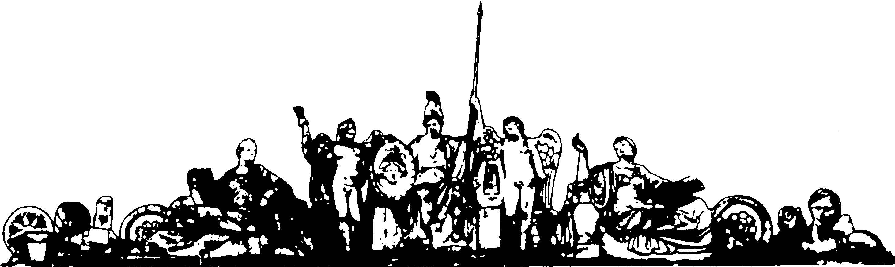

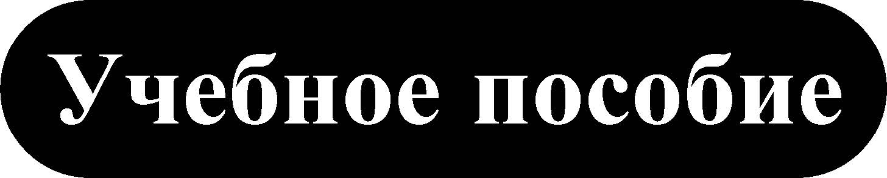

---

## Библиографическая справка

**УДК** 621.4-62-135: 621.7.036: 621.438

**ББК** 31/361

**М69**

**Рецензенты:** Н.И. Троицкий, Н.Д. Чайнов

**Михальцев В.Е., Моляков В.Д.** Теория и проектирование газовой турбины: Учеб. пособие по курсу «Лопаточные машины газотурбинных и комбинированных установок. Газовые турбины». — Ч. 1: Теория и проектирование ступени газовой турбины / Под ред. М.И. Осипова. — М.: Изд-во МГТУ им. Н.Э. Баумана. 2006. — 104 с.: ил.

**ISBN 5-7038-2921-6**

Рассмотрены физические процессы, теория и проектирование газовых турбин различного применения, методы выбора их основных параметров и газодинамического расчета.

Для студентов 4–6-го курсов специальностей «Газотурбинные, паротурбинные установки и двигатели» и «Нетрадиционные и возобновляемые источники энергии».

Ил. 36. Библиогр. 36 назв.

**УДК** 621.4-62-135: 621.7.036: 621.438

**ББК** 31/361

**ISBN 5-7038-2921-6**

© МГТУ им. Н.Э. Баумана, 2006

---

## Предисловие

Данное издание — первая часть учебного пособия, посвященного проектированию, теории и расчету на номинальном режиме газовой турбины как узла стационарной, транспортной газотурбинной или комбинированной установки, вспомогательного или специального газотурбинного двигателя, а также турбины как самостоятельного агрегата.

Описана методика расчета ступени и кратко изложены теоретические сведения, необходимые для выбора основных параметров ступени турбины.

Вопросы проектирования проточной части многоступенчатой турбины будут рассмотрены во второй части работы.

### Принятые сокращения

- **ГТД** — газотурбинный двигатель
- **ГТУ** — газотурбинная установка
- **ТРД** — турбореактивный двигатель
- **ТРДФ** — турбореактивный двигатель с форсажем
- **ДТРД** — двухконтурный ТРД
- **ТВД** — турбовинтовой двигатель, турбина высокого давления
- **ТВВД** — турбовинтовентиляторный двигатель
- **ТВлД** — турбовентиляторный двигатель
- **КВД** — компрессор высокого давления
- **КНД** — компрессор низкого давления
- **ТНД** — турбина низкого давления
- **РК** — рабочее колесо
- **СА** — сопловой аппарат

---

## 1. Назначение, типы и конструкции газовых турбин. Основные требования к ним

Газовая турбина — один из основных агрегатов ГТУ и ГТД. В ней энергия нагретого движущегося газа превращается в механическую работу на валу. В одновальной ГТУ эта работа частично затрачивается на работу компрессора, а частично является полезной и определяет эффективную мощность установки. Турбина так же, как осевой и центробежный компрессоры, является лопаточной машиной; в ней при осуществлении в ГТУ цикла $p = \text{const}$ происходит непрерывное течение газа с расширением.

Обширные теоретические и экспериментальные исследования газовых турбин и их элементов были выполнены в производственных объединениях, научных и учебных институтах. Они отражены в трудах Б.С. Стечкина, В.В. Уварова, К.В. Холщевникова, И.И. Кириллова, Г.И. Зотикова, Г.С. Жирицкого, Г.Ю. Степанова, Я.И. Шнеэ, В.Х. Абианца, С.М. Шляхтенко, В.М. Акимова, В.А. Сосунова, А.П. Гофлина, М.Е. Дейча, В.Е. Михальцева, В.И. Локая, О.Н. Емина, В.Т. Митрохина, С.З. Копелева, Г.В. Подвидза, М.Я. Иванова, В.Д. Венедиктова, Я.А. Сироткина, А.В. Бойко, К.Л. Лапшина и других ученых и реализованы в совершенных турбинах ГТУ, созданных на Ленинградском металлическом заводе, Невском заводе, Харьковском турбинном заводе, Уральском турбомоторном заводе, а также в турбинах ГТД конструкторов А.М. Люльки, В.Я. Климова, Н.Д. Кузнецова, А.А. Микулина, С.К. Туманского, А.Г. Ивченко, С.П. Изотова, В.А. Добрынина, П.А. Колесова, П.А. Соловьева, В.И. Романова и других.

### 1.1. Техническое задание на проектирование газовой турбины

При разработке газовой турбины возникают различные расчетно-конструкторские и технологические задачи. Их решают на основе технического задания с учетом материально-технической базы, удовлетворяя техническим требованиям по надежности в пределах заданного ресурса и условиям эксплуатации, экономичности и минимальной стоимости.

Турбина является узлом ГТД, и ее параметры связаны с параметрами компрессора, камеры сгорания и нагрузки. В ряде случаев

*(Страница 4)*

параметры турбины являются определяющими для всей установки, поскольку от них зависят размеры, масса, частота вращения и характеристики установки.

При проектировании турбины могут быть заданы различные параметры, которые зависят:

- от типа установки (стационарная или транспортная);
- от вида нагрузки (генератор переменного или постоянного тока, газовый компрессор, насос, механический привод к колесам, судовой или воздушный винт переменного или постоянного шага, генератор газа высокого давления);
- от схемы установки (число валов, турбин, компрессоров, камер сгорания, холодильников, наличие регенераторов и редуктора);
- от цикла установки (открытый цикл, применяемый в установках, работающих на воздухе, продуктах сгорания топлива или парогазовой смеси, и замкнутый цикл для установок, работающих на произвольных газе и паре).

При проектировании турбины одновальной энергетической стационарной ГТУ открытого цикла для привода генератора переменного тока обычно задают следующие параметры: температура и давление перед турбиной $T_{\Gamma}^{*}$ и $p_{\Gamma}^{*}$, давление за турбиной $p_{\text{т}}$, частота вращения, рабочее тело и его расход. Мощность турбины является контрольным параметром для уточнения расхода рабочего тела.

В многовальных ГТУ и ГТД при расчете турбины компрессора вместо давления $p_{\text{т}}$ обычно задают мощность турбины или компрессора. Если известна мощность компрессора, то по соотношению расходов в компрессоре и турбине определяют мощность турбины компрессора, а также ТРД. В ТВД и ДТРД расчет турбин обычно ведут по заданному противодавлению $p_{\text{т}}$ или $p_{\text{т}}^{*}$.

Температуру $T_{\Gamma}^{*}$ выбирают в зависимости от назначения ГТУ, схемы охлаждения узлов турбины и применяемых материалов. В энергетических стационарных и приводных газотурбинных установках температура $T_{\Gamma}^{*} = 750...950\,^\circ\text{C}$, а при использовании интенсивного воздушного охлаждения деталей $T_{\Gamma}^{*} = 950...1150\,^\circ\text{C}$. В некоторых перспективных стационарных ГТУ задают температуру $1250...1350\,^\circ\text{C}$ и выше. В локомотивных установках, энерго-

дах и

*(Страница 5)*

автомобильных ГТД температуру газа перед турбиной выбирают такой же, как и в стационарных установках.

В автомобильном ГТД повышение температуры может быть менее эффективно, чем в ГТУ большой мощности, из-за уменьшения расхода рабочего тела и размеров проточных частей лопаточных машин. В двигателях малой мощности это приводит к заметному снижению КПД узлов и возможному понижению экономичности всего двигателя. В авиационных двигателях для обеспечения небольших размеров и массы освоены наиболее высокие температуры газа.

Важным параметром, определяющим схему и конструкцию турбины, является удельная работа турбины, которая при заданных температуре и рабочем теле зависит от степени понижения давления $\pi_{\text{т}} = p_{\Gamma}^{*} / p_{\text{т}}$. В энергетических стационарных ГТУ простейшей схемы $\pi_{\text{т}} = 9...12$. Для более сложных схем целесообразны значения $\pi_{\text{т}\Sigma} = 30...40$. В проектах мощных ГТУ, разработанных по схемам МГТУ им. Н.Э. Баумана, $\pi_{\text{т}\Sigma} = 125...200$. Установки с большим значением $\pi_{\text{т}}$ включают несколько турбин, поэтому степень понижения давления в каждой турбине относительно невелика. Однако в зависимости от схемы и конструкции ГТУ значения $\pi_{\text{т}}$ могут приниматься самыми различными: от $2,5...4$ до $12$ и даже до $16$.

В судовых, локомотивных и автомобильных газотурбинных двигателях с различным числом валов значения $\pi_{\text{т}}$ разные: в одновальных ГТД $\pi_{\text{т}} = 6...10$ (иногда до $16$), в многовальных $\pi_{\text{т}} = 3...4,5$. В многовальных транспортных ГТД так же, как и в стационарных ГТУ, при проектировании компрессорной турбины заданной является мощность турбины, по которой определяют величину $\pi_{\text{т}}$.

В авиационных ГТД степень понижения давления $\pi_{\text{т}}$ зависит от значения степени повышения давления в компрессоре $\pi_{\text{к}}$, температуры $T_{\Gamma}^{*}$, схемы и типа двигателя, а также режима полета. В одновальном ТРД $\pi_{\text{т}}^{*} = 2,5...4$, в двухвальном (двухкаскадном) — $\pi_{\text{т}}^{*} = 2...2,5$; в одновальном ТВД $\pi_{\text{т}}^{*} = 5...10$, в двухвальном — $\pi_{\text{т}}^{*} = 2,5...3,5$. В двухвальных и трехвальных ДТРД значения $\pi_{\text{т}}^{*}$ такие

же, как в

*(Страница 6)*

двухвальных ТВД. При расчете турбины ТРД задана мощность компрессора или каскада компрессоров (в двухкаскадном двигателе), а определяется давление за турбиной. В установках замкнутого цикла давление за турбиной может превосходить атмосферное и иногда существенно; значение $\pi_{\text{т}}^{*}$ обычно невелико. При использовании рабочего тела с большой теплоемкостью работа $L_{\text{т}}$ может быть велика, поэтому проектируют многоступенчатую турбину, как для больших значений $\pi_{\text{т}}$ при работе по открытой схеме.

Не менее важным параметром, характеризующим размеры, массу и экономичность турбины, является ее частота вращения $n_{\text{т}}$. В зависимости от расхода рабочего тела, его параметров, схемы охлаждения и жаропрочности материалов основных деталей турбины можно определить ее максимальную частоту вращения $n_{\text{т max}}$. Наиболее напряженными элементами турбины обычно являются рабочие лопатки, реже — барабан или диски ротора турбины. В ряде случаев заданная частота вращения оказывается меньше $n_{\text{т max}}$. Если турбина находится на валу с компрессором и нагрузкой, то в ГТУ простейшей схемы компрессор обычно не лимитирует частоту вращения, так как его максимальная частота $n_{\text{к max}}$ чаще больше $n_{\text{т max}}$. Таким образом, в простейшей схеме ГТУ частота вращения зависит от нагрузки.

В сложных схемах ГТУ частота вращения турбины зависит от частоты вращения сопряженного с ней узла. Выбор частоты вращения турбин нагрузки аналогичен выбору для турбин простейшей схемы. Частота вращения турбины компрессора при прямой схеме ГТУ может быть принята равной $n_{\text{т max}}$. При перекрестной схеме ГТУ давление перед компрессором низкого давления значительно ниже, чем за турбиной высокого давления, частота $n_{\text{к max}} < n_{\text{т max}}$, частоту вращения турбины выбирают по частоте вращения компрессора. Это относится к турбинам ТРД, рассчитанным на околозвуковые и средние сверхзвуковые скорости полета, а также к турбинам ДТРД с большой степенью двухконтурности, в которых допустимая частота вращения вентилятора значительно меньше $n_{\text{т max}}$.

Однако даже когда задана частота вращения, при проектировании турбины следует определять $n_{\text{т max}}$ и сравнивать с заданной частотой нагрузки или компрессора, так как для уменьшения мас-

сы и

*(Страница 7)*

размеров ГТУ может быть целесообразна установка редуктора. Поскольку от частоты вращения зависит не только прочность элементов, но и экономичность агрегатов, оптимальная частота вращения ротора может быть выбрана лишь после проведения ряда вариантных расчетов всех лопаточных машин, находящихся на одном валу.

### 1.2. Особенности конструкции газовой турбины

Помимо общих требований по прочности и экономичности существует ряд специальных требований, которые должны быть учтены при создании работоспособной конструкции.

1. Обеспечение необходимой жесткости корпуса (при минимальной материалоемкости) не только во время работы, но и при монтаже.
2. Обеспечение соосности узлов, определяющих положение ротора относительно статора (соосность корпуса и подшипников) и ограничивающих проточную часть турбины (соосность венцов СА в корпусе). Оно представляет собой трудность при конструировании из-за высокой температуры рабочего тела и различного теплового состояния деталей.
3. Установка лабиринтных уплотнений для уменьшения как утечек рабочего тела в окружающую среду, так и перетечек газа между ступенями, а также осуществление мероприятий по уменьшению перетечек газа в радиальных зазорах между рабочими лопатками и корпусом и между СА и ротором.
4. Исключение попадания газа и воздуха высокого давления в полость подшипников и ее суфлирование.
5. Создание необходимой системы охлаждения наиболее напряженных горячих деталей без перерасхода охлаждающего агента (воздуха) на режиме как с максимальной нагрузкой, так и с частичной мощностью.

В зависимости от направления потока относительно оси вращения ротора различают осевые и радиальные турбины.

В осевых турбинах газ движется в основном по коаксиальным поверхностям параллельно оси турбины. В зависимости от располагаемого теплоперепада, окружной скорости рабочих лопаток и КПД осевые турбины выполняют с различным числом ступеней (рис. 1). Основными элементами турбины являются корпус и ротор. К корпусу турбины относятся входная улитка, или патрубок 23, и выходная (выпускная) улитка, или патрубок 31. В корпусе

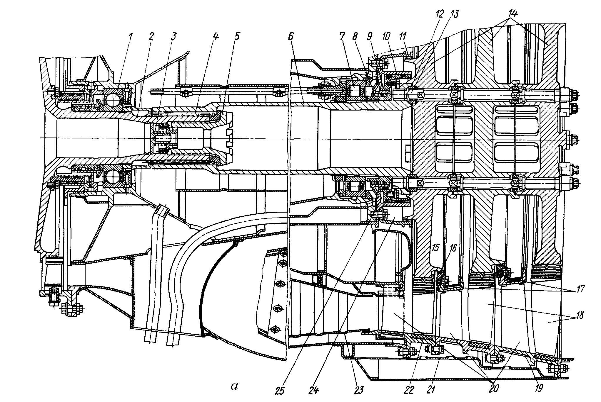

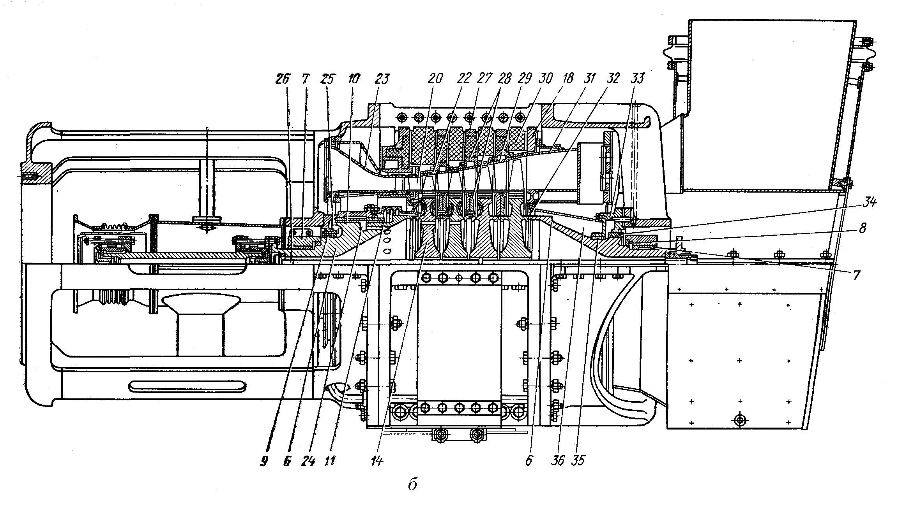

**Рис. 1. Осевая турбина:**

$a$ — трехступенчатая авиационная; $б$ — четырехступенчатая транспортная

*(Страница 8)*

закреплены сопловой аппарат 20, радиальный 7 и осевой 1 подшипники и лабиринтные уплотнения 8–11. В большинстве стационарных и некоторых транспортных установках турбины закрепляют на рамах. Ротор состоит из вала 6, дисков 14 и рабочих лопаток 18. В турбинах небольшой мощности узел ротора выполняют как одно целое, в большинстве же случаев ротор сборный.

*(Страница 9)*

Радиальные турбины отличаются от осевых тем, что в СА и основной части РК газ движется в плоскости, перпендикулярной к оси вращения (рис. 2). В зависимости от направления потока к периферии или к центру радиальные турбины делятся на центробежные (рис. 2, $a$) и центростремительные (рис. 2, $б$, $в$). По конструкции РК разделяют на закрытые (см. рис. 2, $в$), полузакрытые (см. рис. 2, $б$) и открытые (без покрывных дисков). Большее распространение получили центростремительные турбины, в которых рабочее тело движется от периферии к центру. Центростремительные турбины применяют в ГТД с малым объемным расходом или в некоторых ГТД, требующих регулирования СА, а также в транспортных ГТД малой и средней мощности, в турбонаддувных агрегатах двигателей внутреннего сгорания и в качестве радиальных турбодетандеров в холодильных установках.

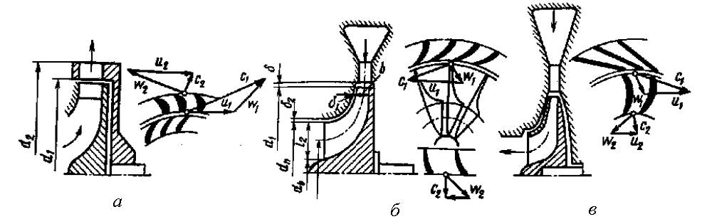

**Рис. 2. Схемы ступеней радиальных турбин:**

$a$ — центробежная турбина; $б$ — центростремительная турбина с полузакрытым рабочим колесом; $в$ — центростремительная турбина с закрытым рабочим колесом

Наиболее совершенной формой корпуса, обеспечивающей наименьшую его массу, является сфера (рис. 3). Такую форму используют иногда в замкнутых ГТУ (ЗГТУ) при высоком давлении рабочего тела. Корпус цилиндрической формы с таким же внутренним давлением должен иметь стенки в два раза толще. Разъемы корпуса или отверстия, необходимые для вывода концов вала ротора, обусловливают наличие фланцев, толщина которых значительно больше (в 2 – 4 раза) толщины стенок и увеличивается с ростом диаметра отверстий. Переход от стенки к фланцу разъемного соединения должен быть плавным и по возможности не нарушать симметрии нагружения стенки. Сварку фланца и стенки выполняют в местах, где их толщины равны (рис. 3, $a$, $б$).

Нежелательно, чтобы разъем турбины был горизонтальным, так как при нагреве происходит искажение формы корпуса, увели-

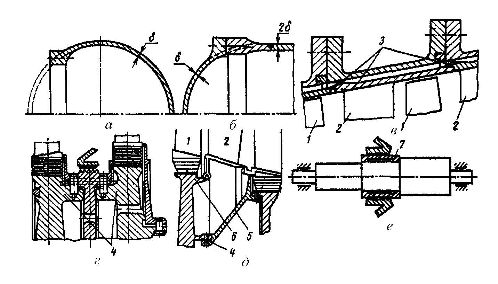

**Рис. 3. Схемы некоторых элементов турбины:**

$a$ — сферический корпус; $б$ — цилиндрический корпус; $в$ — размещение внутри корпуса экранов; $г$, $д$ — соединение дисков радиальными штифтами; $е$ — установка на вал специальных втулок

*(Страница 10)*

чиваются напряжения в соединениях и нарушается равномерность по окружности радиальных зазоров. Вертикальные разъемы (в плоскостях, перпендикулярных к оси турбины) обусловливают осуществление специальной технологии сборки, например вертикальной. Кроме того, затрудняется осмотр и ремонт турбин больших размеров на месте эксплуатации. Однако, используя специальные приспособления, можно выполнить сборку и турбин большой мощности без горизонтального разъема.

При значительном нагреве сопловых лопаток 20 (см. рис. 1) и слабом нагреве корпуса их свободные температурные деформации и соосность внутреннего кольца 17 диафрагмы соплового аппарата обеспечиваются при скольжении лопаток в прорезях кольца. Лопатки вставлены в наружное кольцо 19 соплового аппарата и приварены снаружи.

Турбина локомотивного двигателя (рис. 1, $б$) спроектирована с «холодным» корпусом, который хорошо изолирован от горячих газов, незначительно прогревается и мало изменяет форму и размеры. Сопловой аппарат имеет отдельные лопатки, укрепленные в наружном полукольце диафрагмы 28, которая фиксируется радиальными цилиндрическими штифтами в обойме 27. При нагреве диаметр обоймы не изменяется вследствие уменьшения ширины ее

*(Страница 11)*

радиальных прорезей, сегменты 29, образующие наружный контур проточной части в области рабочих лопаток, расширяются по окружности и выбирают оставленные зазоры, сопловой аппарат остается соосным ротору турбины. Такая конструкция при полном прогреве ротора обеспечивает между корпусом и лопатками малые радиальные зазоры $\delta$.

На рабочих режимах зазор $\delta$ определяют не только по разности температурных расширений корпуса и ротора, но и с учетом некоторого увеличения наружного диаметра ротора от действия центробежных сил на диск и лопатку при вращении (упругих и пластических деформаций лопаток и диска). По разности температурных расширений оцениваются и осевые зазоры между ротором и корпусом.

При конической форме корпуса зазор $\delta$ определяют как сумму двух слагаемых: зазора $\delta_{\text{рад}}$ от разности радиальных изменений размеров рабочего колеса корпуса и осевого смещения ротора относительно корпуса. Достаточно точная оценка $\delta$ затруднена, поэтому в реальных конструкциях минимальный зазор обеспечивается легкосрабатываемыми корпусными вставками 22 (см. рис. 1).

Металлокерамические вставки имеют внутренний слой (обеспечивающий прочность) из порошков железа, никеля (5...10 %), графита (6...8 %) и наружный «мягкий», хорошо срабатываемый в случае касания лопатки о корпус слой из порошка никеля, графита (12...16 %) и кремния (примерно 4 %).

В последние годы получило распространение уменьшение радиальных зазоров между рабочими лопатками и корпусом $\delta_{\text{рад}}$, а также зазоров в лабиринтных уплотнениях $\delta_{\text{лаб}}$ благодаря применению сотовых вставок. Соты имеют форму шестигранных ячеек, полученных путем высокотемпературной пайки гофрированных лент из жаростойкого материала толщиной порядка $0,1...0,2$ мм, как между собой, так и с цилиндрической поверхностью корпуса. При этом рабочий зазор после приработки составляет 0,2 мм и меньше. Такие вставки резко снижают утечки, повышают КПД турбины: при наличии бандажных полок – на $1,5...2$ %, а при наличии лабиринтного уплотнения на них – примерно на $2,5...3$ %. Больший эффект достигается при коротких лопатках, когда влияние радиального зазора более значительно.

При касании выполненных на полке лопаток гребешков о корпус гребешки врезаются в сотовую вставку и не оплавляясь выра-

*(Страница 12)*

батывают канавку при осевых смещениях ротора относительно корпуса. Такое решение можно считать целесообразным при любых значениях радиального зазора.

Обеспечение минимальных зазоров на различных стационарных и нестационарных режимах работы двигателя требует следующих мероприятий:

- обеспечение определенных тепловых режимов корпусных деталей уплотнения путем искусственного согласования тепловых деформаций ротора и корпуса;
- использование материалов с различными коэффициентами линейного расширения;
- применение сегментных подвижных вставок с легкоистираемой поверхностью при изменении давления в исполнительном механизме;
- осевое перемещение ротора от специальной системы регулирования.

Подшипники, встроенные в корпус турбины, обеспечивают соосность элементов ротора и корпуса, если стойки опоры корпуса подшипника изолированы от теплового воздействия горячих газов и имеют одинаковую температуру. При независимых опорах корпусов турбины и подшипников на раму усилия передаются посредством скользящих шпонок, расположенных на уровне горизонтальной оси и допускающих осевые и радиальные температурные деформации корпуса. При этом необходимо обеспечить одинаковую температуру элементов рамы в области опор.

Для снижения и стабилизации температуры стенок между корпусом и специальным кожухом 21 пропускается наружный воздух (рис. 1, $a$), который может эжектироваться потоком газа, выходящим из турбины. Температура корпуса 1 и лопаток 2 (рис. 3, $в$) понижается также при размещении внутри него теплоизоляционных проставок 30 (см. рис. 1, $б$) или тонких экранов 3 (см. рис. 3, $в$) с продувкой между ними и корпусом воздуха высокого давления и последующим выпуском его в проточную часть турбины.

Предотвращение утечек горячего газа осуществляется с помощью лабиринтных уплотнений. Со стороны первой ступени воздух высокого давления подводится в полость 24 (см. рис. 1, $б$), откуда, протекая под небольшим лабиринтным уплотнением 11, поступает к диску, охлаждает его, вытесняя при этом газ, и проходит мимо замка рабочих лопаток в проточную часть. Большое лабиринтное уплотнение 10 уменьшает утечки воздуха в атмосферу, с которой соединена полость 25. В турбине авиационного двигателя уплот-

*(Страница 13)*

нения 8 и 9 (см. рис. 1, $a$) выполняют ту же функцию, но они имеют более компактную конструкцию. Уплотнения также изолируют масляную полость радиального подшипника. Со стороны выпуска уплотняющий воздух подводится в камеру 33, проходит через лабиринтное уплотнение 35 и вытесняет горячий газ из полости 36, окружающей полувал и диск последней ступени (см. рис. 1, $б$). Уплотнение 34 уменьшает утечки воздуха в пространство, разделяющее корпуса турбины и подшипника.

Роторы турбин и компрессоров часто соединяют муфтой, передающей помимо крутящего момента осевые усилия. При этом можно устанавливать общий осевой подшипник 1 с уменьшенным передаваемым на него осевым усилием (см. рис. 1, $a$). Компактное соединение двух роторов передает крутящий момент через шлицы 4 и осевое усилие гайкой 5. Надежным стопором гайки является шлицевая втулка, замыкающая гайку 5 на полувал 2 компрессора под действием пружины 3.

Роторы турбин выполняют дисковыми, дискобарабанными иногда сплошными или барабанными. Крутящий момент в дисковом роторе может передаваться радиальными шлицами (хиртовым соединением) 32 (см. рис. 1, $б$), осевыми втулками 12 (см. рис. 1, $a$), расположенными по окружности, болтовым соединением фланцев. В первых двух случаях диски соединены одной стяжкой 26 (см. рис. 1, $б$), несколькими шпильками 13 (см. рис. 1, $a$) или болтами; применяют также радиальные штифты, входящие непосредственно в плечики 4 или в деталь 5, расположенную между дисками (рис. 3, $г$, $д$).

Для уменьшения температурных напряжений в диске важно обеспечить одинаковую температуру обеих его сторон. Этого можно достичь, подводя воздух между дисками для вытеснения газа из полости 15 (см. рис. 1, $a$). Для уменьшения расхода воздуха применены лабиринтные уплотнения 16, которые лучше устанавливать с обеих сторон полости. Лабиринтные уплотнения полостей между дисками или уплотнения, расположенные в местах возможного значительного прогиба ротора, следует проектировать так, чтобы зубцы, укрепленные на корпусе, не могли касаться деталей, определяющих прямолинейность оси ротора. Иначе при небольшом биении ротора касание зубцами вала вызывает местный нагрев его поверхности и прогрессирующее искривление оси, усиливающее трение уплотнения о вал. Установкой специальных втулок 7 (рис. 3, $е$) или созданием плечиков 6 (см. рис. 3, $д$) можно исключить возникновение указанного явления. В конструкции, где

*(Страница 14)*

зубцы лабиринтного уплотнения выполнены на роторе (см. рис. 3, $г$), повышение температуры зубцов от трения при касании обычно не приводит к неравномерному нагреву ротора, что снижает опасность задевания зубцов о ротор.

Для интенсивного охлаждения рабочих дисков иногда применяют покрывные диски, под которые подают охлаждающий воздух. Крепление покрывных дисков на рабочих должно допускать взаимное перемещение дисков в соответствии с их тепловыми и упругими деформациями.

## 2. Удельные параметры турбины

Вследствие разности давлений перед СА и за ним газ разгоняется. Закручиваясь в СА, поток поступает на рабочие лопатки ротора. В каналах РК газ получает направление, близкое к осевому, и уменьшает скорость (абсолютную). При этом большая часть кинетической энергии струи затрачивается на совершение механической работы по вращению колеса.

Располагаемая энергия газа, работающего в турбине, измеряется располагаемым теплоперепадом, равным идеальной работе адиабатного расширения:

$$H_{\text{т}} = \frac{Rk}{k-1} T_{\Gamma}^{*} \left[ 1 - \pi_{\text{т}}^{(1-k)/k} \right], \tag{1}$$

где $T_{\Gamma}^{*}$ — температура торможения перед турбиной; $\pi_{\text{т}}$ — степень понижения давления; $k$ — средний показатель адиабаты в процессе расширения.

Показатель адиабаты $k$ в интервале температур от $T_{\Gamma}^{*}$ до $T_{\text{т}}$ зависит от состава газа, который определяется сортом топлива и коэффициентом избытка воздуха $\alpha$ (см. рис. П1). В первом приближении показатель адиабаты можно определить как истинное значение показателя $k$ (см. рис. П2) для средней арифметической температуры процесса расширения $T_{\text{ср}} = 0{,}5(T_{\Gamma}^{*} + T_{\text{т.y}})$, где $T_{\text{т.y}}$ — условная температура конца расширения; $T_{\text{т.y}} = T_{\Gamma}^{*} \pi_{\text{т}}^{-1/4}$.

Обычно температура $T_{\text{т}} > T_{\text{т.y}}$, но этим можно пренебречь, что не приведет к большой ошибке в определении показателя $k$. Во

*(Страница 15)*

втором приближении величину $k$ необходимо уточнить по найденной температуре $T_{\text{т}}$.

В зависимости от соотношения давлений перед рабочими лопатками и за ними происходит разделение располагаемого теплоперепада между СА и РК, и таким образом ступени турбины могут быть реактивными и активными. Соотношение проходных сечений СА и РК в ступени можно выбрать таким, чтобы на среднем радиусе статическое давление $p_1$ перед РК было больше давления $p_2$ за РК (реактивная ступень) или было равно ему (активная ступень). При отношении давлений $p_1/p_2$, большем единицы, но близком к ней, условно ступень также называется активной. Степень реактивности ступени $\rho$ определяется долей располагаемого теплоперепада ступени, срабатываемого в РК (рис. 4): $\rho = H_{\text{л}}^{'} / H_0$.

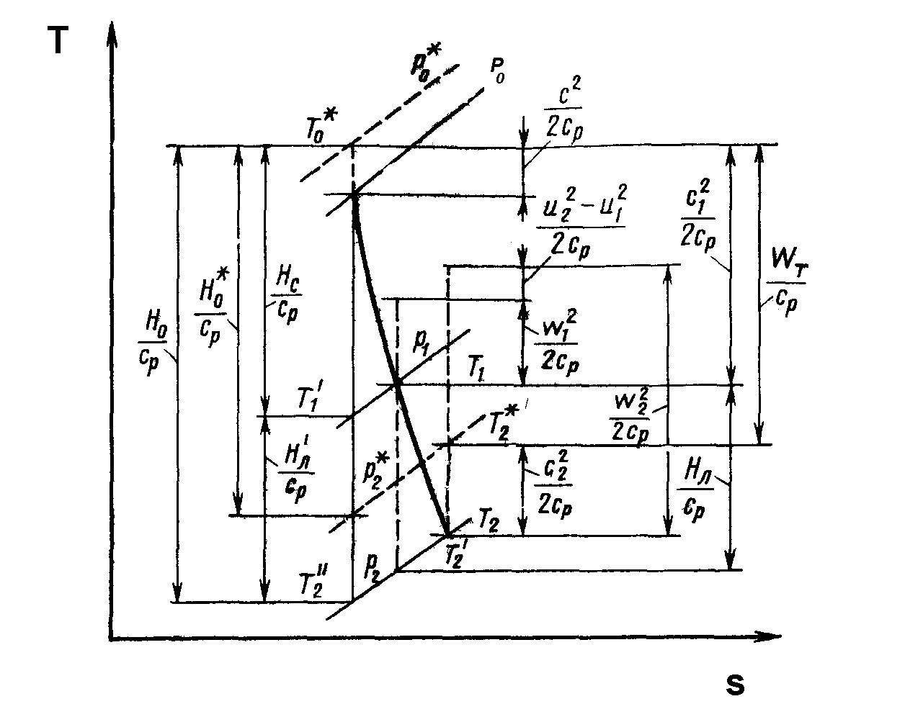

**Рис. 4. Процесс расширения газа в ступени турбины в диаграмме состояния $s$–$T$**

Степень совершенства турбины может быть оценена различными показателями, к основным из которых относятся КПД, удельная масса и удельные размеры. Важными показателями являются также надежность работы турбины и ресурс ее узлов. В

*(Страница 16)*

зависимости от назначения турбины и требований, предъявляемых к ней, те или иные показатели становятся определяющими. Обычно совершенство турбины характеризует ее КПД, который равен отношению совершенной газом работы к располагаемой энергии. Очевидно, что наибольшая работа получается при расширении газа без потерь, при этом КПД турбины равен единице.

Удельная работа турбины $L_{\text{т}}$ — это работа, которую производит 1 кг газа, она может быть получена из уравнения сохранения энергии. Рассмотрим установившийся процесс в турбине с расходом газа $G$. Пусть газ входит в турбину по цилиндрическому патрубку сечением площадью $A_{\text{г}}$ со скоростью $c_{\text{г}}$, а выходит по патрубку сечением площадью $A_{\text{т}}$ со скоростью $c_{\text{т}}$ (рис. 5). Давление и температура газа при входе $p_{\text{г}}$ и $T_{\text{г}}$, а при выходе соответственно $p_{\text{т}}$ и $T_{\text{т}}$. Теплообмен с наружной средой характеризуется удельной теплотой $q$, выработанной 1 кг газа. Представим, что за время $\tau$ масса газа, находящаяся в объеме, ограниченном сечениями $A_1$ и $Б_1$, переместилась и находится между сечениями $A_2$ и $Б_2$. Составим для этой массы газа уравнение сохранения энергии

$$Q = \Delta E + \Delta L_{\text{вн}},$$

где $Q$ — подведенная теплота, $Q = qG\tau$; $\Delta E$ — изменение энергии газа; $\Delta L_{\text{вн}}$ — совершенная газом внешняя работа.

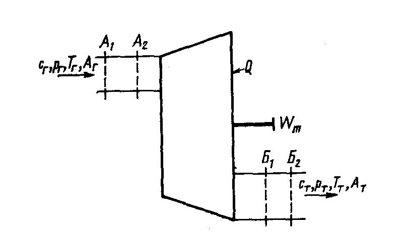

**Рис. 5. Схема турбины для определения удельной работы**

*(Страница 17)*

Рассматривая объемы, занимаемые газом в первый момент и второй, можно представить изменение энергии как

$$\Delta E = E_{\text{A2Б1}} + E_{\text{Б1Б2}} - (E_{\text{A1A2}} + E_{\text{A2Б1}}).$$

При установившемся процессе $E_{\text{A2Б1}} = \text{const}$ и

$$\Delta E = E_{\text{Б1Б2}} - E_{\text{A1A2}}. \tag{2}$$

Таким образом, при определении работы турбины изменение энергии газа соответствует разности энергий входящей и выходящей массы. Найдем эту разность, пренебрегая изменением энергии уровня, как изменение внутренней $\Delta E_{\text{и}}$ и кинетической $\Delta E_{\text{к}}$ энергий за время $\tau$:

$$\Delta E = \Delta E_{\text{и}} + \Delta E_{\text{к}} = (u_{\text{т}} - u_{\text{г}})G\tau + 0{,}5(c_{\text{т}}^{2} - c_{\text{г}}^{2}). \tag{3}$$

Изменение удельной внутренней энергии газа

$$u_{\text{т}} - u_{\text{г}} = c_{v}(T_{\text{т}} - T_{\text{г}}).$$

**Внешняя работа**

$$\Delta L_{\text{вн}} = L_{\text{т}}G\tau + (p_{\text{т}}A_{\text{т}}c_{\text{т}} - p_{\text{г}}A_{\text{г}}c_{\text{г}})\tau \tag{4}$$

Второе слагаемое правой части выражения (4) — работа газа, затраченная на преодоление сил внешнего давления за время $\tau$. После подстановки $Ac = vG$ в уравнение (4) и упрощения имеем

$$L_{\text{т}} = q + u_{\text{г}} - u_{\text{т}} + p_{\text{г}}v_{\text{г}} - p_{\text{т}}v_{\text{т}} + (c_{\text{г}}^{2} - c_{\text{т}}^{2})/2. \tag{5}$$

Так как энтальпия $i = u + pv$ и $i^{*} = i + 0{,}5c^{2}$, получим

$$L_{\text{т}} = q + i_{\text{г}} - i_{\text{т}} + (c_{\text{г}}^{2} - c_{\text{т}}^{2})/2 \tag{6}$$

и

$$L_{\text{т}} = q + i_{\text{г}}^{*} - i_{\text{т}}^{*}. \tag{7}$$

При отсутствии теплообмена

$$L_{\text{т}} = i_{\text{г}}^{*} - i_{\text{т}}^{*} = c_{p}(T_{\text{г}}^{*} - T_{\text{т}}^{*}). \tag{8}$$

*(Страница 18)*

Согласно выражению (8), работа турбины без теплообмена пропорциональна разности температур торможения газа при входе в турбину и выходе из нее. При заданных начальных параметрах газа максимальная удельная работа может быть достигнута при наиболее низкой температуре торможения за турбиной. В случае отсутствия гидравлических потерь при адиабатном расширении получим удельную работу турбины, равную располагаемому теплоперепаду $H_{\text{т}}^{*}$ по параметрам торможения

$$L_{\text{тад}} = i_{\text{г}}^{*} - i_{\text{т}}^{*} = H_{\text{т}}^{*} = c_{p}T_{\text{г}}^{*}(1 - \pi_{\text{т}}^{*(1-k)/k}), \tag{9}$$

где $\pi_{\text{т}}^{*} = p_{\text{г}}^{*} / p_{\text{т}}$.

При скорости газа за турбиной, стремящейся к нулю, удельная работа будет равна полному располагаемому теплоперепаду (см. рис. 4):

$$L_{\text{тад}} = i_{\text{г}}^{*} - i_{\text{т}}^{*} = H_{\text{т}}^{*} = c_{p}T_{\text{г}}^{*}(1 - \pi_{\text{т}}^{(1-k)/k}), \tag{10}$$

где $\pi_{\text{т}} = p_{\text{г}}^{*} / p_{\text{т}}$.

На основе выражений (9) и (10), которые характеризуют различную степень идеализации турбины, можно определить различные КПД как отношения действительной работы турбины к располагаемым теплоперепадам $H_{\text{т}}^{*}$ или $H_{\text{т}}$.

**КПД турбины по параметрам торможения**

$$\eta_{\text{т}}^{*} = L_{\text{т}} / H_{\text{т}}^{*}. \tag{11}$$

**Мощностной КПД турбины**

$$\eta_{\text{т}} = L_{\text{т}} / H_{\text{т}}. \tag{12}$$

Иногда определяют степень совершенства турбины, принимая в качестве полезной энергии сумму работы и кинетической энергии газа при выходе. При этом экономичность турбины оценивается так называемым лопаточным или адиабитным КПД

$$\eta_{\text{л}} = (L_{\text{т}} + 0{,}5c_{\text{т}}^{2}) / H_{\text{т}}. \tag{13}$$

Для сравнения экономичности турбин с различными $\pi_{\text{т}}$ используют политропный КПД

$$\eta_{\text{пол}}^{*} = L_{\text{т}} / H_{\text{пол}}^{*}.$$

*(Страница 19)*

Располагаемый политропный теплоперепад $H_{\text{пол}}^{*}$ зависит от показателя $n$ политропы расширения:

$$H_{\text{пол}}^{*} = (Rn/(n-1))T_{\text{г}}^{*}(1 - \pi_{\text{т}}^{*(1-n)/n}).$$

Выбор КПД для оценки экономичности турбины определяется ее назначением. В простейших стационарных и транспортных установках, в которых кинетическая энергия за турбиной не используется, эффективнее турбина с большим мощностным КПД. Если кинетическая энергия за турбиной используется, например в реактивном сопле, то эффективнее турбина с большим КПД по параметрам торможения. Это верно также для турбин высокого и среднего давления многоагрегатных ГТУ и ГТД. Лопаточный КПД позволяет оценить гидравлические потери в турбине при использовании кинетической энергии выходящего потока.

Удельные энергетические параметры (работа и теплота) турбины без теплообмена с наружной средой можно представить в виде площадей $A$ в диаграмме состояния $s$–$T$ (рис. 6). Располагаемый теплоперепад $H_{\text{т}} \sim A_{\text{Г1'2'2}}$, работа $L_{\text{т}} \sim A_{\text{Г1'4'4}}$, полезная энергия $(L_{\text{т}} + c_{\text{т}}^{2}/2) \sim A_{\text{Г1'5'5}}$. Потерянная энергия эквивалентна площади $A_{\text{Т6'1'T'}} = A_{\text{55'2'2}}$, а кинетическая энергия выходящего газа эквивалентна площади $A_{\text{К7'6'T}} = A_{\text{44'5'5}}$. Кинетическая энергия газа $c^{2}/2$ больше разности $H_{\text{т}} - H_{\text{т}}^{*}$ на величину, эквивалентную площади $A_{\text{ТТ'16}}$. Поскольку теплота, соответствующая работе трения в турбине, эквивалентна $A_{\text{Г1'6'T}}$, она превышает потерянную энергию $A_{\text{ТТ'6}}$ на значение, эквивалентное площади $A_{\text{ГТТ'}}$. Если обозначить $p_{\text{т}}^{*''}$ давление за идеальной турбиной, работа которой равна полезной работе $L_{\text{т}}$ реальной турбины, то в диаграмме состояния $v$–$p$ полезная работа эквивалентна площади $A_{\text{Г74'4}}$ левее исходной адиабаты расширения между изобарами $p_{\text{г}}$ и $p_{\text{т}}^{*''}$.

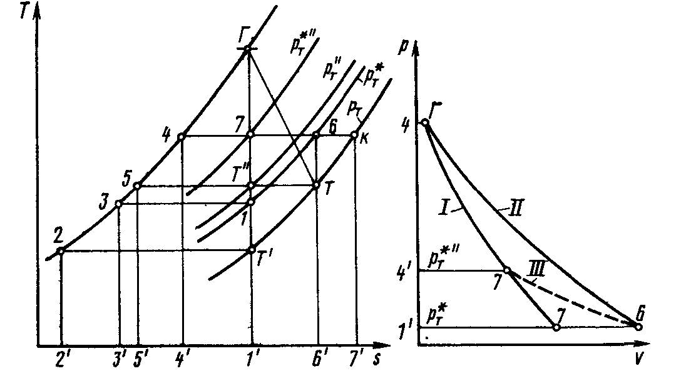

*(Страница 20)*

**Рис. 6. Процесс расширения в турбине:**

I – $pv^{k} = \text{const}$; II – $pv^{n} = \text{const}$; III – $T_{\text{т}}^{*} = \text{const}$

Выразим энергетические параметры турбины с теплообменом в виде площадей в координатах $s$–$T$ (рис. 7), пренебрегая кинетической энергией потока. Согласно уравнению (7), располагаемый теплоперепад ($\eta_{\text{т}} = 1$) в охлаждаемой турбине $H_{\text{т.охл}} = i_{\text{г}}^{*} - i_{\text{х}}' - q_{\text{охл}}$ меньше, чем в неохлаждаемой ($H_{\text{т}} = i_{\text{г}}^{*} - i_{\text{т'}}$), на величину

$$h_{\text{охл}} = H_{\text{т}} - H_{\text{т.охл}} = q_{\text{охл}} - (i_{\text{т'}} - i_{\text{х}}'),$$

эквивалентную площади $A_{\text{ГТ'Х'}}$ (рис. 7, $a$), т. е. $H_{\text{т.охл}} \sim A_{\text{ГХ'1'3'3'}} = A_{\text{ГХ'Т'12'2'}}$. Охлаждение реальной турбины ($\eta_{\text{т}} < 1$) также сопровождается уменьшением удельной работы на величину $\Delta L_{\text{охл}} = L_{\text{т}} - L_{\text{т.охл}}$. Покажем процесс расширения в турбине без охлаждения политропой ГТ (рис. 7, $a$), а процесс с охлаждением — политропой ГХ, при этом отведенная теплота $q_{\text{охл}} \sim A_{\text{Г'Х45}}$, а уменьшение удельной работы $\Delta L_{\text{охл}} = A_{\text{Г'ХТ}}$. Площадь $A_{\text{Г'ХТ}}$ меньше площади $A_{\text{ГХТ}}$, соответствующей разности политропных работ, на КПД турбины, т. е. $A_{\text{Г'ХТ}} = A_{\text{ГХТ}}\eta_{\text{т}}$.

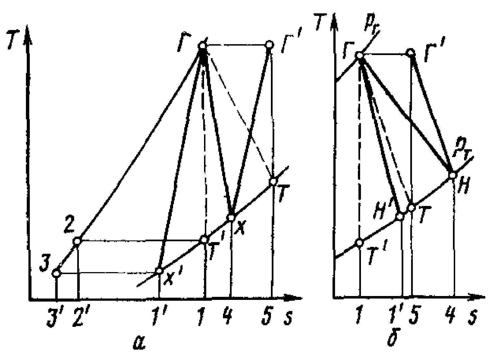

*(Страница 21)*

**Рис. 7. Процесс расширения в турбине с учетом теплообмена:**

$a$ – с охлаждением; $б$ – с нагревом; —— – с теплообменом; - - - - – без теплообмена

При подводе теплоты $q_{\text{н}}$ в процессе идеального расширения ГН' (рис. 7, $б$) располагаемый теплоперепад возрастает пропорционально площади $A_{\text{ГТ'Н'}}$, а количество подведенной теплоты пропорционально $A_{\text{Г11'Н'}}$. Действительная работа возрастает на величину $\Delta L_{\text{н}} \sim A_{\text{Г'ТН}}$, а подведенная теплота $q_{\text{н}} \sim A_{\text{Г'54Н}}$. Увеличение работы $\Delta L_{\text{н}} = L_{\text{ТН}} - L_{\text{т}}$ меньше разности политропных работ ($\sim A_{\text{ГТН}}$), поскольку $A_{\text{Г'ТН}} = A_{\text{ГТН}}\eta_{\text{т}}$.

## 3. Основные параметры процесса течения газа в каналах лопаточных аппаратов

Расчет турбины на номинальном режиме проводится для определения геометрии проточной части турбины, которая при необходимом запасе прочности деталей узлов обеспечивает заданную мощность и наибольший КПД турбины. Следует отметить, что иногда важным требованием является получение малых размеров и массы, оно дополняет требование высокой экономичности турбины. КПД турбины зависит от потерь энергии, которые можно подразделить на гидравлические, тепловые и механические. В современных слабо охлаждаемых турбинах основное значение име-

ют

*(Страница 22)*

гидравлические потери, возникающие при течении газа по каналам проточной части. В высокотемпературных турбинах с интенсивным охлаждением весьма существенны тепловые потери. Расчет ступеней является составной частью расчета турбины, он проводится после того, как определены основные параметры турбины, для окончательного уточнения работы на РК и КПД ступени. Для упрощения расчета ступени при оценке гидравлических потерь пользуются коэффициентами $\varphi$ и $\psi$, отражающими суммарные потери в СА и РК соответственно.

Истечение газа из СА и каналов РК составляет основу физического процесса, происходящего в ступени турбины. Рассмотрим подробнее основные параметры этого процесса при отсутствии и наличии гидравлических потерь, характеризующихся коэффициентами $\varphi$ и $\psi$.

### 3.1. Идеальное истечение

Скорость истечения $c_1$ из идеального сопла без теплообмена при заданных параметрах перед соплом (давлении $p_0$, температуре $T_0$, скорости газа $c_0$) и известном давлении $p_1$ за соплом можно найти из выражения (6), приняв $L_{\text{т}} = 0$, $q = 0$ и обозначив параметры при выходе из сопла как $T_1$, $c_1$ и $i_1$ (см. рис. 4).

Тогда

$$i_0 - i_{\text{1ад}} + (c_0^2 - c_{\text{1ад}}^2)/2 = 0.$$

Отсюда

$$c_{\text{1ад}} = \sqrt{c_0^2 + 2(i_0 - i_{\text{1ад}})/2} = \sqrt{2H_{\text{с}}}, \tag{14}$$

где $H_{\text{с}}$ — теплоперепад в сопле, $H_{\text{с}} = i_0^{*} - i_{\text{ад}}$.

Выразим скорость истечения из идеального сопла через температуру и давление газа, воспользовавшись формулой (14):

$$c_{\text{1ад}} = \sqrt{2(c_{p0}T_0^{*} - c_{p1}T_1')} = \sqrt{2c_pT_0^{*}(1 - T_1'/T_0^{*})}. \tag{15}$$

Использовав уравнения адиабаты и заменив $c_p = Rk/(k-1)$, получим

$$c_{\text{1ад}} = \sqrt{\frac{2Rk}{k-1}T_0^{*}\left[1 - \left(\frac{p_1}{p_0^{*}}\right)^{(k-1)/k}\right]}.$$

*(Страница 23)*

Обозначим степень понижения давления в сопле $\pi_{\text{с}} = p_0^{*}/p_1$. Тогда

$$c_{\text{1ад}} = \sqrt{\frac{2Rk}{k-1}T_0^{*}\left[1 - (\pi_{\text{с}})^{(1-k)/k}\right]}. \tag{16}$$

С увеличением показателя $\pi_{\text{с}}$ скорость возрастает и при истечении в абсолютный вакуум ($p_1 = 0$, $\pi_{\text{с}} \to \infty$) достигает максимальной величины

$$c_{\text{1ад.max}} = \sqrt{\frac{2Rk}{k-1}T_0^{*}} = a^{*}\sqrt{\frac{k+1}{k-1}},$$

где $a^{*}$ — критическая скорость, $a^{*} = \sqrt{\frac{2k}{k+1}RT_0^{*}}$.

Средние удельные теплоемкости $c_{p0}$ и $c_{p1}$ в формуле (15) определяют в зависимости от состава газа и температуры (см. рис. П1, П3 и П5). Удельную теплоемкость $c_p$, среднюю для процесса, приближенно находят как истинную для средней температуры (см. рис. П1 и П4). Показатель адиабаты $k$ в приведенных выше формулах определяется как истинное значение для средней температуры в зависимости от состава газа (см. рис. П1 и П2).

Площадь сечения сопла при секундном расходе газа $G$

$$A_1 = Gv_{\text{1ад}} / c_{\text{1ад}}, \tag{17}$$

где $v_{\text{1ад}}$ — удельный объем газа в сечении $A_1$, $v_{\text{1ад}} = (RT_0^{*}/p_0^{*})(p_0^{*}/p_1)^{1/k}$.

Подставим в уравнение (17) значение $v_{\text{1ад}}$, а также $c_{\text{1ад}}$ из выражения (14). После упрощения получим

$$A_1 = \frac{G\sqrt{RT_0^{*}}}{p_0^{*}\sqrt{2\frac{k}{k-1}\left[\left(\frac{p_1}{p_0^{*}}\right)^{2/k} - \left(\frac{p_1}{p_0^{*}}\right)^{(k+1)/k}\right]}} \tag{18}$$

или

$$A_1 = \frac{G\sqrt{RT_0^{*}}}{p_0^{*}y}, \tag{19}$$

где $y$ —

*(Страница 24)*

расходная функция, зависящая только от показателя адиабаты и отношения давлений $\beta = \pi_{\text{с}}^{-1} = p_1/p_0^{*}$ (рис. 8),

$$y = \sqrt{2\frac{k}{k-1}\left(\pi_{\text{с}}^{-2/k} - \pi_{\text{с}}^{-(k+1)/k}\right)}. \tag{20}$$

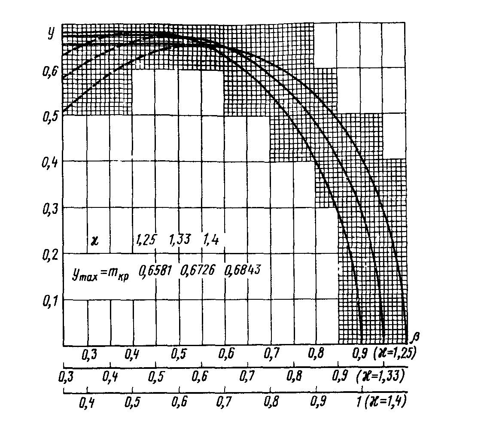

**Рис. 8. Расходная функция $y$**

Введем параметр скорости $\lambda_1 = c/a^{*}$ и газодинамическую функцию $q(\lambda_1)$ и получим

$$y = mq(\lambda_1),$$

где

$$m = \sqrt{k\left(\frac{2}{k+1}\right)^{\frac{k+1}{k-1}}} \quad \text{и} \quad q(\lambda_1) = \frac{A_m}{A} = \left(\frac{k+1}{2}\right)^{(k-1)^{-1}}\left(1 - \frac{k-1}{k+1}\right)^{(k-1)^{-1}}\lambda.$$

*(Страница 25)*

Величина $y$ достигает максимального значения при $\pi_{\text{с}} = \pi_{\text{cm}}$ и обращается в нуль при $\pi_{\text{с}} = 1$ и $\pi_{\text{с}} \to \infty$. Для заданных начальных параметров газа $p_0^{*}$ и $T_0^{*}$ площадь сопла минимальна при $\pi_{\text{с}} = \pi_{\text{cm}}$.

Найдем площадь сопла $A_m$ при $y = y_{\max}$ из условия $\frac{\partial y}{\partial(1/\pi_{\text{с}})} = 0$.

Из выражения (20)

$$\frac{2}{k}(\pi_{\text{cm}})^{1-2/k} - (k+1)/k(\pi_{\text{cm}})^{-1/k} = 0,$$

откуда

$$\pi_{\text{cm}} = \left[\frac{k+1}{2}\right]^{k/(k-1)}. \tag{21}$$

Подставив $\pi_{\text{cm}}$ в уравнение (16), найдем скорость газа в сечении $A_m$:

$$c_{\text{1ад}} = \sqrt{2\frac{k}{k+1}RT_0^{*}\left(1 - \frac{2}{k+1}\right)} = \sqrt{2\frac{k}{k+1}RT_0^{*}} = a^{*}.$$

При идеальном процессе скорость течения в узком сечении сопла достигает критической скорости, равной местной скорости звука $a^{*} = a_m = \sqrt{kRT_{1m}}$, так как температура газа в узком сечении $T_{1m} = T_0^{*}(\pi_{\text{cm}})^{(1-k)/k} = 2T_0^{*}/(k+1)$.

Расход газа при заданном минимальном сечении $A_m$

$$G_{\text{ад}} = \frac{A_m p_0^{*} y}{\sqrt{RT_0^{*}}} = \frac{m_{\text{кр}}q(\lambda_1)p_0^{*}A_m}{\sqrt{RT_0^{*}}}, \tag{22}$$

где

*(Страница 26)*

коэффициент $y = f(\pi_{\text{с}})$, при $\pi_{\text{с}} > \pi_{\text{cm}}$ величина $y$ в формуле (22) имеет постоянное максимальное значение $y_m$.

В суживающемся сопле при любом, сколь угодно малом давлении среды, в которую происходит истечение, величина $y = y_m$, так как в выходном сечении сопла устанавливается критическое давление $p_{1m} = p_0^{*}(2/(k+1))^{k/(k-1)}$. Вследствие постоянства давления в узком сечении сопла с уменьшением противодавления среды $p_1$ расход газа при заданной площади сопла $A_m$ остается неизменным, а не уменьшается согласно формуле (20) при $\pi_{\text{с}} \to \infty$.

### 3.2. Истечение с потерями

Скорость газа при выходе из сопла вследствие трения в жидкости и о стенки сопла меньше скорости $c_{\text{1ад}}$ при идеальном истечении. Часто потери оценивают коэффициентом скорости $\varphi = c_1/c_{\text{1ад}}$. При действительном процессе истечения скорость

$$c_1 = \varphi\sqrt{2\frac{Rk}{k-1}T_0^{*}\left(1 - \pi_{\text{с}}^{(1-k)/k}\right)}. \tag{23}$$

Процесс истечения с потерями при отсутствии теплообмена с окружающей средой в координатах $s$–$T$ выражается политропой со средним показателем $n$, при этом $1 < n < k$. Из уравнения (6) для процесса расширения в сопле по аналогии с идеальным истечением получим $i_0^{*} = i_1^{*}$, откуда действительная скорость истечения

$$c_1 = \sqrt{2(i_0^{*} - i_1)} = \sqrt{2\frac{Rk}{k-1}T_0^{*}\left[1 - \left(T_1/T_0^{*}\right)\right]}. \tag{24}$$

Полагая при истечении процесс расширения политропным со средним показателем $n$ и заменив $c_p = Rk/(k-1)$, найдем

$$c_1 = \sqrt{2\frac{Rk}{k-1}T_0^{*}\left(1 - \pi_{\text{с}}^{(1-n)/n}\right)}. \tag{25}$$

*(Страница 27)*

Приближенное соотношение величин $\varphi$ и $n$ можно найти, сравнив выражения политропной $L_{\text{пол}}$ и адиабатной $L_{\text{ад}}$ работ расширения. Работа $L_{\text{пол}} = \frac{Rn}{n-1}T_0^{*}\left[1 - \pi_{\text{с}}^{(1-n)/n}\right] \sim A_{0123}$, работа $L_{\text{ад}} = \frac{Rk}{k-1}T_0^{*}\left[1 - \pi_{\text{с}}^{(1-k)/k}\right] \sim A_{01'23}$ в координатах $v$–$p$ (рис. 9).

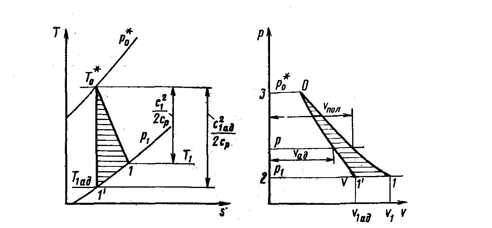

**Рис. 9. Процесс истечения с потерями в диаграммах состояния**

Разность $(L_{\text{пол}} - L_{\text{ад}}) \sim A_{011'}$ зависит от значения показателя $n$ и для обычных потерь при истечении относительно мала. Найдем из уравнения (23) кинетическую энергию струи при действительном истечении и заменим с допустимой погрешностью в правой части выражения адиабатную работу политропной:

$$c_1^2/2 = \varphi^2\frac{Rk}{k-1}T_0^{*}\left[1 - \pi_{\text{с}}^{(1-k)/k}\right] \approx \varphi^2\frac{Rn}{n-1}T_0^{*}\left[1 - \pi_{\text{с}}^{(1-n)/n}\right]. \tag{26}$$

Кинетическая энергия, полученная из уравнения (25),

$$c_1^2/2 = \frac{Rk}{k-1}T_0^{*}\left[1 - \pi_{\text{с}}^{(1-n)/n}\right]. \tag{27}$$

Приравняем правые части уравнений (26) и (27) и получим

$$\varphi \approx \sqrt{\frac{k}{n}\frac{n-1}{k-1}} \quad \text{и} \quad n \approx \frac{k}{1 + (1 - \varphi^2)(k - 1)}. \tag{28}$$

Из

*(Страница 28)*

выражений (28) следует, что при идеальном истечении ($\varphi = 1$) $n = k$, при бесконечно больших потерях ($\varphi = 0$) $n = 1$.

Площадь сечения сопла, необходимая для пропуска расхода газа $G$, при истечении с потерями несколько больше, чем при идеальном, вследствие того, что скорость $c_1 < c_{\text{1ад}}$, а температура $T_1$ и удельный объем газа $v_1$ больше, чем при идеальном истечении, при одном и том же противодавлении $p_1$.

Площадь сечения сопла

$$A_1 = Gv_1/c_1. \tag{29}$$

После подстановки $v_1 = \frac{RT_0^{*}}{p_0^{*}}\left(\frac{p_0^{*}}{p_1}\right)^{1/n}$ и $c_1$ из уравнения (25) в выражение (29) получим

$$A_1 = \frac{G\sqrt{RT_0^{*}}}{p_0^{*}}\left\{2\frac{k}{k-1}\left[(\pi_{\text{с}})^{-2/n} - (\pi_{\text{с}})^{-(n+1)/n}\right]\right\}^{-1/2}.$$

Следует отметить, что здесь величина в фигурных скобках не соответствует значению $y$, полученному из уравнения (20).

Как и для идеального процесса истечения, при увеличении показателя $\pi_{\text{с}}$ площадь $A_1$ уменьшается и при определенном значении $\pi_{\text{с}}$ становится минимальной в соответствии с максимальным значением выражения в фигурных скобках, а затем возрастает. По аналогии с выражением (21) минимальная площадь сопла $A_m$ достигается при $\pi_{\text{с}} = [(n+1)/2]^{n/(n-1)}$.

В минимальном сечении температура газа

$$T_{1m} = 2T_0^{*}/(n+1),$$

а из выражения (25) скорость

$$c_{1m} = \sqrt{2\frac{Rk}{k-1}T_0^{*}\left(1 - \frac{2}{n+1}\right)} = a^{*}\sqrt{\frac{n-1}{k-1}\frac{k+1}{n+1}}. \tag{30}$$

*(Страница 29)*

Рассмотрим сечение $1$ на рис. 10, в котором $\pi_{\text{с}} = \pi_{\text{c1}}$. В случае идеального истечения это сечение имеет минимальную площадь $A_m$ и в нем устанавливается критическая скорость потока, т. е. $\pi_{\text{c1}} = [(k+1)/2]^{k/(k-1)}$, при этом $\pi_{\text{c1}} > \pi_{\text{cm}}$, так как $n < k$ и наибольшее влияние на величину $\pi_{\text{c1}}$ оказывает основание степени. Температура газа при $\pi_{\text{c1}}$

$$T_{11} = T_0^{*}\left(\frac{p_1}{p_0^{*}}\right)^{(n-1)/n} = T_0^{*}\left[\left(\frac{2}{k+1}\right)^{k/(k-1)}\right]^{(n-1)/n}.$$

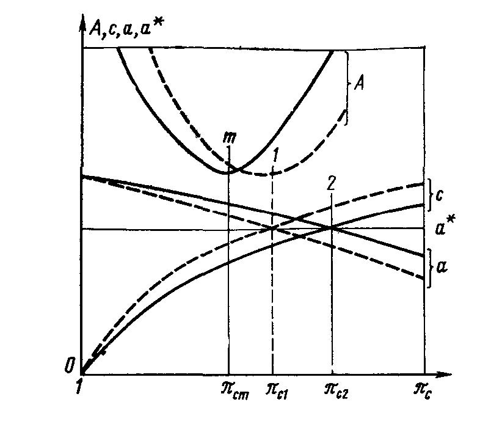

**Рис. 10. Изменение площадей сечения $A$, скорости $c$, местной скорости звука $a$, критической скорости $a^{*}$ в сечениях $m$, $1$ и $2$:**

- - - - - при идеальном процессе; —— при действительном процессе

Скорость в этом сечении из выражения (23)

$$c_{11} = \varphi\sqrt{2\frac{Rk}{k-1}T_0^{*}\left(1 - \frac{2}{k+1}\right)} = \varphi a^{*}.$$

Таким образом, при действительном истечении, когда $\pi_{\text{с}} = \pi_{\text{c1}}$ (в сечении $1$), скорость газа меньше критической в соответствии со значением коэффициента $\varphi$. Можно показать, что $c_{1m} < c_{11}$, так как

$$\varphi \approx \sqrt{\frac{k}{n}\frac{n-1}{k-1}} > \sqrt{\frac{n-1}{k-1}\frac{k+1}{n+1}}.$$

*(Страница 30)*

Рассмотрим сечение $2$ на рис. 10, в котором $\pi_{\text{c2}} = [(k+1)/2]^{n/(n-1)}$, при этом $\pi_{\text{c2}} > \pi_{\text{c1}}$, так как наибольшее влияние на величину $\pi_{\text{c2}}$ оказывает знаменатель показателя степени. Скорость газа при $\pi_{\text{с}} = \pi_{\text{c2}}$, найденная из выражения (25),

$$c_{12} = \sqrt{2\frac{Rk}{k-1}T_0^{*}\left(1 - \frac{2}{k+1}\right)} = a^{*}.$$

Местная скорость звука $a_2 = \sqrt{kRT_{12}} = a^{*}$, так как $T_{12} = T_0^{*}2/(k+1)$. Следовательно, при $\pi_{\text{с}} = \pi_{\text{c2}}$ действительная скорость течения соответствует местной скорости звука и равна критической.

Таким образом, в минимальном сечении сопла скорость течения существенно отличается от критической, а давление превышает критическое. Параметры становятся критическими за узким сечением. Однако площадь, соответствующая критическим параметрам, в сечении при $\pi_{\text{с}} = \pi_{\text{c2}}$ мало отличается от величины $A_m$, поэтому в ряде случаев можно приближенно определить минимальную площадь сопла по критическим параметрам. Погрешность в определении значения площади зависит от потерь в сопле и для $\varphi = 0{,}98$ составляет примерно $0{,}01$ %, а для $\varphi = 0{,}95...0{,}08$ %.

Расход газа через сопло с заданной минимальной площадью при реальном истечении с потерями меньше расхода при идеальном истечении пропорционально коэффициенту расхода $\mu$:

$$G = G_{\text{ад}}\mu. \tag{31}$$

Иначе можно найти расход газа $G$ по действительным значениям скорости и удельного объема из выражения (29):

$$G = Ac_1/v_1. \tag{32}$$

Подставим $c_1 = \varphi c_{\text{1ад}}$ и $v_1 = v_{\text{1ад}}T_1/T_{\text{1ад}}$ (см. рис. 9) в уравнение (32) и, сравнив с выражением (31), найдем

$$\mu = \varphi T_{\text{1ад}}/T_1.$$

*(Страница 31)*

Отношение температур $T_1/T_{\text{1ад}} = \pi_{\text{с}}^{(k-1)/k}(1 - \varphi^2) + \varphi^2$ может быть получено из очевидного соотношения

$$c_p(T_0^{*} - T_1) = c_p(T_0^{*} - T_{\text{1ад}})\varphi^2.$$

Окончательно коэффициент расхода

$$\mu = \varphi\left[\pi_{\text{с}}^{(k-1)/k}\left(1 - \varphi^2\right) + \varphi^2\right]^{-1}. \tag{33}$$

Из выражения (33) следует, что потери приводят к более значительному уменьшению расхода газа, чем уменьшение скорости. Так, если при идеальном истечении ($\varphi = 1$) коэффициент расхода $\mu = 1$, то при $\varphi = 0{,}98$ $\varphi/\mu = 1{,}008$, а при $\varphi = 0{,}95$ $\varphi/\mu = 1{,}02$. Уменьшение $\mu$ по сравнению с $\varphi$ на $1$–$2$ % следует учитывать при определении площади сопла, так как погрешность в размерах сечения сопла заметно сказывается на мощности турбины и может привести на некоторых режимах к неустойчивой работе компрессора.

Необходимо также отметить, что на расход газа влияют потери скорости только в суживающейся части сопла, а коэффициент $\varphi$ обычно обусловлен потерями в СА (включая потери в косом срезе и кромочные). Поэтому в некоторых случаях коэффициент расхода $\mu$ может быть не меньше, а даже несколько больше коэффициента скорости $\varphi$. Приближенно можно принимать $\mu \approx \varphi$.

### 3.3. Соотношение работы трения и потери кинетической энергии при истечении с трением

Потеря кинетической энергии при истечении определяется как разность кинетических энергий при идеальном и действительном истечениях

$$\Delta c^2/2 = (c_{\text{1ад}}^2 - c_1^2)/2 = i_1 - i_{\text{1ад}}. \tag{34}$$

Удельная теплота трения, согласно первому закону термодинамики, для двух состояний газа (до истечения и после истечения с потерями) определяется из уравнений (14) и (24):

$$q = i_1 - i_0^{*} - \int_{p_0^{*}}^{p_1} v\,dp. \tag{35}$$

При

*(Страница 32)*

идеальном истечении $q = 0$, тогда

$$0 = i_{\text{1ад}} - i_0^{*} - \int_{p_0^{*}}^{p_1} v_{\text{ад}}\,dp. \tag{36}$$

Вычитая почленно уравнение (36) из (35), получим

$$q = i_1 - i_{\text{1ад}} - \int_{p_0^{*}}^{p_1} (v - v_{\text{ад}})\,dp. \tag{37}$$

Из уравнений (37) и (34) после изменения пределов интегрирования найдем

$$q = \Delta c^2/2 + \int_{p_1}^{p_0^{*}} (v - v_{\text{ад}})\,dp. \tag{38}$$

Из выражения (38) следует, что теплота или работа трения больше потери кинетической энергии на разность политропной и адиабатной работ расширения (пропорциональную заштрихованным площадям в координатах $s$–$T$ и $v$–$p$ на рис. 9). Кажущийся прирост энергии возникает вследствие расширения относительно более нагретого газа при истечении с трением.

## 4. Параметры газа в ступени и работа на окружности колеса

### 4.1. Работа и КПД

Течение газа в ступени осевой турбины является трехмерным, поэтому параметры потока изменяются по оси турбины и по радиусу. Изменение параметров по радиусу тем существеннее, чем больше отношение длины лопатки к диаметру турбины, при относительно коротких лопатках оно не сказывается существенно на работе турбины.

*(Страница 33)*

Определим основные параметры ступени осевой турбины на среднем радиусе. Из предварительных расчетов ГТУ известны секундный расход газа $G$ и частота вращения $n$, а также давление $p_0^{*}$ и температура $T_0^{*}$ газа перед ступенью, давление за ступенью $p_2$, степень реактивности ступени $\rho$ и меридиональное сечение проточной части ступени.

Наиболее быстро расчет турбины может быть проведен при помощи диаграмм состояния $s$–$T$ или $s$–$i$. Более точным является аналитический метод расчета с учетом зависимости теплоемкости от температуры и состава газа. Процесс расширения газа в ступени турбины в координатах $s$–$T$ представлен на рис. 4.

**Полный располагаемый теплоперепад ступени**

$$H_0 = \frac{Rk}{k-1}T_0^{*}\left[1 - \pi_0^{(1-k)/k}\right],$$

где $\pi_0$ — степень понижения давления в ступени, $\pi_0 = p_0^{*}/p_2$.

**Располагаемый теплоперепад по параметрам торможения**

$$H_0^{*} = \frac{Rk}{k-1}T_0^{*}\left[1 - \pi_0^{*(1-k)/k}\right],$$

где $\pi_0^{*}$ — степень понижения полного давления в ступени, $\pi_0^{*} = p_0^{*}/p_2$.

**Условная адиабатная скорость**

$$c_0 = \sqrt{2H_0}.$$

Действительная скорость истечения из СА $c_1 = \varphi\sqrt{2H_{\text{с}}}$. Теплоперепад в СА $H_{\text{с}} = H_0(1 - \rho)$, коэффициент скорости $\varphi = 0{,}95...0{,}97$. Коэффициент $\varphi$ выбирают в зависимости от сечения и формы сопла или длины, толщины лопаток, кромок, угла $\alpha_1$ и числа Рейнольдса Re. С уменьшением длины лопатки, особенно при $l_1 < 40...50$ мм, вследствие увеличения концевых потерь снижается коэффициент $\varphi$. С уменьшением угла $\alpha_1$ возрастают профильные потери. Это приводит к снижению коэффициента $\varphi$, причем более значительному при углах $\alpha_1$, меньших $17^{\circ}$.

В

*(Страница 34)*

связи с этим геометрию проточной части турбины обычно выбирают такой, чтобы на среднем радиусе угол $\alpha_1$ превышал $16$–$17^{\circ}$. В турбинах небольшой мощности для увеличения длины лопаток и уменьшения концевых и суммарных потерь угол $\alpha_1$ приходится уменьшать до $11$–$14^{\circ}$.

Температура перед РК $T_1 = T_0^{*} - \frac{c_1^2}{2c_p} = T_0^{*} - \varphi^2\frac{H_{\text{с}}}{c_p}$. Средняя теплоемкость процесса расширения $c_p$ (15) зависит, как и показатель адиабаты $k$, от интервала температур $T_0^{*} - T_1$ и состава газа ($\alpha$). Обычно с достаточной степенью точности можно принимать $c_p = \text{const}$ и $k = \text{const}$ для всего процесса расширения в ступени.

**Давление перед РК**

$$p_1 = p_0^{*}\left[\frac{T_1'}{T_0^{*}}\right]^{k/(k-1)},$$

где $T_1'$ — температура конца адиабатного расширения в СА, $T_1' = T_0^{*} - H_{\text{с}}/c_p$.

**Средняя осевая скорость перед РК**

$$c_{1a} = Gv_1/A_{1a},$$

где $v_1$ — удельный объем газа перед РК, $v_1 = RT_1/p_1$; $A_{1a}$ — площадь кольцевого сечения перед РК, $A_{1a} = \pi D_1 l_1$ (рис. 11).

**Угол потока перед РК** $\alpha_1 = \arcsin c_{1a}/c_1$.

Если угол $\alpha_1$ получается меньше допустимого, то, задавая рекомендуемое значение $\alpha_1$, надо найти скорость $c_{1a}$, длину $l_1$ и соответственно изменить геометрию меридионального сечения проточной части. Относительная скорость при входе в РК определяется из треугольника скоростей (рис. 12):

$$w_1 = \sqrt{c_1^2 + u_1^2 - 2c_1u_1\cos\alpha_1}.$$

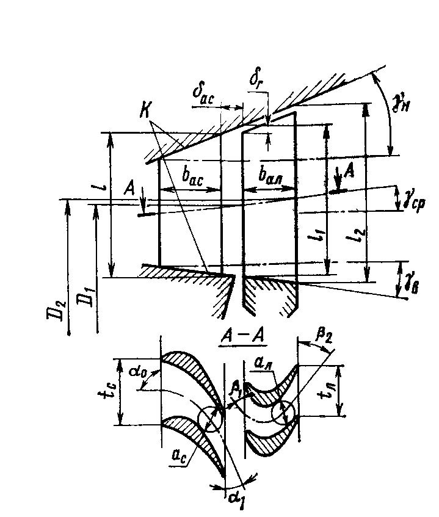

**Рис. 11. Схема меридионального сечения проточной части ступени турбины**

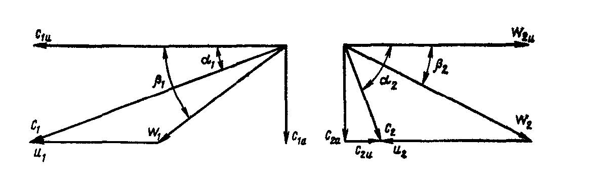

**Рис. 12. Треугольники скоростей в ступени турбины**

**Средний угол входа потока на лопатки РК**

$$\beta_1 = \text{arcctg}\frac{c_1\cos\alpha_1 - u_1}{c_{1a}}.$$

*(Страница 35)*

Угол $\beta_1$ может быть больше или меньше $90^{\circ}$, это зависит от знака котангенса. Располагаемый теплоперепад РК при заданном противодавлении $p_2$ составит

$$H = \frac{Rk}{k-1}T_1\left[1 - \left(\frac{p_2}{p_1}\right)^{(k-1)/k}\right].$$

*(Страница 36)*

Показатель адиабаты $k$ приближенно может быть принят равным значению $k$ для ступени. При расчете промежуточных ступеней, когда выбирают $H_0$, а давление за ступенью $p_2$ неизвестно, величину $H_{\text{л}}$ определяют по степени реактивности $\rho$ и отношению температур $T_1/T_1'$ (см. рис. 4):

$$H_{\text{л}} = H_{\text{л}}'T_1/T_1'.$$

Относительная скорость $w_{\text{2ад}}$ на выходе из РК при идеальном процессе истечения определяется из выражения для энтальпии по параметрам торможения в относительном движении:

$$i_{\text{2ад}}^{*} = i_{1w}^{*} + (u_2^2 - u_1^2)/2$$

или

$$i_{\text{2ад}} + w_{\text{2ад}}^2/2 = i_1 + w_1^2/2 + (u_2^2 - u_1^2)/2.$$

После замены $i_1 - i_{\text{2ад}} = H_{\text{л}}$ получим

$$w_{\text{2ад}} = \sqrt{w_1^2 + 2H_{\text{л}} + u_2^2 - u_1^2}.$$

**Действительная относительная скорость**

$$w_2 = \psi w_{\text{2ад}} = \psi\sqrt{w_1^2 + 2H_{\text{л}} + u_2^2 - u_1^2}.$$

В осевых турбинах при симметричном меридиональном сечении проточной части $u_2 = u_1$, тогда

$$w_2 = \psi\sqrt{w_1^2 + 2H_{\text{л}}}.$$

Коэффициент скорости $\psi$ в рабочих лопатках характеризует потери, которые зависят от сечения и формы канала между лопатками, их длины и толщины кромок, угла поворота потока в каналах, числа Рейнольдса Re, величины $\rho$ и разности $u_2^2 - u_1^2$.

**Температура газа за РК**

$$T_2 = T_1 - (w_2^2 - w_1^2)/(2c_p) + (u_2^2 - u_1^2)/(2c_p).$$

*(Страница 37)*

**Давление за РК при заданных теплоперепадах**

$$p_2 = p_1\left[\frac{T_2'}{T_1}\right]^{k/(k-1)},$$

где

$$T_2' = T_1 - \frac{H_{\text{л}}}{c_p} = T_1 - \frac{(w_2/\psi)^2 - w_1^2}{2c_p} + \frac{u_2^2 - u_1^2}{2c_p}.$$

При заданном давлении $p_2$ для проверки точности расчета можно найти его значение для контроля.

**Удельный объем газа за РК**

$$v_2 = RT_2/p_2.$$

**Осевая скорость газа за РК**

$$c_{2a} = w_{2a} = Gv_2/A_{2a},$$

где $A_{2a}$ — площадь кольцевого сечения за РК (см. рис. 11), $A_{2a} = \pi D_2 l_2$.

**Угол, определяющий направление относительной скорости** (см. рис. 12),

$$\beta_2 = \arcsin(c_{2a}/w_2).$$

**Угол, определяющий величину и направление закрутки потока за РК,**

$$\alpha_2 = \text{arcctg}(c_{2u}/c_{2a}),$$

где $c_{2u} = w_2\cos\beta_2 - u_2$.

Отрицательное значение скорости $c_{2u}$ соответствует отрицательной закрутке потока по вращению РК. Обычно при проектировании ступеней принимают закрутку нулевой или небольшой положительной, соответствующей углу $\alpha_2 = 80...90^{\circ}$ в последней ступени и $\alpha_2 = 70...90^{\circ}$ в промежуточных ступенях. В ступенях транспортных турбин для увеличения относительного крутящего момента при трогании на расчетном режиме иногда принимают закрутку отрицательной ($\alpha_2 > 90^{\circ}$).

*(Страница 38)*

Скорость газа за РК $c_2 = \sqrt{c_{2a}^2 + c_{2u}^2}$. Удельная работа газа на окружности РК может быть определена из уравнения Эйлера

$$L_u = c_{1u}u_1 + c_{2u}u_2. \tag{49}$$

В выражении (49) оба слагаемых имеют положительный знак, поскольку в турбинах принято противоположное направление отсчета углов $\alpha_1$, $\beta_1$ и $\alpha_2$, $\beta_2$.

Работа $L_u$ меньше располагаемого теплоперепада на величину потерь энергии в проточной части, и потери могут быть оценены так называемым КПД на окружности колеса

$$\eta_u = \frac{L_u}{H_0} = 1 - (h_{\text{с}}' + h_{\text{л}} + h_{\text{в}})/H_0, \tag{50}$$

где удельные потери в СА $h_{\text{с}}' = h_{\text{с}}T_2'/T_1$, в большинстве случаев с достаточной степенью точности $h_{\text{с}}' \approx h_{\text{с}}$.

Удельные потери в СА пропорциональны разности кинетических энергий газа при идеальном и действительном истечении:

$$h_{\text{с}} = \left[\left(\frac{c_1}{\varphi}\right)^2 - c_1^2\right]/2 = (\varphi^{-2} - 1)c_1^2/2. \tag{51}$$

**Относительные потери в СА**

$$\xi_{\text{с}} = \frac{h_{\text{с}}}{H_0} = (1 - \rho)(1 - \varphi^2). \tag{52}$$

Удельные потери в рабочих лопатках (по аналогии с СА)

$$h_{\text{л}} = \left[\left(\frac{w_2}{\psi}\right)^2 - w_2^2\right]/2 = (\psi^{-2} - 1)w_2^2/2, \tag{53}$$

или

$$h_{\text{л}} = (w_1^2 + u_2^2 - u_1^2 + 2H_{\text{л}})(1 - \psi^2)/2. \tag{54}$$

*(Страница 39)*

Если $u_2 = u_1$, то

$$h_{\text{л}} = \left(\frac{w_1^2}{2} + H_{\text{л}}\right)(1 - \psi^2). \tag{55}$$

**Относительные потери в рабочих лопатках**

$$\xi_{\text{л}} = \frac{h_{\text{л}}}{H_0}. \tag{56}$$

Если пренебречь различием величин $H_{\text{л}}'$ и $H_{\text{л}}$ (см. рис. 4), приняв $H_{\text{л}}/H_0 \approx \rho$, то

$$\xi_{\text{л}} = \left(\frac{w_1^2}{2H_0} + \rho\right)(1 - \psi^2). \tag{57}$$

Из полученных выражений для $\xi_{\text{с}}$ и $\xi_{\text{л}}$ следует, что в частном случае при степени реактивности $\rho = 0{,}5$ и одинаковых значениях коэффициентов скорости $\varphi = \psi$ относительные потери $\xi_{\text{л}} > \xi_{\text{с}}$, так как при условии деления теплоперепада ступени пополам между СА и РК средняя кинетическая энергия потока в рабочих лопатках больше, чем в сопловых, на величину $w_1^2/2$. Удельные потери с выходной скоростью

$$h_{\text{в}} = c_2^2/2,$$

относительные потери

$$\xi_{\text{в}} = \frac{h_{\text{в}}}{H_0} = \frac{c_2^2}{2H_0}.$$

Используя величины относительных потерь $\xi_{\text{с}}$, $\xi_{\text{л}}$ и $\xi_{\text{в}}$, можно получить простое выражение для КПД на окружности РК

$$\eta_u = 1 - \xi_{\text{с}}' - \xi_{\text{л}} - \xi_{\text{в}},$$

где $\xi_{\text{с}}' = \xi_{\text{с}}T_2'/T_1$, часто принимается $\xi_{\text{с}}' \approx \xi_{\text{с}}$.

Обычно коэффициенты $\varphi$ и $\psi$ отражают профильные потери в проточной части и часть концевых потерь, не связанных с перетеканием

*(Страница 40)*

газа в радиальном зазоре между лопатками и корпусом, вызывающим существенные дополнительные потери энергии.

### 4.2. Потери от перетекания газов в радиальный зазор

В результате перетекания газа через радиальный зазор с вогнутой стороны лопатки на выпуклую и из области перед решеткой в область за ней уменьшается активная масса рабочего тела, искажается течение газа у концов лопаток, а следовательно, уменьшается удельная работа.

Для уменьшения потерь в радиальном зазоре СА проектируют с бандажом и лабиринтным уплотнением. При установке бандажа на рабочих лопатках обычно снижается запас прочности, хотя бандаж может демпфировать вибрацию лопаток и уменьшить действующие в них изгибные напряжения.

Потери от перетекания в радиальном зазоре необандаженных рабочих лопаток

$$h_3 = 1{,}37(1 + 1{,}6\rho)(1 + l_2/D_{\text{ср}})L_u\delta_{\text{л}}/l_2.$$

Отсюда следует, что потери $h_3$ увеличиваются с ростом относительного зазора $\delta_{\text{л}}/l_2$, реактивности $\rho$ и веерности $l_2/D_{\text{ср}}$.

Расчеты и экспериментальные данные показывают, что увеличение относительного кольцевого радиального зазора на 1 % приводит к снижению КПД ступени в среднем на $1{,}5...2{,}3$ %. Применение мягких вставок в корпусе турбины позволяет уменьшить радиальный зазор между рабочими лопатками и корпусом, так как возможное в этом случае цепляние лопаток не грозит аварией турбины.

Потери в радиальном зазоре можно существенно снизить путем применения на лопатках бандажных полок, утопленных в корпусе турбины и снабженных лабиринтным уплотнением. Тогда перетекание газа в окружном направлении устраняется полностью, в осевом направлении – резко уменьшается, а параметры потока за ступенью в периферийной части лопаток становятся более равномерными.

В последнее время применяют сотовые вставки, состоящие из шестиугольных или четырехугольных ячеек, стенки которых выполнены из фольги толщиной $0{,}1...0{,}15$ мм. Для уменьшения потерь в радиальном зазоре полезно эти соты заполнять специальным наполнителем. В случае отсутствия наполнителя соты должны быть мелкими (высотой не более $2...3$ мм), так как в противном

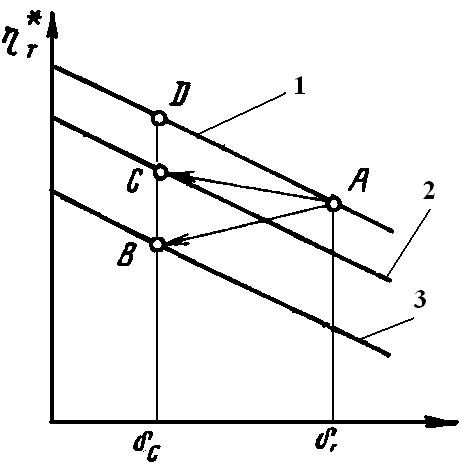

**Рис. 13. Влияние на КПД турбины наличия сотовых уплотнений**

*(Страница 41)*

случае даже при работе с малым радиальным зазором КПД турбины может оказаться ниже, чем при наличии гладкого корпуса с большим радиальным зазором. На рис. 13 схематично показано изменение КПД турбины в зависимости от радиального зазора для гладкого корпуса 1, мелких 2 и крупных сот 3. Если при наличии гладкого корпуса необходим большой радиальный зазор $\delta_{\text{г}}$, то при использовании сотовых вставок можно работать при меньшем зазоре $\delta_{\text{с}}$. Однако, если соты будут крупными, то КПД турбины может быть даже ниже (точка $B$ на рис. 13), чем в исходном случае (точка $A$). При мелких сотах КПД турбины повысится (точка $C$), а оптимальный случай будет при использовании сот с наполнителем (точка $D$), который позволяет вернуться к варианту с гладким корпусом, но при малом радиальном зазоре.

Перетекание газа через лабиринтные уплотнения в СА (рис. 14) при наличии гладкого корпуса 1 и сотовой вставки 2 и сверху бандажа в РК вызывает уменьшение работы ступени, пропорциональное доле перетекшего газа, и соответствующее понижение КПД.

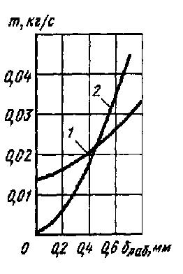

**Рис. 14. Пример утечки газа через радиальный зазор $\delta_{\text{лаб}}$ в СА**

Удельная работа на окружности РК с учетом потерь в радиальном зазоре

$$L_{u3} = L_u - h_3.$$

**Относительные потери в радиальном зазоре**

$$\xi_3 = h_3/H_0.$$

*(Страница 42)*

Определить значение $h_3$ весьма сложно, поскольку помимо указанных параметров оно зависит от формы проточной части ступени, радиальной перекрыши и осевого зазора между СА и рабочими лопатками.

Зная потери в радиальном зазоре, можно найти соответствующие КПД ступени:

- мощностной

$$\eta_{\text{т}}' = \eta_u - \xi_3,$$

- лопаточный

$$\eta_{\text{л}}' = \eta_{\text{т}}' + \xi_{\text{в}}.$$

Если кинетическую энергию струи, выходящей из ступени, можно использовать, то экономичность ступени целесообразно оценивать величиной КПД по параметрам торможения

$$\eta_{\text{т}}^{*'} = L_{u3}/H_0^{*} = \eta_{\text{т}}' H_0/H_0^{*}.$$

Подмешивание перетекшего газа к основному потоку в канале РК нарушает поток, что приводит к дополнительным потерям, которые для активных профилей у корня лопаток могут достигать $50...80$ % основных потерь от перетекания. С увеличением степени реактивности у корня дополнительные потери уменьшаются.

*(Страница 43)*

Подмешивание охлаждающего воздуха к основному потоку в осевом и радиальном зазорах приводит обычно к увеличению потерь в ступени, которые необходимо оценивать специально.

### 4.3. Потери на трение диска и на вентиляцию газа внутри каналов рабочих лопаток (для парциальной турбины)

Для определения мощности одноступенчатой турбины кроме потерь в проточной части ступени необходимо учесть потери на трение диска и на вентиляцию газа внутри каналов рабочих лопаток (для парциальной турбины). Потери на трение зависят от размеров и окружной скорости диска, плотности газа. Они возрастают при увеличении объема камеры, окружающей диск, при усложнении формы поверхности диска и уменьшении числа Re.

Потери на вентиляцию зависят от степени парциальности $\varepsilon$ (части окружности, занятой каналами СА), окружной скорости и плотности газа; они уменьшаются с уменьшением углов $\beta_1$ и $\beta_2$ и ширины РК, с увеличением степени реактивности ступени, а также при установке кожуха, изолирующего рабочие лопатки (могут снизиться в 2–3 раза). Согласно опытам Стодола, потери пропорциональны длине лопатки $l^{1,5}$, в результате более поздних экспериментов получена линейная зависимость потерь от длины $l$.

Затраты абсолютной мощности на трение и вентиляцию, кВт, можно определить по уточненной полуэмпирической формуле Стодола

$$N_{\text{т.в}} = \left[1{,}07D^2 + 61(1 - \varepsilon)Dl\right]\left(\frac{u}{100}\right)^3\rho,$$

где $D$ — средний диаметр ступени, м; $l$ — длина лопаток, м; $u$ — окружная скорость на среднем радиусе, м/с; $\rho$ — средняя плотность газа с обеих сторон диска, кг/м³.

Известны также уточненные методы расчета потерь на вентиляцию в зависимости от геометрии проточной части РК, осевого и радиального зазоров, а также расположения и формы кожуха.

Для различных конструктивных форм ступени рекомендуемые зависимости дают существенно различные расчетные значения затрат мощности $N_{\text{т.в}}$, которые могут сильно отличаться от измеренных, что частично объясняется трудностью экспериментального их определения в работающей турбине.

*(Страница 44)*

Обычно газовые турбины имеют полную степень парциальности ($\varepsilon = 1$). Только в турбинах небольшой мощности уменьшение степени парциальности оправдано, так как при коротких лопатках потери от введения парциальности оказываются меньше концевых (менее $12...10$ мм при $\varepsilon = 1$).

Величина потерь при неполной парциальности определяется при условии компактного расположения всех сопл. При размещении сопл несколькими группами потери растут с увеличением числа групп. Вследствие относительно малой плотности газа (по сравнению, например, с плотностью пара в ступенях высокого давления паровых турбин) при небольших размерах ротора относительные потери на трение и вентиляцию в газовых турбинах обычно ничтожны, и их часто не учитывают. Однако в многовальных газотурбинных установках с большой плотностью газа в корпусах высокого давления эти потери необходимо оценивать, так как они могут составлять существенную долю мощности установки. Удельные потери на трение и вентиляцию

$$h_{\text{т.в}} = N_{\text{т.в}}/G.$$

**Относительные потери на трение и вентиляцию**

$$\xi_{\text{т.в}} = h_{\text{т.в}}/H_0.$$

Мощностной КПД одноступенчатой турбины с учетом потерь на трение и вентиляцию

$$\eta_{\text{т}} = \eta_{\text{т}}' - \xi_{\text{т.в}},$$

или

$$\eta_{\text{т}} = 1 - \xi_{\text{с}}' - \xi_{\text{л}} - \xi_{\text{в}} - \xi_{\text{т.в}} - \xi_3.$$

**КПД по параметрам торможения**

$$\eta_{\text{т}}^{*} = \eta_{\text{т}}H_0/H_0^{*}.$$

**Лопаточный КПД одноступенчатой турбины**

$$\eta_{\text{л}} = \eta_{\text{т}} + \xi_{\text{в}} = \eta_{\text{л}}' - \xi_{\text{т.в}}, \quad \text{или} \quad \eta_{\text{л}} = 1 - \xi_{\text{с}}' - \xi_{\text{л}} - \xi_3 - \xi_{\text{т.в}}.$$

В современных мощных турбинах лопаточный КПД ступени $\eta_{\text{л}} = 0{,}9...0{,}94$, в турбинах транспортных ГТД $\eta_{\text{л}} = 0{,}88...0{,}92$.

*(Страница 45)*

Наиболее точные значения КПД ступени можно получить опытным путем по результатам продувок моделей ступеней или ступеней, подобных натурным, для чего нужна развитая материально-техническая база.

### 4.4. Дополнительные потери при определении полезной мощности

При наличии в газе твердых или жидких частиц (продуктов сгорания, сажи, охлаждающей жидкости, топлива или конденсата) работа ступени и ее КПД снижаются на величину, примерно пропорциональную относительному массовому содержанию частиц.

Кроме рассмотренных потерь при определении полезной мощности турбины следует учитывать потери мощности на трение в подшипниках и привод насосов и регуляторов. Работа трения в подшипниках обычно невелика, а затраты мощности на привод масляного, топливного и жидкостного (при жидкостном охлаждении турбины) насосов могут быть значительными. Эти потери энергии оцениваются механическим КПД $\eta_{\text{м}}$, который для турбин средней мощности составляет $0{,}99...0{,}995$. При присоединении насосов в ГТУ к вспомогательному двигателю (например, к дизелю или электромотору) механические потери можно не учитывать и принимать $\eta_{\text{м}} = 1$. Удельная мощность турбины на валу с учетом механических потерь

$$N_{\text{т.уд}} = H_0\eta_{\text{т}}\eta_{\text{м}}.$$

**Полная мощность одноступенчатой турбины**

$$N_{\text{т}} = N_{\text{т.уд}}G.$$

При определении секундного расхода газа $G$ через проточную часть РК турбины необходимо учитывать количество газа, уходящего через лабиринтные уплотнения турбины со стороны высокого давления.

Потери в ступени газовой турбины можно представить в диаграмме состояния $s$–$i$ (рис. 15). Такое изображение будет точным только для активной ступени ($\rho = 0$). Все потери приводят к увеличению температуры газа за турбиной в результате превращения кинетической энергии в теплоту. В этом отношении несколько отличается кинетическая энергия выходящего потока, она является

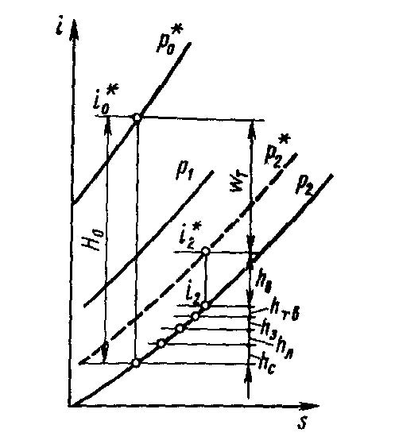

*(Страница 46)*

**Рис. 15. Диаграмма состояния $s$–$i$ газа в ступени турбины с учетом потерь**

потерянной для рассматриваемой ступени, но может быть использована в последующей ступени или за турбиной. Экономичность турбины в первом случае оценивается мощностным КПД $\eta_{\text{т}}$, во втором (при использовании кинетической энергии) – КПД по параметрам торможения $\eta_{\text{т}}^{*}$.

## 5. Зависимость КПД и удельных параметров ступени от окружной скорости

При заданном теплоперепаде $H_0$ работа $L_u$ ступени зависит от окружной скорости $u$ РК. Рассмотрим сначала активную ступень ($\rho = 0$). Скорость $u$ влияет на работу $L_u$ и КПД на окружности РК $\eta_u$. Воспользовавшись выражением для работы $L_u$ (49) и понятием условной адиабатной скорости $c_0 = \sqrt{2H_0}$, получим

$$\eta_u = L_u/H_0 = 2(c_{1u}u_1 + c_{2u}u_2)/c_0^2.$$

Для активной ступени $c_0 = c_1/\varphi$.

КПД ступени с постоянным средним диаметром, в которой $u_1 = u_2 = u$,

$$\eta_u = 2\varphi^2\frac{u}{c_1}\left[\frac{c_{1u}}{c_1} + \frac{c_{2u}}{c_1}\right]. \tag{58}$$

Из

*(Страница 47)*

треугольника скоростей при выходе из РК (см. рис. 17) следует, что $c_{2u} = w_2\cos\beta_2 - u$. Так как при $\rho = 0$ скорость $w_2 = \psi w_1$, то

$$c_{2u} = \psi w_1\cos\beta_2 - u. \tag{59}$$

Из треугольника скоростей при входе в РК

$$w_1 = (c_1\cos\alpha_1 - u)/\cos\beta_1.$$

Подставив $w_1$ в выражение (59), получим

$$c_{2u} = \psi\frac{\cos\beta_2}{\cos\beta_1}(c_1\cos\alpha_1 - u) - u. \tag{60}$$

Окончательно из уравнений (58) и (60) после преобразований найдем КПД на окружности РК

$$\eta_u = 2\varphi^2\frac{u}{c_1}\left(\cos\alpha_1 - \frac{u}{c_1}\right)\left(1 + \psi\frac{\cos\beta_2}{\cos\beta_1}\right). \tag{61}$$

Из формулы (61) следует, что в активной ступени

$$\eta_u = f(u/c_1, \varphi, \psi, \alpha_1, \beta_2).$$

Угол $\beta_1$, входящий в формулу (61), однозначно определяется углом $\alpha_1$ и отношением $u/c_1$. От угла $\beta_2$ зависит отношение длин $l_2/l_1$ и, следовательно, форма проточной части ступени. При двух значениях отношения $u/c_1: 0$ и $\cos\alpha_1$ – КПД $\eta_u$ равен нулю (рис. 16). Найдем оптимальное отношение $(u/c_1)_{\text{η}}$, соответствующее максимальному значению $\eta_u$. Приравняв к нулю производную $\frac{\partial\eta_u}{\partial(u/c_1)}$ и полагая остальные параметры, входящие в выражение (61), не зависимыми от отношения $u/c_1$, получим

$$(u/c_1)_{\text{η}} = 0{,}5\cos\alpha_1.$$

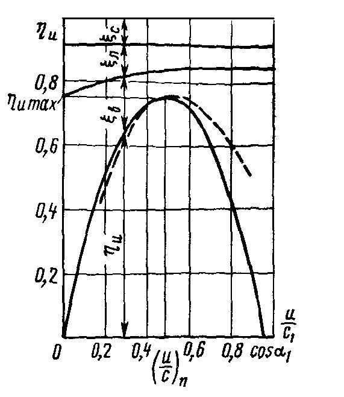

*(Страница 48)*

**Рис. 16. Зависимости КПД и коэффициентов потерь от отношения $u/c_1$**

При принятых условиях КПД $\eta_u$ активной ступени изменяется по квадратичной параболе, достигая максимального значения в середине участка между нулевыми значениями КПД. Поскольку угол $\alpha_1$ обычно мал, $\cos\alpha_1 \approx 1$, коэффициент $\varphi \approx 1$ и в активной ступени оптимальная окружная скорость

$$u_{\text{η}} \approx 0{,}5c_1 \approx 0{,}5c_0.$$

При заданном значении $\alpha_1$ потери в СА с изменением отношения $u/c_1$ остаются постоянными ($\varphi = \text{const}$ и $\xi_{\text{с}} = \text{const}$). Величина $\xi_{\text{с}}$ показана в виде полосы постоянной ширины (см. рис. 16). Принятое выше предположение о постоянстве потерь в рабочих лопатках не соответствует действительности, так как с увеличением отношения $u/c_1$ изменяется направление относительной скорости, увеличиваются углы $\beta_1$ и $\beta_2$, а угол поворота в лопатках $\varepsilon = 180^{\circ} - \beta_1 - \beta_2$ уменьшается. В связи с этим возрастает коэффициент скорости $\psi$ и уменьшаются относительные потери $\xi_{\text{л}}$.

Однако в области оптимального значения $(u/c_1 = 0{,}5\cos\alpha_1)$ величина $\xi_{\text{л}}$ изменяется мало, поэтому максимальное значение КПД

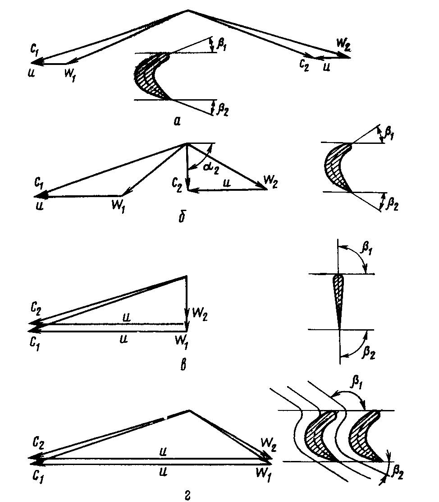

**Рис. 17. Треугольники скоростей, а также профили лопаток ступени при расчетных и переменных режимах:**

$a$ – при малых значениях $u/c_1$; $б$ – при оптимальном $u/c_1$; $в$ – при $u/c_1 = \cos\alpha_1$; $г$ – при значениях $\beta_1 = \arccos(-\psi\cos\beta_2)$

$\eta_u$

*(Страница 49)*

лишь незначительно сдвигается вправо и потери с выходной скоростью достигают минимального значения вблизи $u/c_1 = (u/c_1)_{\text{η}}$.

При исследовании зависимости $\eta_u = f(u/c_1)$ приняли, что каждому значению $u/c_1$ соответствует вполне определенное профилирование лопаток. Меньшему значению $u/c_1$ соответствуют лопатки, в которых осуществляется крутой поворот потока, при $(u/c_1)_{\text{η}}$ угол $\alpha_2 = 90^{\circ}$ (рис. 17). Для больших значений $u/c_1$ менее изогнуты, а отношению $u/c_1 = \cos\alpha_1$ соответствуют пластины, почти не изменяющие направление потока. В этом случае изменяется лишь осевая составляющая абсолютной скорости из-за трения в рабочих лопатках ($\psi < 1$).

*(Страница 50)*

Изменение отношения $u/c_1$ при обтекании лопаток, спроектированных, например, для случая $(u/c_1)_{\text{η}}$, вызывает изменение КПД $\eta_u$, он становится отличным от показанного сплошной линией на рис. 16. С уменьшением отношения $u/c_1 < (u/c_1)_{\text{η}}$ потери $\xi_{\text{л}}$ и $\xi_{\text{в}}$ возрастают более интенсивно, чем при расчетном обтекании, и вызывают более резкое снижение КПД $\eta_u$. С увеличением отношения $u/c_1$ при $u/c_1 > (u/c_1)_{\text{η}}$ вследствие поворота потока в РК при постоянном конструктивном угле $\beta_2$ нарушается соотношение, справедливое для активного колеса, $w_2 = \psi w_1$, и относительная скорость $w_2$ становится больше $\psi w_1$. При этом для ускорения потока в РК используется дополнительный теплоперепад, и характер обтекания рабочих лопаток перестает быть активным, степень реактивности растет ($\rho > 0$).

При заданном суммарном теплоперепаде в ступени с увеличением $u/c_1$ теплоперепад в СА и скорость $c_1$ уменьшаются, а работа $L_u$ и КПД $\eta_u$ становятся несколько больше, чем при том же значении $u/c_1$ (и при большем значении $c_1$) в случае расчетного обтекания. При $u/c_1 = \cos\alpha_1$, т. е. при окружной скорости $u = c_{1u}$, работа $L_u > 0$. С увеличением отношения $u/c_1$ работа $L_u$ приближается к нулю.

Найдем приближенно наибольшее значение $u/c_1$, при котором $L_u = 0$. Если пренебречь значительным увеличением потерь, характерным для нерасчетного обтекания, то из уравнения (61) для активного колеса при заданном значении $\beta_2 \neq \beta_1$ работа $L_u = 0$ при условии $1 + \psi\cos\beta_2/\cos\beta_1 = 0$, откуда

$$\beta_1 = \arccos(-\psi\cos\beta_2). \tag{62}$$

На этом режиме направление потока при входе в РК приблизительно совпадает с его направлением при выходе. Из соотношения (62) и рис. 17 очевидно, что работа $L_u = 0$ при окружной скорости, значительно превосходящей окружную скорость $u = c_1\cos\alpha_1$, которая была получена для расчетного обтекания. В действительности в результате больших потерь скорость возрастает меньше, но может

*(Страница 51)*

заметно превысить величину $c_{1u}$. Это следует учитывать при расчете центробежных сил, действующих на ротор в случае разноса свободной турбины при внезапном снятии нагрузки, которая характерна, например, для транспортного ГТД.

В реактивных ступенях при степени реактивности $\rho > 0$ зависимость КПД на окружности РК от отношения $u/c_1$ имеет более сложный вид, например

$$\eta_u = 2\varphi^2(1 - \rho)\frac{u}{c_1} \times$$
$$\times \left[\cos\alpha_1 - \frac{u}{c_1} + \psi\cos\beta_2\sqrt{\frac{1}{\varphi^2}\frac{\rho}{1 - \rho} + \left(\cos\alpha_1 - \frac{u}{c_1}\right)^2 + \sin^2\alpha_1}\right].$$

Согласно этому выражению, максимальный КПД достигается при значениях $u/c_1$ больших, чем в активной ступени. Это можно объяснить тем, что с увеличением степени реактивности возрастает относительная скорость $w_2$ и для получения осевого выхода из колеса ($\alpha_2 = 90^{\circ}$), который приблизительно соответствует $\eta_{u \text{ max}}$, необходимо увеличить окружную скорость. Кроме того, с ростом величины $\rho$ при постоянном теплоперепаде в ступени уменьшаются теплоперепад $H_{\text{с}}$ и скорость $c_1$ в СА. Оба явления, связанные с ростом степени реактивности, существенно увеличивают оптимальное отношение $u/c_1$. На рис. 18 показана зависимость $(u/c_1)_{\text{η}} = f(\rho)$ для $\alpha_1 \approx 17^{\circ}$ и $\beta_1 \approx 28^{\circ}$. С увеличением углов $\alpha_1$ и $\beta_1$ значения $(u/c_1)_{\text{η}}$ несколько уменьшаются. Можно получить зависимость КПД реактивной ступени от отношения окружной скорости к условной адиабатной $u/c_0$:

$$\eta_u = 2\left(\frac{u}{c_0}\right)\left[\varphi\sqrt{1 - \rho}\cos\alpha_1 - \frac{u}{c_0} + \right.$$
$$\left. + \psi\cos\beta_2\sqrt{\varphi^2(1 - \rho)^2 + \left(\frac{u}{c_0}\right)^2 - 2\varphi\sqrt{1 - \rho}\left(\frac{u}{c_0}\right)\cos\alpha_1 + \rho}\right].$$

*(Страница 52)*

Известны другие выражения для $\eta_u = f(u/c_0)$. В формулах для КПД $\eta_u$ угол $\beta_2$ должен быть выбран в зависимости от угла $\alpha_1$ и соотношения длин рабочих лопаток во входном и выходном сечениях.

Отношения $u/c_0$ и $u/c_1$ связаны зависимостью $\frac{u}{c_0} = \varphi\sqrt{1 - \rho}\frac{u}{c_1}$.

Анализ зависимости $\eta_u = f(u/c_0)$ позволяет определить отклонение оптимального отношения $(u/c_0)_{\text{η}}$ от отношения $u/c_0$, соответствующего незакрученному потоку за турбиной ($\alpha_2 = 90^{\circ}$). Это отклонение для турбин в энергетических установках невелико и соответствует изменению КПД $\eta_u$ на $0{,}1...0{,}2$ %, однако увеличивается с уменьшением коэффициента $\psi$: например, при $\psi = 0{,}84$ отклонение составляет $10$ %, а КПД изменяется на $1$ %. Оптимальное отношение $(u/c_0)_{\text{η}}$ с увеличением степени реактивности растет медленнее отношения $(u/c_1)_{\text{η}}$, так как на первую величину влияет только повышение оптимальной окружной скорости при $c_0 = \text{const}$, а на вторую – еще уменьшение скорости $c_1$.

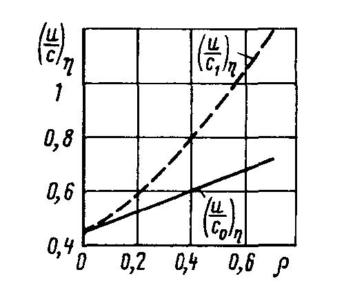

**Рис. 18. Зависимости оптимальных значений $(u/c_1)$ и $(u/c_0)$ от степени реактивности $\rho$**

Абсолютное значение $\eta_{u \text{ max}}$ несколько возрастает с увеличением степени реактивности вследствие улучшения обтекания рабочих лопаток, уменьшения гидравлических потерь в них и соответствующего повышения коэффициента скорости $\psi$. КПД $\eta_{u \text{ max}}$

*(Страница 53)*

заметно увеличивается при повышении степени реактивности от $0$ до $0{,}2...0{,}3$; при дальнейшем возрастании величины $\rho$ ее влияние на КПД $\eta_{u \text{ max}}$ незначительно (рис. 19).

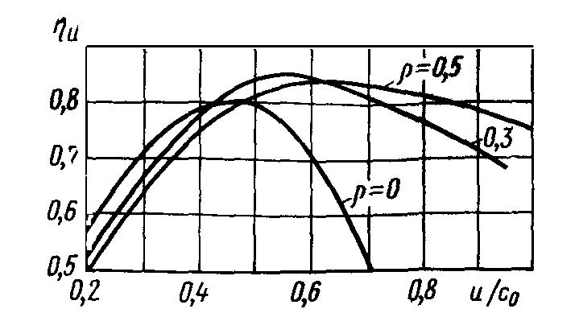

**Рис. 19. Изменение КПД $\eta_u$ ступени турбины при разных значениях реактивности**

Таким образом, в ступени турбины при заданном располагаемом теплоперепаде $H_0$ с ростом величины $\rho$ максимальный КПД тоже растет. Однако это связано с необходимостью повышения окружной скорости и достигается увеличением частоты вращения, сопровождающимся ростом напряжений от центробежных сил в роторе, или увеличением диаметра турбины при неизменной частоте вращения.

## 6. Выбор частоты вращения ротора, основных размеров и формы меридионального сечения проточной части турбины

Одноступенчатая турбина по сравнению с многоступенчатой проста и компактна, хотя может быть менее экономичной. Одноступенчатые турбины применяют в простых транспортных двигателях, а также в некоторых многовальных стационарных ГТУ.

Расчет одноступенчатой турбины сводится в основном к расчету ступени после выбора частоты вращения ротора, основных размеров и формы меридионального сечения проточной части. Турбину в ГТУ простой схемы и турбину низкого давления в многоагрегатных установках обычно стремятся выполнить наименьшего диаметра. Для турбины высокого давления или турбины с противодавлением

*(Страница 54)*

уменьшение размеров обычно не так важно, как для ТНД. Для уменьшения размеров турбины (в первую очередь, диаметральных) необходимо повысить частоту вращения ротора.

### 6.1. Максимальная частота вращения ротора турбины

Для заданных значений расхода рабочего тела и его параметров при входе в турбину максимальную частоту вращения $n_{\text{т max}}$ определяют в зависимости от напряжения, допускаемого в наиболее нагруженном элементе ротора турбины, которым обычно является рабочая лопатка.

Если частота вращения потребителя мощности турбины задана, то также следует определять максимальную частоту вращения $n_{\text{т max}}$ для сравнения этих частот и выявления целесообразности установки передачи (трансформатора частоты) между турбиной и потребителем. Передачу между турбиной и компрессором ГТУ обычно не выполняют, хотя целесообразность применения такой схемы в сложных перекрестных ГТУ не исключена, как и в ДТРД с большой степенью двухконтурности.

Напряженное состояние рабочих лопаток определяется условиями работы турбины. Суммарные напряжения складываются из постоянно действующих напряжений от растяжения и изгиба, напряжений, возникающих при колебаниях лопаток, а также температурных напряжений, особенно на переходных режимах. Для приближенной оценки напряженного состояния рабочих лопаток часто используют значение напряжения при растяжении $\sigma_{\text{л}}$. Известна зависимость величины $\sigma_{\text{л}}$, МПа, у корня лопатки от частоты вращения $n_{\text{т}}$, об/мин, и площади сечения $A_{\text{т}}$, м², турбины при выходе из РК:

$$\sigma_{\text{л}} = k_n n_{\text{т}}^2 A_{\text{т}}, \tag{63}$$

где $k_n$ – коэффициент пропорциональности.

При заданном наибольшем напряжении $\sigma_{\text{л}}$ максимальная частота вращения турбины

$$n_{\text{т max}} = \sqrt{\frac{\sigma_{\text{л}}}{k_n A_{\text{т}}}},$$

где $A_{\text{т}} = A_{2a} = G_{\text{г}}v_{\text{т}}/c_{\text{т. a}}$; $G_{\text{г}}$ – секундный расход газа при выходе из РК; $v_{\text{т}}$ – удельный объем газа за турбиной, $v_{\text{т}} = RT_{\text{т}}/p_{\text{т}}$; $T_{\text{т}}$ – температура

*(Страница 55)*

газа за турбиной, определяется приближенно по располагаемому теплоперепаду $H_0$ и предполагаемому значению лопаточного КПД $\eta_{\text{л}}$; $T_{\text{т}} = T_0^{*} - H_0\eta_{\text{л}}/c_p$; $p_{\text{т}}$ – давление за турбиной; $c_{\text{т. a}}$ – осевая составляющая скорости при выходе из РК, приблизительно принимается равной абсолютной скорости $c_{\text{т}}$.

С увеличением скорости $c_{\text{т}}$ уменьшается площадь $A_{\text{т}}$. Следовательно, при заданном значении $\sigma_{\text{л}}$ увеличивается быстроходность турбины, но уменьшается работа на окружности РК и КПД ступени. Поэтому скорость $c_{\text{т}}$ выбирают в зависимости от назначения ГТУ, исходя из необходимости уменьшения размеров турбины, с одной стороны, и возможности использования энергии выходной скорости, с другой. Например, в турбинах стационарных ГТУ скорость $c_{\text{т}} = 80...120$ м/с, в транспортных ГТД $c_{\text{т}} = 120...200$ м/с и в авиационных ГТД (в полетных условиях) $c_{\text{т}} = 250...350$ м/с. Скорость $c_{\text{т}}$ можно найти, задаваясь параметром скорости $\lambda_{\text{т}}$ или числом $M_{\text{т}}$, тогда $c_{\text{т}} = \lambda_{\text{т}}a^{*}$ или $c_{\text{т}} = M_{\text{т}}a_{\text{т}}$. В стационарных ГТУ $\lambda_{\text{т}} = 0{,}2...0{,}3$ ($M_{\text{т}} = 0{,}18...0{,}27$), в авиационных двигателях $\lambda_{\text{т}} = 0{,}5...0{,}65$ ($M_{\text{т}} = 0{,}47...0{,}62$).

Выбирая скорость $c_{\text{т}}$ и, следовательно, длину лопатки $l_2$, необходимо учитывать величину $c_{1a}$, от которой при заданных значениях $H_0$ и степени реактивности ступени $\rho$ зависит длина рабочей лопатки при входе в РК $l_1$ и угол $\alpha_1$, находящийся в определенных целесообразных пределах. Соотношение длин $l_1$ и $l_2$ определяет угол раскрытия меридионального сечения проточной части, который должен находиться в пределах от $0$ до $20^{\circ}$. При углах раскрытия больше $25^{\circ}$ может произойти отрыв потока на контуре, во всяком случае, на внутренней его части. Угол раскрытия меридионального сечения РК зависит от степени реактивности ступени и возрастает с ее увеличением.

Коэффициент $k_n$ в формуле (63) определяется формой лопатки. Для некоторых конструкций с плавно изменяющимся сечением лопаток по длине $k_n \approx 6{,}8 \cdot 10^{-6}$.

При

*(Страница 56)*

таком изменении площади сечения лопатки $A_{\text{л}}$ по радиусу, когда напряжение в основной части лопатки остается постоянным, а на конце лопатки ($r = r_{\text{л}}$) уменьшается до нуля (рис. 20), при выбранном отношении площадей сечений в корне лопатки $f_{\text{л.к}}$ и на периферии $f_{\text{л.п}}$ ($\mu = f_{\text{л.к}}/f_{\text{л.п}}$) можно получить максимальную частоту вращения $n_{\text{т max}}$ для заданного напряжения $\sigma_{\text{л}}$. В этом случае

$$k_n = \frac{2\pi\rho_{\text{м}}}{3600(1 + \ln\mu)},$$

где $\rho_{\text{м}}$ – плотность материала рабочих лопаток. В частности, для $\rho_{\text{м}} = (7{,}8...8) \cdot 10^3$ кг/м³ и $\mu = 3{,}5...4$ получим $k_n = (6...7) \cdot 10^{-6}$.

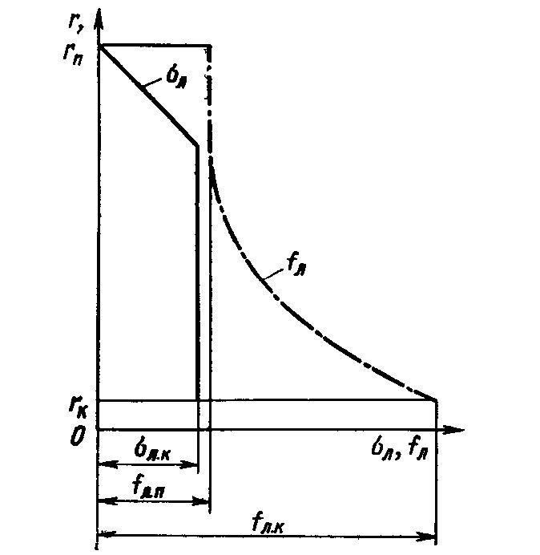

**Рис. 20. Изменение напряжения $\sigma_{\text{л}}$ и площади сечения в оптимальной лопатке**

Напряжение $\sigma_{\text{л}}$ зависит от температуры газа, метода охлаждения лопаток, применяемого материала и необходимого ресурса, оно может быть найдено по справочной литературе. Для турбин стационарных и транспортных ГТУ $\sigma_{\text{л}} = 120...200$ МПа, в особо напряженных лопатках $\sigma_{\text{л}} \leq 300$ МПа; для высокотемпературных турбин ГТУ и ГТУ замкнутых схем напряжение $\sigma_{\text{л}} = 30...100$ МПа.

*(Страница 57)*

Средний диаметр турбины

$$D_{\text{т}} = \sqrt{\frac{A_{\text{т}}}{\pi\left(l_{\text{т}}/D_{\text{т}}\right)}}.$$

Для получения наименьшего среднего диаметра относительную длину лопаток выбираем максимальной: $l_{\text{т}}/D_{\text{т}} = 1/4...1/3{,}5$ (иногда до $1/3$). Применение более длинных лопаток обычно нежелательно, так как при относительно небольшом уменьшении диаметра $D_{\text{т}}$ возникает необходимость значительной закрутки лопаток и увеличиваются потери, связанные с большим их шагом у периферии.

Окружная скорость на среднем радиусе $u_{\text{т}} = \pi D_{\text{т}}n_{\text{т max}}/60$.

### 6.2. Оптимальная окружная скорость в турбине

Известно, что получить высокий КПД ступени можно лишь при значениях $u/c_0$, близких к $(u/c_0)_{\text{η}}$, зависящих от степени реактивности. Поэтому найденная окружная скорость, являющаяся наименьшей для выбранного максимального отношения $l_{\text{т}}/D_{\text{т}}$, может не соответствовать оптимальному значению отношения $u/c_0$. При проектировании одноступенчатой турбины, задавшись на среднем радиусе степенью реактивности $\rho_{\text{ср}}$, необходимо определить оптимальное значение отношения $u/c_0$. Степень реактивности $\rho_{\text{ср}}$ следует задавать в зависимости от относительной длины лопатки так, чтобы у корня соблюдалось условие $\rho \geq 0{,}05...0{,}1$. Ориентировочно можно принимать следующие значения $\rho_{\text{ср}}$:

| $l_{\text{т}}/D_{\text{т}}$ | 1/3 | 1/4 | 1/6 | 1/9 |
|---|---|---|---|---|
| $\rho_{\text{ср}}$ | 0,5 | 0,4 | 0,3 | 0,2 |

Для $\rho_{\text{ср}} = 0{,}25...0{,}45$ оптимальное отношение $(u/c_0)_{\text{η}} = 0{,}55...0{,}6$, при этом большему значению $\rho_{\text{ср}}$ соответствует большее значение $(u/c_0)_{\text{η}}$. По выбранному отношению $(u/c_0)_{\text{η}}$ можно найти оптимальную окружную скорость

$$u_{\text{тη}} = \left(\frac{u}{c_0}\right)_{\text{η}} c_0,$$

где $c_0 = \sqrt{2H_0}$.

По

*(Страница 58)*

величине $u_{\text{тη}}$ и максимальной частоте вращения определяют соответствующий максимальному КПД средний диаметр турбины

$$D_{\text{тη}} = \frac{u_{\text{тη}} 60}{\pi n_{\text{т max}}}, \tag{64}$$

длину рабочих лопаток $l_{2\text{η}} = A_{\text{т}}/(\pi D_{\text{тη}})$ и относительную длину лопаток $(l/D_{\text{т}})_{\text{η}}$.

По окружной скорости и отношению $l_{\text{т}}/D_{\text{т}}$ можно получить напряжение в рабочих лопатках из зависимости, подобной (63):

$$\sigma_{\text{л}} = k_u u_{\text{т}}^2 \frac{l_{\text{т}}}{D_{\text{т}}},$$

где $k_u$ – коэффициент, однозначно связанный с коэффициентом $k_n$, $k_u = k_n 3600/\pi$.

Для некоторых конструкций $k_u \approx 7{,}8 \cdot 10^{-3}$, тогда (при величине $u_{\text{т}}$, измеряемой в метрах в секунду)

$$\sigma_{\text{л}} = 78 \frac{l_{\text{т}}}{D_{\text{т}}} \left(\frac{u_{\text{т}}}{100}\right)^2.$$

Для лопаток с наименьшим напряжением (см. рис. 20) при указанной плотности материала лопаток и отношении площадей $\mu = 3{,}5...4$ коэффициент $k_u = (70...80) \cdot 10^{-4}$.

Обычно в турбинах стационарных ГТУ величина $u_{\text{т}} = 200...260$ м/с, в ГТУ максимальной мощности $u_{\text{т}} = 300...360$ м/с, в транспортных ГТД $u_{\text{т}} = 250...360$ м/с, а в наиболее компактных ГТД $u_{\text{т}} = 300...400$ м/с. При относительно коротких лопатках допустима окружная скорость $u_{\text{т}} = 400...450$ м/с и более.

*(Страница 59)*

Если полученный по формуле (64) диаметр $D_{\text{тη}} > D_{\text{т}}$, а следовательно, $u_{\text{тη}} > u_{\text{т}}$, то длина лопатки $l_{2\text{η}} < l_2$. Увеличение окружной скорости при постоянной частоте не сказывается на напряжении при растяжении в лопатках, так как относительная длина лопаток $l_{\text{т}}/D_{\text{т}}$ изменяется пропорционально обратной величине квадрата окружной скорости. Напряжение от изгиба может также остаться неизменным, если с увеличением диаметра $D_{\text{т}}$ и уменьшением длины лопатки момент сопротивления уменьшится пропорционально величине $D_{\text{т}}^2$ (так как и сила и плечо изменяются пропорционально $D_{\text{т}}$). При этом повышаются напряжения в диске, так как с увеличением окружной скорости на лопатках обычно возрастает радиальная нагрузка на периферии и увеличивается средняя окружная скорость диска. При увеличении диаметра до значения $D_{\text{тη}}$ необходимо также обратить внимание на связанный с укорочением лопатки возможный рост концевых потерь и соответствующее снижение коэффициентов скорости $\varphi$ и $\psi$.

Оптимальную окружную скорость $u_{\text{η}}$ можно несколько уменьшить, снизив степень реактивности $\rho_{\text{ср}}$ ступени. Однако следует отметить, что это может привести к падению КПД ступени.

Если диаметр $D_{\text{тη}}$ значительно превосходит диаметр $D_{\text{т}}$, то одноступенчатую турбину проектировать нецелесообразно и число ступеней в турбине следует увеличить.

В некоторых случаях, когда экономичность турбины не влияет существенно на эффективность ГТУ (например, в турбонасосных агрегатах некоторых небольших ЖРД), можно проектировать турбину одноступенчатой с окружной скоростью, значительно меньшей $u_{\text{тη}}$. Очевидно, что КПД ступени будет соответственно ниже максимального $\eta_{\text{т max}}$.

Если определенный по формуле (64) диаметр $D_{\text{тη}} < D_{\text{т}}$, т. е. $u_{\text{тη}} < u_{\text{т}}$, то при заданном теплоперепаде $H_0$ и выбранной геометрии проточной части турбины максимальная частота вращения $n_{\text{т max}}$ велика. Для получения максимального КПД турбины при найденном диаметре $D_{\text{т}}$ необходимо снизить частоту вращения

*(Страница 60)*

пропорционально отношению диаметров, т. е. пользуясь зависимостью

$$n_{\text{т}} = n_{\text{т max}} D_{\text{тη}}/D_{\text{т}}.$$

### 6.3. Основные размеры и форма меридионального сечения проточной части турбины

После определения частоты вращения и среднего диаметра $D_{\text{т}}$ (при выходе из ступени) можно уточнить форму проточной части, которая для одноступенчатых турбин не имеет такого значения, как для многоступенчатых. При известных длинах лопаток $l_1$ и $l_2$ форма проточной части ступени зависит от ширины сопловых $b_{a \text{ с}}$ и рабочих лопаток $b_{a \text{ л}}$, осевого зазора $\delta_{a \text{ с}}$ и углов контура меридионального сечения $\gamma_{\text{н}}$ и $\gamma_{\text{в}}$ (см. рис. 11).

Ширину лопаток выбирают из конструктивных соображений в зависимости от их длины и действующих на них сил. Для сопловых лопаток в одноступенчатой турбине обычно удлинение $(l/b_a)_{\text{с}} = 2...2{,}5$. Удлинение рабочей лопатки несколько больше, чем сопловой, как правило, $(l/b_a)_{\text{л}} = 2{,}5...3$. В турбинах высокого давления на лопатки действуют значительные осевые усилия, и ширину лопаток увеличивают соответственно удлинениям: $(l/b_a)_{\text{с}} = 1...1{,}5$ и $(l/b_a)_{\text{л}} = 1{,}5...2$. При давлении $p_{\text{г}} = 10...13$ МПа, например, принимают $(l/b_a)_{\text{л}} \approx 0{,}8$.

Обычно удлинение лопаток возрастает с увеличением относительной длины лопатки, т. е. большему отношению $l/D_{\text{т}}$ соответствуют большие значения $(l/b_a)_{\text{с}}$ и $(l/b_a)_{\text{л}}$. При выборе ширины решетки следует учитывать, что с уменьшением ширины концевые потери $\zeta_{\text{к}}$ снижаются, а профильные остаются неизменными или растут, если $\text{Re} < \text{Re}_{\text{кр}}$. Обычно влияние концевых потерь оказывается определяющим, и ширину решетки в СА следует выбирать наименьшей из условия жесткости крепления диафрагм, а в рабочих колесах из условия необходимой жесткости лопаток и более простого размещения замков лопаток в дисках.

Осевой зазор $\delta_{a \text{ с}}$ между сопловыми и рабочими лопатками необходим для предотвращения задевания РК за СА, а также для выравнивания

*(Страница 61)*

потока за соплами. С увеличением зазора $\delta_{a \text{ с}}$ возрастают потери на трение о корпус, потери от смешения потока с закромочными следами и уменьшается энергия потока, но сглаживается его неравномерность (по шагу), в результате снижаются потери при входе на рабочее колесо и уменьшается вибрация лопаток. Следует отметить, что отсутствуют обобщенные рекомендации по выбору $\delta_{a \text{ с}}$. Ширину $\delta_{a \text{ с}}$ осевого зазора часто принимают равной $(0{,}20...0{,}25)b_{a \text{ с}}$. Изменением величин $b_{a \text{ с}}$, $b_{a \text{ л}}$ и $\delta_{a \text{ с}}$ в небольших пределах можно пользоваться для получения необходимого угла раскрытия меридионального сечения $\gamma$.

При выполнении ступени турбины с постоянным средним диаметром меридиональное сечение симметрично относительно оси сечения, внутренний и наружный углы раскрытия сечения оказываются равны, т. е. $\gamma_{\text{в}} = \gamma_{\text{н}}$, а суммарный угол раскрытия $\gamma = 2\gamma_{\text{в}}$. При больших углах $\gamma_{\text{в}}$ обычно возникают трудности проектирования замка лопаток, который получается очень большой массы. При проектировании пера лопаток на длинной ножке этот конструктивный недостаток проявляется меньше. Наиболее легкий замок лопатки получается при проектировании проточной части с постоянным внутренним диаметром ($\gamma_{\text{в}} = 0$) и увеличивающимися средним и наружным диаметрами. Однако увеличение наружного диаметра ($\gamma_{\text{н}} > 0$) может привести к изменению радиального зазора $\delta_r$ во время работы при осевом смещении лопаток относительно корпуса турбины, если упорный подшипник ротора турбины находится на значительном расстоянии от плоскости выходных кромок СА. В этом случае лучше проектировать проточную часть турбины с постоянным наружным диаметром ($\gamma_{\text{н}} \approx 0$).

Иногда проточную часть одноступенчатой турбины проектируют с постоянной длиной лопаток $(l_{\text{л1}} = l_{\text{л2}})$. В реактивной ступени это удается сделать при значительном увеличении осевой составляющей скорости в РК ($c_{2a} > c_{1a}$) и, следовательно, при росте потерь с выходной скоростью, а оно может быть целесообразно лишь при условии эффективного использования кинетической энергии выходящего потока.

В газовых турбинах СА обычно выполняют без радиальных зазоров, лопатки либо укрепляют жестко во внешнем и внутреннем разрезных кольцах корпуса, либо выполняют перемещающимися в кольцах по соответствующим пазам с небольшим зазором по контуру при незначительном перетекании газа.

*(Страница 62)*

Между корпусом и рабочими лопатками предусматривается радиальный зазор для предотвращения задеваний. В активных лопатках через этот зазор перетекает газ вследствие большего давления на вогнутой стороне лопатки, чем на выпуклой. В реактивной ступени перетекание газа через радиальный зазор больше из-за разности давления перед колесом и за ним. Перетекание газа сопровождается потерями, пропорциональными относительному радиальному зазору.

Для уменьшения усилий, возникающих при задеваниях лопаток о корпус, верхняя кромка лопаток утоняется с вогнутой стороны. Величина зазора, отнесенная к длине лопатки, $\delta_{r \text{ л}}/l = 0{,}01...0{,}007$, а к диаметру ротора – $\delta_{r \text{ л}}/D = 0{,}001...0{,}002$. В небольших турбинах относительный зазор получается больше, так как абсолютную величину зазора не удается сделать меньше $\delta_{r \text{ л}} = 0{,}5...0{,}7$ мм.

Потери в радиальном зазоре можно существенно снизить путем применения на лопатках бандажных полок, утопленных в корпусе турбины и снабженных лабиринтным уплотнением (рис. 21). Тогда перетекание газа в окружном направлении устраняется полностью, а в осевом направлении резко уменьшается. Кроме того, эпюры параметров потока за ступенью в периферийной части лопаток получаются более равномерными. Бандаж 1 выполняют в виде сплошной ленты или отдельных ее кусков, укрепленных на лопатках (рис. 21, $a$). При соединении бандажа с лопатками должна быть предусмотрена возможность относительной температурной деформации, так как температура бандажа может быть выше температуры лопаток и остальной части ротора. Иногда лопатки выполняют с козырьками 2 (полубандаж), которые перекрывают часть межлопаточного канала (рис. 21, $б$). При достаточной ширине козырьки могут образовывать бандаж с небольшими зазорами по окружности, которые практически не влияют на перетекание газа.

Сплошной бандаж так же, как и полубандаж, увеличивает напряжение растяжения под действием центробежных сил в лопатках и роторе. В случае больших изгибных напряжений в лопатках от вибрации бандаж и широкие соприкасающиеся козырьки могут оказать демпфирующее действие на вибрационные колебания и увеличить таким образом запас прочности лопаток. Применением бандажных полок без лабиринтного уплотнения снижают прирост КПД ступени примерно вдвое. В целом использование бандажных полок с уплотнением весьма целесообразно как в отношении борьбы с низкочастотными колебаниями лопаток, так и повышения КПД ступени.

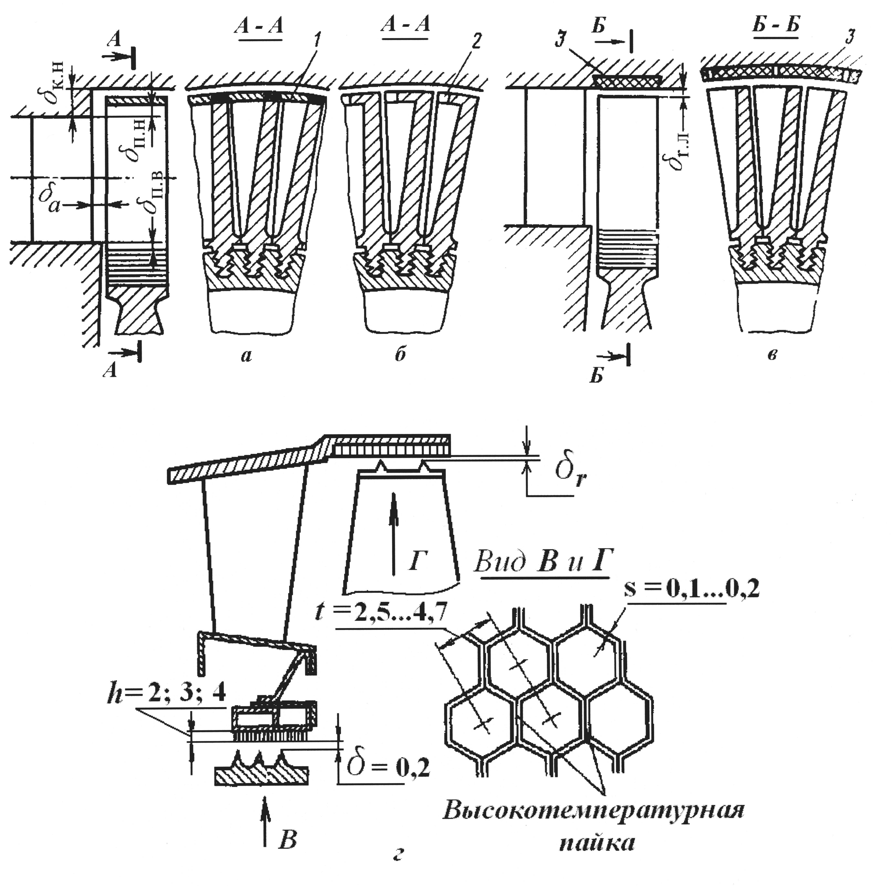

*(Страница 63)*

**Рис. 21. Схемы конструкций проточной части, уменьшающих потери в радиальном зазоре:**

$a$, $б$, $в$ – лопатки с бандажами и мягкими вставками; $г$ – уплотнение радиальных зазоров с использованием сотовой вставки

При выполнении бандажа или полубандажа во внешнем контуре меридионального сечения проточной части делается уступ, который позволяет получить гладкий контур для основной массы газа. По результатам некоторых экспериментальных исследований установлена эффективность устройств перекрыш как на внутреннем $\delta_{\text{п.в}}$, так и на наружном $\delta_{\text{п.н}}$ контуре меридионального сечения. При этом границы струи газа на выходе из соплового аппарата несколько расширяются в радиальном направлении. Определенных рекомендаций по выбору перекрыш дать нельзя, поскольку эффект от их применения связан как с формой проточной части $(\alpha_1, \delta_a, l)$, так и с

*(Страница 64)*

параметрами потока $(\pi_{\text{с }a}, M_{\text{с}}, \text{Re})$. При выполнении перекрыш в проточной части с рабочими лопатками без бандажа снижается перетекание газа в радиальном зазоре, однако для заданного расхода рабочего тела длина рабочих лопаток, а также напряжение в них возрастают.

Применение мягких вставок в корпусе турбины позволяет уменьшить радиальный зазор между рабочими лопатками и корпусом, так как возможное в этом случае касание лопаток не грозит аварией турбины. Если зазор невелик в холодном состоянии, после прогрева и удлинения лопаток во время работы он уменьшается. Ввиду того, что материал лопаток прочнее материала вставок, при взаимном касании изнашиваются именно вставки. При такой конструкции радиальный зазор отсутствует только при том режиме работы турбины, при котором происходит максимальное увеличение диаметра ротора относительно корпуса; на других режимах радиальный зазор относительно невелик. Вставки могут быть выполнены из керамики или металлокерамики 3 (см. рис. 21, $в$). Чаще в качестве таких мягких элементов применяются сотовые вставки, состоящие из шестиугольных или четырехугольных ячеек, стенки которых выполнены из фольги толщиной $0{,}1...0{,}15$ мм (рис. 21, $г$). Их эффективность снижается с увеличением размера сот. Для уменьшения потерь в радиальном зазоре полезно эти соты заполнять специальным наполнителем. В случае отсутствия наполнителя соты должны быть мелкими (высотой не более $2...3$ мм), так как в противном случае даже при работе с малым радиальным зазором КПД турбины может оказаться ниже, чем при наличии гладкого корпуса с большим радиальным зазором.

Малые потери в радиальном зазоре могут быть получены при создании «холодного» корпуса, т. е. охлаждаемого изолированного контура (см. рис. 1), в котором центрировано разрезное кольцо, ограничивающее на периферии канал в РК. В этом случае нагрев секторов, составляющих кольцо, не приводит к увеличению его диаметра и радиальный зазор на режиме максимальной мощности может быть небольшим.

В большинстве турбин с лопатками без бандажа внутренний и внешний контуры меридионального сечения проточной части выполняют без уступов в рабочем состоянии.

Выполнение уступа у наружного контура $\delta_{\text{к.н}}$ и осуществление перекрыши $\delta_{\text{п.н}}$ у безбандажных колес уменьшает влияние радиального зазора тем заметнее, чем меньше осевой зазор $\delta_a$. При

*(Страница 65)*

этом следует учитывать, что при заданном расходе газа и выбранной длине $l_{\text{с}}$ с увеличением $\delta_{\text{п.н}}$ удлиняется рабочая лопатка и повышается напряжение $\sigma_{\text{л}}$. При выборе размеров проточной части турбины в холодном состоянии следует учитывать, что температурные деформации у корпуса, СА и деталей ротора разные. Необходимо обратить внимание на неустановившийся тепловой режим узлов турбины при пуске и останове, так как скорости изменения температуры корпуса и ротора могут быть различными.

Иногда в турбине желательно применить поворотный СА. В этом и в некоторых других случаях между сопловыми лопатками и корпусом может появиться радиальный зазор. Наличие его чрезвычайно вредно сказывается на КПД ступени и поэтому недопустимо.

Для уменьшения концевых потерь и потерь в радиальном зазоре можно воздействовать на пограничный слой, стекающий с поверхностей корпуса и лопаток в каналах СА и РК, выполнением канавок на поверхности, перегородок и каналов в теле лопаток. Этими мерами можно повысить экономичность ступени с проточной частью небольших размеров.

## 7. ПРОФИЛИРОВАНИЕ ЛОПАТОК ПО РАДИУСУ

### 7.1. Необходимость профилирования лопаток

Результатами расчета ступени турбины являются параметры газа и геометрические параметры рабочих и сопловых лопаток на некотором радиусе (обычно на среднем) или у корня. При относительно коротких лопатках $(l/D < 1/7...1/8)$ можно приближенно считать, что давление газа и скорость истечения из соплового аппарата при постоянном угле $\alpha_1$ не изменяются по радиусу. При относительно длинных лопатках проточную часть ступени целесообразно профилировать с учетом переменного по радиусу давления перед рабочим колесом. Геометрические параметры лопаток в этом случае изменяются по радиусу. Рабочие лопатки, а иногда и сопловые, по результатам расчета получаются закрученными. Следует отметить, что до настоящего времени нет определенных рекомендаций по поводу значения отношения $l/D$, при котором закрутка лопаток практически не увеличивает КПД ступени и лопатки являются короткими. По

*(Страница 66)*

данным исследований ступеней с большой степенью реактивности, проведенным В.М. Акимовым, высоким КПД характеризуются ступени как с закрученными лопатками, так и с цилиндрическими при $l/D < 1/4{,}5...1/6$. По данным Центрального котлотурбинного института, в случае закрутки лопаток КПД возрастает примерно на 2 % при $l/D = 1/8$ и на 5 % при $l/D = 1/5$. Такое различие результатов исследований можно объяснить влиянием степени реактивности, которая в опытах ЦКТИ была небольшой (у корня $\rho = 0$, на среднем радиусе $\rho = 0{,}15$).

Рассмотрим необходимость закрутки длинных лопаток. Пусть ступень турбины рассчитана на радиусе $r'$, известны теплоперепады $H_{\text{с}}'$ и $H_{\text{л}}'$, степень реактивности $\rho'$ и углы выхода СЛ $\alpha_1'$ и РЛ $\beta_2'$. Предположим сначала, что без специального профилирования проточной части теплоперепады $H_{\text{с}}'$ и $H_{\text{л}}'$, и угол $\alpha_1'$ постоянны по радиусу. Тогда из треугольников скоростей при входе в РК для двух значений окружных скоростей $u'$ и $u$ следует, что при $\beta_1 < 90^{\circ}$ относительная скорость $w_1 < w_1'$, если $u > u'$ (рис. 22).

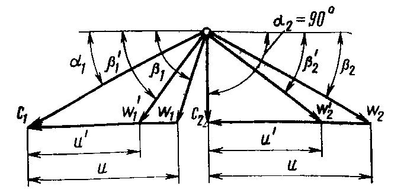

**Рис. 22. Треугольники скоростей на радиусах $r'$ и $r$**

Чтобы удельная работа была максимальной, поток за РК должен иметь осевое направление на любом радиусе. При этом $w_2 > w_2'$. Относительные скорости на радиусах $r'$ и $r$ соответственно равны

$$w_2' = \psi'\sqrt{(w_1')^2 + 2H_{\text{л}}'} \quad \text{и} \quad w_2 = \psi\sqrt{w_1^2 + 2H_{\text{л}}}.$$

При $\psi = \psi'$ теплоперепад $H_{\text{л}} > H_{\text{л}}'$, что противоречит принятому предположению. Таким образом, чтобы КПД на окружности РК был

*(Страница 67)*

максимален, следует с ростом радиуса увеличивать теплоперепад в РК, степень реактивности ступени и давление перед ним.

Необходимость специального профилирования длинных турбинных лопаток впервые была отмечена В.В. Уваровым, который предложил метод профилирования по радиусу при постоянной циркуляции. Затем были разработаны другие методы.

### 7.2. Профилирование по радиусу при постоянной циркуляции

Опишем основные этапы профилирования.

**1. Условия профилирования.** Предположим, что газ движется без трения в осевом зазоре между сопловым аппаратом и рабочим колесом по коаксиальным поверхностям. При этом радиальная составляющая абсолютной скорости $c_{1r} = 0$. Полагая поток потенциальным, в котором окружная составляющая вихря

$$\omega = \frac{1}{2}\left(\frac{\partial c_a}{\partial r} - \frac{\partial c_r}{\partial a}\right) = 0,$$

и учитывая, что $\frac{\partial c_r}{\partial a} = 0$, получим $\frac{\partial c_a}{\partial r} = 0$, откуда $c_a = \text{const}$, т. е. осевая составляющая скорости перед колесом постоянна по радиусу.

**2. Изменение абсолютной скорости перед РК.** Рассмотрим элементарную массу $M$ газа плотностью $\rho$ в виде параллелепипеда высотой $dr$ с площадью основания $f$, движущуюся на радиусе $r$ с абсолютной скоростью $c_1$ (составляющие $c_{1a}$ и $c_{1u}$) в зазоре между СА и рабочими лопатками (рис. 23).

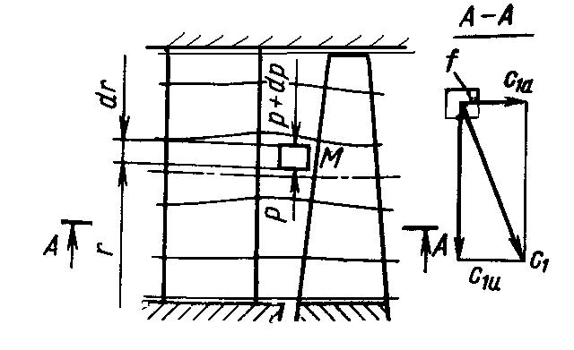

**Рис. 23. Схема потока в осевом зазоре**

На

*(Страница 68)*

радиусе $r$ на массу $M$ действует давление $p$, а на радиусе $r + dr$ – давление $p + dp$.

Полагая по условиям профилирования движение массы по цилиндрической поверхности с осью, совпадающей с осью турбины, можем написать по принципу Даламбера для проекций сил на радиальное направление (принимая положительным направление увеличения радиуса)

$$F_p + F_j = 0,$$

где $F_p$ – проекция суммы сил от давления; $F_j$ – проекция силы инерции. Так как $F_p = fp - f(p + dp) = -fdp$, а $F_j = (c_{1u}^2/r)M = c_{1u}^2\rho f dr/r$, получим

$$\frac{dp}{\rho} = c_{1u}^2 \frac{dr}{r}. \tag{65}$$

Элементарная работа идеального расширения может быть выражена через приращение кинетической энергии при истечении. Поскольку $d(c_1^2) = d(c_{1u}^2)$, так как $c_1^2 = c_{1a}^2 + c_{1u}^2$, а $c_{1a} = \text{const}$,

$$\frac{dp}{\rho} = -d\left(\frac{c_{1u}^2}{2}\right). \tag{66}$$

Из выражений (65) и (66) следует

$$-d\left(\frac{c_{1u}^2}{2}\right) = c_{1u}^2 \frac{dr}{r}.$$

После интегрирования

$$rc_{1u} = \text{const}. \tag{67}$$

Выражение постоянства циркуляции перед РК имеет вид

$$2\pi rc_{1u} = \Gamma_{1u} = \text{const}. \tag{68}$$

*(Страница 69)*

Рассматриваемый метод профилирования иногда называется профилированием по закону свободного вихря, или при постоянной циркуляции.

Осевая составляющая абсолютной скорости с точностью до $0{,}5...1$ % может быть определена по удельному объему $v_1'$ на среднем радиусе и кольцевой площади сечения при входе в РК из выражения $c_{1a} = \frac{Gv_1'}{\pi D_1 l_1}$. Тогда абсолютная скорость в осевом зазоре $c_1 = \sqrt{c_{1u}^2 + c_{1a}^2}$ уменьшается с увеличением радиуса. В качестве примера на рис. 24 показано изменение скоростей $c_1$, $c_{1u}$ и $c_{1a}$ и степени понижения давления по радиусу.

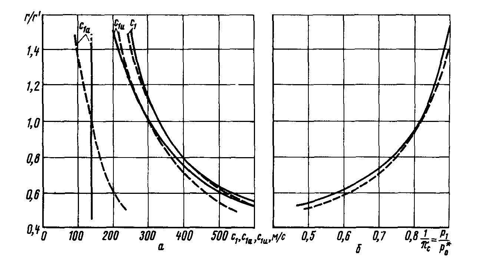

**Рис. 24. Изменение параметров потока по радиусу:**

$a$ – скоростей $c_1$, $c_{1a}$, $c_{1u}$; $б$ – давления $p_1$; —— $\Gamma_{1u} = \text{const}$; - - - - $\alpha_1 = \text{const}$

**3. Изменение степени понижения давления перед РК.** Определим скорость истечения из СА $c_1'$ на расчетном радиусе $r'$ и скорость $c_1$ на произвольном радиусе $r$:

$$(c_1')^2 = 2\frac{k}{k-1}RT_0^{*}\left[1 - \left(\frac{p_1'}{p_0^{*}}\right)^{\frac{k-1}{k}}\right]; \tag{69}$$

$$(c_1)^2 = 2\frac{k}{k-1}RT_0^{*}\left[1 - \left(\frac{p_1}{p_0^{*}}\right)^{\frac{k-1}{k}}\right], \tag{70}$$

где $p_1'$ и $p_1$ –

*(Страница 70)*

давление перед РК на радиусах $r'$ и $r$ соответственно.

После почленного вычитания выражения (70) из (69) получим

$$(c_1')^2 - (c_1)^2 = (c_{1u}')^2 - (c_{1u})^2 = 2\frac{k}{k-1}RT_0^{*}\left[\left(\frac{p_1}{p_0^{*}}\right)^{\frac{k-1}{k}} - \left(\frac{p_1'}{p_0^{*}}\right)^{\frac{k-1}{k}}\right],$$

откуда после замены

$$T_0^{*}\left(\frac{p_1}{p_0^{*}}\right)^{\frac{k-1}{k}} = T_1', \quad kRT_1' = a_1'^2 \quad \text{и} \quad \left(\frac{c_{1u}}{c_{1u}'}\right)^2 = \left(\frac{r_1'}{r_1}\right)^2$$

получим давление на произвольном радиусе

$$p_1 = p_1'\left\{1 + \frac{k-1}{2}M_{1u}'^2\left[1 - \left(\frac{r_1'}{r_1}\right)^2\right]\right\}^{\frac{k}{k-1}}, \tag{71}$$

где $M_{1u}' = \frac{c_{1u}'}{a_1'}$.

Из зависимости (71) следует, что при профилировании с постоянной циркуляцией давление перед РК с увеличением радиуса существенно возрастает, плотность газа повышается и при постоянной по радиусу скорости $c_{1a}$ массовый расход через единицу площади сечения увеличивается. При постоянных по радиусу значениях давления и осевой скорости перед СА и за РК массовый расход, отнесенный к единице площади, в этих сечениях тоже постоянен. Поэтому даже при цилиндрической проточной части линии тока в меридиональном сечении искривлены и их форма свидетельствует о том, что на периферии из СА выходит большая доля расхода, чем у корня (см. рис. 23).

С повышением давления по радиусу растет и степень реактивности ступени. На среднем радиусе $r'$ степень реактивности

$$\rho' = \frac{c_p T_{1\text{ад}}'}{H_0}\left[1 - \left(\frac{p_2}{p_1'}\right)^{\frac{k-1}{k}}\right], \tag{72}$$

на

*(Страница 71)*

радиусе $r$

$$\rho = \frac{c_p T_{1\text{ад}}}{H_0}\left[1 - \left(\frac{p_2}{p_1}\right)^{\frac{k-1}{k}}\right], \tag{73}$$

где $T_{1\text{ад}}'$ и $T_{1\text{ад}}$ – температуры конца адиабатного расширения в СА на радиусах соответственно $r'$ и $r$. Степень реактивности на текущем радиусе можно найти через степень реактивности на среднем:

$$\rho = \rho' \frac{p_1^{\frac{k-1}{k}} - p_2^{\frac{k-1}{k}}}{p_1'^{\frac{k-1}{k}} - p_2^{\frac{k-1}{k}}} \quad \text{или} \quad \rho = \rho' \frac{\pi_{\text{л}}^{\frac{k-1}{k}} - 1}{\pi_{\text{л}}'^{\frac{k-1}{k}} - 1}, \tag{74}$$

где $\pi_{\text{л}}$ и $\pi_{\text{л}}'$ – степени понижения давления в РЛ на радиусах соответственно $r$ и $r'$.

С ростом величины $\rho$ на периферии лопатки увеличивается разность давлений с обеих ее сторон и при безбандажной конструкции повышаются потери в радиальном зазоре. Поэтому среднюю степень реактивности следует выбирать небольшой – из условия минимально допустимого значения $\rho$ у корня лопаток.

**4. Изменение углов сопловых и рабочих лопаток по радиусу.** По известным значениям окружной и осевой составляющих абсолютной скорости могут быть найдены углы потока. При выходе из СА на радиусе $r'$ угол

$$\alpha_1' = \text{arctg}(c_{1a}/c_{1u}'), \tag{75}$$

на радиусе $r$

$$\alpha_1 = \text{arctg}(c_{1a}/c_{1u}) = \text{arctg}[(r/r')\text{tg}\alpha_1']. \tag{76}$$

Соответствующее закону профилирования уменьшение угла с уменьшением радиуса может вызвать трудности при построении

*(Страница 72)*

профиля длинных сопловых лопаток у корня вследствие относительно большой толщины выходной кромки. В результате увеличиваются профильные (кромочные) потери и соответственно снижается средний коэффициент скорости $\varphi$. В связи с этим не следует выполнять у корня лопатки угол $\alpha_1$ меньше $13...14^{\circ}$. Лишь для турбин малой мощности, чтобы избежать парциальности, можно доводить угол $\alpha_1$ у корня до $11...12^{\circ}$.

Угол при входе в РК на радиусе $r'$

$$\beta_1' = \text{arctg}\frac{c_{1a}}{c_{1u}' - u_1'} = \text{arctg}\frac{\text{tg}\alpha_1'}{1 - \frac{u_1'}{c_{1u}'}}, \tag{77}$$

на радиусе $r$

$$\beta_1 = \text{arctg}\frac{c_{1a}}{c_{1u} - u_1} = \text{arctg}\frac{\frac{r}{r'}\text{tg}\alpha_1'}{1 - \frac{u_1'}{c_{1u}'}\left(\frac{r}{r'}\right)^2}. \tag{78}$$

Угол $\beta_1$ сильно возрастает по радиусу, в длинных лопатках он может быть значительно больше $90^{\circ}$. При этом профиль рабочих лопаток получается относительно плоским, похожим на крыльевой. Для снижения потерь на переменных режимах и достижения большего числа режимов с отрицательными углами атаки на профиле, а также для увеличения жесткости лопатки на периферии конструктивный угол $\beta_1$ иногда уменьшают по сравнению с расчетным на $10...15^{\circ}$.

Рассмотрим возможность сохранения осевого выхода потока на любом радиусе и получения наибольшего КПД $\eta_u$ при методе профилирования с циркуляцией перед колесом $\Gamma_{1u} = \text{const}$. При постоянных параметрах газа за РК энтальпия $i_2^{*}$ не зависит от радиуса, и работа на окружности колеса $L_u = i_0^{*} - i_2^{*} = \text{const}$.

Выразим величину $L_u$ через разность циркуляций перед колесом и за ним: $L_u = u(c_{1u} - c_{2u}) = \omega(\Gamma_{1u} - \Gamma_{2u})/(2\pi)$. Знак «минус» перед скоростью $c_{2u}$ соответствует одностороннему отсчету углов $\alpha_1$ и $\alpha_2$, не принятому в теории турбин. При рассматриваемом

*(Страница 73)*

методе профилирования $\Gamma_{1u} = \text{const}$ и $L_u = \text{const}$, поэтому $\Gamma_{2u} = \text{const}$. Если в частном случае на каком-либо радиусе закрутка потока отсутствует и абсолютная скорость газа направлена по оси турбины, т. е. $c_{2u} = 0$ и $\Gamma_{2u} = 0$, то на любом радиусе $\Gamma_{2u} = 0$ или $\alpha_2 = 90^{\circ}$.

Направление потока за РК определяется значениями угла $\alpha_2$. На радиусе $r'$ угол

$$\alpha_2' = \text{arctg}(c_{2a}/c_{2u}'), \tag{79}$$

на радиусе $r$

$$\alpha_2 = \text{arctg}(c_{2a}/c_{2u}) = \text{arctg}[(r/r')\text{tg}\alpha_2']. \tag{80}$$

Направление относительной скорости определяется углом $\beta_2$. На радиусе $r'$ угол

$$\beta_2' = \text{arctg}\frac{c_{2a}}{c_{2u}' + u_2'} = \text{arctg}\frac{\text{tg}\alpha_2'}{1 + \frac{u_2'}{c_{2u}'}}, \tag{81}$$

на радиусе $r$ (рис. 25)

$$\beta_2 = \text{arctg}\frac{c_{2a}}{c_{2u} + u_2} = \text{arctg}\frac{\left(\frac{r}{r'}\right)\text{tg}\alpha_2'}{1 + \frac{u_2'}{c_{2u}'}\left(\frac{r}{r'}\right)^2}. \tag{82}$$

Приведенные зависимости найдены для идеального процесса расширения в проточной части ступени. В некоторых исследованиях получены зависимости параметров проточной части от радиуса для процесса расширения с потерями, например для заданного среднего показателя политропы расширения.

Сравнение результатов расчета параметров ступени для идеального процесса и с учетом потерь показывает, что они различаются незначительно. Например, при $H_0 = 250$ кДж/кг, $\rho' = 0{,}3$, при углах на среднем радиусе $\alpha_1' = 26^{\circ}$, $\beta_1' = 57^{\circ}$, $\beta_2' = 38^{\circ}$, при относительной длине лопаток $l/D = 1/5$ и потере энергии в лопатках $5 \%$ ($m = 0{,}95$) на

*(Страница 74)*

граничных радиусах наибольшее различие углов $\alpha_1$, $\beta_1$ и $\beta_2$ не превышает $2...6$ % (рис. 25, 26). Поправка на давление за СА составляет примерно $2$ % на теплоперепад в СА и на степень реактивности – $1$ %.

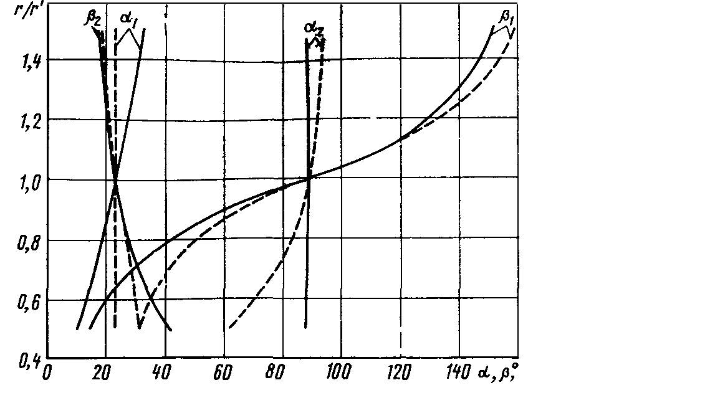

**Рис. 25. Изменение углов $\alpha$ и $\beta$ по радиусу при двух методах профилирования лопаток:**

—— $\Gamma_{1u} = \text{const}$ и - - - - $\alpha_1 = \text{const}$

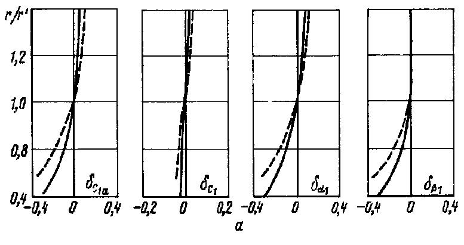

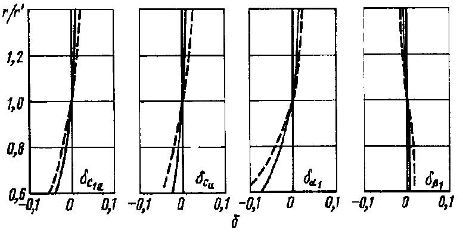

**Рис. 26. Влияние потерь на отклонение параметров потока от расчетных значений для идеального процесса истечения:**

$a$ – $\Gamma = \text{const}$; $б$ – $\alpha_1 = \text{const}$; —— $m = 0{,}95$; - - - - $m = 0{,}9$

На стадии предварительного проектирования лопаток кроме расчетного сечения достаточно определить параметры в корневом

*(Страница 75)*

сечении и на периферии. При изготовлении лопаток профиль задают и проверяют обычно в пяти и более сечениях.

### 7.3. Профилирование по радиусу при постоянном угле выхода из соплового аппарата

Кроме профилирования при постоянной циркуляции $\Gamma_{1u} = \text{const}$ известны другие методы. Наиболее распространенным из них и имеющим некоторые преимущества является профилирование СА при $\alpha_1 = \text{const}$ (см. рис. 25). Условие радиального равновесия в сечении перед РК позволяет установить зависимость между радиусом и значениями осевой и окружной составляющих абсолютной скорости $c_a r^{\cos^2\alpha_1} = \text{const}$; $c_u r^{\cos^2\alpha_1} = \text{const}$ и $c_1 r^{\cos^2\alpha_1} = \text{const}$. Из приведенных соотношений можно найти абсолютные скорости на произвольном радиусе в зависимости от их значений на расчетном радиусе $r'$:

$$c_{1u} = c_{1u}'\left(\frac{r'}{r}\right)^{\cos^2\alpha_1}; \quad c_{1a} = c_{1a}'\left(\frac{r'}{r}\right)^{\cos^2\alpha_1}; \quad c_1 = c_1'\left(\frac{r'}{r}\right)^{\cos^2\alpha_1}.$$

По скорости $c_1$ можно определить изменение по радиусу теплоперепада $H_{\text{с}}$, давления $p_1$, степени реактивности $\rho$, а также скоростей $w_1$ и $w_2$. При таком профилировании скорости $c_{1u}$ и $c_1$ возрастают с уменьшением радиуса несколько слабее, чем при профилировании $\Gamma_{1u} = \text{const}$, несмотря на увеличение скорости $c_{1a}$. Давление $p_1$ и степень реактивности у корня лопаток получаются несколько больше, следовательно, профильные потери могут стать меньше. На периферии профилирование при $\alpha_1 = \text{const}$ дает большую скорость $c_{1u}$, однако вследствие уменьшения осевой скорости $c_{1a}$ скорость $c_1$ оказывается меньше, чем при профилировании при $\Gamma_{1u} = \text{const}$ (см. рис. 24, $a$). Это обусловливает несколько большее давление $p_1$ и степени реактивности, а, следовательно, может вызвать увеличение потерь в радиальном зазоре. Закрутка рабочих лопаток при профилировании по закону $\alpha_1 = \text{const}$ получается более слабой (см. рис. 25).

*(Страница 76)*

Кроме рассмотренных двух методов профилирования иногда применяют и другие. При профилировании длинных лопаток степень реактивности можно принимать постоянной по радиусу или изменяющейся незначительно. В этих случаях снижаются потери в радиальном зазоре и в корневых сечениях в связи с уменьшением степени реактивности на периферии и ее повышением у корня лопатки. При таком профилировании составляющая скорости $c_r \neq 0$ и линии тока не располагаются на цилиндрических поверхностях.

Относительное уменьшение степени реактивности на периферии можно получить при нерадиальном расположении выходных кромок сопловых лопаток, а также специальным профилированием СА, осевого зазора и рабочих лопаток в меридиональном сечении.

Для упрощения изготовления лопаток многоступенчатых турбин иногда ограничиваются подрезкой пера лопаток последних ступеней. Это целесообразно делать при постоянном внутреннем диаметре турбины, когда при равном числе лопаток в ступенях можно принимать одинаковую форму замков. Однако такой метод профилирования не позволяет получить проточную часть турбины с наибольшим КПД.

## 8. ПОСТРОЕНИЕ ПРОФИЛЕЙ СОПЛОВЫХ И РАБОЧИХ ЛОПАТОК

Форма сопловых и рабочих лопаток должна быть совершенной с точки зрения газодинамики и условий прочности. Центробежные силы, действующие на пограничный слой в рабочих лопатках, несколько изменяют условия их работы в газодинамическом отношении по сравнению с сопловыми. Кроме того, конфузорность канала между рабочими лопатками, как правило, значительно меньше, чем между сопловыми, и заметно изменяется по радиусу. В связи с малой степенью реактивности конфузорность рабочих лопаток у корня обычно отсутствует и канал имеет иногда диффузорный профиль. С увеличением радиуса конфузорность возрастает и решетка профилей рабочих лопаток приближается по форме к сопловой. Наличие радиального зазора в рабочих лопатках также делает условия их работы отличными от условий сопловых.

Вследствие вращения в поле центробежных сил и относительной сложности охлаждения рабочие лопатки отличаются от сопловых по условиям прочности. В частности, в рабочих лопатках

*(Страница 77)*

должно быть обеспечено резкое уменьшение площади поперечного сечения от корня к периферии. В современных турбинах при больших окружных скоростях площадь сечения длинных лопаток изменяется по радиусу в 3–4 раза и более. Особые требования к профилю лопатки обусловлены необходимостью создания жесткости в ее поперечном направлении. Указанные обстоятельства затрудняют получение газодинамически совершенного профиля рабочих лопаток, особенно в корневых сечениях.

Форма профилей сопловых и рабочих лопаток определяется основным назначением ступени турбины – повернуть поток с наименьшими потерями и получить при заданной окружной скорости необходимую работу. Поэтому выбор углов лопаток $\alpha_{1\text{л}}$ и $\beta_{2\text{л}}$, которые соответствовали бы углам потока $\alpha_1$ и $\beta_2$, является важной задачей. Согласно экспериментальным данным, при тонких выходных кромках и скорости истечения, близкой к критической ($\lambda_{c1} = \lambda_{w2} = 0{,}9...1{,}05$), распространенных в современных ступенях турбин, углы потока и лопаток близки, т. е. $\alpha_1 \approx \alpha_{1\text{л}}$ и $\beta_2 \approx \beta_{2\text{л}}$. При сверхзвуковых режимах истечения происходит поворот потока в косом срезе. При дозвуковой скорости истечения наблюдается отставание потока на угол $\delta = \alpha_1 - \alpha_{1\text{л}}$ ($\delta = \beta_2 - \beta_{2\text{л}}$), который растет с увеличением $\alpha_1$ ($\beta_2$) и снижением $M_{c1}$ ($M_{w2}$). Приближенно можно принять, что при уменьшении $M_{c1}$ от 0,95 до 0,8 для $\alpha_1 = 15...20^{\circ}$ угол $\delta$ возрастет от $20'$ до $30...50'$, при уменьшении $M_{c1}$ от 0,95 до 0,6 для $\alpha_1 = 20...30^{\circ}$ угол $\delta$ возрастет от $20'$ до $1...2^{\circ}$, а для $\alpha_1 = 30...40^{\circ}$ угол $\delta$ увеличится от $20'$ до $2...5^{\circ}$.

Следовательно, при проектировании лопаток на режимах работы, соответствующих отставанию и отклонению потока от конструктивных углов лопаток, их следует определить из соотношений $\alpha_{2\text{л}} = \alpha_1 - \delta$ и $\beta_{2\text{л}} = \beta_2 - \delta$.

При известных параметрах газа на определенном радиусе можно построить профили сопловых и рабочих лопаток. Чтобы выбрать оптимальный контур профиля, можно подобрать лопатки с различными профилями и исследовать их экспериментально. Этот способ весьма трудоемок. При наличии исследованного профиля удовлетворительные результаты можно получить путем его перепрофилирования. При этом необходимо, чтобы конструктивные углы при входе и выходе проектируемой и исходной лопаток отличались

*(Страница 78)*

незначительно. Для построения нового профиля следует плавно изменить кривизну скелетной линии исходного профиля согласно известным углам $\beta_{1\text{л}}$ и $\beta_{2\text{л}}$, после чего можно найти соотношение хорд проектируемого профиля $b$ и исходного $b'$, определяющее масштаб перестроения $m = b/b'$ (рис. 27). Переменная толщина профиля $s$ и шаг решетки $t$ определяются из условия приближенного геометрического подобия $s = s'm$; $t = t'm$.

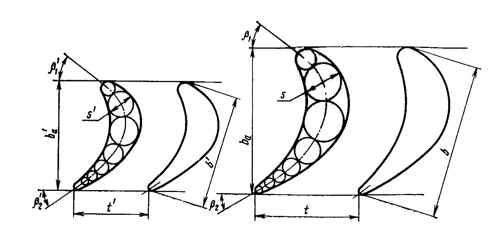

**Рис. 27. Схема построения нового профиля по исходному**

При отсутствии близких по параметрам профилей применяют автоматизированные, а также графические методы профилирования лопаток.

Рассмотрим один из таких графических методов (рис. 28).

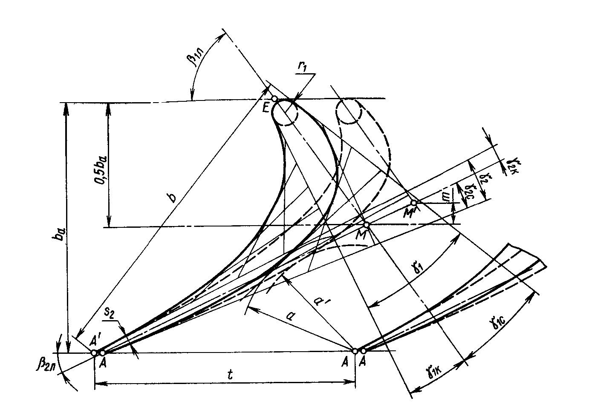

**Рис. 28. Построение профиля лопатки**

Для

*(Страница 79)*

построения профиля при известной ширине решетки $b_a$ из точки $E$ у входной кромки профиля проводим касательную $EM$ к скелетной линии профиля под углом $\beta_{1\text{л}}$, а из точки $M$ (пересечения касательной $EM$ со средней линией решетки) под углом $\beta_{2\text{л}}$ – касательную $MA$ к скелетной линии профиля у выходной кромки.

Затем выбираем радиус скругления входной кромки $r_1$ в зависимости от размеров профиля: $r_1 \approx (0{,}03...0{,}04)b_a$. При выборе величины $r_1$ следует учитывать, что на расчетном режиме при малых углах атаки $i$ профильные потери растут с увеличением радиуса $r_1$, а при обтекании профиля на переменных режимах со значительными углами атаки потери уменьшаются с увеличением радиуса $r_1$. Поэтому при профилировании лопаток турбин, работающих на переменных режимах, входную кромку следует делать толще. В корневых профилях рабочих лопаток для повышения их прочности можно увеличить радиус до $r_1 = 0{,}06b_a$.

Толщину $s_2$ выходной кромки лопатки для уменьшения гидравлических потерь следует делать как можно меньше. Величина $s_2 = 0{,}5...1{,}6$ мм (меньшее значение $s_2$ имеют лопатки маломощных турбин). С уменьшением толщины $s_2$ профильные потери и неравномерность потока за решеткой уменьшаются. Однако выходная кромка имеет обычно наибольшую температуру, и тонкая кромка быстрее прогорает. Кроме того, тонкая кромка длинной лопатки больше подвержена короблению при перегреве относительно средней части лопатки. В лопатках с внутренним охлаждением толщину $s_2$ приходится иногда увеличивать до $2...2{,}5$ мм для приближения охлаждающей среды к концу выходной кромки. Относительные толщины выходных кромок $\overline{s}_2 = s_2/a$ приближенно можно выбрать из таблицы, а размер «горла» СА определить как $a \approx t\sin\alpha_1$.

| Ступень турбины | Сопловые лопатки | Рабочие лопатки |
|---|---|---|
| Первая охлаждаемая ступень | 0,11 | 0,17 |
| Вторая охлаждаемая ступень | 0,07 | 0,10 |
| Неохлаждаемые ступени | 0,055 | 0,07 |

*(Страница 80)*

Угол между касательными к контуру у входной кромки обычных дозвуковых лопаток колеблется в широких пределах $\gamma_1 = 10...45^{\circ}$. Меньшие значения угла $\gamma_1$ относятся к реактивным профилям длинных рабочих лопаток в периферийных сечениях и сопловых, а большие – к активным профилям рабочих лопаток в корневых сечениях. Ориентировочно можно определять угол $\gamma_1$ в зависимости от угла входа $\beta_1$ по рис. 29. Положение входной кромки относительно направления луча $EM$ определяется углами $\gamma_{1\text{к}}$ (касательной к вогнутой поверхности профиля) и $\gamma_{1\text{с}}$ (касательной к выпуклой поверхности). Можно принимать $\gamma_{1\text{к}} = (0...1/3)\gamma_1$ при соблюдении неравенства $\gamma_{1\text{к}} < \gamma_{1\text{с}}$. Такое соотношение между углами $\gamma_{1\text{к}}$ и $\gamma_{1\text{с}}$ приводит к большему отклонению потока при входе на выпуклой поверхности профиля, чем на вогнутой, что соответствует отрицательным углам атаки относительно биссектрисы угла $\gamma_1$ и, как правило, минимальным профильным потерям.

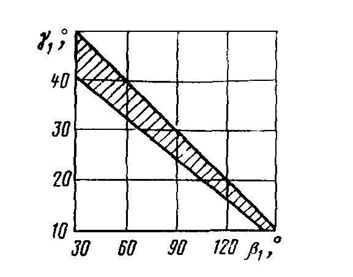

**Рис. 29. Зависимость угла $\gamma_1$ от $\beta_1$, используемая при профилировании лопаток**

У выходной кромки угол между касательными к выпуклой поверхности профиля и вогнутой обычно небольшой: $\gamma_2 = 2...5^{\circ}$. При этом направление касательной к контуру вогнутой поверхности мало отличается от расчетного направления, определяемого

*(Страница 81)*

углом $\beta_2$. Можно принимать $\gamma_{2\text{к}} = (0...1/3)\gamma_2$. При относительно небольшом шаге лопаток (например, в решетке корневых профилей) угол $\gamma_{2\text{к}} \approx 0{,}5\gamma_2$, но с увеличением шага до оптимального и более угол $\gamma_{2\text{к}}$ следует выбирать меньшим, а угол $\gamma_{2\text{с}}$ соответственно увеличивать для уменьшения сечения $a_2$ канала при выходе и приближения угла $\beta_{2\text{р}}$ решетки к расчетному углу $\beta_2$.

По полученным касательным строят контур с плавно изменяющейся кривизной, например по квадратичной параболе. По величине хорды $b$ определяют оптимальный шаг решетки. Иногда величину хорды определяют, используя приближенную зависимость для угла установки профиля $\gamma$ в решетке:

$$\gamma = 70 - 0{,}127(\beta_1 - \beta_2) - 0{,}0041(\beta_1 - \beta_2)^2.$$

Величина хорды $b$ по принятой ширине решетки $b = b_a/\sin\gamma$.

Существуют аналитические и графические зависимости, позволяющие определить относительный оптимальный шаг $\overline{t}_{\text{опт}} = (t/b)_{\text{опт}}$. Часто относительный шаг подсчитывают как

$$\frac{t}{b} = K\left[\frac{180}{180 - (\beta_1 + \beta_2)}\frac{\sin\beta_1}{\sin\beta_2}\right]^{1/3}\left(1 - \frac{c_{\max}}{b}\right),$$

где коэффициент $K$ равен 0,45 для сопловых решеток и 0,60 для рабочих, а относительная максимальная толщина профиля приближенно $\overline{c}_{\max} = c_{\max}/b$ для охлаждаемых лопаток 0,2, для неохлаждаемых 0,13 для сопловых и 0,11 для рабочих лопаток. Так как диапазон изменения коэффициентов, входящих в такие зависимости, относительно велик, а потери в решетке при изменении шага (вблизи оптимального значения $\overline{t}$) почти не изменяются, в большинстве случаев можно принимать $\overline{t}_{\text{опт}} = 0{,}70...0{,}85$. Большие значения соответствуют реактивным решеткам профилей (и сопловым). При одинаковой ширине решетки $b_a$ вследствие различия хорд абсолютный шаг реактивной решетки может значительно превосходить шаг активной решетки. С утолщением выходной кромки лопаток шаг $\overline{t}_{\text{опт}}$ увеличивается.

*(Страница 82)*

После определения оптимального шага следует проверить число лопаток, которое в соседних решетках должно быть взаимно простым, и уточнить величину шага. Чтобы увеличить шаг в реактивных решетках (при постоянной ширине решетки без отклонения от оптимального соотношения $t/b$), следует увеличить хорду, для чего можно сместить точку $M$ вверх от середины решетки в положение $M'$. При таком смещении точки $M$ увеличивается относительная кривизна входного участка профиля, что может привести к росту потерь. В решетках корневых профилей при необходимости можно уменьшить относительный шаг до величины $t/b = 0{,}55...0{,}65$.

После построения решетки следует проверить местную диффузорность канала. Окружности, вписанные в канал и построенные на распрямленной оси, образуют контур некоторого условного выпрямленного межлопаточного канала. Так как высота канала, перпендикулярная его оси, переменна, то для определения изменения сечения плоского канала диаметры полученных окружностей следует изменить пропорционально отношению текущей высоты $l$ к высоте в исходной точке $l_1$ (рис. 30). Приведенная к исходной высоте ширина канала $a' = al/l'$. В построенном таким образом канале (при дозвуковой относительной скорости) желательно не иметь общей геометрической диффузорности и особенно местной (т. е. чтобы верным было выражение $a_{\text{г}}' \leq a' \leq a_1$). Общая диффузорность канала может быть получена при малой степени реактивности и толстой входной кромке. Исправить канал в этом случае можно, увеличив конструктивный угол при входе в решетку $\beta_{1\text{л}}$. Местная диффузорность исправляется обычно утолщением профиля при увеличении угла $\gamma_1$ (в основном $\gamma_{1\text{с}}$) и частично уменьшением шага решетки. В активных решетках при коротких лопатках $(l/b < 1{,}5)$ для снижения относительно больших концевых потерь (с парным вихрем) допускается небольшая геометрическая диффузорность внутри канала (т. е. $a_1 < a > a_{\text{г}}$) при $a < 1{,}2a_1$.

Кроме того, следует проверить угол выхода решетки $\beta_{2\text{р}} = \arcsin a_{\text{г}}/t$ из условия $\beta_{2\text{р}} \approx \beta_2$. В случае увеличения длины лопатки вдоль канала направление потока при выходе уточняют по выражению

$$\beta_{2\text{р}} = (l_{\text{г}}/l_2)\arcsin(a/t),$$

где $l_{\text{г}}$ и $l_2$ –

*(Страница 83)*

средняя высота канала соответственно в горле (сечение $x_{\text{г}}$) и в выходном сечении.

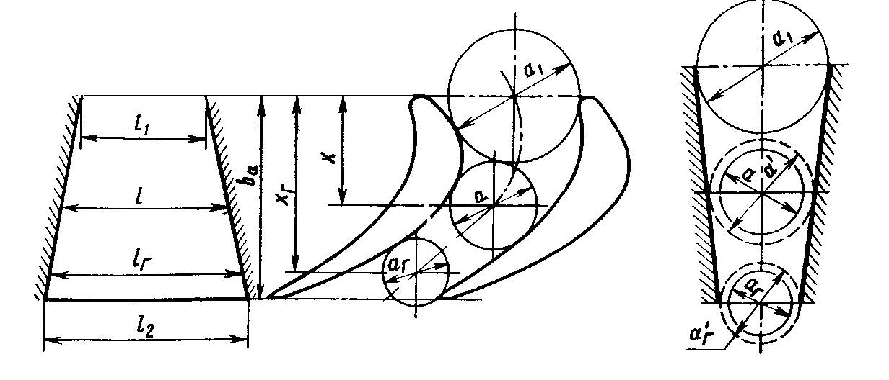

**Рис. 30. Схема проверки профиля межлопаточного канала**

Приближение величины $\beta_{2\text{р}}$ к заданному углу потока $\beta_2$ при неизменном конструктивном угле $\beta_{2\text{л}}$ достигается изменением угла $\gamma_{2\text{с}}$, передвижением точки пересечения $M$ (см. рис. 28) и в некоторой степени изменением шага решетки.

## 9. ПОРЯДОК РАСЧЕТА ПРОТОЧНОЙ ЧАСТИ

**Задание.** Из предварительного расчета ГТУ становятся известны параметры газа перед турбиной: давление $p_{\text{г}}^{*}$ и температура $T_{\text{г}}^{*}$, секундный расход $G$ и состав газа, а также величины $R$, $c_p$ и $k$. Кроме того, в зависимости от схемы ГТУ могут быть заданы:

1) статическое давление $p_{\text{т}}$ при выходе из турбины (для одновальной ГТУ);
2) необходимая удельная работа турбины $L_{\text{т}}$ (для сложной ГТУ или двигателей, в которых турбина сблокирована с компрессором).

Если не указаны специальные требования к конструкции турбины (одноступенчатая, минимальной массы или заданных размеров), то при

*(Страница 84)*

проектировании для заданных параметров стремятся получить турбину с максимальным КПД.

### Определение частоты вращения при заданном статическом давлении $p_{\text{т}}$

1. Степень понижения давления $\pi_{\text{т}} = p_{\text{г}}^{*}/p_{\text{т}}$.
2. Показатель адиабаты $k = f(\alpha, T_{\text{г}}^{*}, T_{\text{у}})$.
3. Средняя удельная теплоемкость процесса $c_p = Rk/(k-1)$.
4. Располагаемый теплоперепад $H_{\text{т}} = c_p T_{\text{г}}^{*}[1 - \pi_{\text{т}}^{(1-k)/k}]$.
5. Лопаточный КПД $\eta_{\text{л}}$ (задается).
6. Температура за турбиной (уточняется $T_{\text{у}}$)

$$T_{\text{т}} = T_{\text{г}}^{*} - H_{\text{т}}\eta_{\text{л}}/c_p.$$

7. Удельный объем $v_{\text{т}} = RT_{\text{т}}/p_{\text{т}}$.
8. Осевая скорость $c_{\text{т}a}$ (выбирается).
9. Площадь кольцевого сечения $A_{\text{т}} = Gv_{\text{т}}/c_{\text{т}a}$.
10. Напряжение на растяжение в РЛ $\sigma_{\text{л}}$ (выбирается).
11. Максимальная частота вращения, об/мин, $n_{\text{т max}} = \sqrt{\frac{\sigma_{\text{л}}}{k_n A_{\text{т}}}}$.
12. Частота вращения, об/мин, $n_{\text{т}} \leq n_{\text{т max}}$.

### Определение частоты вращения при заданной необходимой удельной работе $L_{\text{т}}$

13. Лопаточный КПД $\eta_{\text{л}}$ (задается).
14. Осевая скорость $c_{\text{т}a}$ (выбирается).
15. Располагаемый теплоперепад $H_{\text{т}} = (L_{\text{т}} + c_{\text{т}a}^2/2)/\eta_{\text{л}}$.
16. Показатель адиабаты $k$ – см. п. 2.
17. Средняя удельная теплоемкость $c_p$ – см. п. 3.
18. Температура за турбиной $T_{\text{т}}$ – см. п. 6.
19. Давление за турбиной $p_{\text{т}} = p_{\text{г}}^{*}[1 - H_{\text{т}}/(c_p T_{\text{г}}^{*})]^{k/(k-1)}$.
20. Степень понижения давления $\pi_{\text{т}}$ – см. п. 1.

*(Страница 85)*

21. Удельный объем $v_{\text{т}}$ – см. п. 7.
22. Площадь кольцевого сечения $A_{\text{т}}$ – см. п. 9.
23. Напряжение на растяжение в рабочих лопатках $\sigma_{\text{л}}$ (выбирается).
24. Максимальная частота $n_{\text{tmax}}$ – см. п. 11.
25. Частота вращения ротора турбины $n_{\text{т}}$ – см. п. 12.

### Основные размеры одноступенчатой турбины

26. Условная адиабатная скорость $c_0 = \sqrt{2H_{\text{т}}}$.
27. Степень реактивности $\rho$ (выбирается).
28. Оптимальное отношение $(u/c_0)$ (выбирается).
29. Оптимальная окружная скорость $u_{\text{тη}} = c_0(u/c_0)_{\text{η}}$.
30. Средний диаметр при выходе из рабочих лопаток $D_{\text{тη}} = 60u_{\text{тη}}/(\pi n_{\text{т}})$.
31. Длина рабочей лопатки $l_{\text{л}} = A_{\text{т}}/(\pi D_{\text{тη}})$.
32. Относительная длина рабочей лопатки при выходе $l/D$.
33. Средний диаметр (первой ступени) при выходе из сопловых лопаток $D_{\text{с}}$.
34. Длина сопловой лопатки $l_{\text{с}}$.
35. Кольцевая площадь сечения перед РК $A_{1a} = \pi D_{\text{с}} l_{\text{с}}$.
36. Располагаемый теплоперепад в СА $H_{\text{с}} = H_0(1 - \rho)$.
37. Коэффициент скорости $\varphi$ (выбирается).
38. Скорость за СА $c_1 = \varphi\sqrt{2H_{\text{с}}}$.
39. Температура за СА $T_1 = T_{\text{г}}^{*} - (H_{\text{с}}/c_p)\varphi^2$.
40. Температура конца адиабатного расширения в СА

$$T_1' = T_{\text{г}}^{*} - H_{\text{с}}/c_p.$$

41. Давление за СА $p_1 = p_0^{*}\left(\frac{T_1'}{T_0^{*}}\right)^{\frac{k}{k-1}}$.

*(Страница 86)*

42. Удельный объем $v_1 = RT_1/p_1$.
43. Средняя осевая скорость за СА $c_{1a} = Gv_1/A_{1a}$.
44. Угол выхода из СА $\alpha_1 = \arcsin(c_{1a}/c_1)$.

### Основные размеры многоступенчатой турбины

45. Относительная длина рабочей лопатки последней ступени $l_{\text{т}}/D_{\text{т}} \leq 1/3{,}5...1/3$ (задается).
46. Средний диаметр последней ступени $D_{\text{т}} = \sqrt{\frac{A_{\text{т}a}}{\pi\left(\frac{l_{\text{т}}}{D_{\text{т}}}\right)}}$.
47. Окружная скорость на диаметре $D_{\text{т}}$ $u_{\text{т}} = \pi D_{\text{т}} n_{\text{т}}/60$.
48. Средний диаметр при выходе из СА первой ступени $D_1$ – см. п. 33.
49. Окружная скорость на диаметре $D_1$ $u_1 = \pi D_1 n_{\text{т}}/60$.
50. Средняя окружная скорость по турбине $u_{\text{ср}}$.
51. Оптимальное отношение $y_0$ (выбирается).
52. Средняя скорость за ступенями $c_{2\text{ср}}$ (задается).
53. Коэффициент использования скорости $\mu$ (выбирается).
54. Число ступеней $z = \frac{\frac{c_0^2}{(\mu c_{2\text{ср}})^2} - 1}{\frac{u_{\text{ср}}^2}{(\mu c_{2\text{ср}})^2 y_0^2} - 1}$.
55. Теплоперепады по ступеням $H_{01}'$, $H_{02}'$, ..., $H_{0z}'$.
56. Степень реактивности по ступеням $\rho_1$, $\rho_2$, ..., $\rho_z$.
57. Располагаемый теплоперепад в СА первой ступени $H_{\text{с1}} = H_{01}(1 - \rho_1)$.
58. Угол потока за СА первой ступени $\alpha_{11}$ (задается).
59. Скорость за СА первой ступени $c_1 = \varphi_1\sqrt{2H_{\text{с1}}}$.
60. Температура за СА первой ступени $T_{\text{с1}} = T_{\text{г}}^{*} - H_{\text{с1}}\varphi_1^2/c_p$.

*(Страница 87)*

61. Давление за СА первой ступени

$$p_{\text{с1}} = p_{\text{г}}^{*}[1 - H_{\text{с1}}/(c_p T_{\text{г}}^{*})]^{k/(k-1)}.$$

62. Удельный объем за СА первой ступени $v_{\text{с1}} = RT_{\text{с1}}/p_{\text{с1}}$.
63. Длина сопловой лопатки первой ступени

$$l_{\text{с1}} = Gv_{\text{с1}}/(\pi D_1 \sin\alpha_{11} c_{11}).$$

64. Длины сопловых и рабочих лопаток по ступеням $l_{\text{с2}}$, $l_{\text{с3}}$, ..., $l_{\text{сz}}$; $l_{\text{л1}}$, $l_{\text{л2}}$, ..., $l_{\text{лz}}$.
65. Ширина сопловой лопатки по ступеням $b_{a\text{с1}}$, $b_{a\text{с2}}$, ..., $b_{a\text{сz}}$ (выбирается).
66. Ширина рабочей лопатки по ступеням $b_{a\text{л1}}$, $b_{a\text{л2}}$, ..., $b_{a\text{лz}}$ (выбирается).
67. Осевой зазор за сопловыми лопатками по ступеням $\delta_{a\text{с1}}$, $\delta_{a\text{с2}}$, ..., $\delta_{a\text{сz}}$ (выбирается).
68. Осевой зазор за рабочими лопатками по ступеням $\delta_{a\text{л1}}$, $\delta_{a\text{л2}}$, ..., $\delta_{a\text{лz}}$ (выбирается).
69. Угол раскрытия меридионального сечения $\gamma$, $\gamma_{\text{н}}$, $\gamma_{\text{в}}$.

### Первая ступень турбины

70. Располагаемый теплоперепад первой ступени $H_{01}$ – см. п. 55.
71. Степень реактивности $\rho_1$ – см. п. 56.
72. Располагаемый теплоперепад в СА $H_{\text{с1}}$ – см. п. 57.
73. Коэффициент скорости $\varphi_1$ – см. п. 37.
74. Скорость за СА $c_{11}$ – см. п. 59.
75. Средняя условная температура первой ступени

$$T_{\text{у}} = T_0^{*} - H_{01}\varphi_1^2/(2c_p).$$

76. Средняя удельная теплоемкость $c_p$.
77. Температура за СА $T_1 = T_0^{*} - H_{\text{с1}}\varphi_1^2/c_p$.
78. Температура в конце адиабатного расширения в СА

$$T_1' = T_0^{*} - H_{\text{с1}}/c_p.$$

*(Страница 88)*

79. Давление перед рабочими лопатками $p_1 = p_0^{*}(T_1'/T_0^{*})^{k/(k-1)}$.
80. Кольцевая площадь сечения перед рабочими лопатками $A_{1a} = \pi D_1 l_{\text{с1}}$.
81. Удельный объем перед рабочими лопатками $v_1 = RT_1/p_1$.
82. Средняя скорость перед рабочими лопатками $c_{1a} = G_{\text{с}}v_1/A_{1a}$.
83. Угол потока за СА $\alpha_{11} = \arcsin(c_{1a}/c_1)$ (проверяется, см. п. 58).
84. Относительная скорость при входе в рабочие лопатки

$$w_1 = \sqrt{c_1^2 + u_1^2 - 2c_1u_1\cos\alpha_1}.$$

85. Угол входа потока на рабочие лопатки

$$\beta_{11} = \text{arctg}\frac{c_{1a}}{c_{11}\cos\alpha_{11} - u_1}.$$

86. Располагаемый теплоперепад в РК $H_{\text{л}} = \rho H_0 T_1/T_1'$.
87. Окружная скорость при входе на рабочие лопатки $u_1 = \pi D_{\text{с}}n/60$.
88. Окружная скорость при выходе из рабочих лопаток $u_2 = \pi D_{\text{л}}n/60$.
89. Коэффициент скорости в рабочих лопатках $\psi_1$.
90. Относительная скорость за рабочими лопатками

$$w_{21} = \psi\sqrt{w_1^2 + 2H_{\text{л}} + u_2^2 - u_1^2}.$$

91. Температура за рабочими лопатками

$$T_2 = T_1 - \frac{w_2^2 - w_1^2 - u_2^2 + u_1^2}{2c_p}.$$

92. Температура в конце адиабатного расширения в рабочих лопатках $T_2' = T_1 - H_{\text{л}}/c_p$.
93. Давление за рабочими лопатками $p_2 = p_1(T_2'/T_1)^{k/(k-1)}$.
94. Удельный объем за рабочими лопатками $v_2 = RT_2/p_2$.
95. Площадь кольцевого сечения за рабочими лопатками $A_{\text{л}a} = \pi D_{\text{л}}l_{\text{л}}$.

*(Страница 89)*

96. Осевая скорость за рабочими лопатками $c_{2a} = G_{\text{л}}v_2/A_{\text{л}a}$.
97. Угол выхода потока из рабочих лопаток $\beta_2 = \arcsin(c_{2a}/w_2)$.
98. Скорость закрутки потока за рабочими лопатками $c_{2u} = w_2\cos\beta_2 - u_2$.
99. Угол выхода потока из рабочих лопаток $\alpha_2 = \text{arctg}(c_{2a}/c_{2u})$.

**При отклонении угла $\alpha_2$ от допустимых значений вводятся необходимые изменения и параметры пересчитываются!**

100. Скорость газа за рабочими лопатками $c_2 = \sqrt{c_{2a}^2 + c_{2u}^2}$.
101. Работа на окружности РК $L_u = c_{1u}u_1 + c_{2u}u_2$.
102. КПД на окружности РК $\eta_u = L_u/H_0$.
103. Удельные потери в СА $h_{\text{с}} = (\varphi^{-2} - 1)c_1^2/2$.
104. То же, с учетом их использования в рабочих лопатках $h_{\text{с}}' = h_{\text{с}}T_2'/T_1$.
105. Относительные потери в СА $\xi_{\text{с}} = h_{\text{с}}/H_0$.
106. То же, с учетом их использования в рабочих лопатках $\xi_{\text{с}}' = \xi_{\text{с}}T_2'/T_1$.
107. Удельные потери в рабочих лопатках $h_{\text{л}} = (\psi^{-2} - 1)w_2^2/2$.
108. Относительные потери в рабочих лопатках $\xi_{\text{л}} = h_{\text{л}}/H_0$.
109. Удельные потери с выходной скоростью $h_{\text{в}} = c_2^2/2$.
110. Относительные потери с выходной скоростью $\xi_{\text{в}} = h_{\text{в}}/H_0$.
111. КПД на окружности РК $\eta_u = 1 - \xi_{\text{с}}' - \xi_{\text{л}} - \xi_{\text{в}}$ (проверяется, см. п. 102).
112. Радиальный зазор между корпусом и сопловыми лопатками (задается) $\delta_{\text{с}}$.
113. Радиальный зазор между корпусом и рабочими лопатками (задается) $\delta_{\text{л}}$.
114. Удельные потери в радиальном зазоре

$$h_3 = 1{,}37(1 + 1{,}6\rho)\left(1 + \frac{l_2}{D_{\text{ср}}}\right)\frac{\delta_{\text{л}}}{l_2}L_u.$$

115. Относительные потери в радиальном зазоре $\xi_3 = h_3/H_0$.

*(Страница 90)*

116. Удельная работа ступени с учетом потери в радиальном зазоре $L_{u3} = L_u - h_3$.
117. Мощностной КПД ступени $\eta_{\text{т}}' = \eta_u - \xi_3$.
118. Лопаточный КПД ступени $\eta_{\text{л}}' = \eta_{\text{т}}' + \xi_{\text{в}}$.
119. Затраты мощности на трение и вентиляцию

$$N_{\text{т.в}} = \left[1{,}07D^2 + 61(1 - \varepsilon)Dl\right]\left(\frac{u}{100}\right)^3\rho.$$

120. Удельные потери на трение и вентиляцию $h_{\text{т.в}} = N_{\text{т.в}}/G_{\text{с1}}$.
121. Относительные потери на трение и вентиляцию $\xi_{\text{т.в}} = h_{\text{т.в}}/H_{01}$.
122. Мощностной КПД ступени с учетом потери на трение и вентиляцию $\eta_{\text{т}} = \eta_{\text{т}}' - \xi_{\text{т.в}}$.
123. Лопаточный КПД ступени с учетом потерь на трение и вентиляцию $\eta_{\text{л}} = \eta_{\text{л}}' - \xi_{\text{т.в}}$.
124. Удельная работа ступени $L_{\text{т1}} = H_{01}\eta_{\text{т}}$.
125. Температура за первой ступенью

$$T_{\text{ст}}' = T_2 + h_3/c_p + h_{\text{т.в}}/c_p.$$

126. Температура торможения за первой ступенью

$$T_{\text{ст}}^{*} = T_{\text{ст}} + h_{\text{в}}/c_p.$$

127. Давление торможения за первой ступенью

$$p_{\text{ст}}^{*} = p_2\left(\frac{T_{\text{ст}}^{*}}{T_{\text{ст}}}\right)^{\frac{k}{k-1}}.$$

128. Располагаемый теплоперепад по параметрам торможения

$$H_{01}^{*} = c_p T_0^{*}\left[1 - \left(\frac{p_{\text{ст}}^{*}}{p_0^{*}}\right)^{\frac{k-1}{k}}\right].$$

129. КПД ступени по параметрам торможения $\eta_{\text{т}}^{*} = L_{\text{т1}}/H_{01}^{*}$.

### Расчет $i$-й ступени

130. Температура торможения перед $i$-й ступенью $T_{0i}^{*} = T_{\text{ст}(i-1)}^{*}$.

*(Страница 91)*

131. Коэффициент использования скорости $c_2$ при выходе из $i$-й ступени $\mu$.
132. Давление торможения перед $i$-й ступенью

$$p_{0i}^{*} = p_{2(i-1)}\left[1 + \frac{(\mu c_{2(i-1)})^2}{2c_p T_{\text{ст}(i-1)}}\right]^{\frac{k}{k-1}}.$$

133. Располагаемый теплоперепад $i$-й ступени без учета энергии подтока $H_i$.
134. Уточненный располагаемый теплоперепад $i$-й ступени

$$H_{0i} = H_i\left[1 + \frac{(1 - \mu^2)c_{2(i-1)}^2}{2c_p T_{0i}}\right] + \frac{(\mu c_{2(i-1)})^2}{2}.$$

Затем $i$-я ступень рассчитывается, как первая – см. п. 71.
135. Удельная работа $i$-й ступени $L_{\text{т}i} = H_{0i}\eta_{\text{т}i}$.
136. Отношение расходов газа через СА $i$-й ступени и первой $g_i$.
137. Удельная работа $i$-й ступени, отнесенная к расходу газа через СА первой ступени $L_{\text{т}i}g_i$.

### Расчет последней ступени $z$ при заданном давлении $p_{2z} = p_{\text{т}}$

138. Температура торможения перед ступенью $T_{0z}^{*}$ – см. п. 130.
139. Давление торможения перед ступенью $p_{0z}^{*}$ – см. п. 132.
140. Располагаемый теплоперепад ступени

$$H_{0z} = c_p T_{0z}^{*}\left[1 - \left(\frac{p_{2z}}{p_{0z}^{*}}\right)^{\frac{k-1}{k}}\right].$$

Расчет параметров в СА проводится, как в $i$-й ступени.

*(Страница 92)*

141. Располагаемый теплоперепад в рабочих лопатках $H_{\text{л}z} =$

$$= c_p T_{1z}\left[1 - \left(\frac{p_{2z}}{p_{1z}}\right)^{\frac{k-1}{k}}\right].$$

Затем последняя ступень рассчитывается, как $i$-я.

### Расчет последней ступени при заданной работе $L_{\text{т}\Sigma} = L_{\text{т}}$

142. Удельная работа последней ступени

$$L_{\text{т}z} = \frac{L_{\text{т}\Sigma} - \sum_{1}^{z-1} L_{\text{т}i}g_i}{g_z}.$$

143. Мощностной КПД ступени $\eta_{\text{т}z}$ (задается).
144. Располагаемый теплоперепад последней ступени $H_{0z} = L_{\text{т}z}/\eta_{\text{т}z}$. Расчет параметров в СА проводим так же, как в $i$-й ступени.
145. Располагаемый теплоперепад $H_{\text{л}z}$ в рабочих лопатках определяем, подбирая $p_{\text{т}}$, соответствующее требуемой работе $L_{\text{т}z}$ (п. 142).

### Расчет параметров турбины

146. Удельная работа турбины (отнесена к расходу газа через СА первой ступени) $L_{\text{т}\Sigma} = L_{\text{т}1} + g_2 L_{\text{т}2} + ... + g_z L_{\text{т}z}$.
147. Располагаемый теплоперепад в турбине (для второго варианта уточняем по истинной величине $p_{\text{т}}$, п. 1 и 4) $H_{\text{т}}$.
148. Мощностной КПД турбины $\eta_{\text{т}} = L_{\text{т}\Sigma}/H_{\text{т}}$.
149. Лопаточный КПД турбины $\eta_{\text{л}} = (L_{\text{т}\Sigma} + h_{\text{в}z})/H_{\text{т}}$.
150. Располагаемый теплоперепад турбины по параметрам торможения

$$H_{\text{т}}^{*} = c_p T_{\text{г}}^{*}\left[1 - \left(\frac{p_{\text{т}}^{*}}{p_{\text{г}}^{*}}\right)^{\frac{k-1}{k}}\right].$$

151. КПД турбины по параметрам торможения $\eta_{\text{т}} = L_{\text{т}\Sigma}/H_{\text{т}}^{*}$.
152. Механический КПД $\eta_{\text{м}}$ (принимается).
153. Мощность турбины $N = L_{\text{т}\Sigma}G_c\eta_{\text{м}}$.

*(Страница 93)*

## Замечания

1. Обычно окружная скорость $u_{\text{т}} \leq 360...400$ м/с. Большее значение $u_{\text{т}}$ или неудовлетворительные размеры конструкции (большой диаметр и малая длина лопатки $l_{\text{лη}} < 30...50$ мм при $l/D < 1/3$) свидетельствуют о целесообразности проектирования многоступенчатой турбины (см. п. 29, 32).
2. Размеры лопаток определяют после построения профиля меридионального сечения турбины (см. п. 34, 64–68).
3. Если значения $\gamma_{\text{н}}$ или $\gamma_{\text{в}}$ превосходят допустимые пределы, то следует изменить профиль меридионального сечения (см. п. 69).
4. Приближенно можно принять значение $c_p$ постоянным для процесса расширения в турбине (см. п. 2 и 3). При необходимости более точного расчета значение $c_p$ определяют для каждой ступени по величинам $T_{\text{у}}^{*}$ и $\alpha$ (см. рис. П1 и П2, п. 76).
5. При расчете $c_{1a}$ берется расход газа $G_{\text{с}}$ через СА первой ступени (п. 82).
6. При расчете $c_{2a}$ принимается расход газа $G_{\text{л}}$ через РК. При отсутствии утечек и добавлении воздуха, охлаждающего СА, $G_{\text{л}} = G_{\text{с}}$ (см. п. 96).
7. Удельные потери в радиальном зазоре можно определить другим способом – см. п. 114.
8. Если ротор турбины барабанного типа, то затраты мощности $N_{\text{т.в}}$ определяются для турбины в целом.

---

*(Страница 94)*

## ПРИЛОЖЕНИЕ

### ГРАФИЧЕСКИЕ ЗАВИСИМОСТИ ДЛЯ ОПРЕДЕЛЕНИЯ КОЭФФИЦИЕНТА ИЗБЫТКА ВОЗДУХА, УДЕЛЬНЫХ ТЕПЛОЕМКОСТЕЙ И ПОКАЗАТЕЛЕЙ ИЗОЭНТРОПЫ

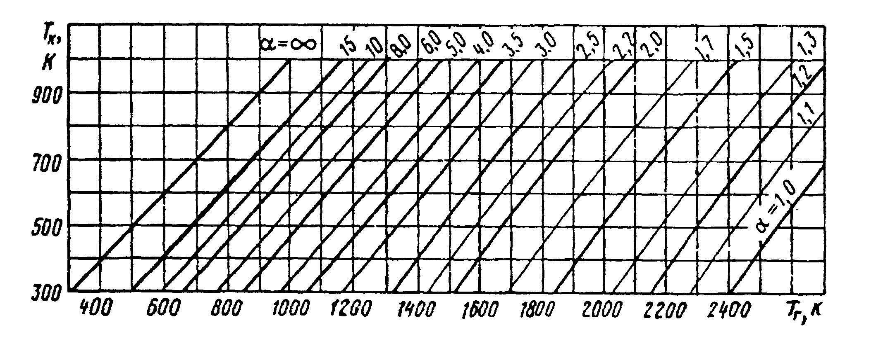

**Рис. П1. Зависимости коэффициента $lpha$ избытка воздуха от температуры $T_{	ext{р}}$ начала и $T_{	ext{г}}$ конца сгорания**

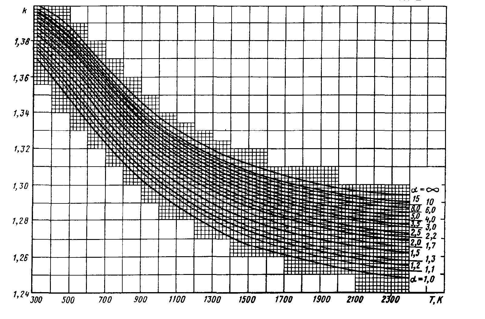

**Рис. П2. Зависимости истинного показателя изоэнтропы $k$**

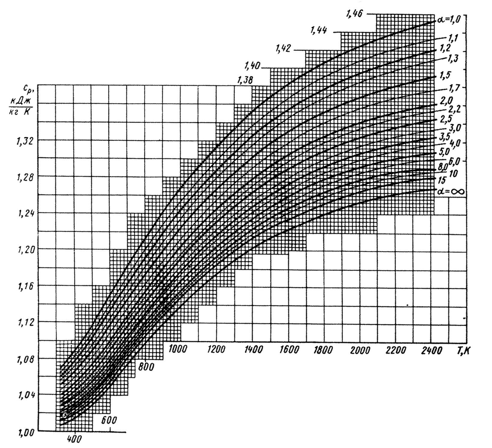

*(Страница 95)*

**Рис. П3. Зависимости истинной теплоемкости $c_p$ продуктов сгорания керосина**

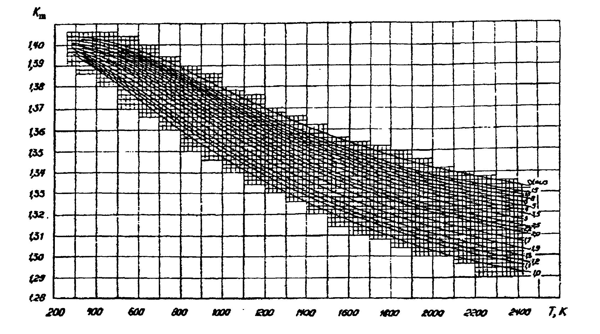

**Рис. П4. Зависимости среднего показателя изоэнтропы $k_m$**

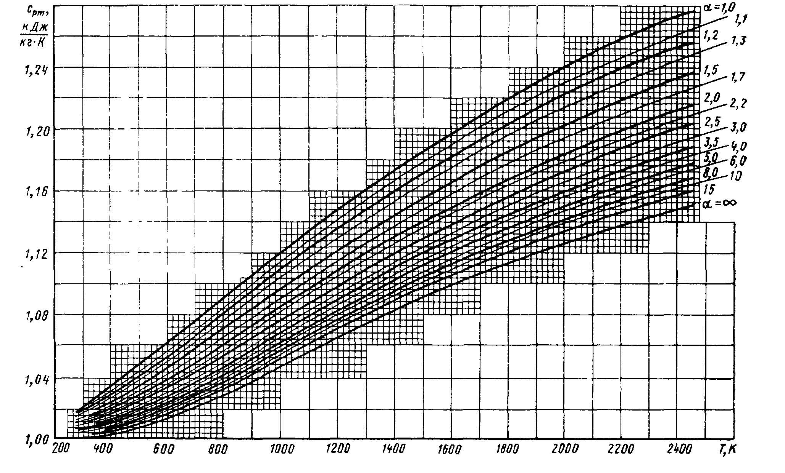

*(Страница 96)*

**Рис. П5. Зависимости средней удельной $c_{pm}$ теплоемкости продуктов сгорания керосина**

---

*(Страница 97)*

## Список рекомендуемой литературы

1. Абианц В.Х. Теория авиационных газовых турбин. М.: Машиностроение, 1979. 246 с.
2. Аронов Б.М. Автоматизация конструирования лопаток авиационных турбомашин. М.: Машиностроение, 1978. 167 с.
3. Аэродинамика турбин и компрессоров: Пер. с англ. / Под ред. У.Р. Хауторна. М.: Машиностроение, 1968. 742 с.
4. Бекнев В.С., Панков О.М., Янсон Р.А. Газовая динамика газотурбинных и комбинированных установок. М.: Машиностроение, 1973. 392 с.
5. Газовая динамика. Механика жидкости и газа: Учеб. для вузов / В.С. Бекнев, В.М. Епифанов, А.И. Леонтьев и др.; Под общ. ред. А.И. Леонтьева. 2-е изд., перераб. и доп. М.: Изд-во МГТУ им. Н.Э. Баумана, 1997. 671 с.
6. Дейч М.Е. Техническая газодинамика. М.: Энергия, 1974. 592 с.
7. Кириллов И.И. Теория турбомашин. Л.: Машиностроение, 1972. 536 с.
8. Турбомашины и МГД-генераторы газотурбинных и комбинированных установок / В.С. Бекнев, В.Е. Михальцев, А.Б. Шабаров, Р.А. Янсон. М.: Машиностроение, 1983. 392 с.
9. Конструкция и проектирование авиационных газотурбинных двигателей: Учеб. для студентов вузов по спец. «Авиационные двигатели и энергетические установки» /С.А. Вьюнов, Ю.И. Гусев, А.В. Карпов и др.; Под общ. ред. Д.В. Хронина. М.: Машиностроение, 1989. 568 с.
10. Кутателадзе С.С., Леонтьев А.И. Теплообмен и трение в турбулентном пограничном слое. М.: Энергия, 1972. 344 с.
11. Локай В.И., Максутова М.К., Стрункин В.А. Газовые турбины двигателей летательных аппаратов. М.: Машиностроение, 1991. 511 с.
12. Локомотивные газотурбинные установки / В.В. Уваров, В.С. Бекнев, Н.Д. Грязнов и др. М.: Машгиз, 1962. 548 с.
13. Малинин Н.Н. Прочность турбомашин. М.: Машгиз, 1962. 291 с.
14. Манушин Э.А., Михальцев В.Е., Чернобровкин А.П. Теория и проектирование газотурбинных и комбинированных установок. М.: Машиностроение, 1977. 447 с.
15. Теория и проектирование газотурбинных и комбинированных установок: Учеб. для вузов / Ю.С. Елисеев, Э.А. Манушин, В.Е. Михальцев и др. 2-е изд., перераб. и доп. М.: Изд-во МГТУ им. Н.Э. Баумана, 2000. 640 с.
16. Нечаев Ю.Н., Федоров Р.М. Теория авиационных газотурбинных двигателей: В 2 ч. Ч. 1. М.: Машиностроение, 1977. 312 с.

*(Страница 98)*

17. Степанов Г.Ю. Гидродинамика решеток турбомашин. М.: ГИФМЛ, 1962. 512 с.
18. Степанов Г. Ю. Гидродинамическая теория решеток. Механика в СССР за 50 лет.: В 3 т. Т. 2: Механика жидкости и газа. М.: Наука, 1970. С. 103–152.
19. Тунаков А.П. Методы оптимизации при доводке и проектировании газотурбинных двигателей. М.: Машиностроение, 1979. 184 с.
20. Уваров В.В. Газовые турбины и газотурбинные установки. М.: Высшая школа, 1970. 320 с.
21. Холщевников К.В. Теория и расчет авиационных лопаточных машин. М.: Машиностроение, 1970. 610 с.
22. Холщевников К.В., Емин О.Н., Митрохин В.Т. Теория и расчет авиационных лопаточных машин: Учеб. для студентов вузов по спец. «Авиационные двигатели». 2-е изд., перераб. и доп. М.: Машиностроение, 1986. 432 с.
23. Ржавин Ю.А. Осевые и центробежные компрессоры двигателей летательных аппаратов. Теория, конструкция и расчет: Учеб. М.: Изд-во МАИ, 1995. 344 с.
24. Манушин Э.А., Суровцев И.Г. Конструирование и расчет на прочность турбомашин газотурбинных и комбинированных установок: Учеб. пособие для студентов машиностр. спец. вузов / Под ред. Н.Н. Малинина. М.: Машиностроение, 1990. 400 с.
25. Теплопередача в охлаждаемых деталях газотурбинных двигателей летательных аппаратов / В.И. Локай, М.Н. Бодунов, В.В. Жуйков, А.В. Щукин. М.: Машиностроение, 1985. 216 с.
26. Копелев С.З., Гуров С.В. Тепловое состояние элементов конструкции авиационных двигателей. М.: Машиностроение, 1978. 208 с.
27. Манушин Э.А., Барышникова Э.С. Турбостроение. Итоги науки и техники.: В 3 т. Т. 2: Системы охлаждения турбин высокотемпературных двигателей. М.:ВИНИТИ, 1980. 280 с.
28. Сироткин Я.А. Аэродинамический расчет лопаток осевых турбомашин. М.: Машиностроение, 1972. 448 с.
29. Бойко А.В. Оптимальное проектирование проточной части осевых турбин. Харьков: Вища школа; Изд-во Харьк. ун-та, 1982. 152 с.
30. Копелев С.З. Охлаждаемые лопатки газовых турбин (тепловой расчет и профилирование). М.: Наука, 1983. 145 с.
31. Митрохин В.Т. Выбор параметров и расчет центростремительной турбины на стационарных и переходных режимах. М.: Машиностроение, 1974. 226 с.
32. Седов Л.И. Методы подобия и размерностей в механике. М.: Наука, 1967. 428 с.
33. Овсянников Б.В., Боровский Б.И. Теория и расчет агрегатов питания ЖРД: Учеб. для вузов. 2-е изд. М.: Машиностроение, 1979. 344 с.

*(Страница 99)*

34. Копелев С.З., Тихонов Н.Д. Расчет турбин авиационных двигателей. М.: Машиностроение, 1974. 268 с.
35. Копелев С.З. Проектирование проточной части турбин авиационных двигателей. М.: Машиностроение, 1984. 224 с.
36. Венедиктов В.Д. Газодинамика охлаждаемых турбин. М.: Машиностроение, 1990. 240 с.

---

*(Страница 100)*

## Оглавление

Предисловие

1. Назначение, типы и конструкции газовых турбин. Основные требования к ним
   1.1. Техническое задание на проектирование газовой турбины
   1.2. Особенности конструкции газовой турбины

2. Удельные параметры турбины

3. Основные параметры процесса течения газа в каналах лопаточных аппаратов
   3.1. Идеальное истечение
   3.2. Истечение с потерями
   3.3. Соотношение работы трения и потери кинетической энергии при истечении с трением

4. Параметры газа в ступени и работа на окружности колеса
   4.1. Работа и КПД
   4.2. Потери от перетекания газов в радиальный зазор
   4.3. Потери на трение диска и на вентиляцию газа внутри каналов рабочих лопаток (для парциальной турбины)
   4.4. Дополнительные потери при определении полезной мощности

5. Зависимость КПД и удельных параметров ступени от окружной скорости

6. Выбор частоты вращения ротора, основных размеров и формы меридионального сечения проточной части турбины
   6.1. Максимальная частота вращения ротора турбины
   6.2. Оптимальная окружная скорость в турбине
   6.3. Основные размеры и форма меридионального сечения проточной части турбины

7. Профилирование лопаток по радиусу
   7.1. Необходимость профилирования лопаток
   7.2. Профилирование по радиусу при постоянной циркуляции
   7.3. Профилирование по радиусу при постоянном угле выхода из соплового аппарата

8. Построение профилей сопловых и рабочих лопаток

9. Порядок расчета проточной части

Приложение. Графические зависимости для определения коэффициента избытка воздуха, удельных теплоемкостей и показателей изоэнтропы

Список рекомендуемой литературы

---

*Для заметок*

---

*(Страница 103)*

## Учебное издание

**Всеволод Евгеньевич Михальцев**
**Валерий Дмитриевич Моляков**

**Теория и проектирование ступени газовой турбины**

Редактор А.В. Сахарова
Корректор Л.И. Малютина
Компьютерная верстка О.В. Беляевой

Подписано в печать 25.10.2006. Формат 60×84/16. Бумага офсетная.
Печ. л. 6,5. Усл. печ. л. 6,05. Уч.-изд. л. 5,85. Изд. № 61. Тираж 100 экз.
Заказ

Издательство МГТУ им. Н.Э. Баумана.
105005, Москва, 2-я Бауманская, 5.

*(Страница 104)*
