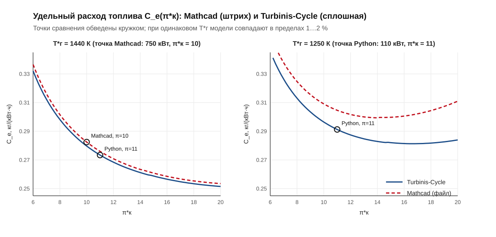

# Сверка: `Turbinis-Cycle.ipynb` ↔ Mathcad «С_учетом_охлаждения_многоступенч.xmcd»

Дата сверки: 01.11.2026.

> **Важно:** §3-§9 относятся к версии цикла от 01.11.2026 с `G_в = 0.524 кг/с`,
> `C_e = 0.2912` (она сохранена в `Turbinis-Cycle/old/Turbinis-Cycle_2026-11-01_Gv0.524.ipynb`).
> Текущая версия блокнота — вариант «увеличенный расход»: `G_в = 0.562 кг/с`, `C_e = 0.3097`
> (коэффициенты КПД/потерь сдвинуты к краю диапазонов, см. вводную ячейку блокнота). Обе модели перезаписаны на Python заново и проверены по числам,
сохранённым в самих файлах (Mathcad — совпадение < 0.05 %, блокнот — совпадение с выводами ячеек).

---

## Коротко

1. **Файл и блокнот считают разные двигатели.** Mathcad: 750 кВт, `T*см = 1440 К`, `π*к = 10`.
   Блокнот: 110 кВт, `T*г = 1250 К`, `π*к = 11`. Поэтому «0.2825 против 0.2912» — это в первую
   очередь разница точек, а не разница методик.
2. **На одной и той же точке модели расходятся на 1.0 % по `C_e` и 0.6 п.п. по `η_e`.**
   То есть перенос в Python сделан корректно: тождества цикла, КПД, баланс мощностей,
   определения `C_e`/`η_e` совпадают.
3. **Но есть одна настоящая физическая ошибка:** в цикле используется **средняя** теплоёмкость
   там, где нужна **истинная**. Из-за этого `k_т` завышен (1.370 вместо 1.337), а `T*т`
   занижен на **26…42 К**. Это уезжает дальше в `Turbinis-Calc`.
4. Плюс 5 более мелких расхождений (таблица в §5) и два отсутствующих блока (масса, поступенчатый
   расчёт — второй уже живёт в `Turbinis-Calc`).

---

## 1. Что содержит Mathcad-файл

Формат — Mathcad 14 (`worksheet30`), 389 областей. Структура:

| Этап | Содержание | Есть в блокноте? |
|---|---|---|
| 1 | Исходные данные (750 кВт, 1440 К, 30000 об/мин) | частично (свои значения) |
| 2 | Теплофизика: **две** корреляции `C_p` (истинная) и `C_pm` (средняя), для воздуха и газа | **нет** (одна — средняя) |
| 3 | Компрессор, 3 приближения по `k` (истинная `C_p`) | да, эквивалентно |
| 4 | КС: `f`, `α`, `k_г`, `L_т.гг` | да, другая формула |
| 5 | Свободная турбина: `π_т.с`, `L_т.с` (через `η_л`), `T_т.с` | да, другой структуры |
| 6 | Масса двигателя, `M_ред`, `J_сумм` — **критерий выбора `π*к`** | **нет** |
| 7 | Графики | да (свои) |
| 8 | Итоговый выбор `π*к = 10` и данные для турбины | частично |
| 9 | `n_т`, `D_т`, `u_т`, `z` (число ступеней) | частично, другие допущения |
| 10 | Поступенчатый расчёт (обрывается на `w_21` 1-й ступени) | вынесено в `Turbinis-Calc` |

Важно: несмотря на название, **`g_охл = 0.05` в файле только объявлен и нигде не используется**
(встречается в документе один раз), как и `η_ст.полн`. Цикл в Mathcad считается **без отбора
на охлаждение** — только `g_ут = 0.007`.

---

## 2. Исходные данные

| Параметр | Mathcad (файл) | Turbinis-Cycle | Комментарий |
|---|---|---|---|
| `N` на валу, кВт | **750** | **110** | разные двигатели |
| `T*г` (`T*см`), К | **1440** | **1250** | разные двигатели |
| `π*к` | **10** (из перебора 7…11) | **11** («оптимум», вручную) | см. §5.7 |
| `g_ут` | 0.007 | 0.0075 | |
| `g_охл` | 0.05 — **не используется** | 0.015 (при `T*г ≤ 1250`), возврат 0.6 | принципиально |
| `σ_вх` | 0.98 | 0.985 | |
| `σ_г` | 0.97 | 0.965 | |
| `σ_вых` → `π_с` | 0.995 → `π_с = 1.005` | — → `π_с = 1.04` | разные `p_т` |
| `η_к` (политропный) | 0.83 | 0.86 | |
| `η_т` | **0.9 задано** (`η_т.полн`) | **0.929** из `η_тп = 0.905` | разные определения |
| `η_л` (лопаточный) | 0.91 | 0.90 (`η_л`) — в цикле не используется | |
| `η_г` | 0.995 | 0.98 | |
| `η_м` | 0.995 | 0.9925 | |
| `η_р` | 0.99 | 0.985 | |
| `Q_н`, кДж/кг | 43000 | 43150 | |
| `l_0` | 14.61 | 14.61 | |
| `R`, `T_а`, `p_а` | 287.4 / 288 / 101300 | 287.4 / 288 / 101300 | совпадает |
| остаточная скорость `c_т` | 210 м/с (`M_т ≈ 0.35`) | `M_т = 0.2031` → `c_т ≈ 108` м/с | |
| `α` | из баланса топлива | **два**: полином (4.01) и `1/(g_m l_0)` (3.94) | §5.5 |

---

## 3. Результаты

### 3.1 Каждый расчёт в своей точке

| Параметр | Mathcad (1440 К, π=10) | Turbinis-Cycle (1250 К, π=11) |
|---|---|---|
| `T*к`, К | 627.9 | 637.8 |
| `L_к`, кДж/кг | 347.7 | 352.6 |
| `g_m` | 0.02349 | 0.01738 |
| `α` | 2.914 | 3.938 |
| `π*т` суммарная | 9.46 (2.82 × 3.35) | 9.77 |
| `L_т`, кДж/кг | 640.8 (343.8 ТГГ + 296.9 СТ) | 568.1 |
| `η*т` | 0.900 (задано) | 0.929 (из 0.905) |
| `T*т`, К | 895.9 | 715.6 |
| `N_в.уд`, кДж/кг | 292.5 | 210.0 |
| `G_в`, кг/с | 2.523 | 0.524 |
| `C_e`, кг/(кВт·ч) | 0.2825 | 0.2912 |
| `η_e` | 0.2964 | 0.2865 |

`C_e` в блокноте **хуже на 3 %**, `η_e` — **хуже на 1 п.п.**, хотя `T*г` ниже на 190 К.
Причина — `π*к` и трактовка `η_т` (см. §5).

### 3.2 Кросс-прогоны: одна точка, две модели

| Модель | Точка | `C_e` | `η_e` | `G_в` | `T*т` |
|---|---|---|---|---|---|
| Mathcad-модель | 1440 К / π=10 / 750 кВт | 0.2825 | 0.2964 | 2.523 | 895.9 |
| **Python-модель** | 1440 К / π=10 / 750 кВт | **0.2797** | **0.2983** | 2.565 | **854.0** |
| Mathcad-модель | 1250 К / π=11 / 110 кВт | 0.3046 | 0.2748 | 0.555 | 748.5 |
| **Python-модель** | 1250 К / π=11 / 110 кВт | **0.2912** | **0.2865** | 0.524 | **715.6** |

На общей точке расхождение 1.0 % (`C_e`) и 0.6 п.п. (`η_e`), но `T*т` расходится на **42 К**.
В точке блокнота расхождение больше (4.6 %) — там сказываются `η_т = 0.9` и остаточная скорость.

---

## 4. Что перенесено верно

Проверено формулой в формулу:

- `η_к.полн = (π^((k−1)/k) − 1)/(π^((k−1)/(k η_п)) − 1)` и `T*к = T_а π^((k−1)/(k η_п))` — тождественны
  (Mathcad считает через КПД, блокнот — через политропу; результат один).
- `η*т = (1 − π_т^((1−k)η_п/k))/(1 − π_т^((1−k)/k))` — та же формула.
- `π*т = σ_вх σ_г π*к / π_с` с итерацией по `k` — то же.
- Баланс мощностей `L_т.гг = L_к/(((1+f) − g_ут)η_м)` и `N_в.уд = (L_т g_сум η_м − L_к)η_р`
  эквивалентны (в Mathcad `η_м` стоит и в балансе ТГГ, и на выходе СТ).
- `k = c_p/(c_p − R)`; `F_т = G v/c_т`; `n_max = √(σ_л/(K_n F_т))` с `K_n = 6.8·10⁻⁶`.
- Определения `C_e = G_т·3600·1000/N` и `η_e = 3600·1000/(C_e Q_н)` — совпадают.
- `L_к`: блокнот −0.9 % от точной разности энтальпий; Mathcad +0.6 %. Различие мало.

---

## 5. Расхождения

| № | Что | Mathcad | Блокнот | Влияние |
|---|---|---|---|---|
| 5.1 | **`c_p`: средняя вместо истинной** | `C_p` (истинная) для `L_к`, `k`, `L_т`; `C_pm` (средняя) для энтальпий КС | одна корреляция — **средняя** — во всех местах | `k_т` 1.370 vs 1.337; `T*т` −26…−42 К; `C_e` **+6.9 %** |
| 5.2 | `η_т` | 0.9 задано | 0.929 из `η_тп = 0.905` | `C_e` **−6.8 %** (блокнот оптимистичнее) |
| 5.3 | Охлаждение | не учитывается (хотя `g_охл` объявлен) | `g_охл = 1.5 %`, возврат 0.6 | `C_e` **+0.75 %** |
| 5.4 | Структура турбины | ТГГ по балансу + СТ по перепаду, `η_л = 0.91`, **вычет `c_т²/2 = 22 кДж/кг`** | одна турбина + сопло, `η*т` по полным параметрам | `N_уд` 196.1 vs 210.0, т.е. +7 % при 1250 К |
| 5.5 | `α` | один, из баланса | два: полином 4.01 и `1/(g_m l_0)` = 3.94 | 1.8 % в `c_p` газа |
| 5.6 | `π_с` | `1/σ_вых = 1.005` | `1.04` | `C_e` **+2.4 %** |
| 5.7 | Выбор `π*к` | перебор 7…11 + минимум массы `J_сумм` (min при π=9, взято 10) | 11 «вручную»; min `C_e` на сетке 4…25 — при 16.9 | обоснование, не число |
| 5.8 | Масса, `n_т.max` по `σ_л` | `M_гтд`, `M_ред`, `J_сумм`; `σ_л = 320 МПа` (ХН70ВМТЮФ) | массового блока нет; `σ_л = 160 МПа` | нет критерия выбора |

Проверка сходимости: при 1440 К / π=10 вклады складываются в
`+6.9 (c_p) − 6.8 (η_т) + 2.4 (π_с) − 4.3 (η_к 0.86 vs 0.83) + 0.75 (охлаждение) ≈ −1.0 %`,
что совпадает с наблюдённым −1.0 % (`0.2797` против `0.2825`). То есть перечисленные пункты
объясняют расхождение полностью, «загадочного остатка» нет.

### 5.1 Подробно: теплоёмкость

В файле **две** функции: `C_p(T)`, `C_p.г(α,T)` — истинные, и `C_pm(T)`, `C_pm(α,T)` — средние.
Mathcad берёт истинную для `L_к`, `k` и `L_т`, а среднюю — только для энтальпий в КС.
Блокнот использует **одну** корреляцию (`calc_cp_kerosene` = `C_pm`, прил. 6) и для `k`,
и для работ.

При 1125 К и `α ≈ 2.9` (точка 1440 К):  `c̄_p = 1086`, `c_p.ист = 1212` Дж/(кг·К) →
`k = 1.360` против `1.311`.
Ошибки частично гасятся (заниженная `c_p` ↑ перепад температур, завышенный `k` ↓ изоэнтропный
перепад), поэтому `L_т` выходит почти верным (568 vs 566 кДж/кг), а вот **`T*т` — нет**:

| Точка | `c_p` (ноутбук) | `T*т` (ноутбук) | `c_p` (Mathcad) | `T*т` (Mathcad) |
|---|---|---|---|---|
| 1250 К, π=11 | 1063 | 715.6 | 1140 | 748.5 |
| 1440 К, π=10 | 1088 | 854.0 | 1193 | 895.9 |

Проверка «что если починить» (та же корреляция, но `c_p.ист = c̄_p + (T − 273.15)·dc̄_p/dT`,
как это уже сделано в `Turbinis-Calc`, функция `газ()`):

| | `c_p.т` | `k_т` | `T*т` | `C_e` | `η_e` |
|---|---|---|---|---|---|
| Как в блокноте | 1063 | 1.3705 | 715.6 | 0.2912 | 0.2865 |
| С исправленной `c_p` | **1137** | **1.3381** | **742.0** | **0.2711** | **0.3077** |
| Mathcad-модель (та же точка) | 1140 | 1.3373 | 748.5 | 0.3046 | 0.2748 |

Исправленная `c_p` совпадает с независимой истинной корреляцией Mathcad с точностью **0.3 %** —
это и есть доказательство, что расхождение именно в этом. `C_e` улучшается на 6.9 %
(из них ≈ 2 п.п. — переход к энтальпии `c̄_p(T − 273.15)`, как в `Turbinis-Calc`).

> Осторожно: это не «поправка к ответу», а исправление согласованности. `T*т` — вход
> `Turbinis-Calc`, а он там уже считается по **истинной** `c_p`. То есть сейчас цикл и турбина
> работают с разными теплоёмкостями.

### 5.4 Подробно: турбина

Mathcad делит турбину на две: ТГГ (работа из баланса с компрессором) и СТ (работа из перепада
`p_т.вых.гг → p_т.с`, `η_л = 0.91`, минус `c_т²/2`). Блокнот считает **одну** турбину по полному
перепаду с `η*т` по полным параметрам, а сопло вводит только ради `R_уд`.
При 1250 К: `N_уд` = 196.1 (Mathcad) против 210.0 (блокнот) — блокнот оптимистичнее на 7 %,
в основном потому, что Mathcad вычитает 22 кДж/кг остаточной скорости.

---

## 6. Что стоит поправить в блокноте

1. **`c_p` (главное).** Взять из `Turbinis-Calc` ту же схему: `c_p.ист` для `k` и `L_т`,
   `h = c̄_p(T)·(T − 273.15)` для разностей энтальпий. Даст `T*т ≈ 742 К` вместо 715.6 К
   и `C_e ≈ 0.271` вместо 0.291.
2. **`η_т`.** Сейчас в модели два разных числа: `η_т_полн = 0.90` (ячейка 2, нигде не используется)
   и 0.929 (из политропного). Надо оставить одно и написать, какое.
3. **`π*к = 11`.** Это не оптимум ни по `C_e` (16.9), ни по `G_в` (8.3). В Mathcad выбор
   обоснован минимумом `J_сумм`; в блокноте массового критерия нет. Либо добавить массовый блок
   (он есть в файле — этап 6), либо явно написать «принято по …».
4. **`α`.** Оставить один: либо полином, либо `1/(g_m l_0)`; сейчас в одном расчёте живут два.
5. **`g_охл`.** Решить, учитывается ли отбор при 1250 К (сейчас 1.5 %, но выбор `π*к` и выводы
   на это не опираются), и убрать `g_охл = 0.05` из «исходных данных» в комментарий.

---

## 7. Числа для передачи в `Turbinis-Calc` (этап 8 файла)

| Величина | Mathcad при π=10 | Что берёт `Turbinis-Calc` из цикла |
|---|---|---|
| `p*гг` | 340.9 кПа | `p_г_полн` |
| `T*гг` (после ТГГ) | 1163.3 К | — (в блокноте нет деления на ТГГ/СТ) |
| `π*т` | 2.82 (ТГГ) / 3.35 (СТ) | `π_т = 9.77` (суммарная) |
| `k` газа | 1.3174 | считается заново по `газ()` |
| `c_p` газа | 1193 | считается заново по `газ()` |
| `G_в` | 2.523 кг/с | `G_в_выб = 0.524` |
| `T*т` | 895.9 К | `T_т` — **считается заново** по `π_т`, поэтому 26…42 К расхождения §5.1 сюда не уезжают напрямую, но `p_г`/`π_т` — уезжают |

Вывод: расхождение по `T*т` в `Turbinis-Calc` частично компенсируется (там своя `c_p`),
но `p_г_полн` и `G_в_выб` берутся из цикла как есть.

---

## 8. Воспроизводимость сверки

Скрипты (чистый Python, без numpy — в системе его нет):

| Файл | Что делает |
|---|---|
| `archive/comparisons/legacy_workbench/xmcd2txt.py` | разбирает `.xmcd` (Mathcad 14 XML) в читаемый текст вместе с сохранёнными результатами |
| `archive/comparisons/legacy_workbench/mathcad_750kW_T1440.xmcd` | копия присланного файла (750 кВт, 1440 К — версия, отличная от `Turbinis-Calc/…xmcd`) |
| `archive/comparisons/legacy_workbench/att.txt` | результат разбора присланного файла (389 областей) |
| `archive/comparisons/legacy_workbench/compare.py` | две модели (Mathcad и блокнот) + проверка по сохранённым числам |
| `archive/comparisons/legacy_workbench/run.py` | таблицы §2, §3, пофакторная атрибуция |
| `archive/comparisons/legacy_workbench/fix.py` | вариант с исправленной `c_p` (§5.1) |
| `archive/comparisons/legacy_workbench/chart.py` | график `C_e(π*к)` |

Проверка моделей: Mathcad-порт совпадает с сохранёнными числами файла в пределах **0.05 %**
на π = 7…11 (по 13 величинам), Python-порт воспроизводит выводы ячеек блокнота
(`C_e = 0.2912`, `G_в = 0.5237`, min `G_в` при π = 8.29, min `C_e` при 16.86).

---

## 9. Порт Mathcad-файла на моём режиме (по запросу)

Подставлено в порт (структура, теплофизика и все коэффициенты — из файла):
`T*г = 1250 К`, `N = 110 кВт`, `π*к = 11`, стенд, и **моё условие охлаждения**:
`g_охл = 1.5 %` при `T*г ≤ 1250`, возврат `g_воз = 0.6 g_охл = 0.9 %`.
Блок охлаждения в файле отсутствует, поэтому он добавлен по той же логике, что в цикле:
расход через ТГГ `= (1+f)(1 − g_ут − g_охл)`, через СТ `+ g_воз`.

### 9.1 Числа

| | 1. файл как есть 1440/750/π=10 | 2. мой режим без охл. | 3. + моё охл. 1.5 %/возвр. 60 % | 4. + все мои числа и `c_т` | 5. мой цикл Python |
|---|---|---|---|---|---|
| `T*к`, К | 627.9 | 647.6 | 647.6 | 630.3 | 637.8 |
| `L_к`, кДж/кг | 347.7 | 368.5 | 368.5 | 350.2 | 352.6 |
| `g_m` | 0.02349 | 0.01688 | 0.01688 | 0.01755 | 0.01738 |
| `α` | 2.91 | 4.06 | 4.06 | 3.90 | 3.94 |
| `π*т` (суммарная) | 9.46 | 10.40 | 10.40 | 10.05 | 9.77 |
| — ТГГ / СТ | 2.83 / 3.35 | 3.76 / 2.77 | 3.85 / 2.70 | 3.41 / 2.95 | — / — |
| `L_т`, кДж/кг | 640.8 | 565.9 | 565.8 | 584.7 | 568.1 |
| — ТГГ / СТ | 343.9 / 296.9 | 366.8 / 199.1 | 372.4 / 193.3 | 354.8 / 230.0 | — / — |
| `T*т` после ТГГ, К | 1163.2 | 942.5 | 937.7 | 953.2 | — |
| `T*т` за турбиной, К | 895.9 | 748.5 | 748.6 | 746.7 | 715.6 |
| `c_p` газа | 1193 | 1140 | 1139 | 1142 | 1063 |
| `k` газа | 1.3174 | 1.3373 | 1.3375 | 1.3364 | 1.3705 |
| `N_в.уд`, кДж/кг | 297.2 | 198.0 | 191.1 | 225.6 | 210.0 |
| `G_в`, кг/с | 2.523 | 0.555 | 0.576 | 0.488 | 0.524 |
| `G_т`, кг/с | 0.0589 | 0.0093 | 0.0096 | 0.0085 | 0.0089 |
| **`C_e`, кг/(кВт·ч)** | 0.2825 | 0.3047 | **0.3157** | **0.2779** | **0.2912** |
| **`η_e`** | 0.2963 | 0.2748 | 0.2652 | 0.3002 | 0.2865 |

**Файл на моём режиме с моим охлаждением: `C_e = 0.3157`, `η_e = 0.2652`, `G_в = 0.576 кг/с`
(+9.9 % к моему циклу), `T*т = 748.6 К`. Мой цикл: `0.2912` / `0.2865` / `0.524` / `715.6`.**
Т.е. порт даёт на 8.4 % больше удельного расхода и на 10 % больше воздуха на те же 110 кВт.

Но если подставить туда ещё и **все мои коэффициенты и мою скорость `c_т = 108 м/с`** (кол. 4),
он выдаёт `C_e = 0.2779` — уже на **4.6 % лучше** моего цикла, при `T*т = 746.7 К`
(против 715.6 у меня). Разница в 0.2912 → 0.2779 — это ровно та самая средняя/истинная `c_p`
(§5.1): `c_p` 1142 против 1063, `k` 1.336 против 1.370.

### 9.2 Откуда взялись 8.4 % (по одному изменению от кол. 3)

| Что меняю на моё | `C_e` | Δ, % | `η_e` | `G_в` | `N_уд` |
|---|---|---|---|---|---|
| — (кол. 3, база) | 0.3157 | 0 | 0.2652 | 0.576 | 191.1 |
| `η_к.политроп` 0.83 → 0.86 | 0.2950 | **−6.6** | 0.2838 | 0.524 | 210.0 |
| `c_т` 210 → 108 м/с (мой `M_т`) | 0.2913 | **−7.7** | 0.2874 | 0.531 | 207.1 |
| `η*т` 0.90 → 0.929 | 0.3011 | −4.6 | 0.2780 | 0.549 | 200.4 |
| `π_с` 1.005 → 1.04 | 0.3268 | +3.5 | 0.2562 | 0.596 | 184.6 |
| `η_г` 0.995 → 0.98 | 0.3205 | +1.5 | 0.2612 | 0.575 | 191.3 |
| `η_м`, `η_р`, `σ_г`, `σ_вх`, `Q_н`, `g_ут` | — | ≤0.8 каждое | — | — | — |
| всё сразу | 0.2779 | −12.0 | 0.3002 | 0.488 | 225.6 |
| → мой цикл | 0.2912 | −7.8 | 0.2865 | 0.524 | 210.0 |

Три главных слагаемых: **`η_к.политроп`** (в файле 0.83, у меня 0.86 — по методичке для
центробежного 0.85…0.87, так что 0.86 защитимее), **скорость за турбиной** (файл берёт 210 м/с,
мой `M_т = 0.2031` даёт 108 м/с; при `π_с = 1.04` это разные вещи) и **`η*т`** (0.90 против 0.929).
Сумма отдельных вкладов больше фактической разницы — они не аддитивны (все завязаны на `L_к`).

### 9.3 Два обнаруженных bookkeeping-различия

- **Цена охлаждения.** В структуре файла `g_охл = 1.5 %` стоит **+3.6 %** к `C_e`
  (воздух отбирается до ТГГ → ТГГ должна отработать на 1.5 % больший перепад на кг →
  свободной турбине остаётся меньше). В моём цикле — **+0.1 %** (учтена только масса:
  `N_уд = (L_т g_сум η_м − L_к)η_р`, а `L_т` от отбора не зависит). Мой цикл эту цену
  практически не считает; истина между этими крайностями (зависит от того, где именно
  воздух возвращается в тракт).
- **Множитель `(1 − g_ут − g_охл)` в `C_e`.** В файле `C_e = f·3600/(L_вал·g_сум)`, у меня
  `C_e = g_m(1 − g_ут − g_охл)·3600/N_уд`. Это 2.3 % разницы в «пользу» моего цикла
  (вопрос о том, на какой килограмм воздуха относить `g_m`).

### 9.4 Сканирование `π*к` на моём режиме

| `π*к` | файл: `C_e` | файл: `G_в` | файл: `η_e` | мой: `C_e` | мой: `G_в` | мой: `η_e` |
|---|---|---|---|---|---|---|
| 9 | 0.3256 | 0.558 | 0.2571 | 0.3035 | 0.514 | 0.2749 |
| 10 | 0.3196 | 0.565 | 0.2619 | 0.2964 | 0.518 | 0.2815 |
| **11** | **0.3157** | **0.576** | **0.2652** | **0.2912** | **0.524** | **0.2865** |
| 12 | 0.3134 | 0.588 | 0.2671 | 0.2874 | 0.532 | 0.2903 |
| 14 | 0.3125 | 0.620 | 0.2679 | 0.2829 | 0.553 | 0.2949 |
| 16 | 0.3155 | 0.660 | 0.2654 | 0.2814 | 0.580 | 0.2965 |
| 18 | 0.3215 | 0.709 | 0.2604 | 0.2817 | 0.611 | 0.2961 |

| | оптимум `C_e` | `C_e` в оптимуме | при π=11 |
|---|---|---|---|
| порт файла | **13.4** | 0.3123 | 0.3157 (+1.1 % к своему оптимуму) |
| мой цикл | **16.7** | 0.2813 | 0.2912 (+3.5 %) |

Кривая файла заметно площе и её минимум левее: `G_в` у файла растёт с `π*к` гораздо быстрее
(0.576 → 0.709 кг/с к π=18), тогда как у меня — 0.524 → 0.611. Поэтому «выбрать π*к по минимуму
`G_в`» две модели понимают по-разному.
