# Vinogradov integration — actual calculation

Engineering admissible: **False**.
Constructed rows: 3/6.

A failed finite search is not a mathematical proof of global infeasibility. No design limit was relaxed.

## Quantified violations

### SA1
- {'name': 'radial pressure momentum', 'value': 0.08689692455892445, 'limit': 0.01, 'passed': False, 'classification': 'numerical', 'source': 'Accepted radial/equilibrium.py', 'units': '1', 'note': ''}
- {'name': 'general radial equilibrium', 'value': 0.08692667019904261, 'limit': 0.01, 'passed': False, 'classification': 'numerical', 'source': 'Accepted radial/equilibrium.py', 'units': '1', 'note': ''}
- {'name': 'construction/calculation failure', 'message': 'Subsonic Vinogradov recommendation not applicable to trans/supersonic section', 'details': {'Mach_in': 0.10854993596508933, 'Mach_out': 1.004157957281678}}
### RK1
- {'section': 0, 'name': 'global throat not bracketed', 'value': 0.0008616153873785098, 'units': 'm'}
- {'section': 0, 'name': 'strength/creep', 'radius_m': 0.040283163203022054, 'area_m2': 9.517693020548971e-06, 'normal_force_N': 1628.0754002927015, 'gas_moment_N_m': [-0.022309878631436825, 0.02224108609960221], 'tension_Pa': 171057775.952391, 'normal_min_Pa': 165106066.48714754, 'normal_max_Pa': 179717711.33695665, 'temperature_K': 1122.0165171998185, 'yield_Pa': 599892472.4260249, 'lm_allowable_Pa': 175962135.82131562, 'lm_margin': 0.9791029193077158, 'required_lm_margin': 1.0, 'screening_passed': True, 'material_passed': True, 'creep_passed': False}
- {'name': 'vibration strength', 'status': 'NOT_CHECKED', 'reason': 'NOT_CHECKED: no IN738C temperature-specific SN data, damping or harmonic load amplitude; axial beam modes are screening only'}
### SA2
- {'name': 'radial pressure momentum', 'value': 0.08782825793807587, 'limit': 0.01, 'passed': False, 'classification': 'numerical', 'source': 'Accepted radial/equilibrium.py', 'units': '1', 'note': ''}
- {'name': 'general radial equilibrium', 'value': 0.08788098294894937, 'limit': 0.01, 'passed': False, 'classification': 'numerical', 'source': 'Accepted radial/equilibrium.py', 'units': '1', 'note': ''}
- {'name': 'construction/calculation failure', 'message': 'Subsonic Vinogradov recommendation not applicable to trans/supersonic section', 'details': {'Mach_in': 0.1710695312859686, 'Mach_out': 1.0209219131255673}}
### RK2
- {'name': 'integral mass', 'value': 0.017445695937048145, 'limit': 0.01, 'passed': False, 'classification': 'numerical', 'source': 'Annular continuity', 'units': '1', 'note': ''}
- {'section': 0, 'name': 'strength/creep', 'radius_m': 0.0383032562596962, 'area_m2': 1.7370702070510233e-05, 'normal_force_N': 5416.063896917138, 'gas_moment_N_m': [-0.03325412664955116, 0.05194883274920947], 'tension_Pa': 311793033.7491564, 'normal_min_Pa': 309733621.55422777, 'normal_max_Pa': 316153538.9880982, 'temperature_K': 964.1777956752823, 'yield_Pa': 865655719.8597593, 'lm_allowable_Pa': 535981391.71019363, 'lm_margin': 1.6953199177389913, 'required_lm_margin': 1.0, 'screening_passed': False, 'material_passed': True, 'creep_passed': True}
- {'name': 'vibration strength', 'status': 'NOT_CHECKED', 'reason': 'NOT_CHECKED: no IN738C temperature-specific SN data, damping or harmonic load amplitude; axial beam modes are screening only'}
### SA3
- {'name': 'general radial equilibrium', 'value': 0.010037513707670353, 'limit': 0.01, 'passed': False, 'classification': 'numerical', 'source': 'Accepted radial/equilibrium.py', 'units': '1', 'note': ''}
- {'name': 'construction/calculation failure', 'message': 'Subsonic Vinogradov recommendation not applicable to trans/supersonic section', 'details': {'Mach_in': 0.18546122117104188, 'Mach_out': 1.058527720788094}}
### RK3
- {'section': 0, 'name': 'local streamtube choke conflict', 'possible': False, 'required_flux': 232.75290338719006, 'critical_flux': 193.49617478850269, 'excess_fraction': 0.2028811610441199, 'mach': None}
- {'section': 0, 'name': 'strength/creep', 'radius_m': 0.03620628395491886, 'area_m2': 2.294287657753398e-05, 'normal_force_N': 7923.745419241281, 'gas_moment_N_m': [-0.04148254350435744, 0.06797107403990588], 'tension_Pa': 345368436.79838884, 'normal_min_Pa': 343526109.9547978, 'normal_max_Pa': 349539510.3873541, 'temperature_K': 811.2688218060141, 'yield_Pa': 917407355.1416725, 'lm_allowable_Pa': None, 'lm_margin': None, 'required_lm_margin': 1.0, 'screening_passed': False, 'material_passed': True, 'creep_passed': False}
- {'section': 1, 'name': 'strength/creep', 'radius_m': 0.04227681617878297, 'area_m2': 1.7537678360487457e-05, 'normal_force_N': 5494.4915954236685, 'gas_moment_N_m': [-0.023333865483239513, 0.04213682375542471], 'tension_Pa': 313296405.74335116, 'normal_min_Pa': 310029733.84898937, 'normal_max_Pa': 319838102.305338, 'temperature_K': 821.9805997164084, 'yield_Pa': 916701483.3046802, 'lm_allowable_Pa': None, 'lm_margin': None, 'required_lm_margin': 1.0, 'screening_passed': False, 'material_passed': True, 'creep_passed': False}
- {'section': 2, 'name': 'strength/creep', 'radius_m': 0.04834734840264709, 'area_m2': 1.204371688263102e-05, 'normal_force_N': 3449.0607930104443, 'gas_moment_N_m': [-0.010370583298062425, 0.020478807004827737], 'tension_Pa': 286378435.0481159, 'normal_min_Pa': 282439801.1607227, 'normal_max_Pa': 294660480.27307725, 'temperature_K': 833.8668148773802, 'yield_Pa': 915918219.8165137, 'lm_allowable_Pa': None, 'lm_margin': None, 'required_lm_margin': 1.0, 'screening_passed': True, 'material_passed': True, 'creep_passed': False}
- {'section': 3, 'name': 'strength/creep', 'radius_m': 0.054417880626511206, 'area_m2': 1.0085630831834102e-05, 'normal_force_N': 1701.2362134228, 'gas_moment_N_m': [-0.002592641349511815, 0.0055501844358751135], 'tension_Pa': 168679207.2592077, 'normal_min_Pa': 166932992.35510093, 'normal_max_Pa': 172289779.40039912, 'temperature_K': 851.545089709424, 'yield_Pa': 914753278.1574414, 'lm_allowable_Pa': None, 'lm_margin': None, 'required_lm_margin': 1.0, 'screening_passed': True, 'material_passed': True, 'creep_passed': False}
- {'section': 4, 'name': 'strength/creep', 'radius_m': 0.06048841285037532, 'area_m2': 9.127891923063156e-06, 'normal_force_N': -0.0, 'gas_moment_N_m': [-0.0, 0.0], 'tension_Pa': -0.0, 'normal_min_Pa': 0.0, 'normal_max_Pa': 0.0, 'temperature_K': 871.3119413498706, 'yield_Pa': 913450705.9798146, 'lm_allowable_Pa': None, 'lm_margin': None, 'required_lm_margin': 1.0, 'screening_passed': True, 'material_passed': True, 'creep_passed': False}
- {'name': 'vibration strength', 'status': 'NOT_CHECKED', 'reason': 'NOT_CHECKED: no IN738C temperature-specific SN data, damping or harmonic load amplitude; axial beam modes are screening only'}

## Empirical guidance — not added hard limits

- {'row': 'RK1', 'section': 0, 'name': 'subsonic entrance expansion guidance', 'value': 1.7660165404263484, 'limit': 1.1, 'classification': 'empirical recommendation; CFD required'}
- {'row': 'RK1', 'section': 0, 'name': 'relative thickness starting guidance', 'value': 0.37728226729952336, 'range': [0.2, 0.3], 'classification': 'empirical, p13'}
- {'row': 'RK1', 'section': 1, 'name': 'relative thickness starting guidance', 'value': 0.337676922323366, 'range': [0.15000000000000002, 0.22499999999999998], 'classification': 'empirical, p13'}
- {'row': 'RK1', 'section': 2, 'name': 'relative thickness starting guidance', 'value': 0.15516691497124396, 'range': [0.1, 0.15], 'classification': 'empirical, p13'}
- {'row': 'RK1', 'section': 3, 'name': 'relative thickness starting guidance', 'value': 0.13137925439979237, 'range': [0.07, 0.1], 'classification': 'empirical, p13'}
- {'row': 'RK1', 'section': 4, 'name': 'relative thickness starting guidance', 'value': 0.07268435085127752, 'range': [0.04, 0.05], 'classification': 'empirical, p13'}
- {'row': 'RK1', 'section': 4, 'name': '2–3mm tip guidance is not scale compatible', 'actual_m': 0.0006654345682362192, 'lower_m': 0.002, 'chord_required_at_5percent_m': 0.04, 'classification': 'manufacturing recommendation requires process-specific qualification, p13'}
- {'row': 'RK2', 'section': 0, 'name': 'subsonic entrance expansion guidance', 'value': 1.3335224981210103, 'limit': 1.1, 'classification': 'empirical recommendation; CFD required'}
- {'row': 'RK2', 'section': 0, 'name': 'relative thickness starting guidance', 'value': 0.19965328244432354, 'range': [0.2, 0.3], 'classification': 'empirical, p13'}
- {'row': 'RK2', 'section': 1, 'name': 'subsonic entrance expansion guidance', 'value': 1.1308271324432013, 'limit': 1.1, 'classification': 'empirical recommendation; CFD required'}
- {'row': 'RK2', 'section': 1, 'name': 'relative thickness starting guidance', 'value': 0.1321406651726951, 'range': [0.15000000000000002, 0.22499999999999998], 'classification': 'empirical, p13'}
- {'row': 'RK2', 'section': 2, 'name': 'relative thickness starting guidance', 'value': 0.08801539061579132, 'range': [0.1, 0.15], 'classification': 'empirical, p13'}
- {'row': 'RK2', 'section': 4, 'name': 'relative thickness starting guidance', 'value': 0.057195758536985, 'range': [0.04, 0.05], 'classification': 'empirical, p13'}
- {'row': 'RK2', 'section': 4, 'name': '2–3mm tip guidance is not scale compatible', 'actual_m': 0.0008230375494754482, 'lower_m': 0.002, 'chord_required_at_5percent_m': 0.04, 'classification': 'manufacturing recommendation requires process-specific qualification, p13'}
- {'row': 'RK3', 'section': 0, 'name': 'subsonic entrance expansion guidance', 'value': 1.3136684446289701, 'limit': 1.1, 'classification': 'empirical recommendation; CFD required'}
- {'row': 'RK3', 'section': 0, 'name': 'relative thickness starting guidance', 'value': 0.11083060008156738, 'range': [0.2, 0.3], 'classification': 'empirical, p13'}
- {'row': 'RK3', 'section': 1, 'name': 'relative thickness starting guidance', 'value': 0.0715663386958135, 'range': [0.15000000000000002, 0.22500000000000003], 'classification': 'empirical, p13'}
- {'row': 'RK3', 'section': 2, 'name': 'relative thickness starting guidance', 'value': 0.051066296466196814, 'range': [0.1, 0.15], 'classification': 'empirical, p13'}
- {'row': 'RK3', 'section': 3, 'name': 'relative thickness starting guidance', 'value': 0.042387724810328126, 'range': [0.06999999999999999, 0.09999999999999998], 'classification': 'empirical, p13'}
- {'row': 'RK3', 'section': 4, 'name': 'relative thickness starting guidance', 'value': 0.0376246524009142, 'range': [0.04, 0.05], 'classification': 'empirical, p13'}
- {'row': 'RK3', 'section': 4, 'name': '2–3mm tip guidance is not scale compatible', 'actual_m': 0.000652144678427322, 'lower_m': 0.002, 'chord_required_at_5percent_m': 0.04, 'classification': 'manufacturing recommendation requires process-specific qualification, p13'}

## Figures

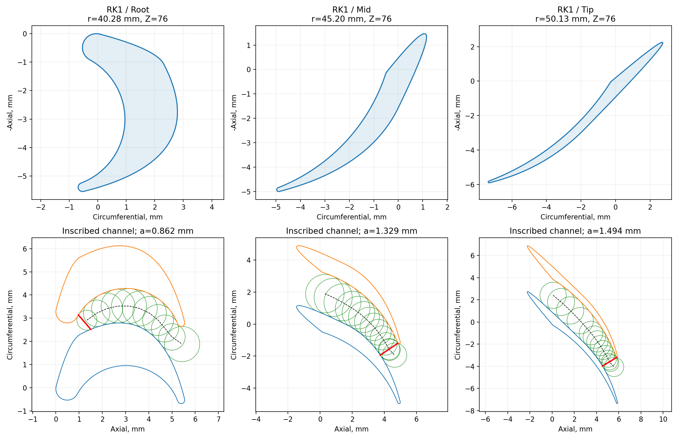
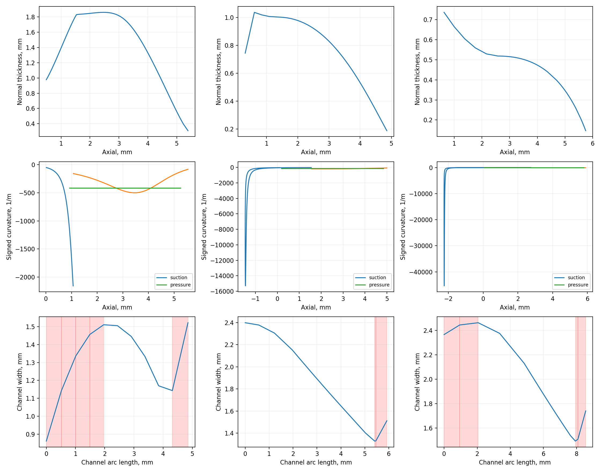
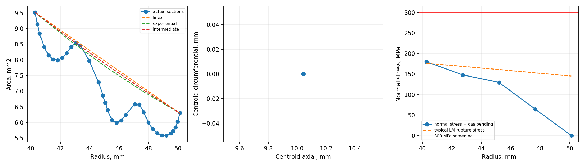
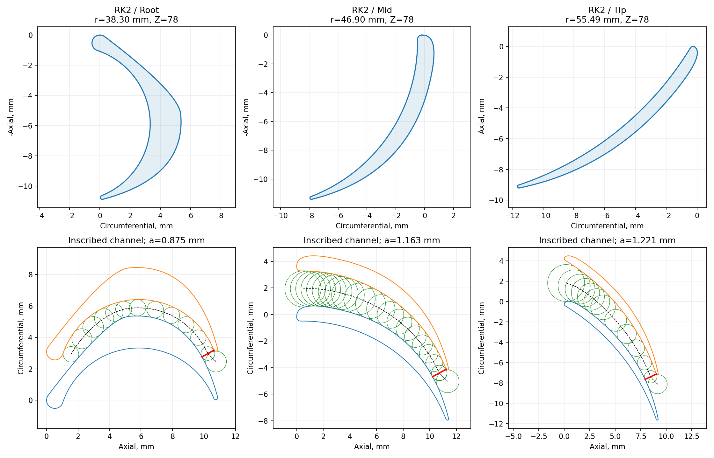
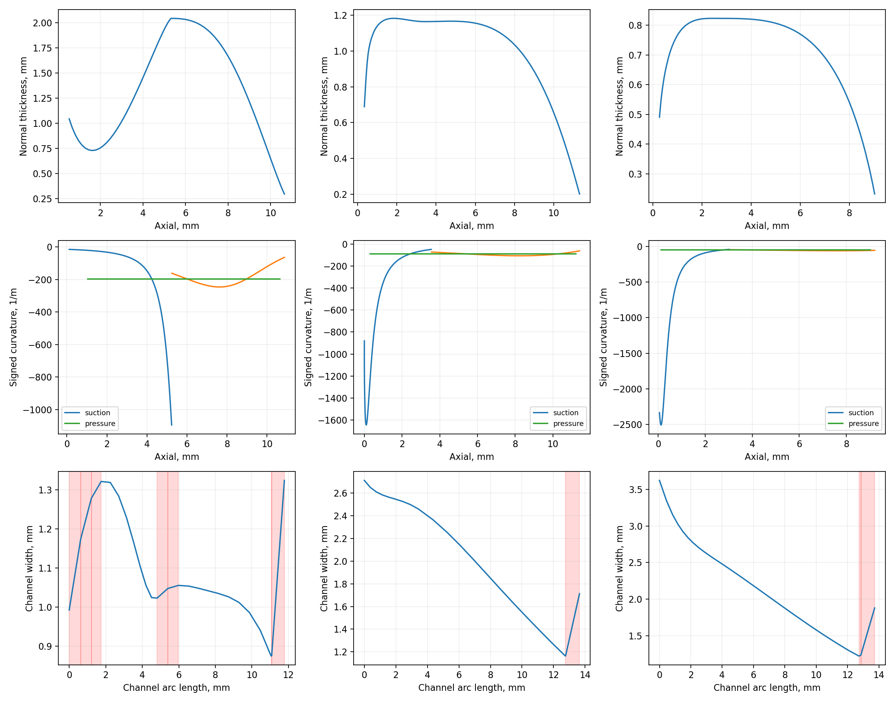
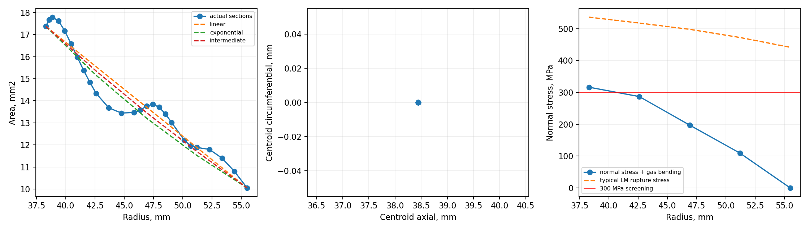
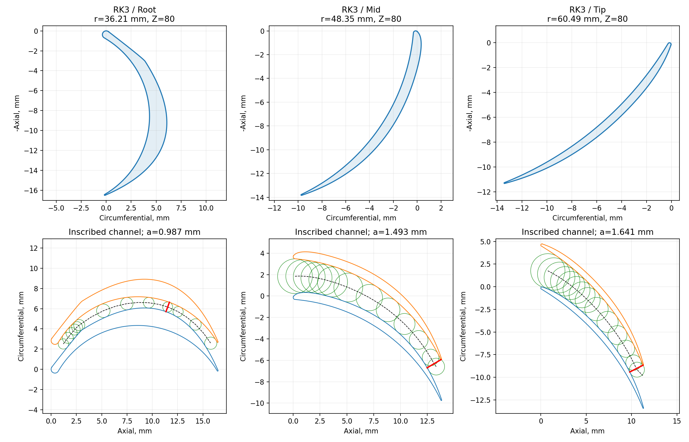
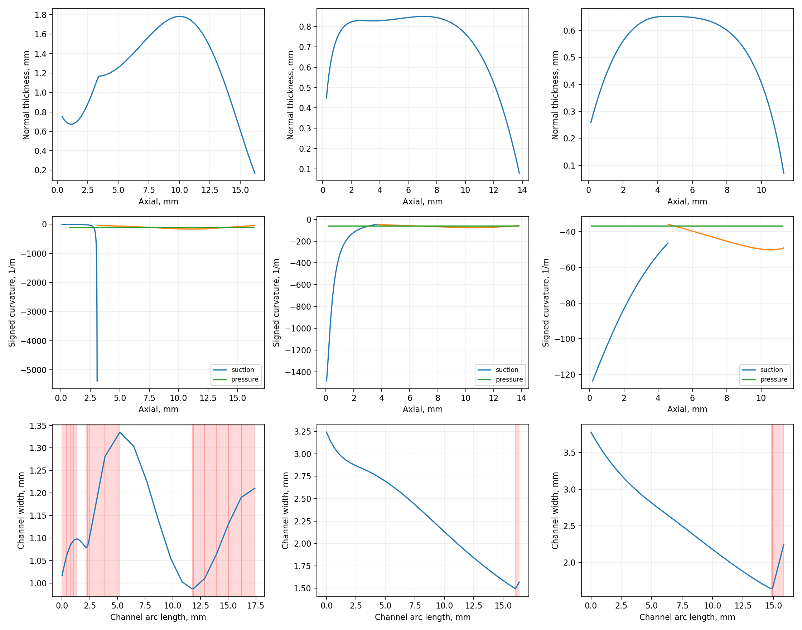
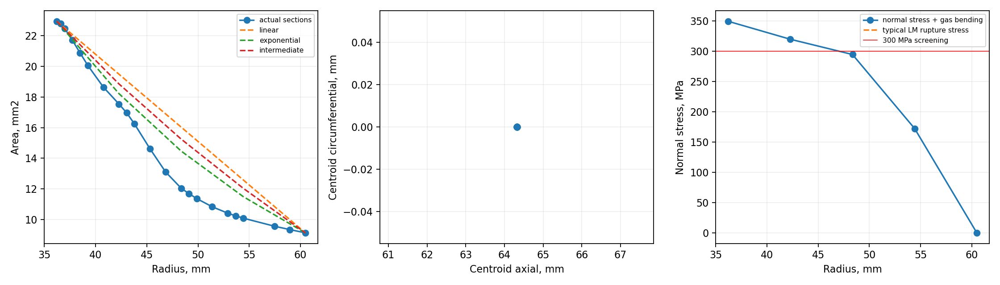
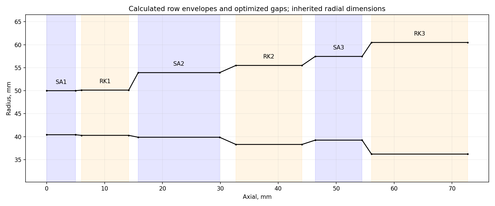
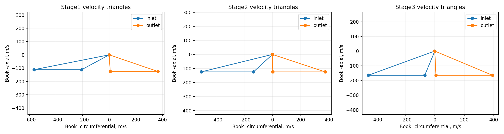
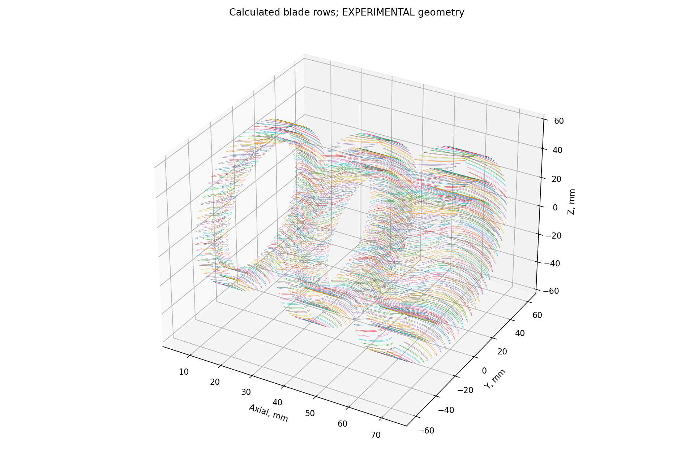

## Scope and missing physical evidence

- Geometry is not CFD/experimental proof of no separation or efficiency.
- Reynolds uses explicitly identified air-viscosity proxy, not measured combustion-products transport.
- Legacy radial pressure/energy/mass closure is independently audited, not repaired by profiling.
- Material data are typical IN738C, not certified supply allowables.
