# Vinogradov — actual TWO-stage course resource calculation

Source: **TVD_1CBK_2st_10000h.ipynb**; resource: **10000 h**; stages: **2**.
Fixed source RPM: **30700**.
Engineering admissible: **False**.
Constructed rows: 3/4.

A failed finite search is not a proof of global infeasibility. No design limit was relaxed.

## Quantified violations

### SA1
- {'name': 'source streamline Euler residual', 'value': 1.663001603446901e-05, 'limit': 1e-05, 'passed': False, 'classification': 'numerical', 'source': 'course radial_stage, J/kg', 'units': '1', 'note': ''}
- {'section': 2, 'name': 'prior profile guide: вписанные круги', 'measurements': {'geometry_valid': False, 'intersections': False, 'self_intersection': False, 'area_equivalent_angle_deg': 12.719783250876983, 'area_ratio': 0.22018302660288672, 'angle_comparison': 'uniform-flux geometric comparison, not actual gas exit angle', 'angle_error_deg': 1.5197832508769835, 'te_over_throat': 0.04435718690380715, 'book_te_over_throat': 0.055, 'max_reduced_expansion': 1.4069679821825298}, 'relative_thickness': 0.13614143323420272, 'actual_relative_pitch': 0.8722105544079615}
### RK1
- {'name': 'source streamline Euler residual', 'value': 1.663001603446901e-05, 'limit': 1e-05, 'passed': False, 'classification': 'numerical', 'source': 'course radial_stage, J/kg', 'units': '1', 'note': ''}
- {'name': 'construction/calculation failure', 'message': 'Parabola lies outside its source control triangle', 'details': {'first_tangent_distance_m': -0.013394840273397882, 'last_tangent_distance_m': -3.495434382489057e-05}}
### SA2
- {'name': 'source streamline Euler residual', 'value': 3.2915588235482574e-05, 'limit': 1e-05, 'passed': False, 'classification': 'numerical', 'source': 'course radial_stage, J/kg', 'units': '1', 'note': ''}
- {'section': 0, 'name': 'prior profile guide: вписанные круги', 'measurements': {'geometry_valid': False, 'intersections': False, 'self_intersection': False, 'area_equivalent_angle_deg': 20.821658245123324, 'area_ratio': 0.3554603083213875, 'angle_comparison': 'uniform-flux geometric comparison, not actual gas exit angle', 'angle_error_deg': 3.590272134915093, 'te_over_throat': 0.03764274295786468, 'book_te_over_throat': 0.055, 'max_reduced_expansion': 1.2711562856927}, 'relative_thickness': 0.1344781410218405, 'actual_relative_pitch': 0.8165803411961987}
- {'section': 1, 'name': 'prior profile guide: вписанные круги', 'measurements': {'geometry_valid': False, 'intersections': False, 'self_intersection': False, 'area_equivalent_angle_deg': 23.015776052254978, 'area_ratio': 0.3909845692133857, 'angle_comparison': 'uniform-flux geometric comparison, not actual gas exit angle', 'angle_error_deg': 5.784389942046747, 'te_over_throat': 0.03241446503923543, 'book_te_over_throat': 0.055, 'max_reduced_expansion': 1.315183315516552}, 'relative_thickness': 0.13398237761762047, 'actual_relative_pitch': 0.8690998140000262}
- {'section': 2, 'name': 'prior profile guide: вписанные круги', 'measurements': {'geometry_valid': False, 'intersections': False, 'self_intersection': False, 'area_equivalent_angle_deg': 21.8084266455467, 'area_ratio': 0.37150438645979506, 'angle_comparison': 'uniform-flux geometric comparison, not actual gas exit angle', 'angle_error_deg': 4.577040535338469, 'te_over_throat': 0.03247126657902315, 'book_te_over_throat': 0.055, 'max_reduced_expansion': 1.2885336072592228}, 'relative_thickness': 0.13408012887435314, 'actual_relative_pitch': 0.8371839137845776}
- {'section': 3, 'name': 'prior profile guide: вписанные круги', 'measurements': {'geometry_valid': False, 'intersections': False, 'self_intersection': False, 'area_equivalent_angle_deg': 22.480363958361476, 'area_ratio': 0.3823667838368773, 'angle_comparison': 'uniform-flux geometric comparison, not actual gas exit angle', 'angle_error_deg': 5.248977848153245, 'te_over_throat': 0.03015026693145948, 'book_te_over_throat': 0.055, 'max_reduced_expansion': 1.2548454397242519}, 'relative_thickness': 0.13406761978564927, 'actual_relative_pitch': 0.8340727304069909}
- {'section': 4, 'name': 'prior profile guide: вписанные круги', 'measurements': {'geometry_valid': False, 'intersections': False, 'self_intersection': False, 'area_equivalent_angle_deg': 23.198211106690877, 'area_ratio': 0.3939132120834961, 'angle_comparison': 'uniform-flux geometric comparison, not actual gas exit angle', 'angle_error_deg': 5.966824996482643, 'te_over_throat': 0.028062846770519928, 'book_te_over_throat': 0.055, 'max_reduced_expansion': 1.2655826807413042}, 'relative_thickness': 0.13549684270398663, 'actual_relative_pitch': 0.8537771799770226}
### RK2
- {'name': 'source streamline Euler residual', 'value': 3.2915588235482574e-05, 'limit': 1e-05, 'passed': False, 'classification': 'numerical', 'source': 'course radial_stage, J/kg', 'units': '1', 'note': ''}
- {'section': 0, 'name': 'prior profile guide: вписанные круги', 'measurements': {'geometry_valid': False, 'intersections': False, 'self_intersection': False, 'area_equivalent_angle_deg': 27.722341885513217, 'area_ratio': 0.46518726029085095, 'angle_comparison': 'uniform-flux geometric comparison, not actual gas exit angle', 'angle_error_deg': -0.5384149642942653, 'te_over_throat': 0.04997080252137261, 'book_te_over_throat': 0.07, 'max_reduced_expansion': 1.232527273833216}, 'relative_thickness': 0.12876827168161545, 'actual_relative_pitch': 0.6862159875114747}
- {'section': 1, 'name': 'prior profile guide: вписанные круги', 'measurements': {'geometry_valid': False, 'intersections': False, 'self_intersection': False, 'area_equivalent_angle_deg': 28.6883972298304, 'area_ratio': 0.48004585976140896, 'angle_comparison': 'uniform-flux geometric comparison, not actual gas exit angle', 'angle_error_deg': 1.450471284773279, 'te_over_throat': 0.045417526695406926, 'book_te_over_throat': 0.07, 'max_reduced_expansion': 1.310997755407767}, 'relative_thickness': 0.13595882218209204, 'actual_relative_pitch': 0.735776707527795}
- {'section': 2, 'name': 'prior profile guide: вписанные круги', 'measurements': {'geometry_valid': False, 'intersections': False, 'self_intersection': False, 'area_equivalent_angle_deg': 26.723566982379594, 'area_ratio': 0.4496864233999201, 'angle_comparison': 'uniform-flux geometric comparison, not actual gas exit angle', 'angle_error_deg': 0.4291006184339743, 'te_over_throat': 0.045677576947096975, 'book_te_over_throat': 0.07, 'max_reduced_expansion': 1.3504828906369795}, 'relative_thickness': 0.136136388728408, 'actual_relative_pitch': 0.8030868641497801}
- {'section': 3, 'name': 'prior profile guide: вписанные круги', 'measurements': {'geometry_valid': False, 'intersections': False, 'self_intersection': False, 'area_equivalent_angle_deg': 26.81290869543047, 'area_ratio': 0.451078628148725, 'angle_comparison': 'uniform-flux geometric comparison, not actual gas exit angle', 'angle_error_deg': 1.3864682220143436, 'te_over_throat': 0.04320907529613309, 'book_te_over_throat': 0.07, 'max_reduced_expansion': 1.3273927323858445}, 'relative_thickness': 0.12401215567856375, 'actual_relative_pitch': 0.8541059410339484}
- {'section': 4, 'name': 'prior profile guide: вписанные круги', 'measurements': {'geometry_valid': False, 'intersections': False, 'self_intersection': False, 'area_equivalent_angle_deg': 25.214884440833682, 'area_ratio': 0.4260143354287925, 'angle_comparison': 'uniform-flux geometric comparison, not actual gas exit angle', 'angle_error_deg': 0.5874111806897133, 'te_over_throat': 0.04357685539475346, 'book_te_over_throat': 0.07, 'max_reduced_expansion': 1.3465291464658111}, 'relative_thickness': 0.1066168902125121, 'actual_relative_pitch': 0.8743221128418395}
- {'name': 'vibration strength', 'status': 'NOT_CHECKED', 'reason': 'NOT_CHECKED: no grade-specific fatigue curve, damping or actual harmonic forcing; beam modes are screening only'}
- {'name': 'radial CAD mesh unconverged', 'value': 0.0023139739716145414, 'limit': 2e-05}

## Global/source violations

- {'row': 'SA1', 'name': 'source streamline Euler residual', 'value': 1.663001603446901e-05, 'limit': 1e-05, 'passed': False, 'classification': 'numerical', 'source': 'course radial_stage, J/kg', 'units': '1', 'note': ''}
- {'row': 'SA1', 'section': 2, 'name': 'prior profile guide: вписанные круги', 'measurements': {'geometry_valid': False, 'intersections': False, 'self_intersection': False, 'area_equivalent_angle_deg': 12.719783250876983, 'area_ratio': 0.22018302660288672, 'angle_comparison': 'uniform-flux geometric comparison, not actual gas exit angle', 'angle_error_deg': 1.5197832508769835, 'te_over_throat': 0.04435718690380715, 'book_te_over_throat': 0.055, 'max_reduced_expansion': 1.4069679821825298}, 'relative_thickness': 0.13614143323420272, 'actual_relative_pitch': 0.8722105544079615}
- {'row': 'RK1', 'name': 'source streamline Euler residual', 'value': 1.663001603446901e-05, 'limit': 1e-05, 'passed': False, 'classification': 'numerical', 'source': 'course radial_stage, J/kg', 'units': '1', 'note': ''}
- {'row': 'RK1', 'name': 'construction/calculation failure', 'message': 'Parabola lies outside its source control triangle', 'details': {'first_tangent_distance_m': -0.013394840273397882, 'last_tangent_distance_m': -3.495434382489057e-05}}
- {'row': 'SA2', 'name': 'source streamline Euler residual', 'value': 3.2915588235482574e-05, 'limit': 1e-05, 'passed': False, 'classification': 'numerical', 'source': 'course radial_stage, J/kg', 'units': '1', 'note': ''}
- {'row': 'SA2', 'section': 0, 'name': 'prior profile guide: вписанные круги', 'measurements': {'geometry_valid': False, 'intersections': False, 'self_intersection': False, 'area_equivalent_angle_deg': 20.821658245123324, 'area_ratio': 0.3554603083213875, 'angle_comparison': 'uniform-flux geometric comparison, not actual gas exit angle', 'angle_error_deg': 3.590272134915093, 'te_over_throat': 0.03764274295786468, 'book_te_over_throat': 0.055, 'max_reduced_expansion': 1.2711562856927}, 'relative_thickness': 0.1344781410218405, 'actual_relative_pitch': 0.8165803411961987}
- {'row': 'SA2', 'section': 1, 'name': 'prior profile guide: вписанные круги', 'measurements': {'geometry_valid': False, 'intersections': False, 'self_intersection': False, 'area_equivalent_angle_deg': 23.015776052254978, 'area_ratio': 0.3909845692133857, 'angle_comparison': 'uniform-flux geometric comparison, not actual gas exit angle', 'angle_error_deg': 5.784389942046747, 'te_over_throat': 0.03241446503923543, 'book_te_over_throat': 0.055, 'max_reduced_expansion': 1.315183315516552}, 'relative_thickness': 0.13398237761762047, 'actual_relative_pitch': 0.8690998140000262}
- {'row': 'SA2', 'section': 2, 'name': 'prior profile guide: вписанные круги', 'measurements': {'geometry_valid': False, 'intersections': False, 'self_intersection': False, 'area_equivalent_angle_deg': 21.8084266455467, 'area_ratio': 0.37150438645979506, 'angle_comparison': 'uniform-flux geometric comparison, not actual gas exit angle', 'angle_error_deg': 4.577040535338469, 'te_over_throat': 0.03247126657902315, 'book_te_over_throat': 0.055, 'max_reduced_expansion': 1.2885336072592228}, 'relative_thickness': 0.13408012887435314, 'actual_relative_pitch': 0.8371839137845776}
- {'row': 'SA2', 'section': 3, 'name': 'prior profile guide: вписанные круги', 'measurements': {'geometry_valid': False, 'intersections': False, 'self_intersection': False, 'area_equivalent_angle_deg': 22.480363958361476, 'area_ratio': 0.3823667838368773, 'angle_comparison': 'uniform-flux geometric comparison, not actual gas exit angle', 'angle_error_deg': 5.248977848153245, 'te_over_throat': 0.03015026693145948, 'book_te_over_throat': 0.055, 'max_reduced_expansion': 1.2548454397242519}, 'relative_thickness': 0.13406761978564927, 'actual_relative_pitch': 0.8340727304069909}
- {'row': 'SA2', 'section': 4, 'name': 'prior profile guide: вписанные круги', 'measurements': {'geometry_valid': False, 'intersections': False, 'self_intersection': False, 'area_equivalent_angle_deg': 23.198211106690877, 'area_ratio': 0.3939132120834961, 'angle_comparison': 'uniform-flux geometric comparison, not actual gas exit angle', 'angle_error_deg': 5.966824996482643, 'te_over_throat': 0.028062846770519928, 'book_te_over_throat': 0.055, 'max_reduced_expansion': 1.2655826807413042}, 'relative_thickness': 0.13549684270398663, 'actual_relative_pitch': 0.8537771799770226}
- {'row': 'RK2', 'name': 'source streamline Euler residual', 'value': 3.2915588235482574e-05, 'limit': 1e-05, 'passed': False, 'classification': 'numerical', 'source': 'course radial_stage, J/kg', 'units': '1', 'note': ''}
- {'row': 'RK2', 'section': 0, 'name': 'prior profile guide: вписанные круги', 'measurements': {'geometry_valid': False, 'intersections': False, 'self_intersection': False, 'area_equivalent_angle_deg': 27.722341885513217, 'area_ratio': 0.46518726029085095, 'angle_comparison': 'uniform-flux geometric comparison, not actual gas exit angle', 'angle_error_deg': -0.5384149642942653, 'te_over_throat': 0.04997080252137261, 'book_te_over_throat': 0.07, 'max_reduced_expansion': 1.232527273833216}, 'relative_thickness': 0.12876827168161545, 'actual_relative_pitch': 0.6862159875114747}
- {'row': 'RK2', 'section': 1, 'name': 'prior profile guide: вписанные круги', 'measurements': {'geometry_valid': False, 'intersections': False, 'self_intersection': False, 'area_equivalent_angle_deg': 28.6883972298304, 'area_ratio': 0.48004585976140896, 'angle_comparison': 'uniform-flux geometric comparison, not actual gas exit angle', 'angle_error_deg': 1.450471284773279, 'te_over_throat': 0.045417526695406926, 'book_te_over_throat': 0.07, 'max_reduced_expansion': 1.310997755407767}, 'relative_thickness': 0.13595882218209204, 'actual_relative_pitch': 0.735776707527795}
- {'row': 'RK2', 'section': 2, 'name': 'prior profile guide: вписанные круги', 'measurements': {'geometry_valid': False, 'intersections': False, 'self_intersection': False, 'area_equivalent_angle_deg': 26.723566982379594, 'area_ratio': 0.4496864233999201, 'angle_comparison': 'uniform-flux geometric comparison, not actual gas exit angle', 'angle_error_deg': 0.4291006184339743, 'te_over_throat': 0.045677576947096975, 'book_te_over_throat': 0.07, 'max_reduced_expansion': 1.3504828906369795}, 'relative_thickness': 0.136136388728408, 'actual_relative_pitch': 0.8030868641497801}
- {'row': 'RK2', 'section': 3, 'name': 'prior profile guide: вписанные круги', 'measurements': {'geometry_valid': False, 'intersections': False, 'self_intersection': False, 'area_equivalent_angle_deg': 26.81290869543047, 'area_ratio': 0.451078628148725, 'angle_comparison': 'uniform-flux geometric comparison, not actual gas exit angle', 'angle_error_deg': 1.3864682220143436, 'te_over_throat': 0.04320907529613309, 'book_te_over_throat': 0.07, 'max_reduced_expansion': 1.3273927323858445}, 'relative_thickness': 0.12401215567856375, 'actual_relative_pitch': 0.8541059410339484}
- {'row': 'RK2', 'section': 4, 'name': 'prior profile guide: вписанные круги', 'measurements': {'geometry_valid': False, 'intersections': False, 'self_intersection': False, 'area_equivalent_angle_deg': 25.214884440833682, 'area_ratio': 0.4260143354287925, 'angle_comparison': 'uniform-flux geometric comparison, not actual gas exit angle', 'angle_error_deg': 0.5874111806897133, 'te_over_throat': 0.04357685539475346, 'book_te_over_throat': 0.07, 'max_reduced_expansion': 1.3465291464658111}, 'relative_thickness': 0.1066168902125121, 'actual_relative_pitch': 0.8743221128418395}
- {'row': 'RK2', 'name': 'vibration strength', 'status': 'NOT_CHECKED', 'reason': 'NOT_CHECKED: no grade-specific fatigue curve, damping or actual harmonic forcing; beam modes are screening only'}
- {'row': 'RK2', 'name': 'radial CAD mesh unconverged', 'value': 0.0023139739716145414, 'limit': 2e-05}
- {'name': 'source strength assessment', 'reasons': ["('РК1', 0)"]}
- {'row': 'SA2', 'section': 1, 'name': 'source finite trailing edge', 'value': 0.0004999999999999994, 'limit': 0.0005}
- {'row': 'SA2', 'section': 2, 'name': 'source finite trailing edge', 'value': 0.0004999999999999985, 'limit': 0.0005}
- {'row': 'SA2', 'section': 4, 'name': 'source finite trailing edge', 'value': 0.0004999999999999956, 'limit': 0.0005}
- {'row': 'RK2', 'name': 'source rotor taper mismatch', 'value': 6.1505237000785735, 'limit': 1.6}
- {'row': 'RK2', 'name': 'source rotor areas must decrease', 'value': [0.00046426175962448787, 9.753124666993854e-05, 0.00010166615873028373, 8.140837331336399e-05, 7.548328927153909e-05], 'limit': 'strict decrease root to tip'}
- {'name': 'STEP export rejected', 'message': 'refusing unconverged radial CAD mesh'}

## Empirical guidance — not added hard limits

- {'row': 'SA1', 'section': 0, 'name': 'relative thickness starting guidance', 'value': 0.13625304074263225, 'range': [0.1, 0.1], 'classification': 'empirical, p13'}
- {'row': 'SA1', 'section': 0, 'name': 'prior profile guide: местная диффузорность', 'measurements': {'geometry_valid': True, 'intersections': False, 'self_intersection': False, 'area_equivalent_angle_deg': 12.957512176943212, 'area_ratio': 0.22422844609553635, 'angle_comparison': 'uniform-flux geometric comparison, not actual gas exit angle', 'angle_error_deg': 1.7575121769432123, 'te_over_throat': 0.04701620449273035, 'book_te_over_throat': 0.055, 'max_reduced_expansion': 1.395765158918954}, 'relative_thickness': 0.13625304074263225, 'actual_relative_pitch': 0.8718555306574797, 'classification': 'historical empirical profile guide; Vinogradov uses its own recommendations'}
- {'row': 'SA1', 'section': 0, 'name': 'prior profile guide: относительный шаг', 'measurements': {'geometry_valid': True, 'intersections': False, 'self_intersection': False, 'area_equivalent_angle_deg': 12.957512176943212, 'area_ratio': 0.22422844609553635, 'angle_comparison': 'uniform-flux geometric comparison, not actual gas exit angle', 'angle_error_deg': 1.7575121769432123, 'te_over_throat': 0.04701620449273035, 'book_te_over_throat': 0.055, 'max_reduced_expansion': 1.395765158918954}, 'relative_thickness': 0.13625304074263225, 'actual_relative_pitch': 0.8718555306574797, 'classification': 'historical empirical profile guide; Vinogradov uses its own recommendations'}
- {'row': 'SA1', 'section': 1, 'name': 'relative thickness starting guidance', 'value': 0.13618746399403506, 'range': [0.1, 0.1], 'classification': 'empirical, p13'}
- {'row': 'SA1', 'section': 1, 'name': 'prior profile guide: местная диффузорность', 'measurements': {'geometry_valid': True, 'intersections': False, 'self_intersection': False, 'area_equivalent_angle_deg': 12.754466301209845, 'area_ratio': 0.22077346390530694, 'angle_comparison': 'uniform-flux geometric comparison, not actual gas exit angle', 'angle_error_deg': 1.5544663012098479, 'te_over_throat': 0.045904286385387016, 'book_te_over_throat': 0.055, 'max_reduced_expansion': 1.4023562438733408}, 'relative_thickness': 0.13618746399403506, 'actual_relative_pitch': 0.8711894568658626, 'classification': 'historical empirical profile guide; Vinogradov uses its own recommendations'}
- {'row': 'SA1', 'section': 1, 'name': 'prior profile guide: относительный шаг', 'measurements': {'geometry_valid': True, 'intersections': False, 'self_intersection': False, 'area_equivalent_angle_deg': 12.754466301209845, 'area_ratio': 0.22077346390530694, 'angle_comparison': 'uniform-flux geometric comparison, not actual gas exit angle', 'angle_error_deg': 1.5544663012098479, 'te_over_throat': 0.045904286385387016, 'book_te_over_throat': 0.055, 'max_reduced_expansion': 1.4023562438733408}, 'relative_thickness': 0.13618746399403506, 'actual_relative_pitch': 0.8711894568658626, 'classification': 'historical empirical profile guide; Vinogradov uses its own recommendations'}
- {'row': 'SA1', 'section': 2, 'name': 'relative thickness starting guidance', 'value': 0.13614143323420272, 'range': [0.1, 0.1], 'classification': 'empirical, p13'}
- {'row': 'SA1', 'section': 2, 'name': 'prior profile guide: местная диффузорность', 'measurements': {'geometry_valid': False, 'intersections': False, 'self_intersection': False, 'area_equivalent_angle_deg': 12.719783250876983, 'area_ratio': 0.22018302660288672, 'angle_comparison': 'uniform-flux geometric comparison, not actual gas exit angle', 'angle_error_deg': 1.5197832508769835, 'te_over_throat': 0.04435718690380715, 'book_te_over_throat': 0.055, 'max_reduced_expansion': 1.4069679821825298}, 'relative_thickness': 0.13614143323420272, 'actual_relative_pitch': 0.8722105544079615, 'classification': 'historical empirical profile guide; Vinogradov uses its own recommendations'}
- {'row': 'SA1', 'section': 2, 'name': 'prior profile guide: относительный шаг', 'measurements': {'geometry_valid': False, 'intersections': False, 'self_intersection': False, 'area_equivalent_angle_deg': 12.719783250876983, 'area_ratio': 0.22018302660288672, 'angle_comparison': 'uniform-flux geometric comparison, not actual gas exit angle', 'angle_error_deg': 1.5197832508769835, 'te_over_throat': 0.04435718690380715, 'book_te_over_throat': 0.055, 'max_reduced_expansion': 1.4069679821825298}, 'relative_thickness': 0.13614143323420272, 'actual_relative_pitch': 0.8722105544079615, 'classification': 'historical empirical profile guide; Vinogradov uses its own recommendations'}
- {'row': 'SA1', 'section': 3, 'name': 'relative thickness starting guidance', 'value': 0.1362306819915285, 'range': [0.1, 0.1], 'classification': 'empirical, p13'}
- {'row': 'SA1', 'section': 3, 'name': 'prior profile guide: местная диффузорность', 'measurements': {'geometry_valid': True, 'intersections': False, 'self_intersection': False, 'area_equivalent_angle_deg': 11.752887420260201, 'area_ratio': 0.20369108986878237, 'angle_comparison': 'uniform-flux geometric comparison, not actual gas exit angle', 'angle_error_deg': 0.5528874202602019, 'te_over_throat': 0.04631123217515076, 'book_te_over_throat': 0.055, 'max_reduced_expansion': 1.4250539694952677}, 'relative_thickness': 0.1362306819915285, 'actual_relative_pitch': 0.8728387640710703, 'classification': 'historical empirical profile guide; Vinogradov uses its own recommendations'}
- {'row': 'SA1', 'section': 3, 'name': 'prior profile guide: относительный шаг', 'measurements': {'geometry_valid': True, 'intersections': False, 'self_intersection': False, 'area_equivalent_angle_deg': 11.752887420260201, 'area_ratio': 0.20369108986878237, 'angle_comparison': 'uniform-flux geometric comparison, not actual gas exit angle', 'angle_error_deg': 0.5528874202602019, 'te_over_throat': 0.04631123217515076, 'book_te_over_throat': 0.055, 'max_reduced_expansion': 1.4250539694952677}, 'relative_thickness': 0.1362306819915285, 'actual_relative_pitch': 0.8728387640710703, 'classification': 'historical empirical profile guide; Vinogradov uses its own recommendations'}
- {'row': 'SA1', 'section': 4, 'name': 'relative thickness starting guidance', 'value': 0.13617390348873543, 'range': [0.1, 0.1], 'classification': 'empirical, p13'}
- {'row': 'SA1', 'section': 4, 'name': 'prior profile guide: местная диффузорность', 'measurements': {'geometry_valid': True, 'intersections': False, 'self_intersection': False, 'area_equivalent_angle_deg': 11.60980008106086, 'area_ratio': 0.2012454683607584, 'angle_comparison': 'uniform-flux geometric comparison, not actual gas exit angle', 'angle_error_deg': 0.4098000810608582, 'te_over_throat': 0.04537409953688223, 'book_te_over_throat': 0.055, 'max_reduced_expansion': 1.4190984132532072}, 'relative_thickness': 0.13617390348873543, 'actual_relative_pitch': 0.8719933708314485, 'classification': 'historical empirical profile guide; Vinogradov uses its own recommendations'}
- {'row': 'SA1', 'section': 4, 'name': 'prior profile guide: относительный шаг', 'measurements': {'geometry_valid': True, 'intersections': False, 'self_intersection': False, 'area_equivalent_angle_deg': 11.60980008106086, 'area_ratio': 0.2012454683607584, 'angle_comparison': 'uniform-flux geometric comparison, not actual gas exit angle', 'angle_error_deg': 0.4098000810608582, 'te_over_throat': 0.04537409953688223, 'book_te_over_throat': 0.055, 'max_reduced_expansion': 1.4190984132532072}, 'relative_thickness': 0.13617390348873543, 'actual_relative_pitch': 0.8719933708314485, 'classification': 'historical empirical profile guide; Vinogradov uses its own recommendations'}
- {'row': 'SA2', 'section': 0, 'name': 'relative thickness starting guidance', 'value': 0.1344781410218405, 'range': [0.1, 0.1], 'classification': 'empirical, p13'}
- {'row': 'SA2', 'section': 0, 'name': 'prior profile guide: угол горла', 'measurements': {'geometry_valid': False, 'intersections': False, 'self_intersection': False, 'area_equivalent_angle_deg': 20.821658245123324, 'area_ratio': 0.3554603083213875, 'angle_comparison': 'uniform-flux geometric comparison, not actual gas exit angle', 'angle_error_deg': 3.590272134915093, 'te_over_throat': 0.03764274295786468, 'book_te_over_throat': 0.055, 'max_reduced_expansion': 1.2711562856927}, 'relative_thickness': 0.1344781410218405, 'actual_relative_pitch': 0.8165803411961987, 'classification': 'historical empirical profile guide; Vinogradov uses its own recommendations'}
- {'row': 'SA2', 'section': 0, 'name': 'prior profile guide: местная диффузорность', 'measurements': {'geometry_valid': False, 'intersections': False, 'self_intersection': False, 'area_equivalent_angle_deg': 20.821658245123324, 'area_ratio': 0.3554603083213875, 'angle_comparison': 'uniform-flux geometric comparison, not actual gas exit angle', 'angle_error_deg': 3.590272134915093, 'te_over_throat': 0.03764274295786468, 'book_te_over_throat': 0.055, 'max_reduced_expansion': 1.2711562856927}, 'relative_thickness': 0.1344781410218405, 'actual_relative_pitch': 0.8165803411961987, 'classification': 'historical empirical profile guide; Vinogradov uses its own recommendations'}
- {'row': 'SA2', 'section': 1, 'name': 'relative thickness starting guidance', 'value': 0.13398237761762047, 'range': [0.1, 0.1], 'classification': 'empirical, p13'}
- {'row': 'SA2', 'section': 1, 'name': 'prior profile guide: угол горла', 'measurements': {'geometry_valid': False, 'intersections': False, 'self_intersection': False, 'area_equivalent_angle_deg': 23.015776052254978, 'area_ratio': 0.3909845692133857, 'angle_comparison': 'uniform-flux geometric comparison, not actual gas exit angle', 'angle_error_deg': 5.784389942046747, 'te_over_throat': 0.03241446503923543, 'book_te_over_throat': 0.055, 'max_reduced_expansion': 1.315183315516552}, 'relative_thickness': 0.13398237761762047, 'actual_relative_pitch': 0.8690998140000262, 'classification': 'historical empirical profile guide; Vinogradov uses its own recommendations'}
- {'row': 'SA2', 'section': 1, 'name': 'prior profile guide: местная диффузорность', 'measurements': {'geometry_valid': False, 'intersections': False, 'self_intersection': False, 'area_equivalent_angle_deg': 23.015776052254978, 'area_ratio': 0.3909845692133857, 'angle_comparison': 'uniform-flux geometric comparison, not actual gas exit angle', 'angle_error_deg': 5.784389942046747, 'te_over_throat': 0.03241446503923543, 'book_te_over_throat': 0.055, 'max_reduced_expansion': 1.315183315516552}, 'relative_thickness': 0.13398237761762047, 'actual_relative_pitch': 0.8690998140000262, 'classification': 'historical empirical profile guide; Vinogradov uses its own recommendations'}
- {'row': 'SA2', 'section': 1, 'name': 'prior profile guide: относительный шаг', 'measurements': {'geometry_valid': False, 'intersections': False, 'self_intersection': False, 'area_equivalent_angle_deg': 23.015776052254978, 'area_ratio': 0.3909845692133857, 'angle_comparison': 'uniform-flux geometric comparison, not actual gas exit angle', 'angle_error_deg': 5.784389942046747, 'te_over_throat': 0.03241446503923543, 'book_te_over_throat': 0.055, 'max_reduced_expansion': 1.315183315516552}, 'relative_thickness': 0.13398237761762047, 'actual_relative_pitch': 0.8690998140000262, 'classification': 'historical empirical profile guide; Vinogradov uses its own recommendations'}
- {'row': 'SA2', 'section': 2, 'name': 'relative thickness starting guidance', 'value': 0.13408012887435314, 'range': [0.1, 0.1], 'classification': 'empirical, p13'}
- {'row': 'SA2', 'section': 2, 'name': 'prior profile guide: угол горла', 'measurements': {'geometry_valid': False, 'intersections': False, 'self_intersection': False, 'area_equivalent_angle_deg': 21.8084266455467, 'area_ratio': 0.37150438645979506, 'angle_comparison': 'uniform-flux geometric comparison, not actual gas exit angle', 'angle_error_deg': 4.577040535338469, 'te_over_throat': 0.03247126657902315, 'book_te_over_throat': 0.055, 'max_reduced_expansion': 1.2885336072592228}, 'relative_thickness': 0.13408012887435314, 'actual_relative_pitch': 0.8371839137845776, 'classification': 'historical empirical profile guide; Vinogradov uses its own recommendations'}
- {'row': 'SA2', 'section': 2, 'name': 'prior profile guide: местная диффузорность', 'measurements': {'geometry_valid': False, 'intersections': False, 'self_intersection': False, 'area_equivalent_angle_deg': 21.8084266455467, 'area_ratio': 0.37150438645979506, 'angle_comparison': 'uniform-flux geometric comparison, not actual gas exit angle', 'angle_error_deg': 4.577040535338469, 'te_over_throat': 0.03247126657902315, 'book_te_over_throat': 0.055, 'max_reduced_expansion': 1.2885336072592228}, 'relative_thickness': 0.13408012887435314, 'actual_relative_pitch': 0.8371839137845776, 'classification': 'historical empirical profile guide; Vinogradov uses its own recommendations'}
- {'row': 'SA2', 'section': 3, 'name': 'relative thickness starting guidance', 'value': 0.13406761978564927, 'range': [0.1, 0.1], 'classification': 'empirical, p13'}
- {'row': 'SA2', 'section': 3, 'name': 'prior profile guide: угол горла', 'measurements': {'geometry_valid': False, 'intersections': False, 'self_intersection': False, 'area_equivalent_angle_deg': 22.480363958361476, 'area_ratio': 0.3823667838368773, 'angle_comparison': 'uniform-flux geometric comparison, not actual gas exit angle', 'angle_error_deg': 5.248977848153245, 'te_over_throat': 0.03015026693145948, 'book_te_over_throat': 0.055, 'max_reduced_expansion': 1.2548454397242519}, 'relative_thickness': 0.13406761978564927, 'actual_relative_pitch': 0.8340727304069909, 'classification': 'historical empirical profile guide; Vinogradov uses its own recommendations'}
- {'row': 'SA2', 'section': 3, 'name': 'prior profile guide: местная диффузорность', 'measurements': {'geometry_valid': False, 'intersections': False, 'self_intersection': False, 'area_equivalent_angle_deg': 22.480363958361476, 'area_ratio': 0.3823667838368773, 'angle_comparison': 'uniform-flux geometric comparison, not actual gas exit angle', 'angle_error_deg': 5.248977848153245, 'te_over_throat': 0.03015026693145948, 'book_te_over_throat': 0.055, 'max_reduced_expansion': 1.2548454397242519}, 'relative_thickness': 0.13406761978564927, 'actual_relative_pitch': 0.8340727304069909, 'classification': 'historical empirical profile guide; Vinogradov uses its own recommendations'}
- {'row': 'SA2', 'section': 4, 'name': 'relative thickness starting guidance', 'value': 0.13549684270398663, 'range': [0.1, 0.1], 'classification': 'empirical, p13'}
- {'row': 'SA2', 'section': 4, 'name': 'prior profile guide: угол горла', 'measurements': {'geometry_valid': False, 'intersections': False, 'self_intersection': False, 'area_equivalent_angle_deg': 23.198211106690877, 'area_ratio': 0.3939132120834961, 'angle_comparison': 'uniform-flux geometric comparison, not actual gas exit angle', 'angle_error_deg': 5.966824996482643, 'te_over_throat': 0.028062846770519928, 'book_te_over_throat': 0.055, 'max_reduced_expansion': 1.2655826807413042}, 'relative_thickness': 0.13549684270398663, 'actual_relative_pitch': 0.8537771799770226, 'classification': 'historical empirical profile guide; Vinogradov uses its own recommendations'}
- {'row': 'SA2', 'section': 4, 'name': 'prior profile guide: местная диффузорность', 'measurements': {'geometry_valid': False, 'intersections': False, 'self_intersection': False, 'area_equivalent_angle_deg': 23.198211106690877, 'area_ratio': 0.3939132120834961, 'angle_comparison': 'uniform-flux geometric comparison, not actual gas exit angle', 'angle_error_deg': 5.966824996482643, 'te_over_throat': 0.028062846770519928, 'book_te_over_throat': 0.055, 'max_reduced_expansion': 1.2655826807413042}, 'relative_thickness': 0.13549684270398663, 'actual_relative_pitch': 0.8537771799770226, 'classification': 'historical empirical profile guide; Vinogradov uses its own recommendations'}
- {'row': 'SA2', 'section': 4, 'name': 'prior profile guide: относительный шаг', 'measurements': {'geometry_valid': False, 'intersections': False, 'self_intersection': False, 'area_equivalent_angle_deg': 23.198211106690877, 'area_ratio': 0.3939132120834961, 'angle_comparison': 'uniform-flux geometric comparison, not actual gas exit angle', 'angle_error_deg': 5.966824996482643, 'te_over_throat': 0.028062846770519928, 'book_te_over_throat': 0.055, 'max_reduced_expansion': 1.2655826807413042}, 'relative_thickness': 0.13549684270398663, 'actual_relative_pitch': 0.8537771799770226, 'classification': 'historical empirical profile guide; Vinogradov uses its own recommendations'}
- {'row': 'RK2', 'section': 0, 'name': 'relative thickness starting guidance', 'value': 0.12876827168161545, 'range': [0.2, 0.3], 'classification': 'empirical, p13'}
- {'row': 'RK2', 'section': 0, 'name': 'prior profile guide: местная диффузорность', 'measurements': {'geometry_valid': False, 'intersections': False, 'self_intersection': False, 'area_equivalent_angle_deg': 27.722341885513217, 'area_ratio': 0.46518726029085095, 'angle_comparison': 'uniform-flux geometric comparison, not actual gas exit angle', 'angle_error_deg': -0.5384149642942653, 'te_over_throat': 0.04997080252137261, 'book_te_over_throat': 0.07, 'max_reduced_expansion': 1.232527273833216}, 'relative_thickness': 0.12876827168161545, 'actual_relative_pitch': 0.6862159875114747, 'classification': 'historical empirical profile guide; Vinogradov uses its own recommendations'}
- {'row': 'RK2', 'section': 0, 'name': 'prior profile guide: максимальная толщина', 'measurements': {'geometry_valid': False, 'intersections': False, 'self_intersection': False, 'area_equivalent_angle_deg': 27.722341885513217, 'area_ratio': 0.46518726029085095, 'angle_comparison': 'uniform-flux geometric comparison, not actual gas exit angle', 'angle_error_deg': -0.5384149642942653, 'te_over_throat': 0.04997080252137261, 'book_te_over_throat': 0.07, 'max_reduced_expansion': 1.232527273833216}, 'relative_thickness': 0.12876827168161545, 'actual_relative_pitch': 0.6862159875114747, 'classification': 'historical empirical profile guide; Vinogradov uses its own recommendations'}
- {'row': 'RK2', 'section': 1, 'name': 'relative thickness starting guidance', 'value': 0.13595882218209204, 'range': [0.14559759370607095, 0.21839639055910637], 'classification': 'empirical, p13'}
- {'row': 'RK2', 'section': 1, 'name': 'prior profile guide: местная диффузорность', 'measurements': {'geometry_valid': False, 'intersections': False, 'self_intersection': False, 'area_equivalent_angle_deg': 28.6883972298304, 'area_ratio': 0.48004585976140896, 'angle_comparison': 'uniform-flux geometric comparison, not actual gas exit angle', 'angle_error_deg': 1.450471284773279, 'te_over_throat': 0.045417526695406926, 'book_te_over_throat': 0.07, 'max_reduced_expansion': 1.310997755407767}, 'relative_thickness': 0.13595882218209204, 'actual_relative_pitch': 0.735776707527795, 'classification': 'historical empirical profile guide; Vinogradov uses its own recommendations'}
- {'row': 'RK2', 'section': 1, 'name': 'prior profile guide: максимальная толщина', 'measurements': {'geometry_valid': False, 'intersections': False, 'self_intersection': False, 'area_equivalent_angle_deg': 28.6883972298304, 'area_ratio': 0.48004585976140896, 'angle_comparison': 'uniform-flux geometric comparison, not actual gas exit angle', 'angle_error_deg': 1.450471284773279, 'te_over_throat': 0.045417526695406926, 'book_te_over_throat': 0.07, 'max_reduced_expansion': 1.310997755407767}, 'relative_thickness': 0.13595882218209204, 'actual_relative_pitch': 0.735776707527795, 'classification': 'historical empirical profile guide; Vinogradov uses its own recommendations'}
- {'row': 'RK2', 'section': 2, 'name': 'prior profile guide: местная диффузорность', 'measurements': {'geometry_valid': False, 'intersections': False, 'self_intersection': False, 'area_equivalent_angle_deg': 26.723566982379594, 'area_ratio': 0.4496864233999201, 'angle_comparison': 'uniform-flux geometric comparison, not actual gas exit angle', 'angle_error_deg': 0.4291006184339743, 'te_over_throat': 0.045677576947096975, 'book_te_over_throat': 0.07, 'max_reduced_expansion': 1.3504828906369795}, 'relative_thickness': 0.136136388728408, 'actual_relative_pitch': 0.8030868641497801, 'classification': 'historical empirical profile guide; Vinogradov uses its own recommendations'}
- {'row': 'RK2', 'section': 2, 'name': 'prior profile guide: максимальная толщина', 'measurements': {'geometry_valid': False, 'intersections': False, 'self_intersection': False, 'area_equivalent_angle_deg': 26.723566982379594, 'area_ratio': 0.4496864233999201, 'angle_comparison': 'uniform-flux geometric comparison, not actual gas exit angle', 'angle_error_deg': 0.4291006184339743, 'te_over_throat': 0.045677576947096975, 'book_te_over_throat': 0.07, 'max_reduced_expansion': 1.3504828906369795}, 'relative_thickness': 0.136136388728408, 'actual_relative_pitch': 0.8030868641497801, 'classification': 'historical empirical profile guide; Vinogradov uses its own recommendations'}
- {'row': 'RK2', 'section': 3, 'name': 'relative thickness starting guidance', 'value': 0.12401215567856375, 'range': [0.06764145599124761, 0.09606909331874602], 'classification': 'empirical, p13'}
- {'row': 'RK2', 'section': 3, 'name': 'prior profile guide: местная диффузорность', 'measurements': {'geometry_valid': False, 'intersections': False, 'self_intersection': False, 'area_equivalent_angle_deg': 26.81290869543047, 'area_ratio': 0.451078628148725, 'angle_comparison': 'uniform-flux geometric comparison, not actual gas exit angle', 'angle_error_deg': 1.3864682220143436, 'te_over_throat': 0.04320907529613309, 'book_te_over_throat': 0.07, 'max_reduced_expansion': 1.3273927323858445}, 'relative_thickness': 0.12401215567856375, 'actual_relative_pitch': 0.8541059410339484, 'classification': 'historical empirical profile guide; Vinogradov uses its own recommendations'}
- {'row': 'RK2', 'section': 3, 'name': 'prior profile guide: относительный шаг', 'measurements': {'geometry_valid': False, 'intersections': False, 'self_intersection': False, 'area_equivalent_angle_deg': 26.81290869543047, 'area_ratio': 0.451078628148725, 'angle_comparison': 'uniform-flux geometric comparison, not actual gas exit angle', 'angle_error_deg': 1.3864682220143436, 'te_over_throat': 0.04320907529613309, 'book_te_over_throat': 0.07, 'max_reduced_expansion': 1.3273927323858445}, 'relative_thickness': 0.12401215567856375, 'actual_relative_pitch': 0.8541059410339484, 'classification': 'historical empirical profile guide; Vinogradov uses its own recommendations'}
- {'row': 'RK2', 'section': 4, 'name': 'relative thickness starting guidance', 'value': 0.1066168902125121, 'range': [0.04, 0.05], 'classification': 'empirical, p13'}
- {'row': 'RK2', 'section': 4, 'name': 'prior profile guide: местная диффузорность', 'measurements': {'geometry_valid': False, 'intersections': False, 'self_intersection': False, 'area_equivalent_angle_deg': 25.214884440833682, 'area_ratio': 0.4260143354287925, 'angle_comparison': 'uniform-flux geometric comparison, not actual gas exit angle', 'angle_error_deg': 0.5874111806897133, 'te_over_throat': 0.04357685539475346, 'book_te_over_throat': 0.07, 'max_reduced_expansion': 1.3465291464658111}, 'relative_thickness': 0.1066168902125121, 'actual_relative_pitch': 0.8743221128418395, 'classification': 'historical empirical profile guide; Vinogradov uses its own recommendations'}
- {'row': 'RK2', 'section': 4, 'name': 'prior profile guide: относительный шаг', 'measurements': {'geometry_valid': False, 'intersections': False, 'self_intersection': False, 'area_equivalent_angle_deg': 25.214884440833682, 'area_ratio': 0.4260143354287925, 'angle_comparison': 'uniform-flux geometric comparison, not actual gas exit angle', 'angle_error_deg': 0.5874111806897133, 'te_over_throat': 0.04357685539475346, 'book_te_over_throat': 0.07, 'max_reduced_expansion': 1.3465291464658111}, 'relative_thickness': 0.1066168902125121, 'actual_relative_pitch': 0.8743221128418395, 'classification': 'historical empirical profile guide; Vinogradov uses its own recommendations'}

## Figures

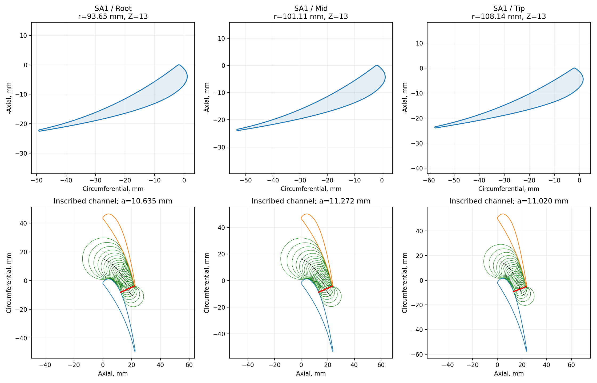
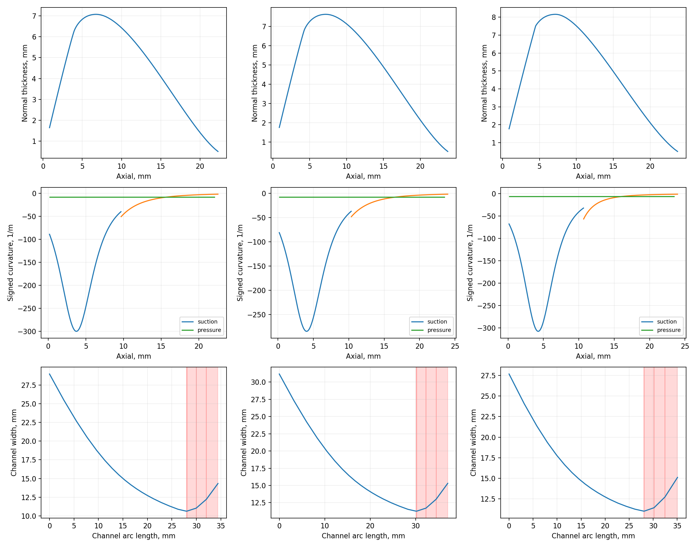
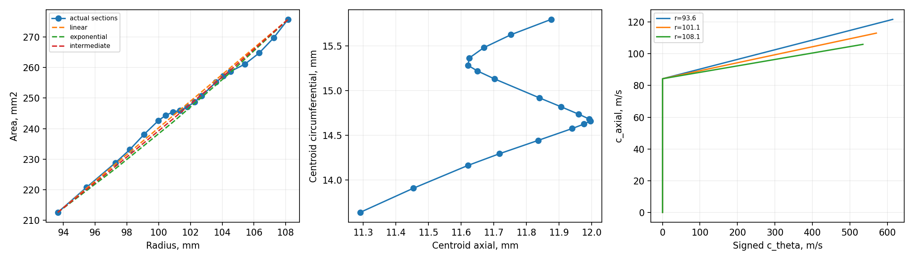
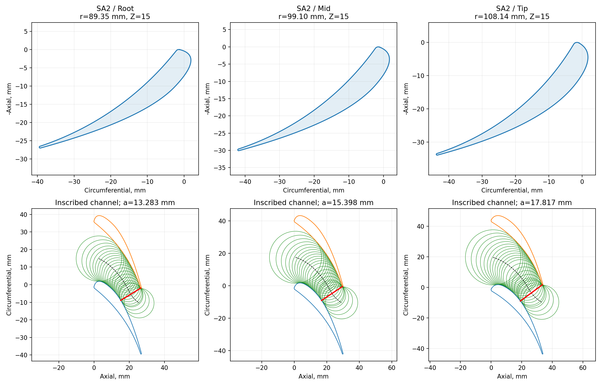
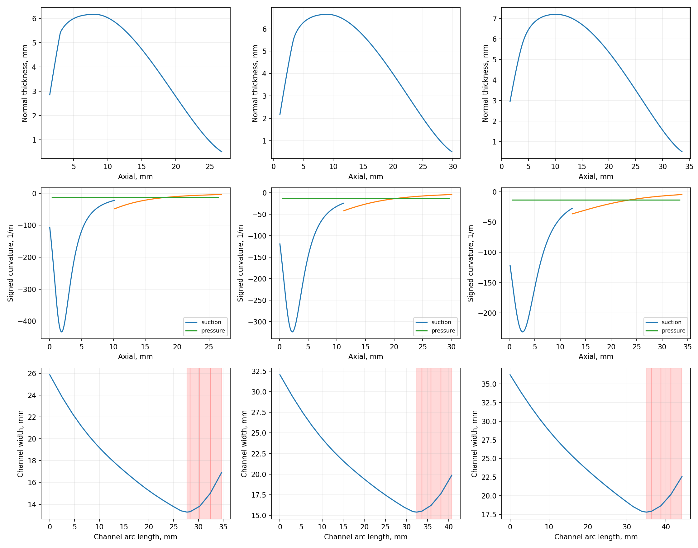
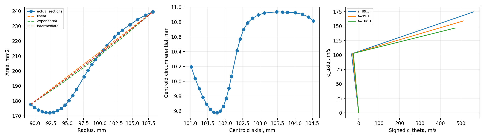
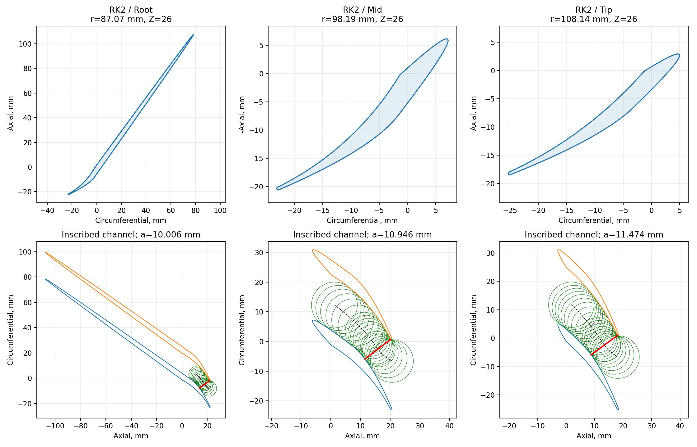
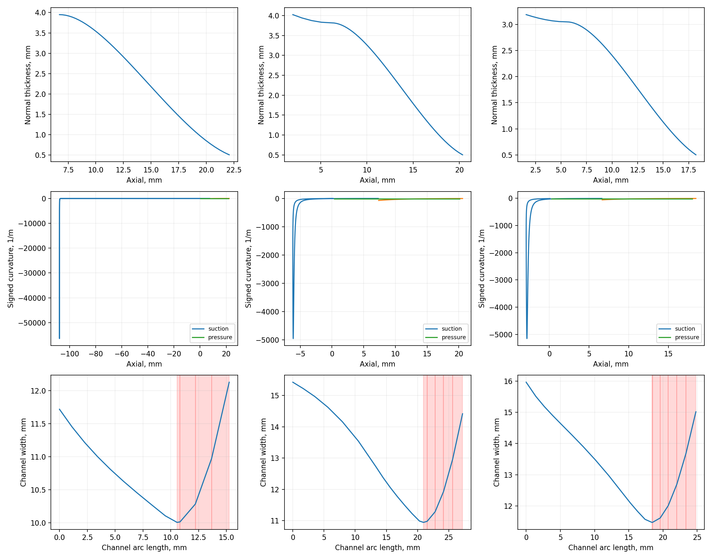
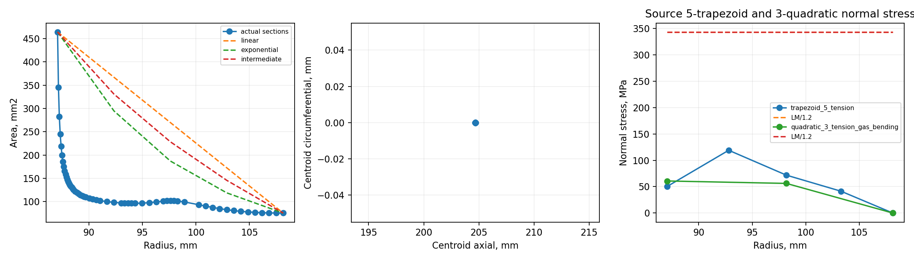
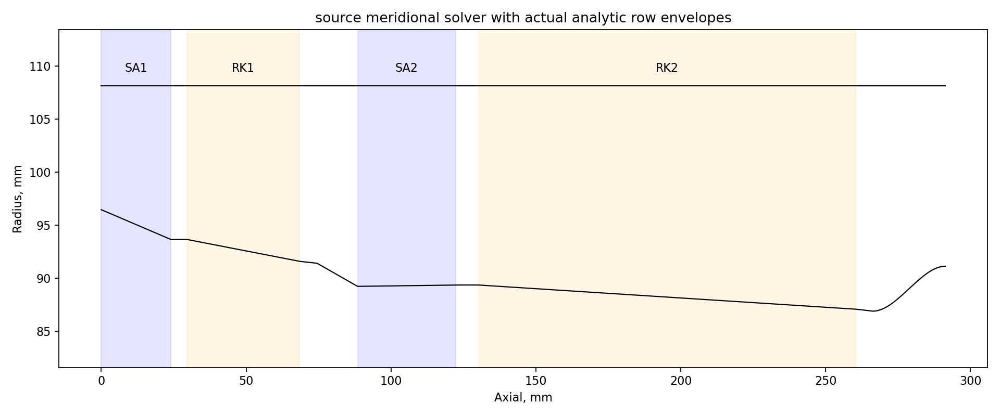

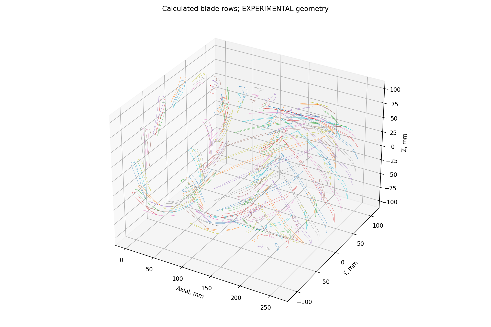

## Scope and missing physical evidence

- Geometry is not CFD/experimental proof of no separation or efficiency.
- Reynolds uses a documented air-viscosity proxy, not measured mixture transport.
- Source variable-cp thermodynamics and independent pressure-equilibrium audits are retained.
- IN738C/LM data are preliminary, not certified supply allowables.
- HCF NOT_CHECKED: grade-specific fatigue curve, forcing and damping are unavailable.
