# Vinogradov — actual TWO-stage course resource calculation

Source: **TVD_1CBK_2st_2000h.ipynb**; resource: **2000 h**; stages: **2**.
Fixed source RPM: **33200**.
Engineering admissible: **False**.
Constructed rows: 3/4.

A failed finite search is not a proof of global infeasibility. No design limit was relaxed.

## Quantified violations

### SA1
- {'name': 'source streamline Euler residual', 'value': 1.9255327060818672e-05, 'limit': 1e-05, 'passed': False, 'classification': 'numerical', 'source': 'course radial_stage, J/kg', 'units': '1', 'note': ''}
- {'section': 1, 'name': 'prior profile guide: вписанные круги', 'measurements': {'geometry_valid': False, 'intersections': False, 'self_intersection': False, 'area_equivalent_angle_deg': 13.202646400159438, 'area_ratio': 0.22839583791506937, 'angle_comparison': 'uniform-flux geometric comparison, not actual gas exit angle', 'angle_error_deg': 2.00264640015944, 'te_over_throat': 0.046273979752517735, 'book_te_over_throat': 0.055, 'max_reduced_expansion': 1.4296700414901549}, 'relative_thickness': 0.1362208030072899, 'actual_relative_pitch': 0.8805695088323457}
- {'section': 2, 'name': 'prior profile guide: вписанные круги', 'measurements': {'geometry_valid': False, 'intersections': False, 'self_intersection': False, 'area_equivalent_angle_deg': 13.238094046941477, 'area_ratio': 0.2289981196329883, 'angle_comparison': 'uniform-flux geometric comparison, not actual gas exit angle', 'angle_error_deg': 2.038094046941479, 'te_over_throat': 0.04443662173337392, 'book_te_over_throat': 0.055, 'max_reduced_expansion': 1.4258358499067072}, 'relative_thickness': 0.13617038585134297, 'actual_relative_pitch': 0.8803528067050812}
### RK1
- {'name': 'source streamline Euler residual', 'value': 1.9255327060818672e-05, 'limit': 1e-05, 'passed': False, 'classification': 'numerical', 'source': 'course radial_stage, J/kg', 'units': '1', 'note': ''}
- {'name': 'construction/calculation failure', 'message': 'Parabola lies outside its source control triangle', 'details': {'first_tangent_distance_m': -0.006277957284638749, 'last_tangent_distance_m': 0.0015772072116145015}}
### SA2
- {'name': 'source streamline Euler residual', 'value': 4.750437801703811e-05, 'limit': 1e-05, 'passed': False, 'classification': 'numerical', 'source': 'course radial_stage, J/kg', 'units': '1', 'note': ''}
- {'section': 0, 'name': 'prior profile guide: вписанные круги', 'measurements': {'geometry_valid': False, 'intersections': False, 'self_intersection': False, 'area_equivalent_angle_deg': 21.619862174902764, 'area_ratio': 0.3684468471996076, 'angle_comparison': 'uniform-flux geometric comparison, not actual gas exit angle', 'angle_error_deg': 4.173587359476802, 'te_over_throat': 0.05262199010365405, 'book_te_over_throat': 0.055, 'max_reduced_expansion': 1.2445567980539336}, 'relative_thickness': 0.13773913083126574, 'actual_relative_pitch': 0.8193786698352142}
- {'section': 1, 'name': 'prior profile guide: вписанные круги', 'measurements': {'geometry_valid': False, 'intersections': False, 'self_intersection': False, 'area_equivalent_angle_deg': 21.743860851268558, 'area_ratio': 0.370457914963811, 'angle_comparison': 'uniform-flux geometric comparison, not actual gas exit angle', 'angle_error_deg': 4.297586035842599, 'te_over_throat': 0.04956702394982605, 'book_te_over_throat': 0.055, 'max_reduced_expansion': 1.3099126858148007}, 'relative_thickness': 0.1406923600254928, 'actual_relative_pitch': 0.8530257606075137}
- {'section': 2, 'name': 'prior profile guide: вписанные круги', 'measurements': {'geometry_valid': False, 'intersections': False, 'self_intersection': False, 'area_equivalent_angle_deg': 23.130150884187504, 'area_ratio': 0.3928211019496461, 'angle_comparison': 'uniform-flux geometric comparison, not actual gas exit angle', 'angle_error_deg': 5.6838760687615455, 'te_over_throat': 0.04448094206701968, 'book_te_over_throat': 0.055, 'max_reduced_expansion': 1.255265663050753}, 'relative_thickness': 0.1379777074108189, 'actual_relative_pitch': 0.8500137342556553}
- {'section': 3, 'name': 'prior profile guide: вписанные круги', 'measurements': {'geometry_valid': False, 'intersections': False, 'self_intersection': False, 'area_equivalent_angle_deg': 22.840307957282878, 'area_ratio': 0.38816402728688926, 'angle_comparison': 'uniform-flux geometric comparison, not actual gas exit angle', 'angle_error_deg': 5.394033141856916, 'te_over_throat': 0.04301898542162423, 'book_te_over_throat': 0.055, 'max_reduced_expansion': 1.3030054345156463}, 'relative_thickness': 0.14084505346687015, 'actual_relative_pitch': 0.8702049204427853}
- {'section': 4, 'name': 'prior profile guide: вписанные круги', 'measurements': {'geometry_valid': False, 'intersections': False, 'self_intersection': False, 'area_equivalent_angle_deg': 22.98158886029535, 'area_ratio': 0.39043531788823393, 'angle_comparison': 'uniform-flux geometric comparison, not actual gas exit angle', 'angle_error_deg': 5.535314044869391, 'te_over_throat': 0.0409901573991623, 'book_te_over_throat': 0.055, 'max_reduced_expansion': 1.199695537688286}, 'relative_thickness': 0.136820103606402, 'actual_relative_pitch': 0.8202800574432979}
### RK2
- {'name': 'source streamline Euler residual', 'value': 4.750437801703811e-05, 'limit': 1e-05, 'passed': False, 'classification': 'numerical', 'source': 'course radial_stage, J/kg', 'units': '1', 'note': ''}
- {'section': 0, 'name': 'prior profile guide: вписанные круги', 'measurements': {'geometry_valid': False, 'intersections': False, 'self_intersection': False, 'area_equivalent_angle_deg': 30.55044865624439, 'area_ratio': 0.508296826423512, 'angle_comparison': 'uniform-flux geometric comparison, not actual gas exit angle', 'angle_error_deg': 1.6125457211996874, 'te_over_throat': 0.07255179667446045, 'book_te_over_throat': 0.07, 'max_reduced_expansion': 1.2851195275557397}, 'relative_thickness': 0.12741737587820548, 'actual_relative_pitch': 0.7460433104407697}
- {'section': 1, 'name': 'prior profile guide: вписанные круги', 'measurements': {'geometry_valid': False, 'intersections': False, 'self_intersection': False, 'area_equivalent_angle_deg': 30.09400726628328, 'area_ratio': 0.5014202456905291, 'angle_comparison': 'uniform-flux geometric comparison, not actual gas exit angle', 'angle_error_deg': 2.339031345942775, 'te_over_throat': 0.06899310925246681, 'book_te_over_throat': 0.07, 'max_reduced_expansion': 1.218028075066959}, 'relative_thickness': 0.12643962194147831, 'actual_relative_pitch': 0.7837631631566793}
- {'section': 2, 'name': 'prior profile guide: вписанные круги', 'measurements': {'geometry_valid': False, 'intersections': False, 'self_intersection': False, 'area_equivalent_angle_deg': 27.89689541843138, 'area_ratio': 0.4678819265825238, 'angle_comparison': 'uniform-flux geometric comparison, not actual gas exit angle', 'angle_error_deg': 1.2120600282404368, 'te_over_throat': 0.06978311094130871, 'book_te_over_throat': 0.07, 'max_reduced_expansion': 1.3265539390939862}, 'relative_thickness': 0.12304010245531233, 'actual_relative_pitch': 0.7929074884103496}
- {'section': 3, 'name': 'prior profile guide: вписанные круги', 'measurements': {'geometry_valid': False, 'intersections': False, 'self_intersection': False, 'area_equivalent_angle_deg': 29.100320187489636, 'area_ratio': 0.48634026333985675, 'angle_comparison': 'uniform-flux geometric comparison, not actual gas exit angle', 'angle_error_deg': 3.385520284882677, 'te_over_throat': 0.06375325203632404, 'book_te_over_throat': 0.07, 'max_reduced_expansion': 1.272052371879241}, 'relative_thickness': 0.11550344669528183, 'actual_relative_pitch': 0.8636618725284446}
- {'section': 4, 'name': 'prior profile guide: вписанные круги', 'measurements': {'geometry_valid': False, 'intersections': False, 'self_intersection': False, 'area_equivalent_angle_deg': 26.238720222414774, 'area_ratio': 0.4421121149782128, 'angle_comparison': 'uniform-flux geometric comparison, not actual gas exit angle', 'angle_error_deg': 1.4061870664384983, 'te_over_throat': 0.0667813321264678, 'book_te_over_throat': 0.07, 'max_reduced_expansion': 1.3184171920195538}, 'relative_thickness': 0.10389810838721192, 'actual_relative_pitch': 0.8754393664040574}
- {'name': 'vibration strength', 'status': 'NOT_CHECKED', 'reason': 'NOT_CHECKED: no grade-specific fatigue curve, damping or actual harmonic forcing; beam modes are screening only'}

## Global/source violations

- {'row': 'SA1', 'name': 'source streamline Euler residual', 'value': 1.9255327060818672e-05, 'limit': 1e-05, 'passed': False, 'classification': 'numerical', 'source': 'course radial_stage, J/kg', 'units': '1', 'note': ''}
- {'row': 'SA1', 'section': 1, 'name': 'prior profile guide: вписанные круги', 'measurements': {'geometry_valid': False, 'intersections': False, 'self_intersection': False, 'area_equivalent_angle_deg': 13.202646400159438, 'area_ratio': 0.22839583791506937, 'angle_comparison': 'uniform-flux geometric comparison, not actual gas exit angle', 'angle_error_deg': 2.00264640015944, 'te_over_throat': 0.046273979752517735, 'book_te_over_throat': 0.055, 'max_reduced_expansion': 1.4296700414901549}, 'relative_thickness': 0.1362208030072899, 'actual_relative_pitch': 0.8805695088323457}
- {'row': 'SA1', 'section': 2, 'name': 'prior profile guide: вписанные круги', 'measurements': {'geometry_valid': False, 'intersections': False, 'self_intersection': False, 'area_equivalent_angle_deg': 13.238094046941477, 'area_ratio': 0.2289981196329883, 'angle_comparison': 'uniform-flux geometric comparison, not actual gas exit angle', 'angle_error_deg': 2.038094046941479, 'te_over_throat': 0.04443662173337392, 'book_te_over_throat': 0.055, 'max_reduced_expansion': 1.4258358499067072}, 'relative_thickness': 0.13617038585134297, 'actual_relative_pitch': 0.8803528067050812}
- {'row': 'RK1', 'name': 'source streamline Euler residual', 'value': 1.9255327060818672e-05, 'limit': 1e-05, 'passed': False, 'classification': 'numerical', 'source': 'course radial_stage, J/kg', 'units': '1', 'note': ''}
- {'row': 'RK1', 'name': 'construction/calculation failure', 'message': 'Parabola lies outside its source control triangle', 'details': {'first_tangent_distance_m': -0.006277957284638749, 'last_tangent_distance_m': 0.0015772072116145015}}
- {'row': 'SA2', 'name': 'source streamline Euler residual', 'value': 4.750437801703811e-05, 'limit': 1e-05, 'passed': False, 'classification': 'numerical', 'source': 'course radial_stage, J/kg', 'units': '1', 'note': ''}
- {'row': 'SA2', 'section': 0, 'name': 'prior profile guide: вписанные круги', 'measurements': {'geometry_valid': False, 'intersections': False, 'self_intersection': False, 'area_equivalent_angle_deg': 21.619862174902764, 'area_ratio': 0.3684468471996076, 'angle_comparison': 'uniform-flux geometric comparison, not actual gas exit angle', 'angle_error_deg': 4.173587359476802, 'te_over_throat': 0.05262199010365405, 'book_te_over_throat': 0.055, 'max_reduced_expansion': 1.2445567980539336}, 'relative_thickness': 0.13773913083126574, 'actual_relative_pitch': 0.8193786698352142}
- {'row': 'SA2', 'section': 1, 'name': 'prior profile guide: вписанные круги', 'measurements': {'geometry_valid': False, 'intersections': False, 'self_intersection': False, 'area_equivalent_angle_deg': 21.743860851268558, 'area_ratio': 0.370457914963811, 'angle_comparison': 'uniform-flux geometric comparison, not actual gas exit angle', 'angle_error_deg': 4.297586035842599, 'te_over_throat': 0.04956702394982605, 'book_te_over_throat': 0.055, 'max_reduced_expansion': 1.3099126858148007}, 'relative_thickness': 0.1406923600254928, 'actual_relative_pitch': 0.8530257606075137}
- {'row': 'SA2', 'section': 2, 'name': 'prior profile guide: вписанные круги', 'measurements': {'geometry_valid': False, 'intersections': False, 'self_intersection': False, 'area_equivalent_angle_deg': 23.130150884187504, 'area_ratio': 0.3928211019496461, 'angle_comparison': 'uniform-flux geometric comparison, not actual gas exit angle', 'angle_error_deg': 5.6838760687615455, 'te_over_throat': 0.04448094206701968, 'book_te_over_throat': 0.055, 'max_reduced_expansion': 1.255265663050753}, 'relative_thickness': 0.1379777074108189, 'actual_relative_pitch': 0.8500137342556553}
- {'row': 'SA2', 'section': 3, 'name': 'prior profile guide: вписанные круги', 'measurements': {'geometry_valid': False, 'intersections': False, 'self_intersection': False, 'area_equivalent_angle_deg': 22.840307957282878, 'area_ratio': 0.38816402728688926, 'angle_comparison': 'uniform-flux geometric comparison, not actual gas exit angle', 'angle_error_deg': 5.394033141856916, 'te_over_throat': 0.04301898542162423, 'book_te_over_throat': 0.055, 'max_reduced_expansion': 1.3030054345156463}, 'relative_thickness': 0.14084505346687015, 'actual_relative_pitch': 0.8702049204427853}
- {'row': 'SA2', 'section': 4, 'name': 'prior profile guide: вписанные круги', 'measurements': {'geometry_valid': False, 'intersections': False, 'self_intersection': False, 'area_equivalent_angle_deg': 22.98158886029535, 'area_ratio': 0.39043531788823393, 'angle_comparison': 'uniform-flux geometric comparison, not actual gas exit angle', 'angle_error_deg': 5.535314044869391, 'te_over_throat': 0.0409901573991623, 'book_te_over_throat': 0.055, 'max_reduced_expansion': 1.199695537688286}, 'relative_thickness': 0.136820103606402, 'actual_relative_pitch': 0.8202800574432979}
- {'row': 'RK2', 'name': 'source streamline Euler residual', 'value': 4.750437801703811e-05, 'limit': 1e-05, 'passed': False, 'classification': 'numerical', 'source': 'course radial_stage, J/kg', 'units': '1', 'note': ''}
- {'row': 'RK2', 'section': 0, 'name': 'prior profile guide: вписанные круги', 'measurements': {'geometry_valid': False, 'intersections': False, 'self_intersection': False, 'area_equivalent_angle_deg': 30.55044865624439, 'area_ratio': 0.508296826423512, 'angle_comparison': 'uniform-flux geometric comparison, not actual gas exit angle', 'angle_error_deg': 1.6125457211996874, 'te_over_throat': 0.07255179667446045, 'book_te_over_throat': 0.07, 'max_reduced_expansion': 1.2851195275557397}, 'relative_thickness': 0.12741737587820548, 'actual_relative_pitch': 0.7460433104407697}
- {'row': 'RK2', 'section': 1, 'name': 'prior profile guide: вписанные круги', 'measurements': {'geometry_valid': False, 'intersections': False, 'self_intersection': False, 'area_equivalent_angle_deg': 30.09400726628328, 'area_ratio': 0.5014202456905291, 'angle_comparison': 'uniform-flux geometric comparison, not actual gas exit angle', 'angle_error_deg': 2.339031345942775, 'te_over_throat': 0.06899310925246681, 'book_te_over_throat': 0.07, 'max_reduced_expansion': 1.218028075066959}, 'relative_thickness': 0.12643962194147831, 'actual_relative_pitch': 0.7837631631566793}
- {'row': 'RK2', 'section': 2, 'name': 'prior profile guide: вписанные круги', 'measurements': {'geometry_valid': False, 'intersections': False, 'self_intersection': False, 'area_equivalent_angle_deg': 27.89689541843138, 'area_ratio': 0.4678819265825238, 'angle_comparison': 'uniform-flux geometric comparison, not actual gas exit angle', 'angle_error_deg': 1.2120600282404368, 'te_over_throat': 0.06978311094130871, 'book_te_over_throat': 0.07, 'max_reduced_expansion': 1.3265539390939862}, 'relative_thickness': 0.12304010245531233, 'actual_relative_pitch': 0.7929074884103496}
- {'row': 'RK2', 'section': 3, 'name': 'prior profile guide: вписанные круги', 'measurements': {'geometry_valid': False, 'intersections': False, 'self_intersection': False, 'area_equivalent_angle_deg': 29.100320187489636, 'area_ratio': 0.48634026333985675, 'angle_comparison': 'uniform-flux geometric comparison, not actual gas exit angle', 'angle_error_deg': 3.385520284882677, 'te_over_throat': 0.06375325203632404, 'book_te_over_throat': 0.07, 'max_reduced_expansion': 1.272052371879241}, 'relative_thickness': 0.11550344669528183, 'actual_relative_pitch': 0.8636618725284446}
- {'row': 'RK2', 'section': 4, 'name': 'prior profile guide: вписанные круги', 'measurements': {'geometry_valid': False, 'intersections': False, 'self_intersection': False, 'area_equivalent_angle_deg': 26.238720222414774, 'area_ratio': 0.4421121149782128, 'angle_comparison': 'uniform-flux geometric comparison, not actual gas exit angle', 'angle_error_deg': 1.4061870664384983, 'te_over_throat': 0.0667813321264678, 'book_te_over_throat': 0.07, 'max_reduced_expansion': 1.3184171920195538}, 'relative_thickness': 0.10389810838721192, 'actual_relative_pitch': 0.8754393664040574}
- {'row': 'RK2', 'name': 'vibration strength', 'status': 'NOT_CHECKED', 'reason': 'NOT_CHECKED: no grade-specific fatigue curve, damping or actual harmonic forcing; beam modes are screening only'}
- {'name': 'source strength assessment', 'reasons': ["('РК1', 0)"]}
- {'row': 'SA2', 'section': 2, 'name': 'source finite trailing edge', 'value': 0.0004999999999999991, 'limit': 0.0005}
- {'row': 'RK2', 'name': 'source rotor taper mismatch', 'value': 1.1272729002674935, 'limit': 1.3}
- {'row': 'RK2', 'name': 'source chord direction', 'root_m': 0.0177887122172496, 'tip_m': 0.018809736422904396, 'limit': 'root>tip RK; root<tip SA'}
- {'row': 'RK2', 'name': 'source rotor areas must decrease', 'value': [3.2102668547513524e-05, 3.197597071816445e-05, 3.4223179440355465e-05, 2.9492022909148375e-05, 2.847816934115581e-05], 'limit': 'strict decrease root to tip'}
- {'row': 'RK2', 'section': 0, 'name': 'source finite trailing edge', 'value': 0.0004999999999999986, 'limit': 0.0005}
- {'row': 'RK2', 'section': 1, 'name': 'source finite trailing edge', 'value': 0.0004999999999999993, 'limit': 0.0005}
- {'row': 'RK2', 'section': 2, 'name': 'source finite trailing edge', 'value': 0.0004999999999999994, 'limit': 0.0005}
- {'row': 'RK2', 'section': 4, 'name': 'source finite trailing edge', 'value': 0.0004999999999999997, 'limit': 0.0005}

## Empirical guidance — not added hard limits

- {'row': 'SA1', 'section': 0, 'name': 'relative thickness starting guidance', 'value': 0.13630418149524687, 'range': [0.1, 0.1], 'classification': 'empirical, p13'}
- {'row': 'SA1', 'section': 0, 'name': 'prior profile guide: местная диффузорность', 'measurements': {'geometry_valid': True, 'intersections': False, 'self_intersection': False, 'area_equivalent_angle_deg': 12.838906555667908, 'area_ratio': 0.22221061921822235, 'angle_comparison': 'uniform-flux geometric comparison, not actual gas exit angle', 'angle_error_deg': 1.6389065556679103, 'te_over_throat': 0.0495636816615422, 'book_te_over_throat': 0.055, 'max_reduced_expansion': 1.3966642501721587}, 'relative_thickness': 0.13630418149524687, 'actual_relative_pitch': 0.8710956719528739, 'classification': 'historical empirical profile guide; Vinogradov uses its own recommendations'}
- {'row': 'SA1', 'section': 0, 'name': 'prior profile guide: относительный шаг', 'measurements': {'geometry_valid': True, 'intersections': False, 'self_intersection': False, 'area_equivalent_angle_deg': 12.838906555667908, 'area_ratio': 0.22221061921822235, 'angle_comparison': 'uniform-flux geometric comparison, not actual gas exit angle', 'angle_error_deg': 1.6389065556679103, 'te_over_throat': 0.0495636816615422, 'book_te_over_throat': 0.055, 'max_reduced_expansion': 1.3966642501721587}, 'relative_thickness': 0.13630418149524687, 'actual_relative_pitch': 0.8710956719528739, 'classification': 'historical empirical profile guide; Vinogradov uses its own recommendations'}
- {'row': 'SA1', 'section': 1, 'name': 'relative thickness starting guidance', 'value': 0.1362208030072899, 'range': [0.1, 0.1], 'classification': 'empirical, p13'}
- {'row': 'SA1', 'section': 1, 'name': 'prior profile guide: угол горла', 'measurements': {'geometry_valid': False, 'intersections': False, 'self_intersection': False, 'area_equivalent_angle_deg': 13.202646400159438, 'area_ratio': 0.22839583791506937, 'angle_comparison': 'uniform-flux geometric comparison, not actual gas exit angle', 'angle_error_deg': 2.00264640015944, 'te_over_throat': 0.046273979752517735, 'book_te_over_throat': 0.055, 'max_reduced_expansion': 1.4296700414901549}, 'relative_thickness': 0.1362208030072899, 'actual_relative_pitch': 0.8805695088323457, 'classification': 'historical empirical profile guide; Vinogradov uses its own recommendations'}
- {'row': 'SA1', 'section': 1, 'name': 'prior profile guide: местная диффузорность', 'measurements': {'geometry_valid': False, 'intersections': False, 'self_intersection': False, 'area_equivalent_angle_deg': 13.202646400159438, 'area_ratio': 0.22839583791506937, 'angle_comparison': 'uniform-flux geometric comparison, not actual gas exit angle', 'angle_error_deg': 2.00264640015944, 'te_over_throat': 0.046273979752517735, 'book_te_over_throat': 0.055, 'max_reduced_expansion': 1.4296700414901549}, 'relative_thickness': 0.1362208030072899, 'actual_relative_pitch': 0.8805695088323457, 'classification': 'historical empirical profile guide; Vinogradov uses its own recommendations'}
- {'row': 'SA1', 'section': 1, 'name': 'prior profile guide: относительный шаг', 'measurements': {'geometry_valid': False, 'intersections': False, 'self_intersection': False, 'area_equivalent_angle_deg': 13.202646400159438, 'area_ratio': 0.22839583791506937, 'angle_comparison': 'uniform-flux geometric comparison, not actual gas exit angle', 'angle_error_deg': 2.00264640015944, 'te_over_throat': 0.046273979752517735, 'book_te_over_throat': 0.055, 'max_reduced_expansion': 1.4296700414901549}, 'relative_thickness': 0.1362208030072899, 'actual_relative_pitch': 0.8805695088323457, 'classification': 'historical empirical profile guide; Vinogradov uses its own recommendations'}
- {'row': 'SA1', 'section': 2, 'name': 'relative thickness starting guidance', 'value': 0.13617038585134297, 'range': [0.1, 0.1], 'classification': 'empirical, p13'}
- {'row': 'SA1', 'section': 2, 'name': 'prior profile guide: угол горла', 'measurements': {'geometry_valid': False, 'intersections': False, 'self_intersection': False, 'area_equivalent_angle_deg': 13.238094046941477, 'area_ratio': 0.2289981196329883, 'angle_comparison': 'uniform-flux geometric comparison, not actual gas exit angle', 'angle_error_deg': 2.038094046941479, 'te_over_throat': 0.04443662173337392, 'book_te_over_throat': 0.055, 'max_reduced_expansion': 1.4258358499067072}, 'relative_thickness': 0.13617038585134297, 'actual_relative_pitch': 0.8803528067050812, 'classification': 'historical empirical profile guide; Vinogradov uses its own recommendations'}
- {'row': 'SA1', 'section': 2, 'name': 'prior profile guide: местная диффузорность', 'measurements': {'geometry_valid': False, 'intersections': False, 'self_intersection': False, 'area_equivalent_angle_deg': 13.238094046941477, 'area_ratio': 0.2289981196329883, 'angle_comparison': 'uniform-flux geometric comparison, not actual gas exit angle', 'angle_error_deg': 2.038094046941479, 'te_over_throat': 0.04443662173337392, 'book_te_over_throat': 0.055, 'max_reduced_expansion': 1.4258358499067072}, 'relative_thickness': 0.13617038585134297, 'actual_relative_pitch': 0.8803528067050812, 'classification': 'historical empirical profile guide; Vinogradov uses its own recommendations'}
- {'row': 'SA1', 'section': 2, 'name': 'prior profile guide: относительный шаг', 'measurements': {'geometry_valid': False, 'intersections': False, 'self_intersection': False, 'area_equivalent_angle_deg': 13.238094046941477, 'area_ratio': 0.2289981196329883, 'angle_comparison': 'uniform-flux geometric comparison, not actual gas exit angle', 'angle_error_deg': 2.038094046941479, 'te_over_throat': 0.04443662173337392, 'book_te_over_throat': 0.055, 'max_reduced_expansion': 1.4258358499067072}, 'relative_thickness': 0.13617038585134297, 'actual_relative_pitch': 0.8803528067050812, 'classification': 'historical empirical profile guide; Vinogradov uses its own recommendations'}
- {'row': 'SA1', 'section': 3, 'name': 'relative thickness starting guidance', 'value': 0.1362382088711906, 'range': [0.1, 0.1], 'classification': 'empirical, p13'}
- {'row': 'SA1', 'section': 3, 'name': 'prior profile guide: местная диффузорность', 'measurements': {'geometry_valid': True, 'intersections': False, 'self_intersection': False, 'area_equivalent_angle_deg': 12.380356902928945, 'area_ratio': 0.2144004754343309, 'angle_comparison': 'uniform-flux geometric comparison, not actual gas exit angle', 'angle_error_deg': 1.1803569029289473, 'te_over_throat': 0.045799463618531794, 'book_te_over_throat': 0.055, 'max_reduced_expansion': 1.4489632217851565}, 'relative_thickness': 0.1362382088711906, 'actual_relative_pitch': 0.8800906188430677, 'classification': 'historical empirical profile guide; Vinogradov uses its own recommendations'}
- {'row': 'SA1', 'section': 3, 'name': 'prior profile guide: относительный шаг', 'measurements': {'geometry_valid': True, 'intersections': False, 'self_intersection': False, 'area_equivalent_angle_deg': 12.380356902928945, 'area_ratio': 0.2144004754343309, 'angle_comparison': 'uniform-flux geometric comparison, not actual gas exit angle', 'angle_error_deg': 1.1803569029289473, 'te_over_throat': 0.045799463618531794, 'book_te_over_throat': 0.055, 'max_reduced_expansion': 1.4489632217851565}, 'relative_thickness': 0.1362382088711906, 'actual_relative_pitch': 0.8800906188430677, 'classification': 'historical empirical profile guide; Vinogradov uses its own recommendations'}
- {'row': 'SA1', 'section': 4, 'name': 'relative thickness starting guidance', 'value': 0.13623576043786464, 'range': [0.1, 0.1], 'classification': 'empirical, p13'}
- {'row': 'SA1', 'section': 4, 'name': 'prior profile guide: местная диффузорность', 'measurements': {'geometry_valid': True, 'intersections': False, 'self_intersection': False, 'area_equivalent_angle_deg': 12.002379005018712, 'area_ratio': 0.2079523047652709, 'angle_comparison': 'uniform-flux geometric comparison, not actual gas exit angle', 'angle_error_deg': 0.8023790050187127, 'te_over_throat': 0.04566331528260895, 'book_te_over_throat': 0.055, 'max_reduced_expansion': 1.4515272325990605}, 'relative_thickness': 0.13623576043786464, 'actual_relative_pitch': 0.8796482902365791, 'classification': 'historical empirical profile guide; Vinogradov uses its own recommendations'}
- {'row': 'SA1', 'section': 4, 'name': 'prior profile guide: относительный шаг', 'measurements': {'geometry_valid': True, 'intersections': False, 'self_intersection': False, 'area_equivalent_angle_deg': 12.002379005018712, 'area_ratio': 0.2079523047652709, 'angle_comparison': 'uniform-flux geometric comparison, not actual gas exit angle', 'angle_error_deg': 0.8023790050187127, 'te_over_throat': 0.04566331528260895, 'book_te_over_throat': 0.055, 'max_reduced_expansion': 1.4515272325990605}, 'relative_thickness': 0.13623576043786464, 'actual_relative_pitch': 0.8796482902365791, 'classification': 'historical empirical profile guide; Vinogradov uses its own recommendations'}
- {'row': 'SA2', 'section': 0, 'name': 'relative thickness starting guidance', 'value': 0.13773913083126574, 'range': [0.1, 0.1], 'classification': 'empirical, p13'}
- {'row': 'SA2', 'section': 0, 'name': 'prior profile guide: угол горла', 'measurements': {'geometry_valid': False, 'intersections': False, 'self_intersection': False, 'area_equivalent_angle_deg': 21.619862174902764, 'area_ratio': 0.3684468471996076, 'angle_comparison': 'uniform-flux geometric comparison, not actual gas exit angle', 'angle_error_deg': 4.173587359476802, 'te_over_throat': 0.05262199010365405, 'book_te_over_throat': 0.055, 'max_reduced_expansion': 1.2445567980539336}, 'relative_thickness': 0.13773913083126574, 'actual_relative_pitch': 0.8193786698352142, 'classification': 'historical empirical profile guide; Vinogradov uses its own recommendations'}
- {'row': 'SA2', 'section': 0, 'name': 'prior profile guide: местная диффузорность', 'measurements': {'geometry_valid': False, 'intersections': False, 'self_intersection': False, 'area_equivalent_angle_deg': 21.619862174902764, 'area_ratio': 0.3684468471996076, 'angle_comparison': 'uniform-flux geometric comparison, not actual gas exit angle', 'angle_error_deg': 4.173587359476802, 'te_over_throat': 0.05262199010365405, 'book_te_over_throat': 0.055, 'max_reduced_expansion': 1.2445567980539336}, 'relative_thickness': 0.13773913083126574, 'actual_relative_pitch': 0.8193786698352142, 'classification': 'historical empirical profile guide; Vinogradov uses its own recommendations'}
- {'row': 'SA2', 'section': 1, 'name': 'relative thickness starting guidance', 'value': 0.1406923600254928, 'range': [0.1, 0.1], 'classification': 'empirical, p13'}
- {'row': 'SA2', 'section': 1, 'name': 'prior profile guide: угол горла', 'measurements': {'geometry_valid': False, 'intersections': False, 'self_intersection': False, 'area_equivalent_angle_deg': 21.743860851268558, 'area_ratio': 0.370457914963811, 'angle_comparison': 'uniform-flux geometric comparison, not actual gas exit angle', 'angle_error_deg': 4.297586035842599, 'te_over_throat': 0.04956702394982605, 'book_te_over_throat': 0.055, 'max_reduced_expansion': 1.3099126858148007}, 'relative_thickness': 0.1406923600254928, 'actual_relative_pitch': 0.8530257606075137, 'classification': 'historical empirical profile guide; Vinogradov uses its own recommendations'}
- {'row': 'SA2', 'section': 1, 'name': 'prior profile guide: местная диффузорность', 'measurements': {'geometry_valid': False, 'intersections': False, 'self_intersection': False, 'area_equivalent_angle_deg': 21.743860851268558, 'area_ratio': 0.370457914963811, 'angle_comparison': 'uniform-flux geometric comparison, not actual gas exit angle', 'angle_error_deg': 4.297586035842599, 'te_over_throat': 0.04956702394982605, 'book_te_over_throat': 0.055, 'max_reduced_expansion': 1.3099126858148007}, 'relative_thickness': 0.1406923600254928, 'actual_relative_pitch': 0.8530257606075137, 'classification': 'historical empirical profile guide; Vinogradov uses its own recommendations'}
- {'row': 'SA2', 'section': 1, 'name': 'prior profile guide: относительный шаг', 'measurements': {'geometry_valid': False, 'intersections': False, 'self_intersection': False, 'area_equivalent_angle_deg': 21.743860851268558, 'area_ratio': 0.370457914963811, 'angle_comparison': 'uniform-flux geometric comparison, not actual gas exit angle', 'angle_error_deg': 4.297586035842599, 'te_over_throat': 0.04956702394982605, 'book_te_over_throat': 0.055, 'max_reduced_expansion': 1.3099126858148007}, 'relative_thickness': 0.1406923600254928, 'actual_relative_pitch': 0.8530257606075137, 'classification': 'historical empirical profile guide; Vinogradov uses its own recommendations'}
- {'row': 'SA2', 'section': 2, 'name': 'relative thickness starting guidance', 'value': 0.1379777074108189, 'range': [0.1, 0.1], 'classification': 'empirical, p13'}
- {'row': 'SA2', 'section': 2, 'name': 'prior profile guide: угол горла', 'measurements': {'geometry_valid': False, 'intersections': False, 'self_intersection': False, 'area_equivalent_angle_deg': 23.130150884187504, 'area_ratio': 0.3928211019496461, 'angle_comparison': 'uniform-flux geometric comparison, not actual gas exit angle', 'angle_error_deg': 5.6838760687615455, 'te_over_throat': 0.04448094206701968, 'book_te_over_throat': 0.055, 'max_reduced_expansion': 1.255265663050753}, 'relative_thickness': 0.1379777074108189, 'actual_relative_pitch': 0.8500137342556553, 'classification': 'historical empirical profile guide; Vinogradov uses its own recommendations'}
- {'row': 'SA2', 'section': 2, 'name': 'prior profile guide: местная диффузорность', 'measurements': {'geometry_valid': False, 'intersections': False, 'self_intersection': False, 'area_equivalent_angle_deg': 23.130150884187504, 'area_ratio': 0.3928211019496461, 'angle_comparison': 'uniform-flux geometric comparison, not actual gas exit angle', 'angle_error_deg': 5.6838760687615455, 'te_over_throat': 0.04448094206701968, 'book_te_over_throat': 0.055, 'max_reduced_expansion': 1.255265663050753}, 'relative_thickness': 0.1379777074108189, 'actual_relative_pitch': 0.8500137342556553, 'classification': 'historical empirical profile guide; Vinogradov uses its own recommendations'}
- {'row': 'SA2', 'section': 2, 'name': 'prior profile guide: относительный шаг', 'measurements': {'geometry_valid': False, 'intersections': False, 'self_intersection': False, 'area_equivalent_angle_deg': 23.130150884187504, 'area_ratio': 0.3928211019496461, 'angle_comparison': 'uniform-flux geometric comparison, not actual gas exit angle', 'angle_error_deg': 5.6838760687615455, 'te_over_throat': 0.04448094206701968, 'book_te_over_throat': 0.055, 'max_reduced_expansion': 1.255265663050753}, 'relative_thickness': 0.1379777074108189, 'actual_relative_pitch': 0.8500137342556553, 'classification': 'historical empirical profile guide; Vinogradov uses its own recommendations'}
- {'row': 'SA2', 'section': 3, 'name': 'relative thickness starting guidance', 'value': 0.14084505346687015, 'range': [0.1, 0.1], 'classification': 'empirical, p13'}
- {'row': 'SA2', 'section': 3, 'name': 'prior profile guide: угол горла', 'measurements': {'geometry_valid': False, 'intersections': False, 'self_intersection': False, 'area_equivalent_angle_deg': 22.840307957282878, 'area_ratio': 0.38816402728688926, 'angle_comparison': 'uniform-flux geometric comparison, not actual gas exit angle', 'angle_error_deg': 5.394033141856916, 'te_over_throat': 0.04301898542162423, 'book_te_over_throat': 0.055, 'max_reduced_expansion': 1.3030054345156463}, 'relative_thickness': 0.14084505346687015, 'actual_relative_pitch': 0.8702049204427853, 'classification': 'historical empirical profile guide; Vinogradov uses its own recommendations'}
- {'row': 'SA2', 'section': 3, 'name': 'prior profile guide: местная диффузорность', 'measurements': {'geometry_valid': False, 'intersections': False, 'self_intersection': False, 'area_equivalent_angle_deg': 22.840307957282878, 'area_ratio': 0.38816402728688926, 'angle_comparison': 'uniform-flux geometric comparison, not actual gas exit angle', 'angle_error_deg': 5.394033141856916, 'te_over_throat': 0.04301898542162423, 'book_te_over_throat': 0.055, 'max_reduced_expansion': 1.3030054345156463}, 'relative_thickness': 0.14084505346687015, 'actual_relative_pitch': 0.8702049204427853, 'classification': 'historical empirical profile guide; Vinogradov uses its own recommendations'}
- {'row': 'SA2', 'section': 3, 'name': 'prior profile guide: относительный шаг', 'measurements': {'geometry_valid': False, 'intersections': False, 'self_intersection': False, 'area_equivalent_angle_deg': 22.840307957282878, 'area_ratio': 0.38816402728688926, 'angle_comparison': 'uniform-flux geometric comparison, not actual gas exit angle', 'angle_error_deg': 5.394033141856916, 'te_over_throat': 0.04301898542162423, 'book_te_over_throat': 0.055, 'max_reduced_expansion': 1.3030054345156463}, 'relative_thickness': 0.14084505346687015, 'actual_relative_pitch': 0.8702049204427853, 'classification': 'historical empirical profile guide; Vinogradov uses its own recommendations'}
- {'row': 'SA2', 'section': 4, 'name': 'relative thickness starting guidance', 'value': 0.136820103606402, 'range': [0.1, 0.1], 'classification': 'empirical, p13'}
- {'row': 'SA2', 'section': 4, 'name': 'prior profile guide: угол горла', 'measurements': {'geometry_valid': False, 'intersections': False, 'self_intersection': False, 'area_equivalent_angle_deg': 22.98158886029535, 'area_ratio': 0.39043531788823393, 'angle_comparison': 'uniform-flux geometric comparison, not actual gas exit angle', 'angle_error_deg': 5.535314044869391, 'te_over_throat': 0.0409901573991623, 'book_te_over_throat': 0.055, 'max_reduced_expansion': 1.199695537688286}, 'relative_thickness': 0.136820103606402, 'actual_relative_pitch': 0.8202800574432979, 'classification': 'historical empirical profile guide; Vinogradov uses its own recommendations'}
- {'row': 'SA2', 'section': 4, 'name': 'prior profile guide: местная диффузорность', 'measurements': {'geometry_valid': False, 'intersections': False, 'self_intersection': False, 'area_equivalent_angle_deg': 22.98158886029535, 'area_ratio': 0.39043531788823393, 'angle_comparison': 'uniform-flux geometric comparison, not actual gas exit angle', 'angle_error_deg': 5.535314044869391, 'te_over_throat': 0.0409901573991623, 'book_te_over_throat': 0.055, 'max_reduced_expansion': 1.199695537688286}, 'relative_thickness': 0.136820103606402, 'actual_relative_pitch': 0.8202800574432979, 'classification': 'historical empirical profile guide; Vinogradov uses its own recommendations'}
- {'row': 'RK2', 'section': 0, 'name': 'relative thickness starting guidance', 'value': 0.12741737587820548, 'range': [0.2, 0.3], 'classification': 'empirical, p13'}
- {'row': 'RK2', 'section': 0, 'name': 'prior profile guide: местная диффузорность', 'measurements': {'geometry_valid': False, 'intersections': False, 'self_intersection': False, 'area_equivalent_angle_deg': 30.55044865624439, 'area_ratio': 0.508296826423512, 'angle_comparison': 'uniform-flux geometric comparison, not actual gas exit angle', 'angle_error_deg': 1.6125457211996874, 'te_over_throat': 0.07255179667446045, 'book_te_over_throat': 0.07, 'max_reduced_expansion': 1.2851195275557397}, 'relative_thickness': 0.12741737587820548, 'actual_relative_pitch': 0.7460433104407697, 'classification': 'historical empirical profile guide; Vinogradov uses its own recommendations'}
- {'row': 'RK2', 'section': 0, 'name': 'prior profile guide: максимальная толщина', 'measurements': {'geometry_valid': False, 'intersections': False, 'self_intersection': False, 'area_equivalent_angle_deg': 30.55044865624439, 'area_ratio': 0.508296826423512, 'angle_comparison': 'uniform-flux geometric comparison, not actual gas exit angle', 'angle_error_deg': 1.6125457211996874, 'te_over_throat': 0.07255179667446045, 'book_te_over_throat': 0.07, 'max_reduced_expansion': 1.2851195275557397}, 'relative_thickness': 0.12741737587820548, 'actual_relative_pitch': 0.7460433104407697, 'classification': 'historical empirical profile guide; Vinogradov uses its own recommendations'}
- {'row': 'RK2', 'section': 1, 'name': 'relative thickness starting guidance', 'value': 0.12643962194147831, 'range': [0.14570494584815885, 0.21855741877223822], 'classification': 'empirical, p13'}
- {'row': 'RK2', 'section': 1, 'name': 'prior profile guide: угол горла', 'measurements': {'geometry_valid': False, 'intersections': False, 'self_intersection': False, 'area_equivalent_angle_deg': 30.09400726628328, 'area_ratio': 0.5014202456905291, 'angle_comparison': 'uniform-flux geometric comparison, not actual gas exit angle', 'angle_error_deg': 2.339031345942775, 'te_over_throat': 0.06899310925246681, 'book_te_over_throat': 0.07, 'max_reduced_expansion': 1.218028075066959}, 'relative_thickness': 0.12643962194147831, 'actual_relative_pitch': 0.7837631631566793, 'classification': 'historical empirical profile guide; Vinogradov uses its own recommendations'}
- {'row': 'RK2', 'section': 1, 'name': 'prior profile guide: местная диффузорность', 'measurements': {'geometry_valid': False, 'intersections': False, 'self_intersection': False, 'area_equivalent_angle_deg': 30.09400726628328, 'area_ratio': 0.5014202456905291, 'angle_comparison': 'uniform-flux geometric comparison, not actual gas exit angle', 'angle_error_deg': 2.339031345942775, 'te_over_throat': 0.06899310925246681, 'book_te_over_throat': 0.07, 'max_reduced_expansion': 1.218028075066959}, 'relative_thickness': 0.12643962194147831, 'actual_relative_pitch': 0.7837631631566793, 'classification': 'historical empirical profile guide; Vinogradov uses its own recommendations'}
- {'row': 'RK2', 'section': 1, 'name': 'prior profile guide: максимальная толщина', 'measurements': {'geometry_valid': False, 'intersections': False, 'self_intersection': False, 'area_equivalent_angle_deg': 30.09400726628328, 'area_ratio': 0.5014202456905291, 'angle_comparison': 'uniform-flux geometric comparison, not actual gas exit angle', 'angle_error_deg': 2.339031345942775, 'te_over_throat': 0.06899310925246681, 'book_te_over_throat': 0.07, 'max_reduced_expansion': 1.218028075066959}, 'relative_thickness': 0.12643962194147831, 'actual_relative_pitch': 0.7837631631566793, 'classification': 'historical empirical profile guide; Vinogradov uses its own recommendations'}
- {'row': 'RK2', 'section': 2, 'name': 'prior profile guide: местная диффузорность', 'measurements': {'geometry_valid': False, 'intersections': False, 'self_intersection': False, 'area_equivalent_angle_deg': 27.89689541843138, 'area_ratio': 0.4678819265825238, 'angle_comparison': 'uniform-flux geometric comparison, not actual gas exit angle', 'angle_error_deg': 1.2120600282404368, 'te_over_throat': 0.06978311094130871, 'book_te_over_throat': 0.07, 'max_reduced_expansion': 1.3265539390939862}, 'relative_thickness': 0.12304010245531233, 'actual_relative_pitch': 0.7929074884103496, 'classification': 'historical empirical profile guide; Vinogradov uses its own recommendations'}
- {'row': 'RK2', 'section': 3, 'name': 'relative thickness starting guidance', 'value': 0.11550344669528183, 'range': [0.0676922969800166, 0.09615382830002765], 'classification': 'empirical, p13'}
- {'row': 'RK2', 'section': 3, 'name': 'prior profile guide: угол горла', 'measurements': {'geometry_valid': False, 'intersections': False, 'self_intersection': False, 'area_equivalent_angle_deg': 29.100320187489636, 'area_ratio': 0.48634026333985675, 'angle_comparison': 'uniform-flux geometric comparison, not actual gas exit angle', 'angle_error_deg': 3.385520284882677, 'te_over_throat': 0.06375325203632404, 'book_te_over_throat': 0.07, 'max_reduced_expansion': 1.272052371879241}, 'relative_thickness': 0.11550344669528183, 'actual_relative_pitch': 0.8636618725284446, 'classification': 'historical empirical profile guide; Vinogradov uses its own recommendations'}
- {'row': 'RK2', 'section': 3, 'name': 'prior profile guide: местная диффузорность', 'measurements': {'geometry_valid': False, 'intersections': False, 'self_intersection': False, 'area_equivalent_angle_deg': 29.100320187489636, 'area_ratio': 0.48634026333985675, 'angle_comparison': 'uniform-flux geometric comparison, not actual gas exit angle', 'angle_error_deg': 3.385520284882677, 'te_over_throat': 0.06375325203632404, 'book_te_over_throat': 0.07, 'max_reduced_expansion': 1.272052371879241}, 'relative_thickness': 0.11550344669528183, 'actual_relative_pitch': 0.8636618725284446, 'classification': 'historical empirical profile guide; Vinogradov uses its own recommendations'}
- {'row': 'RK2', 'section': 3, 'name': 'prior profile guide: относительный шаг', 'measurements': {'geometry_valid': False, 'intersections': False, 'self_intersection': False, 'area_equivalent_angle_deg': 29.100320187489636, 'area_ratio': 0.48634026333985675, 'angle_comparison': 'uniform-flux geometric comparison, not actual gas exit angle', 'angle_error_deg': 3.385520284882677, 'te_over_throat': 0.06375325203632404, 'book_te_over_throat': 0.07, 'max_reduced_expansion': 1.272052371879241}, 'relative_thickness': 0.11550344669528183, 'actual_relative_pitch': 0.8636618725284446, 'classification': 'historical empirical profile guide; Vinogradov uses its own recommendations'}
- {'row': 'RK2', 'section': 4, 'name': 'relative thickness starting guidance', 'value': 0.10389810838721192, 'range': [0.04, 0.05], 'classification': 'empirical, p13'}
- {'row': 'RK2', 'section': 4, 'name': '2–3mm tip guidance is not scale compatible', 'actual_m': 0.0019542960336018087, 'lower_m': 0.002, 'chord_required_at_5percent_m': 0.04, 'classification': 'manufacturing recommendation requires process-specific qualification, p13'}
- {'row': 'RK2', 'section': 4, 'name': 'prior profile guide: местная диффузорность', 'measurements': {'geometry_valid': False, 'intersections': False, 'self_intersection': False, 'area_equivalent_angle_deg': 26.238720222414774, 'area_ratio': 0.4421121149782128, 'angle_comparison': 'uniform-flux geometric comparison, not actual gas exit angle', 'angle_error_deg': 1.4061870664384983, 'te_over_throat': 0.0667813321264678, 'book_te_over_throat': 0.07, 'max_reduced_expansion': 1.3184171920195538}, 'relative_thickness': 0.10389810838721192, 'actual_relative_pitch': 0.8754393664040574, 'classification': 'historical empirical profile guide; Vinogradov uses its own recommendations'}
- {'row': 'RK2', 'section': 4, 'name': 'prior profile guide: относительный шаг', 'measurements': {'geometry_valid': False, 'intersections': False, 'self_intersection': False, 'area_equivalent_angle_deg': 26.238720222414774, 'area_ratio': 0.4421121149782128, 'angle_comparison': 'uniform-flux geometric comparison, not actual gas exit angle', 'angle_error_deg': 1.4061870664384983, 'te_over_throat': 0.0667813321264678, 'book_te_over_throat': 0.07, 'max_reduced_expansion': 1.3184171920195538}, 'relative_thickness': 0.10389810838721192, 'actual_relative_pitch': 0.8754393664040574, 'classification': 'historical empirical profile guide; Vinogradov uses its own recommendations'}

## Figures

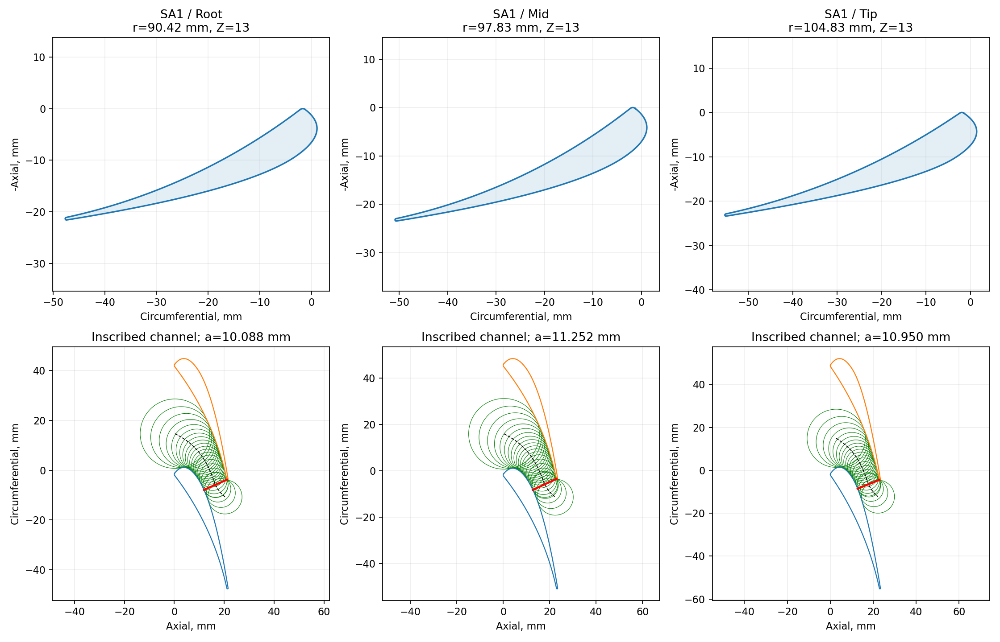
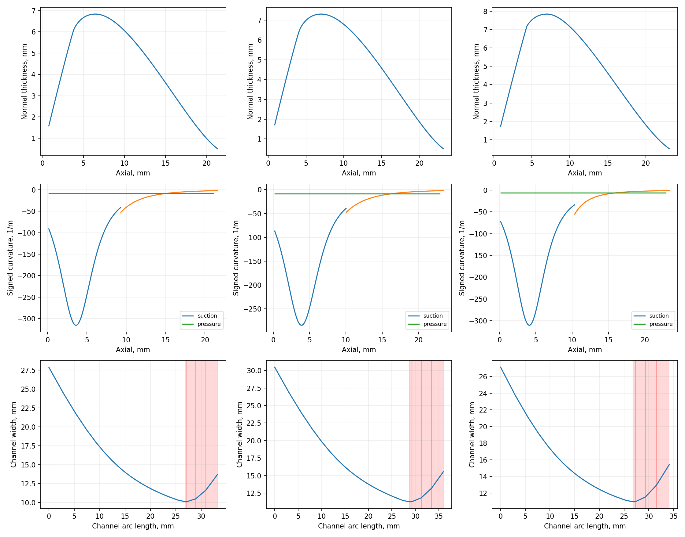
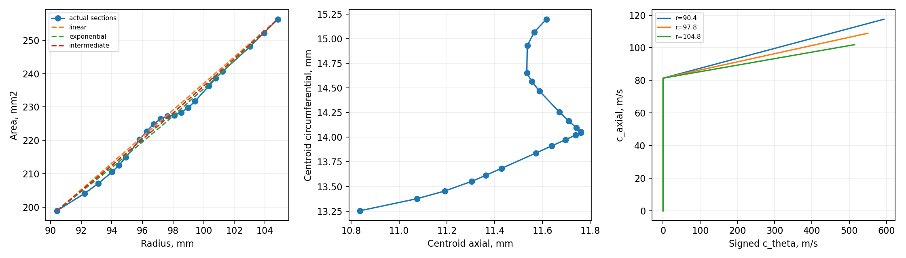
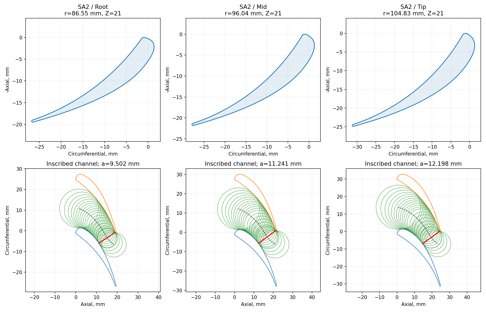
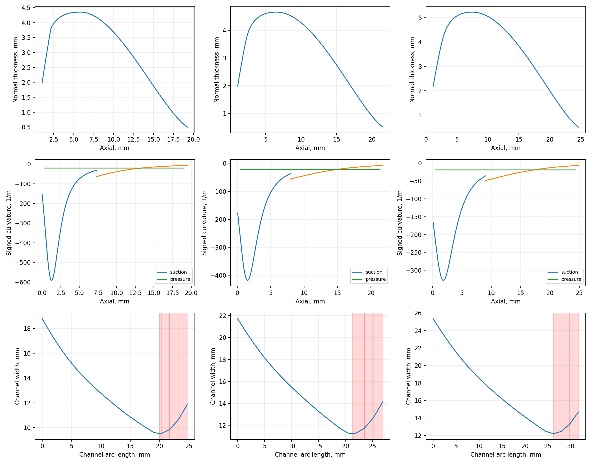
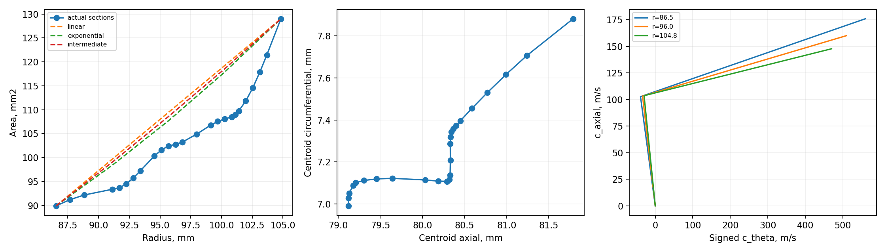
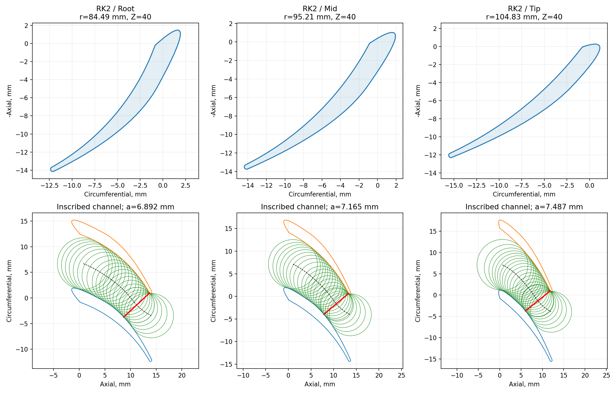
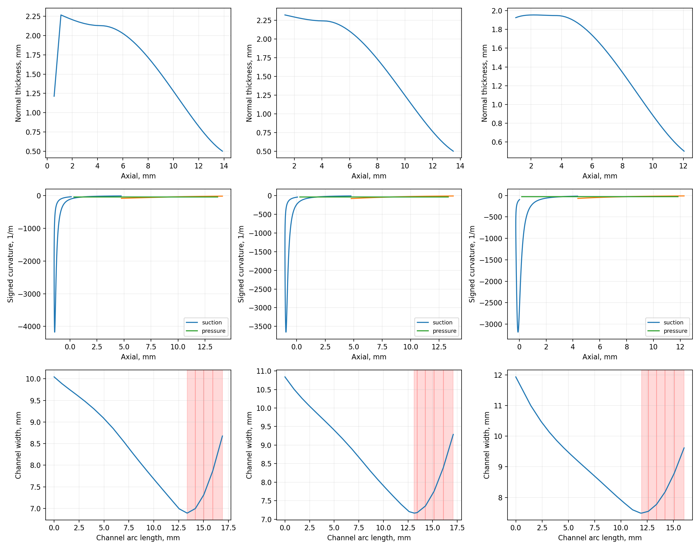
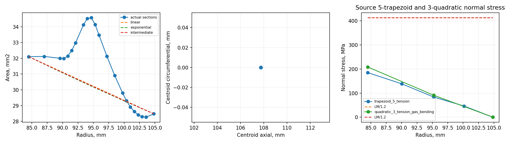
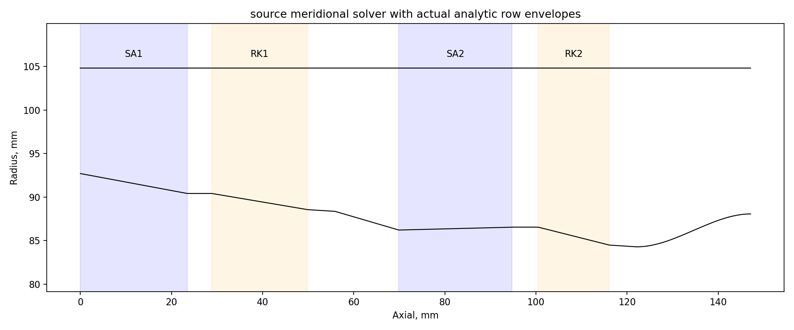
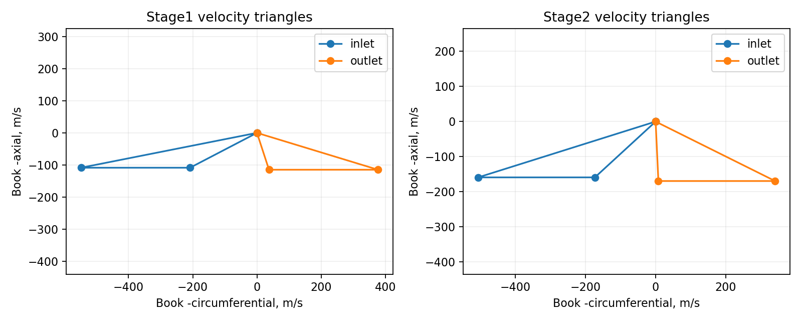
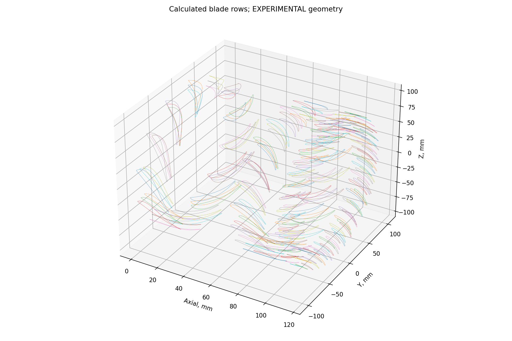

## Scope and missing physical evidence

- Geometry is not CFD/experimental proof of no separation or efficiency.
- Reynolds uses a documented air-viscosity proxy, not measured mixture transport.
- Source variable-cp thermodynamics and independent pressure-equilibrium audits are retained.
- IN738C/LM data are preliminary, not certified supply allowables.
- HCF NOT_CHECKED: grade-specific fatigue curve, forcing and damping are unavailable.
