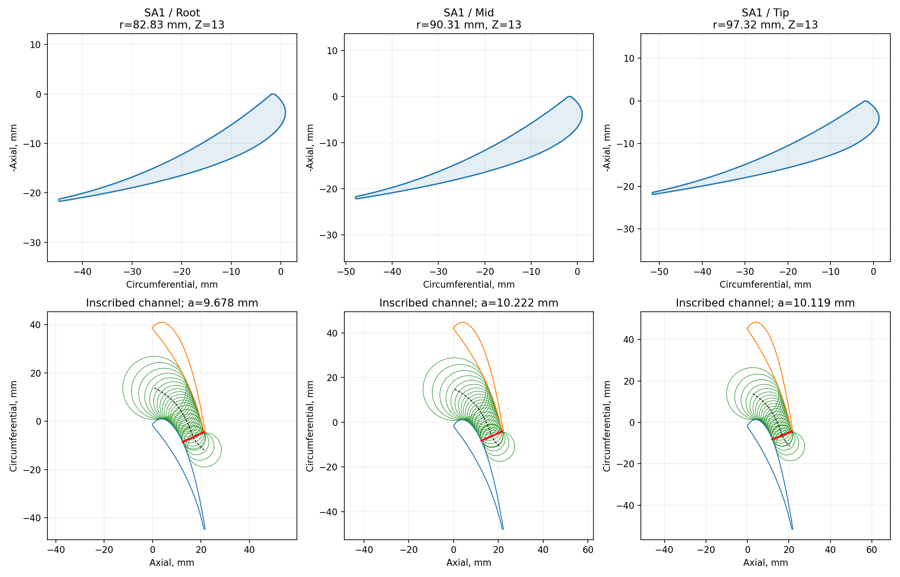
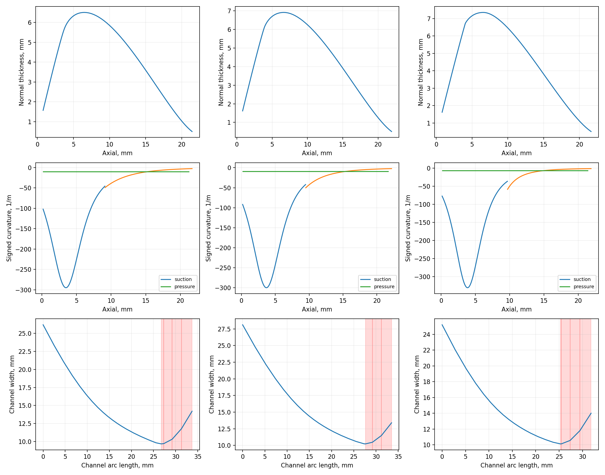
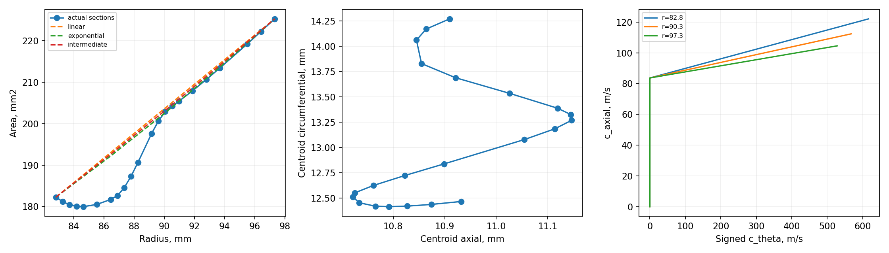
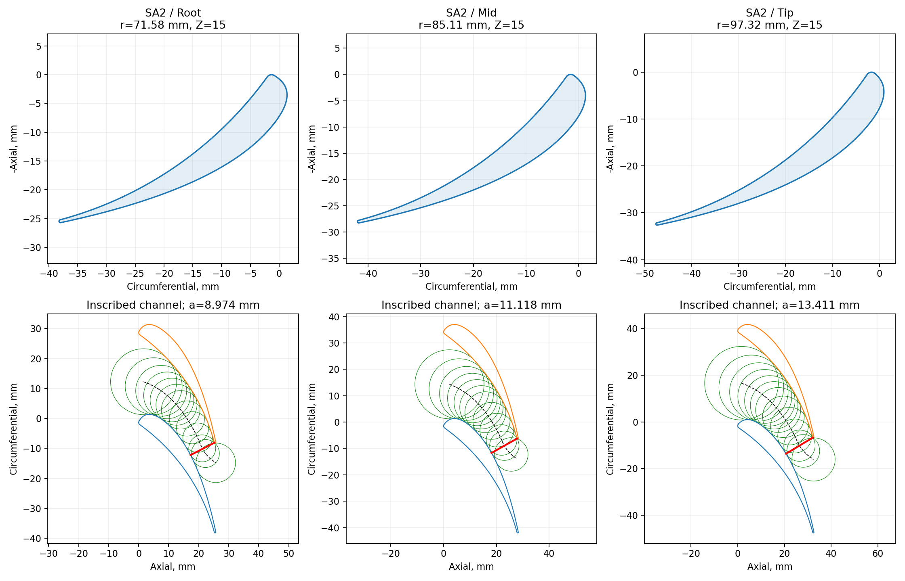
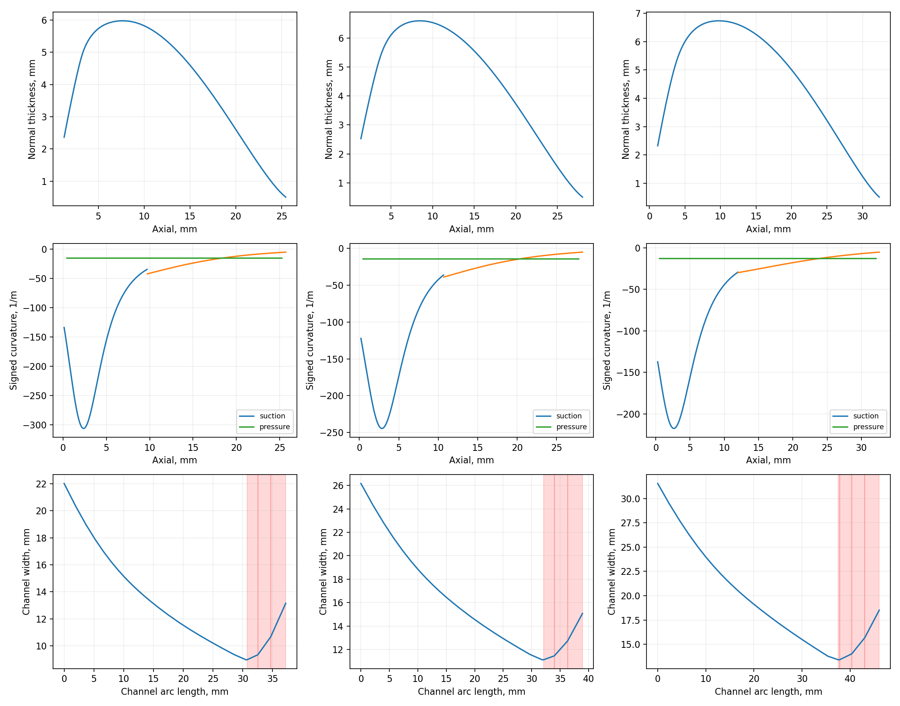
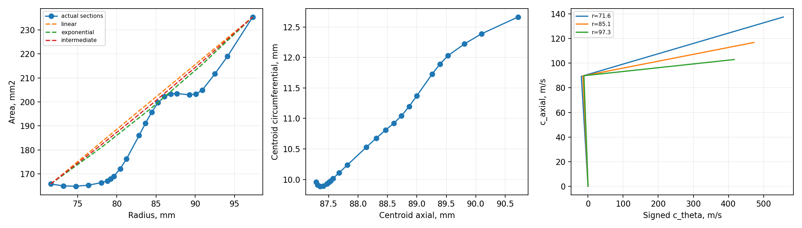
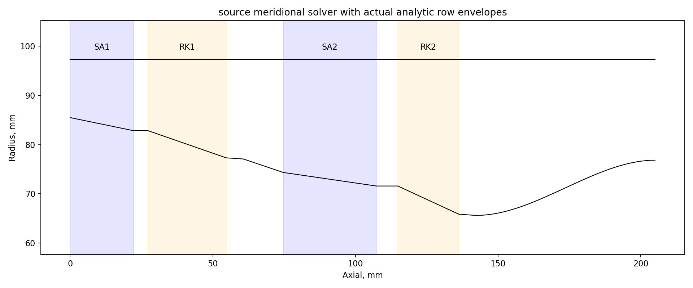
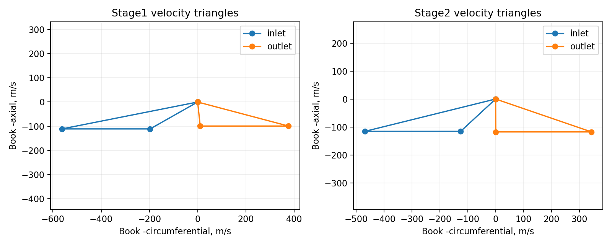
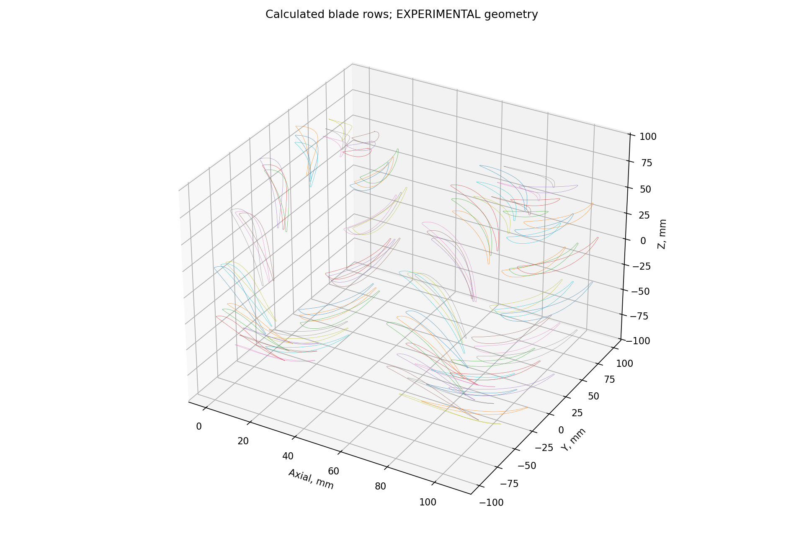

# Vinogradov — actual TWO-stage course resource calculation

Source: **TVD_1CBK_2st_300h.ipynb**; resource: **300 h**; stages: **2**.
Fixed source RPM: **38800**.
Engineering admissible: **False**.
Constructed rows: 2/4.

A failed finite search is not a proof of global infeasibility. No design limit was relaxed.

## Quantified violations

### SA1
- {'name': 'source streamline Euler residual', 'value': 1.4479970559477806e-05, 'limit': 1e-05, 'passed': False, 'classification': 'numerical', 'source': 'course radial_stage, J/kg', 'units': '1', 'note': ''}
- {'section': 1, 'name': 'prior profile guide: вписанные круги', 'measurements': {'geometry_valid': False, 'intersections': False, 'self_intersection': False, 'area_equivalent_angle_deg': 13.420408359352962, 'area_ratio': 0.23209438480773623, 'angle_comparison': 'uniform-flux geometric comparison, not actual gas exit angle', 'angle_error_deg': 2.220408359342251, 'te_over_throat': 0.04920482373621188, 'book_te_over_throat': 0.055, 'max_reduced_expansion': 1.4146899685910432}, 'relative_thickness': 0.1367037861807307, 'actual_relative_pitch': 0.8784305604665527}
### RK1
- {'name': 'source streamline Euler residual', 'value': 1.4479970559477806e-05, 'limit': 1e-05, 'passed': False, 'classification': 'numerical', 'source': 'course radial_stage, J/kg', 'units': '1', 'note': ''}
- {'name': 'construction/calculation failure', 'message': 'Parabola lies outside its source control triangle', 'details': {'first_tangent_distance_m': -0.009246197163710343, 'last_tangent_distance_m': 0.0007105166634220078}}
### SA2
- {'name': 'source streamline Euler residual', 'value': 3.843728336505592e-05, 'limit': 1e-05, 'passed': False, 'classification': 'numerical', 'source': 'course radial_stage, J/kg', 'units': '1', 'note': ''}
- {'section': 0, 'name': 'prior profile guide: вписанные круги', 'measurements': {'geometry_valid': False, 'intersections': False, 'self_intersection': False, 'area_equivalent_angle_deg': 17.08373754406683, 'area_ratio': 0.2937690274102377, 'angle_comparison': 'uniform-flux geometric comparison, not actual gas exit angle', 'angle_error_deg': 3.2001575969304668, 'te_over_throat': 0.05571392767602506, 'book_te_over_throat': 0.055, 'max_reduced_expansion': 1.4929826274104188}, 'relative_thickness': 0.13546823246345727, 'actual_relative_pitch': 0.6798694477690405}
- {'section': 1, 'name': 'prior profile guide: вписанные круги', 'measurements': {'geometry_valid': False, 'intersections': False, 'self_intersection': False, 'area_equivalent_angle_deg': 18.05063048723217, 'area_ratio': 0.30985729249374144, 'angle_comparison': 'uniform-flux geometric comparison, not actual gas exit angle', 'angle_error_deg': 4.167050540095806, 'te_over_throat': 0.04802982912691923, 'book_te_over_throat': 0.055, 'max_reduced_expansion': 1.4089815230314582}, 'relative_thickness': 0.135475114786803, 'actual_relative_pitch': 0.743845410519846}
- {'section': 2, 'name': 'prior profile guide: вписанные круги', 'measurements': {'geometry_valid': False, 'intersections': False, 'self_intersection': False, 'area_equivalent_angle_deg': 17.795101957353936, 'area_ratio': 0.3056139091883319, 'angle_comparison': 'uniform-flux geometric comparison, not actual gas exit angle', 'angle_error_deg': 3.9115220102175723, 'te_over_throat': 0.044971159149456416, 'book_te_over_throat': 0.055, 'max_reduced_expansion': 1.3799137016334944}, 'relative_thickness': 0.1358148827146423, 'actual_relative_pitch': 0.7343168299713825}
- {'section': 3, 'name': 'prior profile guide: вписанные круги', 'measurements': {'geometry_valid': False, 'intersections': False, 'self_intersection': False, 'area_equivalent_angle_deg': 18.627496528649715, 'area_ratio': 0.3194141113098649, 'angle_comparison': 'uniform-flux geometric comparison, not actual gas exit angle', 'angle_error_deg': 4.743916581513352, 'te_over_throat': 0.04007850028090663, 'book_te_over_throat': 0.055, 'max_reduced_expansion': 1.4256622691714465}, 'relative_thickness': 0.12055006668664857, 'actual_relative_pitch': 0.736036076232104}
- {'section': 4, 'name': 'prior profile guide: вписанные круги', 'measurements': {'geometry_valid': False, 'intersections': False, 'self_intersection': False, 'area_equivalent_angle_deg': 18.801993742154277, 'area_ratio': 0.32229863593525326, 'angle_comparison': 'uniform-flux geometric comparison, not actual gas exit angle', 'angle_error_deg': 4.918413795017914, 'te_over_throat': 0.03728258849132541, 'book_te_over_throat': 0.055, 'max_reduced_expansion': 1.4088209434602268}, 'relative_thickness': 0.12172712588406491, 'actual_relative_pitch': 0.7363510491011676}
### RK2
- {'name': 'source streamline Euler residual', 'value': 3.843728336505592e-05, 'limit': 1e-05, 'passed': False, 'classification': 'numerical', 'source': 'course radial_stage, J/kg', 'units': '1', 'note': ''}
- {'name': 'construction/calculation failure', 'message': 'Parabola lies outside its source control triangle', 'details': {'first_tangent_distance_m': -0.02092747588442037, 'last_tangent_distance_m': -0.015418771243272091}}

## Global/source violations

- {'row': 'SA1', 'name': 'source streamline Euler residual', 'value': 1.4479970559477806e-05, 'limit': 1e-05, 'passed': False, 'classification': 'numerical', 'source': 'course radial_stage, J/kg', 'units': '1', 'note': ''}
- {'row': 'SA1', 'section': 1, 'name': 'prior profile guide: вписанные круги', 'measurements': {'geometry_valid': False, 'intersections': False, 'self_intersection': False, 'area_equivalent_angle_deg': 13.420408359352962, 'area_ratio': 0.23209438480773623, 'angle_comparison': 'uniform-flux geometric comparison, not actual gas exit angle', 'angle_error_deg': 2.220408359342251, 'te_over_throat': 0.04920482373621188, 'book_te_over_throat': 0.055, 'max_reduced_expansion': 1.4146899685910432}, 'relative_thickness': 0.1367037861807307, 'actual_relative_pitch': 0.8784305604665527}
- {'row': 'RK1', 'name': 'source streamline Euler residual', 'value': 1.4479970559477806e-05, 'limit': 1e-05, 'passed': False, 'classification': 'numerical', 'source': 'course radial_stage, J/kg', 'units': '1', 'note': ''}
- {'row': 'RK1', 'name': 'construction/calculation failure', 'message': 'Parabola lies outside its source control triangle', 'details': {'first_tangent_distance_m': -0.009246197163710343, 'last_tangent_distance_m': 0.0007105166634220078}}
- {'row': 'SA2', 'name': 'source streamline Euler residual', 'value': 3.843728336505592e-05, 'limit': 1e-05, 'passed': False, 'classification': 'numerical', 'source': 'course radial_stage, J/kg', 'units': '1', 'note': ''}
- {'row': 'SA2', 'section': 0, 'name': 'prior profile guide: вписанные круги', 'measurements': {'geometry_valid': False, 'intersections': False, 'self_intersection': False, 'area_equivalent_angle_deg': 17.08373754406683, 'area_ratio': 0.2937690274102377, 'angle_comparison': 'uniform-flux geometric comparison, not actual gas exit angle', 'angle_error_deg': 3.2001575969304668, 'te_over_throat': 0.05571392767602506, 'book_te_over_throat': 0.055, 'max_reduced_expansion': 1.4929826274104188}, 'relative_thickness': 0.13546823246345727, 'actual_relative_pitch': 0.6798694477690405}
- {'row': 'SA2', 'section': 1, 'name': 'prior profile guide: вписанные круги', 'measurements': {'geometry_valid': False, 'intersections': False, 'self_intersection': False, 'area_equivalent_angle_deg': 18.05063048723217, 'area_ratio': 0.30985729249374144, 'angle_comparison': 'uniform-flux geometric comparison, not actual gas exit angle', 'angle_error_deg': 4.167050540095806, 'te_over_throat': 0.04802982912691923, 'book_te_over_throat': 0.055, 'max_reduced_expansion': 1.4089815230314582}, 'relative_thickness': 0.135475114786803, 'actual_relative_pitch': 0.743845410519846}
- {'row': 'SA2', 'section': 2, 'name': 'prior profile guide: вписанные круги', 'measurements': {'geometry_valid': False, 'intersections': False, 'self_intersection': False, 'area_equivalent_angle_deg': 17.795101957353936, 'area_ratio': 0.3056139091883319, 'angle_comparison': 'uniform-flux geometric comparison, not actual gas exit angle', 'angle_error_deg': 3.9115220102175723, 'te_over_throat': 0.044971159149456416, 'book_te_over_throat': 0.055, 'max_reduced_expansion': 1.3799137016334944}, 'relative_thickness': 0.1358148827146423, 'actual_relative_pitch': 0.7343168299713825}
- {'row': 'SA2', 'section': 3, 'name': 'prior profile guide: вписанные круги', 'measurements': {'geometry_valid': False, 'intersections': False, 'self_intersection': False, 'area_equivalent_angle_deg': 18.627496528649715, 'area_ratio': 0.3194141113098649, 'angle_comparison': 'uniform-flux geometric comparison, not actual gas exit angle', 'angle_error_deg': 4.743916581513352, 'te_over_throat': 0.04007850028090663, 'book_te_over_throat': 0.055, 'max_reduced_expansion': 1.4256622691714465}, 'relative_thickness': 0.12055006668664857, 'actual_relative_pitch': 0.736036076232104}
- {'row': 'SA2', 'section': 4, 'name': 'prior profile guide: вписанные круги', 'measurements': {'geometry_valid': False, 'intersections': False, 'self_intersection': False, 'area_equivalent_angle_deg': 18.801993742154277, 'area_ratio': 0.32229863593525326, 'angle_comparison': 'uniform-flux geometric comparison, not actual gas exit angle', 'angle_error_deg': 4.918413795017914, 'te_over_throat': 0.03728258849132541, 'book_te_over_throat': 0.055, 'max_reduced_expansion': 1.4088209434602268}, 'relative_thickness': 0.12172712588406491, 'actual_relative_pitch': 0.7363510491011676}
- {'row': 'RK2', 'name': 'source streamline Euler residual', 'value': 3.843728336505592e-05, 'limit': 1e-05, 'passed': False, 'classification': 'numerical', 'source': 'course radial_stage, J/kg', 'units': '1', 'note': ''}
- {'row': 'RK2', 'name': 'construction/calculation failure', 'message': 'Parabola lies outside its source control triangle', 'details': {'first_tangent_distance_m': -0.02092747588442037, 'last_tangent_distance_m': -0.015418771243272091}}
- {'name': 'source strength assessment', 'reasons': ["('РК1', 0)"]}
- {'row': 'SA1', 'section': 0, 'name': 'source finite trailing edge', 'value': 0.0004999999999999986, 'limit': 0.0005}
- {'row': 'SA1', 'section': 1, 'name': 'source finite trailing edge', 'value': 0.0004999999999999983, 'limit': 0.0005}
- {'row': 'SA1', 'section': 2, 'name': 'source finite trailing edge', 'value': 0.0004999999999999983, 'limit': 0.0005}
- {'row': 'SA1', 'section': 3, 'name': 'source finite trailing edge', 'value': 0.0004999999999999983, 'limit': 0.0005}
- {'row': 'SA1', 'section': 4, 'name': 'source finite trailing edge', 'value': 0.0004999999999999983, 'limit': 0.0005}
- {'row': 'SA2', 'section': 0, 'name': 'source finite trailing edge', 'value': 0.0004999999999999975, 'limit': 0.0005}
- {'row': 'SA2', 'section': 4, 'name': 'source finite trailing edge', 'value': 0.000499999999999994, 'limit': 0.0005}

## Empirical guidance — not added hard limits

- {'row': 'SA1', 'section': 0, 'name': 'relative thickness starting guidance', 'value': 0.13632683092727918, 'range': [0.1, 0.1], 'classification': 'empirical, p13'}
- {'row': 'SA1', 'section': 0, 'name': 'prior profile guide: угол горла', 'measurements': {'geometry_valid': True, 'intersections': False, 'self_intersection': False, 'area_equivalent_angle_deg': 13.402538491894596, 'area_ratio': 0.2317910021424375, 'angle_comparison': 'uniform-flux geometric comparison, not actual gas exit angle', 'angle_error_deg': 2.2025384918838853, 'te_over_throat': 0.05166567680467086, 'book_te_over_throat': 0.055, 'max_reduced_expansion': 1.5262748121430951}, 'relative_thickness': 0.13632683092727918, 'actual_relative_pitch': 0.8395128311897931, 'classification': 'historical empirical profile guide; Vinogradov uses its own recommendations'}
- {'row': 'SA1', 'section': 0, 'name': 'prior profile guide: местная диффузорность', 'measurements': {'geometry_valid': True, 'intersections': False, 'self_intersection': False, 'area_equivalent_angle_deg': 13.402538491894596, 'area_ratio': 0.2317910021424375, 'angle_comparison': 'uniform-flux geometric comparison, not actual gas exit angle', 'angle_error_deg': 2.2025384918838853, 'te_over_throat': 0.05166567680467086, 'book_te_over_throat': 0.055, 'max_reduced_expansion': 1.5262748121430951}, 'relative_thickness': 0.13632683092727918, 'actual_relative_pitch': 0.8395128311897931, 'classification': 'historical empirical profile guide; Vinogradov uses its own recommendations'}
- {'row': 'SA1', 'section': 1, 'name': 'relative thickness starting guidance', 'value': 0.1367037861807307, 'range': [0.1, 0.1], 'classification': 'empirical, p13'}
- {'row': 'SA1', 'section': 1, 'name': 'prior profile guide: угол горла', 'measurements': {'geometry_valid': False, 'intersections': False, 'self_intersection': False, 'area_equivalent_angle_deg': 13.420408359352962, 'area_ratio': 0.23209438480773623, 'angle_comparison': 'uniform-flux geometric comparison, not actual gas exit angle', 'angle_error_deg': 2.220408359342251, 'te_over_throat': 0.04920482373621188, 'book_te_over_throat': 0.055, 'max_reduced_expansion': 1.4146899685910432}, 'relative_thickness': 0.1367037861807307, 'actual_relative_pitch': 0.8784305604665527, 'classification': 'historical empirical profile guide; Vinogradov uses its own recommendations'}
- {'row': 'SA1', 'section': 1, 'name': 'prior profile guide: местная диффузорность', 'measurements': {'geometry_valid': False, 'intersections': False, 'self_intersection': False, 'area_equivalent_angle_deg': 13.420408359352962, 'area_ratio': 0.23209438480773623, 'angle_comparison': 'uniform-flux geometric comparison, not actual gas exit angle', 'angle_error_deg': 2.220408359342251, 'te_over_throat': 0.04920482373621188, 'book_te_over_throat': 0.055, 'max_reduced_expansion': 1.4146899685910432}, 'relative_thickness': 0.1367037861807307, 'actual_relative_pitch': 0.8784305604665527, 'classification': 'historical empirical profile guide; Vinogradov uses its own recommendations'}
- {'row': 'SA1', 'section': 1, 'name': 'prior profile guide: относительный шаг', 'measurements': {'geometry_valid': False, 'intersections': False, 'self_intersection': False, 'area_equivalent_angle_deg': 13.420408359352962, 'area_ratio': 0.23209438480773623, 'angle_comparison': 'uniform-flux geometric comparison, not actual gas exit angle', 'angle_error_deg': 2.220408359342251, 'te_over_throat': 0.04920482373621188, 'book_te_over_throat': 0.055, 'max_reduced_expansion': 1.4146899685910432}, 'relative_thickness': 0.1367037861807307, 'actual_relative_pitch': 0.8784305604665527, 'classification': 'historical empirical profile guide; Vinogradov uses its own recommendations'}
- {'row': 'SA1', 'section': 2, 'name': 'relative thickness starting guidance', 'value': 0.13659397283710117, 'range': [0.1, 0.1], 'classification': 'empirical, p13'}
- {'row': 'SA1', 'section': 2, 'name': 'prior profile guide: местная диффузорность', 'measurements': {'geometry_valid': True, 'intersections': False, 'self_intersection': False, 'area_equivalent_angle_deg': 12.958733979699097, 'area_ratio': 0.2242492275318762, 'angle_comparison': 'uniform-flux geometric comparison, not actual gas exit angle', 'angle_error_deg': 1.7587339796883867, 'te_over_throat': 0.04891391510562829, 'book_te_over_throat': 0.055, 'max_reduced_expansion': 1.350053199424335}, 'relative_thickness': 0.13659397283710117, 'actual_relative_pitch': 0.861711259721624, 'classification': 'historical empirical profile guide; Vinogradov uses its own recommendations'}
- {'row': 'SA1', 'section': 2, 'name': 'prior profile guide: относительный шаг', 'measurements': {'geometry_valid': True, 'intersections': False, 'self_intersection': False, 'area_equivalent_angle_deg': 12.958733979699097, 'area_ratio': 0.2242492275318762, 'angle_comparison': 'uniform-flux geometric comparison, not actual gas exit angle', 'angle_error_deg': 1.7587339796883867, 'te_over_throat': 0.04891391510562829, 'book_te_over_throat': 0.055, 'max_reduced_expansion': 1.350053199424335}, 'relative_thickness': 0.13659397283710117, 'actual_relative_pitch': 0.861711259721624, 'classification': 'historical empirical profile guide; Vinogradov uses its own recommendations'}
- {'row': 'SA1', 'section': 3, 'name': 'relative thickness starting guidance', 'value': 0.13654089526955182, 'range': [0.1, 0.1], 'classification': 'empirical, p13'}
- {'row': 'SA1', 'section': 3, 'name': 'prior profile guide: местная диффузорность', 'measurements': {'geometry_valid': True, 'intersections': False, 'self_intersection': False, 'area_equivalent_angle_deg': 12.144925234778201, 'area_ratio': 0.21038517163798776, 'angle_comparison': 'uniform-flux geometric comparison, not actual gas exit angle', 'angle_error_deg': 0.9449252347674921, 'te_over_throat': 0.05013698181860367, 'book_te_over_throat': 0.055, 'max_reduced_expansion': 1.3967024571438114}, 'relative_thickness': 0.13654089526955182, 'actual_relative_pitch': 0.8678682527019332, 'classification': 'historical empirical profile guide; Vinogradov uses its own recommendations'}
- {'row': 'SA1', 'section': 3, 'name': 'prior profile guide: относительный шаг', 'measurements': {'geometry_valid': True, 'intersections': False, 'self_intersection': False, 'area_equivalent_angle_deg': 12.144925234778201, 'area_ratio': 0.21038517163798776, 'angle_comparison': 'uniform-flux geometric comparison, not actual gas exit angle', 'angle_error_deg': 0.9449252347674921, 'te_over_throat': 0.05013698181860367, 'book_te_over_throat': 0.055, 'max_reduced_expansion': 1.3967024571438114}, 'relative_thickness': 0.13654089526955182, 'actual_relative_pitch': 0.8678682527019332, 'classification': 'historical empirical profile guide; Vinogradov uses its own recommendations'}
- {'row': 'SA1', 'section': 4, 'name': 'relative thickness starting guidance', 'value': 0.13655689477927216, 'range': [0.1, 0.1], 'classification': 'empirical, p13'}
- {'row': 'SA1', 'section': 4, 'name': 'prior profile guide: местная диффузорность', 'measurements': {'geometry_valid': True, 'intersections': False, 'self_intersection': False, 'area_equivalent_angle_deg': 11.876702938580332, 'area_ratio': 0.20580629640446338, 'angle_comparison': 'uniform-flux geometric comparison, not actual gas exit angle', 'angle_error_deg': 0.6767029385696208, 'te_over_throat': 0.04941338098906084, 'book_te_over_throat': 0.055, 'max_reduced_expansion': 1.4305694549494263}, 'relative_thickness': 0.13655689477927216, 'actual_relative_pitch': 0.8740631539928501, 'classification': 'historical empirical profile guide; Vinogradov uses its own recommendations'}
- {'row': 'SA1', 'section': 4, 'name': 'prior profile guide: относительный шаг', 'measurements': {'geometry_valid': True, 'intersections': False, 'self_intersection': False, 'area_equivalent_angle_deg': 11.876702938580332, 'area_ratio': 0.20580629640446338, 'angle_comparison': 'uniform-flux geometric comparison, not actual gas exit angle', 'angle_error_deg': 0.6767029385696208, 'te_over_throat': 0.04941338098906084, 'book_te_over_throat': 0.055, 'max_reduced_expansion': 1.4305694549494263}, 'relative_thickness': 0.13655689477927216, 'actual_relative_pitch': 0.8740631539928501, 'classification': 'historical empirical profile guide; Vinogradov uses its own recommendations'}
- {'row': 'SA2', 'section': 0, 'name': 'relative thickness starting guidance', 'value': 0.13546823246345727, 'range': [0.1, 0.1], 'classification': 'empirical, p13'}
- {'row': 'SA2', 'section': 0, 'name': 'prior profile guide: угол горла', 'measurements': {'geometry_valid': False, 'intersections': False, 'self_intersection': False, 'area_equivalent_angle_deg': 17.08373754406683, 'area_ratio': 0.2937690274102377, 'angle_comparison': 'uniform-flux geometric comparison, not actual gas exit angle', 'angle_error_deg': 3.2001575969304668, 'te_over_throat': 0.05571392767602506, 'book_te_over_throat': 0.055, 'max_reduced_expansion': 1.4929826274104188}, 'relative_thickness': 0.13546823246345727, 'actual_relative_pitch': 0.6798694477690405, 'classification': 'historical empirical profile guide; Vinogradov uses its own recommendations'}
- {'row': 'SA2', 'section': 0, 'name': 'prior profile guide: местная диффузорность', 'measurements': {'geometry_valid': False, 'intersections': False, 'self_intersection': False, 'area_equivalent_angle_deg': 17.08373754406683, 'area_ratio': 0.2937690274102377, 'angle_comparison': 'uniform-flux geometric comparison, not actual gas exit angle', 'angle_error_deg': 3.2001575969304668, 'te_over_throat': 0.05571392767602506, 'book_te_over_throat': 0.055, 'max_reduced_expansion': 1.4929826274104188}, 'relative_thickness': 0.13546823246345727, 'actual_relative_pitch': 0.6798694477690405, 'classification': 'historical empirical profile guide; Vinogradov uses its own recommendations'}
- {'row': 'SA2', 'section': 1, 'name': 'relative thickness starting guidance', 'value': 0.135475114786803, 'range': [0.1, 0.1], 'classification': 'empirical, p13'}
- {'row': 'SA2', 'section': 1, 'name': 'prior profile guide: угол горла', 'measurements': {'geometry_valid': False, 'intersections': False, 'self_intersection': False, 'area_equivalent_angle_deg': 18.05063048723217, 'area_ratio': 0.30985729249374144, 'angle_comparison': 'uniform-flux geometric comparison, not actual gas exit angle', 'angle_error_deg': 4.167050540095806, 'te_over_throat': 0.04802982912691923, 'book_te_over_throat': 0.055, 'max_reduced_expansion': 1.4089815230314582}, 'relative_thickness': 0.135475114786803, 'actual_relative_pitch': 0.743845410519846, 'classification': 'historical empirical profile guide; Vinogradov uses its own recommendations'}
- {'row': 'SA2', 'section': 1, 'name': 'prior profile guide: местная диффузорность', 'measurements': {'geometry_valid': False, 'intersections': False, 'self_intersection': False, 'area_equivalent_angle_deg': 18.05063048723217, 'area_ratio': 0.30985729249374144, 'angle_comparison': 'uniform-flux geometric comparison, not actual gas exit angle', 'angle_error_deg': 4.167050540095806, 'te_over_throat': 0.04802982912691923, 'book_te_over_throat': 0.055, 'max_reduced_expansion': 1.4089815230314582}, 'relative_thickness': 0.135475114786803, 'actual_relative_pitch': 0.743845410519846, 'classification': 'historical empirical profile guide; Vinogradov uses its own recommendations'}
- {'row': 'SA2', 'section': 2, 'name': 'relative thickness starting guidance', 'value': 0.1358148827146423, 'range': [0.1, 0.1], 'classification': 'empirical, p13'}
- {'row': 'SA2', 'section': 2, 'name': 'prior profile guide: угол горла', 'measurements': {'geometry_valid': False, 'intersections': False, 'self_intersection': False, 'area_equivalent_angle_deg': 17.795101957353936, 'area_ratio': 0.3056139091883319, 'angle_comparison': 'uniform-flux geometric comparison, not actual gas exit angle', 'angle_error_deg': 3.9115220102175723, 'te_over_throat': 0.044971159149456416, 'book_te_over_throat': 0.055, 'max_reduced_expansion': 1.3799137016334944}, 'relative_thickness': 0.1358148827146423, 'actual_relative_pitch': 0.7343168299713825, 'classification': 'historical empirical profile guide; Vinogradov uses its own recommendations'}
- {'row': 'SA2', 'section': 2, 'name': 'prior profile guide: местная диффузорность', 'measurements': {'geometry_valid': False, 'intersections': False, 'self_intersection': False, 'area_equivalent_angle_deg': 17.795101957353936, 'area_ratio': 0.3056139091883319, 'angle_comparison': 'uniform-flux geometric comparison, not actual gas exit angle', 'angle_error_deg': 3.9115220102175723, 'te_over_throat': 0.044971159149456416, 'book_te_over_throat': 0.055, 'max_reduced_expansion': 1.3799137016334944}, 'relative_thickness': 0.1358148827146423, 'actual_relative_pitch': 0.7343168299713825, 'classification': 'historical empirical profile guide; Vinogradov uses its own recommendations'}
- {'row': 'SA2', 'section': 3, 'name': 'relative thickness starting guidance', 'value': 0.12055006668664857, 'range': [0.1, 0.1], 'classification': 'empirical, p13'}
- {'row': 'SA2', 'section': 3, 'name': 'prior profile guide: угол горла', 'measurements': {'geometry_valid': False, 'intersections': False, 'self_intersection': False, 'area_equivalent_angle_deg': 18.627496528649715, 'area_ratio': 0.3194141113098649, 'angle_comparison': 'uniform-flux geometric comparison, not actual gas exit angle', 'angle_error_deg': 4.743916581513352, 'te_over_throat': 0.04007850028090663, 'book_te_over_throat': 0.055, 'max_reduced_expansion': 1.4256622691714465}, 'relative_thickness': 0.12055006668664857, 'actual_relative_pitch': 0.736036076232104, 'classification': 'historical empirical profile guide; Vinogradov uses its own recommendations'}
- {'row': 'SA2', 'section': 3, 'name': 'prior profile guide: местная диффузорность', 'measurements': {'geometry_valid': False, 'intersections': False, 'self_intersection': False, 'area_equivalent_angle_deg': 18.627496528649715, 'area_ratio': 0.3194141113098649, 'angle_comparison': 'uniform-flux geometric comparison, not actual gas exit angle', 'angle_error_deg': 4.743916581513352, 'te_over_throat': 0.04007850028090663, 'book_te_over_throat': 0.055, 'max_reduced_expansion': 1.4256622691714465}, 'relative_thickness': 0.12055006668664857, 'actual_relative_pitch': 0.736036076232104, 'classification': 'historical empirical profile guide; Vinogradov uses its own recommendations'}
- {'row': 'SA2', 'section': 4, 'name': 'relative thickness starting guidance', 'value': 0.12172712588406491, 'range': [0.1, 0.1], 'classification': 'empirical, p13'}
- {'row': 'SA2', 'section': 4, 'name': 'prior profile guide: угол горла', 'measurements': {'geometry_valid': False, 'intersections': False, 'self_intersection': False, 'area_equivalent_angle_deg': 18.801993742154277, 'area_ratio': 0.32229863593525326, 'angle_comparison': 'uniform-flux geometric comparison, not actual gas exit angle', 'angle_error_deg': 4.918413795017914, 'te_over_throat': 0.03728258849132541, 'book_te_over_throat': 0.055, 'max_reduced_expansion': 1.4088209434602268}, 'relative_thickness': 0.12172712588406491, 'actual_relative_pitch': 0.7363510491011676, 'classification': 'historical empirical profile guide; Vinogradov uses its own recommendations'}
- {'row': 'SA2', 'section': 4, 'name': 'prior profile guide: местная диффузорность', 'measurements': {'geometry_valid': False, 'intersections': False, 'self_intersection': False, 'area_equivalent_angle_deg': 18.801993742154277, 'area_ratio': 0.32229863593525326, 'angle_comparison': 'uniform-flux geometric comparison, not actual gas exit angle', 'angle_error_deg': 4.918413795017914, 'te_over_throat': 0.03728258849132541, 'book_te_over_throat': 0.055, 'max_reduced_expansion': 1.4088209434602268}, 'relative_thickness': 0.12172712588406491, 'actual_relative_pitch': 0.7363510491011676, 'classification': 'historical empirical profile guide; Vinogradov uses its own recommendations'}

## Figures

## Scope and missing physical evidence

- Geometry is not CFD/experimental proof of no separation or efficiency.
- Reynolds uses a documented air-viscosity proxy, not measured mixture transport.
- Source variable-cp thermodynamics and independent pressure-equilibrium audits are retained.
- IN738C/LM data are preliminary, not certified supply allowables.
- HCF NOT_CHECKED: grade-specific fatigue curve, forcing and damping are unavailable.
