# Vinogradov — actual TWO-stage course resource calculation

Source: **TVD_1CBK_2st_10000h.ipynb**; resource: **10000 h**; stages: **2**.
Fixed source RPM: **30700**.
Engineering admissible: **False**.
Constructed rows: 4/4.

A failed finite search is not a proof of global infeasibility. No design limit was relaxed.

## Quantified violations

### SA1
- No recorded row violation; global checks still required.
### RK1
- {'section': 1, 'name': 'axial envelope boundary', 'value': 6.152942788829768e-05, 'limit': 4.474617130550364e-09, 'passed': False, 'classification': 'numerical', 'source': 'Prescribed axial width between leading/trailing outer edge planes', 'units': 'm', 'note': ''}
- {'section': 1, 'name': 'axial envelope boundary', 'value': 6.152942788829768e-05, 'limit': 4.474617130550364e-09, 'passed': False, 'classification': 'numerical', 'source': 'Prescribed axial width between leading/trailing outer edge planes', 'units': 'm', 'note': ''}
- {'section': 2, 'name': 'axial envelope boundary', 'value': 2.7378802694833312e-05, 'limit': 4.396093016083864e-09, 'passed': False, 'classification': 'numerical', 'source': 'Prescribed axial width between leading/trailing outer edge planes', 'units': 'm', 'note': ''}
- {'section': 2, 'name': 'axial envelope boundary', 'value': 2.7378802694833312e-05, 'limit': 4.396093016083864e-09, 'passed': False, 'classification': 'numerical', 'source': 'Prescribed axial width between leading/trailing outer edge planes', 'units': 'm', 'note': ''}
- {'section': 3, 'name': 'axial envelope boundary', 'value': 7.328917099544576e-06, 'limit': 4.525110878264032e-09, 'passed': False, 'classification': 'numerical', 'source': 'Prescribed axial width between leading/trailing outer edge planes', 'units': 'm', 'note': ''}
- {'section': 3, 'name': 'axial envelope boundary', 'value': 7.328917099544576e-06, 'limit': 4.525110878264032e-09, 'passed': False, 'classification': 'numerical', 'source': 'Prescribed axial width between leading/trailing outer edge planes', 'units': 'm', 'note': ''}
- {'section': 4, 'name': 'axial envelope boundary', 'value': 1.3229756347514307e-05, 'limit': 4.112931344530937e-09, 'passed': False, 'classification': 'numerical', 'source': 'Prescribed axial width between leading/trailing outer edge planes', 'units': 'm', 'note': ''}
- {'section': 4, 'name': 'axial envelope boundary', 'value': 1.3229756347514307e-05, 'limit': 4.112931344530937e-09, 'passed': False, 'classification': 'numerical', 'source': 'Prescribed axial width between leading/trailing outer edge planes', 'units': 'm', 'note': ''}
- {'name': 'vibration strength', 'status': 'NOT_CHECKED', 'reason': 'NOT_CHECKED: no grade-specific fatigue curve, damping or actual harmonic forcing; beam modes are screening only'}
- {'name': 'construction/calculation failure', 'message': 'Intermediate radial profile fails geometry validation', 'details': {'radius_m': 0.0959922485092956, 'checks': [{'name': 'axial envelope boundary', 'value': 6.114424856496559e-05, 'limit': 4.475128816907197e-09, 'passed': False, 'classification': 'numerical', 'source': 'Prescribed axial width between leading/trailing outer edge planes', 'units': 'm', 'note': ''}]}}
### SA2
- No recorded row violation; global checks still required.
### RK2
- {'section': 1, 'name': 'axial envelope boundary', 'value': 2.4513344319662207e-08, 'limit': 2.276885051369703e-09, 'passed': False, 'classification': 'numerical', 'source': 'Prescribed axial width between leading/trailing outer edge planes', 'units': 'm', 'note': ''}
- {'section': 1, 'name': 'axial envelope boundary', 'value': 2.4513344319662207e-08, 'limit': 2.276885051369703e-09, 'passed': False, 'classification': 'numerical', 'source': 'Prescribed axial width between leading/trailing outer edge planes', 'units': 'm', 'note': ''}
- {'section': 2, 'name': 'axial envelope boundary', 'value': 9.543603167271896e-06, 'limit': 2.204056025328395e-09, 'passed': False, 'classification': 'numerical', 'source': 'Prescribed axial width between leading/trailing outer edge planes', 'units': 'm', 'note': ''}
- {'section': 2, 'name': 'axial envelope boundary', 'value': 9.543603167271896e-06, 'limit': 2.204056025328395e-09, 'passed': False, 'classification': 'numerical', 'source': 'Prescribed axial width between leading/trailing outer edge planes', 'units': 'm', 'note': ''}
- {'name': 'vibration strength', 'status': 'NOT_CHECKED', 'reason': 'NOT_CHECKED: no grade-specific fatigue curve, damping or actual harmonic forcing; beam modes are screening only'}
- {'name': 'construction/calculation failure', 'message': 'Intermediate radial profile fails geometry validation', 'details': {'radius_m': 0.09278951469619766, 'checks': [{'name': 'axial envelope boundary', 'value': 2.3230826735881203e-08, 'limit': 2.2770670114543572e-09, 'passed': False, 'classification': 'numerical', 'source': 'Prescribed axial width between leading/trailing outer edge planes', 'units': 'm', 'note': ''}]}}

## Global/source violations

- {'row': 'RK1', 'section': 1, 'name': 'axial envelope boundary', 'value': 6.152942788829768e-05, 'limit': 4.474617130550364e-09, 'passed': False, 'classification': 'numerical', 'source': 'Prescribed axial width between leading/trailing outer edge planes', 'units': 'm', 'note': ''}
- {'row': 'RK1', 'section': 1, 'name': 'axial envelope boundary', 'value': 6.152942788829768e-05, 'limit': 4.474617130550364e-09, 'passed': False, 'classification': 'numerical', 'source': 'Prescribed axial width between leading/trailing outer edge planes', 'units': 'm', 'note': ''}
- {'row': 'RK1', 'section': 2, 'name': 'axial envelope boundary', 'value': 2.7378802694833312e-05, 'limit': 4.396093016083864e-09, 'passed': False, 'classification': 'numerical', 'source': 'Prescribed axial width between leading/trailing outer edge planes', 'units': 'm', 'note': ''}
- {'row': 'RK1', 'section': 2, 'name': 'axial envelope boundary', 'value': 2.7378802694833312e-05, 'limit': 4.396093016083864e-09, 'passed': False, 'classification': 'numerical', 'source': 'Prescribed axial width between leading/trailing outer edge planes', 'units': 'm', 'note': ''}
- {'row': 'RK1', 'section': 3, 'name': 'axial envelope boundary', 'value': 7.328917099544576e-06, 'limit': 4.525110878264032e-09, 'passed': False, 'classification': 'numerical', 'source': 'Prescribed axial width between leading/trailing outer edge planes', 'units': 'm', 'note': ''}
- {'row': 'RK1', 'section': 3, 'name': 'axial envelope boundary', 'value': 7.328917099544576e-06, 'limit': 4.525110878264032e-09, 'passed': False, 'classification': 'numerical', 'source': 'Prescribed axial width between leading/trailing outer edge planes', 'units': 'm', 'note': ''}
- {'row': 'RK1', 'section': 4, 'name': 'axial envelope boundary', 'value': 1.3229756347514307e-05, 'limit': 4.112931344530937e-09, 'passed': False, 'classification': 'numerical', 'source': 'Prescribed axial width between leading/trailing outer edge planes', 'units': 'm', 'note': ''}
- {'row': 'RK1', 'section': 4, 'name': 'axial envelope boundary', 'value': 1.3229756347514307e-05, 'limit': 4.112931344530937e-09, 'passed': False, 'classification': 'numerical', 'source': 'Prescribed axial width between leading/trailing outer edge planes', 'units': 'm', 'note': ''}
- {'row': 'RK1', 'name': 'vibration strength', 'status': 'NOT_CHECKED', 'reason': 'NOT_CHECKED: no grade-specific fatigue curve, damping or actual harmonic forcing; beam modes are screening only'}
- {'row': 'RK1', 'name': 'construction/calculation failure', 'message': 'Intermediate radial profile fails geometry validation', 'details': {'radius_m': 0.0959922485092956, 'checks': [{'name': 'axial envelope boundary', 'value': 6.114424856496559e-05, 'limit': 4.475128816907197e-09, 'passed': False, 'classification': 'numerical', 'source': 'Prescribed axial width between leading/trailing outer edge planes', 'units': 'm', 'note': ''}]}}
- {'row': 'RK2', 'section': 1, 'name': 'axial envelope boundary', 'value': 2.4513344319662207e-08, 'limit': 2.276885051369703e-09, 'passed': False, 'classification': 'numerical', 'source': 'Prescribed axial width between leading/trailing outer edge planes', 'units': 'm', 'note': ''}
- {'row': 'RK2', 'section': 1, 'name': 'axial envelope boundary', 'value': 2.4513344319662207e-08, 'limit': 2.276885051369703e-09, 'passed': False, 'classification': 'numerical', 'source': 'Prescribed axial width between leading/trailing outer edge planes', 'units': 'm', 'note': ''}
- {'row': 'RK2', 'section': 2, 'name': 'axial envelope boundary', 'value': 9.543603167271896e-06, 'limit': 2.204056025328395e-09, 'passed': False, 'classification': 'numerical', 'source': 'Prescribed axial width between leading/trailing outer edge planes', 'units': 'm', 'note': ''}
- {'row': 'RK2', 'section': 2, 'name': 'axial envelope boundary', 'value': 9.543603167271896e-06, 'limit': 2.204056025328395e-09, 'passed': False, 'classification': 'numerical', 'source': 'Prescribed axial width between leading/trailing outer edge planes', 'units': 'm', 'note': ''}
- {'row': 'RK2', 'name': 'vibration strength', 'status': 'NOT_CHECKED', 'reason': 'NOT_CHECKED: no grade-specific fatigue curve, damping or actual harmonic forcing; beam modes are screening only'}
- {'row': 'RK2', 'name': 'construction/calculation failure', 'message': 'Intermediate radial profile fails geometry validation', 'details': {'radius_m': 0.09278951469619766, 'checks': [{'name': 'axial envelope boundary', 'value': 2.3230826735881203e-08, 'limit': 2.2770670114543572e-09, 'passed': False, 'classification': 'numerical', 'source': 'Prescribed axial width between leading/trailing outer edge planes', 'units': 'm', 'note': ''}]}}
- {'row': 'RK2', 'section': 3, 'name': 'source finite trailing edge', 'value': 0.00048638910070414836, 'limit': 0.0005}

## Empirical guidance — not added hard limits

- {'row': 'SA1', 'section': 0, 'name': 'relative thickness starting guidance', 'value': 0.1292692642207968, 'range': [0.1, 0.1], 'classification': 'empirical, p13'}
- {'row': 'SA1', 'section': 0, 'name': 'prior profile guide: местная диффузорность', 'measurements': {'geometry_valid': True, 'circle_crosses_open_station_cut': False, 'intersections': False, 'self_intersection': False, 'area_equivalent_angle_deg': 10.870362136999246, 'area_ratio': 0.18858747178743937, 'angle_comparison': 'uniform-flux geometric comparison, not actual gas exit angle', 'angle_error_deg': -0.3296378630007535, 'te_over_throat': 0.06344253061093684, 'book_te_over_throat': 0.055, 'max_reduced_expansion': 1.5115244197868483}, 'relative_thickness': 0.1292692642207968, 'actual_relative_pitch': 0.8138700878793377, 'classification': 'historical empirical profile guide; Vinogradov uses its own recommendations'}
- {'row': 'SA1', 'section': 1, 'name': 'relative thickness starting guidance', 'value': 0.12459354687293259, 'range': [0.1, 0.1], 'classification': 'empirical, p13'}
- {'row': 'SA1', 'section': 1, 'name': 'prior profile guide: толщина выходной кромки', 'measurements': {'geometry_valid': True, 'circle_crosses_open_station_cut': False, 'intersections': False, 'self_intersection': False, 'area_equivalent_angle_deg': 10.934039256281677, 'area_ratio': 0.18967878840545938, 'angle_comparison': 'uniform-flux geometric comparison, not actual gas exit angle', 'angle_error_deg': -0.26596074371832046, 'te_over_throat': 0.08543220172724794, 'book_te_over_throat': 0.055, 'max_reduced_expansion': 1.6565243648935044}, 'relative_thickness': 0.12459354687293259, 'actual_relative_pitch': 0.8351651223022041, 'classification': 'historical empirical profile guide; Vinogradov uses its own recommendations'}
- {'row': 'SA1', 'section': 1, 'name': 'prior profile guide: местная диффузорность', 'measurements': {'geometry_valid': True, 'circle_crosses_open_station_cut': False, 'intersections': False, 'self_intersection': False, 'area_equivalent_angle_deg': 10.934039256281677, 'area_ratio': 0.18967878840545938, 'angle_comparison': 'uniform-flux geometric comparison, not actual gas exit angle', 'angle_error_deg': -0.26596074371832046, 'te_over_throat': 0.08543220172724794, 'book_te_over_throat': 0.055, 'max_reduced_expansion': 1.6565243648935044}, 'relative_thickness': 0.12459354687293259, 'actual_relative_pitch': 0.8351651223022041, 'classification': 'historical empirical profile guide; Vinogradov uses its own recommendations'}
- {'row': 'SA1', 'section': 2, 'name': 'relative thickness starting guidance', 'value': 0.13275593304405242, 'range': [0.1, 0.1], 'classification': 'empirical, p13'}
- {'row': 'SA1', 'section': 2, 'name': 'prior profile guide: толщина выходной кромки', 'measurements': {'geometry_valid': True, 'circle_crosses_open_station_cut': False, 'intersections': False, 'self_intersection': False, 'area_equivalent_angle_deg': 10.638671899996755, 'area_ratio': 0.18461474282490983, 'angle_comparison': 'uniform-flux geometric comparison, not actual gas exit angle', 'angle_error_deg': -0.5613281000032444, 'te_over_throat': 0.07328574142203759, 'book_te_over_throat': 0.055, 'max_reduced_expansion': 1.6155417266629706}, 'relative_thickness': 0.13275593304405242, 'actual_relative_pitch': 0.8866368967051336, 'classification': 'historical empirical profile guide; Vinogradov uses its own recommendations'}
- {'row': 'SA1', 'section': 2, 'name': 'prior profile guide: местная диффузорность', 'measurements': {'geometry_valid': True, 'circle_crosses_open_station_cut': False, 'intersections': False, 'self_intersection': False, 'area_equivalent_angle_deg': 10.638671899996755, 'area_ratio': 0.18461474282490983, 'angle_comparison': 'uniform-flux geometric comparison, not actual gas exit angle', 'angle_error_deg': -0.5613281000032444, 'te_over_throat': 0.07328574142203759, 'book_te_over_throat': 0.055, 'max_reduced_expansion': 1.6155417266629706}, 'relative_thickness': 0.13275593304405242, 'actual_relative_pitch': 0.8866368967051336, 'classification': 'historical empirical profile guide; Vinogradov uses its own recommendations'}
- {'row': 'SA1', 'section': 2, 'name': 'prior profile guide: относительный шаг', 'measurements': {'geometry_valid': True, 'circle_crosses_open_station_cut': False, 'intersections': False, 'self_intersection': False, 'area_equivalent_angle_deg': 10.638671899996755, 'area_ratio': 0.18461474282490983, 'angle_comparison': 'uniform-flux geometric comparison, not actual gas exit angle', 'angle_error_deg': -0.5613281000032444, 'te_over_throat': 0.07328574142203759, 'book_te_over_throat': 0.055, 'max_reduced_expansion': 1.6155417266629706}, 'relative_thickness': 0.13275593304405242, 'actual_relative_pitch': 0.8866368967051336, 'classification': 'historical empirical profile guide; Vinogradov uses its own recommendations'}
- {'row': 'SA1', 'section': 3, 'name': 'relative thickness starting guidance', 'value': 0.15230061381442742, 'range': [0.1, 0.1], 'classification': 'empirical, p13'}
- {'row': 'SA1', 'section': 3, 'name': 'prior profile guide: местная диффузорность', 'measurements': {'geometry_valid': True, 'circle_crosses_open_station_cut': False, 'intersections': False, 'self_intersection': False, 'area_equivalent_angle_deg': 10.60936152444574, 'area_ratio': 0.18411194939771433, 'angle_comparison': 'uniform-flux geometric comparison, not actual gas exit angle', 'angle_error_deg': -0.5906384755542593, 'te_over_throat': 0.06571998132106971, 'book_te_over_throat': 0.055, 'max_reduced_expansion': 1.4989459802070004}, 'relative_thickness': 0.15230061381442742, 'actual_relative_pitch': 0.9499726368804073, 'classification': 'historical empirical profile guide; Vinogradov uses its own recommendations'}
- {'row': 'SA1', 'section': 3, 'name': 'prior profile guide: максимальная толщина', 'measurements': {'geometry_valid': True, 'circle_crosses_open_station_cut': False, 'intersections': False, 'self_intersection': False, 'area_equivalent_angle_deg': 10.60936152444574, 'area_ratio': 0.18411194939771433, 'angle_comparison': 'uniform-flux geometric comparison, not actual gas exit angle', 'angle_error_deg': -0.5906384755542593, 'te_over_throat': 0.06571998132106971, 'book_te_over_throat': 0.055, 'max_reduced_expansion': 1.4989459802070004}, 'relative_thickness': 0.15230061381442742, 'actual_relative_pitch': 0.9499726368804073, 'classification': 'historical empirical profile guide; Vinogradov uses its own recommendations'}
- {'row': 'SA1', 'section': 3, 'name': 'prior profile guide: относительный шаг', 'measurements': {'geometry_valid': True, 'circle_crosses_open_station_cut': False, 'intersections': False, 'self_intersection': False, 'area_equivalent_angle_deg': 10.60936152444574, 'area_ratio': 0.18411194939771433, 'angle_comparison': 'uniform-flux geometric comparison, not actual gas exit angle', 'angle_error_deg': -0.5906384755542593, 'te_over_throat': 0.06571998132106971, 'book_te_over_throat': 0.055, 'max_reduced_expansion': 1.4989459802070004}, 'relative_thickness': 0.15230061381442742, 'actual_relative_pitch': 0.9499726368804073, 'classification': 'historical empirical profile guide; Vinogradov uses its own recommendations'}
- {'row': 'SA1', 'section': 4, 'name': 'relative thickness starting guidance', 'value': 0.1176275351442791, 'range': [0.1, 0.1], 'classification': 'empirical, p13'}
- {'row': 'SA1', 'section': 4, 'name': 'prior profile guide: местная диффузорность', 'measurements': {'geometry_valid': True, 'circle_crosses_open_station_cut': False, 'intersections': False, 'self_intersection': False, 'area_equivalent_angle_deg': 10.637821343751943, 'area_ratio': 0.18460015296893806, 'angle_comparison': 'uniform-flux geometric comparison, not actual gas exit angle', 'angle_error_deg': -0.562178656248058, 'te_over_throat': 0.04674608577603063, 'book_te_over_throat': 0.055, 'max_reduced_expansion': 1.3215017347372657}, 'relative_thickness': 0.1176275351442791, 'actual_relative_pitch': 0.8715414479492893, 'classification': 'historical empirical profile guide; Vinogradov uses its own recommendations'}
- {'row': 'SA1', 'section': 4, 'name': 'prior profile guide: относительный шаг', 'measurements': {'geometry_valid': True, 'circle_crosses_open_station_cut': False, 'intersections': False, 'self_intersection': False, 'area_equivalent_angle_deg': 10.637821343751943, 'area_ratio': 0.18460015296893806, 'angle_comparison': 'uniform-flux geometric comparison, not actual gas exit angle', 'angle_error_deg': -0.562178656248058, 'te_over_throat': 0.04674608577603063, 'book_te_over_throat': 0.055, 'max_reduced_expansion': 1.3215017347372657}, 'relative_thickness': 0.1176275351442791, 'actual_relative_pitch': 0.8715414479492893, 'classification': 'historical empirical profile guide; Vinogradov uses its own recommendations'}
- {'row': 'RK1', 'section': 0, 'name': 'measured back angle outside source guidance', 'value': 26.54375618672422, 'recommended_range_deg': [5.0, 10.0], 'source_maximum_deg': 15.0, 'classification': 'empirical applicability review, not a new physical limit; Vinogradov pp.7–14'}
- {'row': 'RK1', 'section': 0, 'name': 'subsonic entrance expansion guidance', 'value': 1.1125623771465512, 'limit': 1.1, 'classification': 'empirical recommendation; CFD required'}
- {'row': 'RK1', 'section': 0, 'name': 'relative thickness starting guidance', 'value': 0.3823063869777418, 'range': [0.2, 0.3], 'classification': 'empirical, p13'}
- {'row': 'RK1', 'section': 0, 'name': 'prior profile guide: угол горла', 'measurements': {'geometry_valid': True, 'circle_crosses_open_station_cut': False, 'intersections': False, 'self_intersection': False, 'area_equivalent_angle_deg': 21.901759140581827, 'area_ratio': 0.3730162695664477, 'angle_comparison': 'uniform-flux geometric comparison, not actual gas exit angle', 'angle_error_deg': 3.0863471059798435, 'te_over_throat': 0.22465460527667985, 'book_te_over_throat': 0.07, 'max_reduced_expansion': 1.383927544588768}, 'relative_thickness': 0.3823063869777418, 'actual_relative_pitch': 0.7766641173264874, 'classification': 'historical empirical profile guide; Vinogradov uses its own recommendations'}
- {'row': 'RK1', 'section': 0, 'name': 'prior profile guide: толщина выходной кромки', 'measurements': {'geometry_valid': True, 'circle_crosses_open_station_cut': False, 'intersections': False, 'self_intersection': False, 'area_equivalent_angle_deg': 21.901759140581827, 'area_ratio': 0.3730162695664477, 'angle_comparison': 'uniform-flux geometric comparison, not actual gas exit angle', 'angle_error_deg': 3.0863471059798435, 'te_over_throat': 0.22465460527667985, 'book_te_over_throat': 0.07, 'max_reduced_expansion': 1.383927544588768}, 'relative_thickness': 0.3823063869777418, 'actual_relative_pitch': 0.7766641173264874, 'classification': 'historical empirical profile guide; Vinogradov uses its own recommendations'}
- {'row': 'RK1', 'section': 0, 'name': 'prior profile guide: местная диффузорность', 'measurements': {'geometry_valid': True, 'circle_crosses_open_station_cut': False, 'intersections': False, 'self_intersection': False, 'area_equivalent_angle_deg': 21.901759140581827, 'area_ratio': 0.3730162695664477, 'angle_comparison': 'uniform-flux geometric comparison, not actual gas exit angle', 'angle_error_deg': 3.0863471059798435, 'te_over_throat': 0.22465460527667985, 'book_te_over_throat': 0.07, 'max_reduced_expansion': 1.383927544588768}, 'relative_thickness': 0.3823063869777418, 'actual_relative_pitch': 0.7766641173264874, 'classification': 'historical empirical profile guide; Vinogradov uses its own recommendations'}
- {'row': 'RK1', 'section': 0, 'name': 'prior profile guide: максимальная толщина', 'measurements': {'geometry_valid': True, 'circle_crosses_open_station_cut': False, 'intersections': False, 'self_intersection': False, 'area_equivalent_angle_deg': 21.901759140581827, 'area_ratio': 0.3730162695664477, 'angle_comparison': 'uniform-flux geometric comparison, not actual gas exit angle', 'angle_error_deg': 3.0863471059798435, 'te_over_throat': 0.22465460527667985, 'book_te_over_throat': 0.07, 'max_reduced_expansion': 1.383927544588768}, 'relative_thickness': 0.3823063869777418, 'actual_relative_pitch': 0.7766641173264874, 'classification': 'historical empirical profile guide; Vinogradov uses its own recommendations'}
- {'row': 'RK1', 'section': 1, 'name': 'measured back angle outside source guidance', 'value': 17.443654531380325, 'recommended_range_deg': [5.0, 10.0], 'source_maximum_deg': 15.0, 'classification': 'empirical applicability review, not a new physical limit; Vinogradov pp.7–14'}
- {'row': 'RK1', 'section': 1, 'name': 'subsonic entrance expansion guidance', 'value': 1.103102459338126, 'limit': 1.1, 'classification': 'empirical recommendation; CFD required'}
- {'row': 'RK1', 'section': 1, 'name': 'relative thickness starting guidance', 'value': 0.40871232730716645, 'range': [0.14658407163388162, 0.21987610745082242], 'classification': 'empirical, p13'}
- {'row': 'RK1', 'section': 1, 'name': 'prior profile guide: толщина выходной кромки', 'measurements': {'geometry_valid': True, 'circle_crosses_open_station_cut': True, 'intersections': False, 'self_intersection': False, 'area_equivalent_angle_deg': 17.6791053915484, 'area_ratio': 0.3036856244003696, 'angle_comparison': 'uniform-flux geometric comparison, not actual gas exit angle', 'angle_error_deg': -0.5895852450971759, 'te_over_throat': 0.08707591653220731, 'book_te_over_throat': 0.07, 'max_reduced_expansion': 1.3569667940767387}, 'relative_thickness': 0.40871232730716645, 'actual_relative_pitch': 0.8425266294472599, 'classification': 'historical empirical profile guide; Vinogradov uses its own recommendations'}
- {'row': 'RK1', 'section': 1, 'name': 'prior profile guide: местная диффузорность', 'measurements': {'geometry_valid': True, 'circle_crosses_open_station_cut': True, 'intersections': False, 'self_intersection': False, 'area_equivalent_angle_deg': 17.6791053915484, 'area_ratio': 0.3036856244003696, 'angle_comparison': 'uniform-flux geometric comparison, not actual gas exit angle', 'angle_error_deg': -0.5895852450971759, 'te_over_throat': 0.08707591653220731, 'book_te_over_throat': 0.07, 'max_reduced_expansion': 1.3569667940767387}, 'relative_thickness': 0.40871232730716645, 'actual_relative_pitch': 0.8425266294472599, 'classification': 'historical empirical profile guide; Vinogradov uses its own recommendations'}
- {'row': 'RK1', 'section': 1, 'name': 'prior profile guide: максимальная толщина', 'measurements': {'geometry_valid': True, 'circle_crosses_open_station_cut': True, 'intersections': False, 'self_intersection': False, 'area_equivalent_angle_deg': 17.6791053915484, 'area_ratio': 0.3036856244003696, 'angle_comparison': 'uniform-flux geometric comparison, not actual gas exit angle', 'angle_error_deg': -0.5895852450971759, 'te_over_throat': 0.08707591653220731, 'book_te_over_throat': 0.07, 'max_reduced_expansion': 1.3569667940767387}, 'relative_thickness': 0.40871232730716645, 'actual_relative_pitch': 0.8425266294472599, 'classification': 'historical empirical profile guide; Vinogradov uses its own recommendations'}
- {'row': 'RK1', 'section': 2, 'name': 'measured back angle outside source guidance', 'value': 27.752318447361972, 'recommended_range_deg': [5.0, 10.0], 'source_maximum_deg': 15.0, 'classification': 'empirical applicability review, not a new physical limit; Vinogradov pp.7–14'}
- {'row': 'RK1', 'section': 2, 'name': 'relative thickness starting guidance', 'value': 0.3831905622287045, 'range': [0.09738937847815876, 0.1456489641302646], 'classification': 'empirical, p13'}
- {'row': 'RK1', 'section': 2, 'name': 'prior profile guide: местная диффузорность', 'measurements': {'geometry_valid': True, 'circle_crosses_open_station_cut': True, 'intersections': False, 'self_intersection': False, 'area_equivalent_angle_deg': 19.117677716305725, 'area_ratio': 0.3275094326019351, 'angle_comparison': 'uniform-flux geometric comparison, not actual gas exit angle', 'angle_error_deg': 1.3565346904955327, 'te_over_throat': 0.07589767431271917, 'book_te_over_throat': 0.07, 'max_reduced_expansion': 1.278115966181641}, 'relative_thickness': 0.3831905622287045, 'actual_relative_pitch': 0.89526627405134, 'classification': 'historical empirical profile guide; Vinogradov uses its own recommendations'}
- {'row': 'RK1', 'section': 2, 'name': 'prior profile guide: максимальная толщина', 'measurements': {'geometry_valid': True, 'circle_crosses_open_station_cut': True, 'intersections': False, 'self_intersection': False, 'area_equivalent_angle_deg': 19.117677716305725, 'area_ratio': 0.3275094326019351, 'angle_comparison': 'uniform-flux geometric comparison, not actual gas exit angle', 'angle_error_deg': 1.3565346904955327, 'te_over_throat': 0.07589767431271917, 'book_te_over_throat': 0.07, 'max_reduced_expansion': 1.278115966181641}, 'relative_thickness': 0.3831905622287045, 'actual_relative_pitch': 0.89526627405134, 'classification': 'historical empirical profile guide; Vinogradov uses its own recommendations'}
- {'row': 'RK1', 'section': 2, 'name': 'prior profile guide: относительный шаг', 'measurements': {'geometry_valid': True, 'circle_crosses_open_station_cut': True, 'intersections': False, 'self_intersection': False, 'area_equivalent_angle_deg': 19.117677716305725, 'area_ratio': 0.3275094326019351, 'angle_comparison': 'uniform-flux geometric comparison, not actual gas exit angle', 'angle_error_deg': 1.3565346904955327, 'te_over_throat': 0.07589767431271917, 'book_te_over_throat': 0.07, 'max_reduced_expansion': 1.278115966181641}, 'relative_thickness': 0.3831905622287045, 'actual_relative_pitch': 0.89526627405134, 'classification': 'historical empirical profile guide; Vinogradov uses its own recommendations'}
- {'row': 'RK1', 'section': 3, 'name': 'measured back angle outside source guidance', 'value': 29.798447701229993, 'recommended_range_deg': [5.0, 10.0], 'source_maximum_deg': 15.0, 'classification': 'empirical applicability review, not a new physical limit; Vinogradov pp.7–14'}
- {'row': 'RK1', 'section': 3, 'name': 'relative thickness starting guidance', 'value': 0.3569705193396806, 'range': [0.06812418197944138, 0.09687363663240228], 'classification': 'empirical, p13'}
- {'row': 'RK1', 'section': 3, 'name': 'prior profile guide: угол горла', 'measurements': {'geometry_valid': True, 'circle_crosses_open_station_cut': True, 'intersections': False, 'self_intersection': False, 'area_equivalent_angle_deg': 26.085641309244266, 'area_ratio': 0.4397141045586229, 'angle_comparison': 'uniform-flux geometric comparison, not actual gas exit angle', 'angle_error_deg': 8.796064797552116, 'te_over_throat': 0.05277893387614989, 'book_te_over_throat': 0.07, 'max_reduced_expansion': 1.2333325748499702}, 'relative_thickness': 0.3569705193396806, 'actual_relative_pitch': 0.90480387749479, 'classification': 'historical empirical profile guide; Vinogradov uses its own recommendations'}
- {'row': 'RK1', 'section': 3, 'name': 'prior profile guide: местная диффузорность', 'measurements': {'geometry_valid': True, 'circle_crosses_open_station_cut': True, 'intersections': False, 'self_intersection': False, 'area_equivalent_angle_deg': 26.085641309244266, 'area_ratio': 0.4397141045586229, 'angle_comparison': 'uniform-flux geometric comparison, not actual gas exit angle', 'angle_error_deg': 8.796064797552116, 'te_over_throat': 0.05277893387614989, 'book_te_over_throat': 0.07, 'max_reduced_expansion': 1.2333325748499702}, 'relative_thickness': 0.3569705193396806, 'actual_relative_pitch': 0.90480387749479, 'classification': 'historical empirical profile guide; Vinogradov uses its own recommendations'}
- {'row': 'RK1', 'section': 3, 'name': 'prior profile guide: максимальная толщина', 'measurements': {'geometry_valid': True, 'circle_crosses_open_station_cut': True, 'intersections': False, 'self_intersection': False, 'area_equivalent_angle_deg': 26.085641309244266, 'area_ratio': 0.4397141045586229, 'angle_comparison': 'uniform-flux geometric comparison, not actual gas exit angle', 'angle_error_deg': 8.796064797552116, 'te_over_throat': 0.05277893387614989, 'book_te_over_throat': 0.07, 'max_reduced_expansion': 1.2333325748499702}, 'relative_thickness': 0.3569705193396806, 'actual_relative_pitch': 0.90480387749479, 'classification': 'historical empirical profile guide; Vinogradov uses its own recommendations'}
- {'row': 'RK1', 'section': 3, 'name': 'prior profile guide: относительный шаг', 'measurements': {'geometry_valid': True, 'circle_crosses_open_station_cut': True, 'intersections': False, 'self_intersection': False, 'area_equivalent_angle_deg': 26.085641309244266, 'area_ratio': 0.4397141045586229, 'angle_comparison': 'uniform-flux geometric comparison, not actual gas exit angle', 'angle_error_deg': 8.796064797552116, 'te_over_throat': 0.05277893387614989, 'book_te_over_throat': 0.07, 'max_reduced_expansion': 1.2333325748499702}, 'relative_thickness': 0.3569705193396806, 'actual_relative_pitch': 0.90480387749479, 'classification': 'historical empirical profile guide; Vinogradov uses its own recommendations'}
- {'row': 'RK1', 'section': 4, 'name': 'measured back angle outside source guidance', 'value': 30.520581166177898, 'recommended_range_deg': [5.0, 10.0], 'source_maximum_deg': 15.0, 'classification': 'empirical applicability review, not a new physical limit; Vinogradov pp.7–14'}
- {'row': 'RK1', 'section': 4, 'name': 'relative thickness starting guidance', 'value': 0.3675731889500191, 'range': [0.04, 0.05], 'classification': 'empirical, p13'}
- {'row': 'RK1', 'section': 4, 'name': 'prior profile guide: угол горла', 'measurements': {'geometry_valid': True, 'circle_crosses_open_station_cut': True, 'intersections': False, 'self_intersection': False, 'area_equivalent_angle_deg': 23.797921823142286, 'area_ratio': 0.4035121095586619, 'angle_comparison': 'uniform-flux geometric comparison, not actual gas exit angle', 'angle_error_deg': 6.947264705474332, 'te_over_throat': 0.05476119431285076, 'book_te_over_throat': 0.07, 'max_reduced_expansion': 1.2871742456181117}, 'relative_thickness': 0.3675731889500191, 'actual_relative_pitch': 1.0325520772948176, 'classification': 'historical empirical profile guide; Vinogradov uses its own recommendations'}
- {'row': 'RK1', 'section': 4, 'name': 'prior profile guide: местная диффузорность', 'measurements': {'geometry_valid': True, 'circle_crosses_open_station_cut': True, 'intersections': False, 'self_intersection': False, 'area_equivalent_angle_deg': 23.797921823142286, 'area_ratio': 0.4035121095586619, 'angle_comparison': 'uniform-flux geometric comparison, not actual gas exit angle', 'angle_error_deg': 6.947264705474332, 'te_over_throat': 0.05476119431285076, 'book_te_over_throat': 0.07, 'max_reduced_expansion': 1.2871742456181117}, 'relative_thickness': 0.3675731889500191, 'actual_relative_pitch': 1.0325520772948176, 'classification': 'historical empirical profile guide; Vinogradov uses its own recommendations'}
- {'row': 'RK1', 'section': 4, 'name': 'prior profile guide: максимальная толщина', 'measurements': {'geometry_valid': True, 'circle_crosses_open_station_cut': True, 'intersections': False, 'self_intersection': False, 'area_equivalent_angle_deg': 23.797921823142286, 'area_ratio': 0.4035121095586619, 'angle_comparison': 'uniform-flux geometric comparison, not actual gas exit angle', 'angle_error_deg': 6.947264705474332, 'te_over_throat': 0.05476119431285076, 'book_te_over_throat': 0.07, 'max_reduced_expansion': 1.2871742456181117}, 'relative_thickness': 0.3675731889500191, 'actual_relative_pitch': 1.0325520772948176, 'classification': 'historical empirical profile guide; Vinogradov uses its own recommendations'}
- {'row': 'RK1', 'section': 4, 'name': 'prior profile guide: относительный шаг', 'measurements': {'geometry_valid': True, 'circle_crosses_open_station_cut': True, 'intersections': False, 'self_intersection': False, 'area_equivalent_angle_deg': 23.797921823142286, 'area_ratio': 0.4035121095586619, 'angle_comparison': 'uniform-flux geometric comparison, not actual gas exit angle', 'angle_error_deg': 6.947264705474332, 'te_over_throat': 0.05476119431285076, 'book_te_over_throat': 0.07, 'max_reduced_expansion': 1.2871742456181117}, 'relative_thickness': 0.3675731889500191, 'actual_relative_pitch': 1.0325520772948176, 'classification': 'historical empirical profile guide; Vinogradov uses its own recommendations'}
- {'row': 'SA2', 'section': 0, 'name': 'relative thickness starting guidance', 'value': 0.23784252783938134, 'range': [0.1, 0.1], 'classification': 'empirical, p13'}
- {'row': 'SA2', 'section': 0, 'name': 'prior profile guide: толщина выходной кромки', 'measurements': {'geometry_valid': True, 'circle_crosses_open_station_cut': False, 'intersections': False, 'self_intersection': False, 'area_equivalent_angle_deg': 17.50677581898538, 'area_ratio': 0.3008185843024209, 'angle_comparison': 'uniform-flux geometric comparison, not actual gas exit angle', 'angle_error_deg': 0.27538970877714775, 'te_over_throat': 0.11146549648242807, 'book_te_over_throat': 0.055, 'max_reduced_expansion': 1.468662432637212}, 'relative_thickness': 0.23784252783938134, 'actual_relative_pitch': 0.7231334370731551, 'classification': 'historical empirical profile guide; Vinogradov uses its own recommendations'}
- {'row': 'SA2', 'section': 0, 'name': 'prior profile guide: местная диффузорность', 'measurements': {'geometry_valid': True, 'circle_crosses_open_station_cut': False, 'intersections': False, 'self_intersection': False, 'area_equivalent_angle_deg': 17.50677581898538, 'area_ratio': 0.3008185843024209, 'angle_comparison': 'uniform-flux geometric comparison, not actual gas exit angle', 'angle_error_deg': 0.27538970877714775, 'te_over_throat': 0.11146549648242807, 'book_te_over_throat': 0.055, 'max_reduced_expansion': 1.468662432637212}, 'relative_thickness': 0.23784252783938134, 'actual_relative_pitch': 0.7231334370731551, 'classification': 'historical empirical profile guide; Vinogradov uses its own recommendations'}
- {'row': 'SA2', 'section': 0, 'name': 'prior profile guide: максимальная толщина', 'measurements': {'geometry_valid': True, 'circle_crosses_open_station_cut': False, 'intersections': False, 'self_intersection': False, 'area_equivalent_angle_deg': 17.50677581898538, 'area_ratio': 0.3008185843024209, 'angle_comparison': 'uniform-flux geometric comparison, not actual gas exit angle', 'angle_error_deg': 0.27538970877714775, 'te_over_throat': 0.11146549648242807, 'book_te_over_throat': 0.055, 'max_reduced_expansion': 1.468662432637212}, 'relative_thickness': 0.23784252783938134, 'actual_relative_pitch': 0.7231334370731551, 'classification': 'historical empirical profile guide; Vinogradov uses its own recommendations'}
- {'row': 'SA2', 'section': 1, 'name': 'relative thickness starting guidance', 'value': 0.19916155184844384, 'range': [0.1, 0.1], 'classification': 'empirical, p13'}
- {'row': 'SA2', 'section': 1, 'name': 'prior profile guide: местная диффузорность', 'measurements': {'geometry_valid': True, 'circle_crosses_open_station_cut': False, 'intersections': False, 'self_intersection': False, 'area_equivalent_angle_deg': 17.54806427385562, 'area_ratio': 0.3015057475190053, 'angle_comparison': 'uniform-flux geometric comparison, not actual gas exit angle', 'angle_error_deg': 0.31667816364738854, 'te_over_throat': 0.06171615829382269, 'book_te_over_throat': 0.055, 'max_reduced_expansion': 1.334902404322197}, 'relative_thickness': 0.19916155184844384, 'actual_relative_pitch': 0.6931346929532125, 'classification': 'historical empirical profile guide; Vinogradov uses its own recommendations'}
- {'row': 'SA2', 'section': 1, 'name': 'prior profile guide: максимальная толщина', 'measurements': {'geometry_valid': True, 'circle_crosses_open_station_cut': False, 'intersections': False, 'self_intersection': False, 'area_equivalent_angle_deg': 17.54806427385562, 'area_ratio': 0.3015057475190053, 'angle_comparison': 'uniform-flux geometric comparison, not actual gas exit angle', 'angle_error_deg': 0.31667816364738854, 'te_over_throat': 0.06171615829382269, 'book_te_over_throat': 0.055, 'max_reduced_expansion': 1.334902404322197}, 'relative_thickness': 0.19916155184844384, 'actual_relative_pitch': 0.6931346929532125, 'classification': 'historical empirical profile guide; Vinogradov uses its own recommendations'}
- {'row': 'SA2', 'section': 1, 'name': 'prior profile guide: относительный шаг', 'measurements': {'geometry_valid': True, 'circle_crosses_open_station_cut': False, 'intersections': False, 'self_intersection': False, 'area_equivalent_angle_deg': 17.54806427385562, 'area_ratio': 0.3015057475190053, 'angle_comparison': 'uniform-flux geometric comparison, not actual gas exit angle', 'angle_error_deg': 0.31667816364738854, 'te_over_throat': 0.06171615829382269, 'book_te_over_throat': 0.055, 'max_reduced_expansion': 1.334902404322197}, 'relative_thickness': 0.19916155184844384, 'actual_relative_pitch': 0.6931346929532125, 'classification': 'historical empirical profile guide; Vinogradov uses its own recommendations'}
- {'row': 'SA2', 'section': 2, 'name': 'relative thickness starting guidance', 'value': 0.22252708690394474, 'range': [0.1, 0.1], 'classification': 'empirical, p13'}
- {'row': 'SA2', 'section': 2, 'name': 'prior profile guide: толщина выходной кромки', 'measurements': {'geometry_valid': True, 'circle_crosses_open_station_cut': False, 'intersections': False, 'self_intersection': False, 'area_equivalent_angle_deg': 17.115895704622105, 'area_ratio': 0.2943054818462967, 'angle_comparison': 'uniform-flux geometric comparison, not actual gas exit angle', 'angle_error_deg': -0.11549040558612589, 'te_over_throat': 0.11185825243276241, 'book_te_over_throat': 0.055, 'max_reduced_expansion': 1.524561979663802}, 'relative_thickness': 0.22252708690394474, 'actual_relative_pitch': 0.7061125897054671, 'classification': 'historical empirical profile guide; Vinogradov uses its own recommendations'}
- {'row': 'SA2', 'section': 2, 'name': 'prior profile guide: местная диффузорность', 'measurements': {'geometry_valid': True, 'circle_crosses_open_station_cut': False, 'intersections': False, 'self_intersection': False, 'area_equivalent_angle_deg': 17.115895704622105, 'area_ratio': 0.2943054818462967, 'angle_comparison': 'uniform-flux geometric comparison, not actual gas exit angle', 'angle_error_deg': -0.11549040558612589, 'te_over_throat': 0.11185825243276241, 'book_te_over_throat': 0.055, 'max_reduced_expansion': 1.524561979663802}, 'relative_thickness': 0.22252708690394474, 'actual_relative_pitch': 0.7061125897054671, 'classification': 'historical empirical profile guide; Vinogradov uses its own recommendations'}
- {'row': 'SA2', 'section': 2, 'name': 'prior profile guide: максимальная толщина', 'measurements': {'geometry_valid': True, 'circle_crosses_open_station_cut': False, 'intersections': False, 'self_intersection': False, 'area_equivalent_angle_deg': 17.115895704622105, 'area_ratio': 0.2943054818462967, 'angle_comparison': 'uniform-flux geometric comparison, not actual gas exit angle', 'angle_error_deg': -0.11549040558612589, 'te_over_throat': 0.11185825243276241, 'book_te_over_throat': 0.055, 'max_reduced_expansion': 1.524561979663802}, 'relative_thickness': 0.22252708690394474, 'actual_relative_pitch': 0.7061125897054671, 'classification': 'historical empirical profile guide; Vinogradov uses its own recommendations'}
- {'row': 'SA2', 'section': 3, 'name': 'relative thickness starting guidance', 'value': 0.16365062221577065, 'range': [0.1, 0.1], 'classification': 'empirical, p13'}
- {'row': 'SA2', 'section': 3, 'name': 'prior profile guide: толщина выходной кромки', 'measurements': {'geometry_valid': True, 'circle_crosses_open_station_cut': False, 'intersections': False, 'self_intersection': False, 'area_equivalent_angle_deg': 16.95561368583124, 'area_ratio': 0.2916307798914504, 'angle_comparison': 'uniform-flux geometric comparison, not actual gas exit angle', 'angle_error_deg': -0.2757724243769921, 'te_over_throat': 0.07978445977212749, 'book_te_over_throat': 0.055, 'max_reduced_expansion': 1.393091788882789}, 'relative_thickness': 0.16365062221577065, 'actual_relative_pitch': 0.6189790778795747, 'classification': 'historical empirical profile guide; Vinogradov uses its own recommendations'}
- {'row': 'SA2', 'section': 3, 'name': 'prior profile guide: местная диффузорность', 'measurements': {'geometry_valid': True, 'circle_crosses_open_station_cut': False, 'intersections': False, 'self_intersection': False, 'area_equivalent_angle_deg': 16.95561368583124, 'area_ratio': 0.2916307798914504, 'angle_comparison': 'uniform-flux geometric comparison, not actual gas exit angle', 'angle_error_deg': -0.2757724243769921, 'te_over_throat': 0.07978445977212749, 'book_te_over_throat': 0.055, 'max_reduced_expansion': 1.393091788882789}, 'relative_thickness': 0.16365062221577065, 'actual_relative_pitch': 0.6189790778795747, 'classification': 'historical empirical profile guide; Vinogradov uses its own recommendations'}
- {'row': 'SA2', 'section': 3, 'name': 'prior profile guide: максимальная толщина', 'measurements': {'geometry_valid': True, 'circle_crosses_open_station_cut': False, 'intersections': False, 'self_intersection': False, 'area_equivalent_angle_deg': 16.95561368583124, 'area_ratio': 0.2916307798914504, 'angle_comparison': 'uniform-flux geometric comparison, not actual gas exit angle', 'angle_error_deg': -0.2757724243769921, 'te_over_throat': 0.07978445977212749, 'book_te_over_throat': 0.055, 'max_reduced_expansion': 1.393091788882789}, 'relative_thickness': 0.16365062221577065, 'actual_relative_pitch': 0.6189790778795747, 'classification': 'historical empirical profile guide; Vinogradov uses its own recommendations'}
- {'row': 'SA2', 'section': 3, 'name': 'prior profile guide: относительный шаг', 'measurements': {'geometry_valid': True, 'circle_crosses_open_station_cut': False, 'intersections': False, 'self_intersection': False, 'area_equivalent_angle_deg': 16.95561368583124, 'area_ratio': 0.2916307798914504, 'angle_comparison': 'uniform-flux geometric comparison, not actual gas exit angle', 'angle_error_deg': -0.2757724243769921, 'te_over_throat': 0.07978445977212749, 'book_te_over_throat': 0.055, 'max_reduced_expansion': 1.393091788882789}, 'relative_thickness': 0.16365062221577065, 'actual_relative_pitch': 0.6189790778795747, 'classification': 'historical empirical profile guide; Vinogradov uses its own recommendations'}
- {'row': 'SA2', 'section': 4, 'name': 'relative thickness starting guidance', 'value': 0.20211533293957754, 'range': [0.1, 0.1], 'classification': 'empirical, p13'}
- {'row': 'SA2', 'section': 4, 'name': 'prior profile guide: толщина выходной кромки', 'measurements': {'geometry_valid': True, 'circle_crosses_open_station_cut': False, 'intersections': False, 'self_intersection': False, 'area_equivalent_angle_deg': 17.046514070923532, 'area_ratio': 0.2931479591445958, 'angle_comparison': 'uniform-flux geometric comparison, not actual gas exit angle', 'angle_error_deg': -0.18487203928470208, 'te_over_throat': 0.0987773174781951, 'book_te_over_throat': 0.055, 'max_reduced_expansion': 1.2705479521145613}, 'relative_thickness': 0.20211533293957754, 'actual_relative_pitch': 0.6827731836416834, 'classification': 'historical empirical profile guide; Vinogradov uses its own recommendations'}
- {'row': 'SA2', 'section': 4, 'name': 'prior profile guide: местная диффузорность', 'measurements': {'geometry_valid': True, 'circle_crosses_open_station_cut': False, 'intersections': False, 'self_intersection': False, 'area_equivalent_angle_deg': 17.046514070923532, 'area_ratio': 0.2931479591445958, 'angle_comparison': 'uniform-flux geometric comparison, not actual gas exit angle', 'angle_error_deg': -0.18487203928470208, 'te_over_throat': 0.0987773174781951, 'book_te_over_throat': 0.055, 'max_reduced_expansion': 1.2705479521145613}, 'relative_thickness': 0.20211533293957754, 'actual_relative_pitch': 0.6827731836416834, 'classification': 'historical empirical profile guide; Vinogradov uses its own recommendations'}
- {'row': 'SA2', 'section': 4, 'name': 'prior profile guide: максимальная толщина', 'measurements': {'geometry_valid': True, 'circle_crosses_open_station_cut': False, 'intersections': False, 'self_intersection': False, 'area_equivalent_angle_deg': 17.046514070923532, 'area_ratio': 0.2931479591445958, 'angle_comparison': 'uniform-flux geometric comparison, not actual gas exit angle', 'angle_error_deg': -0.18487203928470208, 'te_over_throat': 0.0987773174781951, 'book_te_over_throat': 0.055, 'max_reduced_expansion': 1.2705479521145613}, 'relative_thickness': 0.20211533293957754, 'actual_relative_pitch': 0.6827731836416834, 'classification': 'historical empirical profile guide; Vinogradov uses its own recommendations'}
- {'row': 'SA2', 'section': 4, 'name': 'prior profile guide: относительный шаг', 'measurements': {'geometry_valid': True, 'circle_crosses_open_station_cut': False, 'intersections': False, 'self_intersection': False, 'area_equivalent_angle_deg': 17.046514070923532, 'area_ratio': 0.2931479591445958, 'angle_comparison': 'uniform-flux geometric comparison, not actual gas exit angle', 'angle_error_deg': -0.18487203928470208, 'te_over_throat': 0.0987773174781951, 'book_te_over_throat': 0.055, 'max_reduced_expansion': 1.2705479521145613}, 'relative_thickness': 0.20211533293957754, 'actual_relative_pitch': 0.6827731836416834, 'classification': 'historical empirical profile guide; Vinogradov uses its own recommendations'}
- {'row': 'RK2', 'section': 0, 'name': 'measured back angle outside source guidance', 'value': 24.951963761064135, 'recommended_range_deg': [5.0, 10.0], 'source_maximum_deg': 15.0, 'classification': 'empirical applicability review, not a new physical limit; Vinogradov pp.7–14'}
- {'row': 'RK2', 'section': 0, 'name': 'prior profile guide: угол горла', 'measurements': {'geometry_valid': True, 'circle_crosses_open_station_cut': True, 'intersections': False, 'self_intersection': False, 'area_equivalent_angle_deg': 33.41549441227608, 'area_ratio': 0.5507064866171191, 'angle_comparison': 'uniform-flux geometric comparison, not actual gas exit angle', 'angle_error_deg': 5.1547375624686005, 'te_over_throat': 0.06549497472688712, 'book_te_over_throat': 0.07, 'max_reduced_expansion': 1.145055256378142}, 'relative_thickness': 0.2452218836868855, 'actual_relative_pitch': 0.7696421411201587, 'classification': 'historical empirical profile guide; Vinogradov uses its own recommendations'}
- {'row': 'RK2', 'section': 0, 'name': 'prior profile guide: местная диффузорность', 'measurements': {'geometry_valid': True, 'circle_crosses_open_station_cut': True, 'intersections': False, 'self_intersection': False, 'area_equivalent_angle_deg': 33.41549441227608, 'area_ratio': 0.5507064866171191, 'angle_comparison': 'uniform-flux geometric comparison, not actual gas exit angle', 'angle_error_deg': 5.1547375624686005, 'te_over_throat': 0.06549497472688712, 'book_te_over_throat': 0.07, 'max_reduced_expansion': 1.145055256378142}, 'relative_thickness': 0.2452218836868855, 'actual_relative_pitch': 0.7696421411201587, 'classification': 'historical empirical profile guide; Vinogradov uses its own recommendations'}
- {'row': 'RK2', 'section': 0, 'name': 'prior profile guide: максимальная толщина', 'measurements': {'geometry_valid': True, 'circle_crosses_open_station_cut': True, 'intersections': False, 'self_intersection': False, 'area_equivalent_angle_deg': 33.41549441227608, 'area_ratio': 0.5507064866171191, 'angle_comparison': 'uniform-flux geometric comparison, not actual gas exit angle', 'angle_error_deg': 5.1547375624686005, 'te_over_throat': 0.06549497472688712, 'book_te_over_throat': 0.07, 'max_reduced_expansion': 1.145055256378142}, 'relative_thickness': 0.2452218836868855, 'actual_relative_pitch': 0.7696421411201587, 'classification': 'historical empirical profile guide; Vinogradov uses its own recommendations'}
- {'row': 'RK2', 'section': 1, 'name': 'measured back angle outside source guidance', 'value': 26.4871962082133, 'recommended_range_deg': [5.0, 10.0], 'source_maximum_deg': 15.0, 'classification': 'empirical applicability review, not a new physical limit; Vinogradov pp.7–14'}
- {'row': 'RK2', 'section': 1, 'name': 'prior profile guide: угол горла', 'measurements': {'geometry_valid': True, 'circle_crosses_open_station_cut': True, 'intersections': False, 'self_intersection': False, 'area_equivalent_angle_deg': 33.92449420071082, 'area_ratio': 0.5580998919475921, 'angle_comparison': 'uniform-flux geometric comparison, not actual gas exit angle', 'angle_error_deg': 6.686568255653697, 'te_over_throat': 0.05744568257413325, 'book_te_over_throat': 0.07, 'max_reduced_expansion': 1.1826481545374574}, 'relative_thickness': 0.20976993743762357, 'actual_relative_pitch': 0.8002873376137672, 'classification': 'historical empirical profile guide; Vinogradov uses its own recommendations'}
- {'row': 'RK2', 'section': 1, 'name': 'prior profile guide: местная диффузорность', 'measurements': {'geometry_valid': True, 'circle_crosses_open_station_cut': True, 'intersections': False, 'self_intersection': False, 'area_equivalent_angle_deg': 33.92449420071082, 'area_ratio': 0.5580998919475921, 'angle_comparison': 'uniform-flux geometric comparison, not actual gas exit angle', 'angle_error_deg': 6.686568255653697, 'te_over_throat': 0.05744568257413325, 'book_te_over_throat': 0.07, 'max_reduced_expansion': 1.1826481545374574}, 'relative_thickness': 0.20976993743762357, 'actual_relative_pitch': 0.8002873376137672, 'classification': 'historical empirical profile guide; Vinogradov uses its own recommendations'}
- {'row': 'RK2', 'section': 1, 'name': 'prior profile guide: максимальная толщина', 'measurements': {'geometry_valid': True, 'circle_crosses_open_station_cut': True, 'intersections': False, 'self_intersection': False, 'area_equivalent_angle_deg': 33.92449420071082, 'area_ratio': 0.5580998919475921, 'angle_comparison': 'uniform-flux geometric comparison, not actual gas exit angle', 'angle_error_deg': 6.686568255653697, 'te_over_throat': 0.05744568257413325, 'book_te_over_throat': 0.07, 'max_reduced_expansion': 1.1826481545374574}, 'relative_thickness': 0.20976993743762357, 'actual_relative_pitch': 0.8002873376137672, 'classification': 'historical empirical profile guide; Vinogradov uses its own recommendations'}
- {'row': 'RK2', 'section': 2, 'name': 'measured back angle outside source guidance', 'value': 22.930984067060436, 'recommended_range_deg': [5.0, 10.0], 'source_maximum_deg': 15.0, 'classification': 'empirical applicability review, not a new physical limit; Vinogradov pp.7–14'}
- {'row': 'RK2', 'section': 2, 'name': 'relative thickness starting guidance', 'value': 0.21560326823806122, 'range': [0.09668021909485812, 0.14446703182476353], 'classification': 'empirical, p13'}
- {'row': 'RK2', 'section': 2, 'name': 'prior profile guide: угол горла', 'measurements': {'geometry_valid': True, 'circle_crosses_open_station_cut': True, 'intersections': False, 'self_intersection': False, 'area_equivalent_angle_deg': 30.354315177353737, 'area_ratio': 0.5053458775653443, 'angle_comparison': 'uniform-flux geometric comparison, not actual gas exit angle', 'angle_error_deg': 4.0598488134081165, 'te_over_throat': 0.053207217618074364, 'book_te_over_throat': 0.07, 'max_reduced_expansion': 1.2259921191897447}, 'relative_thickness': 0.21560326823806122, 'actual_relative_pitch': 0.8747295271750715, 'classification': 'historical empirical profile guide; Vinogradov uses its own recommendations'}
- {'row': 'RK2', 'section': 2, 'name': 'prior profile guide: местная диффузорность', 'measurements': {'geometry_valid': True, 'circle_crosses_open_station_cut': True, 'intersections': False, 'self_intersection': False, 'area_equivalent_angle_deg': 30.354315177353737, 'area_ratio': 0.5053458775653443, 'angle_comparison': 'uniform-flux geometric comparison, not actual gas exit angle', 'angle_error_deg': 4.0598488134081165, 'te_over_throat': 0.053207217618074364, 'book_te_over_throat': 0.07, 'max_reduced_expansion': 1.2259921191897447}, 'relative_thickness': 0.21560326823806122, 'actual_relative_pitch': 0.8747295271750715, 'classification': 'historical empirical profile guide; Vinogradov uses its own recommendations'}
- {'row': 'RK2', 'section': 2, 'name': 'prior profile guide: максимальная толщина', 'measurements': {'geometry_valid': True, 'circle_crosses_open_station_cut': True, 'intersections': False, 'self_intersection': False, 'area_equivalent_angle_deg': 30.354315177353737, 'area_ratio': 0.5053458775653443, 'angle_comparison': 'uniform-flux geometric comparison, not actual gas exit angle', 'angle_error_deg': 4.0598488134081165, 'te_over_throat': 0.053207217618074364, 'book_te_over_throat': 0.07, 'max_reduced_expansion': 1.2259921191897447}, 'relative_thickness': 0.21560326823806122, 'actual_relative_pitch': 0.8747295271750715, 'classification': 'historical empirical profile guide; Vinogradov uses its own recommendations'}
- {'row': 'RK2', 'section': 2, 'name': 'prior profile guide: относительный шаг', 'measurements': {'geometry_valid': True, 'circle_crosses_open_station_cut': True, 'intersections': False, 'self_intersection': False, 'area_equivalent_angle_deg': 30.354315177353737, 'area_ratio': 0.5053458775653443, 'angle_comparison': 'uniform-flux geometric comparison, not actual gas exit angle', 'angle_error_deg': 4.0598488134081165, 'te_over_throat': 0.053207217618074364, 'book_te_over_throat': 0.07, 'max_reduced_expansion': 1.2259921191897447}, 'relative_thickness': 0.21560326823806122, 'actual_relative_pitch': 0.8747295271750715, 'classification': 'historical empirical profile guide; Vinogradov uses its own recommendations'}
- {'row': 'RK2', 'section': 3, 'name': 'measured back angle outside source guidance', 'value': 26.061462550019993, 'recommended_range_deg': [5.0, 10.0], 'source_maximum_deg': 15.0, 'classification': 'empirical applicability review, not a new physical limit; Vinogradov pp.7–14'}
- {'row': 'RK2', 'section': 3, 'name': 'relative thickness starting guidance', 'value': 0.18738012070387514, 'range': [0.06764145599124761, 0.09606909331874602], 'classification': 'empirical, p13'}
- {'row': 'RK2', 'section': 3, 'name': 'prior profile guide: угол горла', 'measurements': {'geometry_valid': True, 'circle_crosses_open_station_cut': True, 'intersections': False, 'self_intersection': False, 'area_equivalent_angle_deg': 30.910439911651267, 'area_ratio': 0.5136975922526414, 'angle_comparison': 'uniform-flux geometric comparison, not actual gas exit angle', 'angle_error_deg': 5.483999438235141, 'te_over_throat': 0.04566695254471037, 'book_te_over_throat': 0.07, 'max_reduced_expansion': 1.1731355656935445}, 'relative_thickness': 0.18738012070387514, 'actual_relative_pitch': 0.9196945208353372, 'classification': 'historical empirical profile guide; Vinogradov uses its own recommendations'}
- {'row': 'RK2', 'section': 3, 'name': 'prior profile guide: местная диффузорность', 'measurements': {'geometry_valid': True, 'circle_crosses_open_station_cut': True, 'intersections': False, 'self_intersection': False, 'area_equivalent_angle_deg': 30.910439911651267, 'area_ratio': 0.5136975922526414, 'angle_comparison': 'uniform-flux geometric comparison, not actual gas exit angle', 'angle_error_deg': 5.483999438235141, 'te_over_throat': 0.04566695254471037, 'book_te_over_throat': 0.07, 'max_reduced_expansion': 1.1731355656935445}, 'relative_thickness': 0.18738012070387514, 'actual_relative_pitch': 0.9196945208353372, 'classification': 'historical empirical profile guide; Vinogradov uses its own recommendations'}
- {'row': 'RK2', 'section': 3, 'name': 'prior profile guide: максимальная толщина', 'measurements': {'geometry_valid': True, 'circle_crosses_open_station_cut': True, 'intersections': False, 'self_intersection': False, 'area_equivalent_angle_deg': 30.910439911651267, 'area_ratio': 0.5136975922526414, 'angle_comparison': 'uniform-flux geometric comparison, not actual gas exit angle', 'angle_error_deg': 5.483999438235141, 'te_over_throat': 0.04566695254471037, 'book_te_over_throat': 0.07, 'max_reduced_expansion': 1.1731355656935445}, 'relative_thickness': 0.18738012070387514, 'actual_relative_pitch': 0.9196945208353372, 'classification': 'historical empirical profile guide; Vinogradov uses its own recommendations'}
- {'row': 'RK2', 'section': 3, 'name': 'prior profile guide: относительный шаг', 'measurements': {'geometry_valid': True, 'circle_crosses_open_station_cut': True, 'intersections': False, 'self_intersection': False, 'area_equivalent_angle_deg': 30.910439911651267, 'area_ratio': 0.5136975922526414, 'angle_comparison': 'uniform-flux geometric comparison, not actual gas exit angle', 'angle_error_deg': 5.483999438235141, 'te_over_throat': 0.04566695254471037, 'book_te_over_throat': 0.07, 'max_reduced_expansion': 1.1731355656935445}, 'relative_thickness': 0.18738012070387514, 'actual_relative_pitch': 0.9196945208353372, 'classification': 'historical empirical profile guide; Vinogradov uses its own recommendations'}
- {'row': 'RK2', 'section': 4, 'name': 'measured back angle outside source guidance', 'value': 29.51101215036622, 'recommended_range_deg': [5.0, 10.0], 'source_maximum_deg': 15.0, 'classification': 'empirical applicability review, not a new physical limit; Vinogradov pp.7–14'}
- {'row': 'RK2', 'section': 4, 'name': 'relative thickness starting guidance', 'value': 0.19047218775297756, 'range': [0.04, 0.05], 'classification': 'empirical, p13'}
- {'row': 'RK2', 'section': 4, 'name': 'prior profile guide: угол горла', 'measurements': {'geometry_valid': True, 'circle_crosses_open_station_cut': True, 'intersections': False, 'self_intersection': False, 'area_equivalent_angle_deg': 31.944405874612848, 'area_ratio': 0.5290961533878035, 'angle_comparison': 'uniform-flux geometric comparison, not actual gas exit angle', 'angle_error_deg': 7.316932614468879, 'te_over_throat': 0.053628215203353, 'book_te_over_throat': 0.07, 'max_reduced_expansion': 1.1617382936719827}, 'relative_thickness': 0.19047218775297756, 'actual_relative_pitch': 1.0286107763564034, 'classification': 'historical empirical profile guide; Vinogradov uses its own recommendations'}
- {'row': 'RK2', 'section': 4, 'name': 'prior profile guide: местная диффузорность', 'measurements': {'geometry_valid': True, 'circle_crosses_open_station_cut': True, 'intersections': False, 'self_intersection': False, 'area_equivalent_angle_deg': 31.944405874612848, 'area_ratio': 0.5290961533878035, 'angle_comparison': 'uniform-flux geometric comparison, not actual gas exit angle', 'angle_error_deg': 7.316932614468879, 'te_over_throat': 0.053628215203353, 'book_te_over_throat': 0.07, 'max_reduced_expansion': 1.1617382936719827}, 'relative_thickness': 0.19047218775297756, 'actual_relative_pitch': 1.0286107763564034, 'classification': 'historical empirical profile guide; Vinogradov uses its own recommendations'}
- {'row': 'RK2', 'section': 4, 'name': 'prior profile guide: максимальная толщина', 'measurements': {'geometry_valid': True, 'circle_crosses_open_station_cut': True, 'intersections': False, 'self_intersection': False, 'area_equivalent_angle_deg': 31.944405874612848, 'area_ratio': 0.5290961533878035, 'angle_comparison': 'uniform-flux geometric comparison, not actual gas exit angle', 'angle_error_deg': 7.316932614468879, 'te_over_throat': 0.053628215203353, 'book_te_over_throat': 0.07, 'max_reduced_expansion': 1.1617382936719827}, 'relative_thickness': 0.19047218775297756, 'actual_relative_pitch': 1.0286107763564034, 'classification': 'historical empirical profile guide; Vinogradov uses its own recommendations'}
- {'row': 'RK2', 'section': 4, 'name': 'prior profile guide: относительный шаг', 'measurements': {'geometry_valid': True, 'circle_crosses_open_station_cut': True, 'intersections': False, 'self_intersection': False, 'area_equivalent_angle_deg': 31.944405874612848, 'area_ratio': 0.5290961533878035, 'angle_comparison': 'uniform-flux geometric comparison, not actual gas exit angle', 'angle_error_deg': 7.316932614468879, 'te_over_throat': 0.053628215203353, 'book_te_over_throat': 0.07, 'max_reduced_expansion': 1.1617382936719827}, 'relative_thickness': 0.19047218775297756, 'actual_relative_pitch': 1.0286107763564034, 'classification': 'historical empirical profile guide; Vinogradov uses its own recommendations'}
- {'row': 'SA1', 'section': 0, 'name': 'source leading radius/axial width', 'value': 0.0505645973979873, 'limit': '.03… .04', 'classification': 'historical empirical nose guide, not a Vinogradov restriction'}
- {'row': 'SA1', 'section': 1, 'name': 'source leading radius/axial width', 'value': 0.05039263363619915, 'limit': '.03… .04', 'classification': 'historical empirical nose guide, not a Vinogradov restriction'}
- {'row': 'SA1', 'section': 2, 'name': 'source leading radius/axial width', 'value': 0.058571711176098475, 'limit': '.03… .04', 'classification': 'historical empirical nose guide, not a Vinogradov restriction'}
- {'row': 'SA1', 'section': 3, 'name': 'source leading radius/axial width', 'value': 0.061829045312945356, 'limit': '.03… .04', 'classification': 'historical empirical nose guide, not a Vinogradov restriction'}
- {'row': 'SA1', 'section': 4, 'name': 'source leading radius/axial width', 'value': 0.058439173476632, 'limit': '.03… .04', 'classification': 'historical empirical nose guide, not a Vinogradov restriction'}
- {'row': 'RK1', 'section': 0, 'name': 'source leading radius/axial width', 'value': 0.09301109712900338, 'limit': '.03… .04', 'classification': 'historical empirical nose guide, not a Vinogradov restriction'}
- {'row': 'RK1', 'section': 1, 'name': 'source leading radius/axial width', 'value': 0.06134303959658276, 'limit': '.03… .04', 'classification': 'historical empirical nose guide, not a Vinogradov restriction'}
- {'row': 'RK1', 'section': 2, 'name': 'source leading radius/axial width', 'value': 0.061035101623116615, 'limit': '.03… .04', 'classification': 'historical empirical nose guide, not a Vinogradov restriction'}
- {'row': 'RK1', 'section': 3, 'name': 'source leading radius/axial width', 'value': 0.059872120346457516, 'limit': '.03… .04', 'classification': 'historical empirical nose guide, not a Vinogradov restriction'}
- {'row': 'RK1', 'section': 4, 'name': 'source leading radius/axial width', 'value': 0.057828832201220315, 'limit': '.03… .04', 'classification': 'historical empirical nose guide, not a Vinogradov restriction'}
- {'row': 'SA2', 'section': 0, 'name': 'source leading radius/axial width', 'value': 0.055163678112708926, 'limit': '.03… .04', 'classification': 'historical empirical nose guide, not a Vinogradov restriction'}
- {'row': 'SA2', 'section': 1, 'name': 'source leading radius/axial width', 'value': 0.05003044585996847, 'limit': '.03… .04', 'classification': 'historical empirical nose guide, not a Vinogradov restriction'}
- {'row': 'SA2', 'section': 2, 'name': 'source leading radius/axial width', 'value': 0.05265538746216459, 'limit': '.03… .04', 'classification': 'historical empirical nose guide, not a Vinogradov restriction'}
- {'row': 'SA2', 'section': 3, 'name': 'source leading radius/axial width', 'value': 0.04372475851550831, 'limit': '.03… .04', 'classification': 'historical empirical nose guide, not a Vinogradov restriction'}
- {'row': 'SA2', 'section': 4, 'name': 'source leading radius/axial width', 'value': 0.05203411443083656, 'limit': '.03… .04', 'classification': 'historical empirical nose guide, not a Vinogradov restriction'}
- {'row': 'RK2', 'section': 0, 'name': 'source leading radius/axial width', 'value': 0.05104567379413321, 'limit': '.03… .04', 'classification': 'historical empirical nose guide, not a Vinogradov restriction'}
- {'row': 'RK2', 'section': 1, 'name': 'source leading radius/axial width', 'value': 0.04429697511907389, 'limit': '.03… .04', 'classification': 'historical empirical nose guide, not a Vinogradov restriction'}
- {'row': 'RK2', 'section': 2, 'name': 'source leading radius/axial width', 'value': 0.043091945746081634, 'limit': '.03… .04', 'classification': 'historical empirical nose guide, not a Vinogradov restriction'}
- {'row': 'RK2', 'section': 3, 'name': 'source leading radius/axial width', 'value': 0.04144391264312884, 'limit': '.03… .04', 'classification': 'historical empirical nose guide, not a Vinogradov restriction'}
- {'row': 'RK2', 'section': 4, 'name': 'source leading radius/axial width', 'value': 0.0509836214932948, 'limit': '.03… .04', 'classification': 'historical empirical nose guide, not a Vinogradov restriction'}

## Figures

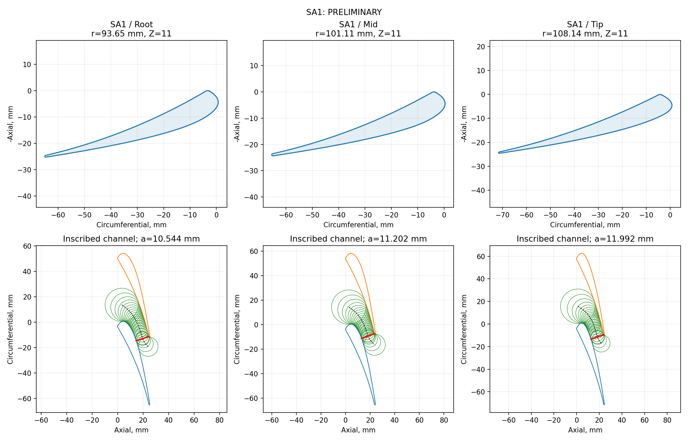
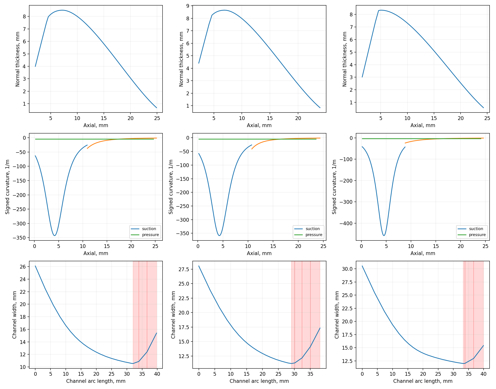
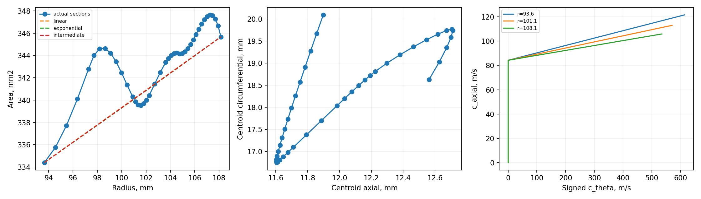
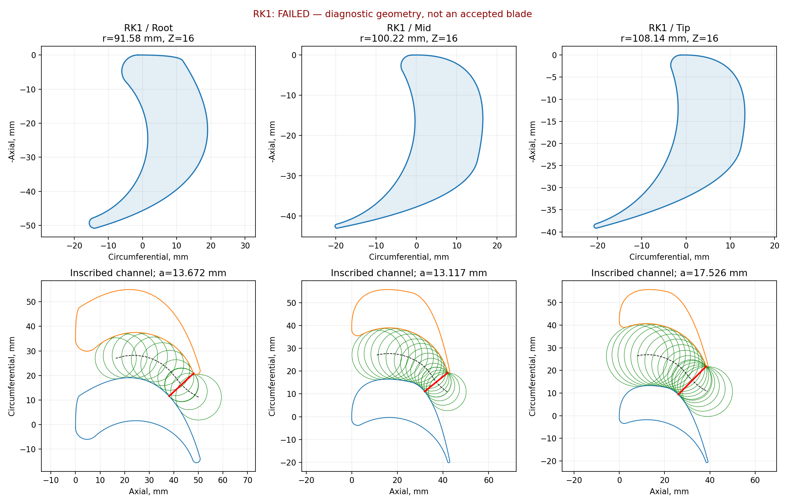
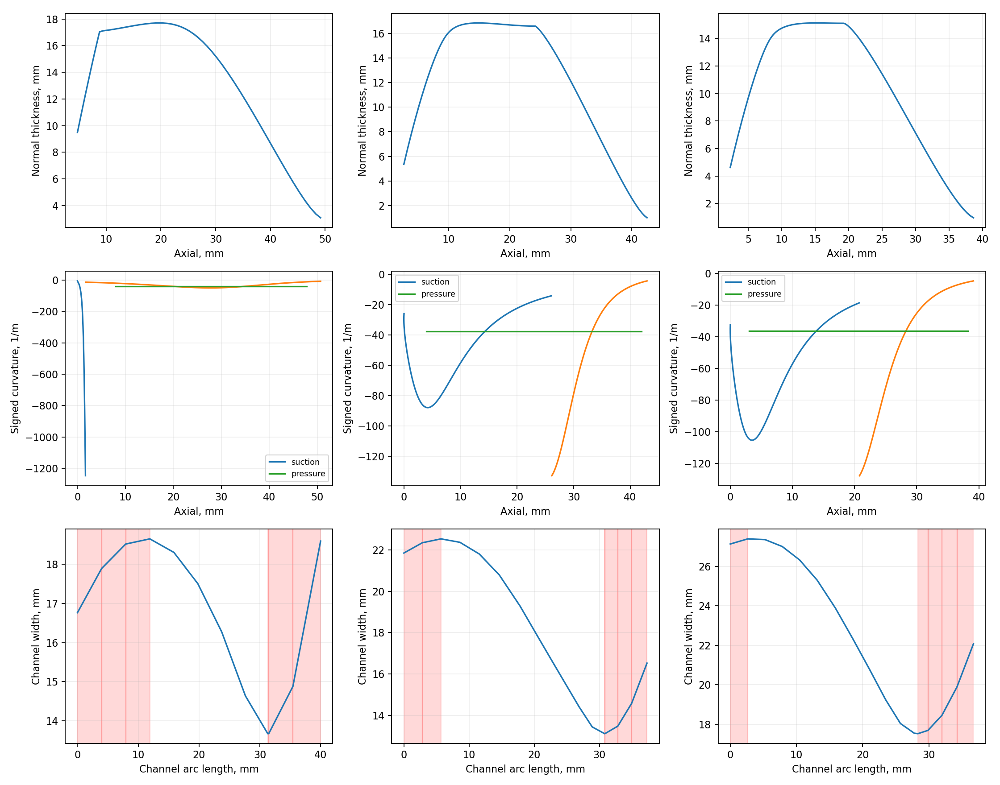
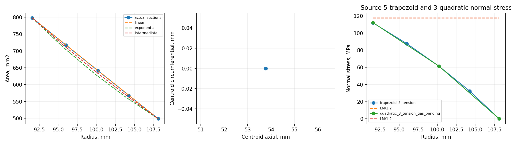
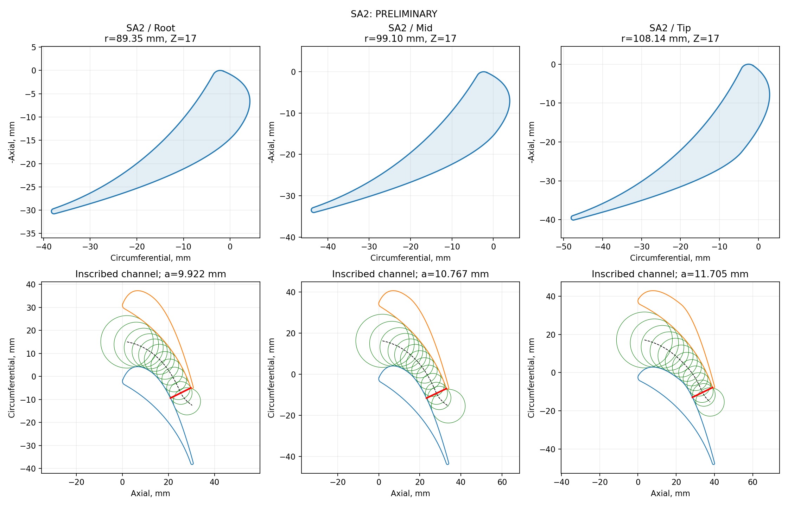
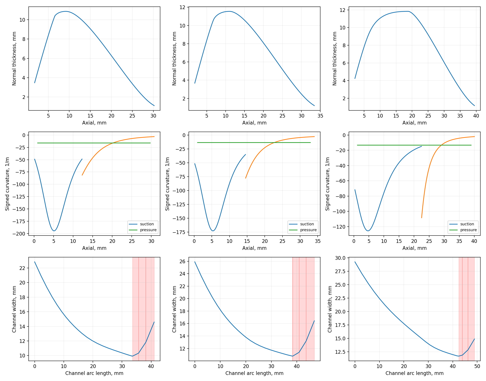
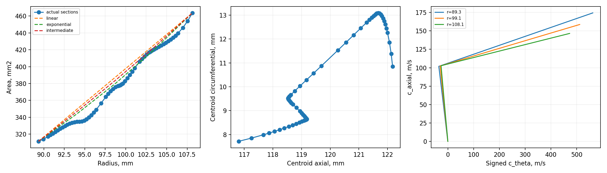
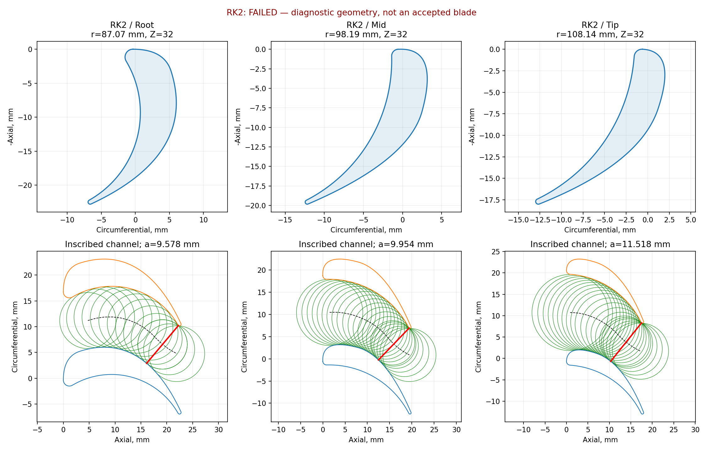
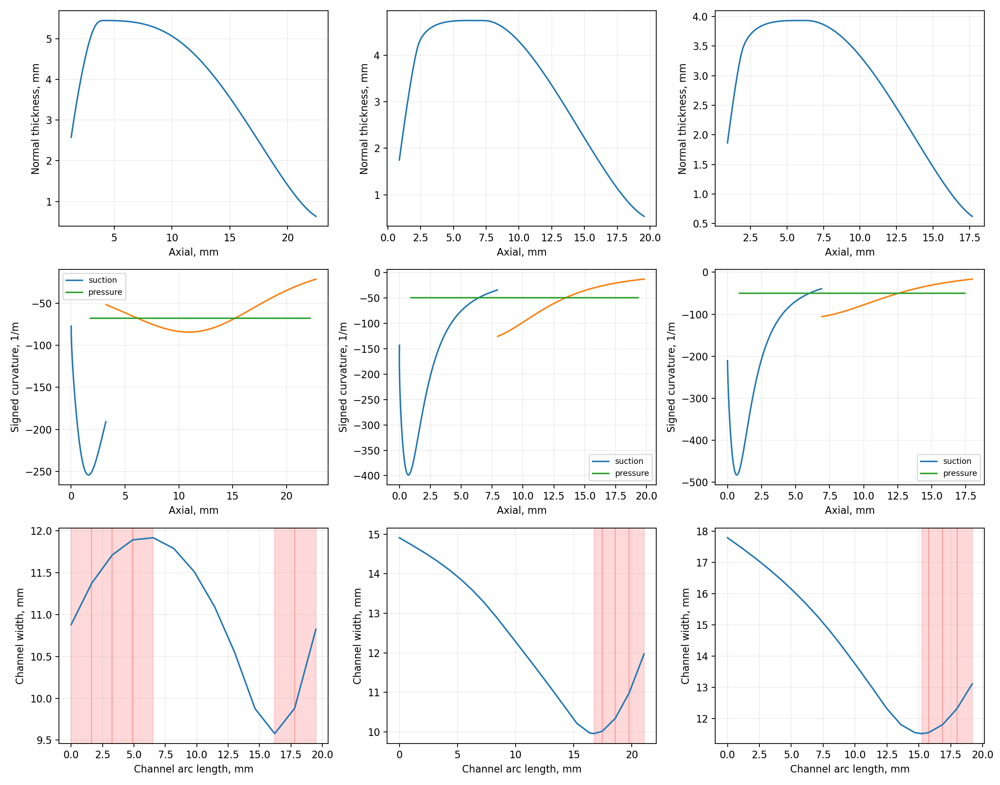
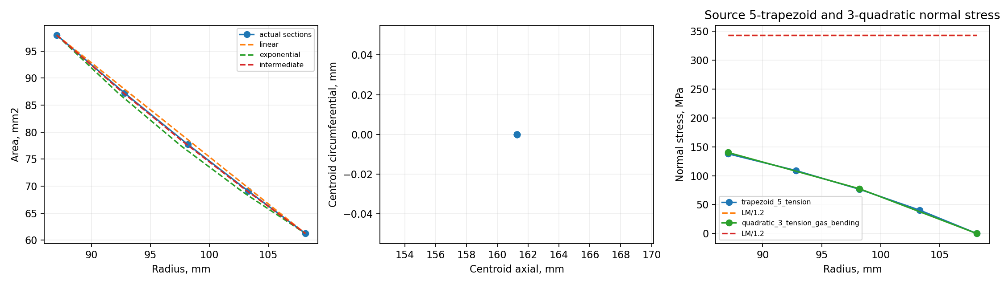
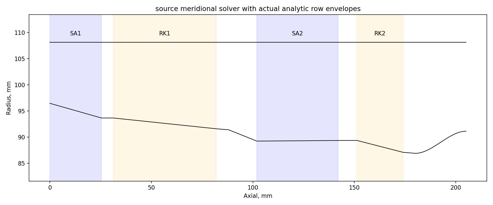

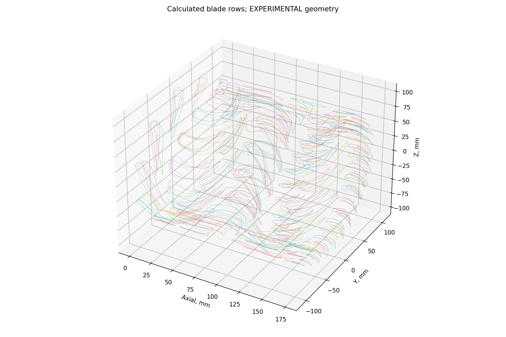

## Scope and missing physical evidence

- Geometry is not CFD/experimental proof of no separation or efficiency.
- Reynolds uses a documented air-viscosity proxy, not measured mixture transport.
- Source variable-cp thermodynamics and independent pressure-equilibrium audits are retained.
- IN738C/LM data are preliminary, not certified supply allowables.
- HCF NOT_CHECKED: grade-specific fatigue curve, forcing and damping are unavailable.
