# Vinogradov — actual TWO-stage course resource calculation

Source: **TVD_1CBK_2st_10000h.ipynb**; resource: **10000 h**; stages: **2**.
Fixed source RPM: **30700**.
Engineering admissible: **False**.
Constructed rows: 4/4.

A failed finite search is not a proof of global infeasibility. No design limit was relaxed.

## Quantified violations

### SA1
- {'name': 'source streamline Euler residual', 'value': 1.663001603446901e-05, 'limit': 1e-05, 'passed': False, 'classification': 'numerical', 'source': 'course radial_stage, J/kg', 'units': '1', 'note': ''}
- {'section': 0, 'name': 'local streamtube choke conflict', 'possible': False, 'required_flux_kg_m2_s': 491.83961975311263, 'critical_flux_kg_m2_s': 471.9765445887573, 'required_mach': None, 'stagnation_temperature_K': 1249.9999999999998, 'stagnation_pressure_Pa': 422749.4491921801, 'critical_temperature_K': 1081.7030867407584, 'source': 'original variable-cp h, pressure_isentropic, sound'}
- {'section': 1, 'name': 'local streamtube choke conflict', 'possible': False, 'required_flux_kg_m2_s': 489.25499695742565, 'critical_flux_kg_m2_s': 471.97655331961613, 'required_mach': None, 'stagnation_temperature_K': 1249.9999551658825, 'stagnation_pressure_Pa': 422749.4491399771, 'critical_temperature_K': 1081.7030467298239, 'source': 'original variable-cp h, pressure_isentropic, sound'}
- {'section': 2, 'name': 'local streamtube choke conflict', 'possible': False, 'required_flux_kg_m2_s': 486.8428835836757, 'critical_flux_kg_m2_s': 471.97654888311433, 'required_mach': None, 'stagnation_temperature_K': 1249.9999317739803, 'stagnation_pressure_Pa': 422749.4410588134, 'critical_temperature_K': 1081.7030258543848, 'source': 'original variable-cp h, pressure_isentropic, sound'}
- {'section': 3, 'name': 'local streamtube choke conflict', 'possible': False, 'required_flux_kg_m2_s': 485.31585454681056, 'critical_flux_kg_m2_s': 471.9765440501777, 'required_mach': None, 'stagnation_temperature_K': 1249.9999895364103, 'stagnation_pressure_Pa': 422749.4468724699, 'critical_temperature_K': 1081.7030774028253, 'source': 'original variable-cp h, pressure_isentropic, sound'}
- {'section': 4, 'name': 'local streamtube choke conflict', 'possible': False, 'required_flux_kg_m2_s': 481.287282294018, 'critical_flux_kg_m2_s': 471.97654458875684, 'required_mach': None, 'stagnation_temperature_K': 1249.9999999999998, 'stagnation_pressure_Pa': 422749.44919217966, 'critical_temperature_K': 1081.7030867407584, 'source': 'original variable-cp h, pressure_isentropic, sound'}
- {'name': 'insufficient choked capacity', 'value': 0.8078556122549032, 'limit': 0.8336628797375195, 'units': 'kg/s'}
### RK1
- {'name': 'source streamline Euler residual', 'value': 1.663001603446901e-05, 'limit': 1e-05, 'passed': False, 'classification': 'numerical', 'source': 'course radial_stage, J/kg', 'units': '1', 'note': ''}
- {'section': 0, 'name': 'prior profile guide: вписанные круги', 'measurements': {'geometry_valid': False, 'intersections': False, 'self_intersection': False, 'area_equivalent_angle_deg': 29.15256277683189, 'area_ratio': 0.4871367686336085, 'angle_comparison': 'uniform-flux geometric comparison, not actual gas exit angle', 'angle_error_deg': 10.337150742229905, 'te_over_throat': 0.03337156779086715, 'book_te_over_throat': 0.07, 'max_reduced_expansion': 1.2391417713263382}, 'relative_thickness': 0.2760534014125383, 'actual_relative_pitch': 0.8566340120862246}
- {'section': 1, 'name': 'axial envelope boundary', 'value': 3.849226605393462e-06, 'limit': 3.686084593894887e-09, 'passed': False, 'classification': 'numerical', 'source': 'Prescribed axial width between leading/trailing outer edge planes', 'units': 'm', 'note': ''}
- {'section': 1, 'name': 'axial envelope boundary', 'value': 3.849226605393462e-06, 'limit': 3.686084593894887e-09, 'passed': False, 'classification': 'numerical', 'source': 'Prescribed axial width between leading/trailing outer edge planes', 'units': 'm', 'note': ''}
- {'section': 1, 'name': 'prior profile guide: вписанные круги', 'measurements': {'geometry_valid': False, 'intersections': False, 'self_intersection': False, 'area_equivalent_angle_deg': 31.347747425334507, 'area_ratio': 0.5202309944807386, 'angle_comparison': 'uniform-flux geometric comparison, not actual gas exit angle', 'angle_error_deg': 13.07905678868893, 'te_over_throat': 0.07263626060545365, 'book_te_over_throat': 0.07, 'max_reduced_expansion': 1.1009199961923686}, 'relative_thickness': 0.2477919800783183, 'actual_relative_pitch': 1.022761142083836}
- {'section': 2, 'name': 'prior profile guide: вписанные круги', 'measurements': {'geometry_valid': False, 'intersections': False, 'self_intersection': False, 'area_equivalent_angle_deg': 33.52120104973984, 'area_ratio': 0.552245508724589, 'angle_comparison': 'uniform-flux geometric comparison, not actual gas exit angle', 'angle_error_deg': 15.760058023929645, 'te_over_throat': 0.05953832919832398, 'book_te_over_throat': 0.07, 'max_reduced_expansion': 1.1533285302178538}, 'relative_thickness': 0.24117294537643674, 'actual_relative_pitch': 1.141589016270866}
- {'section': 3, 'name': 'prior profile guide: вписанные круги', 'measurements': {'geometry_valid': False, 'intersections': False, 'self_intersection': False, 'area_equivalent_angle_deg': 33.073316157165465, 'area_ratio': 0.5457117586780383, 'angle_comparison': 'uniform-flux geometric comparison, not actual gas exit angle', 'angle_error_deg': 15.783739645473315, 'te_over_throat': 0.06220973082273299, 'book_te_over_throat': 0.07, 'max_reduced_expansion': 1.152176913711794}, 'relative_thickness': 0.24486942554347457, 'actual_relative_pitch': 1.1374441321815563}
- {'section': 4, 'name': 'prior profile guide: вписанные круги', 'measurements': {'geometry_valid': False, 'intersections': False, 'self_intersection': False, 'area_equivalent_angle_deg': 36.35351314911845, 'area_ratio': 0.5927656418944419, 'angle_comparison': 'uniform-flux geometric comparison, not actual gas exit angle', 'angle_error_deg': 19.502856031450495, 'te_over_throat': 0.04788109568234976, 'book_te_over_throat': 0.07, 'max_reduced_expansion': 1.0949886206488195}, 'relative_thickness': 0.23588950126790126, 'actual_relative_pitch': 1.3267420571565256}
- {'name': 'vibration strength', 'status': 'NOT_CHECKED', 'reason': 'NOT_CHECKED: no grade-specific fatigue curve, damping or actual harmonic forcing; beam modes are screening only'}
### SA2
- {'name': 'source streamline Euler residual', 'value': 3.2915588235482574e-05, 'limit': 1e-05, 'passed': False, 'classification': 'numerical', 'source': 'course radial_stage, J/kg', 'units': '1', 'note': ''}
- {'section': 0, 'name': 'local streamtube choke conflict', 'possible': False, 'required_flux_kg_m2_s': 249.56729662492037, 'critical_flux_kg_m2_s': 245.0191897316294, 'required_mach': None, 'stagnation_temperature_K': 1099.3008865253757, 'stagnation_pressure_Pa': 205284.8501270197, 'critical_temperature_K': 947.3366965458624, 'source': 'original variable-cp h, pressure_isentropic, sound'}
- {'section': 1, 'name': 'local streamtube choke conflict', 'possible': False, 'required_flux_kg_m2_s': 257.54554854443796, 'critical_flux_kg_m2_s': 245.01920054288667, 'required_mach': None, 'stagnation_temperature_K': 1099.3007737442865, 'stagnation_pressure_Pa': 205284.8482237486, 'critical_temperature_K': 947.3365961042688, 'source': 'original variable-cp h, pressure_isentropic, sound'}
- {'section': 2, 'name': 'local streamtube choke conflict', 'possible': False, 'required_flux_kg_m2_s': 257.3429214089403, 'critical_flux_kg_m2_s': 245.01918982972262, 'required_mach': None, 'stagnation_temperature_K': 1099.3008533053826, 'stagnation_pressure_Pa': 205284.8469805286, 'critical_temperature_K': 947.336666960503, 'source': 'original variable-cp h, pressure_isentropic, sound'}
- {'section': 3, 'name': 'local streamtube choke conflict', 'possible': False, 'required_flux_kg_m2_s': 252.0464086511091, 'critical_flux_kg_m2_s': 245.0191845353256, 'required_mach': None, 'stagnation_temperature_K': 1099.3008169721734, 'stagnation_pressure_Pa': 205284.8390134603, 'critical_temperature_K': 947.3366346025477, 'source': 'original variable-cp h, pressure_isentropic, sound'}
- {'section': 4, 'name': 'local streamtube choke conflict', 'possible': False, 'required_flux_kg_m2_s': 246.10639696841955, 'critical_flux_kg_m2_s': 245.01918973162918, 'required_mach': None, 'stagnation_temperature_K': 1099.3008865253757, 'stagnation_pressure_Pa': 205284.85012701948, 'critical_temperature_K': 947.3366965458624, 'source': 'original variable-cp h, pressure_isentropic, sound'}
- {'name': 'insufficient choked capacity', 'value': 0.8051187261003284, 'limit': 0.8336628797375195, 'units': 'kg/s'}
### RK2
- {'name': 'source streamline Euler residual', 'value': 3.2915588235482574e-05, 'limit': 1e-05, 'passed': False, 'classification': 'numerical', 'source': 'course radial_stage, J/kg', 'units': '1', 'note': ''}
- {'section': 0, 'name': 'prior profile guide: вписанные круги', 'measurements': {'geometry_valid': False, 'intersections': False, 'self_intersection': False, 'area_equivalent_angle_deg': 37.433923866410126, 'area_ratio': 0.6078460927561659, 'angle_comparison': 'uniform-flux geometric comparison, not actual gas exit angle', 'angle_error_deg': 9.173167016602644, 'te_over_throat': 0.042825136975368036, 'book_te_over_throat': 0.07, 'max_reduced_expansion': 1.22468176439985}, 'relative_thickness': 0.1780394500897976, 'actual_relative_pitch': 0.7977918440950807}
- {'section': 1, 'name': 'prior profile guide: вписанные круги', 'measurements': {'geometry_valid': False, 'intersections': False, 'self_intersection': False, 'area_equivalent_angle_deg': 38.01566101285774, 'area_ratio': 0.6158768442194504, 'angle_comparison': 'uniform-flux geometric comparison, not actual gas exit angle', 'angle_error_deg': 10.77773506780062, 'te_over_throat': 0.04113717061644936, 'book_te_over_throat': 0.07, 'max_reduced_expansion': 1.2450441497770073}, 'relative_thickness': 0.16850670501405943, 'actual_relative_pitch': 0.8259253755876319}
- {'section': 2, 'name': 'axial envelope boundary', 'value': 6.4120725545069765e-06, 'limit': 2.2350480464381093e-09, 'passed': False, 'classification': 'numerical', 'source': 'Prescribed axial width between leading/trailing outer edge planes', 'units': 'm', 'note': ''}
- {'section': 2, 'name': 'axial envelope boundary', 'value': 6.4120725545069765e-06, 'limit': 2.2350480464381093e-09, 'passed': False, 'classification': 'numerical', 'source': 'Prescribed axial width between leading/trailing outer edge planes', 'units': 'm', 'note': ''}
- {'section': 2, 'name': 'prior profile guide: вписанные круги', 'measurements': {'geometry_valid': False, 'intersections': False, 'self_intersection': False, 'area_equivalent_angle_deg': 32.03258786911307, 'area_ratio': 0.5304015190888777, 'angle_comparison': 'uniform-flux geometric comparison, not actual gas exit angle', 'angle_error_deg': 5.738121505167452, 'te_over_throat': 0.04710483920379855, 'book_te_over_throat': 0.07, 'max_reduced_expansion': 1.170652476511816}, 'relative_thickness': 0.18145056326181738, 'actual_relative_pitch': 0.8626001968840724}
- {'section': 3, 'name': 'prior profile guide: вписанные круги', 'measurements': {'geometry_valid': False, 'intersections': False, 'self_intersection': False, 'area_equivalent_angle_deg': 33.76945996035543, 'area_ratio': 0.5558526016256125, 'angle_comparison': 'uniform-flux geometric comparison, not actual gas exit angle', 'angle_error_deg': 8.343019486939301, 'te_over_throat': 0.04163248578608236, 'book_te_over_throat': 0.07, 'max_reduced_expansion': 1.1400080054733224}, 'relative_thickness': 0.1651608555539164, 'actual_relative_pitch': 0.9395706095503212}
- {'section': 4, 'name': 'axial envelope boundary', 'value': 8.345978086650204e-06, 'limit': 2.3812398510649627e-09, 'passed': False, 'classification': 'numerical', 'source': 'Prescribed axial width between leading/trailing outer edge planes', 'units': 'm', 'note': ''}
- {'section': 4, 'name': 'axial envelope boundary', 'value': 8.345978086650204e-06, 'limit': 2.3812398510649627e-09, 'passed': False, 'classification': 'numerical', 'source': 'Prescribed axial width between leading/trailing outer edge planes', 'units': 'm', 'note': ''}
- {'section': 4, 'name': 'prior profile guide: вписанные круги', 'measurements': {'geometry_valid': False, 'intersections': False, 'self_intersection': False, 'area_equivalent_angle_deg': 28.72948906302156, 'area_ratio': 0.4806748844963059, 'angle_comparison': 'uniform-flux geometric comparison, not actual gas exit angle', 'angle_error_deg': 4.102015802877592, 'te_over_throat': 0.049652555530324036, 'book_te_over_throat': 0.07, 'max_reduced_expansion': 1.2286953988240186}, 'relative_thickness': 0.1423924455672869, 'actual_relative_pitch': 0.8917236543114008}
- {'name': 'vibration strength', 'status': 'NOT_CHECKED', 'reason': 'NOT_CHECKED: no grade-specific fatigue curve, damping or actual harmonic forcing; beam modes are screening only'}

## Global/source violations

- {'row': 'SA1', 'name': 'source streamline Euler residual', 'value': 1.663001603446901e-05, 'limit': 1e-05, 'passed': False, 'classification': 'numerical', 'source': 'course radial_stage, J/kg', 'units': '1', 'note': ''}
- {'row': 'SA1', 'section': 0, 'name': 'local streamtube choke conflict', 'possible': False, 'required_flux_kg_m2_s': 491.83961975311263, 'critical_flux_kg_m2_s': 471.9765445887573, 'required_mach': None, 'stagnation_temperature_K': 1249.9999999999998, 'stagnation_pressure_Pa': 422749.4491921801, 'critical_temperature_K': 1081.7030867407584, 'source': 'original variable-cp h, pressure_isentropic, sound'}
- {'row': 'SA1', 'section': 1, 'name': 'local streamtube choke conflict', 'possible': False, 'required_flux_kg_m2_s': 489.25499695742565, 'critical_flux_kg_m2_s': 471.97655331961613, 'required_mach': None, 'stagnation_temperature_K': 1249.9999551658825, 'stagnation_pressure_Pa': 422749.4491399771, 'critical_temperature_K': 1081.7030467298239, 'source': 'original variable-cp h, pressure_isentropic, sound'}
- {'row': 'SA1', 'section': 2, 'name': 'local streamtube choke conflict', 'possible': False, 'required_flux_kg_m2_s': 486.8428835836757, 'critical_flux_kg_m2_s': 471.97654888311433, 'required_mach': None, 'stagnation_temperature_K': 1249.9999317739803, 'stagnation_pressure_Pa': 422749.4410588134, 'critical_temperature_K': 1081.7030258543848, 'source': 'original variable-cp h, pressure_isentropic, sound'}
- {'row': 'SA1', 'section': 3, 'name': 'local streamtube choke conflict', 'possible': False, 'required_flux_kg_m2_s': 485.31585454681056, 'critical_flux_kg_m2_s': 471.9765440501777, 'required_mach': None, 'stagnation_temperature_K': 1249.9999895364103, 'stagnation_pressure_Pa': 422749.4468724699, 'critical_temperature_K': 1081.7030774028253, 'source': 'original variable-cp h, pressure_isentropic, sound'}
- {'row': 'SA1', 'section': 4, 'name': 'local streamtube choke conflict', 'possible': False, 'required_flux_kg_m2_s': 481.287282294018, 'critical_flux_kg_m2_s': 471.97654458875684, 'required_mach': None, 'stagnation_temperature_K': 1249.9999999999998, 'stagnation_pressure_Pa': 422749.44919217966, 'critical_temperature_K': 1081.7030867407584, 'source': 'original variable-cp h, pressure_isentropic, sound'}
- {'row': 'SA1', 'name': 'insufficient choked capacity', 'value': 0.8078556122549032, 'limit': 0.8336628797375195, 'units': 'kg/s'}
- {'row': 'RK1', 'name': 'source streamline Euler residual', 'value': 1.663001603446901e-05, 'limit': 1e-05, 'passed': False, 'classification': 'numerical', 'source': 'course radial_stage, J/kg', 'units': '1', 'note': ''}
- {'row': 'RK1', 'section': 0, 'name': 'prior profile guide: вписанные круги', 'measurements': {'geometry_valid': False, 'intersections': False, 'self_intersection': False, 'area_equivalent_angle_deg': 29.15256277683189, 'area_ratio': 0.4871367686336085, 'angle_comparison': 'uniform-flux geometric comparison, not actual gas exit angle', 'angle_error_deg': 10.337150742229905, 'te_over_throat': 0.03337156779086715, 'book_te_over_throat': 0.07, 'max_reduced_expansion': 1.2391417713263382}, 'relative_thickness': 0.2760534014125383, 'actual_relative_pitch': 0.8566340120862246}
- {'row': 'RK1', 'section': 1, 'name': 'axial envelope boundary', 'value': 3.849226605393462e-06, 'limit': 3.686084593894887e-09, 'passed': False, 'classification': 'numerical', 'source': 'Prescribed axial width between leading/trailing outer edge planes', 'units': 'm', 'note': ''}
- {'row': 'RK1', 'section': 1, 'name': 'axial envelope boundary', 'value': 3.849226605393462e-06, 'limit': 3.686084593894887e-09, 'passed': False, 'classification': 'numerical', 'source': 'Prescribed axial width between leading/trailing outer edge planes', 'units': 'm', 'note': ''}
- {'row': 'RK1', 'section': 1, 'name': 'prior profile guide: вписанные круги', 'measurements': {'geometry_valid': False, 'intersections': False, 'self_intersection': False, 'area_equivalent_angle_deg': 31.347747425334507, 'area_ratio': 0.5202309944807386, 'angle_comparison': 'uniform-flux geometric comparison, not actual gas exit angle', 'angle_error_deg': 13.07905678868893, 'te_over_throat': 0.07263626060545365, 'book_te_over_throat': 0.07, 'max_reduced_expansion': 1.1009199961923686}, 'relative_thickness': 0.2477919800783183, 'actual_relative_pitch': 1.022761142083836}
- {'row': 'RK1', 'section': 2, 'name': 'prior profile guide: вписанные круги', 'measurements': {'geometry_valid': False, 'intersections': False, 'self_intersection': False, 'area_equivalent_angle_deg': 33.52120104973984, 'area_ratio': 0.552245508724589, 'angle_comparison': 'uniform-flux geometric comparison, not actual gas exit angle', 'angle_error_deg': 15.760058023929645, 'te_over_throat': 0.05953832919832398, 'book_te_over_throat': 0.07, 'max_reduced_expansion': 1.1533285302178538}, 'relative_thickness': 0.24117294537643674, 'actual_relative_pitch': 1.141589016270866}
- {'row': 'RK1', 'section': 3, 'name': 'prior profile guide: вписанные круги', 'measurements': {'geometry_valid': False, 'intersections': False, 'self_intersection': False, 'area_equivalent_angle_deg': 33.073316157165465, 'area_ratio': 0.5457117586780383, 'angle_comparison': 'uniform-flux geometric comparison, not actual gas exit angle', 'angle_error_deg': 15.783739645473315, 'te_over_throat': 0.06220973082273299, 'book_te_over_throat': 0.07, 'max_reduced_expansion': 1.152176913711794}, 'relative_thickness': 0.24486942554347457, 'actual_relative_pitch': 1.1374441321815563}
- {'row': 'RK1', 'section': 4, 'name': 'prior profile guide: вписанные круги', 'measurements': {'geometry_valid': False, 'intersections': False, 'self_intersection': False, 'area_equivalent_angle_deg': 36.35351314911845, 'area_ratio': 0.5927656418944419, 'angle_comparison': 'uniform-flux geometric comparison, not actual gas exit angle', 'angle_error_deg': 19.502856031450495, 'te_over_throat': 0.04788109568234976, 'book_te_over_throat': 0.07, 'max_reduced_expansion': 1.0949886206488195}, 'relative_thickness': 0.23588950126790126, 'actual_relative_pitch': 1.3267420571565256}
- {'row': 'RK1', 'name': 'vibration strength', 'status': 'NOT_CHECKED', 'reason': 'NOT_CHECKED: no grade-specific fatigue curve, damping or actual harmonic forcing; beam modes are screening only'}
- {'row': 'SA2', 'name': 'source streamline Euler residual', 'value': 3.2915588235482574e-05, 'limit': 1e-05, 'passed': False, 'classification': 'numerical', 'source': 'course radial_stage, J/kg', 'units': '1', 'note': ''}
- {'row': 'SA2', 'section': 0, 'name': 'local streamtube choke conflict', 'possible': False, 'required_flux_kg_m2_s': 249.56729662492037, 'critical_flux_kg_m2_s': 245.0191897316294, 'required_mach': None, 'stagnation_temperature_K': 1099.3008865253757, 'stagnation_pressure_Pa': 205284.8501270197, 'critical_temperature_K': 947.3366965458624, 'source': 'original variable-cp h, pressure_isentropic, sound'}
- {'row': 'SA2', 'section': 1, 'name': 'local streamtube choke conflict', 'possible': False, 'required_flux_kg_m2_s': 257.54554854443796, 'critical_flux_kg_m2_s': 245.01920054288667, 'required_mach': None, 'stagnation_temperature_K': 1099.3007737442865, 'stagnation_pressure_Pa': 205284.8482237486, 'critical_temperature_K': 947.3365961042688, 'source': 'original variable-cp h, pressure_isentropic, sound'}
- {'row': 'SA2', 'section': 2, 'name': 'local streamtube choke conflict', 'possible': False, 'required_flux_kg_m2_s': 257.3429214089403, 'critical_flux_kg_m2_s': 245.01918982972262, 'required_mach': None, 'stagnation_temperature_K': 1099.3008533053826, 'stagnation_pressure_Pa': 205284.8469805286, 'critical_temperature_K': 947.336666960503, 'source': 'original variable-cp h, pressure_isentropic, sound'}
- {'row': 'SA2', 'section': 3, 'name': 'local streamtube choke conflict', 'possible': False, 'required_flux_kg_m2_s': 252.0464086511091, 'critical_flux_kg_m2_s': 245.0191845353256, 'required_mach': None, 'stagnation_temperature_K': 1099.3008169721734, 'stagnation_pressure_Pa': 205284.8390134603, 'critical_temperature_K': 947.3366346025477, 'source': 'original variable-cp h, pressure_isentropic, sound'}
- {'row': 'SA2', 'section': 4, 'name': 'local streamtube choke conflict', 'possible': False, 'required_flux_kg_m2_s': 246.10639696841955, 'critical_flux_kg_m2_s': 245.01918973162918, 'required_mach': None, 'stagnation_temperature_K': 1099.3008865253757, 'stagnation_pressure_Pa': 205284.85012701948, 'critical_temperature_K': 947.3366965458624, 'source': 'original variable-cp h, pressure_isentropic, sound'}
- {'row': 'SA2', 'name': 'insufficient choked capacity', 'value': 0.8051187261003284, 'limit': 0.8336628797375195, 'units': 'kg/s'}
- {'row': 'RK2', 'name': 'source streamline Euler residual', 'value': 3.2915588235482574e-05, 'limit': 1e-05, 'passed': False, 'classification': 'numerical', 'source': 'course radial_stage, J/kg', 'units': '1', 'note': ''}
- {'row': 'RK2', 'section': 0, 'name': 'prior profile guide: вписанные круги', 'measurements': {'geometry_valid': False, 'intersections': False, 'self_intersection': False, 'area_equivalent_angle_deg': 37.433923866410126, 'area_ratio': 0.6078460927561659, 'angle_comparison': 'uniform-flux geometric comparison, not actual gas exit angle', 'angle_error_deg': 9.173167016602644, 'te_over_throat': 0.042825136975368036, 'book_te_over_throat': 0.07, 'max_reduced_expansion': 1.22468176439985}, 'relative_thickness': 0.1780394500897976, 'actual_relative_pitch': 0.7977918440950807}
- {'row': 'RK2', 'section': 1, 'name': 'prior profile guide: вписанные круги', 'measurements': {'geometry_valid': False, 'intersections': False, 'self_intersection': False, 'area_equivalent_angle_deg': 38.01566101285774, 'area_ratio': 0.6158768442194504, 'angle_comparison': 'uniform-flux geometric comparison, not actual gas exit angle', 'angle_error_deg': 10.77773506780062, 'te_over_throat': 0.04113717061644936, 'book_te_over_throat': 0.07, 'max_reduced_expansion': 1.2450441497770073}, 'relative_thickness': 0.16850670501405943, 'actual_relative_pitch': 0.8259253755876319}
- {'row': 'RK2', 'section': 2, 'name': 'axial envelope boundary', 'value': 6.4120725545069765e-06, 'limit': 2.2350480464381093e-09, 'passed': False, 'classification': 'numerical', 'source': 'Prescribed axial width between leading/trailing outer edge planes', 'units': 'm', 'note': ''}
- {'row': 'RK2', 'section': 2, 'name': 'axial envelope boundary', 'value': 6.4120725545069765e-06, 'limit': 2.2350480464381093e-09, 'passed': False, 'classification': 'numerical', 'source': 'Prescribed axial width between leading/trailing outer edge planes', 'units': 'm', 'note': ''}
- {'row': 'RK2', 'section': 2, 'name': 'prior profile guide: вписанные круги', 'measurements': {'geometry_valid': False, 'intersections': False, 'self_intersection': False, 'area_equivalent_angle_deg': 32.03258786911307, 'area_ratio': 0.5304015190888777, 'angle_comparison': 'uniform-flux geometric comparison, not actual gas exit angle', 'angle_error_deg': 5.738121505167452, 'te_over_throat': 0.04710483920379855, 'book_te_over_throat': 0.07, 'max_reduced_expansion': 1.170652476511816}, 'relative_thickness': 0.18145056326181738, 'actual_relative_pitch': 0.8626001968840724}
- {'row': 'RK2', 'section': 3, 'name': 'prior profile guide: вписанные круги', 'measurements': {'geometry_valid': False, 'intersections': False, 'self_intersection': False, 'area_equivalent_angle_deg': 33.76945996035543, 'area_ratio': 0.5558526016256125, 'angle_comparison': 'uniform-flux geometric comparison, not actual gas exit angle', 'angle_error_deg': 8.343019486939301, 'te_over_throat': 0.04163248578608236, 'book_te_over_throat': 0.07, 'max_reduced_expansion': 1.1400080054733224}, 'relative_thickness': 0.1651608555539164, 'actual_relative_pitch': 0.9395706095503212}
- {'row': 'RK2', 'section': 4, 'name': 'axial envelope boundary', 'value': 8.345978086650204e-06, 'limit': 2.3812398510649627e-09, 'passed': False, 'classification': 'numerical', 'source': 'Prescribed axial width between leading/trailing outer edge planes', 'units': 'm', 'note': ''}
- {'row': 'RK2', 'section': 4, 'name': 'axial envelope boundary', 'value': 8.345978086650204e-06, 'limit': 2.3812398510649627e-09, 'passed': False, 'classification': 'numerical', 'source': 'Prescribed axial width between leading/trailing outer edge planes', 'units': 'm', 'note': ''}
- {'row': 'RK2', 'section': 4, 'name': 'prior profile guide: вписанные круги', 'measurements': {'geometry_valid': False, 'intersections': False, 'self_intersection': False, 'area_equivalent_angle_deg': 28.72948906302156, 'area_ratio': 0.4806748844963059, 'angle_comparison': 'uniform-flux geometric comparison, not actual gas exit angle', 'angle_error_deg': 4.102015802877592, 'te_over_throat': 0.049652555530324036, 'book_te_over_throat': 0.07, 'max_reduced_expansion': 1.2286953988240186}, 'relative_thickness': 0.1423924455672869, 'actual_relative_pitch': 0.8917236543114008}
- {'row': 'RK2', 'name': 'vibration strength', 'status': 'NOT_CHECKED', 'reason': 'NOT_CHECKED: no grade-specific fatigue curve, damping or actual harmonic forcing; beam modes are screening only'}
- {'row': 'RK1', 'name': 'source rotor taper mismatch', 'value': 2.0193207497438497, 'limit': 1.6}
- {'row': 'RK1', 'name': 'source rotor areas must decrease', 'value': [0.00045258430971824185, 0.00031502493432535483, 0.0002676102273399251, 0.00029627044809331317, 0.00022412700398173597], 'limit': 'strict decrease root to tip'}
- {'row': 'RK2', 'name': 'source rotor taper mismatch', 'value': 1.1749179685570599, 'limit': 1.6}
- {'row': 'RK2', 'name': 'source chord direction', 'root_m': 0.021429175276768856, 'tip_m': 0.02381239851064963, 'limit': 'root>tip RK; root<tip SA'}
- {'row': 'RK2', 'name': 'source rotor areas must decrease', 'value': [7.161096800544644e-05, 6.852997072335815e-05, 7.071301014680451e-05, 6.0791382027167206e-05, 6.0949759831653016e-05], 'limit': 'strict decrease root to tip'}
- {'row': 'RK2', 'section': 0, 'name': 'source finite trailing edge', 'value': 0.0004521694414040165, 'limit': 0.0005}
- {'row': 'RK2', 'section': 1, 'name': 'source finite trailing edge', 'value': 0.0004690874215268878, 'limit': 0.0005}
- {'row': 'RK2', 'section': 2, 'name': 'source finite trailing edge', 'value': 0.0004912636372922306, 'limit': 0.0005}
- {'row': 'RK2', 'section': 3, 'name': 'source finite trailing edge', 'value': 0.0004790853476630414, 'limit': 0.0005}

## Empirical guidance — not added hard limits

- {'row': 'SA1', 'section': 0, 'name': 'relative thickness starting guidance', 'value': 0.13106764108267457, 'range': [0.1, 0.1], 'classification': 'empirical, p13'}
- {'row': 'SA1', 'section': 0, 'name': 'prior profile guide: местная диффузорность', 'measurements': {'geometry_valid': True, 'intersections': False, 'self_intersection': False, 'area_equivalent_angle_deg': 10.206803412813231, 'area_ratio': 0.17720160438046442, 'angle_comparison': 'uniform-flux geometric comparison, not actual gas exit angle', 'angle_error_deg': -0.9931965871867678, 'te_over_throat': 0.054082174304427806, 'book_te_over_throat': 0.055, 'max_reduced_expansion': 1.385992622382364}, 'relative_thickness': 0.13106764108267457, 'actual_relative_pitch': 0.90847487988048, 'classification': 'historical empirical profile guide; Vinogradov uses its own recommendations'}
- {'row': 'SA1', 'section': 0, 'name': 'prior profile guide: относительный шаг', 'measurements': {'geometry_valid': True, 'intersections': False, 'self_intersection': False, 'area_equivalent_angle_deg': 10.206803412813231, 'area_ratio': 0.17720160438046442, 'angle_comparison': 'uniform-flux geometric comparison, not actual gas exit angle', 'angle_error_deg': -0.9931965871867678, 'te_over_throat': 0.054082174304427806, 'book_te_over_throat': 0.055, 'max_reduced_expansion': 1.385992622382364}, 'relative_thickness': 0.13106764108267457, 'actual_relative_pitch': 0.90847487988048, 'classification': 'historical empirical profile guide; Vinogradov uses its own recommendations'}
- {'row': 'SA1', 'section': 1, 'name': 'relative thickness starting guidance', 'value': 0.13107367364561875, 'range': [0.1, 0.1], 'classification': 'empirical, p13'}
- {'row': 'SA1', 'section': 1, 'name': 'prior profile guide: местная диффузорность', 'measurements': {'geometry_valid': True, 'intersections': False, 'self_intersection': False, 'area_equivalent_angle_deg': 10.227863367807329, 'area_ratio': 0.17756334107530464, 'angle_comparison': 'uniform-flux geometric comparison, not actual gas exit angle', 'angle_error_deg': -0.9721366321926688, 'te_over_throat': 0.051717640711781795, 'book_te_over_throat': 0.055, 'max_reduced_expansion': 1.4296603639874597}, 'relative_thickness': 0.13107367364561875, 'actual_relative_pitch': 0.91228793699771, 'classification': 'historical empirical profile guide; Vinogradov uses its own recommendations'}
- {'row': 'SA1', 'section': 1, 'name': 'prior profile guide: относительный шаг', 'measurements': {'geometry_valid': True, 'intersections': False, 'self_intersection': False, 'area_equivalent_angle_deg': 10.227863367807329, 'area_ratio': 0.17756334107530464, 'angle_comparison': 'uniform-flux geometric comparison, not actual gas exit angle', 'angle_error_deg': -0.9721366321926688, 'te_over_throat': 0.051717640711781795, 'book_te_over_throat': 0.055, 'max_reduced_expansion': 1.4296603639874597}, 'relative_thickness': 0.13107367364561875, 'actual_relative_pitch': 0.91228793699771, 'classification': 'historical empirical profile guide; Vinogradov uses its own recommendations'}
- {'row': 'SA1', 'section': 2, 'name': 'relative thickness starting guidance', 'value': 0.13108313666331847, 'range': [0.1, 0.1], 'classification': 'empirical, p13'}
- {'row': 'SA1', 'section': 2, 'name': 'prior profile guide: местная диффузорность', 'measurements': {'geometry_valid': True, 'intersections': False, 'self_intersection': False, 'area_equivalent_angle_deg': 10.222909407814658, 'area_ratio': 0.17747825144862472, 'angle_comparison': 'uniform-flux geometric comparison, not actual gas exit angle', 'angle_error_deg': -0.9770905921853412, 'te_over_throat': 0.05019873308042068, 'book_te_over_throat': 0.055, 'max_reduced_expansion': 1.4202767363659812}, 'relative_thickness': 0.13108313666331847, 'actual_relative_pitch': 0.9104626710141729, 'classification': 'historical empirical profile guide; Vinogradov uses its own recommendations'}
- {'row': 'SA1', 'section': 2, 'name': 'prior profile guide: относительный шаг', 'measurements': {'geometry_valid': True, 'intersections': False, 'self_intersection': False, 'area_equivalent_angle_deg': 10.222909407814658, 'area_ratio': 0.17747825144862472, 'angle_comparison': 'uniform-flux geometric comparison, not actual gas exit angle', 'angle_error_deg': -0.9770905921853412, 'te_over_throat': 0.05019873308042068, 'book_te_over_throat': 0.055, 'max_reduced_expansion': 1.4202767363659812}, 'relative_thickness': 0.13108313666331847, 'actual_relative_pitch': 0.9104626710141729, 'classification': 'historical empirical profile guide; Vinogradov uses its own recommendations'}
- {'row': 'SA1', 'section': 3, 'name': 'relative thickness starting guidance', 'value': 0.13104888342988813, 'range': [0.1, 0.1], 'classification': 'empirical, p13'}
- {'row': 'SA1', 'section': 3, 'name': 'prior profile guide: местная диффузорность', 'measurements': {'geometry_valid': True, 'intersections': False, 'self_intersection': False, 'area_equivalent_angle_deg': 10.182221451429607, 'area_ratio': 0.1767793416019449, 'angle_comparison': 'uniform-flux geometric comparison, not actual gas exit angle', 'angle_error_deg': -1.0177785485703925, 'te_over_throat': 0.04903287237374878, 'book_te_over_throat': 0.055, 'max_reduced_expansion': 1.4084406647352712}, 'relative_thickness': 0.13104888342988813, 'actual_relative_pitch': 0.9078636856812532, 'classification': 'historical empirical profile guide; Vinogradov uses its own recommendations'}
- {'row': 'SA1', 'section': 3, 'name': 'prior profile guide: относительный шаг', 'measurements': {'geometry_valid': True, 'intersections': False, 'self_intersection': False, 'area_equivalent_angle_deg': 10.182221451429607, 'area_ratio': 0.1767793416019449, 'angle_comparison': 'uniform-flux geometric comparison, not actual gas exit angle', 'angle_error_deg': -1.0177785485703925, 'te_over_throat': 0.04903287237374878, 'book_te_over_throat': 0.055, 'max_reduced_expansion': 1.4084406647352712}, 'relative_thickness': 0.13104888342988813, 'actual_relative_pitch': 0.9078636856812532, 'classification': 'historical empirical profile guide; Vinogradov uses its own recommendations'}
- {'row': 'SA1', 'section': 4, 'name': 'relative thickness starting guidance', 'value': 0.13099560924872083, 'range': [0.1, 0.1], 'classification': 'empirical, p13'}
- {'row': 'SA1', 'section': 4, 'name': 'prior profile guide: местная диффузорность', 'measurements': {'geometry_valid': True, 'intersections': False, 'self_intersection': False, 'area_equivalent_angle_deg': 10.18047214088899, 'area_ratio': 0.17674929114229398, 'angle_comparison': 'uniform-flux geometric comparison, not actual gas exit angle', 'angle_error_deg': -1.0195278591110117, 'te_over_throat': 0.04759628515217986, 'book_te_over_throat': 0.055, 'max_reduced_expansion': 1.409893317620551}, 'relative_thickness': 0.13099560924872083, 'actual_relative_pitch': 0.907216161242882, 'classification': 'historical empirical profile guide; Vinogradov uses its own recommendations'}
- {'row': 'SA1', 'section': 4, 'name': 'prior profile guide: относительный шаг', 'measurements': {'geometry_valid': True, 'intersections': False, 'self_intersection': False, 'area_equivalent_angle_deg': 10.18047214088899, 'area_ratio': 0.17674929114229398, 'angle_comparison': 'uniform-flux geometric comparison, not actual gas exit angle', 'angle_error_deg': -1.0195278591110117, 'te_over_throat': 0.04759628515217986, 'book_te_over_throat': 0.055, 'max_reduced_expansion': 1.409893317620551}, 'relative_thickness': 0.13099560924872083, 'actual_relative_pitch': 0.907216161242882, 'classification': 'historical empirical profile guide; Vinogradov uses its own recommendations'}
- {'row': 'RK1', 'section': 0, 'name': 'subsonic entrance expansion guidance', 'value': 1.1985029777705063, 'limit': 1.1, 'classification': 'empirical recommendation; CFD required'}
- {'row': 'RK1', 'section': 0, 'name': 'prior profile guide: угол горла', 'measurements': {'geometry_valid': False, 'intersections': False, 'self_intersection': False, 'area_equivalent_angle_deg': 29.15256277683189, 'area_ratio': 0.4871367686336085, 'angle_comparison': 'uniform-flux geometric comparison, not actual gas exit angle', 'angle_error_deg': 10.337150742229905, 'te_over_throat': 0.03337156779086715, 'book_te_over_throat': 0.07, 'max_reduced_expansion': 1.2391417713263382}, 'relative_thickness': 0.2760534014125383, 'actual_relative_pitch': 0.8566340120862246, 'classification': 'historical empirical profile guide; Vinogradov uses its own recommendations'}
- {'row': 'RK1', 'section': 0, 'name': 'prior profile guide: местная диффузорность', 'measurements': {'geometry_valid': False, 'intersections': False, 'self_intersection': False, 'area_equivalent_angle_deg': 29.15256277683189, 'area_ratio': 0.4871367686336085, 'angle_comparison': 'uniform-flux geometric comparison, not actual gas exit angle', 'angle_error_deg': 10.337150742229905, 'te_over_throat': 0.03337156779086715, 'book_te_over_throat': 0.07, 'max_reduced_expansion': 1.2391417713263382}, 'relative_thickness': 0.2760534014125383, 'actual_relative_pitch': 0.8566340120862246, 'classification': 'historical empirical profile guide; Vinogradov uses its own recommendations'}
- {'row': 'RK1', 'section': 0, 'name': 'prior profile guide: максимальная толщина', 'measurements': {'geometry_valid': False, 'intersections': False, 'self_intersection': False, 'area_equivalent_angle_deg': 29.15256277683189, 'area_ratio': 0.4871367686336085, 'angle_comparison': 'uniform-flux geometric comparison, not actual gas exit angle', 'angle_error_deg': 10.337150742229905, 'te_over_throat': 0.03337156779086715, 'book_te_over_throat': 0.07, 'max_reduced_expansion': 1.2391417713263382}, 'relative_thickness': 0.2760534014125383, 'actual_relative_pitch': 0.8566340120862246, 'classification': 'historical empirical profile guide; Vinogradov uses its own recommendations'}
- {'row': 'RK1', 'section': 0, 'name': 'prior profile guide: относительный шаг', 'measurements': {'geometry_valid': False, 'intersections': False, 'self_intersection': False, 'area_equivalent_angle_deg': 29.15256277683189, 'area_ratio': 0.4871367686336085, 'angle_comparison': 'uniform-flux geometric comparison, not actual gas exit angle', 'angle_error_deg': 10.337150742229905, 'te_over_throat': 0.03337156779086715, 'book_te_over_throat': 0.07, 'max_reduced_expansion': 1.2391417713263382}, 'relative_thickness': 0.2760534014125383, 'actual_relative_pitch': 0.8566340120862246, 'classification': 'historical empirical profile guide; Vinogradov uses its own recommendations'}
- {'row': 'RK1', 'section': 1, 'name': 'relative thickness starting guidance', 'value': 0.2477919800783183, 'range': [0.14658407163388162, 0.21987610745082242], 'classification': 'empirical, p13'}
- {'row': 'RK1', 'section': 1, 'name': 'prior profile guide: угол горла', 'measurements': {'geometry_valid': False, 'intersections': False, 'self_intersection': False, 'area_equivalent_angle_deg': 31.347747425334507, 'area_ratio': 0.5202309944807386, 'angle_comparison': 'uniform-flux geometric comparison, not actual gas exit angle', 'angle_error_deg': 13.07905678868893, 'te_over_throat': 0.07263626060545365, 'book_te_over_throat': 0.07, 'max_reduced_expansion': 1.1009199961923686}, 'relative_thickness': 0.2477919800783183, 'actual_relative_pitch': 1.022761142083836, 'classification': 'historical empirical profile guide; Vinogradov uses its own recommendations'}
- {'row': 'RK1', 'section': 1, 'name': 'prior profile guide: местная диффузорность', 'measurements': {'geometry_valid': False, 'intersections': False, 'self_intersection': False, 'area_equivalent_angle_deg': 31.347747425334507, 'area_ratio': 0.5202309944807386, 'angle_comparison': 'uniform-flux geometric comparison, not actual gas exit angle', 'angle_error_deg': 13.07905678868893, 'te_over_throat': 0.07263626060545365, 'book_te_over_throat': 0.07, 'max_reduced_expansion': 1.1009199961923686}, 'relative_thickness': 0.2477919800783183, 'actual_relative_pitch': 1.022761142083836, 'classification': 'historical empirical profile guide; Vinogradov uses its own recommendations'}
- {'row': 'RK1', 'section': 1, 'name': 'prior profile guide: максимальная толщина', 'measurements': {'geometry_valid': False, 'intersections': False, 'self_intersection': False, 'area_equivalent_angle_deg': 31.347747425334507, 'area_ratio': 0.5202309944807386, 'angle_comparison': 'uniform-flux geometric comparison, not actual gas exit angle', 'angle_error_deg': 13.07905678868893, 'te_over_throat': 0.07263626060545365, 'book_te_over_throat': 0.07, 'max_reduced_expansion': 1.1009199961923686}, 'relative_thickness': 0.2477919800783183, 'actual_relative_pitch': 1.022761142083836, 'classification': 'historical empirical profile guide; Vinogradov uses its own recommendations'}
- {'row': 'RK1', 'section': 1, 'name': 'prior profile guide: относительный шаг', 'measurements': {'geometry_valid': False, 'intersections': False, 'self_intersection': False, 'area_equivalent_angle_deg': 31.347747425334507, 'area_ratio': 0.5202309944807386, 'angle_comparison': 'uniform-flux geometric comparison, not actual gas exit angle', 'angle_error_deg': 13.07905678868893, 'te_over_throat': 0.07263626060545365, 'book_te_over_throat': 0.07, 'max_reduced_expansion': 1.1009199961923686}, 'relative_thickness': 0.2477919800783183, 'actual_relative_pitch': 1.022761142083836, 'classification': 'historical empirical profile guide; Vinogradov uses its own recommendations'}
- {'row': 'RK1', 'section': 2, 'name': 'relative thickness starting guidance', 'value': 0.24117294537643674, 'range': [0.09738937847815876, 0.1456489641302646], 'classification': 'empirical, p13'}
- {'row': 'RK1', 'section': 2, 'name': 'prior profile guide: угол горла', 'measurements': {'geometry_valid': False, 'intersections': False, 'self_intersection': False, 'area_equivalent_angle_deg': 33.52120104973984, 'area_ratio': 0.552245508724589, 'angle_comparison': 'uniform-flux geometric comparison, not actual gas exit angle', 'angle_error_deg': 15.760058023929645, 'te_over_throat': 0.05953832919832398, 'book_te_over_throat': 0.07, 'max_reduced_expansion': 1.1533285302178538}, 'relative_thickness': 0.24117294537643674, 'actual_relative_pitch': 1.141589016270866, 'classification': 'historical empirical profile guide; Vinogradov uses its own recommendations'}
- {'row': 'RK1', 'section': 2, 'name': 'prior profile guide: местная диффузорность', 'measurements': {'geometry_valid': False, 'intersections': False, 'self_intersection': False, 'area_equivalent_angle_deg': 33.52120104973984, 'area_ratio': 0.552245508724589, 'angle_comparison': 'uniform-flux geometric comparison, not actual gas exit angle', 'angle_error_deg': 15.760058023929645, 'te_over_throat': 0.05953832919832398, 'book_te_over_throat': 0.07, 'max_reduced_expansion': 1.1533285302178538}, 'relative_thickness': 0.24117294537643674, 'actual_relative_pitch': 1.141589016270866, 'classification': 'historical empirical profile guide; Vinogradov uses its own recommendations'}
- {'row': 'RK1', 'section': 2, 'name': 'prior profile guide: максимальная толщина', 'measurements': {'geometry_valid': False, 'intersections': False, 'self_intersection': False, 'area_equivalent_angle_deg': 33.52120104973984, 'area_ratio': 0.552245508724589, 'angle_comparison': 'uniform-flux geometric comparison, not actual gas exit angle', 'angle_error_deg': 15.760058023929645, 'te_over_throat': 0.05953832919832398, 'book_te_over_throat': 0.07, 'max_reduced_expansion': 1.1533285302178538}, 'relative_thickness': 0.24117294537643674, 'actual_relative_pitch': 1.141589016270866, 'classification': 'historical empirical profile guide; Vinogradov uses its own recommendations'}
- {'row': 'RK1', 'section': 2, 'name': 'prior profile guide: относительный шаг', 'measurements': {'geometry_valid': False, 'intersections': False, 'self_intersection': False, 'area_equivalent_angle_deg': 33.52120104973984, 'area_ratio': 0.552245508724589, 'angle_comparison': 'uniform-flux geometric comparison, not actual gas exit angle', 'angle_error_deg': 15.760058023929645, 'te_over_throat': 0.05953832919832398, 'book_te_over_throat': 0.07, 'max_reduced_expansion': 1.1533285302178538}, 'relative_thickness': 0.24117294537643674, 'actual_relative_pitch': 1.141589016270866, 'classification': 'historical empirical profile guide; Vinogradov uses its own recommendations'}
- {'row': 'RK1', 'section': 3, 'name': 'relative thickness starting guidance', 'value': 0.24486942554347457, 'range': [0.06812418197944138, 0.09687363663240228], 'classification': 'empirical, p13'}
- {'row': 'RK1', 'section': 3, 'name': 'prior profile guide: угол горла', 'measurements': {'geometry_valid': False, 'intersections': False, 'self_intersection': False, 'area_equivalent_angle_deg': 33.073316157165465, 'area_ratio': 0.5457117586780383, 'angle_comparison': 'uniform-flux geometric comparison, not actual gas exit angle', 'angle_error_deg': 15.783739645473315, 'te_over_throat': 0.06220973082273299, 'book_te_over_throat': 0.07, 'max_reduced_expansion': 1.152176913711794}, 'relative_thickness': 0.24486942554347457, 'actual_relative_pitch': 1.1374441321815563, 'classification': 'historical empirical profile guide; Vinogradov uses its own recommendations'}
- {'row': 'RK1', 'section': 3, 'name': 'prior profile guide: местная диффузорность', 'measurements': {'geometry_valid': False, 'intersections': False, 'self_intersection': False, 'area_equivalent_angle_deg': 33.073316157165465, 'area_ratio': 0.5457117586780383, 'angle_comparison': 'uniform-flux geometric comparison, not actual gas exit angle', 'angle_error_deg': 15.783739645473315, 'te_over_throat': 0.06220973082273299, 'book_te_over_throat': 0.07, 'max_reduced_expansion': 1.152176913711794}, 'relative_thickness': 0.24486942554347457, 'actual_relative_pitch': 1.1374441321815563, 'classification': 'historical empirical profile guide; Vinogradov uses its own recommendations'}
- {'row': 'RK1', 'section': 3, 'name': 'prior profile guide: максимальная толщина', 'measurements': {'geometry_valid': False, 'intersections': False, 'self_intersection': False, 'area_equivalent_angle_deg': 33.073316157165465, 'area_ratio': 0.5457117586780383, 'angle_comparison': 'uniform-flux geometric comparison, not actual gas exit angle', 'angle_error_deg': 15.783739645473315, 'te_over_throat': 0.06220973082273299, 'book_te_over_throat': 0.07, 'max_reduced_expansion': 1.152176913711794}, 'relative_thickness': 0.24486942554347457, 'actual_relative_pitch': 1.1374441321815563, 'classification': 'historical empirical profile guide; Vinogradov uses its own recommendations'}
- {'row': 'RK1', 'section': 3, 'name': 'prior profile guide: относительный шаг', 'measurements': {'geometry_valid': False, 'intersections': False, 'self_intersection': False, 'area_equivalent_angle_deg': 33.073316157165465, 'area_ratio': 0.5457117586780383, 'angle_comparison': 'uniform-flux geometric comparison, not actual gas exit angle', 'angle_error_deg': 15.783739645473315, 'te_over_throat': 0.06220973082273299, 'book_te_over_throat': 0.07, 'max_reduced_expansion': 1.152176913711794}, 'relative_thickness': 0.24486942554347457, 'actual_relative_pitch': 1.1374441321815563, 'classification': 'historical empirical profile guide; Vinogradov uses its own recommendations'}
- {'row': 'RK1', 'section': 4, 'name': 'relative thickness starting guidance', 'value': 0.23588950126790126, 'range': [0.04, 0.05], 'classification': 'empirical, p13'}
- {'row': 'RK1', 'section': 4, 'name': 'prior profile guide: угол горла', 'measurements': {'geometry_valid': False, 'intersections': False, 'self_intersection': False, 'area_equivalent_angle_deg': 36.35351314911845, 'area_ratio': 0.5927656418944419, 'angle_comparison': 'uniform-flux geometric comparison, not actual gas exit angle', 'angle_error_deg': 19.502856031450495, 'te_over_throat': 0.04788109568234976, 'book_te_over_throat': 0.07, 'max_reduced_expansion': 1.0949886206488195}, 'relative_thickness': 0.23588950126790126, 'actual_relative_pitch': 1.3267420571565256, 'classification': 'historical empirical profile guide; Vinogradov uses its own recommendations'}
- {'row': 'RK1', 'section': 4, 'name': 'prior profile guide: местная диффузорность', 'measurements': {'geometry_valid': False, 'intersections': False, 'self_intersection': False, 'area_equivalent_angle_deg': 36.35351314911845, 'area_ratio': 0.5927656418944419, 'angle_comparison': 'uniform-flux geometric comparison, not actual gas exit angle', 'angle_error_deg': 19.502856031450495, 'te_over_throat': 0.04788109568234976, 'book_te_over_throat': 0.07, 'max_reduced_expansion': 1.0949886206488195}, 'relative_thickness': 0.23588950126790126, 'actual_relative_pitch': 1.3267420571565256, 'classification': 'historical empirical profile guide; Vinogradov uses its own recommendations'}
- {'row': 'RK1', 'section': 4, 'name': 'prior profile guide: максимальная толщина', 'measurements': {'geometry_valid': False, 'intersections': False, 'self_intersection': False, 'area_equivalent_angle_deg': 36.35351314911845, 'area_ratio': 0.5927656418944419, 'angle_comparison': 'uniform-flux geometric comparison, not actual gas exit angle', 'angle_error_deg': 19.502856031450495, 'te_over_throat': 0.04788109568234976, 'book_te_over_throat': 0.07, 'max_reduced_expansion': 1.0949886206488195}, 'relative_thickness': 0.23588950126790126, 'actual_relative_pitch': 1.3267420571565256, 'classification': 'historical empirical profile guide; Vinogradov uses its own recommendations'}
- {'row': 'RK1', 'section': 4, 'name': 'prior profile guide: относительный шаг', 'measurements': {'geometry_valid': False, 'intersections': False, 'self_intersection': False, 'area_equivalent_angle_deg': 36.35351314911845, 'area_ratio': 0.5927656418944419, 'angle_comparison': 'uniform-flux geometric comparison, not actual gas exit angle', 'angle_error_deg': 19.502856031450495, 'te_over_throat': 0.04788109568234976, 'book_te_over_throat': 0.07, 'max_reduced_expansion': 1.0949886206488195}, 'relative_thickness': 0.23588950126790126, 'actual_relative_pitch': 1.3267420571565256, 'classification': 'historical empirical profile guide; Vinogradov uses its own recommendations'}
- {'row': 'SA2', 'section': 0, 'name': 'relative thickness starting guidance', 'value': 0.19637095079452385, 'range': [0.1, 0.1], 'classification': 'empirical, p13'}
- {'row': 'SA2', 'section': 0, 'name': 'prior profile guide: толщина выходной кромки', 'measurements': {'geometry_valid': True, 'intersections': False, 'self_intersection': False, 'area_equivalent_angle_deg': 16.922816602583357, 'area_ratio': 0.2910831974736202, 'angle_comparison': 'uniform-flux geometric comparison, not actual gas exit angle', 'angle_error_deg': -0.308569507624874, 'te_over_throat': 0.09735389487621522, 'book_te_over_throat': 0.055, 'max_reduced_expansion': 1.3825618082356976}, 'relative_thickness': 0.19637095079452385, 'actual_relative_pitch': 0.7335732721055069, 'classification': 'historical empirical profile guide; Vinogradov uses its own recommendations'}
- {'row': 'SA2', 'section': 0, 'name': 'prior profile guide: местная диффузорность', 'measurements': {'geometry_valid': True, 'intersections': False, 'self_intersection': False, 'area_equivalent_angle_deg': 16.922816602583357, 'area_ratio': 0.2910831974736202, 'angle_comparison': 'uniform-flux geometric comparison, not actual gas exit angle', 'angle_error_deg': -0.308569507624874, 'te_over_throat': 0.09735389487621522, 'book_te_over_throat': 0.055, 'max_reduced_expansion': 1.3825618082356976}, 'relative_thickness': 0.19637095079452385, 'actual_relative_pitch': 0.7335732721055069, 'classification': 'historical empirical profile guide; Vinogradov uses its own recommendations'}
- {'row': 'SA2', 'section': 0, 'name': 'prior profile guide: максимальная толщина', 'measurements': {'geometry_valid': True, 'intersections': False, 'self_intersection': False, 'area_equivalent_angle_deg': 16.922816602583357, 'area_ratio': 0.2910831974736202, 'angle_comparison': 'uniform-flux geometric comparison, not actual gas exit angle', 'angle_error_deg': -0.308569507624874, 'te_over_throat': 0.09735389487621522, 'book_te_over_throat': 0.055, 'max_reduced_expansion': 1.3825618082356976}, 'relative_thickness': 0.19637095079452385, 'actual_relative_pitch': 0.7335732721055069, 'classification': 'historical empirical profile guide; Vinogradov uses its own recommendations'}
- {'row': 'SA2', 'section': 1, 'name': 'relative thickness starting guidance', 'value': 0.19549554405604777, 'range': [0.1, 0.1], 'classification': 'empirical, p13'}
- {'row': 'SA2', 'section': 1, 'name': 'prior profile guide: толщина выходной кромки', 'measurements': {'geometry_valid': True, 'intersections': False, 'self_intersection': False, 'area_equivalent_angle_deg': 16.301842273516872, 'area_ratio': 0.28069757010415414, 'angle_comparison': 'uniform-flux geometric comparison, not actual gas exit angle', 'angle_error_deg': -0.9295438366913586, 'te_over_throat': 0.0965736254678013, 'book_te_over_throat': 0.055, 'max_reduced_expansion': 1.5124023751409208}, 'relative_thickness': 0.19549554405604777, 'actual_relative_pitch': 0.7619777372996585, 'classification': 'historical empirical profile guide; Vinogradov uses its own recommendations'}
- {'row': 'SA2', 'section': 1, 'name': 'prior profile guide: местная диффузорность', 'measurements': {'geometry_valid': True, 'intersections': False, 'self_intersection': False, 'area_equivalent_angle_deg': 16.301842273516872, 'area_ratio': 0.28069757010415414, 'angle_comparison': 'uniform-flux geometric comparison, not actual gas exit angle', 'angle_error_deg': -0.9295438366913586, 'te_over_throat': 0.0965736254678013, 'book_te_over_throat': 0.055, 'max_reduced_expansion': 1.5124023751409208}, 'relative_thickness': 0.19549554405604777, 'actual_relative_pitch': 0.7619777372996585, 'classification': 'historical empirical profile guide; Vinogradov uses its own recommendations'}
- {'row': 'SA2', 'section': 1, 'name': 'prior profile guide: максимальная толщина', 'measurements': {'geometry_valid': True, 'intersections': False, 'self_intersection': False, 'area_equivalent_angle_deg': 16.301842273516872, 'area_ratio': 0.28069757010415414, 'angle_comparison': 'uniform-flux geometric comparison, not actual gas exit angle', 'angle_error_deg': -0.9295438366913586, 'te_over_throat': 0.0965736254678013, 'book_te_over_throat': 0.055, 'max_reduced_expansion': 1.5124023751409208}, 'relative_thickness': 0.19549554405604777, 'actual_relative_pitch': 0.7619777372996585, 'classification': 'historical empirical profile guide; Vinogradov uses its own recommendations'}
- {'row': 'SA2', 'section': 2, 'name': 'relative thickness starting guidance', 'value': 0.18455886394996132, 'range': [0.1, 0.1], 'classification': 'empirical, p13'}
- {'row': 'SA2', 'section': 2, 'name': 'prior profile guide: толщина выходной кромки', 'measurements': {'geometry_valid': True, 'intersections': False, 'self_intersection': False, 'area_equivalent_angle_deg': 16.1733018984219, 'area_ratio': 0.27854360793289945, 'angle_comparison': 'uniform-flux geometric comparison, not actual gas exit angle', 'angle_error_deg': -1.0580842117863298, 'te_over_throat': 0.0710239267105064, 'book_te_over_throat': 0.055, 'max_reduced_expansion': 1.4302703955576719}, 'relative_thickness': 0.18455886394996132, 'actual_relative_pitch': 0.7398349247469154, 'classification': 'historical empirical profile guide; Vinogradov uses its own recommendations'}
- {'row': 'SA2', 'section': 2, 'name': 'prior profile guide: местная диффузорность', 'measurements': {'geometry_valid': True, 'intersections': False, 'self_intersection': False, 'area_equivalent_angle_deg': 16.1733018984219, 'area_ratio': 0.27854360793289945, 'angle_comparison': 'uniform-flux geometric comparison, not actual gas exit angle', 'angle_error_deg': -1.0580842117863298, 'te_over_throat': 0.0710239267105064, 'book_te_over_throat': 0.055, 'max_reduced_expansion': 1.4302703955576719}, 'relative_thickness': 0.18455886394996132, 'actual_relative_pitch': 0.7398349247469154, 'classification': 'historical empirical profile guide; Vinogradov uses its own recommendations'}
- {'row': 'SA2', 'section': 2, 'name': 'prior profile guide: максимальная толщина', 'measurements': {'geometry_valid': True, 'intersections': False, 'self_intersection': False, 'area_equivalent_angle_deg': 16.1733018984219, 'area_ratio': 0.27854360793289945, 'angle_comparison': 'uniform-flux geometric comparison, not actual gas exit angle', 'angle_error_deg': -1.0580842117863298, 'te_over_throat': 0.0710239267105064, 'book_te_over_throat': 0.055, 'max_reduced_expansion': 1.4302703955576719}, 'relative_thickness': 0.18455886394996132, 'actual_relative_pitch': 0.7398349247469154, 'classification': 'historical empirical profile guide; Vinogradov uses its own recommendations'}
- {'row': 'SA2', 'section': 3, 'name': 'relative thickness starting guidance', 'value': 0.19495751377303888, 'range': [0.1, 0.1], 'classification': 'empirical, p13'}
- {'row': 'SA2', 'section': 3, 'name': 'prior profile guide: толщина выходной кромки', 'measurements': {'geometry_valid': True, 'intersections': False, 'self_intersection': False, 'area_equivalent_angle_deg': 16.339187377901766, 'area_ratio': 0.28132310087215356, 'angle_comparison': 'uniform-flux geometric comparison, not actual gas exit angle', 'angle_error_deg': -0.8921987323064648, 'te_over_throat': 0.07755413197492107, 'book_te_over_throat': 0.055, 'max_reduced_expansion': 1.434165347165452}, 'relative_thickness': 0.19495751377303888, 'actual_relative_pitch': 0.7495242869997834, 'classification': 'historical empirical profile guide; Vinogradov uses its own recommendations'}
- {'row': 'SA2', 'section': 3, 'name': 'prior profile guide: местная диффузорность', 'measurements': {'geometry_valid': True, 'intersections': False, 'self_intersection': False, 'area_equivalent_angle_deg': 16.339187377901766, 'area_ratio': 0.28132310087215356, 'angle_comparison': 'uniform-flux geometric comparison, not actual gas exit angle', 'angle_error_deg': -0.8921987323064648, 'te_over_throat': 0.07755413197492107, 'book_te_over_throat': 0.055, 'max_reduced_expansion': 1.434165347165452}, 'relative_thickness': 0.19495751377303888, 'actual_relative_pitch': 0.7495242869997834, 'classification': 'historical empirical profile guide; Vinogradov uses its own recommendations'}
- {'row': 'SA2', 'section': 3, 'name': 'prior profile guide: максимальная толщина', 'measurements': {'geometry_valid': True, 'intersections': False, 'self_intersection': False, 'area_equivalent_angle_deg': 16.339187377901766, 'area_ratio': 0.28132310087215356, 'angle_comparison': 'uniform-flux geometric comparison, not actual gas exit angle', 'angle_error_deg': -0.8921987323064648, 'te_over_throat': 0.07755413197492107, 'book_te_over_throat': 0.055, 'max_reduced_expansion': 1.434165347165452}, 'relative_thickness': 0.19495751377303888, 'actual_relative_pitch': 0.7495242869997834, 'classification': 'historical empirical profile guide; Vinogradov uses its own recommendations'}
- {'row': 'SA2', 'section': 4, 'name': 'relative thickness starting guidance', 'value': 0.19714213643776432, 'range': [0.1, 0.1], 'classification': 'empirical, p13'}
- {'row': 'SA2', 'section': 4, 'name': 'prior profile guide: толщина выходной кромки', 'measurements': {'geometry_valid': True, 'intersections': False, 'self_intersection': False, 'area_equivalent_angle_deg': 16.531816856583568, 'area_ratio': 0.28454774202301947, 'angle_comparison': 'uniform-flux geometric comparison, not actual gas exit angle', 'angle_error_deg': -0.6995692536246665, 'te_over_throat': 0.08717029765545405, 'book_te_over_throat': 0.055, 'max_reduced_expansion': 1.4864126027132416}, 'relative_thickness': 0.19714213643776432, 'actual_relative_pitch': 0.7564328732537154, 'classification': 'historical empirical profile guide; Vinogradov uses its own recommendations'}
- {'row': 'SA2', 'section': 4, 'name': 'prior profile guide: местная диффузорность', 'measurements': {'geometry_valid': True, 'intersections': False, 'self_intersection': False, 'area_equivalent_angle_deg': 16.531816856583568, 'area_ratio': 0.28454774202301947, 'angle_comparison': 'uniform-flux geometric comparison, not actual gas exit angle', 'angle_error_deg': -0.6995692536246665, 'te_over_throat': 0.08717029765545405, 'book_te_over_throat': 0.055, 'max_reduced_expansion': 1.4864126027132416}, 'relative_thickness': 0.19714213643776432, 'actual_relative_pitch': 0.7564328732537154, 'classification': 'historical empirical profile guide; Vinogradov uses its own recommendations'}
- {'row': 'SA2', 'section': 4, 'name': 'prior profile guide: максимальная толщина', 'measurements': {'geometry_valid': True, 'intersections': False, 'self_intersection': False, 'area_equivalent_angle_deg': 16.531816856583568, 'area_ratio': 0.28454774202301947, 'angle_comparison': 'uniform-flux geometric comparison, not actual gas exit angle', 'angle_error_deg': -0.6995692536246665, 'te_over_throat': 0.08717029765545405, 'book_te_over_throat': 0.055, 'max_reduced_expansion': 1.4864126027132416}, 'relative_thickness': 0.19714213643776432, 'actual_relative_pitch': 0.7564328732537154, 'classification': 'historical empirical profile guide; Vinogradov uses its own recommendations'}
- {'row': 'RK2', 'section': 0, 'name': 'subsonic entrance expansion guidance', 'value': 1.1894046168336407, 'limit': 1.1, 'classification': 'empirical recommendation; CFD required'}
- {'row': 'RK2', 'section': 0, 'name': 'relative thickness starting guidance', 'value': 0.1780394500897976, 'range': [0.2, 0.3], 'classification': 'empirical, p13'}
- {'row': 'RK2', 'section': 0, 'name': 'prior profile guide: угол горла', 'measurements': {'geometry_valid': False, 'intersections': False, 'self_intersection': False, 'area_equivalent_angle_deg': 37.433923866410126, 'area_ratio': 0.6078460927561659, 'angle_comparison': 'uniform-flux geometric comparison, not actual gas exit angle', 'angle_error_deg': 9.173167016602644, 'te_over_throat': 0.042825136975368036, 'book_te_over_throat': 0.07, 'max_reduced_expansion': 1.22468176439985}, 'relative_thickness': 0.1780394500897976, 'actual_relative_pitch': 0.7977918440950807, 'classification': 'historical empirical profile guide; Vinogradov uses its own recommendations'}
- {'row': 'RK2', 'section': 0, 'name': 'prior profile guide: местная диффузорность', 'measurements': {'geometry_valid': False, 'intersections': False, 'self_intersection': False, 'area_equivalent_angle_deg': 37.433923866410126, 'area_ratio': 0.6078460927561659, 'angle_comparison': 'uniform-flux geometric comparison, not actual gas exit angle', 'angle_error_deg': 9.173167016602644, 'te_over_throat': 0.042825136975368036, 'book_te_over_throat': 0.07, 'max_reduced_expansion': 1.22468176439985}, 'relative_thickness': 0.1780394500897976, 'actual_relative_pitch': 0.7977918440950807, 'classification': 'historical empirical profile guide; Vinogradov uses its own recommendations'}
- {'row': 'RK2', 'section': 0, 'name': 'prior profile guide: максимальная толщина', 'measurements': {'geometry_valid': False, 'intersections': False, 'self_intersection': False, 'area_equivalent_angle_deg': 37.433923866410126, 'area_ratio': 0.6078460927561659, 'angle_comparison': 'uniform-flux geometric comparison, not actual gas exit angle', 'angle_error_deg': 9.173167016602644, 'te_over_throat': 0.042825136975368036, 'book_te_over_throat': 0.07, 'max_reduced_expansion': 1.22468176439985}, 'relative_thickness': 0.1780394500897976, 'actual_relative_pitch': 0.7977918440950807, 'classification': 'historical empirical profile guide; Vinogradov uses its own recommendations'}
- {'row': 'RK2', 'section': 1, 'name': 'subsonic entrance expansion guidance', 'value': 1.2078104907652745, 'limit': 1.1, 'classification': 'empirical recommendation; CFD required'}
- {'row': 'RK2', 'section': 1, 'name': 'prior profile guide: угол горла', 'measurements': {'geometry_valid': False, 'intersections': False, 'self_intersection': False, 'area_equivalent_angle_deg': 38.01566101285774, 'area_ratio': 0.6158768442194504, 'angle_comparison': 'uniform-flux geometric comparison, not actual gas exit angle', 'angle_error_deg': 10.77773506780062, 'te_over_throat': 0.04113717061644936, 'book_te_over_throat': 0.07, 'max_reduced_expansion': 1.2450441497770073}, 'relative_thickness': 0.16850670501405943, 'actual_relative_pitch': 0.8259253755876319, 'classification': 'historical empirical profile guide; Vinogradov uses its own recommendations'}
- {'row': 'RK2', 'section': 1, 'name': 'prior profile guide: местная диффузорность', 'measurements': {'geometry_valid': False, 'intersections': False, 'self_intersection': False, 'area_equivalent_angle_deg': 38.01566101285774, 'area_ratio': 0.6158768442194504, 'angle_comparison': 'uniform-flux geometric comparison, not actual gas exit angle', 'angle_error_deg': 10.77773506780062, 'te_over_throat': 0.04113717061644936, 'book_te_over_throat': 0.07, 'max_reduced_expansion': 1.2450441497770073}, 'relative_thickness': 0.16850670501405943, 'actual_relative_pitch': 0.8259253755876319, 'classification': 'historical empirical profile guide; Vinogradov uses its own recommendations'}
- {'row': 'RK2', 'section': 1, 'name': 'prior profile guide: максимальная толщина', 'measurements': {'geometry_valid': False, 'intersections': False, 'self_intersection': False, 'area_equivalent_angle_deg': 38.01566101285774, 'area_ratio': 0.6158768442194504, 'angle_comparison': 'uniform-flux geometric comparison, not actual gas exit angle', 'angle_error_deg': 10.77773506780062, 'te_over_throat': 0.04113717061644936, 'book_te_over_throat': 0.07, 'max_reduced_expansion': 1.2450441497770073}, 'relative_thickness': 0.16850670501405943, 'actual_relative_pitch': 0.8259253755876319, 'classification': 'historical empirical profile guide; Vinogradov uses its own recommendations'}
- {'row': 'RK2', 'section': 1, 'name': 'prior profile guide: толщина тела без пережатия', 'measurements': {'geometry_valid': False, 'intersections': False, 'self_intersection': False, 'area_equivalent_angle_deg': 38.01566101285774, 'area_ratio': 0.6158768442194504, 'angle_comparison': 'uniform-flux geometric comparison, not actual gas exit angle', 'angle_error_deg': 10.77773506780062, 'te_over_throat': 0.04113717061644936, 'book_te_over_throat': 0.07, 'max_reduced_expansion': 1.2450441497770073}, 'relative_thickness': 0.16850670501405943, 'actual_relative_pitch': 0.8259253755876319, 'classification': 'historical empirical profile guide; Vinogradov uses its own recommendations'}
- {'row': 'RK2', 'section': 2, 'name': 'relative thickness starting guidance', 'value': 0.18145056326181738, 'range': [0.09668021909485812, 0.14446703182476353], 'classification': 'empirical, p13'}
- {'row': 'RK2', 'section': 2, 'name': 'prior profile guide: угол горла', 'measurements': {'geometry_valid': False, 'intersections': False, 'self_intersection': False, 'area_equivalent_angle_deg': 32.03258786911307, 'area_ratio': 0.5304015190888777, 'angle_comparison': 'uniform-flux geometric comparison, not actual gas exit angle', 'angle_error_deg': 5.738121505167452, 'te_over_throat': 0.04710483920379855, 'book_te_over_throat': 0.07, 'max_reduced_expansion': 1.170652476511816}, 'relative_thickness': 0.18145056326181738, 'actual_relative_pitch': 0.8626001968840724, 'classification': 'historical empirical profile guide; Vinogradov uses its own recommendations'}
- {'row': 'RK2', 'section': 2, 'name': 'prior profile guide: местная диффузорность', 'measurements': {'geometry_valid': False, 'intersections': False, 'self_intersection': False, 'area_equivalent_angle_deg': 32.03258786911307, 'area_ratio': 0.5304015190888777, 'angle_comparison': 'uniform-flux geometric comparison, not actual gas exit angle', 'angle_error_deg': 5.738121505167452, 'te_over_throat': 0.04710483920379855, 'book_te_over_throat': 0.07, 'max_reduced_expansion': 1.170652476511816}, 'relative_thickness': 0.18145056326181738, 'actual_relative_pitch': 0.8626001968840724, 'classification': 'historical empirical profile guide; Vinogradov uses its own recommendations'}
- {'row': 'RK2', 'section': 2, 'name': 'prior profile guide: максимальная толщина', 'measurements': {'geometry_valid': False, 'intersections': False, 'self_intersection': False, 'area_equivalent_angle_deg': 32.03258786911307, 'area_ratio': 0.5304015190888777, 'angle_comparison': 'uniform-flux geometric comparison, not actual gas exit angle', 'angle_error_deg': 5.738121505167452, 'te_over_throat': 0.04710483920379855, 'book_te_over_throat': 0.07, 'max_reduced_expansion': 1.170652476511816}, 'relative_thickness': 0.18145056326181738, 'actual_relative_pitch': 0.8626001968840724, 'classification': 'historical empirical profile guide; Vinogradov uses its own recommendations'}
- {'row': 'RK2', 'section': 2, 'name': 'prior profile guide: относительный шаг', 'measurements': {'geometry_valid': False, 'intersections': False, 'self_intersection': False, 'area_equivalent_angle_deg': 32.03258786911307, 'area_ratio': 0.5304015190888777, 'angle_comparison': 'uniform-flux geometric comparison, not actual gas exit angle', 'angle_error_deg': 5.738121505167452, 'te_over_throat': 0.04710483920379855, 'book_te_over_throat': 0.07, 'max_reduced_expansion': 1.170652476511816}, 'relative_thickness': 0.18145056326181738, 'actual_relative_pitch': 0.8626001968840724, 'classification': 'historical empirical profile guide; Vinogradov uses its own recommendations'}
- {'row': 'RK2', 'section': 3, 'name': 'relative thickness starting guidance', 'value': 0.1651608555539164, 'range': [0.06764145599124761, 0.09606909331874602], 'classification': 'empirical, p13'}
- {'row': 'RK2', 'section': 3, 'name': 'prior profile guide: угол горла', 'measurements': {'geometry_valid': False, 'intersections': False, 'self_intersection': False, 'area_equivalent_angle_deg': 33.76945996035543, 'area_ratio': 0.5558526016256125, 'angle_comparison': 'uniform-flux geometric comparison, not actual gas exit angle', 'angle_error_deg': 8.343019486939301, 'te_over_throat': 0.04163248578608236, 'book_te_over_throat': 0.07, 'max_reduced_expansion': 1.1400080054733224}, 'relative_thickness': 0.1651608555539164, 'actual_relative_pitch': 0.9395706095503212, 'classification': 'historical empirical profile guide; Vinogradov uses its own recommendations'}
- {'row': 'RK2', 'section': 3, 'name': 'prior profile guide: местная диффузорность', 'measurements': {'geometry_valid': False, 'intersections': False, 'self_intersection': False, 'area_equivalent_angle_deg': 33.76945996035543, 'area_ratio': 0.5558526016256125, 'angle_comparison': 'uniform-flux geometric comparison, not actual gas exit angle', 'angle_error_deg': 8.343019486939301, 'te_over_throat': 0.04163248578608236, 'book_te_over_throat': 0.07, 'max_reduced_expansion': 1.1400080054733224}, 'relative_thickness': 0.1651608555539164, 'actual_relative_pitch': 0.9395706095503212, 'classification': 'historical empirical profile guide; Vinogradov uses its own recommendations'}
- {'row': 'RK2', 'section': 3, 'name': 'prior profile guide: максимальная толщина', 'measurements': {'geometry_valid': False, 'intersections': False, 'self_intersection': False, 'area_equivalent_angle_deg': 33.76945996035543, 'area_ratio': 0.5558526016256125, 'angle_comparison': 'uniform-flux geometric comparison, not actual gas exit angle', 'angle_error_deg': 8.343019486939301, 'te_over_throat': 0.04163248578608236, 'book_te_over_throat': 0.07, 'max_reduced_expansion': 1.1400080054733224}, 'relative_thickness': 0.1651608555539164, 'actual_relative_pitch': 0.9395706095503212, 'classification': 'historical empirical profile guide; Vinogradov uses its own recommendations'}
- {'row': 'RK2', 'section': 3, 'name': 'prior profile guide: относительный шаг', 'measurements': {'geometry_valid': False, 'intersections': False, 'self_intersection': False, 'area_equivalent_angle_deg': 33.76945996035543, 'area_ratio': 0.5558526016256125, 'angle_comparison': 'uniform-flux geometric comparison, not actual gas exit angle', 'angle_error_deg': 8.343019486939301, 'te_over_throat': 0.04163248578608236, 'book_te_over_throat': 0.07, 'max_reduced_expansion': 1.1400080054733224}, 'relative_thickness': 0.1651608555539164, 'actual_relative_pitch': 0.9395706095503212, 'classification': 'historical empirical profile guide; Vinogradov uses its own recommendations'}
- {'row': 'RK2', 'section': 4, 'name': 'relative thickness starting guidance', 'value': 0.1423924455672869, 'range': [0.04, 0.05], 'classification': 'empirical, p13'}
- {'row': 'RK2', 'section': 4, 'name': 'prior profile guide: угол горла', 'measurements': {'geometry_valid': False, 'intersections': False, 'self_intersection': False, 'area_equivalent_angle_deg': 28.72948906302156, 'area_ratio': 0.4806748844963059, 'angle_comparison': 'uniform-flux geometric comparison, not actual gas exit angle', 'angle_error_deg': 4.102015802877592, 'te_over_throat': 0.049652555530324036, 'book_te_over_throat': 0.07, 'max_reduced_expansion': 1.2286953988240186}, 'relative_thickness': 0.1423924455672869, 'actual_relative_pitch': 0.8917236543114008, 'classification': 'historical empirical profile guide; Vinogradov uses its own recommendations'}
- {'row': 'RK2', 'section': 4, 'name': 'prior profile guide: местная диффузорность', 'measurements': {'geometry_valid': False, 'intersections': False, 'self_intersection': False, 'area_equivalent_angle_deg': 28.72948906302156, 'area_ratio': 0.4806748844963059, 'angle_comparison': 'uniform-flux geometric comparison, not actual gas exit angle', 'angle_error_deg': 4.102015802877592, 'te_over_throat': 0.049652555530324036, 'book_te_over_throat': 0.07, 'max_reduced_expansion': 1.2286953988240186}, 'relative_thickness': 0.1423924455672869, 'actual_relative_pitch': 0.8917236543114008, 'classification': 'historical empirical profile guide; Vinogradov uses its own recommendations'}
- {'row': 'RK2', 'section': 4, 'name': 'prior profile guide: максимальная толщина', 'measurements': {'geometry_valid': False, 'intersections': False, 'self_intersection': False, 'area_equivalent_angle_deg': 28.72948906302156, 'area_ratio': 0.4806748844963059, 'angle_comparison': 'uniform-flux geometric comparison, not actual gas exit angle', 'angle_error_deg': 4.102015802877592, 'te_over_throat': 0.049652555530324036, 'book_te_over_throat': 0.07, 'max_reduced_expansion': 1.2286953988240186}, 'relative_thickness': 0.1423924455672869, 'actual_relative_pitch': 0.8917236543114008, 'classification': 'historical empirical profile guide; Vinogradov uses its own recommendations'}
- {'row': 'RK2', 'section': 4, 'name': 'prior profile guide: относительный шаг', 'measurements': {'geometry_valid': False, 'intersections': False, 'self_intersection': False, 'area_equivalent_angle_deg': 28.72948906302156, 'area_ratio': 0.4806748844963059, 'angle_comparison': 'uniform-flux geometric comparison, not actual gas exit angle', 'angle_error_deg': 4.102015802877592, 'te_over_throat': 0.049652555530324036, 'book_te_over_throat': 0.07, 'max_reduced_expansion': 1.2286953988240186}, 'relative_thickness': 0.1423924455672869, 'actual_relative_pitch': 0.8917236543114008, 'classification': 'historical empirical profile guide; Vinogradov uses its own recommendations'}
- {'row': 'SA1', 'section': 0, 'name': 'source leading radius/axial width', 'value': 0.057281372647084244, 'limit': '.03… .04', 'classification': 'historical empirical nose guide, not a Vinogradov restriction'}
- {'row': 'SA1', 'section': 1, 'name': 'source leading radius/axial width', 'value': 0.058297417654524925, 'limit': '.03… .04', 'classification': 'historical empirical nose guide, not a Vinogradov restriction'}
- {'row': 'SA1', 'section': 2, 'name': 'source leading radius/axial width', 'value': 0.05857562044159738, 'limit': '.03… .04', 'classification': 'historical empirical nose guide, not a Vinogradov restriction'}
- {'row': 'SA1', 'section': 3, 'name': 'source leading radius/axial width', 'value': 0.057024203134484114, 'limit': '.03… .04', 'classification': 'historical empirical nose guide, not a Vinogradov restriction'}
- {'row': 'SA1', 'section': 4, 'name': 'source leading radius/axial width', 'value': 0.05699161993331331, 'limit': '.03… .04', 'classification': 'historical empirical nose guide, not a Vinogradov restriction'}
- {'row': 'RK1', 'section': 0, 'name': 'source leading radius/axial width', 'value': 0.044384549341015836, 'limit': '.03… .04', 'classification': 'historical empirical nose guide, not a Vinogradov restriction'}
- {'row': 'SA2', 'section': 0, 'name': 'source leading radius/axial width', 'value': 0.04979435516805879, 'limit': '.03… .04', 'classification': 'historical empirical nose guide, not a Vinogradov restriction'}
- {'row': 'SA2', 'section': 1, 'name': 'source leading radius/axial width', 'value': 0.049537039952242394, 'limit': '.03… .04', 'classification': 'historical empirical nose guide, not a Vinogradov restriction'}
- {'row': 'SA2', 'section': 2, 'name': 'source leading radius/axial width', 'value': 0.04716839943689063, 'limit': '.03… .04', 'classification': 'historical empirical nose guide, not a Vinogradov restriction'}
- {'row': 'SA2', 'section': 3, 'name': 'source leading radius/axial width', 'value': 0.04951109345121352, 'limit': '.03… .04', 'classification': 'historical empirical nose guide, not a Vinogradov restriction'}
- {'row': 'SA2', 'section': 4, 'name': 'source leading radius/axial width', 'value': 0.049399387274849105, 'limit': '.03… .04', 'classification': 'historical empirical nose guide, not a Vinogradov restriction'}

## Figures

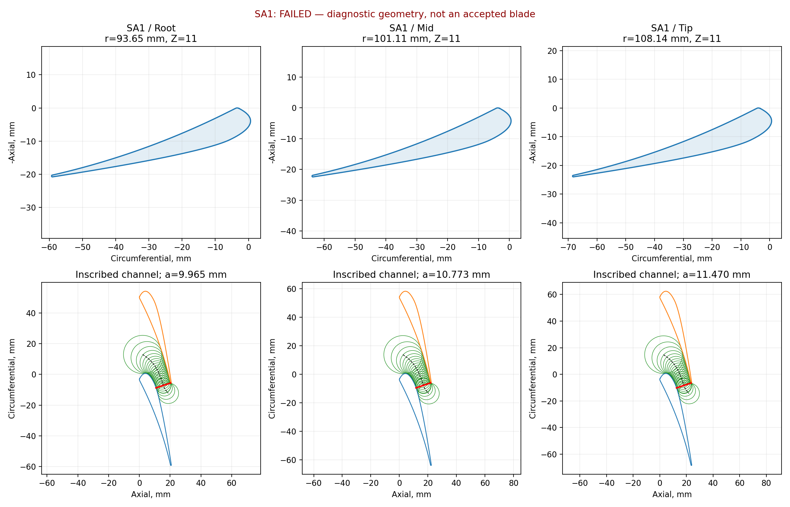
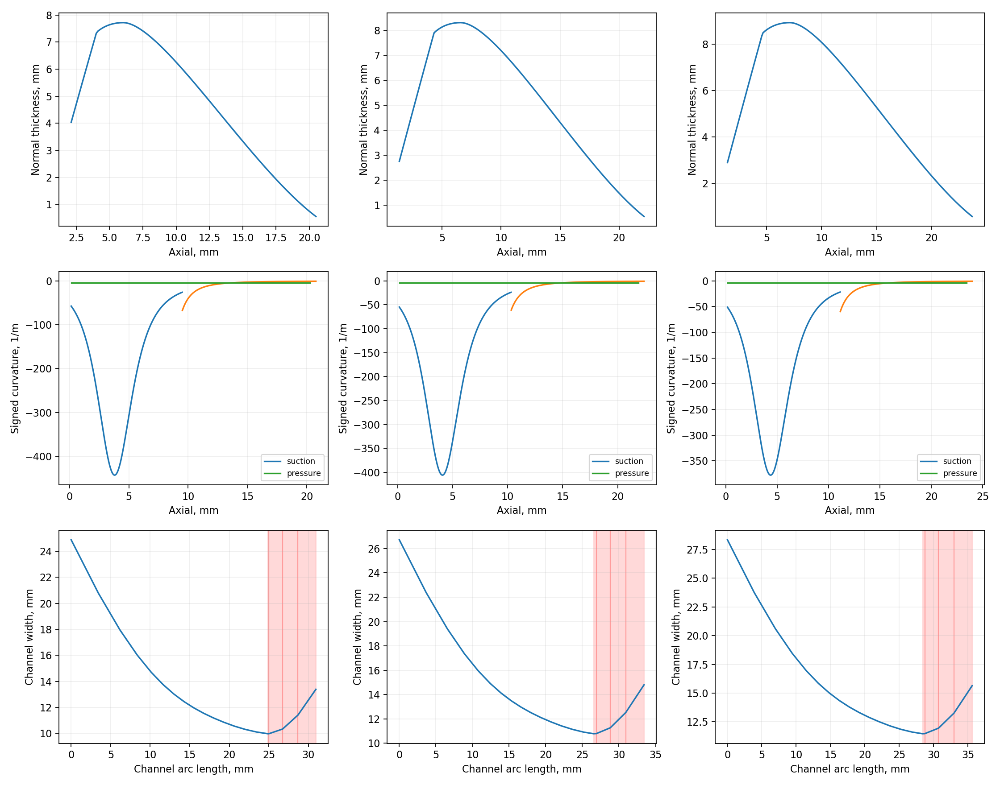
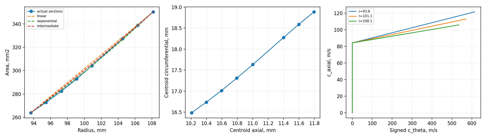
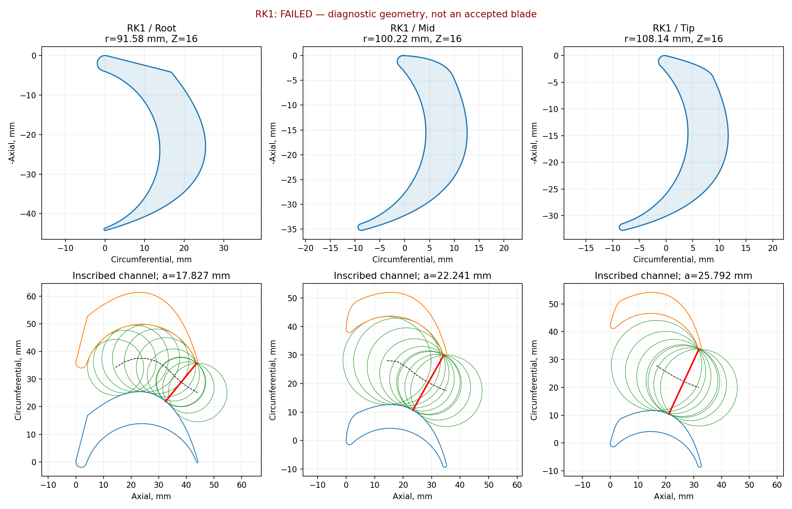
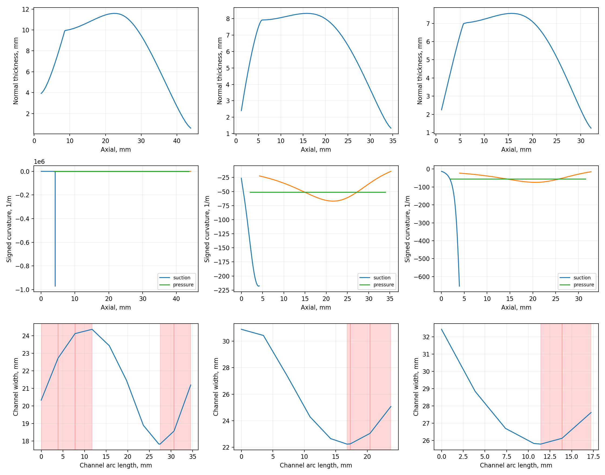
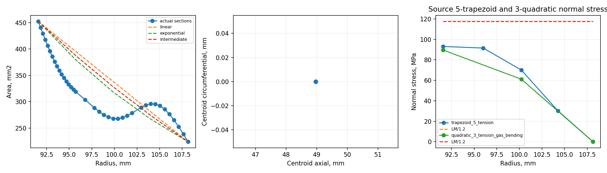
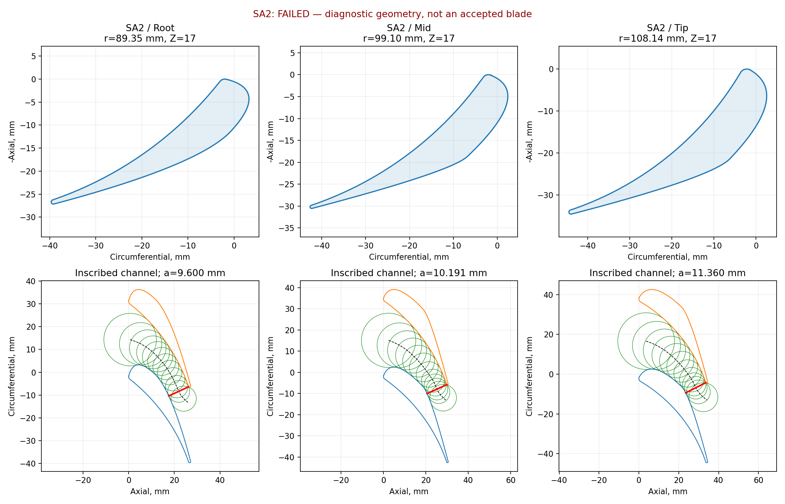
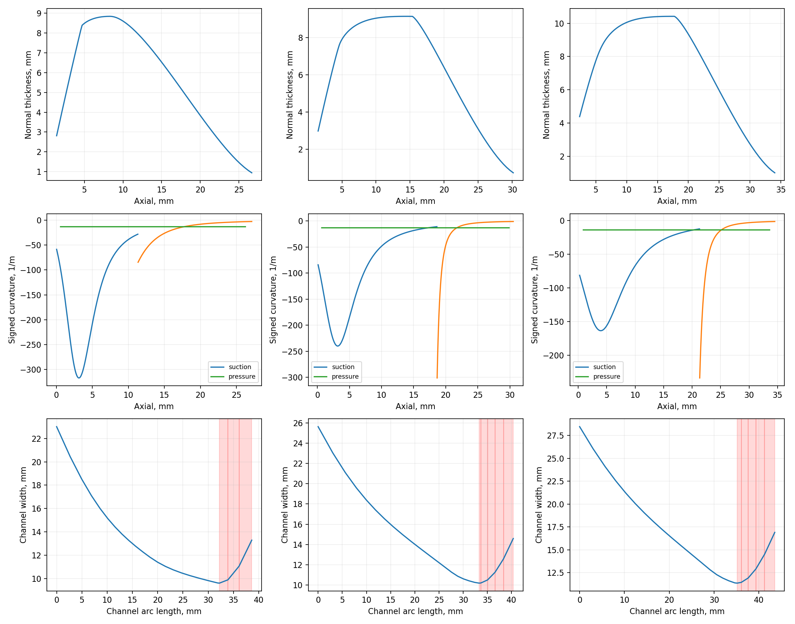
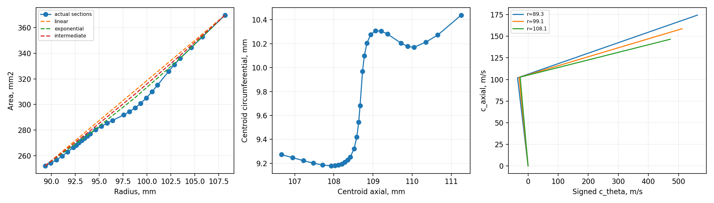
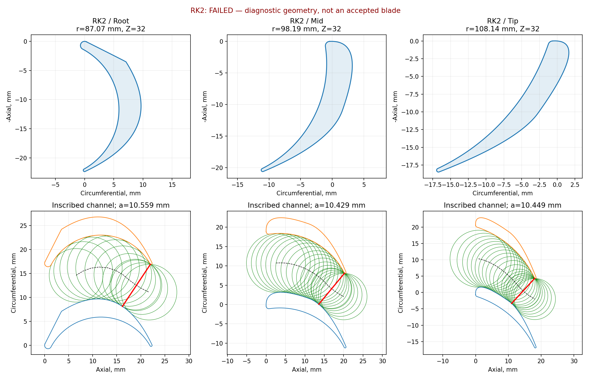
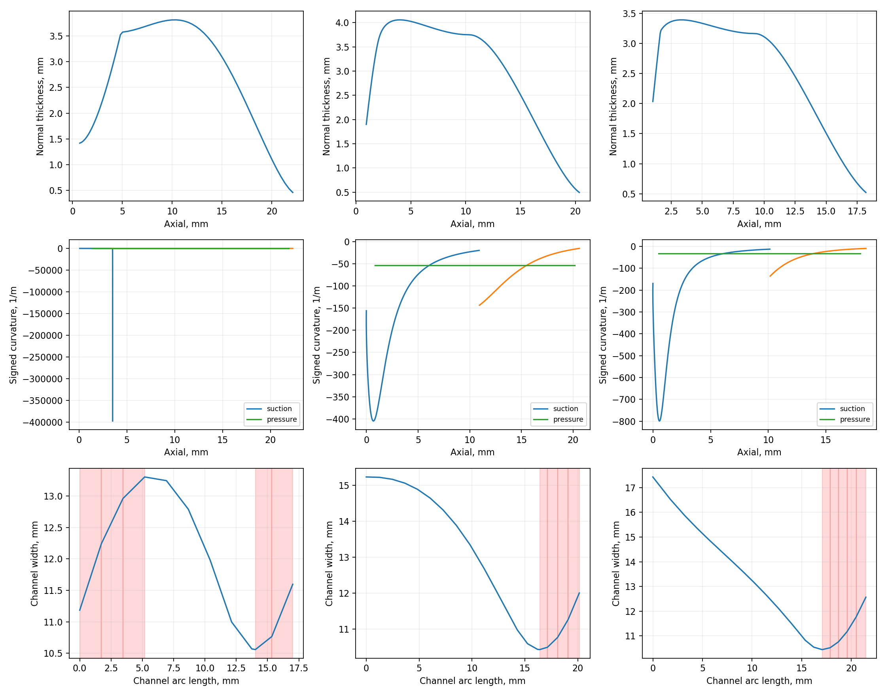
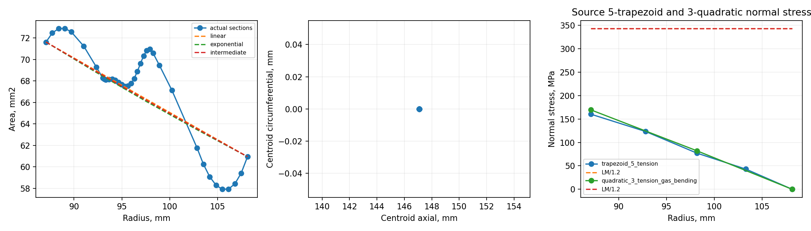
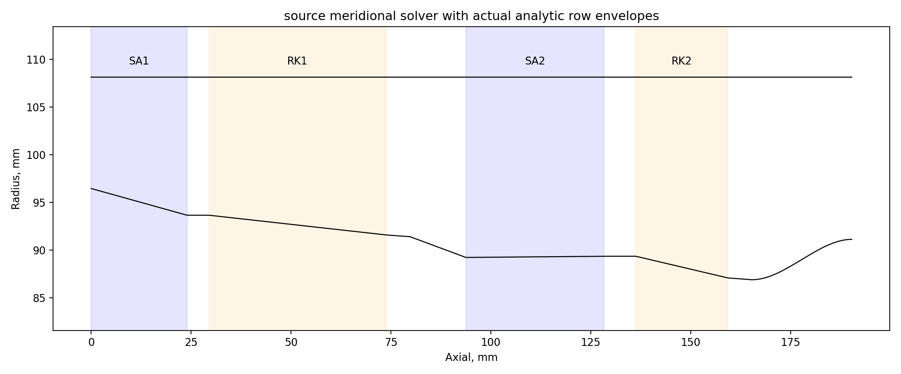

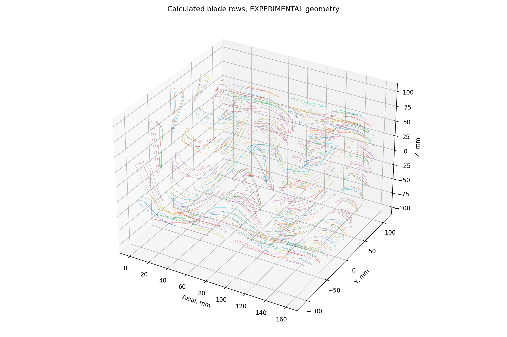

## Scope and missing physical evidence

- Geometry is not CFD/experimental proof of no separation or efficiency.
- Reynolds uses a documented air-viscosity proxy, not measured mixture transport.
- Source variable-cp thermodynamics and independent pressure-equilibrium audits are retained.
- IN738C/LM data are preliminary, not certified supply allowables.
- HCF NOT_CHECKED: grade-specific fatigue curve, forcing and damping are unavailable.
