# Vinogradov — actual TWO-stage course resource calculation

Source: **TVD_1CBK_2st_10000h.ipynb**; resource: **10000 h**; stages: **2**.
Fixed source RPM: **30700**.
Engineering admissible: **False**.
Constructed rows: 4/4.

A failed finite search is not a proof of global infeasibility. No design limit was relaxed.

## Quantified violations

### SA1
- No recorded row violation; global checks still required.
### RK1
- {'section': 0, 'name': 'prior profile guide: вписанные круги', 'measurements': {'geometry_valid': False, 'intersections': False, 'self_intersection': False, 'area_equivalent_angle_deg': 29.156258299587595, 'area_ratio': 0.48719309628890695, 'angle_comparison': 'uniform-flux geometric comparison, not actual gas exit angle', 'angle_error_deg': 10.340846264985611, 'te_over_throat': 0.033360722772167284, 'book_te_over_throat': 0.07, 'max_reduced_expansion': 1.2385663844358927}, 'relative_thickness': 0.27593208123599167, 'actual_relative_pitch': 0.8566078977377849}
- {'section': 1, 'name': 'prior profile guide: вписанные круги', 'measurements': {'geometry_valid': False, 'intersections': False, 'self_intersection': False, 'area_equivalent_angle_deg': 31.35076385095997, 'area_ratio': 0.5202759552683354, 'angle_comparison': 'uniform-flux geometric comparison, not actual gas exit angle', 'angle_error_deg': 13.082073214314395, 'te_over_throat': 0.07259267357135975, 'book_te_over_throat': 0.07, 'max_reduced_expansion': 1.1009556085051013}, 'relative_thickness': 0.24775332464965016, 'actual_relative_pitch': 1.0228090727731665}
- {'section': 2, 'name': 'prior profile guide: вписанные круги', 'measurements': {'geometry_valid': False, 'intersections': False, 'self_intersection': False, 'area_equivalent_angle_deg': 33.52415970240611, 'area_ratio': 0.5522885578273976, 'angle_comparison': 'uniform-flux geometric comparison, not actual gas exit angle', 'angle_error_deg': 15.763016676595917, 'te_over_throat': 0.05950256894582266, 'book_te_over_throat': 0.07, 'max_reduced_expansion': 1.15336357642022}, 'relative_thickness': 0.24113249307663234, 'actual_relative_pitch': 1.1416417700996293}
- {'section': 3, 'name': 'prior profile guide: вписанные круги', 'measurements': {'geometry_valid': False, 'intersections': False, 'self_intersection': False, 'area_equivalent_angle_deg': 33.07630143492355, 'area_ratio': 0.545755418780225, 'angle_comparison': 'uniform-flux geometric comparison, not actual gas exit angle', 'angle_error_deg': 15.7867249232314, 'te_over_throat': 0.06217307045980103, 'book_te_over_throat': 0.07, 'max_reduced_expansion': 1.1522122827314956}, 'relative_thickness': 0.24482918195979378, 'actual_relative_pitch': 1.1374970446730592}
- {'section': 4, 'name': 'prior profile guide: вписанные круги', 'measurements': {'geometry_valid': False, 'intersections': False, 'self_intersection': False, 'area_equivalent_angle_deg': 36.356455473206694, 'area_ratio': 0.5928069997309986, 'angle_comparison': 'uniform-flux geometric comparison, not actual gas exit angle', 'angle_error_deg': 19.50579835553874, 'te_over_throat': 0.04785309984276604, 'book_te_over_throat': 0.07, 'max_reduced_expansion': 1.095013534153911}, 'relative_thickness': 0.23584687092933748, 'actual_relative_pitch': 1.3268031746538118}
- {'name': 'vibration strength', 'status': 'NOT_CHECKED', 'reason': 'NOT_CHECKED: no grade-specific fatigue curve, damping or actual harmonic forcing; beam modes are screening only'}
### SA2
- {'section': 1, 'name': 'local streamtube choke conflict', 'possible': False, 'required_flux_kg_m2_s': 246.84044170675853, 'critical_flux_kg_m2_s': 245.01920054288667, 'required_mach': None, 'stagnation_temperature_K': 1099.3007737442865, 'stagnation_pressure_Pa': 205284.8482237486, 'critical_temperature_K': 947.3365961042688, 'source': 'original variable-cp h, pressure_isentropic, sound'}
- {'section': 2, 'name': 'prior profile guide: вписанные круги', 'measurements': {'geometry_valid': False, 'intersections': False, 'self_intersection': False, 'area_equivalent_angle_deg': 17.331908894775403, 'area_ratio': 0.2979065488069451, 'angle_comparison': 'uniform-flux geometric comparison, not actual gas exit angle', 'angle_error_deg': 0.1005227845671719, 'te_over_throat': 0.05480717660963745, 'book_te_over_throat': 0.055, 'max_reduced_expansion': 1.4015611660894292}, 'relative_thickness': 0.15919540648997424, 'actual_relative_pitch': 0.7179165284784272}
- {'section': 4, 'name': 'local streamtube choke conflict', 'possible': False, 'required_flux_kg_m2_s': 245.13059750162898, 'critical_flux_kg_m2_s': 245.01918973162918, 'required_mach': None, 'stagnation_temperature_K': 1099.3008865253757, 'stagnation_pressure_Pa': 205284.85012701948, 'critical_temperature_K': 947.3366965458624, 'source': 'original variable-cp h, pressure_isentropic, sound'}
### RK2
- {'section': 0, 'name': 'prior profile guide: вписанные круги', 'measurements': {'geometry_valid': False, 'intersections': False, 'self_intersection': False, 'area_equivalent_angle_deg': 37.433923866410126, 'area_ratio': 0.6078460927561659, 'angle_comparison': 'uniform-flux geometric comparison, not actual gas exit angle', 'angle_error_deg': 9.173167016602644, 'te_over_throat': 0.042825136975368036, 'book_te_over_throat': 0.07, 'max_reduced_expansion': 1.22468176439985}, 'relative_thickness': 0.1780394500897976, 'actual_relative_pitch': 0.7977918440950807}
- {'section': 1, 'name': 'prior profile guide: вписанные круги', 'measurements': {'geometry_valid': False, 'intersections': False, 'self_intersection': False, 'area_equivalent_angle_deg': 38.01566101285774, 'area_ratio': 0.6158768442194504, 'angle_comparison': 'uniform-flux geometric comparison, not actual gas exit angle', 'angle_error_deg': 10.77773506780062, 'te_over_throat': 0.04113717061644936, 'book_te_over_throat': 0.07, 'max_reduced_expansion': 1.2450441497770073}, 'relative_thickness': 0.16850670501405943, 'actual_relative_pitch': 0.8259253755876319}
- {'section': 2, 'name': 'prior profile guide: вписанные круги', 'measurements': {'geometry_valid': False, 'intersections': False, 'self_intersection': False, 'area_equivalent_angle_deg': 32.03258786911307, 'area_ratio': 0.5304015190888777, 'angle_comparison': 'uniform-flux geometric comparison, not actual gas exit angle', 'angle_error_deg': 5.738121505167452, 'te_over_throat': 0.04710483920379855, 'book_te_over_throat': 0.07, 'max_reduced_expansion': 1.170652476511816}, 'relative_thickness': 0.17793524714911724, 'actual_relative_pitch': 0.8626001968840724}
- {'section': 3, 'name': 'prior profile guide: вписанные круги', 'measurements': {'geometry_valid': False, 'intersections': False, 'self_intersection': False, 'area_equivalent_angle_deg': 33.76945996035543, 'area_ratio': 0.5558526016256125, 'angle_comparison': 'uniform-flux geometric comparison, not actual gas exit angle', 'angle_error_deg': 8.343019486939301, 'te_over_throat': 0.04163248578608236, 'book_te_over_throat': 0.07, 'max_reduced_expansion': 1.1400080054733224}, 'relative_thickness': 0.1651608555539164, 'actual_relative_pitch': 0.9395706095503212}
- {'section': 4, 'name': 'prior profile guide: вписанные круги', 'measurements': {'geometry_valid': False, 'intersections': False, 'self_intersection': False, 'area_equivalent_angle_deg': 36.72870154604717, 'area_ratio': 0.5980267106436118, 'angle_comparison': 'uniform-flux geometric comparison, not actual gas exit angle', 'angle_error_deg': 12.1012282859032, 'te_over_throat': 0.03348301401025636, 'book_te_over_throat': 0.07, 'max_reduced_expansion': 1.1237186703538364}, 'relative_thickness': 0.14032624658933823, 'actual_relative_pitch': 1.0555010115729706}
- {'name': 'vibration strength', 'status': 'NOT_CHECKED', 'reason': 'NOT_CHECKED: no grade-specific fatigue curve, damping or actual harmonic forcing; beam modes are screening only'}

## Global/source violations

- {'row': 'RK1', 'section': 0, 'name': 'prior profile guide: вписанные круги', 'measurements': {'geometry_valid': False, 'intersections': False, 'self_intersection': False, 'area_equivalent_angle_deg': 29.156258299587595, 'area_ratio': 0.48719309628890695, 'angle_comparison': 'uniform-flux geometric comparison, not actual gas exit angle', 'angle_error_deg': 10.340846264985611, 'te_over_throat': 0.033360722772167284, 'book_te_over_throat': 0.07, 'max_reduced_expansion': 1.2385663844358927}, 'relative_thickness': 0.27593208123599167, 'actual_relative_pitch': 0.8566078977377849}
- {'row': 'RK1', 'section': 1, 'name': 'prior profile guide: вписанные круги', 'measurements': {'geometry_valid': False, 'intersections': False, 'self_intersection': False, 'area_equivalent_angle_deg': 31.35076385095997, 'area_ratio': 0.5202759552683354, 'angle_comparison': 'uniform-flux geometric comparison, not actual gas exit angle', 'angle_error_deg': 13.082073214314395, 'te_over_throat': 0.07259267357135975, 'book_te_over_throat': 0.07, 'max_reduced_expansion': 1.1009556085051013}, 'relative_thickness': 0.24775332464965016, 'actual_relative_pitch': 1.0228090727731665}
- {'row': 'RK1', 'section': 2, 'name': 'prior profile guide: вписанные круги', 'measurements': {'geometry_valid': False, 'intersections': False, 'self_intersection': False, 'area_equivalent_angle_deg': 33.52415970240611, 'area_ratio': 0.5522885578273976, 'angle_comparison': 'uniform-flux geometric comparison, not actual gas exit angle', 'angle_error_deg': 15.763016676595917, 'te_over_throat': 0.05950256894582266, 'book_te_over_throat': 0.07, 'max_reduced_expansion': 1.15336357642022}, 'relative_thickness': 0.24113249307663234, 'actual_relative_pitch': 1.1416417700996293}
- {'row': 'RK1', 'section': 3, 'name': 'prior profile guide: вписанные круги', 'measurements': {'geometry_valid': False, 'intersections': False, 'self_intersection': False, 'area_equivalent_angle_deg': 33.07630143492355, 'area_ratio': 0.545755418780225, 'angle_comparison': 'uniform-flux geometric comparison, not actual gas exit angle', 'angle_error_deg': 15.7867249232314, 'te_over_throat': 0.06217307045980103, 'book_te_over_throat': 0.07, 'max_reduced_expansion': 1.1522122827314956}, 'relative_thickness': 0.24482918195979378, 'actual_relative_pitch': 1.1374970446730592}
- {'row': 'RK1', 'section': 4, 'name': 'prior profile guide: вписанные круги', 'measurements': {'geometry_valid': False, 'intersections': False, 'self_intersection': False, 'area_equivalent_angle_deg': 36.356455473206694, 'area_ratio': 0.5928069997309986, 'angle_comparison': 'uniform-flux geometric comparison, not actual gas exit angle', 'angle_error_deg': 19.50579835553874, 'te_over_throat': 0.04785309984276604, 'book_te_over_throat': 0.07, 'max_reduced_expansion': 1.095013534153911}, 'relative_thickness': 0.23584687092933748, 'actual_relative_pitch': 1.3268031746538118}
- {'row': 'RK1', 'name': 'vibration strength', 'status': 'NOT_CHECKED', 'reason': 'NOT_CHECKED: no grade-specific fatigue curve, damping or actual harmonic forcing; beam modes are screening only'}
- {'row': 'SA2', 'section': 1, 'name': 'local streamtube choke conflict', 'possible': False, 'required_flux_kg_m2_s': 246.84044170675853, 'critical_flux_kg_m2_s': 245.01920054288667, 'required_mach': None, 'stagnation_temperature_K': 1099.3007737442865, 'stagnation_pressure_Pa': 205284.8482237486, 'critical_temperature_K': 947.3365961042688, 'source': 'original variable-cp h, pressure_isentropic, sound'}
- {'row': 'SA2', 'section': 2, 'name': 'prior profile guide: вписанные круги', 'measurements': {'geometry_valid': False, 'intersections': False, 'self_intersection': False, 'area_equivalent_angle_deg': 17.331908894775403, 'area_ratio': 0.2979065488069451, 'angle_comparison': 'uniform-flux geometric comparison, not actual gas exit angle', 'angle_error_deg': 0.1005227845671719, 'te_over_throat': 0.05480717660963745, 'book_te_over_throat': 0.055, 'max_reduced_expansion': 1.4015611660894292}, 'relative_thickness': 0.15919540648997424, 'actual_relative_pitch': 0.7179165284784272}
- {'row': 'SA2', 'section': 4, 'name': 'local streamtube choke conflict', 'possible': False, 'required_flux_kg_m2_s': 245.13059750162898, 'critical_flux_kg_m2_s': 245.01918973162918, 'required_mach': None, 'stagnation_temperature_K': 1099.3008865253757, 'stagnation_pressure_Pa': 205284.85012701948, 'critical_temperature_K': 947.3366965458624, 'source': 'original variable-cp h, pressure_isentropic, sound'}
- {'row': 'RK2', 'section': 0, 'name': 'prior profile guide: вписанные круги', 'measurements': {'geometry_valid': False, 'intersections': False, 'self_intersection': False, 'area_equivalent_angle_deg': 37.433923866410126, 'area_ratio': 0.6078460927561659, 'angle_comparison': 'uniform-flux geometric comparison, not actual gas exit angle', 'angle_error_deg': 9.173167016602644, 'te_over_throat': 0.042825136975368036, 'book_te_over_throat': 0.07, 'max_reduced_expansion': 1.22468176439985}, 'relative_thickness': 0.1780394500897976, 'actual_relative_pitch': 0.7977918440950807}
- {'row': 'RK2', 'section': 1, 'name': 'prior profile guide: вписанные круги', 'measurements': {'geometry_valid': False, 'intersections': False, 'self_intersection': False, 'area_equivalent_angle_deg': 38.01566101285774, 'area_ratio': 0.6158768442194504, 'angle_comparison': 'uniform-flux geometric comparison, not actual gas exit angle', 'angle_error_deg': 10.77773506780062, 'te_over_throat': 0.04113717061644936, 'book_te_over_throat': 0.07, 'max_reduced_expansion': 1.2450441497770073}, 'relative_thickness': 0.16850670501405943, 'actual_relative_pitch': 0.8259253755876319}
- {'row': 'RK2', 'section': 2, 'name': 'prior profile guide: вписанные круги', 'measurements': {'geometry_valid': False, 'intersections': False, 'self_intersection': False, 'area_equivalent_angle_deg': 32.03258786911307, 'area_ratio': 0.5304015190888777, 'angle_comparison': 'uniform-flux geometric comparison, not actual gas exit angle', 'angle_error_deg': 5.738121505167452, 'te_over_throat': 0.04710483920379855, 'book_te_over_throat': 0.07, 'max_reduced_expansion': 1.170652476511816}, 'relative_thickness': 0.17793524714911724, 'actual_relative_pitch': 0.8626001968840724}
- {'row': 'RK2', 'section': 3, 'name': 'prior profile guide: вписанные круги', 'measurements': {'geometry_valid': False, 'intersections': False, 'self_intersection': False, 'area_equivalent_angle_deg': 33.76945996035543, 'area_ratio': 0.5558526016256125, 'angle_comparison': 'uniform-flux geometric comparison, not actual gas exit angle', 'angle_error_deg': 8.343019486939301, 'te_over_throat': 0.04163248578608236, 'book_te_over_throat': 0.07, 'max_reduced_expansion': 1.1400080054733224}, 'relative_thickness': 0.1651608555539164, 'actual_relative_pitch': 0.9395706095503212}
- {'row': 'RK2', 'section': 4, 'name': 'prior profile guide: вписанные круги', 'measurements': {'geometry_valid': False, 'intersections': False, 'self_intersection': False, 'area_equivalent_angle_deg': 36.72870154604717, 'area_ratio': 0.5980267106436118, 'angle_comparison': 'uniform-flux geometric comparison, not actual gas exit angle', 'angle_error_deg': 12.1012282859032, 'te_over_throat': 0.03348301401025636, 'book_te_over_throat': 0.07, 'max_reduced_expansion': 1.1237186703538364}, 'relative_thickness': 0.14032624658933823, 'actual_relative_pitch': 1.0555010115729706}
- {'row': 'RK2', 'name': 'vibration strength', 'status': 'NOT_CHECKED', 'reason': 'NOT_CHECKED: no grade-specific fatigue curve, damping or actual harmonic forcing; beam modes are screening only'}
- {'row': 'SA1', 'section': 0, 'name': 'source finite trailing edge', 'value': 0.00047672896165540504, 'limit': 0.0005}
- {'row': 'RK1', 'name': 'source rotor taper mismatch', 'value': 2.0188749611659857, 'limit': 1.6}
- {'row': 'RK1', 'name': 'source rotor areas must decrease', 'value': [0.0004523496414739956, 0.00031218670498425933, 0.0002675336613724124, 0.00029618661209755996, 0.00022406025641763598], 'limit': 'strict decrease root to tip'}
- {'row': 'RK2', 'name': 'source rotor taper mismatch', 'value': 1.5777283854554993, 'limit': 1.6}
- {'row': 'RK2', 'name': 'source rotor areas must decrease', 'value': [7.161096800544644e-05, 6.852997072335815e-05, 6.966938697270984e-05, 6.0791382027167206e-05, 4.538865413438825e-05], 'limit': 'strict decrease root to tip'}
- {'row': 'RK2', 'section': 0, 'name': 'source finite trailing edge', 'value': 0.0004521694414040165, 'limit': 0.0005}
- {'row': 'RK2', 'section': 1, 'name': 'source finite trailing edge', 'value': 0.0004690874215268878, 'limit': 0.0005}
- {'row': 'RK2', 'section': 2, 'name': 'source finite trailing edge', 'value': 0.0004912636372922306, 'limit': 0.0005}
- {'row': 'RK2', 'section': 3, 'name': 'source finite trailing edge', 'value': 0.0004790853476630414, 'limit': 0.0005}
- {'row': 'RK2', 'section': 4, 'name': 'source finite trailing edge', 'value': 0.0004345711985441397, 'limit': 0.0005}

## Empirical guidance — not added hard limits

- {'row': 'SA1', 'section': 0, 'name': 'relative thickness starting guidance', 'value': 0.12087191323459506, 'range': [0.1, 0.1], 'classification': 'empirical, p13'}
- {'row': 'SA1', 'section': 0, 'name': 'prior profile guide: местная диффузорность', 'measurements': {'geometry_valid': True, 'intersections': False, 'self_intersection': False, 'area_equivalent_angle_deg': 10.915758510577088, 'area_ratio': 0.18936551169144564, 'angle_comparison': 'uniform-flux geometric comparison, not actual gas exit angle', 'angle_error_deg': -0.28424148942291083, 'te_over_throat': 0.044588822446769386, 'book_te_over_throat': 0.055, 'max_reduced_expansion': 1.45742409472295}, 'relative_thickness': 0.12087191323459506, 'actual_relative_pitch': 0.9447122932975485, 'classification': 'historical empirical profile guide; Vinogradov uses its own recommendations'}
- {'row': 'SA1', 'section': 0, 'name': 'prior profile guide: относительный шаг', 'measurements': {'geometry_valid': True, 'intersections': False, 'self_intersection': False, 'area_equivalent_angle_deg': 10.915758510577088, 'area_ratio': 0.18936551169144564, 'angle_comparison': 'uniform-flux geometric comparison, not actual gas exit angle', 'angle_error_deg': -0.28424148942291083, 'te_over_throat': 0.044588822446769386, 'book_te_over_throat': 0.055, 'max_reduced_expansion': 1.45742409472295}, 'relative_thickness': 0.12087191323459506, 'actual_relative_pitch': 0.9447122932975485, 'classification': 'historical empirical profile guide; Vinogradov uses its own recommendations'}
- {'row': 'SA1', 'section': 1, 'name': 'relative thickness starting guidance', 'value': 0.12151780306260287, 'range': [0.1, 0.1], 'classification': 'empirical, p13'}
- {'row': 'SA1', 'section': 1, 'name': 'prior profile guide: местная диффузорность', 'measurements': {'geometry_valid': True, 'intersections': False, 'self_intersection': False, 'area_equivalent_angle_deg': 10.786217177244506, 'area_ratio': 0.1871450144307921, 'angle_comparison': 'uniform-flux geometric comparison, not actual gas exit angle', 'angle_error_deg': -0.4137828227554916, 'te_over_throat': 0.05415430800169273, 'book_te_over_throat': 0.055, 'max_reduced_expansion': 1.4847314984858528}, 'relative_thickness': 0.12151780306260287, 'actual_relative_pitch': 0.9421274445087873, 'classification': 'historical empirical profile guide; Vinogradov uses its own recommendations'}
- {'row': 'SA1', 'section': 1, 'name': 'prior profile guide: относительный шаг', 'measurements': {'geometry_valid': True, 'intersections': False, 'self_intersection': False, 'area_equivalent_angle_deg': 10.786217177244506, 'area_ratio': 0.1871450144307921, 'angle_comparison': 'uniform-flux geometric comparison, not actual gas exit angle', 'angle_error_deg': -0.4137828227554916, 'te_over_throat': 0.05415430800169273, 'book_te_over_throat': 0.055, 'max_reduced_expansion': 1.4847314984858528}, 'relative_thickness': 0.12151780306260287, 'actual_relative_pitch': 0.9421274445087873, 'classification': 'historical empirical profile guide; Vinogradov uses its own recommendations'}
- {'row': 'SA1', 'section': 2, 'name': 'relative thickness starting guidance', 'value': 0.12174207651132664, 'range': [0.1, 0.1], 'classification': 'empirical, p13'}
- {'row': 'SA1', 'section': 2, 'name': 'prior profile guide: местная диффузорность', 'measurements': {'geometry_valid': True, 'intersections': False, 'self_intersection': False, 'area_equivalent_angle_deg': 10.696935570406838, 'area_ratio': 0.18561406067785172, 'angle_comparison': 'uniform-flux geometric comparison, not actual gas exit angle', 'angle_error_deg': -0.5030644295931612, 'te_over_throat': 0.056139981286149936, 'book_te_over_throat': 0.055, 'max_reduced_expansion': 1.4453853532620484}, 'relative_thickness': 0.12174207651132664, 'actual_relative_pitch': 0.9348886444037514, 'classification': 'historical empirical profile guide; Vinogradov uses its own recommendations'}
- {'row': 'SA1', 'section': 2, 'name': 'prior profile guide: относительный шаг', 'measurements': {'geometry_valid': True, 'intersections': False, 'self_intersection': False, 'area_equivalent_angle_deg': 10.696935570406838, 'area_ratio': 0.18561406067785172, 'angle_comparison': 'uniform-flux geometric comparison, not actual gas exit angle', 'angle_error_deg': -0.5030644295931612, 'te_over_throat': 0.056139981286149936, 'book_te_over_throat': 0.055, 'max_reduced_expansion': 1.4453853532620484}, 'relative_thickness': 0.12174207651132664, 'actual_relative_pitch': 0.9348886444037514, 'classification': 'historical empirical profile guide; Vinogradov uses its own recommendations'}
- {'row': 'SA1', 'section': 3, 'name': 'relative thickness starting guidance', 'value': 0.13150327696170458, 'range': [0.1, 0.1], 'classification': 'empirical, p13'}
- {'row': 'SA1', 'section': 3, 'name': 'prior profile guide: местная диффузорность', 'measurements': {'geometry_valid': True, 'intersections': False, 'self_intersection': False, 'area_equivalent_angle_deg': 10.782651267955673, 'area_ratio': 0.18708387679273072, 'angle_comparison': 'uniform-flux geometric comparison, not actual gas exit angle', 'angle_error_deg': -0.4173487320443261, 'te_over_throat': 0.043376605487064145, 'book_te_over_throat': 0.055, 'max_reduced_expansion': 1.4216894670543603}, 'relative_thickness': 0.13150327696170458, 'actual_relative_pitch': 0.9687058782961688, 'classification': 'historical empirical profile guide; Vinogradov uses its own recommendations'}
- {'row': 'SA1', 'section': 3, 'name': 'prior profile guide: относительный шаг', 'measurements': {'geometry_valid': True, 'intersections': False, 'self_intersection': False, 'area_equivalent_angle_deg': 10.782651267955673, 'area_ratio': 0.18708387679273072, 'angle_comparison': 'uniform-flux geometric comparison, not actual gas exit angle', 'angle_error_deg': -0.4173487320443261, 'te_over_throat': 0.043376605487064145, 'book_te_over_throat': 0.055, 'max_reduced_expansion': 1.4216894670543603}, 'relative_thickness': 0.13150327696170458, 'actual_relative_pitch': 0.9687058782961688, 'classification': 'historical empirical profile guide; Vinogradov uses its own recommendations'}
- {'row': 'SA1', 'section': 4, 'name': 'relative thickness starting guidance', 'value': 0.13167416044115474, 'range': [0.1, 0.1], 'classification': 'empirical, p13'}
- {'row': 'SA1', 'section': 4, 'name': 'prior profile guide: местная диффузорность', 'measurements': {'geometry_valid': True, 'intersections': False, 'self_intersection': False, 'area_equivalent_angle_deg': 10.460017047804271, 'area_ratio': 0.18154933231303175, 'angle_comparison': 'uniform-flux geometric comparison, not actual gas exit angle', 'angle_error_deg': -0.7399829521957297, 'te_over_throat': 0.04506057231112981, 'book_te_over_throat': 0.055, 'max_reduced_expansion': 1.5498653554302855}, 'relative_thickness': 0.13167416044115474, 'actual_relative_pitch': 0.9358000511213331, 'classification': 'historical empirical profile guide; Vinogradov uses its own recommendations'}
- {'row': 'SA1', 'section': 4, 'name': 'prior profile guide: относительный шаг', 'measurements': {'geometry_valid': True, 'intersections': False, 'self_intersection': False, 'area_equivalent_angle_deg': 10.460017047804271, 'area_ratio': 0.18154933231303175, 'angle_comparison': 'uniform-flux geometric comparison, not actual gas exit angle', 'angle_error_deg': -0.7399829521957297, 'te_over_throat': 0.04506057231112981, 'book_te_over_throat': 0.055, 'max_reduced_expansion': 1.5498653554302855}, 'relative_thickness': 0.13167416044115474, 'actual_relative_pitch': 0.9358000511213331, 'classification': 'historical empirical profile guide; Vinogradov uses its own recommendations'}
- {'row': 'RK1', 'section': 0, 'name': 'subsonic entrance expansion guidance', 'value': 1.197939815120911, 'limit': 1.1, 'classification': 'empirical recommendation; CFD required'}
- {'row': 'RK1', 'section': 0, 'name': 'prior profile guide: угол горла', 'measurements': {'geometry_valid': False, 'intersections': False, 'self_intersection': False, 'area_equivalent_angle_deg': 29.156258299587595, 'area_ratio': 0.48719309628890695, 'angle_comparison': 'uniform-flux geometric comparison, not actual gas exit angle', 'angle_error_deg': 10.340846264985611, 'te_over_throat': 0.033360722772167284, 'book_te_over_throat': 0.07, 'max_reduced_expansion': 1.2385663844358927}, 'relative_thickness': 0.27593208123599167, 'actual_relative_pitch': 0.8566078977377849, 'classification': 'historical empirical profile guide; Vinogradov uses its own recommendations'}
- {'row': 'RK1', 'section': 0, 'name': 'prior profile guide: местная диффузорность', 'measurements': {'geometry_valid': False, 'intersections': False, 'self_intersection': False, 'area_equivalent_angle_deg': 29.156258299587595, 'area_ratio': 0.48719309628890695, 'angle_comparison': 'uniform-flux geometric comparison, not actual gas exit angle', 'angle_error_deg': 10.340846264985611, 'te_over_throat': 0.033360722772167284, 'book_te_over_throat': 0.07, 'max_reduced_expansion': 1.2385663844358927}, 'relative_thickness': 0.27593208123599167, 'actual_relative_pitch': 0.8566078977377849, 'classification': 'historical empirical profile guide; Vinogradov uses its own recommendations'}
- {'row': 'RK1', 'section': 0, 'name': 'prior profile guide: максимальная толщина', 'measurements': {'geometry_valid': False, 'intersections': False, 'self_intersection': False, 'area_equivalent_angle_deg': 29.156258299587595, 'area_ratio': 0.48719309628890695, 'angle_comparison': 'uniform-flux geometric comparison, not actual gas exit angle', 'angle_error_deg': 10.340846264985611, 'te_over_throat': 0.033360722772167284, 'book_te_over_throat': 0.07, 'max_reduced_expansion': 1.2385663844358927}, 'relative_thickness': 0.27593208123599167, 'actual_relative_pitch': 0.8566078977377849, 'classification': 'historical empirical profile guide; Vinogradov uses its own recommendations'}
- {'row': 'RK1', 'section': 0, 'name': 'prior profile guide: относительный шаг', 'measurements': {'geometry_valid': False, 'intersections': False, 'self_intersection': False, 'area_equivalent_angle_deg': 29.156258299587595, 'area_ratio': 0.48719309628890695, 'angle_comparison': 'uniform-flux geometric comparison, not actual gas exit angle', 'angle_error_deg': 10.340846264985611, 'te_over_throat': 0.033360722772167284, 'book_te_over_throat': 0.07, 'max_reduced_expansion': 1.2385663844358927}, 'relative_thickness': 0.27593208123599167, 'actual_relative_pitch': 0.8566078977377849, 'classification': 'historical empirical profile guide; Vinogradov uses its own recommendations'}
- {'row': 'RK1', 'section': 1, 'name': 'relative thickness starting guidance', 'value': 0.24775332464965016, 'range': [0.14658407163388162, 0.21987610745082242], 'classification': 'empirical, p13'}
- {'row': 'RK1', 'section': 1, 'name': 'prior profile guide: угол горла', 'measurements': {'geometry_valid': False, 'intersections': False, 'self_intersection': False, 'area_equivalent_angle_deg': 31.35076385095997, 'area_ratio': 0.5202759552683354, 'angle_comparison': 'uniform-flux geometric comparison, not actual gas exit angle', 'angle_error_deg': 13.082073214314395, 'te_over_throat': 0.07259267357135975, 'book_te_over_throat': 0.07, 'max_reduced_expansion': 1.1009556085051013}, 'relative_thickness': 0.24775332464965016, 'actual_relative_pitch': 1.0228090727731665, 'classification': 'historical empirical profile guide; Vinogradov uses its own recommendations'}
- {'row': 'RK1', 'section': 1, 'name': 'prior profile guide: местная диффузорность', 'measurements': {'geometry_valid': False, 'intersections': False, 'self_intersection': False, 'area_equivalent_angle_deg': 31.35076385095997, 'area_ratio': 0.5202759552683354, 'angle_comparison': 'uniform-flux geometric comparison, not actual gas exit angle', 'angle_error_deg': 13.082073214314395, 'te_over_throat': 0.07259267357135975, 'book_te_over_throat': 0.07, 'max_reduced_expansion': 1.1009556085051013}, 'relative_thickness': 0.24775332464965016, 'actual_relative_pitch': 1.0228090727731665, 'classification': 'historical empirical profile guide; Vinogradov uses its own recommendations'}
- {'row': 'RK1', 'section': 1, 'name': 'prior profile guide: максимальная толщина', 'measurements': {'geometry_valid': False, 'intersections': False, 'self_intersection': False, 'area_equivalent_angle_deg': 31.35076385095997, 'area_ratio': 0.5202759552683354, 'angle_comparison': 'uniform-flux geometric comparison, not actual gas exit angle', 'angle_error_deg': 13.082073214314395, 'te_over_throat': 0.07259267357135975, 'book_te_over_throat': 0.07, 'max_reduced_expansion': 1.1009556085051013}, 'relative_thickness': 0.24775332464965016, 'actual_relative_pitch': 1.0228090727731665, 'classification': 'historical empirical profile guide; Vinogradov uses its own recommendations'}
- {'row': 'RK1', 'section': 1, 'name': 'prior profile guide: относительный шаг', 'measurements': {'geometry_valid': False, 'intersections': False, 'self_intersection': False, 'area_equivalent_angle_deg': 31.35076385095997, 'area_ratio': 0.5202759552683354, 'angle_comparison': 'uniform-flux geometric comparison, not actual gas exit angle', 'angle_error_deg': 13.082073214314395, 'te_over_throat': 0.07259267357135975, 'book_te_over_throat': 0.07, 'max_reduced_expansion': 1.1009556085051013}, 'relative_thickness': 0.24775332464965016, 'actual_relative_pitch': 1.0228090727731665, 'classification': 'historical empirical profile guide; Vinogradov uses its own recommendations'}
- {'row': 'RK1', 'section': 2, 'name': 'relative thickness starting guidance', 'value': 0.24113249307663234, 'range': [0.09738937847815876, 0.1456489641302646], 'classification': 'empirical, p13'}
- {'row': 'RK1', 'section': 2, 'name': 'prior profile guide: угол горла', 'measurements': {'geometry_valid': False, 'intersections': False, 'self_intersection': False, 'area_equivalent_angle_deg': 33.52415970240611, 'area_ratio': 0.5522885578273976, 'angle_comparison': 'uniform-flux geometric comparison, not actual gas exit angle', 'angle_error_deg': 15.763016676595917, 'te_over_throat': 0.05950256894582266, 'book_te_over_throat': 0.07, 'max_reduced_expansion': 1.15336357642022}, 'relative_thickness': 0.24113249307663234, 'actual_relative_pitch': 1.1416417700996293, 'classification': 'historical empirical profile guide; Vinogradov uses its own recommendations'}
- {'row': 'RK1', 'section': 2, 'name': 'prior profile guide: местная диффузорность', 'measurements': {'geometry_valid': False, 'intersections': False, 'self_intersection': False, 'area_equivalent_angle_deg': 33.52415970240611, 'area_ratio': 0.5522885578273976, 'angle_comparison': 'uniform-flux geometric comparison, not actual gas exit angle', 'angle_error_deg': 15.763016676595917, 'te_over_throat': 0.05950256894582266, 'book_te_over_throat': 0.07, 'max_reduced_expansion': 1.15336357642022}, 'relative_thickness': 0.24113249307663234, 'actual_relative_pitch': 1.1416417700996293, 'classification': 'historical empirical profile guide; Vinogradov uses its own recommendations'}
- {'row': 'RK1', 'section': 2, 'name': 'prior profile guide: максимальная толщина', 'measurements': {'geometry_valid': False, 'intersections': False, 'self_intersection': False, 'area_equivalent_angle_deg': 33.52415970240611, 'area_ratio': 0.5522885578273976, 'angle_comparison': 'uniform-flux geometric comparison, not actual gas exit angle', 'angle_error_deg': 15.763016676595917, 'te_over_throat': 0.05950256894582266, 'book_te_over_throat': 0.07, 'max_reduced_expansion': 1.15336357642022}, 'relative_thickness': 0.24113249307663234, 'actual_relative_pitch': 1.1416417700996293, 'classification': 'historical empirical profile guide; Vinogradov uses its own recommendations'}
- {'row': 'RK1', 'section': 2, 'name': 'prior profile guide: относительный шаг', 'measurements': {'geometry_valid': False, 'intersections': False, 'self_intersection': False, 'area_equivalent_angle_deg': 33.52415970240611, 'area_ratio': 0.5522885578273976, 'angle_comparison': 'uniform-flux geometric comparison, not actual gas exit angle', 'angle_error_deg': 15.763016676595917, 'te_over_throat': 0.05950256894582266, 'book_te_over_throat': 0.07, 'max_reduced_expansion': 1.15336357642022}, 'relative_thickness': 0.24113249307663234, 'actual_relative_pitch': 1.1416417700996293, 'classification': 'historical empirical profile guide; Vinogradov uses its own recommendations'}
- {'row': 'RK1', 'section': 3, 'name': 'relative thickness starting guidance', 'value': 0.24482918195979378, 'range': [0.06812418197944138, 0.09687363663240228], 'classification': 'empirical, p13'}
- {'row': 'RK1', 'section': 3, 'name': 'prior profile guide: угол горла', 'measurements': {'geometry_valid': False, 'intersections': False, 'self_intersection': False, 'area_equivalent_angle_deg': 33.07630143492355, 'area_ratio': 0.545755418780225, 'angle_comparison': 'uniform-flux geometric comparison, not actual gas exit angle', 'angle_error_deg': 15.7867249232314, 'te_over_throat': 0.06217307045980103, 'book_te_over_throat': 0.07, 'max_reduced_expansion': 1.1522122827314956}, 'relative_thickness': 0.24482918195979378, 'actual_relative_pitch': 1.1374970446730592, 'classification': 'historical empirical profile guide; Vinogradov uses its own recommendations'}
- {'row': 'RK1', 'section': 3, 'name': 'prior profile guide: местная диффузорность', 'measurements': {'geometry_valid': False, 'intersections': False, 'self_intersection': False, 'area_equivalent_angle_deg': 33.07630143492355, 'area_ratio': 0.545755418780225, 'angle_comparison': 'uniform-flux geometric comparison, not actual gas exit angle', 'angle_error_deg': 15.7867249232314, 'te_over_throat': 0.06217307045980103, 'book_te_over_throat': 0.07, 'max_reduced_expansion': 1.1522122827314956}, 'relative_thickness': 0.24482918195979378, 'actual_relative_pitch': 1.1374970446730592, 'classification': 'historical empirical profile guide; Vinogradov uses its own recommendations'}
- {'row': 'RK1', 'section': 3, 'name': 'prior profile guide: максимальная толщина', 'measurements': {'geometry_valid': False, 'intersections': False, 'self_intersection': False, 'area_equivalent_angle_deg': 33.07630143492355, 'area_ratio': 0.545755418780225, 'angle_comparison': 'uniform-flux geometric comparison, not actual gas exit angle', 'angle_error_deg': 15.7867249232314, 'te_over_throat': 0.06217307045980103, 'book_te_over_throat': 0.07, 'max_reduced_expansion': 1.1522122827314956}, 'relative_thickness': 0.24482918195979378, 'actual_relative_pitch': 1.1374970446730592, 'classification': 'historical empirical profile guide; Vinogradov uses its own recommendations'}
- {'row': 'RK1', 'section': 3, 'name': 'prior profile guide: относительный шаг', 'measurements': {'geometry_valid': False, 'intersections': False, 'self_intersection': False, 'area_equivalent_angle_deg': 33.07630143492355, 'area_ratio': 0.545755418780225, 'angle_comparison': 'uniform-flux geometric comparison, not actual gas exit angle', 'angle_error_deg': 15.7867249232314, 'te_over_throat': 0.06217307045980103, 'book_te_over_throat': 0.07, 'max_reduced_expansion': 1.1522122827314956}, 'relative_thickness': 0.24482918195979378, 'actual_relative_pitch': 1.1374970446730592, 'classification': 'historical empirical profile guide; Vinogradov uses its own recommendations'}
- {'row': 'RK1', 'section': 4, 'name': 'relative thickness starting guidance', 'value': 0.23584687092933748, 'range': [0.04, 0.05], 'classification': 'empirical, p13'}
- {'row': 'RK1', 'section': 4, 'name': 'prior profile guide: угол горла', 'measurements': {'geometry_valid': False, 'intersections': False, 'self_intersection': False, 'area_equivalent_angle_deg': 36.356455473206694, 'area_ratio': 0.5928069997309986, 'angle_comparison': 'uniform-flux geometric comparison, not actual gas exit angle', 'angle_error_deg': 19.50579835553874, 'te_over_throat': 0.04785309984276604, 'book_te_over_throat': 0.07, 'max_reduced_expansion': 1.095013534153911}, 'relative_thickness': 0.23584687092933748, 'actual_relative_pitch': 1.3268031746538118, 'classification': 'historical empirical profile guide; Vinogradov uses its own recommendations'}
- {'row': 'RK1', 'section': 4, 'name': 'prior profile guide: местная диффузорность', 'measurements': {'geometry_valid': False, 'intersections': False, 'self_intersection': False, 'area_equivalent_angle_deg': 36.356455473206694, 'area_ratio': 0.5928069997309986, 'angle_comparison': 'uniform-flux geometric comparison, not actual gas exit angle', 'angle_error_deg': 19.50579835553874, 'te_over_throat': 0.04785309984276604, 'book_te_over_throat': 0.07, 'max_reduced_expansion': 1.095013534153911}, 'relative_thickness': 0.23584687092933748, 'actual_relative_pitch': 1.3268031746538118, 'classification': 'historical empirical profile guide; Vinogradov uses its own recommendations'}
- {'row': 'RK1', 'section': 4, 'name': 'prior profile guide: максимальная толщина', 'measurements': {'geometry_valid': False, 'intersections': False, 'self_intersection': False, 'area_equivalent_angle_deg': 36.356455473206694, 'area_ratio': 0.5928069997309986, 'angle_comparison': 'uniform-flux geometric comparison, not actual gas exit angle', 'angle_error_deg': 19.50579835553874, 'te_over_throat': 0.04785309984276604, 'book_te_over_throat': 0.07, 'max_reduced_expansion': 1.095013534153911}, 'relative_thickness': 0.23584687092933748, 'actual_relative_pitch': 1.3268031746538118, 'classification': 'historical empirical profile guide; Vinogradov uses its own recommendations'}
- {'row': 'RK1', 'section': 4, 'name': 'prior profile guide: относительный шаг', 'measurements': {'geometry_valid': False, 'intersections': False, 'self_intersection': False, 'area_equivalent_angle_deg': 36.356455473206694, 'area_ratio': 0.5928069997309986, 'angle_comparison': 'uniform-flux geometric comparison, not actual gas exit angle', 'angle_error_deg': 19.50579835553874, 'te_over_throat': 0.04785309984276604, 'book_te_over_throat': 0.07, 'max_reduced_expansion': 1.095013534153911}, 'relative_thickness': 0.23584687092933748, 'actual_relative_pitch': 1.3268031746538118, 'classification': 'historical empirical profile guide; Vinogradov uses its own recommendations'}
- {'row': 'SA2', 'section': 0, 'name': 'relative thickness starting guidance', 'value': 0.19896233011172543, 'range': [0.1, 0.1], 'classification': 'empirical, p13'}
- {'row': 'SA2', 'section': 0, 'name': 'prior profile guide: толщина выходной кромки', 'measurements': {'geometry_valid': True, 'intersections': False, 'self_intersection': False, 'area_equivalent_angle_deg': 17.732231917413458, 'area_ratio': 0.30456893544259145, 'angle_comparison': 'uniform-flux geometric comparison, not actual gas exit angle', 'angle_error_deg': 0.5008458072052271, 'te_over_throat': 0.07977225213708379, 'book_te_over_throat': 0.055, 'max_reduced_expansion': 1.3452771919608513}, 'relative_thickness': 0.19896233011172543, 'actual_relative_pitch': 0.8085027888722371, 'classification': 'historical empirical profile guide; Vinogradov uses its own recommendations'}
- {'row': 'SA2', 'section': 0, 'name': 'prior profile guide: местная диффузорность', 'measurements': {'geometry_valid': True, 'intersections': False, 'self_intersection': False, 'area_equivalent_angle_deg': 17.732231917413458, 'area_ratio': 0.30456893544259145, 'angle_comparison': 'uniform-flux geometric comparison, not actual gas exit angle', 'angle_error_deg': 0.5008458072052271, 'te_over_throat': 0.07977225213708379, 'book_te_over_throat': 0.055, 'max_reduced_expansion': 1.3452771919608513}, 'relative_thickness': 0.19896233011172543, 'actual_relative_pitch': 0.8085027888722371, 'classification': 'historical empirical profile guide; Vinogradov uses its own recommendations'}
- {'row': 'SA2', 'section': 0, 'name': 'prior profile guide: максимальная толщина', 'measurements': {'geometry_valid': True, 'intersections': False, 'self_intersection': False, 'area_equivalent_angle_deg': 17.732231917413458, 'area_ratio': 0.30456893544259145, 'angle_comparison': 'uniform-flux geometric comparison, not actual gas exit angle', 'angle_error_deg': 0.5008458072052271, 'te_over_throat': 0.07977225213708379, 'book_te_over_throat': 0.055, 'max_reduced_expansion': 1.3452771919608513}, 'relative_thickness': 0.19896233011172543, 'actual_relative_pitch': 0.8085027888722371, 'classification': 'historical empirical profile guide; Vinogradov uses its own recommendations'}
- {'row': 'SA2', 'section': 1, 'name': 'relative thickness starting guidance', 'value': 0.20248224792589975, 'range': [0.1, 0.1], 'classification': 'empirical, p13'}
- {'row': 'SA2', 'section': 1, 'name': 'prior profile guide: толщина выходной кромки', 'measurements': {'geometry_valid': True, 'intersections': False, 'self_intersection': False, 'area_equivalent_angle_deg': 17.0313112296787, 'area_ratio': 0.29289426633586035, 'angle_comparison': 'uniform-flux geometric comparison, not actual gas exit angle', 'angle_error_deg': -0.20007488052953093, 'te_over_throat': 0.08224565081714084, 'book_te_over_throat': 0.055, 'max_reduced_expansion': 1.484144377063382}, 'relative_thickness': 0.20248224792589975, 'actual_relative_pitch': 0.8305417625018292, 'classification': 'historical empirical profile guide; Vinogradov uses its own recommendations'}
- {'row': 'SA2', 'section': 1, 'name': 'prior profile guide: местная диффузорность', 'measurements': {'geometry_valid': True, 'intersections': False, 'self_intersection': False, 'area_equivalent_angle_deg': 17.0313112296787, 'area_ratio': 0.29289426633586035, 'angle_comparison': 'uniform-flux geometric comparison, not actual gas exit angle', 'angle_error_deg': -0.20007488052953093, 'te_over_throat': 0.08224565081714084, 'book_te_over_throat': 0.055, 'max_reduced_expansion': 1.484144377063382}, 'relative_thickness': 0.20248224792589975, 'actual_relative_pitch': 0.8305417625018292, 'classification': 'historical empirical profile guide; Vinogradov uses its own recommendations'}
- {'row': 'SA2', 'section': 1, 'name': 'prior profile guide: максимальная толщина', 'measurements': {'geometry_valid': True, 'intersections': False, 'self_intersection': False, 'area_equivalent_angle_deg': 17.0313112296787, 'area_ratio': 0.29289426633586035, 'angle_comparison': 'uniform-flux geometric comparison, not actual gas exit angle', 'angle_error_deg': -0.20007488052953093, 'te_over_throat': 0.08224565081714084, 'book_te_over_throat': 0.055, 'max_reduced_expansion': 1.484144377063382}, 'relative_thickness': 0.20248224792589975, 'actual_relative_pitch': 0.8305417625018292, 'classification': 'historical empirical profile guide; Vinogradov uses its own recommendations'}
- {'row': 'SA2', 'section': 2, 'name': 'relative thickness starting guidance', 'value': 0.15919540648997424, 'range': [0.1, 0.1], 'classification': 'empirical, p13'}
- {'row': 'SA2', 'section': 2, 'name': 'prior profile guide: местная диффузорность', 'measurements': {'geometry_valid': False, 'intersections': False, 'self_intersection': False, 'area_equivalent_angle_deg': 17.331908894775403, 'area_ratio': 0.2979065488069451, 'angle_comparison': 'uniform-flux geometric comparison, not actual gas exit angle', 'angle_error_deg': 0.1005227845671719, 'te_over_throat': 0.05480717660963745, 'book_te_over_throat': 0.055, 'max_reduced_expansion': 1.4015611660894292}, 'relative_thickness': 0.15919540648997424, 'actual_relative_pitch': 0.7179165284784272, 'classification': 'historical empirical profile guide; Vinogradov uses its own recommendations'}
- {'row': 'SA2', 'section': 2, 'name': 'prior profile guide: максимальная толщина', 'measurements': {'geometry_valid': False, 'intersections': False, 'self_intersection': False, 'area_equivalent_angle_deg': 17.331908894775403, 'area_ratio': 0.2979065488069451, 'angle_comparison': 'uniform-flux geometric comparison, not actual gas exit angle', 'angle_error_deg': 0.1005227845671719, 'te_over_throat': 0.05480717660963745, 'book_te_over_throat': 0.055, 'max_reduced_expansion': 1.4015611660894292}, 'relative_thickness': 0.15919540648997424, 'actual_relative_pitch': 0.7179165284784272, 'classification': 'historical empirical profile guide; Vinogradov uses its own recommendations'}
- {'row': 'SA2', 'section': 3, 'name': 'relative thickness starting guidance', 'value': 0.19609641151227525, 'range': [0.1, 0.1], 'classification': 'empirical, p13'}
- {'row': 'SA2', 'section': 3, 'name': 'prior profile guide: толщина выходной кромки', 'measurements': {'geometry_valid': True, 'intersections': False, 'self_intersection': False, 'area_equivalent_angle_deg': 16.85613764000758, 'area_ratio': 0.28996962692756045, 'angle_comparison': 'uniform-flux geometric comparison, not actual gas exit angle', 'angle_error_deg': -0.3752484702006491, 'te_over_throat': 0.0674495701245748, 'book_te_over_throat': 0.055, 'max_reduced_expansion': 1.350601841171964}, 'relative_thickness': 0.19609641151227525, 'actual_relative_pitch': 0.7894649657131956, 'classification': 'historical empirical profile guide; Vinogradov uses its own recommendations'}
- {'row': 'SA2', 'section': 3, 'name': 'prior profile guide: местная диффузорность', 'measurements': {'geometry_valid': True, 'intersections': False, 'self_intersection': False, 'area_equivalent_angle_deg': 16.85613764000758, 'area_ratio': 0.28996962692756045, 'angle_comparison': 'uniform-flux geometric comparison, not actual gas exit angle', 'angle_error_deg': -0.3752484702006491, 'te_over_throat': 0.0674495701245748, 'book_te_over_throat': 0.055, 'max_reduced_expansion': 1.350601841171964}, 'relative_thickness': 0.19609641151227525, 'actual_relative_pitch': 0.7894649657131956, 'classification': 'historical empirical profile guide; Vinogradov uses its own recommendations'}
- {'row': 'SA2', 'section': 3, 'name': 'prior profile guide: максимальная толщина', 'measurements': {'geometry_valid': True, 'intersections': False, 'self_intersection': False, 'area_equivalent_angle_deg': 16.85613764000758, 'area_ratio': 0.28996962692756045, 'angle_comparison': 'uniform-flux geometric comparison, not actual gas exit angle', 'angle_error_deg': -0.3752484702006491, 'te_over_throat': 0.0674495701245748, 'book_te_over_throat': 0.055, 'max_reduced_expansion': 1.350601841171964}, 'relative_thickness': 0.19609641151227525, 'actual_relative_pitch': 0.7894649657131956, 'classification': 'historical empirical profile guide; Vinogradov uses its own recommendations'}
- {'row': 'SA2', 'section': 4, 'name': 'relative thickness starting guidance', 'value': 0.2054501724432315, 'range': [0.1, 0.1], 'classification': 'empirical, p13'}
- {'row': 'SA2', 'section': 4, 'name': 'prior profile guide: толщина выходной кромки', 'measurements': {'geometry_valid': True, 'intersections': False, 'self_intersection': False, 'area_equivalent_angle_deg': 16.600543429697368, 'area_ratio': 0.28569745673432356, 'angle_comparison': 'uniform-flux geometric comparison, not actual gas exit angle', 'angle_error_deg': -0.6308426805108667, 'te_over_throat': 0.09530157420685222, 'book_te_over_throat': 0.055, 'max_reduced_expansion': 1.4133045385285086}, 'relative_thickness': 0.2054501724432315, 'actual_relative_pitch': 0.7994836331460002, 'classification': 'historical empirical profile guide; Vinogradov uses its own recommendations'}
- {'row': 'SA2', 'section': 4, 'name': 'prior profile guide: местная диффузорность', 'measurements': {'geometry_valid': True, 'intersections': False, 'self_intersection': False, 'area_equivalent_angle_deg': 16.600543429697368, 'area_ratio': 0.28569745673432356, 'angle_comparison': 'uniform-flux geometric comparison, not actual gas exit angle', 'angle_error_deg': -0.6308426805108667, 'te_over_throat': 0.09530157420685222, 'book_te_over_throat': 0.055, 'max_reduced_expansion': 1.4133045385285086}, 'relative_thickness': 0.2054501724432315, 'actual_relative_pitch': 0.7994836331460002, 'classification': 'historical empirical profile guide; Vinogradov uses its own recommendations'}
- {'row': 'SA2', 'section': 4, 'name': 'prior profile guide: максимальная толщина', 'measurements': {'geometry_valid': True, 'intersections': False, 'self_intersection': False, 'area_equivalent_angle_deg': 16.600543429697368, 'area_ratio': 0.28569745673432356, 'angle_comparison': 'uniform-flux geometric comparison, not actual gas exit angle', 'angle_error_deg': -0.6308426805108667, 'te_over_throat': 0.09530157420685222, 'book_te_over_throat': 0.055, 'max_reduced_expansion': 1.4133045385285086}, 'relative_thickness': 0.2054501724432315, 'actual_relative_pitch': 0.7994836331460002, 'classification': 'historical empirical profile guide; Vinogradov uses its own recommendations'}
- {'row': 'RK2', 'section': 0, 'name': 'subsonic entrance expansion guidance', 'value': 1.1894046168336407, 'limit': 1.1, 'classification': 'empirical recommendation; CFD required'}
- {'row': 'RK2', 'section': 0, 'name': 'relative thickness starting guidance', 'value': 0.1780394500897976, 'range': [0.2, 0.3], 'classification': 'empirical, p13'}
- {'row': 'RK2', 'section': 0, 'name': 'prior profile guide: угол горла', 'measurements': {'geometry_valid': False, 'intersections': False, 'self_intersection': False, 'area_equivalent_angle_deg': 37.433923866410126, 'area_ratio': 0.6078460927561659, 'angle_comparison': 'uniform-flux geometric comparison, not actual gas exit angle', 'angle_error_deg': 9.173167016602644, 'te_over_throat': 0.042825136975368036, 'book_te_over_throat': 0.07, 'max_reduced_expansion': 1.22468176439985}, 'relative_thickness': 0.1780394500897976, 'actual_relative_pitch': 0.7977918440950807, 'classification': 'historical empirical profile guide; Vinogradov uses its own recommendations'}
- {'row': 'RK2', 'section': 0, 'name': 'prior profile guide: местная диффузорность', 'measurements': {'geometry_valid': False, 'intersections': False, 'self_intersection': False, 'area_equivalent_angle_deg': 37.433923866410126, 'area_ratio': 0.6078460927561659, 'angle_comparison': 'uniform-flux geometric comparison, not actual gas exit angle', 'angle_error_deg': 9.173167016602644, 'te_over_throat': 0.042825136975368036, 'book_te_over_throat': 0.07, 'max_reduced_expansion': 1.22468176439985}, 'relative_thickness': 0.1780394500897976, 'actual_relative_pitch': 0.7977918440950807, 'classification': 'historical empirical profile guide; Vinogradov uses its own recommendations'}
- {'row': 'RK2', 'section': 0, 'name': 'prior profile guide: максимальная толщина', 'measurements': {'geometry_valid': False, 'intersections': False, 'self_intersection': False, 'area_equivalent_angle_deg': 37.433923866410126, 'area_ratio': 0.6078460927561659, 'angle_comparison': 'uniform-flux geometric comparison, not actual gas exit angle', 'angle_error_deg': 9.173167016602644, 'te_over_throat': 0.042825136975368036, 'book_te_over_throat': 0.07, 'max_reduced_expansion': 1.22468176439985}, 'relative_thickness': 0.1780394500897976, 'actual_relative_pitch': 0.7977918440950807, 'classification': 'historical empirical profile guide; Vinogradov uses its own recommendations'}
- {'row': 'RK2', 'section': 1, 'name': 'subsonic entrance expansion guidance', 'value': 1.2078104907652745, 'limit': 1.1, 'classification': 'empirical recommendation; CFD required'}
- {'row': 'RK2', 'section': 1, 'name': 'prior profile guide: угол горла', 'measurements': {'geometry_valid': False, 'intersections': False, 'self_intersection': False, 'area_equivalent_angle_deg': 38.01566101285774, 'area_ratio': 0.6158768442194504, 'angle_comparison': 'uniform-flux geometric comparison, not actual gas exit angle', 'angle_error_deg': 10.77773506780062, 'te_over_throat': 0.04113717061644936, 'book_te_over_throat': 0.07, 'max_reduced_expansion': 1.2450441497770073}, 'relative_thickness': 0.16850670501405943, 'actual_relative_pitch': 0.8259253755876319, 'classification': 'historical empirical profile guide; Vinogradov uses its own recommendations'}
- {'row': 'RK2', 'section': 1, 'name': 'prior profile guide: местная диффузорность', 'measurements': {'geometry_valid': False, 'intersections': False, 'self_intersection': False, 'area_equivalent_angle_deg': 38.01566101285774, 'area_ratio': 0.6158768442194504, 'angle_comparison': 'uniform-flux geometric comparison, not actual gas exit angle', 'angle_error_deg': 10.77773506780062, 'te_over_throat': 0.04113717061644936, 'book_te_over_throat': 0.07, 'max_reduced_expansion': 1.2450441497770073}, 'relative_thickness': 0.16850670501405943, 'actual_relative_pitch': 0.8259253755876319, 'classification': 'historical empirical profile guide; Vinogradov uses its own recommendations'}
- {'row': 'RK2', 'section': 1, 'name': 'prior profile guide: максимальная толщина', 'measurements': {'geometry_valid': False, 'intersections': False, 'self_intersection': False, 'area_equivalent_angle_deg': 38.01566101285774, 'area_ratio': 0.6158768442194504, 'angle_comparison': 'uniform-flux geometric comparison, not actual gas exit angle', 'angle_error_deg': 10.77773506780062, 'te_over_throat': 0.04113717061644936, 'book_te_over_throat': 0.07, 'max_reduced_expansion': 1.2450441497770073}, 'relative_thickness': 0.16850670501405943, 'actual_relative_pitch': 0.8259253755876319, 'classification': 'historical empirical profile guide; Vinogradov uses its own recommendations'}
- {'row': 'RK2', 'section': 1, 'name': 'prior profile guide: толщина тела без пережатия', 'measurements': {'geometry_valid': False, 'intersections': False, 'self_intersection': False, 'area_equivalent_angle_deg': 38.01566101285774, 'area_ratio': 0.6158768442194504, 'angle_comparison': 'uniform-flux geometric comparison, not actual gas exit angle', 'angle_error_deg': 10.77773506780062, 'te_over_throat': 0.04113717061644936, 'book_te_over_throat': 0.07, 'max_reduced_expansion': 1.2450441497770073}, 'relative_thickness': 0.16850670501405943, 'actual_relative_pitch': 0.8259253755876319, 'classification': 'historical empirical profile guide; Vinogradov uses its own recommendations'}
- {'row': 'RK2', 'section': 2, 'name': 'relative thickness starting guidance', 'value': 0.17793524714911724, 'range': [0.09668021909485812, 0.14446703182476353], 'classification': 'empirical, p13'}
- {'row': 'RK2', 'section': 2, 'name': 'prior profile guide: угол горла', 'measurements': {'geometry_valid': False, 'intersections': False, 'self_intersection': False, 'area_equivalent_angle_deg': 32.03258786911307, 'area_ratio': 0.5304015190888777, 'angle_comparison': 'uniform-flux geometric comparison, not actual gas exit angle', 'angle_error_deg': 5.738121505167452, 'te_over_throat': 0.04710483920379855, 'book_te_over_throat': 0.07, 'max_reduced_expansion': 1.170652476511816}, 'relative_thickness': 0.17793524714911724, 'actual_relative_pitch': 0.8626001968840724, 'classification': 'historical empirical profile guide; Vinogradov uses its own recommendations'}
- {'row': 'RK2', 'section': 2, 'name': 'prior profile guide: местная диффузорность', 'measurements': {'geometry_valid': False, 'intersections': False, 'self_intersection': False, 'area_equivalent_angle_deg': 32.03258786911307, 'area_ratio': 0.5304015190888777, 'angle_comparison': 'uniform-flux geometric comparison, not actual gas exit angle', 'angle_error_deg': 5.738121505167452, 'te_over_throat': 0.04710483920379855, 'book_te_over_throat': 0.07, 'max_reduced_expansion': 1.170652476511816}, 'relative_thickness': 0.17793524714911724, 'actual_relative_pitch': 0.8626001968840724, 'classification': 'historical empirical profile guide; Vinogradov uses its own recommendations'}
- {'row': 'RK2', 'section': 2, 'name': 'prior profile guide: максимальная толщина', 'measurements': {'geometry_valid': False, 'intersections': False, 'self_intersection': False, 'area_equivalent_angle_deg': 32.03258786911307, 'area_ratio': 0.5304015190888777, 'angle_comparison': 'uniform-flux geometric comparison, not actual gas exit angle', 'angle_error_deg': 5.738121505167452, 'te_over_throat': 0.04710483920379855, 'book_te_over_throat': 0.07, 'max_reduced_expansion': 1.170652476511816}, 'relative_thickness': 0.17793524714911724, 'actual_relative_pitch': 0.8626001968840724, 'classification': 'historical empirical profile guide; Vinogradov uses its own recommendations'}
- {'row': 'RK2', 'section': 2, 'name': 'prior profile guide: относительный шаг', 'measurements': {'geometry_valid': False, 'intersections': False, 'self_intersection': False, 'area_equivalent_angle_deg': 32.03258786911307, 'area_ratio': 0.5304015190888777, 'angle_comparison': 'uniform-flux geometric comparison, not actual gas exit angle', 'angle_error_deg': 5.738121505167452, 'te_over_throat': 0.04710483920379855, 'book_te_over_throat': 0.07, 'max_reduced_expansion': 1.170652476511816}, 'relative_thickness': 0.17793524714911724, 'actual_relative_pitch': 0.8626001968840724, 'classification': 'historical empirical profile guide; Vinogradov uses its own recommendations'}
- {'row': 'RK2', 'section': 3, 'name': 'relative thickness starting guidance', 'value': 0.1651608555539164, 'range': [0.06764145599124761, 0.09606909331874602], 'classification': 'empirical, p13'}
- {'row': 'RK2', 'section': 3, 'name': 'prior profile guide: угол горла', 'measurements': {'geometry_valid': False, 'intersections': False, 'self_intersection': False, 'area_equivalent_angle_deg': 33.76945996035543, 'area_ratio': 0.5558526016256125, 'angle_comparison': 'uniform-flux geometric comparison, not actual gas exit angle', 'angle_error_deg': 8.343019486939301, 'te_over_throat': 0.04163248578608236, 'book_te_over_throat': 0.07, 'max_reduced_expansion': 1.1400080054733224}, 'relative_thickness': 0.1651608555539164, 'actual_relative_pitch': 0.9395706095503212, 'classification': 'historical empirical profile guide; Vinogradov uses its own recommendations'}
- {'row': 'RK2', 'section': 3, 'name': 'prior profile guide: местная диффузорность', 'measurements': {'geometry_valid': False, 'intersections': False, 'self_intersection': False, 'area_equivalent_angle_deg': 33.76945996035543, 'area_ratio': 0.5558526016256125, 'angle_comparison': 'uniform-flux geometric comparison, not actual gas exit angle', 'angle_error_deg': 8.343019486939301, 'te_over_throat': 0.04163248578608236, 'book_te_over_throat': 0.07, 'max_reduced_expansion': 1.1400080054733224}, 'relative_thickness': 0.1651608555539164, 'actual_relative_pitch': 0.9395706095503212, 'classification': 'historical empirical profile guide; Vinogradov uses its own recommendations'}
- {'row': 'RK2', 'section': 3, 'name': 'prior profile guide: максимальная толщина', 'measurements': {'geometry_valid': False, 'intersections': False, 'self_intersection': False, 'area_equivalent_angle_deg': 33.76945996035543, 'area_ratio': 0.5558526016256125, 'angle_comparison': 'uniform-flux geometric comparison, not actual gas exit angle', 'angle_error_deg': 8.343019486939301, 'te_over_throat': 0.04163248578608236, 'book_te_over_throat': 0.07, 'max_reduced_expansion': 1.1400080054733224}, 'relative_thickness': 0.1651608555539164, 'actual_relative_pitch': 0.9395706095503212, 'classification': 'historical empirical profile guide; Vinogradov uses its own recommendations'}
- {'row': 'RK2', 'section': 3, 'name': 'prior profile guide: относительный шаг', 'measurements': {'geometry_valid': False, 'intersections': False, 'self_intersection': False, 'area_equivalent_angle_deg': 33.76945996035543, 'area_ratio': 0.5558526016256125, 'angle_comparison': 'uniform-flux geometric comparison, not actual gas exit angle', 'angle_error_deg': 8.343019486939301, 'te_over_throat': 0.04163248578608236, 'book_te_over_throat': 0.07, 'max_reduced_expansion': 1.1400080054733224}, 'relative_thickness': 0.1651608555539164, 'actual_relative_pitch': 0.9395706095503212, 'classification': 'historical empirical profile guide; Vinogradov uses its own recommendations'}
- {'row': 'RK2', 'section': 4, 'name': 'relative thickness starting guidance', 'value': 0.14032624658933823, 'range': [0.04, 0.05], 'classification': 'empirical, p13'}
- {'row': 'RK2', 'section': 4, 'name': 'prior profile guide: угол горла', 'measurements': {'geometry_valid': False, 'intersections': False, 'self_intersection': False, 'area_equivalent_angle_deg': 36.72870154604717, 'area_ratio': 0.5980267106436118, 'angle_comparison': 'uniform-flux geometric comparison, not actual gas exit angle', 'angle_error_deg': 12.1012282859032, 'te_over_throat': 0.03348301401025636, 'book_te_over_throat': 0.07, 'max_reduced_expansion': 1.1237186703538364}, 'relative_thickness': 0.14032624658933823, 'actual_relative_pitch': 1.0555010115729706, 'classification': 'historical empirical profile guide; Vinogradov uses its own recommendations'}
- {'row': 'RK2', 'section': 4, 'name': 'prior profile guide: местная диффузорность', 'measurements': {'geometry_valid': False, 'intersections': False, 'self_intersection': False, 'area_equivalent_angle_deg': 36.72870154604717, 'area_ratio': 0.5980267106436118, 'angle_comparison': 'uniform-flux geometric comparison, not actual gas exit angle', 'angle_error_deg': 12.1012282859032, 'te_over_throat': 0.03348301401025636, 'book_te_over_throat': 0.07, 'max_reduced_expansion': 1.1237186703538364}, 'relative_thickness': 0.14032624658933823, 'actual_relative_pitch': 1.0555010115729706, 'classification': 'historical empirical profile guide; Vinogradov uses its own recommendations'}
- {'row': 'RK2', 'section': 4, 'name': 'prior profile guide: максимальная толщина', 'measurements': {'geometry_valid': False, 'intersections': False, 'self_intersection': False, 'area_equivalent_angle_deg': 36.72870154604717, 'area_ratio': 0.5980267106436118, 'angle_comparison': 'uniform-flux geometric comparison, not actual gas exit angle', 'angle_error_deg': 12.1012282859032, 'te_over_throat': 0.03348301401025636, 'book_te_over_throat': 0.07, 'max_reduced_expansion': 1.1237186703538364}, 'relative_thickness': 0.14032624658933823, 'actual_relative_pitch': 1.0555010115729706, 'classification': 'historical empirical profile guide; Vinogradov uses its own recommendations'}
- {'row': 'RK2', 'section': 4, 'name': 'prior profile guide: относительный шаг', 'measurements': {'geometry_valid': False, 'intersections': False, 'self_intersection': False, 'area_equivalent_angle_deg': 36.72870154604717, 'area_ratio': 0.5980267106436118, 'angle_comparison': 'uniform-flux geometric comparison, not actual gas exit angle', 'angle_error_deg': 12.1012282859032, 'te_over_throat': 0.03348301401025636, 'book_te_over_throat': 0.07, 'max_reduced_expansion': 1.1237186703538364}, 'relative_thickness': 0.14032624658933823, 'actual_relative_pitch': 1.0555010115729706, 'classification': 'historical empirical profile guide; Vinogradov uses its own recommendations'}
- {'row': 'SA1', 'section': 0, 'name': 'source leading radius/axial width', 'value': 0.051712219376564776, 'limit': '.03… .04', 'classification': 'historical empirical nose guide, not a Vinogradov restriction'}
- {'row': 'SA1', 'section': 1, 'name': 'source leading radius/axial width', 'value': 0.05184603479301449, 'limit': '.03… .04', 'classification': 'historical empirical nose guide, not a Vinogradov restriction'}
- {'row': 'SA1', 'section': 2, 'name': 'source leading radius/axial width', 'value': 0.051922686604226366, 'limit': '.03… .04', 'classification': 'historical empirical nose guide, not a Vinogradov restriction'}
- {'row': 'SA1', 'section': 3, 'name': 'source leading radius/axial width', 'value': 0.06084566874016373, 'limit': '.03… .04', 'classification': 'historical empirical nose guide, not a Vinogradov restriction'}
- {'row': 'SA1', 'section': 4, 'name': 'source leading radius/axial width', 'value': 0.060515389895022136, 'limit': '.03… .04', 'classification': 'historical empirical nose guide, not a Vinogradov restriction'}
- {'row': 'RK1', 'section': 0, 'name': 'source leading radius/axial width', 'value': 0.04429870778876732, 'limit': '.03… .04', 'classification': 'historical empirical nose guide, not a Vinogradov restriction'}
- {'row': 'SA2', 'section': 0, 'name': 'source leading radius/axial width', 'value': 0.05041493227258738, 'limit': '.03… .04', 'classification': 'historical empirical nose guide, not a Vinogradov restriction'}
- {'row': 'SA2', 'section': 1, 'name': 'source leading radius/axial width', 'value': 0.051116060241227605, 'limit': '.03… .04', 'classification': 'historical empirical nose guide, not a Vinogradov restriction'}
- {'row': 'SA2', 'section': 2, 'name': 'source leading radius/axial width', 'value': 0.0419278272331013, 'limit': '.03… .04', 'classification': 'historical empirical nose guide, not a Vinogradov restriction'}
- {'row': 'SA2', 'section': 3, 'name': 'source leading radius/axial width', 'value': 0.04967447391265267, 'limit': '.03… .04', 'classification': 'historical empirical nose guide, not a Vinogradov restriction'}
- {'row': 'SA2', 'section': 4, 'name': 'source leading radius/axial width', 'value': 0.05107536757268238, 'limit': '.03… .04', 'classification': 'historical empirical nose guide, not a Vinogradov restriction'}

## Figures

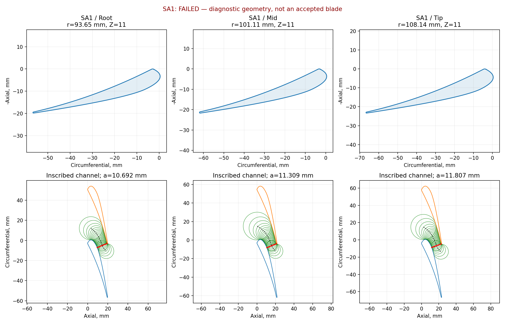
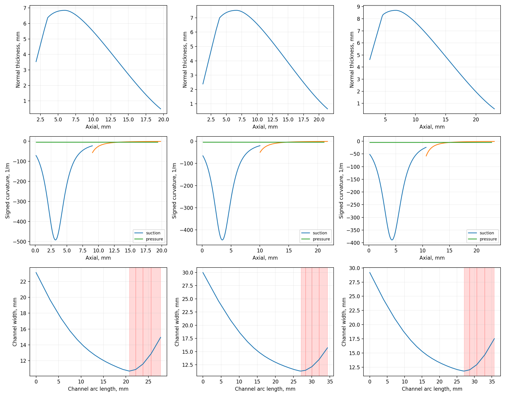
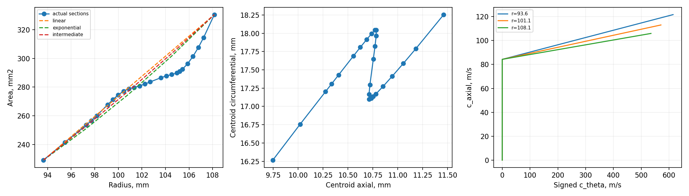
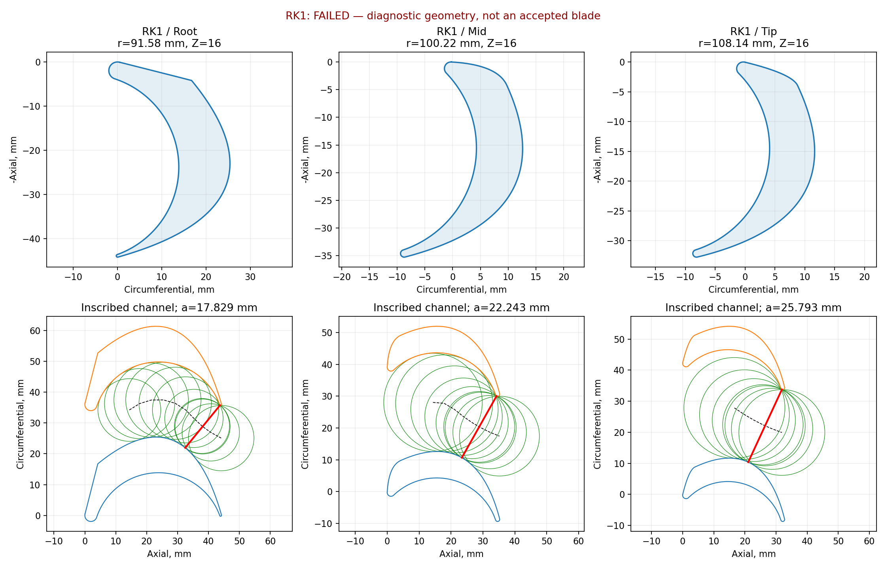
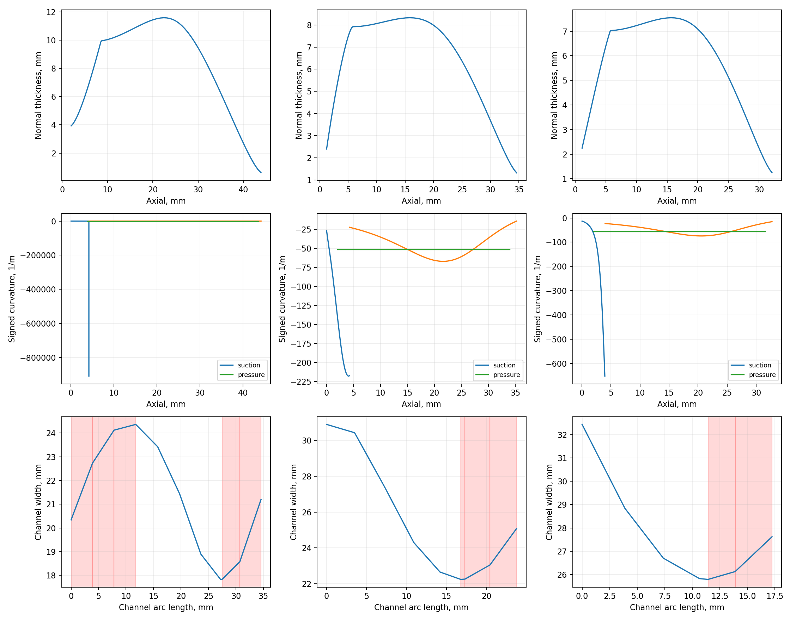
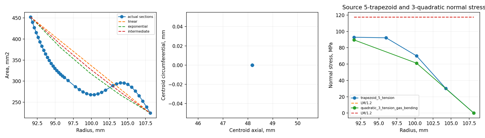
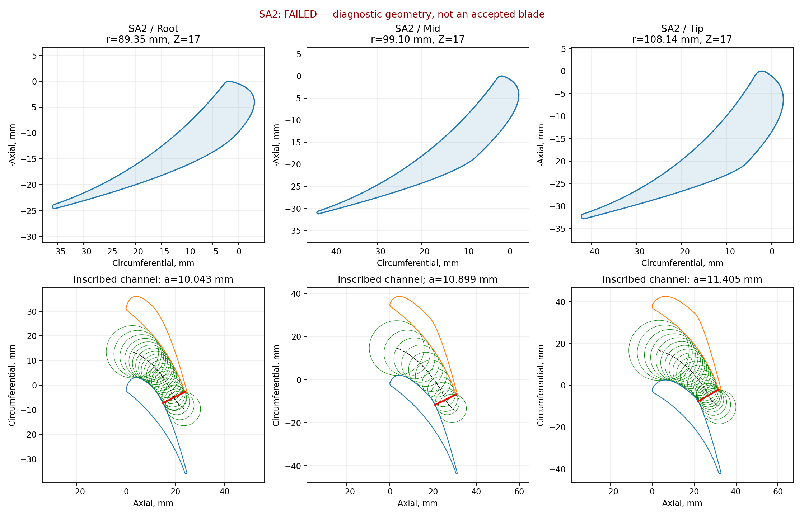
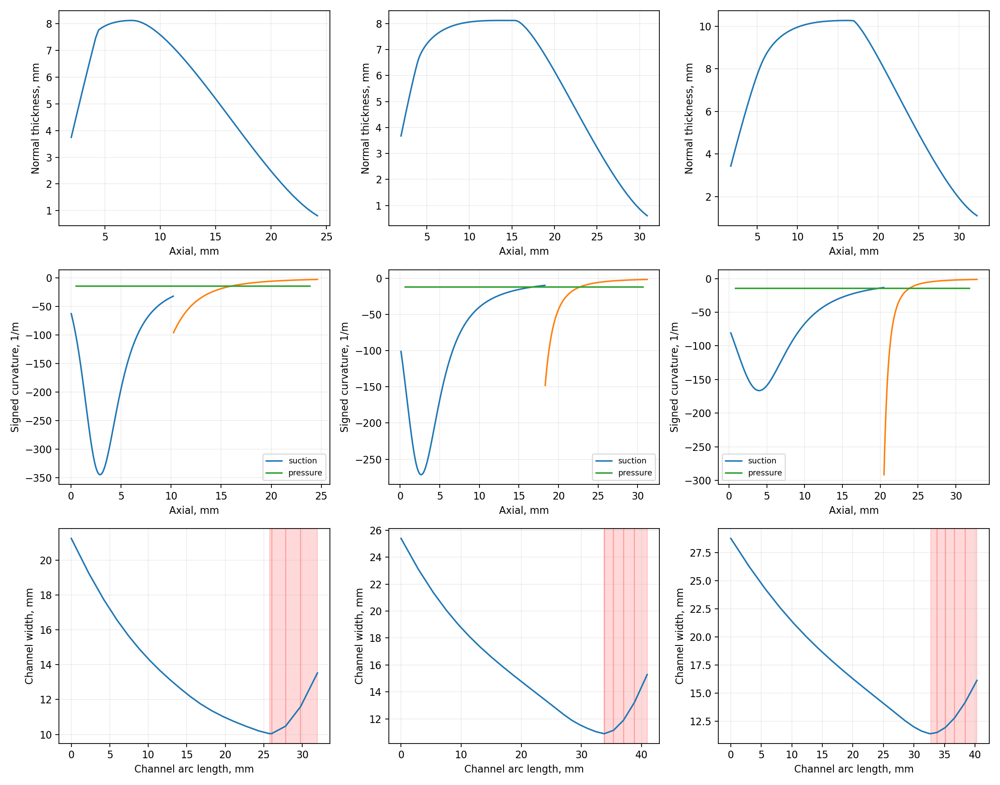
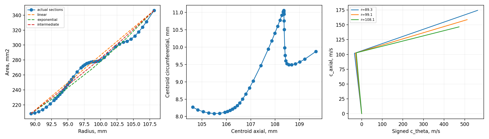
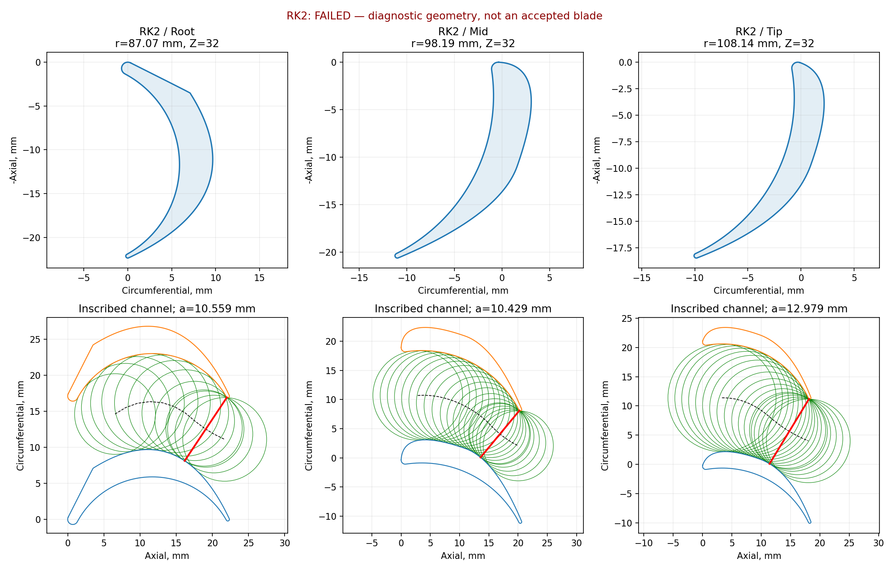
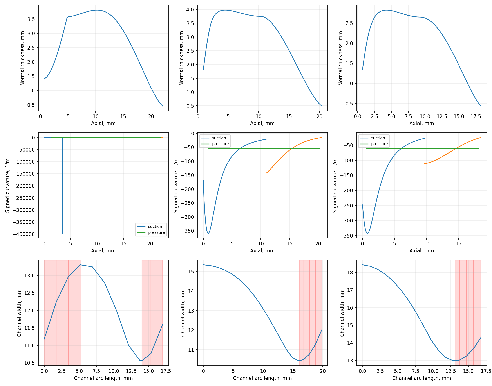
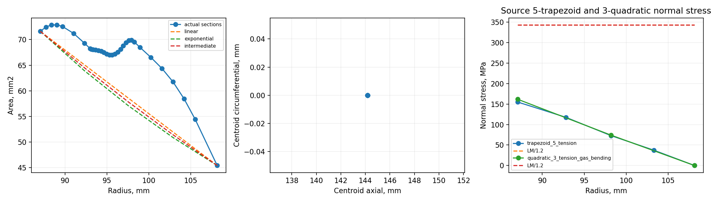
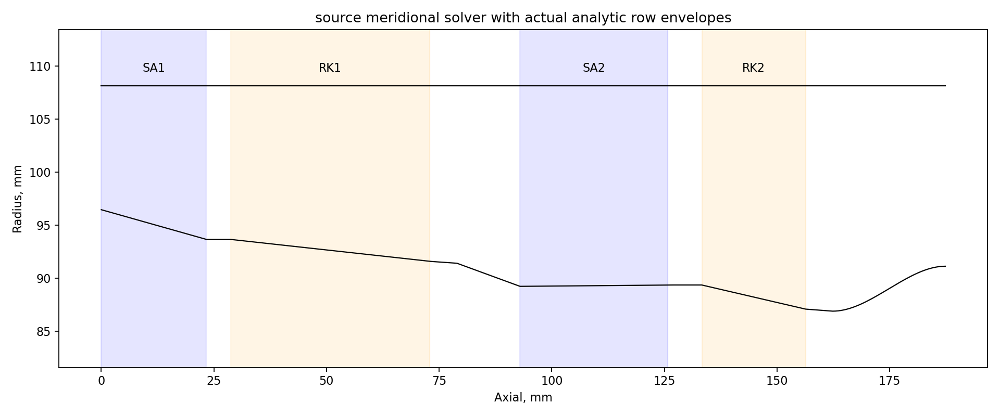

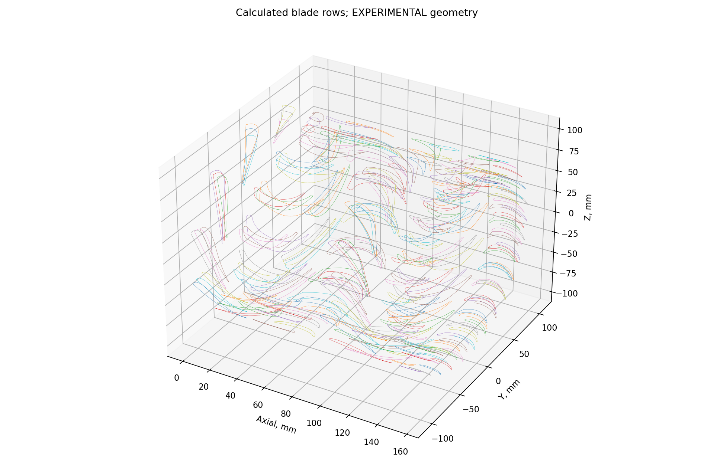

## Scope and missing physical evidence

- Geometry is not CFD/experimental proof of no separation or efficiency.
- Reynolds uses a documented air-viscosity proxy, not measured mixture transport.
- Source variable-cp thermodynamics and independent pressure-equilibrium audits are retained.
- IN738C/LM data are preliminary, not certified supply allowables.
- HCF NOT_CHECKED: grade-specific fatigue curve, forcing and damping are unavailable.
