# Vinogradov — actual TWO-stage course resource calculation

Source: **TVD_1CBK_2st_10000h.ipynb**; resource: **10000 h**; stages: **2**.
Fixed source RPM: **30700**.
Engineering admissible: **False**.
Constructed rows: 4/4.

A failed finite search is not a proof of global infeasibility. No design limit was relaxed.

## Quantified violations

### SA1
- No recorded row violation; global checks still required.
### RK1
- {'name': 'vibration strength', 'status': 'NOT_CHECKED', 'reason': 'NOT_CHECKED: no grade-specific fatigue curve, damping or actual harmonic forcing; beam modes are screening only'}
### SA2
- {'section': 0, 'name': 'local streamtube choke conflict', 'possible': False, 'required_flux_kg_m2_s': 245.0519073905243, 'critical_flux_kg_m2_s': 245.0191897316294, 'required_mach': None, 'stagnation_temperature_K': 1099.3008865253757, 'stagnation_pressure_Pa': 205284.8501270197, 'critical_temperature_K': 947.3366965458624, 'source': 'original variable-cp h, pressure_isentropic, sound'}
- {'section': 2, 'name': 'local streamtube choke conflict', 'possible': False, 'required_flux_kg_m2_s': 245.1098785841171, 'critical_flux_kg_m2_s': 245.01918982972262, 'required_mach': None, 'stagnation_temperature_K': 1099.3008533053826, 'stagnation_pressure_Pa': 205284.8469805286, 'critical_temperature_K': 947.336666960503, 'source': 'original variable-cp h, pressure_isentropic, sound'}
- {'name': 'insufficient choked capacity', 'value': 0.8334634748676345, 'limit': 0.8336628797375195, 'units': 'kg/s'}
### RK2
- {'name': 'vibration strength', 'status': 'NOT_CHECKED', 'reason': 'NOT_CHECKED: no grade-specific fatigue curve, damping or actual harmonic forcing; beam modes are screening only'}
- {'name': 'construction/calculation failure', 'message': 'Parabola lies outside its source control triangle', 'details': {'first_tangent_distance_m': 0.00809752571296987, 'last_tangent_distance_m': -3.850236737335106e-05}}

## Global/source violations

- {'row': 'RK1', 'name': 'vibration strength', 'status': 'NOT_CHECKED', 'reason': 'NOT_CHECKED: no grade-specific fatigue curve, damping or actual harmonic forcing; beam modes are screening only'}
- {'row': 'SA2', 'section': 0, 'name': 'local streamtube choke conflict', 'possible': False, 'required_flux_kg_m2_s': 245.0519073905243, 'critical_flux_kg_m2_s': 245.0191897316294, 'required_mach': None, 'stagnation_temperature_K': 1099.3008865253757, 'stagnation_pressure_Pa': 205284.8501270197, 'critical_temperature_K': 947.3366965458624, 'source': 'original variable-cp h, pressure_isentropic, sound'}
- {'row': 'SA2', 'section': 2, 'name': 'local streamtube choke conflict', 'possible': False, 'required_flux_kg_m2_s': 245.1098785841171, 'critical_flux_kg_m2_s': 245.01918982972262, 'required_mach': None, 'stagnation_temperature_K': 1099.3008533053826, 'stagnation_pressure_Pa': 205284.8469805286, 'critical_temperature_K': 947.336666960503, 'source': 'original variable-cp h, pressure_isentropic, sound'}
- {'row': 'SA2', 'name': 'insufficient choked capacity', 'value': 0.8334634748676345, 'limit': 0.8336628797375195, 'units': 'kg/s'}
- {'row': 'RK2', 'name': 'vibration strength', 'status': 'NOT_CHECKED', 'reason': 'NOT_CHECKED: no grade-specific fatigue curve, damping or actual harmonic forcing; beam modes are screening only'}
- {'row': 'RK2', 'name': 'construction/calculation failure', 'message': 'Parabola lies outside its source control triangle', 'details': {'first_tangent_distance_m': 0.00809752571296987, 'last_tangent_distance_m': -3.850236737335106e-05}}
- {'row': 'RK1', 'name': 'source rotor taper mismatch', 'value': 2.0149129288828442, 'limit': 1.6}
- {'row': 'RK1', 'name': 'source rotor areas must decrease', 'value': [0.0004563888687885201, 0.00031485380872702494, 0.000270163751032729, 0.0002988128119772796, 0.00022650550415672898], 'limit': 'strict decrease root to tip'}
- {'row': 'RK2', 'name': 'source rotor taper mismatch', 'value': 1.5821067041621235, 'limit': 1.6}
- {'row': 'RK2', 'name': 'source rotor areas must decrease', 'value': [7.357287847745807e-05, 7.017780735231546e-05, 7.114277298002103e-05, 6.234207176616152e-05, 4.6503107713219595e-05], 'limit': 'strict decrease root to tip'}
- {'row': 'RK2', 'section': 0, 'name': 'source finite trailing edge', 'value': 0.000475858468384894, 'limit': 0.0005}
- {'row': 'RK2', 'section': 1, 'name': 'source finite trailing edge', 'value': 0.0004939678166344679, 'limit': 0.0005}
- {'row': 'RK2', 'section': 3, 'name': 'source finite trailing edge', 'value': 0.0004958339773854927, 'limit': 0.0005}
- {'row': 'RK2', 'section': 4, 'name': 'source finite trailing edge', 'value': 0.00043960869825547213, 'limit': 0.0005}

## Empirical guidance — not added hard limits

- {'row': 'SA1', 'section': 0, 'name': 'relative thickness starting guidance', 'value': 0.18852722295308708, 'range': [0.1, 0.1], 'classification': 'empirical, p13'}
- {'row': 'SA1', 'section': 0, 'name': 'prior profile guide: толщина выходной кромки', 'measurements': {'geometry_valid': True, 'circle_crosses_open_station_cut': True, 'intersections': False, 'self_intersection': False, 'area_equivalent_angle_deg': 10.575290982335039, 'area_ratio': 0.18352743900110174, 'angle_comparison': 'uniform-flux geometric comparison, not actual gas exit angle', 'angle_error_deg': -0.6247090176649603, 'te_over_throat': 0.07148405879483119, 'book_te_over_throat': 0.055, 'max_reduced_expansion': 1.5401467023450408}, 'relative_thickness': 0.18852722295308708, 'actual_relative_pitch': 1.1673462988547145, 'classification': 'historical empirical profile guide; Vinogradov uses its own recommendations'}
- {'row': 'SA1', 'section': 0, 'name': 'prior profile guide: местная диффузорность', 'measurements': {'geometry_valid': True, 'circle_crosses_open_station_cut': True, 'intersections': False, 'self_intersection': False, 'area_equivalent_angle_deg': 10.575290982335039, 'area_ratio': 0.18352743900110174, 'angle_comparison': 'uniform-flux geometric comparison, not actual gas exit angle', 'angle_error_deg': -0.6247090176649603, 'te_over_throat': 0.07148405879483119, 'book_te_over_throat': 0.055, 'max_reduced_expansion': 1.5401467023450408}, 'relative_thickness': 0.18852722295308708, 'actual_relative_pitch': 1.1673462988547145, 'classification': 'historical empirical profile guide; Vinogradov uses its own recommendations'}
- {'row': 'SA1', 'section': 0, 'name': 'prior profile guide: максимальная толщина', 'measurements': {'geometry_valid': True, 'circle_crosses_open_station_cut': True, 'intersections': False, 'self_intersection': False, 'area_equivalent_angle_deg': 10.575290982335039, 'area_ratio': 0.18352743900110174, 'angle_comparison': 'uniform-flux geometric comparison, not actual gas exit angle', 'angle_error_deg': -0.6247090176649603, 'te_over_throat': 0.07148405879483119, 'book_te_over_throat': 0.055, 'max_reduced_expansion': 1.5401467023450408}, 'relative_thickness': 0.18852722295308708, 'actual_relative_pitch': 1.1673462988547145, 'classification': 'historical empirical profile guide; Vinogradov uses its own recommendations'}
- {'row': 'SA1', 'section': 0, 'name': 'prior profile guide: относительный шаг', 'measurements': {'geometry_valid': True, 'circle_crosses_open_station_cut': True, 'intersections': False, 'self_intersection': False, 'area_equivalent_angle_deg': 10.575290982335039, 'area_ratio': 0.18352743900110174, 'angle_comparison': 'uniform-flux geometric comparison, not actual gas exit angle', 'angle_error_deg': -0.6247090176649603, 'te_over_throat': 0.07148405879483119, 'book_te_over_throat': 0.055, 'max_reduced_expansion': 1.5401467023450408}, 'relative_thickness': 0.18852722295308708, 'actual_relative_pitch': 1.1673462988547145, 'classification': 'historical empirical profile guide; Vinogradov uses its own recommendations'}
- {'row': 'SA1', 'section': 1, 'name': 'relative thickness starting guidance', 'value': 0.18978162135499016, 'range': [0.1, 0.1], 'classification': 'empirical, p13'}
- {'row': 'SA1', 'section': 1, 'name': 'prior profile guide: местная диффузорность', 'measurements': {'geometry_valid': True, 'circle_crosses_open_station_cut': True, 'intersections': False, 'self_intersection': False, 'area_equivalent_angle_deg': 10.570374505701082, 'area_ratio': 0.18344308711692947, 'angle_comparison': 'uniform-flux geometric comparison, not actual gas exit angle', 'angle_error_deg': -0.6296254942989155, 'te_over_throat': 0.06258027239706779, 'book_te_over_throat': 0.055, 'max_reduced_expansion': 1.270836958118678}, 'relative_thickness': 0.18978162135499016, 'actual_relative_pitch': 1.1384357193545367, 'classification': 'historical empirical profile guide; Vinogradov uses its own recommendations'}
- {'row': 'SA1', 'section': 1, 'name': 'prior profile guide: максимальная толщина', 'measurements': {'geometry_valid': True, 'circle_crosses_open_station_cut': True, 'intersections': False, 'self_intersection': False, 'area_equivalent_angle_deg': 10.570374505701082, 'area_ratio': 0.18344308711692947, 'angle_comparison': 'uniform-flux geometric comparison, not actual gas exit angle', 'angle_error_deg': -0.6296254942989155, 'te_over_throat': 0.06258027239706779, 'book_te_over_throat': 0.055, 'max_reduced_expansion': 1.270836958118678}, 'relative_thickness': 0.18978162135499016, 'actual_relative_pitch': 1.1384357193545367, 'classification': 'historical empirical profile guide; Vinogradov uses its own recommendations'}
- {'row': 'SA1', 'section': 1, 'name': 'prior profile guide: относительный шаг', 'measurements': {'geometry_valid': True, 'circle_crosses_open_station_cut': True, 'intersections': False, 'self_intersection': False, 'area_equivalent_angle_deg': 10.570374505701082, 'area_ratio': 0.18344308711692947, 'angle_comparison': 'uniform-flux geometric comparison, not actual gas exit angle', 'angle_error_deg': -0.6296254942989155, 'te_over_throat': 0.06258027239706779, 'book_te_over_throat': 0.055, 'max_reduced_expansion': 1.270836958118678}, 'relative_thickness': 0.18978162135499016, 'actual_relative_pitch': 1.1384357193545367, 'classification': 'historical empirical profile guide; Vinogradov uses its own recommendations'}
- {'row': 'SA1', 'section': 2, 'name': 'relative thickness starting guidance', 'value': 0.1827783933975924, 'range': [0.1, 0.1], 'classification': 'empirical, p13'}
- {'row': 'SA1', 'section': 2, 'name': 'prior profile guide: толщина выходной кромки', 'measurements': {'geometry_valid': True, 'circle_crosses_open_station_cut': False, 'intersections': False, 'self_intersection': False, 'area_equivalent_angle_deg': 10.432592233188208, 'area_ratio': 0.18107861256003832, 'angle_comparison': 'uniform-flux geometric comparison, not actual gas exit angle', 'angle_error_deg': -0.7674077668117913, 'te_over_throat': 0.10424926163231274, 'book_te_over_throat': 0.055, 'max_reduced_expansion': 1.5992620964859543}, 'relative_thickness': 0.1827783933975924, 'actual_relative_pitch': 1.1582831228024641, 'classification': 'historical empirical profile guide; Vinogradov uses its own recommendations'}
- {'row': 'SA1', 'section': 2, 'name': 'prior profile guide: местная диффузорность', 'measurements': {'geometry_valid': True, 'circle_crosses_open_station_cut': False, 'intersections': False, 'self_intersection': False, 'area_equivalent_angle_deg': 10.432592233188208, 'area_ratio': 0.18107861256003832, 'angle_comparison': 'uniform-flux geometric comparison, not actual gas exit angle', 'angle_error_deg': -0.7674077668117913, 'te_over_throat': 0.10424926163231274, 'book_te_over_throat': 0.055, 'max_reduced_expansion': 1.5992620964859543}, 'relative_thickness': 0.1827783933975924, 'actual_relative_pitch': 1.1582831228024641, 'classification': 'historical empirical profile guide; Vinogradov uses its own recommendations'}
- {'row': 'SA1', 'section': 2, 'name': 'prior profile guide: максимальная толщина', 'measurements': {'geometry_valid': True, 'circle_crosses_open_station_cut': False, 'intersections': False, 'self_intersection': False, 'area_equivalent_angle_deg': 10.432592233188208, 'area_ratio': 0.18107861256003832, 'angle_comparison': 'uniform-flux geometric comparison, not actual gas exit angle', 'angle_error_deg': -0.7674077668117913, 'te_over_throat': 0.10424926163231274, 'book_te_over_throat': 0.055, 'max_reduced_expansion': 1.5992620964859543}, 'relative_thickness': 0.1827783933975924, 'actual_relative_pitch': 1.1582831228024641, 'classification': 'historical empirical profile guide; Vinogradov uses its own recommendations'}
- {'row': 'SA1', 'section': 2, 'name': 'prior profile guide: относительный шаг', 'measurements': {'geometry_valid': True, 'circle_crosses_open_station_cut': False, 'intersections': False, 'self_intersection': False, 'area_equivalent_angle_deg': 10.432592233188208, 'area_ratio': 0.18107861256003832, 'angle_comparison': 'uniform-flux geometric comparison, not actual gas exit angle', 'angle_error_deg': -0.7674077668117913, 'te_over_throat': 0.10424926163231274, 'book_te_over_throat': 0.055, 'max_reduced_expansion': 1.5992620964859543}, 'relative_thickness': 0.1827783933975924, 'actual_relative_pitch': 1.1582831228024641, 'classification': 'historical empirical profile guide; Vinogradov uses its own recommendations'}
- {'row': 'SA1', 'section': 3, 'name': 'relative thickness starting guidance', 'value': 0.19651906051317225, 'range': [0.1, 0.1], 'classification': 'empirical, p13'}
- {'row': 'SA1', 'section': 3, 'name': 'prior profile guide: толщина выходной кромки', 'measurements': {'geometry_valid': True, 'circle_crosses_open_station_cut': True, 'intersections': False, 'self_intersection': False, 'area_equivalent_angle_deg': 10.44148945851344, 'area_ratio': 0.18123132916332918, 'angle_comparison': 'uniform-flux geometric comparison, not actual gas exit angle', 'angle_error_deg': -0.7585105414865598, 'te_over_throat': 0.0863469431095719, 'book_te_over_throat': 0.055, 'max_reduced_expansion': 1.4311370377180543}, 'relative_thickness': 0.19651906051317225, 'actual_relative_pitch': 1.160316230099504, 'classification': 'historical empirical profile guide; Vinogradov uses its own recommendations'}
- {'row': 'SA1', 'section': 3, 'name': 'prior profile guide: местная диффузорность', 'measurements': {'geometry_valid': True, 'circle_crosses_open_station_cut': True, 'intersections': False, 'self_intersection': False, 'area_equivalent_angle_deg': 10.44148945851344, 'area_ratio': 0.18123132916332918, 'angle_comparison': 'uniform-flux geometric comparison, not actual gas exit angle', 'angle_error_deg': -0.7585105414865598, 'te_over_throat': 0.0863469431095719, 'book_te_over_throat': 0.055, 'max_reduced_expansion': 1.4311370377180543}, 'relative_thickness': 0.19651906051317225, 'actual_relative_pitch': 1.160316230099504, 'classification': 'historical empirical profile guide; Vinogradov uses its own recommendations'}
- {'row': 'SA1', 'section': 3, 'name': 'prior profile guide: максимальная толщина', 'measurements': {'geometry_valid': True, 'circle_crosses_open_station_cut': True, 'intersections': False, 'self_intersection': False, 'area_equivalent_angle_deg': 10.44148945851344, 'area_ratio': 0.18123132916332918, 'angle_comparison': 'uniform-flux geometric comparison, not actual gas exit angle', 'angle_error_deg': -0.7585105414865598, 'te_over_throat': 0.0863469431095719, 'book_te_over_throat': 0.055, 'max_reduced_expansion': 1.4311370377180543}, 'relative_thickness': 0.19651906051317225, 'actual_relative_pitch': 1.160316230099504, 'classification': 'historical empirical profile guide; Vinogradov uses its own recommendations'}
- {'row': 'SA1', 'section': 3, 'name': 'prior profile guide: относительный шаг', 'measurements': {'geometry_valid': True, 'circle_crosses_open_station_cut': True, 'intersections': False, 'self_intersection': False, 'area_equivalent_angle_deg': 10.44148945851344, 'area_ratio': 0.18123132916332918, 'angle_comparison': 'uniform-flux geometric comparison, not actual gas exit angle', 'angle_error_deg': -0.7585105414865598, 'te_over_throat': 0.0863469431095719, 'book_te_over_throat': 0.055, 'max_reduced_expansion': 1.4311370377180543}, 'relative_thickness': 0.19651906051317225, 'actual_relative_pitch': 1.160316230099504, 'classification': 'historical empirical profile guide; Vinogradov uses its own recommendations'}
- {'row': 'SA1', 'section': 4, 'name': 'relative thickness starting guidance', 'value': 0.20573071648174585, 'range': [0.1, 0.1], 'classification': 'empirical, p13'}
- {'row': 'SA1', 'section': 4, 'name': 'prior profile guide: толщина выходной кромки', 'measurements': {'geometry_valid': True, 'circle_crosses_open_station_cut': True, 'intersections': False, 'self_intersection': False, 'area_equivalent_angle_deg': 10.323262305775962, 'area_ratio': 0.17920166145969546, 'angle_comparison': 'uniform-flux geometric comparison, not actual gas exit angle', 'angle_error_deg': -0.8767376942240386, 'te_over_throat': 0.0881778101340171, 'book_te_over_throat': 0.055, 'max_reduced_expansion': 1.4125840772548228}, 'relative_thickness': 0.20573071648174585, 'actual_relative_pitch': 1.1797072118919898, 'classification': 'historical empirical profile guide; Vinogradov uses its own recommendations'}
- {'row': 'SA1', 'section': 4, 'name': 'prior profile guide: местная диффузорность', 'measurements': {'geometry_valid': True, 'circle_crosses_open_station_cut': True, 'intersections': False, 'self_intersection': False, 'area_equivalent_angle_deg': 10.323262305775962, 'area_ratio': 0.17920166145969546, 'angle_comparison': 'uniform-flux geometric comparison, not actual gas exit angle', 'angle_error_deg': -0.8767376942240386, 'te_over_throat': 0.0881778101340171, 'book_te_over_throat': 0.055, 'max_reduced_expansion': 1.4125840772548228}, 'relative_thickness': 0.20573071648174585, 'actual_relative_pitch': 1.1797072118919898, 'classification': 'historical empirical profile guide; Vinogradov uses its own recommendations'}
- {'row': 'SA1', 'section': 4, 'name': 'prior profile guide: максимальная толщина', 'measurements': {'geometry_valid': True, 'circle_crosses_open_station_cut': True, 'intersections': False, 'self_intersection': False, 'area_equivalent_angle_deg': 10.323262305775962, 'area_ratio': 0.17920166145969546, 'angle_comparison': 'uniform-flux geometric comparison, not actual gas exit angle', 'angle_error_deg': -0.8767376942240386, 'te_over_throat': 0.0881778101340171, 'book_te_over_throat': 0.055, 'max_reduced_expansion': 1.4125840772548228}, 'relative_thickness': 0.20573071648174585, 'actual_relative_pitch': 1.1797072118919898, 'classification': 'historical empirical profile guide; Vinogradov uses its own recommendations'}
- {'row': 'SA1', 'section': 4, 'name': 'prior profile guide: относительный шаг', 'measurements': {'geometry_valid': True, 'circle_crosses_open_station_cut': True, 'intersections': False, 'self_intersection': False, 'area_equivalent_angle_deg': 10.323262305775962, 'area_ratio': 0.17920166145969546, 'angle_comparison': 'uniform-flux geometric comparison, not actual gas exit angle', 'angle_error_deg': -0.8767376942240386, 'te_over_throat': 0.0881778101340171, 'book_te_over_throat': 0.055, 'max_reduced_expansion': 1.4125840772548228}, 'relative_thickness': 0.20573071648174585, 'actual_relative_pitch': 1.1797072118919898, 'classification': 'historical empirical profile guide; Vinogradov uses its own recommendations'}
- {'row': 'RK1', 'section': 0, 'name': 'subsonic entrance expansion guidance', 'value': 1.200295053073331, 'limit': 1.1, 'classification': 'empirical recommendation; CFD required'}
- {'row': 'RK1', 'section': 0, 'name': 'prior profile guide: угол горла', 'measurements': {'geometry_valid': True, 'circle_crosses_open_station_cut': True, 'intersections': False, 'self_intersection': False, 'area_equivalent_angle_deg': 29.05160027081243, 'area_ratio': 0.48559710133575973, 'angle_comparison': 'uniform-flux geometric comparison, not actual gas exit angle', 'angle_error_deg': 10.236188236210445, 'te_over_throat': 0.035082064187861486, 'book_te_over_throat': 0.07, 'max_reduced_expansion': 1.2409291448846183}, 'relative_thickness': 0.2771766019153309, 'actual_relative_pitch': 0.8553444333394895, 'classification': 'historical empirical profile guide; Vinogradov uses its own recommendations'}
- {'row': 'RK1', 'section': 0, 'name': 'prior profile guide: местная диффузорность', 'measurements': {'geometry_valid': True, 'circle_crosses_open_station_cut': True, 'intersections': False, 'self_intersection': False, 'area_equivalent_angle_deg': 29.05160027081243, 'area_ratio': 0.48559710133575973, 'angle_comparison': 'uniform-flux geometric comparison, not actual gas exit angle', 'angle_error_deg': 10.236188236210445, 'te_over_throat': 0.035082064187861486, 'book_te_over_throat': 0.07, 'max_reduced_expansion': 1.2409291448846183}, 'relative_thickness': 0.2771766019153309, 'actual_relative_pitch': 0.8553444333394895, 'classification': 'historical empirical profile guide; Vinogradov uses its own recommendations'}
- {'row': 'RK1', 'section': 0, 'name': 'prior profile guide: максимальная толщина', 'measurements': {'geometry_valid': True, 'circle_crosses_open_station_cut': True, 'intersections': False, 'self_intersection': False, 'area_equivalent_angle_deg': 29.05160027081243, 'area_ratio': 0.48559710133575973, 'angle_comparison': 'uniform-flux geometric comparison, not actual gas exit angle', 'angle_error_deg': 10.236188236210445, 'te_over_throat': 0.035082064187861486, 'book_te_over_throat': 0.07, 'max_reduced_expansion': 1.2409291448846183}, 'relative_thickness': 0.2771766019153309, 'actual_relative_pitch': 0.8553444333394895, 'classification': 'historical empirical profile guide; Vinogradov uses its own recommendations'}
- {'row': 'RK1', 'section': 0, 'name': 'prior profile guide: относительный шаг', 'measurements': {'geometry_valid': True, 'circle_crosses_open_station_cut': True, 'intersections': False, 'self_intersection': False, 'area_equivalent_angle_deg': 29.05160027081243, 'area_ratio': 0.48559710133575973, 'angle_comparison': 'uniform-flux geometric comparison, not actual gas exit angle', 'angle_error_deg': 10.236188236210445, 'te_over_throat': 0.035082064187861486, 'book_te_over_throat': 0.07, 'max_reduced_expansion': 1.2409291448846183}, 'relative_thickness': 0.2771766019153309, 'actual_relative_pitch': 0.8553444333394895, 'classification': 'historical empirical profile guide; Vinogradov uses its own recommendations'}
- {'row': 'RK1', 'section': 1, 'name': 'relative thickness starting guidance', 'value': 0.24878615098143037, 'range': [0.14658407163388162, 0.21987610745082242], 'classification': 'empirical, p13'}
- {'row': 'RK1', 'section': 1, 'name': 'prior profile guide: угол горла', 'measurements': {'geometry_valid': True, 'circle_crosses_open_station_cut': True, 'intersections': False, 'self_intersection': False, 'area_equivalent_angle_deg': 31.263901752794705, 'area_ratio': 0.5189806713166097, 'angle_comparison': 'uniform-flux geometric comparison, not actual gas exit angle', 'angle_error_deg': 12.995211116149129, 'te_over_throat': 0.0741455888513689, 'book_te_over_throat': 0.07, 'max_reduced_expansion': 1.1018771001991805}, 'relative_thickness': 0.24878615098143037, 'actual_relative_pitch': 1.0210630390308548, 'classification': 'historical empirical profile guide; Vinogradov uses its own recommendations'}
- {'row': 'RK1', 'section': 1, 'name': 'prior profile guide: местная диффузорность', 'measurements': {'geometry_valid': True, 'circle_crosses_open_station_cut': True, 'intersections': False, 'self_intersection': False, 'area_equivalent_angle_deg': 31.263901752794705, 'area_ratio': 0.5189806713166097, 'angle_comparison': 'uniform-flux geometric comparison, not actual gas exit angle', 'angle_error_deg': 12.995211116149129, 'te_over_throat': 0.0741455888513689, 'book_te_over_throat': 0.07, 'max_reduced_expansion': 1.1018771001991805}, 'relative_thickness': 0.24878615098143037, 'actual_relative_pitch': 1.0210630390308548, 'classification': 'historical empirical profile guide; Vinogradov uses its own recommendations'}
- {'row': 'RK1', 'section': 1, 'name': 'prior profile guide: максимальная толщина', 'measurements': {'geometry_valid': True, 'circle_crosses_open_station_cut': True, 'intersections': False, 'self_intersection': False, 'area_equivalent_angle_deg': 31.263901752794705, 'area_ratio': 0.5189806713166097, 'angle_comparison': 'uniform-flux geometric comparison, not actual gas exit angle', 'angle_error_deg': 12.995211116149129, 'te_over_throat': 0.0741455888513689, 'book_te_over_throat': 0.07, 'max_reduced_expansion': 1.1018771001991805}, 'relative_thickness': 0.24878615098143037, 'actual_relative_pitch': 1.0210630390308548, 'classification': 'historical empirical profile guide; Vinogradov uses its own recommendations'}
- {'row': 'RK1', 'section': 1, 'name': 'prior profile guide: относительный шаг', 'measurements': {'geometry_valid': True, 'circle_crosses_open_station_cut': True, 'intersections': False, 'self_intersection': False, 'area_equivalent_angle_deg': 31.263901752794705, 'area_ratio': 0.5189806713166097, 'angle_comparison': 'uniform-flux geometric comparison, not actual gas exit angle', 'angle_error_deg': 12.995211116149129, 'te_over_throat': 0.0741455888513689, 'book_te_over_throat': 0.07, 'max_reduced_expansion': 1.1018771001991805}, 'relative_thickness': 0.24878615098143037, 'actual_relative_pitch': 1.0210630390308548, 'classification': 'historical empirical profile guide; Vinogradov uses its own recommendations'}
- {'row': 'RK1', 'section': 2, 'name': 'relative thickness starting guidance', 'value': 0.24244808316043787, 'range': [0.09738937847815876, 0.1456489641302646], 'classification': 'empirical, p13'}
- {'row': 'RK1', 'section': 2, 'name': 'prior profile guide: угол горла', 'measurements': {'geometry_valid': True, 'circle_crosses_open_station_cut': True, 'intersections': False, 'self_intersection': False, 'area_equivalent_angle_deg': 33.42418767962647, 'area_ratio': 0.5508331259284558, 'angle_comparison': 'uniform-flux geometric comparison, not actual gas exit angle', 'angle_error_deg': 15.663044653816279, 'te_over_throat': 0.06079524599306675, 'book_te_over_throat': 0.07, 'max_reduced_expansion': 1.1529215013761624}, 'relative_thickness': 0.24244808316043787, 'actual_relative_pitch': 1.1397039645002214, 'classification': 'historical empirical profile guide; Vinogradov uses its own recommendations'}
- {'row': 'RK1', 'section': 2, 'name': 'prior profile guide: местная диффузорность', 'measurements': {'geometry_valid': True, 'circle_crosses_open_station_cut': True, 'intersections': False, 'self_intersection': False, 'area_equivalent_angle_deg': 33.42418767962647, 'area_ratio': 0.5508331259284558, 'angle_comparison': 'uniform-flux geometric comparison, not actual gas exit angle', 'angle_error_deg': 15.663044653816279, 'te_over_throat': 0.06079524599306675, 'book_te_over_throat': 0.07, 'max_reduced_expansion': 1.1529215013761624}, 'relative_thickness': 0.24244808316043787, 'actual_relative_pitch': 1.1397039645002214, 'classification': 'historical empirical profile guide; Vinogradov uses its own recommendations'}
- {'row': 'RK1', 'section': 2, 'name': 'prior profile guide: максимальная толщина', 'measurements': {'geometry_valid': True, 'circle_crosses_open_station_cut': True, 'intersections': False, 'self_intersection': False, 'area_equivalent_angle_deg': 33.42418767962647, 'area_ratio': 0.5508331259284558, 'angle_comparison': 'uniform-flux geometric comparison, not actual gas exit angle', 'angle_error_deg': 15.663044653816279, 'te_over_throat': 0.06079524599306675, 'book_te_over_throat': 0.07, 'max_reduced_expansion': 1.1529215013761624}, 'relative_thickness': 0.24244808316043787, 'actual_relative_pitch': 1.1397039645002214, 'classification': 'historical empirical profile guide; Vinogradov uses its own recommendations'}
- {'row': 'RK1', 'section': 2, 'name': 'prior profile guide: относительный шаг', 'measurements': {'geometry_valid': True, 'circle_crosses_open_station_cut': True, 'intersections': False, 'self_intersection': False, 'area_equivalent_angle_deg': 33.42418767962647, 'area_ratio': 0.5508331259284558, 'angle_comparison': 'uniform-flux geometric comparison, not actual gas exit angle', 'angle_error_deg': 15.663044653816279, 'te_over_throat': 0.06079524599306675, 'book_te_over_throat': 0.07, 'max_reduced_expansion': 1.1529215013761624}, 'relative_thickness': 0.24244808316043787, 'actual_relative_pitch': 1.1397039645002214, 'classification': 'historical empirical profile guide; Vinogradov uses its own recommendations'}
- {'row': 'RK1', 'section': 3, 'name': 'relative thickness starting guidance', 'value': 0.24587900178353084, 'range': [0.06812418197944138, 0.09687363663240228], 'classification': 'empirical, p13'}
- {'row': 'RK1', 'section': 3, 'name': 'prior profile guide: угол горла', 'measurements': {'geometry_valid': True, 'circle_crosses_open_station_cut': True, 'intersections': False, 'self_intersection': False, 'area_equivalent_angle_deg': 32.98463959816131, 'area_ratio': 0.5444141765997825, 'angle_comparison': 'uniform-flux geometric comparison, not actual gas exit angle', 'angle_error_deg': 15.695063086469158, 'te_over_throat': 0.06343294741421138, 'book_te_over_throat': 0.07, 'max_reduced_expansion': 1.1519932199972245}, 'relative_thickness': 0.24587900178353084, 'actual_relative_pitch': 1.1354998191422632, 'classification': 'historical empirical profile guide; Vinogradov uses its own recommendations'}
- {'row': 'RK1', 'section': 3, 'name': 'prior profile guide: местная диффузорность', 'measurements': {'geometry_valid': True, 'circle_crosses_open_station_cut': True, 'intersections': False, 'self_intersection': False, 'area_equivalent_angle_deg': 32.98463959816131, 'area_ratio': 0.5444141765997825, 'angle_comparison': 'uniform-flux geometric comparison, not actual gas exit angle', 'angle_error_deg': 15.695063086469158, 'te_over_throat': 0.06343294741421138, 'book_te_over_throat': 0.07, 'max_reduced_expansion': 1.1519932199972245}, 'relative_thickness': 0.24587900178353084, 'actual_relative_pitch': 1.1354998191422632, 'classification': 'historical empirical profile guide; Vinogradov uses its own recommendations'}
- {'row': 'RK1', 'section': 3, 'name': 'prior profile guide: максимальная толщина', 'measurements': {'geometry_valid': True, 'circle_crosses_open_station_cut': True, 'intersections': False, 'self_intersection': False, 'area_equivalent_angle_deg': 32.98463959816131, 'area_ratio': 0.5444141765997825, 'angle_comparison': 'uniform-flux geometric comparison, not actual gas exit angle', 'angle_error_deg': 15.695063086469158, 'te_over_throat': 0.06343294741421138, 'book_te_over_throat': 0.07, 'max_reduced_expansion': 1.1519932199972245}, 'relative_thickness': 0.24587900178353084, 'actual_relative_pitch': 1.1354998191422632, 'classification': 'historical empirical profile guide; Vinogradov uses its own recommendations'}
- {'row': 'RK1', 'section': 3, 'name': 'prior profile guide: относительный шаг', 'measurements': {'geometry_valid': True, 'circle_crosses_open_station_cut': True, 'intersections': False, 'self_intersection': False, 'area_equivalent_angle_deg': 32.98463959816131, 'area_ratio': 0.5444141765997825, 'angle_comparison': 'uniform-flux geometric comparison, not actual gas exit angle', 'angle_error_deg': 15.695063086469158, 'te_over_throat': 0.06343294741421138, 'book_te_over_throat': 0.07, 'max_reduced_expansion': 1.1519932199972245}, 'relative_thickness': 0.24587900178353084, 'actual_relative_pitch': 1.1354998191422632, 'classification': 'historical empirical profile guide; Vinogradov uses its own recommendations'}
- {'row': 'RK1', 'section': 4, 'name': 'relative thickness starting guidance', 'value': 0.23739873211209683, 'range': [0.04, 0.05], 'classification': 'empirical, p13'}
- {'row': 'RK1', 'section': 4, 'name': 'prior profile guide: угол горла', 'measurements': {'geometry_valid': True, 'circle_crosses_open_station_cut': True, 'intersections': False, 'self_intersection': False, 'area_equivalent_angle_deg': 36.24825105534303, 'area_ratio': 0.5912850314934142, 'angle_comparison': 'uniform-flux geometric comparison, not actual gas exit angle', 'angle_error_deg': 19.39759393767508, 'te_over_throat': 0.04888352431365803, 'book_te_over_throat': 0.07, 'max_reduced_expansion': 1.0941409533701796}, 'relative_thickness': 0.23739873211209683, 'actual_relative_pitch': 1.3245656911555377, 'classification': 'historical empirical profile guide; Vinogradov uses its own recommendations'}
- {'row': 'RK1', 'section': 4, 'name': 'prior profile guide: местная диффузорность', 'measurements': {'geometry_valid': True, 'circle_crosses_open_station_cut': True, 'intersections': False, 'self_intersection': False, 'area_equivalent_angle_deg': 36.24825105534303, 'area_ratio': 0.5912850314934142, 'angle_comparison': 'uniform-flux geometric comparison, not actual gas exit angle', 'angle_error_deg': 19.39759393767508, 'te_over_throat': 0.04888352431365803, 'book_te_over_throat': 0.07, 'max_reduced_expansion': 1.0941409533701796}, 'relative_thickness': 0.23739873211209683, 'actual_relative_pitch': 1.3245656911555377, 'classification': 'historical empirical profile guide; Vinogradov uses its own recommendations'}
- {'row': 'RK1', 'section': 4, 'name': 'prior profile guide: максимальная толщина', 'measurements': {'geometry_valid': True, 'circle_crosses_open_station_cut': True, 'intersections': False, 'self_intersection': False, 'area_equivalent_angle_deg': 36.24825105534303, 'area_ratio': 0.5912850314934142, 'angle_comparison': 'uniform-flux geometric comparison, not actual gas exit angle', 'angle_error_deg': 19.39759393767508, 'te_over_throat': 0.04888352431365803, 'book_te_over_throat': 0.07, 'max_reduced_expansion': 1.0941409533701796}, 'relative_thickness': 0.23739873211209683, 'actual_relative_pitch': 1.3245656911555377, 'classification': 'historical empirical profile guide; Vinogradov uses its own recommendations'}
- {'row': 'RK1', 'section': 4, 'name': 'prior profile guide: относительный шаг', 'measurements': {'geometry_valid': True, 'circle_crosses_open_station_cut': True, 'intersections': False, 'self_intersection': False, 'area_equivalent_angle_deg': 36.24825105534303, 'area_ratio': 0.5912850314934142, 'angle_comparison': 'uniform-flux geometric comparison, not actual gas exit angle', 'angle_error_deg': 19.39759393767508, 'te_over_throat': 0.04888352431365803, 'book_te_over_throat': 0.07, 'max_reduced_expansion': 1.0941409533701796}, 'relative_thickness': 0.23739873211209683, 'actual_relative_pitch': 1.3245656911555377, 'classification': 'historical empirical profile guide; Vinogradov uses its own recommendations'}
- {'row': 'SA2', 'section': 0, 'name': 'relative thickness starting guidance', 'value': 0.22391171578052826, 'range': [0.1, 0.1], 'classification': 'empirical, p13'}
- {'row': 'SA2', 'section': 0, 'name': 'prior profile guide: толщина выходной кромки', 'measurements': {'geometry_valid': True, 'circle_crosses_open_station_cut': False, 'intersections': False, 'self_intersection': False, 'area_equivalent_angle_deg': 17.248307994560264, 'area_ratio': 0.29651337208936923, 'angle_comparison': 'uniform-flux geometric comparison, not actual gas exit angle', 'angle_error_deg': 0.016921884352033345, 'te_over_throat': 0.09569884599026175, 'book_te_over_throat': 0.055, 'max_reduced_expansion': 1.4990239186066587}, 'relative_thickness': 0.22391171578052826, 'actual_relative_pitch': 0.8708517282122157, 'classification': 'historical empirical profile guide; Vinogradov uses its own recommendations'}
- {'row': 'SA2', 'section': 0, 'name': 'prior profile guide: местная диффузорность', 'measurements': {'geometry_valid': True, 'circle_crosses_open_station_cut': False, 'intersections': False, 'self_intersection': False, 'area_equivalent_angle_deg': 17.248307994560264, 'area_ratio': 0.29651337208936923, 'angle_comparison': 'uniform-flux geometric comparison, not actual gas exit angle', 'angle_error_deg': 0.016921884352033345, 'te_over_throat': 0.09569884599026175, 'book_te_over_throat': 0.055, 'max_reduced_expansion': 1.4990239186066587}, 'relative_thickness': 0.22391171578052826, 'actual_relative_pitch': 0.8708517282122157, 'classification': 'historical empirical profile guide; Vinogradov uses its own recommendations'}
- {'row': 'SA2', 'section': 0, 'name': 'prior profile guide: максимальная толщина', 'measurements': {'geometry_valid': True, 'circle_crosses_open_station_cut': False, 'intersections': False, 'self_intersection': False, 'area_equivalent_angle_deg': 17.248307994560264, 'area_ratio': 0.29651337208936923, 'angle_comparison': 'uniform-flux geometric comparison, not actual gas exit angle', 'angle_error_deg': 0.016921884352033345, 'te_over_throat': 0.09569884599026175, 'book_te_over_throat': 0.055, 'max_reduced_expansion': 1.4990239186066587}, 'relative_thickness': 0.22391171578052826, 'actual_relative_pitch': 0.8708517282122157, 'classification': 'historical empirical profile guide; Vinogradov uses its own recommendations'}
- {'row': 'SA2', 'section': 0, 'name': 'prior profile guide: относительный шаг', 'measurements': {'geometry_valid': True, 'circle_crosses_open_station_cut': False, 'intersections': False, 'self_intersection': False, 'area_equivalent_angle_deg': 17.248307994560264, 'area_ratio': 0.29651337208936923, 'angle_comparison': 'uniform-flux geometric comparison, not actual gas exit angle', 'angle_error_deg': 0.016921884352033345, 'te_over_throat': 0.09569884599026175, 'book_te_over_throat': 0.055, 'max_reduced_expansion': 1.4990239186066587}, 'relative_thickness': 0.22391171578052826, 'actual_relative_pitch': 0.8708517282122157, 'classification': 'historical empirical profile guide; Vinogradov uses its own recommendations'}
- {'row': 'SA2', 'section': 1, 'name': 'relative thickness starting guidance', 'value': 0.21903023636945976, 'range': [0.1, 0.1], 'classification': 'empirical, p13'}
- {'row': 'SA2', 'section': 1, 'name': 'prior profile guide: толщина выходной кромки', 'measurements': {'geometry_valid': True, 'circle_crosses_open_station_cut': True, 'intersections': False, 'self_intersection': False, 'area_equivalent_angle_deg': 17.174382425030718, 'area_ratio': 0.29528090500900106, 'angle_comparison': 'uniform-flux geometric comparison, not actual gas exit angle', 'angle_error_deg': -0.057003685177512864, 'te_over_throat': 0.06790930025898488, 'book_te_over_throat': 0.055, 'max_reduced_expansion': 1.3293410367352343}, 'relative_thickness': 0.21903023636945976, 'actual_relative_pitch': 0.8742340286882475, 'classification': 'historical empirical profile guide; Vinogradov uses its own recommendations'}
- {'row': 'SA2', 'section': 1, 'name': 'prior profile guide: местная диффузорность', 'measurements': {'geometry_valid': True, 'circle_crosses_open_station_cut': True, 'intersections': False, 'self_intersection': False, 'area_equivalent_angle_deg': 17.174382425030718, 'area_ratio': 0.29528090500900106, 'angle_comparison': 'uniform-flux geometric comparison, not actual gas exit angle', 'angle_error_deg': -0.057003685177512864, 'te_over_throat': 0.06790930025898488, 'book_te_over_throat': 0.055, 'max_reduced_expansion': 1.3293410367352343}, 'relative_thickness': 0.21903023636945976, 'actual_relative_pitch': 0.8742340286882475, 'classification': 'historical empirical profile guide; Vinogradov uses its own recommendations'}
- {'row': 'SA2', 'section': 1, 'name': 'prior profile guide: максимальная толщина', 'measurements': {'geometry_valid': True, 'circle_crosses_open_station_cut': True, 'intersections': False, 'self_intersection': False, 'area_equivalent_angle_deg': 17.174382425030718, 'area_ratio': 0.29528090500900106, 'angle_comparison': 'uniform-flux geometric comparison, not actual gas exit angle', 'angle_error_deg': -0.057003685177512864, 'te_over_throat': 0.06790930025898488, 'book_te_over_throat': 0.055, 'max_reduced_expansion': 1.3293410367352343}, 'relative_thickness': 0.21903023636945976, 'actual_relative_pitch': 0.8742340286882475, 'classification': 'historical empirical profile guide; Vinogradov uses its own recommendations'}
- {'row': 'SA2', 'section': 1, 'name': 'prior profile guide: относительный шаг', 'measurements': {'geometry_valid': True, 'circle_crosses_open_station_cut': True, 'intersections': False, 'self_intersection': False, 'area_equivalent_angle_deg': 17.174382425030718, 'area_ratio': 0.29528090500900106, 'angle_comparison': 'uniform-flux geometric comparison, not actual gas exit angle', 'angle_error_deg': -0.057003685177512864, 'te_over_throat': 0.06790930025898488, 'book_te_over_throat': 0.055, 'max_reduced_expansion': 1.3293410367352343}, 'relative_thickness': 0.21903023636945976, 'actual_relative_pitch': 0.8742340286882475, 'classification': 'historical empirical profile guide; Vinogradov uses its own recommendations'}
- {'row': 'SA2', 'section': 2, 'name': 'relative thickness starting guidance', 'value': 0.2380325704645548, 'range': [0.1, 0.1], 'classification': 'empirical, p13'}
- {'row': 'SA2', 'section': 2, 'name': 'prior profile guide: толщина выходной кромки', 'measurements': {'geometry_valid': True, 'circle_crosses_open_station_cut': False, 'intersections': False, 'self_intersection': False, 'area_equivalent_angle_deg': 17.00831351673522, 'area_ratio': 0.2925104597809933, 'angle_comparison': 'uniform-flux geometric comparison, not actual gas exit angle', 'angle_error_deg': -0.22307259347300956, 'te_over_throat': 0.07301015952828815, 'book_te_over_throat': 0.055, 'max_reduced_expansion': 1.3159151032487426}, 'relative_thickness': 0.2380325704645548, 'actual_relative_pitch': 0.8910739909729085, 'classification': 'historical empirical profile guide; Vinogradov uses its own recommendations'}
- {'row': 'SA2', 'section': 2, 'name': 'prior profile guide: местная диффузорность', 'measurements': {'geometry_valid': True, 'circle_crosses_open_station_cut': False, 'intersections': False, 'self_intersection': False, 'area_equivalent_angle_deg': 17.00831351673522, 'area_ratio': 0.2925104597809933, 'angle_comparison': 'uniform-flux geometric comparison, not actual gas exit angle', 'angle_error_deg': -0.22307259347300956, 'te_over_throat': 0.07301015952828815, 'book_te_over_throat': 0.055, 'max_reduced_expansion': 1.3159151032487426}, 'relative_thickness': 0.2380325704645548, 'actual_relative_pitch': 0.8910739909729085, 'classification': 'historical empirical profile guide; Vinogradov uses its own recommendations'}
- {'row': 'SA2', 'section': 2, 'name': 'prior profile guide: максимальная толщина', 'measurements': {'geometry_valid': True, 'circle_crosses_open_station_cut': False, 'intersections': False, 'self_intersection': False, 'area_equivalent_angle_deg': 17.00831351673522, 'area_ratio': 0.2925104597809933, 'angle_comparison': 'uniform-flux geometric comparison, not actual gas exit angle', 'angle_error_deg': -0.22307259347300956, 'te_over_throat': 0.07301015952828815, 'book_te_over_throat': 0.055, 'max_reduced_expansion': 1.3159151032487426}, 'relative_thickness': 0.2380325704645548, 'actual_relative_pitch': 0.8910739909729085, 'classification': 'historical empirical profile guide; Vinogradov uses its own recommendations'}
- {'row': 'SA2', 'section': 2, 'name': 'prior profile guide: относительный шаг', 'measurements': {'geometry_valid': True, 'circle_crosses_open_station_cut': False, 'intersections': False, 'self_intersection': False, 'area_equivalent_angle_deg': 17.00831351673522, 'area_ratio': 0.2925104597809933, 'angle_comparison': 'uniform-flux geometric comparison, not actual gas exit angle', 'angle_error_deg': -0.22307259347300956, 'te_over_throat': 0.07301015952828815, 'book_te_over_throat': 0.055, 'max_reduced_expansion': 1.3159151032487426}, 'relative_thickness': 0.2380325704645548, 'actual_relative_pitch': 0.8910739909729085, 'classification': 'historical empirical profile guide; Vinogradov uses its own recommendations'}
- {'row': 'SA2', 'section': 3, 'name': 'relative thickness starting guidance', 'value': 0.22961057815957137, 'range': [0.1, 0.1], 'classification': 'empirical, p13'}
- {'row': 'SA2', 'section': 3, 'name': 'prior profile guide: толщина выходной кромки', 'measurements': {'geometry_valid': True, 'circle_crosses_open_station_cut': True, 'intersections': False, 'self_intersection': False, 'area_equivalent_angle_deg': 16.824343665867996, 'area_ratio': 0.2894385139965156, 'angle_comparison': 'uniform-flux geometric comparison, not actual gas exit angle', 'angle_error_deg': -0.4070424443402345, 'te_over_throat': 0.07900936741627777, 'book_te_over_throat': 0.055, 'max_reduced_expansion': 1.338669316009823}, 'relative_thickness': 0.22961057815957137, 'actual_relative_pitch': 0.8858577953910238, 'classification': 'historical empirical profile guide; Vinogradov uses its own recommendations'}
- {'row': 'SA2', 'section': 3, 'name': 'prior profile guide: местная диффузорность', 'measurements': {'geometry_valid': True, 'circle_crosses_open_station_cut': True, 'intersections': False, 'self_intersection': False, 'area_equivalent_angle_deg': 16.824343665867996, 'area_ratio': 0.2894385139965156, 'angle_comparison': 'uniform-flux geometric comparison, not actual gas exit angle', 'angle_error_deg': -0.4070424443402345, 'te_over_throat': 0.07900936741627777, 'book_te_over_throat': 0.055, 'max_reduced_expansion': 1.338669316009823}, 'relative_thickness': 0.22961057815957137, 'actual_relative_pitch': 0.8858577953910238, 'classification': 'historical empirical profile guide; Vinogradov uses its own recommendations'}
- {'row': 'SA2', 'section': 3, 'name': 'prior profile guide: максимальная толщина', 'measurements': {'geometry_valid': True, 'circle_crosses_open_station_cut': True, 'intersections': False, 'self_intersection': False, 'area_equivalent_angle_deg': 16.824343665867996, 'area_ratio': 0.2894385139965156, 'angle_comparison': 'uniform-flux geometric comparison, not actual gas exit angle', 'angle_error_deg': -0.4070424443402345, 'te_over_throat': 0.07900936741627777, 'book_te_over_throat': 0.055, 'max_reduced_expansion': 1.338669316009823}, 'relative_thickness': 0.22961057815957137, 'actual_relative_pitch': 0.8858577953910238, 'classification': 'historical empirical profile guide; Vinogradov uses its own recommendations'}
- {'row': 'SA2', 'section': 3, 'name': 'prior profile guide: относительный шаг', 'measurements': {'geometry_valid': True, 'circle_crosses_open_station_cut': True, 'intersections': False, 'self_intersection': False, 'area_equivalent_angle_deg': 16.824343665867996, 'area_ratio': 0.2894385139965156, 'angle_comparison': 'uniform-flux geometric comparison, not actual gas exit angle', 'angle_error_deg': -0.4070424443402345, 'te_over_throat': 0.07900936741627777, 'book_te_over_throat': 0.055, 'max_reduced_expansion': 1.338669316009823}, 'relative_thickness': 0.22961057815957137, 'actual_relative_pitch': 0.8858577953910238, 'classification': 'historical empirical profile guide; Vinogradov uses its own recommendations'}
- {'row': 'SA2', 'section': 4, 'name': 'relative thickness starting guidance', 'value': 0.23122435291763618, 'range': [0.1, 0.1], 'classification': 'empirical, p13'}
- {'row': 'SA2', 'section': 4, 'name': 'prior profile guide: местная диффузорность', 'measurements': {'geometry_valid': True, 'circle_crosses_open_station_cut': True, 'intersections': False, 'self_intersection': False, 'area_equivalent_angle_deg': 16.609527339237246, 'area_ratio': 0.2858477166275842, 'angle_comparison': 'uniform-flux geometric comparison, not actual gas exit angle', 'angle_error_deg': -0.621858770970988, 'te_over_throat': 0.055331570187822414, 'book_te_over_throat': 0.055, 'max_reduced_expansion': 1.4252117295414555}, 'relative_thickness': 0.23122435291763618, 'actual_relative_pitch': 0.8787041924768684, 'classification': 'historical empirical profile guide; Vinogradov uses its own recommendations'}
- {'row': 'SA2', 'section': 4, 'name': 'prior profile guide: максимальная толщина', 'measurements': {'geometry_valid': True, 'circle_crosses_open_station_cut': True, 'intersections': False, 'self_intersection': False, 'area_equivalent_angle_deg': 16.609527339237246, 'area_ratio': 0.2858477166275842, 'angle_comparison': 'uniform-flux geometric comparison, not actual gas exit angle', 'angle_error_deg': -0.621858770970988, 'te_over_throat': 0.055331570187822414, 'book_te_over_throat': 0.055, 'max_reduced_expansion': 1.4252117295414555}, 'relative_thickness': 0.23122435291763618, 'actual_relative_pitch': 0.8787041924768684, 'classification': 'historical empirical profile guide; Vinogradov uses its own recommendations'}
- {'row': 'SA2', 'section': 4, 'name': 'prior profile guide: относительный шаг', 'measurements': {'geometry_valid': True, 'circle_crosses_open_station_cut': True, 'intersections': False, 'self_intersection': False, 'area_equivalent_angle_deg': 16.609527339237246, 'area_ratio': 0.2858477166275842, 'angle_comparison': 'uniform-flux geometric comparison, not actual gas exit angle', 'angle_error_deg': -0.621858770970988, 'te_over_throat': 0.055331570187822414, 'book_te_over_throat': 0.055, 'max_reduced_expansion': 1.4252117295414555}, 'relative_thickness': 0.23122435291763618, 'actual_relative_pitch': 0.8787041924768684, 'classification': 'historical empirical profile guide; Vinogradov uses its own recommendations'}
- {'row': 'RK2', 'section': 0, 'name': 'subsonic entrance expansion guidance', 'value': 1.1927836274886354, 'limit': 1.1, 'classification': 'empirical recommendation; CFD required'}
- {'row': 'RK2', 'section': 0, 'name': 'relative thickness starting guidance', 'value': 0.17943534015661536, 'range': [0.2, 0.3], 'classification': 'empirical, p13'}
- {'row': 'RK2', 'section': 0, 'name': 'prior profile guide: угол горла', 'measurements': {'geometry_valid': True, 'circle_crosses_open_station_cut': True, 'intersections': False, 'self_intersection': False, 'area_equivalent_angle_deg': 37.203921673091, 'area_ratio': 0.6046536328185936, 'angle_comparison': 'uniform-flux geometric comparison, not actual gas exit angle', 'angle_error_deg': 8.94316482328352, 'te_over_throat': 0.045308441279902675, 'book_te_over_throat': 0.07, 'max_reduced_expansion': 1.2299576236225844}, 'relative_thickness': 0.17943534015661536, 'actual_relative_pitch': 0.7915452753972869, 'classification': 'historical empirical profile guide; Vinogradov uses its own recommendations'}
- {'row': 'RK2', 'section': 0, 'name': 'prior profile guide: местная диффузорность', 'measurements': {'geometry_valid': True, 'circle_crosses_open_station_cut': True, 'intersections': False, 'self_intersection': False, 'area_equivalent_angle_deg': 37.203921673091, 'area_ratio': 0.6046536328185936, 'angle_comparison': 'uniform-flux geometric comparison, not actual gas exit angle', 'angle_error_deg': 8.94316482328352, 'te_over_throat': 0.045308441279902675, 'book_te_over_throat': 0.07, 'max_reduced_expansion': 1.2299576236225844}, 'relative_thickness': 0.17943534015661536, 'actual_relative_pitch': 0.7915452753972869, 'classification': 'historical empirical profile guide; Vinogradov uses its own recommendations'}
- {'row': 'RK2', 'section': 0, 'name': 'prior profile guide: максимальная толщина', 'measurements': {'geometry_valid': True, 'circle_crosses_open_station_cut': True, 'intersections': False, 'self_intersection': False, 'area_equivalent_angle_deg': 37.203921673091, 'area_ratio': 0.6046536328185936, 'angle_comparison': 'uniform-flux geometric comparison, not actual gas exit angle', 'angle_error_deg': 8.94316482328352, 'te_over_throat': 0.045308441279902675, 'book_te_over_throat': 0.07, 'max_reduced_expansion': 1.2299576236225844}, 'relative_thickness': 0.17943534015661536, 'actual_relative_pitch': 0.7915452753972869, 'classification': 'historical empirical profile guide; Vinogradov uses its own recommendations'}
- {'row': 'RK2', 'section': 1, 'name': 'subsonic entrance expansion guidance', 'value': 1.207713900268271, 'limit': 1.1, 'classification': 'empirical recommendation; CFD required'}
- {'row': 'RK2', 'section': 1, 'name': 'prior profile guide: угол горла', 'measurements': {'geometry_valid': True, 'circle_crosses_open_station_cut': True, 'intersections': False, 'self_intersection': False, 'area_equivalent_angle_deg': 37.811349797325406, 'area_ratio': 0.6130635644861528, 'angle_comparison': 'uniform-flux geometric comparison, not actual gas exit angle', 'angle_error_deg': 10.573423852268284, 'te_over_throat': 0.04351845208554784, 'book_te_over_throat': 0.07, 'max_reduced_expansion': 1.244836259845653}, 'relative_thickness': 0.1699870760546534, 'actual_relative_pitch': 0.8209417794066476, 'classification': 'historical empirical profile guide; Vinogradov uses its own recommendations'}
- {'row': 'RK2', 'section': 1, 'name': 'prior profile guide: местная диффузорность', 'measurements': {'geometry_valid': True, 'circle_crosses_open_station_cut': True, 'intersections': False, 'self_intersection': False, 'area_equivalent_angle_deg': 37.811349797325406, 'area_ratio': 0.6130635644861528, 'angle_comparison': 'uniform-flux geometric comparison, not actual gas exit angle', 'angle_error_deg': 10.573423852268284, 'te_over_throat': 0.04351845208554784, 'book_te_over_throat': 0.07, 'max_reduced_expansion': 1.244836259845653}, 'relative_thickness': 0.1699870760546534, 'actual_relative_pitch': 0.8209417794066476, 'classification': 'historical empirical profile guide; Vinogradov uses its own recommendations'}
- {'row': 'RK2', 'section': 1, 'name': 'prior profile guide: максимальная толщина', 'measurements': {'geometry_valid': True, 'circle_crosses_open_station_cut': True, 'intersections': False, 'self_intersection': False, 'area_equivalent_angle_deg': 37.811349797325406, 'area_ratio': 0.6130635644861528, 'angle_comparison': 'uniform-flux geometric comparison, not actual gas exit angle', 'angle_error_deg': 10.573423852268284, 'te_over_throat': 0.04351845208554784, 'book_te_over_throat': 0.07, 'max_reduced_expansion': 1.244836259845653}, 'relative_thickness': 0.1699870760546534, 'actual_relative_pitch': 0.8209417794066476, 'classification': 'historical empirical profile guide; Vinogradov uses its own recommendations'}
- {'row': 'RK2', 'section': 1, 'name': 'prior profile guide: толщина тела без пережатия', 'measurements': {'geometry_valid': True, 'circle_crosses_open_station_cut': True, 'intersections': False, 'self_intersection': False, 'area_equivalent_angle_deg': 37.811349797325406, 'area_ratio': 0.6130635644861528, 'angle_comparison': 'uniform-flux geometric comparison, not actual gas exit angle', 'angle_error_deg': 10.573423852268284, 'te_over_throat': 0.04351845208554784, 'book_te_over_throat': 0.07, 'max_reduced_expansion': 1.244836259845653}, 'relative_thickness': 0.1699870760546534, 'actual_relative_pitch': 0.8209417794066476, 'classification': 'historical empirical profile guide; Vinogradov uses its own recommendations'}
- {'row': 'RK2', 'section': 2, 'name': 'relative thickness starting guidance', 'value': 0.18046066151075588, 'range': [0.09668021909485812, 0.14446703182476353], 'classification': 'empirical, p13'}
- {'row': 'RK2', 'section': 2, 'name': 'prior profile guide: угол горла', 'measurements': {'geometry_valid': True, 'circle_crosses_open_station_cut': True, 'intersections': False, 'self_intersection': False, 'area_equivalent_angle_deg': 31.81729472110233, 'area_ratio': 0.5272123114483155, 'angle_comparison': 'uniform-flux geometric comparison, not actual gas exit angle', 'angle_error_deg': 5.522828357156708, 'te_over_throat': 0.04928031285134561, 'book_te_over_throat': 0.07, 'max_reduced_expansion': 1.172837596469952}, 'relative_thickness': 0.18046066151075588, 'actual_relative_pitch': 0.860612382954563, 'classification': 'historical empirical profile guide; Vinogradov uses its own recommendations'}
- {'row': 'RK2', 'section': 2, 'name': 'prior profile guide: местная диффузорность', 'measurements': {'geometry_valid': True, 'circle_crosses_open_station_cut': True, 'intersections': False, 'self_intersection': False, 'area_equivalent_angle_deg': 31.81729472110233, 'area_ratio': 0.5272123114483155, 'angle_comparison': 'uniform-flux geometric comparison, not actual gas exit angle', 'angle_error_deg': 5.522828357156708, 'te_over_throat': 0.04928031285134561, 'book_te_over_throat': 0.07, 'max_reduced_expansion': 1.172837596469952}, 'relative_thickness': 0.18046066151075588, 'actual_relative_pitch': 0.860612382954563, 'classification': 'historical empirical profile guide; Vinogradov uses its own recommendations'}
- {'row': 'RK2', 'section': 2, 'name': 'prior profile guide: максимальная толщина', 'measurements': {'geometry_valid': True, 'circle_crosses_open_station_cut': True, 'intersections': False, 'self_intersection': False, 'area_equivalent_angle_deg': 31.81729472110233, 'area_ratio': 0.5272123114483155, 'angle_comparison': 'uniform-flux geometric comparison, not actual gas exit angle', 'angle_error_deg': 5.522828357156708, 'te_over_throat': 0.04928031285134561, 'book_te_over_throat': 0.07, 'max_reduced_expansion': 1.172837596469952}, 'relative_thickness': 0.18046066151075588, 'actual_relative_pitch': 0.860612382954563, 'classification': 'historical empirical profile guide; Vinogradov uses its own recommendations'}
- {'row': 'RK2', 'section': 2, 'name': 'prior profile guide: относительный шаг', 'measurements': {'geometry_valid': True, 'circle_crosses_open_station_cut': True, 'intersections': False, 'self_intersection': False, 'area_equivalent_angle_deg': 31.81729472110233, 'area_ratio': 0.5272123114483155, 'angle_comparison': 'uniform-flux geometric comparison, not actual gas exit angle', 'angle_error_deg': 5.522828357156708, 'te_over_throat': 0.04928031285134561, 'book_te_over_throat': 0.07, 'max_reduced_expansion': 1.172837596469952}, 'relative_thickness': 0.18046066151075588, 'actual_relative_pitch': 0.860612382954563, 'classification': 'historical empirical profile guide; Vinogradov uses its own recommendations'}
- {'row': 'RK2', 'section': 3, 'name': 'relative thickness starting guidance', 'value': 0.16845774579924355, 'range': [0.06764145599124761, 0.09606909331874602], 'classification': 'empirical, p13'}
- {'row': 'RK2', 'section': 3, 'name': 'prior profile guide: угол горла', 'measurements': {'geometry_valid': True, 'circle_crosses_open_station_cut': True, 'intersections': False, 'self_intersection': False, 'area_equivalent_angle_deg': 33.51304473263332, 'area_ratio': 0.5521268247379998, 'angle_comparison': 'uniform-flux geometric comparison, not actual gas exit angle', 'angle_error_deg': 8.086604259217193, 'te_over_throat': 0.04337936223361144, 'book_te_over_throat': 0.07, 'max_reduced_expansion': 1.1442119591897493}, 'relative_thickness': 0.16845774579924355, 'actual_relative_pitch': 0.937850625570813, 'classification': 'historical empirical profile guide; Vinogradov uses its own recommendations'}
- {'row': 'RK2', 'section': 3, 'name': 'prior profile guide: местная диффузорность', 'measurements': {'geometry_valid': True, 'circle_crosses_open_station_cut': True, 'intersections': False, 'self_intersection': False, 'area_equivalent_angle_deg': 33.51304473263332, 'area_ratio': 0.5521268247379998, 'angle_comparison': 'uniform-flux geometric comparison, not actual gas exit angle', 'angle_error_deg': 8.086604259217193, 'te_over_throat': 0.04337936223361144, 'book_te_over_throat': 0.07, 'max_reduced_expansion': 1.1442119591897493}, 'relative_thickness': 0.16845774579924355, 'actual_relative_pitch': 0.937850625570813, 'classification': 'historical empirical profile guide; Vinogradov uses its own recommendations'}
- {'row': 'RK2', 'section': 3, 'name': 'prior profile guide: максимальная толщина', 'measurements': {'geometry_valid': True, 'circle_crosses_open_station_cut': True, 'intersections': False, 'self_intersection': False, 'area_equivalent_angle_deg': 33.51304473263332, 'area_ratio': 0.5521268247379998, 'angle_comparison': 'uniform-flux geometric comparison, not actual gas exit angle', 'angle_error_deg': 8.086604259217193, 'te_over_throat': 0.04337936223361144, 'book_te_over_throat': 0.07, 'max_reduced_expansion': 1.1442119591897493}, 'relative_thickness': 0.16845774579924355, 'actual_relative_pitch': 0.937850625570813, 'classification': 'historical empirical profile guide; Vinogradov uses its own recommendations'}
- {'row': 'RK2', 'section': 3, 'name': 'prior profile guide: относительный шаг', 'measurements': {'geometry_valid': True, 'circle_crosses_open_station_cut': True, 'intersections': False, 'self_intersection': False, 'area_equivalent_angle_deg': 33.51304473263332, 'area_ratio': 0.5521268247379998, 'angle_comparison': 'uniform-flux geometric comparison, not actual gas exit angle', 'angle_error_deg': 8.086604259217193, 'te_over_throat': 0.04337936223361144, 'book_te_over_throat': 0.07, 'max_reduced_expansion': 1.1442119591897493}, 'relative_thickness': 0.16845774579924355, 'actual_relative_pitch': 0.937850625570813, 'classification': 'historical empirical profile guide; Vinogradov uses its own recommendations'}
- {'row': 'RK2', 'section': 4, 'name': 'relative thickness starting guidance', 'value': 0.14338076150191806, 'range': [0.04, 0.05], 'classification': 'empirical, p13'}
- {'row': 'RK2', 'section': 4, 'name': 'prior profile guide: угол горла', 'measurements': {'geometry_valid': True, 'circle_crosses_open_station_cut': True, 'intersections': False, 'self_intersection': False, 'area_equivalent_angle_deg': 36.517751967215126, 'area_ratio': 0.5950718173908893, 'angle_comparison': 'uniform-flux geometric comparison, not actual gas exit angle', 'angle_error_deg': 11.890278707071158, 'te_over_throat': 0.03404077922456779, 'book_te_over_throat': 0.07, 'max_reduced_expansion': 1.1264835898516519}, 'relative_thickness': 0.14338076150191806, 'actual_relative_pitch': 1.0544875949046542, 'classification': 'historical empirical profile guide; Vinogradov uses its own recommendations'}
- {'row': 'RK2', 'section': 4, 'name': 'prior profile guide: местная диффузорность', 'measurements': {'geometry_valid': True, 'circle_crosses_open_station_cut': True, 'intersections': False, 'self_intersection': False, 'area_equivalent_angle_deg': 36.517751967215126, 'area_ratio': 0.5950718173908893, 'angle_comparison': 'uniform-flux geometric comparison, not actual gas exit angle', 'angle_error_deg': 11.890278707071158, 'te_over_throat': 0.03404077922456779, 'book_te_over_throat': 0.07, 'max_reduced_expansion': 1.1264835898516519}, 'relative_thickness': 0.14338076150191806, 'actual_relative_pitch': 1.0544875949046542, 'classification': 'historical empirical profile guide; Vinogradov uses its own recommendations'}
- {'row': 'RK2', 'section': 4, 'name': 'prior profile guide: максимальная толщина', 'measurements': {'geometry_valid': True, 'circle_crosses_open_station_cut': True, 'intersections': False, 'self_intersection': False, 'area_equivalent_angle_deg': 36.517751967215126, 'area_ratio': 0.5950718173908893, 'angle_comparison': 'uniform-flux geometric comparison, not actual gas exit angle', 'angle_error_deg': 11.890278707071158, 'te_over_throat': 0.03404077922456779, 'book_te_over_throat': 0.07, 'max_reduced_expansion': 1.1264835898516519}, 'relative_thickness': 0.14338076150191806, 'actual_relative_pitch': 1.0544875949046542, 'classification': 'historical empirical profile guide; Vinogradov uses its own recommendations'}
- {'row': 'RK2', 'section': 4, 'name': 'prior profile guide: относительный шаг', 'measurements': {'geometry_valid': True, 'circle_crosses_open_station_cut': True, 'intersections': False, 'self_intersection': False, 'area_equivalent_angle_deg': 36.517751967215126, 'area_ratio': 0.5950718173908893, 'angle_comparison': 'uniform-flux geometric comparison, not actual gas exit angle', 'angle_error_deg': 11.890278707071158, 'te_over_throat': 0.03404077922456779, 'book_te_over_throat': 0.07, 'max_reduced_expansion': 1.1264835898516519}, 'relative_thickness': 0.14338076150191806, 'actual_relative_pitch': 1.0544875949046542, 'classification': 'historical empirical profile guide; Vinogradov uses its own recommendations'}
- {'row': 'SA1', 'section': 0, 'name': 'source leading radius/axial width', 'value': 0.09786156680941825, 'limit': '.03… .04', 'classification': 'historical empirical nose guide, not a Vinogradov restriction'}
- {'row': 'SA1', 'section': 1, 'name': 'source leading radius/axial width', 'value': 0.07912877101856242, 'limit': '.03… .04', 'classification': 'historical empirical nose guide, not a Vinogradov restriction'}
- {'row': 'SA1', 'section': 2, 'name': 'source leading radius/axial width', 'value': 0.08129691475939838, 'limit': '.03… .04', 'classification': 'historical empirical nose guide, not a Vinogradov restriction'}
- {'row': 'SA1', 'section': 3, 'name': 'source leading radius/axial width', 'value': 0.08721113747501157, 'limit': '.03… .04', 'classification': 'historical empirical nose guide, not a Vinogradov restriction'}
- {'row': 'SA1', 'section': 4, 'name': 'source leading radius/axial width', 'value': 0.09582728071459339, 'limit': '.03… .04', 'classification': 'historical empirical nose guide, not a Vinogradov restriction'}
- {'row': 'RK1', 'section': 0, 'name': 'source leading radius/axial width', 'value': 0.044700145409917715, 'limit': '.03… .04', 'classification': 'historical empirical nose guide, not a Vinogradov restriction'}
- {'row': 'SA2', 'section': 0, 'name': 'source leading radius/axial width', 'value': 0.0551701714789779, 'limit': '.03… .04', 'classification': 'historical empirical nose guide, not a Vinogradov restriction'}
- {'row': 'SA2', 'section': 1, 'name': 'source leading radius/axial width', 'value': 0.05514017380481161, 'limit': '.03… .04', 'classification': 'historical empirical nose guide, not a Vinogradov restriction'}
- {'row': 'SA2', 'section': 2, 'name': 'source leading radius/axial width', 'value': 0.07448682461592881, 'limit': '.03… .04', 'classification': 'historical empirical nose guide, not a Vinogradov restriction'}
- {'row': 'SA2', 'section': 3, 'name': 'source leading radius/axial width', 'value': 0.06065769287860475, 'limit': '.03… .04', 'classification': 'historical empirical nose guide, not a Vinogradov restriction'}
- {'row': 'SA2', 'section': 4, 'name': 'source leading radius/axial width', 'value': 0.05308847513824597, 'limit': '.03… .04', 'classification': 'historical empirical nose guide, not a Vinogradov restriction'}

## Figures

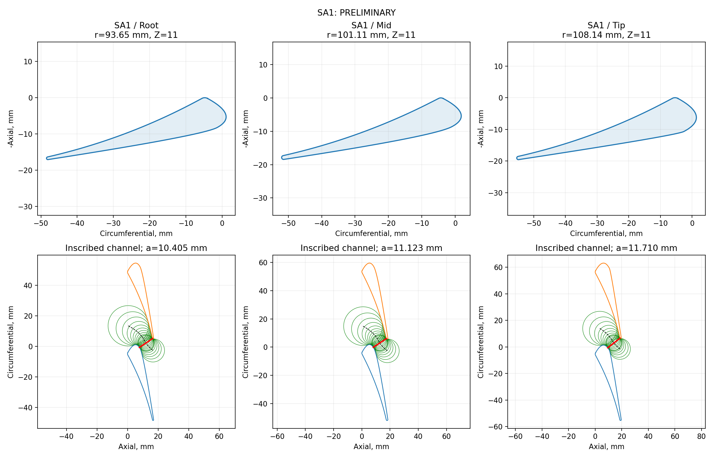
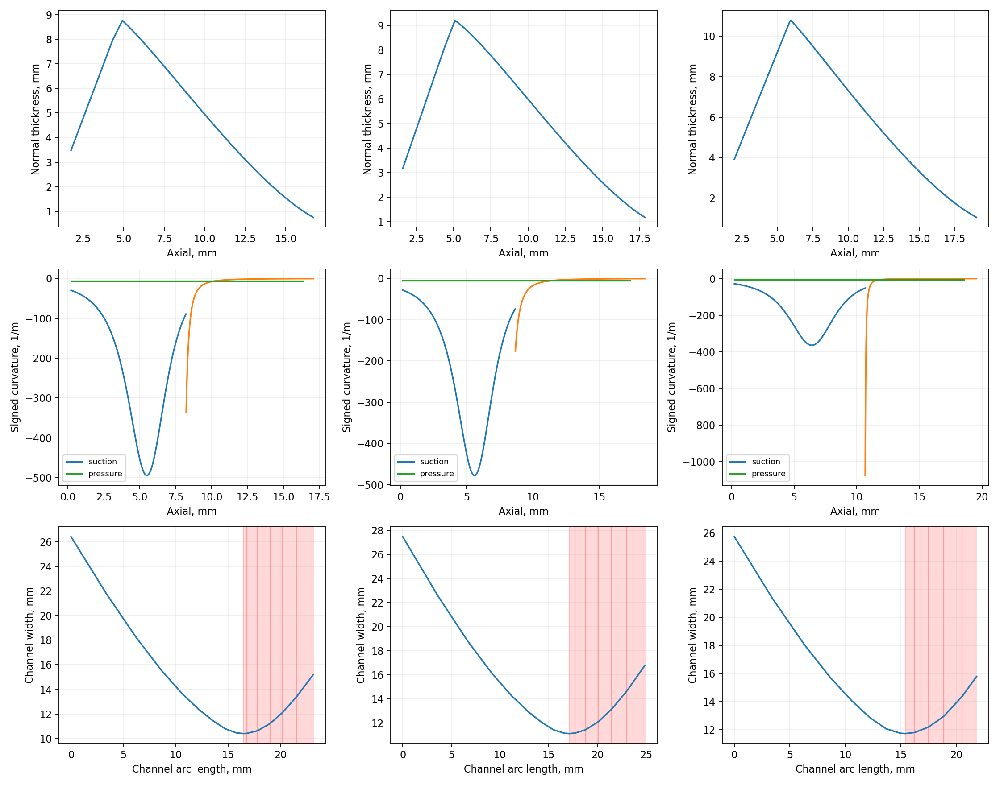
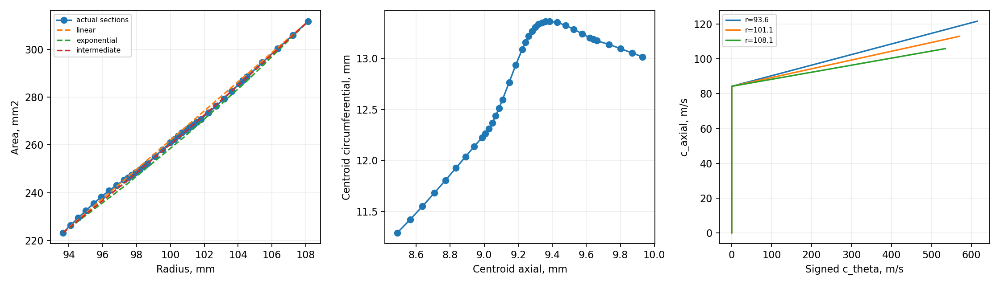
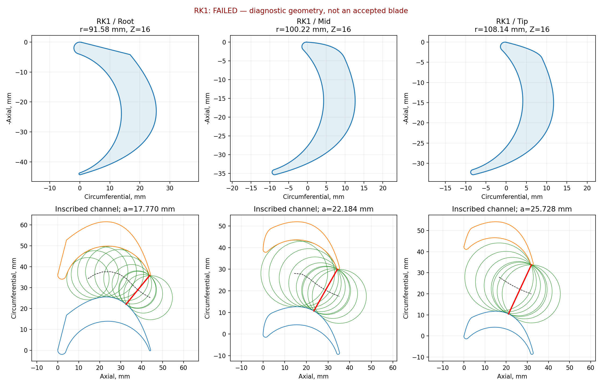
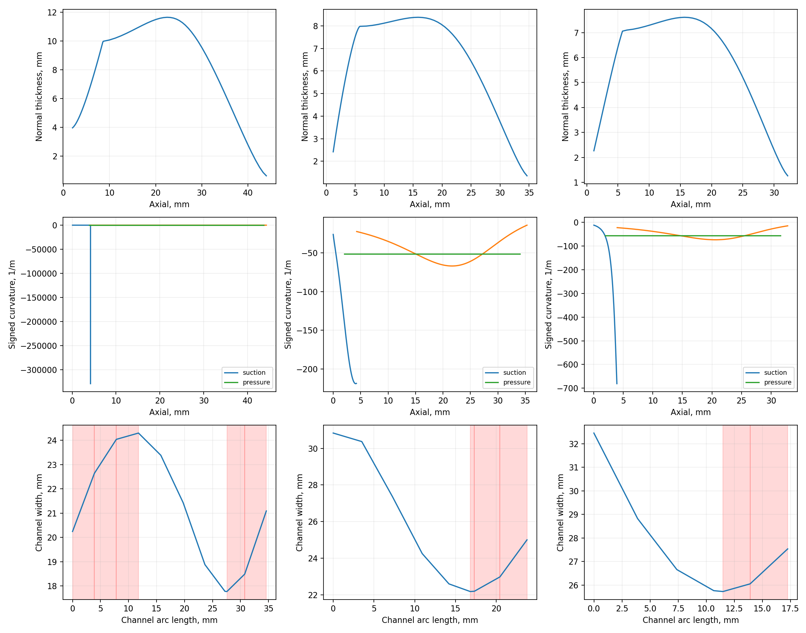
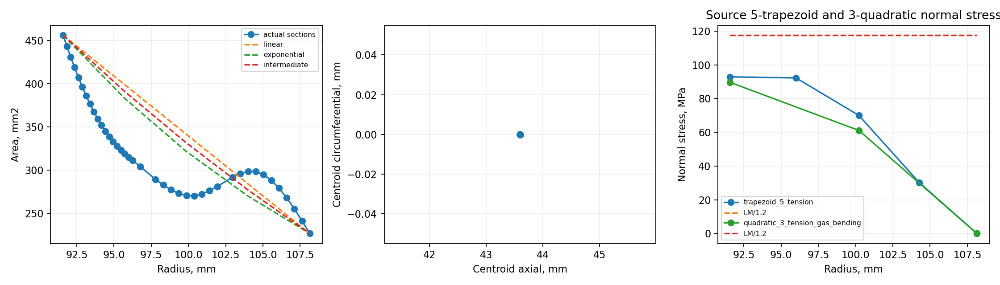
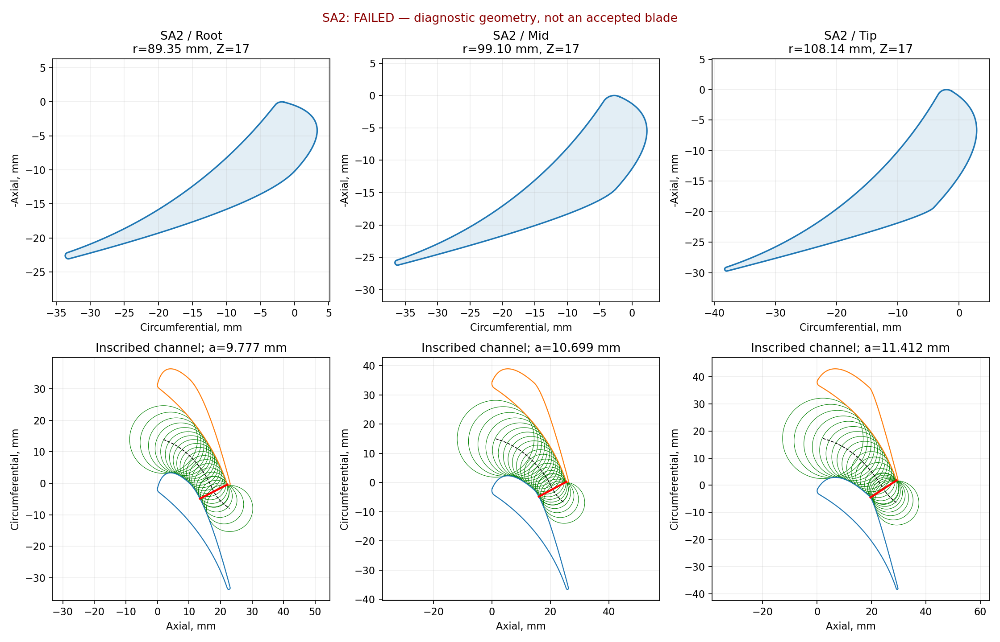
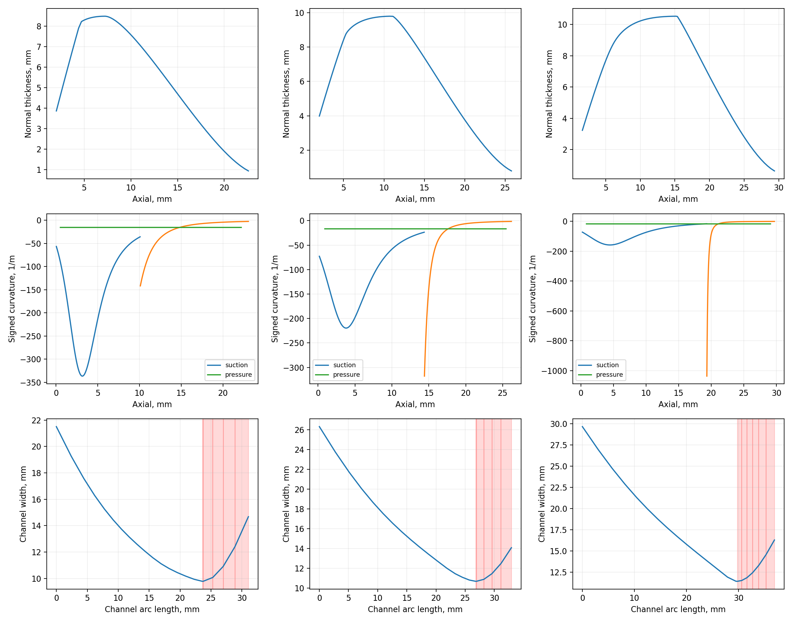
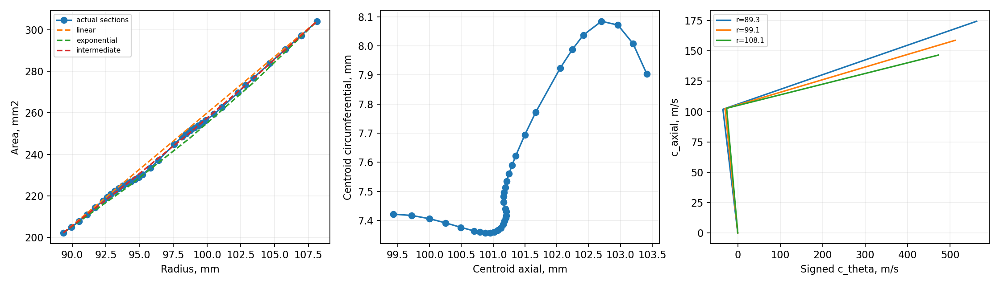
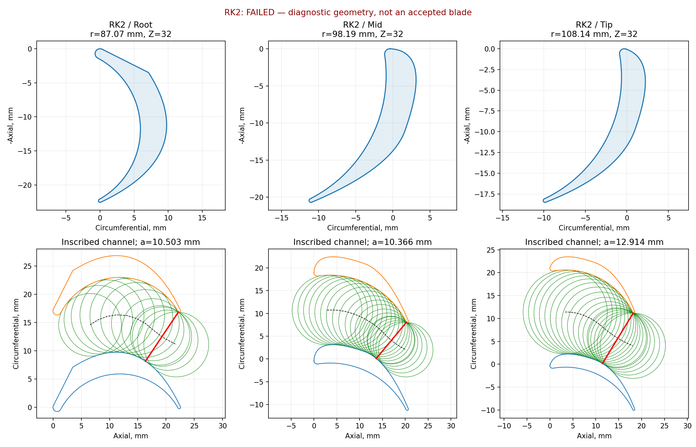
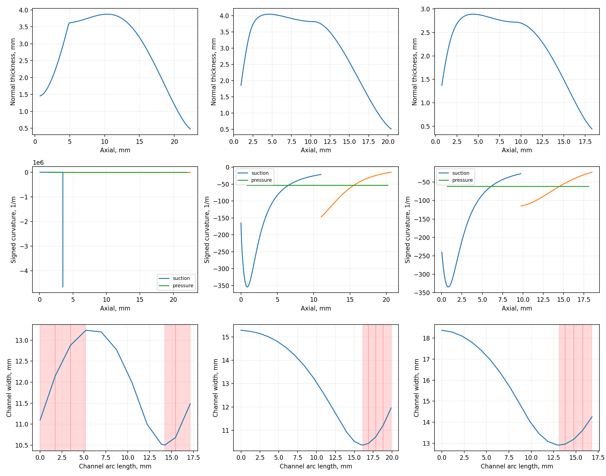
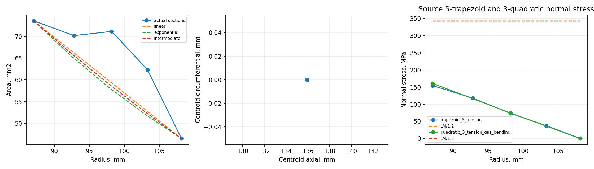
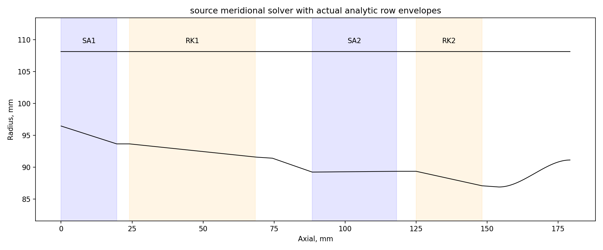

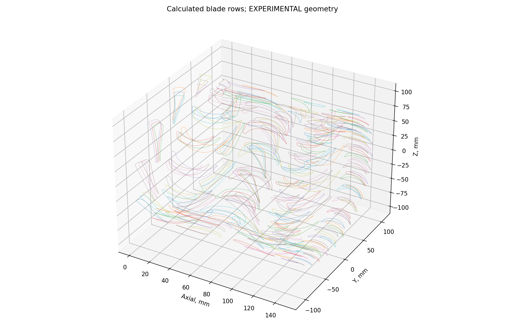

## Scope and missing physical evidence

- Geometry is not CFD/experimental proof of no separation or efficiency.
- Reynolds uses a documented air-viscosity proxy, not measured mixture transport.
- Source variable-cp thermodynamics and independent pressure-equilibrium audits are retained.
- IN738C/LM data are preliminary, not certified supply allowables.
- HCF NOT_CHECKED: grade-specific fatigue curve, forcing and damping are unavailable.
