# Vinogradov — actual TWO-stage course resource calculation

Source: **TVD_1CBK_2st_10000h.ipynb**; resource: **10000 h**; stages: **2**.
Fixed source RPM: **30700**.
Engineering admissible: **False**.
Constructed rows: 4/4.

A failed finite search is not a proof of global infeasibility. No design limit was relaxed.

## Quantified violations

### SA1
- {'section': 0, 'name': 'local streamtube choke conflict', 'possible': False, 'required_flux_kg_m2_s': 538.9756592713645, 'critical_flux_kg_m2_s': 471.9765445887573, 'required_mach': None, 'stagnation_temperature_K': 1249.9999999999998, 'stagnation_pressure_Pa': 422749.4491921801, 'critical_temperature_K': 1081.7030867407584, 'source': 'original variable-cp h, pressure_isentropic, sound'}
- {'section': 3, 'name': 'local streamtube choke conflict', 'possible': False, 'required_flux_kg_m2_s': 516.470411708975, 'critical_flux_kg_m2_s': 471.9765440501777, 'required_mach': None, 'stagnation_temperature_K': 1249.9999895364103, 'stagnation_pressure_Pa': 422749.4468724699, 'critical_temperature_K': 1081.7030774028253, 'source': 'original variable-cp h, pressure_isentropic, sound'}
- {'section': 4, 'name': 'local streamtube choke conflict', 'possible': False, 'required_flux_kg_m2_s': 535.0632276786695, 'critical_flux_kg_m2_s': 471.97654458875684, 'required_mach': None, 'stagnation_temperature_K': 1249.9999999999998, 'stagnation_pressure_Pa': 422749.44919217966, 'critical_temperature_K': 1081.7030867407584, 'source': 'original variable-cp h, pressure_isentropic, sound'}
- {'name': 'insufficient choked capacity', 'value': 0.8101956466970526, 'estimated_error_kg_s': 1.189898310119674e-09, 'limit': 0.8336628797375195, 'units': 'kg/s'}
- {'name': 'radial local choke conflict', 'value': -0.1344234629768719, 'radius_m': 0.10733031653632892, 'limit': 0.0}
- {'name': 'radial CAD mesh unconverged', 'value': 2.870801314249063e-05, 'limit': 2e-05}
### RK1
- {'name': 'vibration strength', 'status': 'NOT_CHECKED', 'reason': 'NOT_CHECKED: no grade-specific fatigue curve, damping or actual harmonic forcing; beam modes are screening only'}
### SA2
- {'section': 1, 'name': 'local streamtube choke conflict', 'possible': False, 'required_flux_kg_m2_s': 253.42595950117192, 'critical_flux_kg_m2_s': 245.01920054288667, 'required_mach': None, 'stagnation_temperature_K': 1099.3007737442865, 'stagnation_pressure_Pa': 205284.8482237486, 'critical_temperature_K': 947.3365961042688, 'source': 'original variable-cp h, pressure_isentropic, sound'}
- {'section': 2, 'name': 'local streamtube choke conflict', 'possible': False, 'required_flux_kg_m2_s': 276.04766438071323, 'critical_flux_kg_m2_s': 245.01918982972262, 'required_mach': None, 'stagnation_temperature_K': 1099.3008533053826, 'stagnation_pressure_Pa': 205284.8469805286, 'critical_temperature_K': 947.336666960503, 'source': 'original variable-cp h, pressure_isentropic, sound'}
- {'name': 'insufficient choked capacity', 'value': 0.8249304467205233, 'estimated_error_kg_s': 1.2496505729244083e-09, 'limit': 0.8336628797375195, 'units': 'kg/s'}
- {'name': 'radial local choke conflict', 'value': -0.11247698308280774, 'radius_m': 0.09916211337359318, 'limit': 0.0}
- {'name': 'radial CAD mesh unconverged', 'value': 3.3935363010841336e-05, 'limit': 2e-05}
### RK2
- {'name': 'vibration strength', 'status': 'NOT_CHECKED', 'reason': 'NOT_CHECKED: no grade-specific fatigue curve, damping or actual harmonic forcing; beam modes are screening only'}

## Global/source violations

- {'row': 'SA1', 'section': 0, 'name': 'local streamtube choke conflict', 'possible': False, 'required_flux_kg_m2_s': 538.9756592713645, 'critical_flux_kg_m2_s': 471.9765445887573, 'required_mach': None, 'stagnation_temperature_K': 1249.9999999999998, 'stagnation_pressure_Pa': 422749.4491921801, 'critical_temperature_K': 1081.7030867407584, 'source': 'original variable-cp h, pressure_isentropic, sound'}
- {'row': 'SA1', 'section': 3, 'name': 'local streamtube choke conflict', 'possible': False, 'required_flux_kg_m2_s': 516.470411708975, 'critical_flux_kg_m2_s': 471.9765440501777, 'required_mach': None, 'stagnation_temperature_K': 1249.9999895364103, 'stagnation_pressure_Pa': 422749.4468724699, 'critical_temperature_K': 1081.7030774028253, 'source': 'original variable-cp h, pressure_isentropic, sound'}
- {'row': 'SA1', 'section': 4, 'name': 'local streamtube choke conflict', 'possible': False, 'required_flux_kg_m2_s': 535.0632276786695, 'critical_flux_kg_m2_s': 471.97654458875684, 'required_mach': None, 'stagnation_temperature_K': 1249.9999999999998, 'stagnation_pressure_Pa': 422749.44919217966, 'critical_temperature_K': 1081.7030867407584, 'source': 'original variable-cp h, pressure_isentropic, sound'}
- {'row': 'SA1', 'name': 'insufficient choked capacity', 'value': 0.8101956466970526, 'estimated_error_kg_s': 1.189898310119674e-09, 'limit': 0.8336628797375195, 'units': 'kg/s'}
- {'row': 'SA1', 'name': 'radial local choke conflict', 'value': -0.1344234629768719, 'radius_m': 0.10733031653632892, 'limit': 0.0}
- {'row': 'SA1', 'name': 'radial CAD mesh unconverged', 'value': 2.870801314249063e-05, 'limit': 2e-05}
- {'row': 'RK1', 'name': 'vibration strength', 'status': 'NOT_CHECKED', 'reason': 'NOT_CHECKED: no grade-specific fatigue curve, damping or actual harmonic forcing; beam modes are screening only'}
- {'row': 'SA2', 'section': 1, 'name': 'local streamtube choke conflict', 'possible': False, 'required_flux_kg_m2_s': 253.42595950117192, 'critical_flux_kg_m2_s': 245.01920054288667, 'required_mach': None, 'stagnation_temperature_K': 1099.3007737442865, 'stagnation_pressure_Pa': 205284.8482237486, 'critical_temperature_K': 947.3365961042688, 'source': 'original variable-cp h, pressure_isentropic, sound'}
- {'row': 'SA2', 'section': 2, 'name': 'local streamtube choke conflict', 'possible': False, 'required_flux_kg_m2_s': 276.04766438071323, 'critical_flux_kg_m2_s': 245.01918982972262, 'required_mach': None, 'stagnation_temperature_K': 1099.3008533053826, 'stagnation_pressure_Pa': 205284.8469805286, 'critical_temperature_K': 947.336666960503, 'source': 'original variable-cp h, pressure_isentropic, sound'}
- {'row': 'SA2', 'name': 'insufficient choked capacity', 'value': 0.8249304467205233, 'estimated_error_kg_s': 1.2496505729244083e-09, 'limit': 0.8336628797375195, 'units': 'kg/s'}
- {'row': 'SA2', 'name': 'radial local choke conflict', 'value': -0.11247698308280774, 'radius_m': 0.09916211337359318, 'limit': 0.0}
- {'row': 'SA2', 'name': 'radial CAD mesh unconverged', 'value': 3.3935363010841336e-05, 'limit': 2e-05}
- {'row': 'RK2', 'name': 'vibration strength', 'status': 'NOT_CHECKED', 'reason': 'NOT_CHECKED: no grade-specific fatigue curve, damping or actual harmonic forcing; beam modes are screening only'}
- {'row': 'SA2', 'section': 3, 'name': 'source finite trailing edge', 'value': 0.0004786220488437605, 'limit': 0.0005}

## Empirical guidance — not added hard limits

- {'row': 'SA1', 'section': 0, 'name': 'measured back angle outside source guidance', 'value': 4.6361031560339505, 'recommended_range_deg': [5.0, 10.0], 'source_maximum_deg': 15.0, 'classification': 'empirical applicability review, not a new physical limit; Vinogradov pp.7–14'}
- {'row': 'SA1', 'section': 0, 'name': 'relative thickness starting guidance', 'value': 0.15300085367120073, 'range': [0.1, 0.1], 'classification': 'empirical, p13'}
- {'row': 'SA1', 'section': 0, 'name': 'prior profile guide: толщина выходной кромки', 'measurements': {'geometry_valid': True, 'circle_crosses_open_station_cut': False, 'intersections': False, 'self_intersection': False, 'area_equivalent_angle_deg': 9.441762647450268, 'area_ratio': 0.16404502699996956, 'angle_comparison': 'uniform-flux geometric comparison, not actual gas exit angle', 'angle_error_deg': -1.758237352549731, 'te_over_throat': 0.0921554752120134, 'book_te_over_throat': 0.055, 'max_reduced_expansion': 1.6266892140396407}, 'relative_thickness': 0.15300085367120073, 'actual_relative_pitch': 0.7036239957499458, 'classification': 'historical empirical profile guide; Vinogradov uses its own recommendations'}
- {'row': 'SA1', 'section': 0, 'name': 'prior profile guide: местная диффузорность', 'measurements': {'geometry_valid': True, 'circle_crosses_open_station_cut': False, 'intersections': False, 'self_intersection': False, 'area_equivalent_angle_deg': 9.441762647450268, 'area_ratio': 0.16404502699996956, 'angle_comparison': 'uniform-flux geometric comparison, not actual gas exit angle', 'angle_error_deg': -1.758237352549731, 'te_over_throat': 0.0921554752120134, 'book_te_over_throat': 0.055, 'max_reduced_expansion': 1.6266892140396407}, 'relative_thickness': 0.15300085367120073, 'actual_relative_pitch': 0.7036239957499458, 'classification': 'historical empirical profile guide; Vinogradov uses its own recommendations'}
- {'row': 'SA1', 'section': 0, 'name': 'prior profile guide: максимальная толщина', 'measurements': {'geometry_valid': True, 'circle_crosses_open_station_cut': False, 'intersections': False, 'self_intersection': False, 'area_equivalent_angle_deg': 9.441762647450268, 'area_ratio': 0.16404502699996956, 'angle_comparison': 'uniform-flux geometric comparison, not actual gas exit angle', 'angle_error_deg': -1.758237352549731, 'te_over_throat': 0.0921554752120134, 'book_te_over_throat': 0.055, 'max_reduced_expansion': 1.6266892140396407}, 'relative_thickness': 0.15300085367120073, 'actual_relative_pitch': 0.7036239957499458, 'classification': 'historical empirical profile guide; Vinogradov uses its own recommendations'}
- {'row': 'SA1', 'section': 1, 'name': 'relative thickness starting guidance', 'value': 0.16551159388860315, 'range': [0.1, 0.1], 'classification': 'empirical, p13'}
- {'row': 'SA1', 'section': 1, 'name': 'prior profile guide: толщина выходной кромки', 'measurements': {'geometry_valid': True, 'circle_crosses_open_station_cut': False, 'intersections': False, 'self_intersection': False, 'area_equivalent_angle_deg': 11.105204285788735, 'area_ratio': 0.19261109843052843, 'angle_comparison': 'uniform-flux geometric comparison, not actual gas exit angle', 'angle_error_deg': -0.0947957142112621, 'te_over_throat': 0.1107314220595029, 'book_te_over_throat': 0.055, 'max_reduced_expansion': 1.3119543267949718}, 'relative_thickness': 0.16551159388860315, 'actual_relative_pitch': 0.8425863014560234, 'classification': 'historical empirical profile guide; Vinogradov uses its own recommendations'}
- {'row': 'SA1', 'section': 1, 'name': 'prior profile guide: местная диффузорность', 'measurements': {'geometry_valid': True, 'circle_crosses_open_station_cut': False, 'intersections': False, 'self_intersection': False, 'area_equivalent_angle_deg': 11.105204285788735, 'area_ratio': 0.19261109843052843, 'angle_comparison': 'uniform-flux geometric comparison, not actual gas exit angle', 'angle_error_deg': -0.0947957142112621, 'te_over_throat': 0.1107314220595029, 'book_te_over_throat': 0.055, 'max_reduced_expansion': 1.3119543267949718}, 'relative_thickness': 0.16551159388860315, 'actual_relative_pitch': 0.8425863014560234, 'classification': 'historical empirical profile guide; Vinogradov uses its own recommendations'}
- {'row': 'SA1', 'section': 1, 'name': 'prior profile guide: максимальная толщина', 'measurements': {'geometry_valid': True, 'circle_crosses_open_station_cut': False, 'intersections': False, 'self_intersection': False, 'area_equivalent_angle_deg': 11.105204285788735, 'area_ratio': 0.19261109843052843, 'angle_comparison': 'uniform-flux geometric comparison, not actual gas exit angle', 'angle_error_deg': -0.0947957142112621, 'te_over_throat': 0.1107314220595029, 'book_te_over_throat': 0.055, 'max_reduced_expansion': 1.3119543267949718}, 'relative_thickness': 0.16551159388860315, 'actual_relative_pitch': 0.8425863014560234, 'classification': 'historical empirical profile guide; Vinogradov uses its own recommendations'}
- {'row': 'SA1', 'section': 2, 'name': 'relative thickness starting guidance', 'value': 0.1314551905076287, 'range': [0.1, 0.1], 'classification': 'empirical, p13'}
- {'row': 'SA1', 'section': 2, 'name': 'prior profile guide: толщина выходной кромки', 'measurements': {'geometry_valid': True, 'circle_crosses_open_station_cut': False, 'intersections': False, 'self_intersection': False, 'area_equivalent_angle_deg': 11.169502172028066, 'area_ratio': 0.19371217354859455, 'angle_comparison': 'uniform-flux geometric comparison, not actual gas exit angle', 'angle_error_deg': -0.030497827971933233, 'te_over_throat': 0.08038858195745036, 'book_te_over_throat': 0.055, 'max_reduced_expansion': 1.6191027474330721}, 'relative_thickness': 0.1314551905076287, 'actual_relative_pitch': 0.8459321834306106, 'classification': 'historical empirical profile guide; Vinogradov uses its own recommendations'}
- {'row': 'SA1', 'section': 2, 'name': 'prior profile guide: местная диффузорность', 'measurements': {'geometry_valid': True, 'circle_crosses_open_station_cut': False, 'intersections': False, 'self_intersection': False, 'area_equivalent_angle_deg': 11.169502172028066, 'area_ratio': 0.19371217354859455, 'angle_comparison': 'uniform-flux geometric comparison, not actual gas exit angle', 'angle_error_deg': -0.030497827971933233, 'te_over_throat': 0.08038858195745036, 'book_te_over_throat': 0.055, 'max_reduced_expansion': 1.6191027474330721}, 'relative_thickness': 0.1314551905076287, 'actual_relative_pitch': 0.8459321834306106, 'classification': 'historical empirical profile guide; Vinogradov uses its own recommendations'}
- {'row': 'SA1', 'section': 3, 'name': 'relative thickness starting guidance', 'value': 0.20135574431371275, 'range': [0.1, 0.1], 'classification': 'empirical, p13'}
- {'row': 'SA1', 'section': 3, 'name': 'prior profile guide: толщина выходной кромки', 'measurements': {'geometry_valid': True, 'circle_crosses_open_station_cut': False, 'intersections': False, 'self_intersection': False, 'area_equivalent_angle_deg': 9.60511367918293, 'area_ratio': 0.16685674672917233, 'angle_comparison': 'uniform-flux geometric comparison, not actual gas exit angle', 'angle_error_deg': -1.5948863208170696, 'te_over_throat': 0.11953968861695773, 'book_te_over_throat': 0.055, 'max_reduced_expansion': 1.3918533941664948}, 'relative_thickness': 0.20135574431371275, 'actual_relative_pitch': 0.9535673202565477, 'classification': 'historical empirical profile guide; Vinogradov uses its own recommendations'}
- {'row': 'SA1', 'section': 3, 'name': 'prior profile guide: местная диффузорность', 'measurements': {'geometry_valid': True, 'circle_crosses_open_station_cut': False, 'intersections': False, 'self_intersection': False, 'area_equivalent_angle_deg': 9.60511367918293, 'area_ratio': 0.16685674672917233, 'angle_comparison': 'uniform-flux geometric comparison, not actual gas exit angle', 'angle_error_deg': -1.5948863208170696, 'te_over_throat': 0.11953968861695773, 'book_te_over_throat': 0.055, 'max_reduced_expansion': 1.3918533941664948}, 'relative_thickness': 0.20135574431371275, 'actual_relative_pitch': 0.9535673202565477, 'classification': 'historical empirical profile guide; Vinogradov uses its own recommendations'}
- {'row': 'SA1', 'section': 3, 'name': 'prior profile guide: максимальная толщина', 'measurements': {'geometry_valid': True, 'circle_crosses_open_station_cut': False, 'intersections': False, 'self_intersection': False, 'area_equivalent_angle_deg': 9.60511367918293, 'area_ratio': 0.16685674672917233, 'angle_comparison': 'uniform-flux geometric comparison, not actual gas exit angle', 'angle_error_deg': -1.5948863208170696, 'te_over_throat': 0.11953968861695773, 'book_te_over_throat': 0.055, 'max_reduced_expansion': 1.3918533941664948}, 'relative_thickness': 0.20135574431371275, 'actual_relative_pitch': 0.9535673202565477, 'classification': 'historical empirical profile guide; Vinogradov uses its own recommendations'}
- {'row': 'SA1', 'section': 3, 'name': 'prior profile guide: относительный шаг', 'measurements': {'geometry_valid': True, 'circle_crosses_open_station_cut': False, 'intersections': False, 'self_intersection': False, 'area_equivalent_angle_deg': 9.60511367918293, 'area_ratio': 0.16685674672917233, 'angle_comparison': 'uniform-flux geometric comparison, not actual gas exit angle', 'angle_error_deg': -1.5948863208170696, 'te_over_throat': 0.11953968861695773, 'book_te_over_throat': 0.055, 'max_reduced_expansion': 1.3918533941664948}, 'relative_thickness': 0.20135574431371275, 'actual_relative_pitch': 0.9535673202565477, 'classification': 'historical empirical profile guide; Vinogradov uses its own recommendations'}
- {'row': 'SA1', 'section': 4, 'name': 'relative thickness starting guidance', 'value': 0.12304704346258566, 'range': [0.1, 0.1], 'classification': 'empirical, p13'}
- {'row': 'SA1', 'section': 4, 'name': 'prior profile guide: толщина выходной кромки', 'measurements': {'geometry_valid': True, 'circle_crosses_open_station_cut': False, 'intersections': False, 'self_intersection': False, 'area_equivalent_angle_deg': 9.235013887079893, 'area_ratio': 0.16048440428738675, 'angle_comparison': 'uniform-flux geometric comparison, not actual gas exit angle', 'angle_error_deg': -1.9649861129201085, 'te_over_throat': 0.06866013881870828, 'book_te_over_throat': 0.055, 'max_reduced_expansion': 1.5805184464631636}, 'relative_thickness': 0.12304704346258566, 'actual_relative_pitch': 0.754975744004445, 'classification': 'historical empirical profile guide; Vinogradov uses its own recommendations'}
- {'row': 'SA1', 'section': 4, 'name': 'prior profile guide: местная диффузорность', 'measurements': {'geometry_valid': True, 'circle_crosses_open_station_cut': False, 'intersections': False, 'self_intersection': False, 'area_equivalent_angle_deg': 9.235013887079893, 'area_ratio': 0.16048440428738675, 'angle_comparison': 'uniform-flux geometric comparison, not actual gas exit angle', 'angle_error_deg': -1.9649861129201085, 'te_over_throat': 0.06866013881870828, 'book_te_over_throat': 0.055, 'max_reduced_expansion': 1.5805184464631636}, 'relative_thickness': 0.12304704346258566, 'actual_relative_pitch': 0.754975744004445, 'classification': 'historical empirical profile guide; Vinogradov uses its own recommendations'}
- {'row': 'RK1', 'section': 0, 'name': 'measured back angle outside source guidance', 'value': 25.372788915984813, 'recommended_range_deg': [5.0, 10.0], 'source_maximum_deg': 15.0, 'classification': 'empirical applicability review, not a new physical limit; Vinogradov pp.7–14'}
- {'row': 'RK1', 'section': 0, 'name': 'subsonic entrance expansion guidance', 'value': 1.158866914783705, 'limit': 1.1, 'classification': 'empirical recommendation; CFD required'}
- {'row': 'RK1', 'section': 0, 'name': 'prior profile guide: угол горла', 'measurements': {'geometry_valid': True, 'circle_crosses_open_station_cut': False, 'intersections': False, 'self_intersection': False, 'area_equivalent_angle_deg': 22.846257249100482, 'area_ratio': 0.3882597182749, 'angle_comparison': 'uniform-flux geometric comparison, not actual gas exit angle', 'angle_error_deg': 4.030845214498498, 'te_over_throat': 0.18405455240256935, 'book_te_over_throat': 0.07, 'max_reduced_expansion': 1.2164988334255944}, 'relative_thickness': 0.23428193513369033, 'actual_relative_pitch': 0.5937391631396002, 'classification': 'historical empirical profile guide; Vinogradov uses its own recommendations'}
- {'row': 'RK1', 'section': 0, 'name': 'prior profile guide: толщина выходной кромки', 'measurements': {'geometry_valid': True, 'circle_crosses_open_station_cut': False, 'intersections': False, 'self_intersection': False, 'area_equivalent_angle_deg': 22.846257249100482, 'area_ratio': 0.3882597182749, 'angle_comparison': 'uniform-flux geometric comparison, not actual gas exit angle', 'angle_error_deg': 4.030845214498498, 'te_over_throat': 0.18405455240256935, 'book_te_over_throat': 0.07, 'max_reduced_expansion': 1.2164988334255944}, 'relative_thickness': 0.23428193513369033, 'actual_relative_pitch': 0.5937391631396002, 'classification': 'historical empirical profile guide; Vinogradov uses its own recommendations'}
- {'row': 'RK1', 'section': 0, 'name': 'prior profile guide: местная диффузорность', 'measurements': {'geometry_valid': True, 'circle_crosses_open_station_cut': False, 'intersections': False, 'self_intersection': False, 'area_equivalent_angle_deg': 22.846257249100482, 'area_ratio': 0.3882597182749, 'angle_comparison': 'uniform-flux geometric comparison, not actual gas exit angle', 'angle_error_deg': 4.030845214498498, 'te_over_throat': 0.18405455240256935, 'book_te_over_throat': 0.07, 'max_reduced_expansion': 1.2164988334255944}, 'relative_thickness': 0.23428193513369033, 'actual_relative_pitch': 0.5937391631396002, 'classification': 'historical empirical profile guide; Vinogradov uses its own recommendations'}
- {'row': 'RK1', 'section': 0, 'name': 'prior profile guide: максимальная толщина', 'measurements': {'geometry_valid': True, 'circle_crosses_open_station_cut': False, 'intersections': False, 'self_intersection': False, 'area_equivalent_angle_deg': 22.846257249100482, 'area_ratio': 0.3882597182749, 'angle_comparison': 'uniform-flux geometric comparison, not actual gas exit angle', 'angle_error_deg': 4.030845214498498, 'te_over_throat': 0.18405455240256935, 'book_te_over_throat': 0.07, 'max_reduced_expansion': 1.2164988334255944}, 'relative_thickness': 0.23428193513369033, 'actual_relative_pitch': 0.5937391631396002, 'classification': 'historical empirical profile guide; Vinogradov uses its own recommendations'}
- {'row': 'RK1', 'section': 1, 'name': 'measured back angle outside source guidance', 'value': 25.68051920780327, 'recommended_range_deg': [5.0, 10.0], 'source_maximum_deg': 15.0, 'classification': 'empirical applicability review, not a new physical limit; Vinogradov pp.7–14'}
- {'row': 'RK1', 'section': 1, 'name': 'subsonic entrance expansion guidance', 'value': 1.1727001379832753, 'limit': 1.1, 'classification': 'empirical recommendation; CFD required'}
- {'row': 'RK1', 'section': 1, 'name': 'relative thickness starting guidance', 'value': 0.25682636229703854, 'range': [0.14658407163388162, 0.21987610745082242], 'classification': 'empirical, p13'}
- {'row': 'RK1', 'section': 1, 'name': 'prior profile guide: угол горла', 'measurements': {'geometry_valid': True, 'circle_crosses_open_station_cut': True, 'intersections': False, 'self_intersection': False, 'area_equivalent_angle_deg': 25.16738376288406, 'area_ratio': 0.4252641400983955, 'angle_comparison': 'uniform-flux geometric comparison, not actual gas exit angle', 'angle_error_deg': 6.898693126238484, 'te_over_throat': 0.05557504524027045, 'book_te_over_throat': 0.07, 'max_reduced_expansion': 1.221255260680664}, 'relative_thickness': 0.25682636229703854, 'actual_relative_pitch': 0.6607810163635434, 'classification': 'historical empirical profile guide; Vinogradov uses its own recommendations'}
- {'row': 'RK1', 'section': 1, 'name': 'prior profile guide: местная диффузорность', 'measurements': {'geometry_valid': True, 'circle_crosses_open_station_cut': True, 'intersections': False, 'self_intersection': False, 'area_equivalent_angle_deg': 25.16738376288406, 'area_ratio': 0.4252641400983955, 'angle_comparison': 'uniform-flux geometric comparison, not actual gas exit angle', 'angle_error_deg': 6.898693126238484, 'te_over_throat': 0.05557504524027045, 'book_te_over_throat': 0.07, 'max_reduced_expansion': 1.221255260680664}, 'relative_thickness': 0.25682636229703854, 'actual_relative_pitch': 0.6607810163635434, 'classification': 'historical empirical profile guide; Vinogradov uses its own recommendations'}
- {'row': 'RK1', 'section': 1, 'name': 'prior profile guide: максимальная толщина', 'measurements': {'geometry_valid': True, 'circle_crosses_open_station_cut': True, 'intersections': False, 'self_intersection': False, 'area_equivalent_angle_deg': 25.16738376288406, 'area_ratio': 0.4252641400983955, 'angle_comparison': 'uniform-flux geometric comparison, not actual gas exit angle', 'angle_error_deg': 6.898693126238484, 'te_over_throat': 0.05557504524027045, 'book_te_over_throat': 0.07, 'max_reduced_expansion': 1.221255260680664}, 'relative_thickness': 0.25682636229703854, 'actual_relative_pitch': 0.6607810163635434, 'classification': 'historical empirical profile guide; Vinogradov uses its own recommendations'}
- {'row': 'RK1', 'section': 1, 'name': 'prior profile guide: относительный шаг', 'measurements': {'geometry_valid': True, 'circle_crosses_open_station_cut': True, 'intersections': False, 'self_intersection': False, 'area_equivalent_angle_deg': 25.16738376288406, 'area_ratio': 0.4252641400983955, 'angle_comparison': 'uniform-flux geometric comparison, not actual gas exit angle', 'angle_error_deg': 6.898693126238484, 'te_over_throat': 0.05557504524027045, 'book_te_over_throat': 0.07, 'max_reduced_expansion': 1.221255260680664}, 'relative_thickness': 0.25682636229703854, 'actual_relative_pitch': 0.6607810163635434, 'classification': 'historical empirical profile guide; Vinogradov uses its own recommendations'}
- {'row': 'RK1', 'section': 2, 'name': 'measured back angle outside source guidance', 'value': 30.914405697438305, 'recommended_range_deg': [5.0, 10.0], 'source_maximum_deg': 15.0, 'classification': 'empirical applicability review, not a new physical limit; Vinogradov pp.7–14'}
- {'row': 'RK1', 'section': 2, 'name': 'subsonic entrance expansion guidance', 'value': 1.1073471803157255, 'limit': 1.1, 'classification': 'empirical recommendation; CFD required'}
- {'row': 'RK1', 'section': 2, 'name': 'relative thickness starting guidance', 'value': 0.3682482998438787, 'range': [0.09738937847815876, 0.1456489641302646], 'classification': 'empirical, p13'}
- {'row': 'RK1', 'section': 2, 'name': 'prior profile guide: угол горла', 'measurements': {'geometry_valid': True, 'circle_crosses_open_station_cut': True, 'intersections': False, 'self_intersection': False, 'area_equivalent_angle_deg': 21.774012243542224, 'area_ratio': 0.37094666226947526, 'angle_comparison': 'uniform-flux geometric comparison, not actual gas exit angle', 'angle_error_deg': 4.012869217732032, 'te_over_throat': 0.06767987466453237, 'book_te_over_throat': 0.07, 'max_reduced_expansion': 1.1600698306359662}, 'relative_thickness': 0.3682482998438787, 'actual_relative_pitch': 0.8674261096141821, 'classification': 'historical empirical profile guide; Vinogradov uses its own recommendations'}
- {'row': 'RK1', 'section': 2, 'name': 'prior profile guide: местная диффузорность', 'measurements': {'geometry_valid': True, 'circle_crosses_open_station_cut': True, 'intersections': False, 'self_intersection': False, 'area_equivalent_angle_deg': 21.774012243542224, 'area_ratio': 0.37094666226947526, 'angle_comparison': 'uniform-flux geometric comparison, not actual gas exit angle', 'angle_error_deg': 4.012869217732032, 'te_over_throat': 0.06767987466453237, 'book_te_over_throat': 0.07, 'max_reduced_expansion': 1.1600698306359662}, 'relative_thickness': 0.3682482998438787, 'actual_relative_pitch': 0.8674261096141821, 'classification': 'historical empirical profile guide; Vinogradov uses its own recommendations'}
- {'row': 'RK1', 'section': 2, 'name': 'prior profile guide: максимальная толщина', 'measurements': {'geometry_valid': True, 'circle_crosses_open_station_cut': True, 'intersections': False, 'self_intersection': False, 'area_equivalent_angle_deg': 21.774012243542224, 'area_ratio': 0.37094666226947526, 'angle_comparison': 'uniform-flux geometric comparison, not actual gas exit angle', 'angle_error_deg': 4.012869217732032, 'te_over_throat': 0.06767987466453237, 'book_te_over_throat': 0.07, 'max_reduced_expansion': 1.1600698306359662}, 'relative_thickness': 0.3682482998438787, 'actual_relative_pitch': 0.8674261096141821, 'classification': 'historical empirical profile guide; Vinogradov uses its own recommendations'}
- {'row': 'RK1', 'section': 2, 'name': 'prior profile guide: относительный шаг', 'measurements': {'geometry_valid': True, 'circle_crosses_open_station_cut': True, 'intersections': False, 'self_intersection': False, 'area_equivalent_angle_deg': 21.774012243542224, 'area_ratio': 0.37094666226947526, 'angle_comparison': 'uniform-flux geometric comparison, not actual gas exit angle', 'angle_error_deg': 4.012869217732032, 'te_over_throat': 0.06767987466453237, 'book_te_over_throat': 0.07, 'max_reduced_expansion': 1.1600698306359662}, 'relative_thickness': 0.3682482998438787, 'actual_relative_pitch': 0.8674261096141821, 'classification': 'historical empirical profile guide; Vinogradov uses its own recommendations'}
- {'row': 'RK1', 'section': 3, 'name': 'measured back angle outside source guidance', 'value': 32.90495184457196, 'recommended_range_deg': [5.0, 10.0], 'source_maximum_deg': 15.0, 'classification': 'empirical applicability review, not a new physical limit; Vinogradov pp.7–14'}
- {'row': 'RK1', 'section': 3, 'name': 'relative thickness starting guidance', 'value': 0.3145932920684195, 'range': [0.06812418197944138, 0.09687363663240228], 'classification': 'empirical, p13'}
- {'row': 'RK1', 'section': 3, 'name': 'prior profile guide: угол горла', 'measurements': {'geometry_valid': True, 'circle_crosses_open_station_cut': True, 'intersections': False, 'self_intersection': False, 'area_equivalent_angle_deg': 27.25404702751652, 'area_ratio': 0.45793670877154136, 'angle_comparison': 'uniform-flux geometric comparison, not actual gas exit angle', 'angle_error_deg': 9.96447051582437, 'te_over_throat': 0.06127551804470914, 'book_te_over_throat': 0.07, 'max_reduced_expansion': 1.1478187151918695}, 'relative_thickness': 0.3145932920684195, 'actual_relative_pitch': 0.8764531192914756, 'classification': 'historical empirical profile guide; Vinogradov uses its own recommendations'}
- {'row': 'RK1', 'section': 3, 'name': 'prior profile guide: местная диффузорность', 'measurements': {'geometry_valid': True, 'circle_crosses_open_station_cut': True, 'intersections': False, 'self_intersection': False, 'area_equivalent_angle_deg': 27.25404702751652, 'area_ratio': 0.45793670877154136, 'angle_comparison': 'uniform-flux geometric comparison, not actual gas exit angle', 'angle_error_deg': 9.96447051582437, 'te_over_throat': 0.06127551804470914, 'book_te_over_throat': 0.07, 'max_reduced_expansion': 1.1478187151918695}, 'relative_thickness': 0.3145932920684195, 'actual_relative_pitch': 0.8764531192914756, 'classification': 'historical empirical profile guide; Vinogradov uses its own recommendations'}
- {'row': 'RK1', 'section': 3, 'name': 'prior profile guide: максимальная толщина', 'measurements': {'geometry_valid': True, 'circle_crosses_open_station_cut': True, 'intersections': False, 'self_intersection': False, 'area_equivalent_angle_deg': 27.25404702751652, 'area_ratio': 0.45793670877154136, 'angle_comparison': 'uniform-flux geometric comparison, not actual gas exit angle', 'angle_error_deg': 9.96447051582437, 'te_over_throat': 0.06127551804470914, 'book_te_over_throat': 0.07, 'max_reduced_expansion': 1.1478187151918695}, 'relative_thickness': 0.3145932920684195, 'actual_relative_pitch': 0.8764531192914756, 'classification': 'historical empirical profile guide; Vinogradov uses its own recommendations'}
- {'row': 'RK1', 'section': 3, 'name': 'prior profile guide: относительный шаг', 'measurements': {'geometry_valid': True, 'circle_crosses_open_station_cut': True, 'intersections': False, 'self_intersection': False, 'area_equivalent_angle_deg': 27.25404702751652, 'area_ratio': 0.45793670877154136, 'angle_comparison': 'uniform-flux geometric comparison, not actual gas exit angle', 'angle_error_deg': 9.96447051582437, 'te_over_throat': 0.06127551804470914, 'book_te_over_throat': 0.07, 'max_reduced_expansion': 1.1478187151918695}, 'relative_thickness': 0.3145932920684195, 'actual_relative_pitch': 0.8764531192914756, 'classification': 'historical empirical profile guide; Vinogradov uses its own recommendations'}
- {'row': 'RK1', 'section': 4, 'name': 'measured back angle outside source guidance', 'value': 36.83441050945579, 'recommended_range_deg': [5.0, 10.0], 'source_maximum_deg': 15.0, 'classification': 'empirical applicability review, not a new physical limit; Vinogradov pp.7–14'}
- {'row': 'RK1', 'section': 4, 'name': 'relative thickness starting guidance', 'value': 0.34525159726456683, 'range': [0.04, 0.05], 'classification': 'empirical, p13'}
- {'row': 'RK1', 'section': 4, 'name': 'prior profile guide: угол горла', 'measurements': {'geometry_valid': True, 'circle_crosses_open_station_cut': True, 'intersections': False, 'self_intersection': False, 'area_equivalent_angle_deg': 28.68110037027921, 'area_ratio': 0.4799341352168419, 'angle_comparison': 'uniform-flux geometric comparison, not actual gas exit angle', 'angle_error_deg': 11.830443252611257, 'te_over_throat': 0.05461015998886525, 'book_te_over_throat': 0.07, 'max_reduced_expansion': 1.2231690041411665}, 'relative_thickness': 0.34525159726456683, 'actual_relative_pitch': 1.0144983347346672, 'classification': 'historical empirical profile guide; Vinogradov uses its own recommendations'}
- {'row': 'RK1', 'section': 4, 'name': 'prior profile guide: местная диффузорность', 'measurements': {'geometry_valid': True, 'circle_crosses_open_station_cut': True, 'intersections': False, 'self_intersection': False, 'area_equivalent_angle_deg': 28.68110037027921, 'area_ratio': 0.4799341352168419, 'angle_comparison': 'uniform-flux geometric comparison, not actual gas exit angle', 'angle_error_deg': 11.830443252611257, 'te_over_throat': 0.05461015998886525, 'book_te_over_throat': 0.07, 'max_reduced_expansion': 1.2231690041411665}, 'relative_thickness': 0.34525159726456683, 'actual_relative_pitch': 1.0144983347346672, 'classification': 'historical empirical profile guide; Vinogradov uses its own recommendations'}
- {'row': 'RK1', 'section': 4, 'name': 'prior profile guide: максимальная толщина', 'measurements': {'geometry_valid': True, 'circle_crosses_open_station_cut': True, 'intersections': False, 'self_intersection': False, 'area_equivalent_angle_deg': 28.68110037027921, 'area_ratio': 0.4799341352168419, 'angle_comparison': 'uniform-flux geometric comparison, not actual gas exit angle', 'angle_error_deg': 11.830443252611257, 'te_over_throat': 0.05461015998886525, 'book_te_over_throat': 0.07, 'max_reduced_expansion': 1.2231690041411665}, 'relative_thickness': 0.34525159726456683, 'actual_relative_pitch': 1.0144983347346672, 'classification': 'historical empirical profile guide; Vinogradov uses its own recommendations'}
- {'row': 'RK1', 'section': 4, 'name': 'prior profile guide: относительный шаг', 'measurements': {'geometry_valid': True, 'circle_crosses_open_station_cut': True, 'intersections': False, 'self_intersection': False, 'area_equivalent_angle_deg': 28.68110037027921, 'area_ratio': 0.4799341352168419, 'angle_comparison': 'uniform-flux geometric comparison, not actual gas exit angle', 'angle_error_deg': 11.830443252611257, 'te_over_throat': 0.05461015998886525, 'book_te_over_throat': 0.07, 'max_reduced_expansion': 1.2231690041411665}, 'relative_thickness': 0.34525159726456683, 'actual_relative_pitch': 1.0144983347346672, 'classification': 'historical empirical profile guide; Vinogradov uses its own recommendations'}
- {'row': 'SA2', 'section': 0, 'name': 'relative thickness starting guidance', 'value': 0.13899845182192186, 'range': [0.1, 0.1], 'classification': 'empirical, p13'}
- {'row': 'SA2', 'section': 0, 'name': 'prior profile guide: толщина выходной кромки', 'measurements': {'geometry_valid': True, 'circle_crosses_open_station_cut': False, 'intersections': False, 'self_intersection': False, 'area_equivalent_angle_deg': 17.31753437388735, 'area_ratio': 0.29766704803618854, 'angle_comparison': 'uniform-flux geometric comparison, not actual gas exit angle', 'angle_error_deg': 0.08614826367912087, 'te_over_throat': 0.21253812560178403, 'book_te_over_throat': 0.055, 'max_reduced_expansion': 1.1636173571151662}, 'relative_thickness': 0.13899845182192186, 'actual_relative_pitch': 0.4258142777070724, 'classification': 'historical empirical profile guide; Vinogradov uses its own recommendations'}
- {'row': 'SA2', 'section': 0, 'name': 'prior profile guide: местная диффузорность', 'measurements': {'geometry_valid': True, 'circle_crosses_open_station_cut': False, 'intersections': False, 'self_intersection': False, 'area_equivalent_angle_deg': 17.31753437388735, 'area_ratio': 0.29766704803618854, 'angle_comparison': 'uniform-flux geometric comparison, not actual gas exit angle', 'angle_error_deg': 0.08614826367912087, 'te_over_throat': 0.21253812560178403, 'book_te_over_throat': 0.055, 'max_reduced_expansion': 1.1636173571151662}, 'relative_thickness': 0.13899845182192186, 'actual_relative_pitch': 0.4258142777070724, 'classification': 'historical empirical profile guide; Vinogradov uses its own recommendations'}
- {'row': 'SA2', 'section': 0, 'name': 'prior profile guide: относительный шаг', 'measurements': {'geometry_valid': True, 'circle_crosses_open_station_cut': False, 'intersections': False, 'self_intersection': False, 'area_equivalent_angle_deg': 17.31753437388735, 'area_ratio': 0.29766704803618854, 'angle_comparison': 'uniform-flux geometric comparison, not actual gas exit angle', 'angle_error_deg': 0.08614826367912087, 'te_over_throat': 0.21253812560178403, 'book_te_over_throat': 0.055, 'max_reduced_expansion': 1.1636173571151662}, 'relative_thickness': 0.13899845182192186, 'actual_relative_pitch': 0.4258142777070724, 'classification': 'historical empirical profile guide; Vinogradov uses its own recommendations'}
- {'row': 'SA2', 'section': 1, 'name': 'relative thickness starting guidance', 'value': 0.13848368143659034, 'range': [0.1, 0.1], 'classification': 'empirical, p13'}
- {'row': 'SA2', 'section': 1, 'name': 'prior profile guide: толщина выходной кромки', 'measurements': {'geometry_valid': True, 'circle_crosses_open_station_cut': False, 'intersections': False, 'self_intersection': False, 'area_equivalent_angle_deg': 16.56454950825609, 'area_ratio': 0.28509537193814, 'angle_comparison': 'uniform-flux geometric comparison, not actual gas exit angle', 'angle_error_deg': -0.6668366019521415, 'te_over_throat': 0.1672082083459839, 'book_te_over_throat': 0.055, 'max_reduced_expansion': 1.418379298782998}, 'relative_thickness': 0.13848368143659034, 'actual_relative_pitch': 0.4112408499164219, 'classification': 'historical empirical profile guide; Vinogradov uses its own recommendations'}
- {'row': 'SA2', 'section': 1, 'name': 'prior profile guide: местная диффузорность', 'measurements': {'geometry_valid': True, 'circle_crosses_open_station_cut': False, 'intersections': False, 'self_intersection': False, 'area_equivalent_angle_deg': 16.56454950825609, 'area_ratio': 0.28509537193814, 'angle_comparison': 'uniform-flux geometric comparison, not actual gas exit angle', 'angle_error_deg': -0.6668366019521415, 'te_over_throat': 0.1672082083459839, 'book_te_over_throat': 0.055, 'max_reduced_expansion': 1.418379298782998}, 'relative_thickness': 0.13848368143659034, 'actual_relative_pitch': 0.4112408499164219, 'classification': 'historical empirical profile guide; Vinogradov uses its own recommendations'}
- {'row': 'SA2', 'section': 1, 'name': 'prior profile guide: относительный шаг', 'measurements': {'geometry_valid': True, 'circle_crosses_open_station_cut': False, 'intersections': False, 'self_intersection': False, 'area_equivalent_angle_deg': 16.56454950825609, 'area_ratio': 0.28509537193814, 'angle_comparison': 'uniform-flux geometric comparison, not actual gas exit angle', 'angle_error_deg': -0.6668366019521415, 'te_over_throat': 0.1672082083459839, 'book_te_over_throat': 0.055, 'max_reduced_expansion': 1.418379298782998}, 'relative_thickness': 0.13848368143659034, 'actual_relative_pitch': 0.4112408499164219, 'classification': 'historical empirical profile guide; Vinogradov uses its own recommendations'}
- {'row': 'SA2', 'section': 2, 'name': 'relative thickness starting guidance', 'value': 0.19568406311477088, 'range': [0.1, 0.1], 'classification': 'empirical, p13'}
- {'row': 'SA2', 'section': 2, 'name': 'prior profile guide: угол горла', 'measurements': {'geometry_valid': True, 'circle_crosses_open_station_cut': False, 'intersections': False, 'self_intersection': False, 'area_equivalent_angle_deg': 15.046430567475852, 'area_ratio': 0.2596017137492258, 'angle_comparison': 'uniform-flux geometric comparison, not actual gas exit angle', 'angle_error_deg': -2.1849555427323786, 'te_over_throat': 0.24080631916439302, 'book_te_over_throat': 0.055, 'max_reduced_expansion': 1.5118075598331475}, 'relative_thickness': 0.19568406311477088, 'actual_relative_pitch': 0.5437248519566097, 'classification': 'historical empirical profile guide; Vinogradov uses its own recommendations'}
- {'row': 'SA2', 'section': 2, 'name': 'prior profile guide: толщина выходной кромки', 'measurements': {'geometry_valid': True, 'circle_crosses_open_station_cut': False, 'intersections': False, 'self_intersection': False, 'area_equivalent_angle_deg': 15.046430567475852, 'area_ratio': 0.2596017137492258, 'angle_comparison': 'uniform-flux geometric comparison, not actual gas exit angle', 'angle_error_deg': -2.1849555427323786, 'te_over_throat': 0.24080631916439302, 'book_te_over_throat': 0.055, 'max_reduced_expansion': 1.5118075598331475}, 'relative_thickness': 0.19568406311477088, 'actual_relative_pitch': 0.5437248519566097, 'classification': 'historical empirical profile guide; Vinogradov uses its own recommendations'}
- {'row': 'SA2', 'section': 2, 'name': 'prior profile guide: местная диффузорность', 'measurements': {'geometry_valid': True, 'circle_crosses_open_station_cut': False, 'intersections': False, 'self_intersection': False, 'area_equivalent_angle_deg': 15.046430567475852, 'area_ratio': 0.2596017137492258, 'angle_comparison': 'uniform-flux geometric comparison, not actual gas exit angle', 'angle_error_deg': -2.1849555427323786, 'te_over_throat': 0.24080631916439302, 'book_te_over_throat': 0.055, 'max_reduced_expansion': 1.5118075598331475}, 'relative_thickness': 0.19568406311477088, 'actual_relative_pitch': 0.5437248519566097, 'classification': 'historical empirical profile guide; Vinogradov uses its own recommendations'}
- {'row': 'SA2', 'section': 2, 'name': 'prior profile guide: максимальная толщина', 'measurements': {'geometry_valid': True, 'circle_crosses_open_station_cut': False, 'intersections': False, 'self_intersection': False, 'area_equivalent_angle_deg': 15.046430567475852, 'area_ratio': 0.2596017137492258, 'angle_comparison': 'uniform-flux geometric comparison, not actual gas exit angle', 'angle_error_deg': -2.1849555427323786, 'te_over_throat': 0.24080631916439302, 'book_te_over_throat': 0.055, 'max_reduced_expansion': 1.5118075598331475}, 'relative_thickness': 0.19568406311477088, 'actual_relative_pitch': 0.5437248519566097, 'classification': 'historical empirical profile guide; Vinogradov uses its own recommendations'}
- {'row': 'SA2', 'section': 2, 'name': 'prior profile guide: относительный шаг', 'measurements': {'geometry_valid': True, 'circle_crosses_open_station_cut': False, 'intersections': False, 'self_intersection': False, 'area_equivalent_angle_deg': 15.046430567475852, 'area_ratio': 0.2596017137492258, 'angle_comparison': 'uniform-flux geometric comparison, not actual gas exit angle', 'angle_error_deg': -2.1849555427323786, 'te_over_throat': 0.24080631916439302, 'book_te_over_throat': 0.055, 'max_reduced_expansion': 1.5118075598331475}, 'relative_thickness': 0.19568406311477088, 'actual_relative_pitch': 0.5437248519566097, 'classification': 'historical empirical profile guide; Vinogradov uses its own recommendations'}
- {'row': 'SA2', 'section': 3, 'name': 'relative thickness starting guidance', 'value': 0.1075459052557923, 'range': [0.1, 0.1], 'classification': 'empirical, p13'}
- {'row': 'SA2', 'section': 3, 'name': 'prior profile guide: толщина выходной кромки', 'measurements': {'geometry_valid': True, 'circle_crosses_open_station_cut': False, 'intersections': False, 'self_intersection': False, 'area_equivalent_angle_deg': 18.17489610254128, 'area_ratio': 0.31191866240888194, 'angle_comparison': 'uniform-flux geometric comparison, not actual gas exit angle', 'angle_error_deg': 0.9435099923330483, 'te_over_throat': 0.06834475224986014, 'book_te_over_throat': 0.055, 'max_reduced_expansion': 1.1603335467043006}, 'relative_thickness': 0.1075459052557923, 'actual_relative_pitch': 0.40242460172857963, 'classification': 'historical empirical profile guide; Vinogradov uses its own recommendations'}
- {'row': 'SA2', 'section': 3, 'name': 'prior profile guide: местная диффузорность', 'measurements': {'geometry_valid': True, 'circle_crosses_open_station_cut': False, 'intersections': False, 'self_intersection': False, 'area_equivalent_angle_deg': 18.17489610254128, 'area_ratio': 0.31191866240888194, 'angle_comparison': 'uniform-flux geometric comparison, not actual gas exit angle', 'angle_error_deg': 0.9435099923330483, 'te_over_throat': 0.06834475224986014, 'book_te_over_throat': 0.055, 'max_reduced_expansion': 1.1603335467043006}, 'relative_thickness': 0.1075459052557923, 'actual_relative_pitch': 0.40242460172857963, 'classification': 'historical empirical profile guide; Vinogradov uses its own recommendations'}
- {'row': 'SA2', 'section': 3, 'name': 'prior profile guide: максимальная толщина', 'measurements': {'geometry_valid': True, 'circle_crosses_open_station_cut': False, 'intersections': False, 'self_intersection': False, 'area_equivalent_angle_deg': 18.17489610254128, 'area_ratio': 0.31191866240888194, 'angle_comparison': 'uniform-flux geometric comparison, not actual gas exit angle', 'angle_error_deg': 0.9435099923330483, 'te_over_throat': 0.06834475224986014, 'book_te_over_throat': 0.055, 'max_reduced_expansion': 1.1603335467043006}, 'relative_thickness': 0.1075459052557923, 'actual_relative_pitch': 0.40242460172857963, 'classification': 'historical empirical profile guide; Vinogradov uses its own recommendations'}
- {'row': 'SA2', 'section': 3, 'name': 'prior profile guide: относительный шаг', 'measurements': {'geometry_valid': True, 'circle_crosses_open_station_cut': False, 'intersections': False, 'self_intersection': False, 'area_equivalent_angle_deg': 18.17489610254128, 'area_ratio': 0.31191866240888194, 'angle_comparison': 'uniform-flux geometric comparison, not actual gas exit angle', 'angle_error_deg': 0.9435099923330483, 'te_over_throat': 0.06834475224986014, 'book_te_over_throat': 0.055, 'max_reduced_expansion': 1.1603335467043006}, 'relative_thickness': 0.1075459052557923, 'actual_relative_pitch': 0.40242460172857963, 'classification': 'historical empirical profile guide; Vinogradov uses its own recommendations'}
- {'row': 'SA2', 'section': 4, 'name': 'relative thickness starting guidance', 'value': 0.10391707741494358, 'range': [0.1, 0.1], 'classification': 'empirical, p13'}
- {'row': 'SA2', 'section': 4, 'name': 'prior profile guide: толщина выходной кромки', 'measurements': {'geometry_valid': True, 'circle_crosses_open_station_cut': False, 'intersections': False, 'self_intersection': False, 'area_equivalent_angle_deg': 17.44855521445959, 'area_ratio': 0.2998493541811452, 'angle_comparison': 'uniform-flux geometric comparison, not actual gas exit angle', 'angle_error_deg': 0.21716910425135438, 'te_over_throat': 0.16054921306317632, 'book_te_over_throat': 0.055, 'max_reduced_expansion': 1.5086885325055368}, 'relative_thickness': 0.10391707741494358, 'actual_relative_pitch': 0.3776962752480009, 'classification': 'historical empirical profile guide; Vinogradov uses its own recommendations'}
- {'row': 'SA2', 'section': 4, 'name': 'prior profile guide: местная диффузорность', 'measurements': {'geometry_valid': True, 'circle_crosses_open_station_cut': False, 'intersections': False, 'self_intersection': False, 'area_equivalent_angle_deg': 17.44855521445959, 'area_ratio': 0.2998493541811452, 'angle_comparison': 'uniform-flux geometric comparison, not actual gas exit angle', 'angle_error_deg': 0.21716910425135438, 'te_over_throat': 0.16054921306317632, 'book_te_over_throat': 0.055, 'max_reduced_expansion': 1.5086885325055368}, 'relative_thickness': 0.10391707741494358, 'actual_relative_pitch': 0.3776962752480009, 'classification': 'historical empirical profile guide; Vinogradov uses its own recommendations'}
- {'row': 'SA2', 'section': 4, 'name': 'prior profile guide: максимальная толщина', 'measurements': {'geometry_valid': True, 'circle_crosses_open_station_cut': False, 'intersections': False, 'self_intersection': False, 'area_equivalent_angle_deg': 17.44855521445959, 'area_ratio': 0.2998493541811452, 'angle_comparison': 'uniform-flux geometric comparison, not actual gas exit angle', 'angle_error_deg': 0.21716910425135438, 'te_over_throat': 0.16054921306317632, 'book_te_over_throat': 0.055, 'max_reduced_expansion': 1.5086885325055368}, 'relative_thickness': 0.10391707741494358, 'actual_relative_pitch': 0.3776962752480009, 'classification': 'historical empirical profile guide; Vinogradov uses its own recommendations'}
- {'row': 'SA2', 'section': 4, 'name': 'prior profile guide: относительный шаг', 'measurements': {'geometry_valid': True, 'circle_crosses_open_station_cut': False, 'intersections': False, 'self_intersection': False, 'area_equivalent_angle_deg': 17.44855521445959, 'area_ratio': 0.2998493541811452, 'angle_comparison': 'uniform-flux geometric comparison, not actual gas exit angle', 'angle_error_deg': 0.21716910425135438, 'te_over_throat': 0.16054921306317632, 'book_te_over_throat': 0.055, 'max_reduced_expansion': 1.5086885325055368}, 'relative_thickness': 0.10391707741494358, 'actual_relative_pitch': 0.3776962752480009, 'classification': 'historical empirical profile guide; Vinogradov uses its own recommendations'}
- {'row': 'RK2', 'section': 0, 'name': 'measured back angle outside source guidance', 'value': 17.32457558095187, 'recommended_range_deg': [5.0, 10.0], 'source_maximum_deg': 15.0, 'classification': 'empirical applicability review, not a new physical limit; Vinogradov pp.7–14'}
- {'row': 'RK2', 'section': 0, 'name': 'subsonic entrance expansion guidance', 'value': 1.1941325743886693, 'limit': 1.1, 'classification': 'empirical recommendation; CFD required'}
- {'row': 'RK2', 'section': 0, 'name': 'prior profile guide: толщина выходной кромки', 'measurements': {'geometry_valid': True, 'circle_crosses_open_station_cut': True, 'intersections': False, 'self_intersection': False, 'area_equivalent_angle_deg': 29.130383943444386, 'area_ratio': 0.4867986732999542, 'angle_comparison': 'uniform-flux geometric comparison, not actual gas exit angle', 'angle_error_deg': 0.8696270936369039, 'te_over_throat': 0.10247693993558853, 'book_te_over_throat': 0.07, 'max_reduced_expansion': 1.3094704253980438}, 'relative_thickness': 0.244900442944833, 'actual_relative_pitch': 0.5596942311595768, 'classification': 'historical empirical profile guide; Vinogradov uses its own recommendations'}
- {'row': 'RK2', 'section': 0, 'name': 'prior profile guide: местная диффузорность', 'measurements': {'geometry_valid': True, 'circle_crosses_open_station_cut': True, 'intersections': False, 'self_intersection': False, 'area_equivalent_angle_deg': 29.130383943444386, 'area_ratio': 0.4867986732999542, 'angle_comparison': 'uniform-flux geometric comparison, not actual gas exit angle', 'angle_error_deg': 0.8696270936369039, 'te_over_throat': 0.10247693993558853, 'book_te_over_throat': 0.07, 'max_reduced_expansion': 1.3094704253980438}, 'relative_thickness': 0.244900442944833, 'actual_relative_pitch': 0.5596942311595768, 'classification': 'historical empirical profile guide; Vinogradov uses its own recommendations'}
- {'row': 'RK2', 'section': 0, 'name': 'prior profile guide: максимальная толщина', 'measurements': {'geometry_valid': True, 'circle_crosses_open_station_cut': True, 'intersections': False, 'self_intersection': False, 'area_equivalent_angle_deg': 29.130383943444386, 'area_ratio': 0.4867986732999542, 'angle_comparison': 'uniform-flux geometric comparison, not actual gas exit angle', 'angle_error_deg': 0.8696270936369039, 'te_over_throat': 0.10247693993558853, 'book_te_over_throat': 0.07, 'max_reduced_expansion': 1.3094704253980438}, 'relative_thickness': 0.244900442944833, 'actual_relative_pitch': 0.5596942311595768, 'classification': 'historical empirical profile guide; Vinogradov uses its own recommendations'}
- {'row': 'RK2', 'section': 1, 'name': 'measured back angle outside source guidance', 'value': 18.96227519294425, 'recommended_range_deg': [5.0, 10.0], 'source_maximum_deg': 15.0, 'classification': 'empirical applicability review, not a new physical limit; Vinogradov pp.7–14'}
- {'row': 'RK2', 'section': 1, 'name': 'relative thickness starting guidance', 'value': 0.27735420301336206, 'range': [0.14559759370607095, 0.21839639055910637], 'classification': 'empirical, p13'}
- {'row': 'RK2', 'section': 1, 'name': 'prior profile guide: толщина выходной кромки', 'measurements': {'geometry_valid': True, 'circle_crosses_open_station_cut': True, 'intersections': False, 'self_intersection': False, 'area_equivalent_angle_deg': 29.067545116823542, 'area_ratio': 0.48584035889634636, 'angle_comparison': 'uniform-flux geometric comparison, not actual gas exit angle', 'angle_error_deg': 1.8296191717664207, 'te_over_throat': 0.10498944130452176, 'book_te_over_throat': 0.07, 'max_reduced_expansion': 1.1938342268442372}, 'relative_thickness': 0.27735420301336206, 'actual_relative_pitch': 0.6658396216131652, 'classification': 'historical empirical profile guide; Vinogradov uses its own recommendations'}
- {'row': 'RK2', 'section': 1, 'name': 'prior profile guide: местная диффузорность', 'measurements': {'geometry_valid': True, 'circle_crosses_open_station_cut': True, 'intersections': False, 'self_intersection': False, 'area_equivalent_angle_deg': 29.067545116823542, 'area_ratio': 0.48584035889634636, 'angle_comparison': 'uniform-flux geometric comparison, not actual gas exit angle', 'angle_error_deg': 1.8296191717664207, 'te_over_throat': 0.10498944130452176, 'book_te_over_throat': 0.07, 'max_reduced_expansion': 1.1938342268442372}, 'relative_thickness': 0.27735420301336206, 'actual_relative_pitch': 0.6658396216131652, 'classification': 'historical empirical profile guide; Vinogradov uses its own recommendations'}
- {'row': 'RK2', 'section': 1, 'name': 'prior profile guide: максимальная толщина', 'measurements': {'geometry_valid': True, 'circle_crosses_open_station_cut': True, 'intersections': False, 'self_intersection': False, 'area_equivalent_angle_deg': 29.067545116823542, 'area_ratio': 0.48584035889634636, 'angle_comparison': 'uniform-flux geometric comparison, not actual gas exit angle', 'angle_error_deg': 1.8296191717664207, 'te_over_throat': 0.10498944130452176, 'book_te_over_throat': 0.07, 'max_reduced_expansion': 1.1938342268442372}, 'relative_thickness': 0.27735420301336206, 'actual_relative_pitch': 0.6658396216131652, 'classification': 'historical empirical profile guide; Vinogradov uses its own recommendations'}
- {'row': 'RK2', 'section': 1, 'name': 'prior profile guide: относительный шаг', 'measurements': {'geometry_valid': True, 'circle_crosses_open_station_cut': True, 'intersections': False, 'self_intersection': False, 'area_equivalent_angle_deg': 29.067545116823542, 'area_ratio': 0.48584035889634636, 'angle_comparison': 'uniform-flux geometric comparison, not actual gas exit angle', 'angle_error_deg': 1.8296191717664207, 'te_over_throat': 0.10498944130452176, 'book_te_over_throat': 0.07, 'max_reduced_expansion': 1.1938342268442372}, 'relative_thickness': 0.27735420301336206, 'actual_relative_pitch': 0.6658396216131652, 'classification': 'historical empirical profile guide; Vinogradov uses its own recommendations'}
- {'row': 'RK2', 'section': 2, 'name': 'measured back angle outside source guidance', 'value': 15.01643018552948, 'recommended_range_deg': [5.0, 10.0], 'source_maximum_deg': 15.0, 'classification': 'empirical applicability review, not a new physical limit; Vinogradov pp.7–14'}
- {'row': 'RK2', 'section': 2, 'name': 'relative thickness starting guidance', 'value': 0.28548010586531003, 'range': [0.09668021909485812, 0.14446703182476353], 'classification': 'empirical, p13'}
- {'row': 'RK2', 'section': 2, 'name': 'prior profile guide: толщина выходной кромки', 'measurements': {'geometry_valid': True, 'circle_crosses_open_station_cut': True, 'intersections': False, 'self_intersection': False, 'area_equivalent_angle_deg': 26.23003264726403, 'area_ratio': 0.4419761067613417, 'angle_comparison': 'uniform-flux geometric comparison, not actual gas exit angle', 'angle_error_deg': -0.06443371668159159, 'te_over_throat': 0.09860191621169746, 'book_te_over_throat': 0.07, 'max_reduced_expansion': 1.2019136059285005}, 'relative_thickness': 0.28548010586531003, 'actual_relative_pitch': 0.7164196529305863, 'classification': 'historical empirical profile guide; Vinogradov uses its own recommendations'}
- {'row': 'RK2', 'section': 2, 'name': 'prior profile guide: местная диффузорность', 'measurements': {'geometry_valid': True, 'circle_crosses_open_station_cut': True, 'intersections': False, 'self_intersection': False, 'area_equivalent_angle_deg': 26.23003264726403, 'area_ratio': 0.4419761067613417, 'angle_comparison': 'uniform-flux geometric comparison, not actual gas exit angle', 'angle_error_deg': -0.06443371668159159, 'te_over_throat': 0.09860191621169746, 'book_te_over_throat': 0.07, 'max_reduced_expansion': 1.2019136059285005}, 'relative_thickness': 0.28548010586531003, 'actual_relative_pitch': 0.7164196529305863, 'classification': 'historical empirical profile guide; Vinogradov uses its own recommendations'}
- {'row': 'RK2', 'section': 2, 'name': 'prior profile guide: максимальная толщина', 'measurements': {'geometry_valid': True, 'circle_crosses_open_station_cut': True, 'intersections': False, 'self_intersection': False, 'area_equivalent_angle_deg': 26.23003264726403, 'area_ratio': 0.4419761067613417, 'angle_comparison': 'uniform-flux geometric comparison, not actual gas exit angle', 'angle_error_deg': -0.06443371668159159, 'te_over_throat': 0.09860191621169746, 'book_te_over_throat': 0.07, 'max_reduced_expansion': 1.2019136059285005}, 'relative_thickness': 0.28548010586531003, 'actual_relative_pitch': 0.7164196529305863, 'classification': 'historical empirical profile guide; Vinogradov uses its own recommendations'}
- {'row': 'RK2', 'section': 3, 'name': 'measured back angle outside source guidance', 'value': 17.717953417831247, 'recommended_range_deg': [5.0, 10.0], 'source_maximum_deg': 15.0, 'classification': 'empirical applicability review, not a new physical limit; Vinogradov pp.7–14'}
- {'row': 'RK2', 'section': 3, 'name': 'relative thickness starting guidance', 'value': 0.24505377060566952, 'range': [0.06764145599124761, 0.09606909331874602], 'classification': 'empirical, p13'}
- {'row': 'RK2', 'section': 3, 'name': 'prior profile guide: толщина выходной кромки', 'measurements': {'geometry_valid': True, 'circle_crosses_open_station_cut': True, 'intersections': False, 'self_intersection': False, 'area_equivalent_angle_deg': 27.058491562609994, 'area_ratio': 0.4548998651566525, 'angle_comparison': 'uniform-flux geometric comparison, not actual gas exit angle', 'angle_error_deg': 1.6320510891938689, 'te_over_throat': 0.08461033572903098, 'book_te_over_throat': 0.07, 'max_reduced_expansion': 1.3070529035908012}, 'relative_thickness': 0.24505377060566952, 'actual_relative_pitch': 0.7436471164267212, 'classification': 'historical empirical profile guide; Vinogradov uses its own recommendations'}
- {'row': 'RK2', 'section': 3, 'name': 'prior profile guide: местная диффузорность', 'measurements': {'geometry_valid': True, 'circle_crosses_open_station_cut': True, 'intersections': False, 'self_intersection': False, 'area_equivalent_angle_deg': 27.058491562609994, 'area_ratio': 0.4548998651566525, 'angle_comparison': 'uniform-flux geometric comparison, not actual gas exit angle', 'angle_error_deg': 1.6320510891938689, 'te_over_throat': 0.08461033572903098, 'book_te_over_throat': 0.07, 'max_reduced_expansion': 1.3070529035908012}, 'relative_thickness': 0.24505377060566952, 'actual_relative_pitch': 0.7436471164267212, 'classification': 'historical empirical profile guide; Vinogradov uses its own recommendations'}
- {'row': 'RK2', 'section': 3, 'name': 'prior profile guide: максимальная толщина', 'measurements': {'geometry_valid': True, 'circle_crosses_open_station_cut': True, 'intersections': False, 'self_intersection': False, 'area_equivalent_angle_deg': 27.058491562609994, 'area_ratio': 0.4548998651566525, 'angle_comparison': 'uniform-flux geometric comparison, not actual gas exit angle', 'angle_error_deg': 1.6320510891938689, 'te_over_throat': 0.08461033572903098, 'book_te_over_throat': 0.07, 'max_reduced_expansion': 1.3070529035908012}, 'relative_thickness': 0.24505377060566952, 'actual_relative_pitch': 0.7436471164267212, 'classification': 'historical empirical profile guide; Vinogradov uses its own recommendations'}
- {'row': 'RK2', 'section': 4, 'name': 'measured back angle outside source guidance', 'value': 20.547235613462107, 'recommended_range_deg': [5.0, 10.0], 'source_maximum_deg': 15.0, 'classification': 'empirical applicability review, not a new physical limit; Vinogradov pp.7–14'}
- {'row': 'RK2', 'section': 4, 'name': 'relative thickness starting guidance', 'value': 0.25647708555111687, 'range': [0.04, 0.05], 'classification': 'empirical, p13'}
- {'row': 'RK2', 'section': 4, 'name': 'prior profile guide: толщина выходной кромки', 'measurements': {'geometry_valid': True, 'circle_crosses_open_station_cut': True, 'intersections': False, 'self_intersection': False, 'area_equivalent_angle_deg': 25.164875535178645, 'area_ratio': 0.4252245186250044, 'angle_comparison': 'uniform-flux geometric comparison, not actual gas exit angle', 'angle_error_deg': 0.5374022750346761, 'te_over_throat': 0.1035492720239791, 'book_te_over_throat': 0.07, 'max_reduced_expansion': 1.251657480674502}, 'relative_thickness': 0.25647708555111687, 'actual_relative_pitch': 0.8838108239004862, 'classification': 'historical empirical profile guide; Vinogradov uses its own recommendations'}
- {'row': 'RK2', 'section': 4, 'name': 'prior profile guide: местная диффузорность', 'measurements': {'geometry_valid': True, 'circle_crosses_open_station_cut': True, 'intersections': False, 'self_intersection': False, 'area_equivalent_angle_deg': 25.164875535178645, 'area_ratio': 0.4252245186250044, 'angle_comparison': 'uniform-flux geometric comparison, not actual gas exit angle', 'angle_error_deg': 0.5374022750346761, 'te_over_throat': 0.1035492720239791, 'book_te_over_throat': 0.07, 'max_reduced_expansion': 1.251657480674502}, 'relative_thickness': 0.25647708555111687, 'actual_relative_pitch': 0.8838108239004862, 'classification': 'historical empirical profile guide; Vinogradov uses its own recommendations'}
- {'row': 'RK2', 'section': 4, 'name': 'prior profile guide: максимальная толщина', 'measurements': {'geometry_valid': True, 'circle_crosses_open_station_cut': True, 'intersections': False, 'self_intersection': False, 'area_equivalent_angle_deg': 25.164875535178645, 'area_ratio': 0.4252245186250044, 'angle_comparison': 'uniform-flux geometric comparison, not actual gas exit angle', 'angle_error_deg': 0.5374022750346761, 'te_over_throat': 0.1035492720239791, 'book_te_over_throat': 0.07, 'max_reduced_expansion': 1.251657480674502}, 'relative_thickness': 0.25647708555111687, 'actual_relative_pitch': 0.8838108239004862, 'classification': 'historical empirical profile guide; Vinogradov uses its own recommendations'}
- {'row': 'RK2', 'section': 4, 'name': 'prior profile guide: относительный шаг', 'measurements': {'geometry_valid': True, 'circle_crosses_open_station_cut': True, 'intersections': False, 'self_intersection': False, 'area_equivalent_angle_deg': 25.164875535178645, 'area_ratio': 0.4252245186250044, 'angle_comparison': 'uniform-flux geometric comparison, not actual gas exit angle', 'angle_error_deg': 0.5374022750346761, 'te_over_throat': 0.1035492720239791, 'book_te_over_throat': 0.07, 'max_reduced_expansion': 1.251657480674502}, 'relative_thickness': 0.25647708555111687, 'actual_relative_pitch': 0.8838108239004862, 'classification': 'historical empirical profile guide; Vinogradov uses its own recommendations'}
- {'row': 'SA1', 'section': 0, 'name': 'source leading radius/axial width', 'value': 0.06032245862335119, 'limit': '.03… .04', 'classification': 'historical empirical nose guide, not a Vinogradov restriction'}
- {'row': 'SA1', 'section': 1, 'name': 'source leading radius/axial width', 'value': 0.058111051871687455, 'limit': '.03… .04', 'classification': 'historical empirical nose guide, not a Vinogradov restriction'}
- {'row': 'SA1', 'section': 2, 'name': 'source leading radius/axial width', 'value': 0.060140621732562474, 'limit': '.03… .04', 'classification': 'historical empirical nose guide, not a Vinogradov restriction'}
- {'row': 'SA1', 'section': 3, 'name': 'source leading radius/axial width', 'value': 0.09272357761453925, 'limit': '.03… .04', 'classification': 'historical empirical nose guide, not a Vinogradov restriction'}
- {'row': 'SA1', 'section': 4, 'name': 'source leading radius/axial width', 'value': 0.05890723852573689, 'limit': '.03… .04', 'classification': 'historical empirical nose guide, not a Vinogradov restriction'}
- {'row': 'SA1', 'section': 3, 'name': 'prior profile trailing wedge guide', 'value': 5.112937686320279, 'limit': '2…5 deg', 'classification': 'historical empirical guide; Vinogradov p12 recommends 4…8 deg'}
- {'row': 'RK1', 'section': 0, 'name': 'source leading radius/axial width', 'value': 0.06373286487984105, 'limit': '.03… .04', 'classification': 'historical empirical nose guide, not a Vinogradov restriction'}
- {'row': 'RK1', 'section': 1, 'name': 'source leading radius/axial width', 'value': 0.04507770978536986, 'limit': '.03… .04', 'classification': 'historical empirical nose guide, not a Vinogradov restriction'}
- {'row': 'RK1', 'section': 2, 'name': 'source leading radius/axial width', 'value': 0.056611602495677635, 'limit': '.03… .04', 'classification': 'historical empirical nose guide, not a Vinogradov restriction'}
- {'row': 'RK1', 'section': 3, 'name': 'source leading radius/axial width', 'value': 0.05613499175828641, 'limit': '.03… .04', 'classification': 'historical empirical nose guide, not a Vinogradov restriction'}
- {'row': 'RK1', 'section': 4, 'name': 'source leading radius/axial width', 'value': 0.0572960463231769, 'limit': '.03… .04', 'classification': 'historical empirical nose guide, not a Vinogradov restriction'}
- {'row': 'SA2', 'section': 0, 'name': 'source leading radius/axial width', 'value': 0.04000932483856884, 'limit': '.03… .04', 'classification': 'historical empirical nose guide, not a Vinogradov restriction'}
- {'row': 'SA2', 'section': 1, 'name': 'source leading radius/axial width', 'value': 0.04019973527206163, 'limit': '.03… .04', 'classification': 'historical empirical nose guide, not a Vinogradov restriction'}
- {'row': 'SA2', 'section': 2, 'name': 'source leading radius/axial width', 'value': 0.05522736036369075, 'limit': '.03… .04', 'classification': 'historical empirical nose guide, not a Vinogradov restriction'}
- {'row': 'SA2', 'section': 3, 'name': 'source leading radius/axial width', 'value': 0.02759818725516801, 'limit': '.03… .04', 'classification': 'historical empirical nose guide, not a Vinogradov restriction'}
- {'row': 'RK2', 'section': 0, 'name': 'source leading radius/axial width', 'value': 0.05102998402157314, 'limit': '.03… .04', 'classification': 'historical empirical nose guide, not a Vinogradov restriction'}
- {'row': 'RK2', 'section': 1, 'name': 'source leading radius/axial width', 'value': 0.05748538375895923, 'limit': '.03… .04', 'classification': 'historical empirical nose guide, not a Vinogradov restriction'}
- {'row': 'RK2', 'section': 2, 'name': 'source leading radius/axial width', 'value': 0.05603356668688872, 'limit': '.03… .04', 'classification': 'historical empirical nose guide, not a Vinogradov restriction'}
- {'row': 'RK2', 'section': 3, 'name': 'source leading radius/axial width', 'value': 0.05390254245297682, 'limit': '.03… .04', 'classification': 'historical empirical nose guide, not a Vinogradov restriction'}
- {'row': 'RK2', 'section': 4, 'name': 'source leading radius/axial width', 'value': 0.06629564131416582, 'limit': '.03… .04', 'classification': 'historical empirical nose guide, not a Vinogradov restriction'}

## Figures

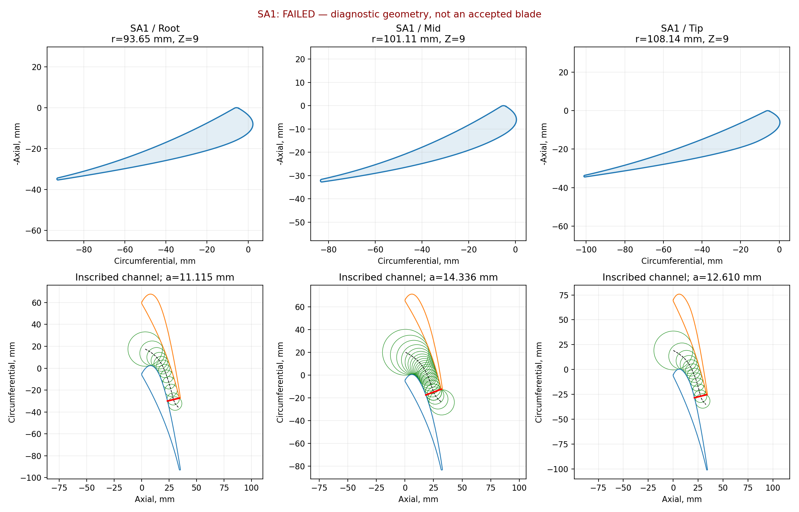
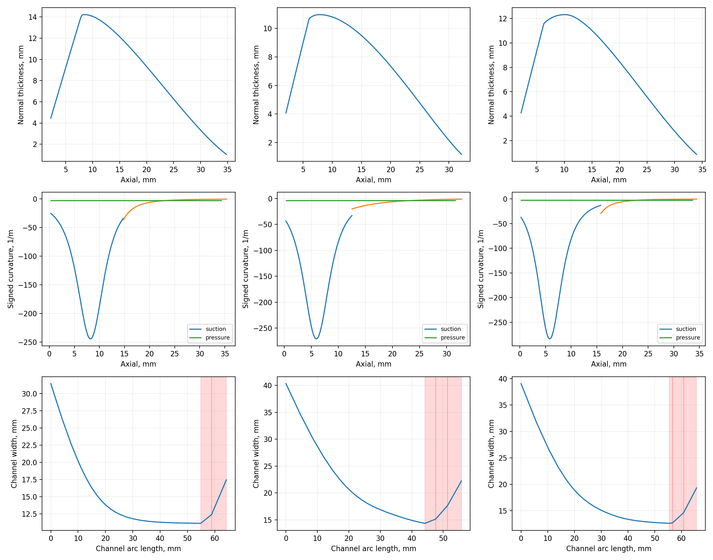
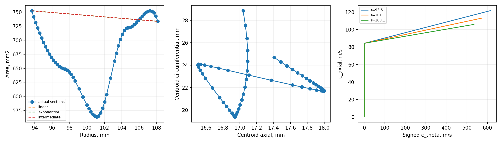
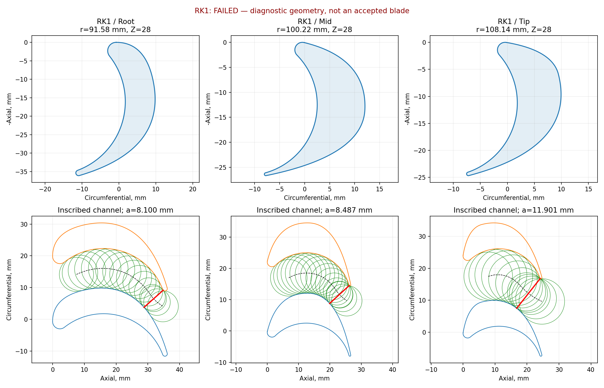
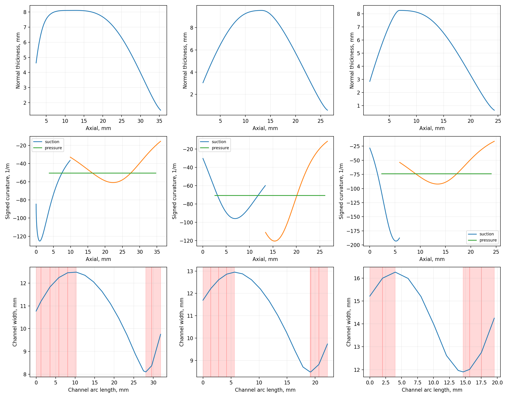
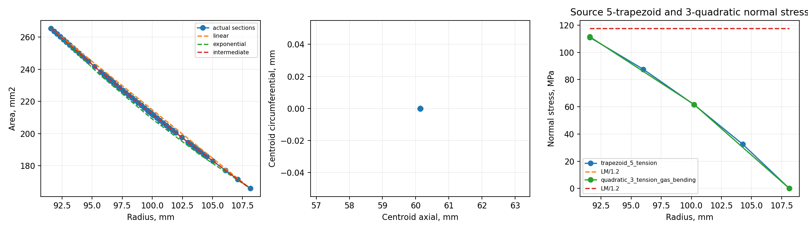
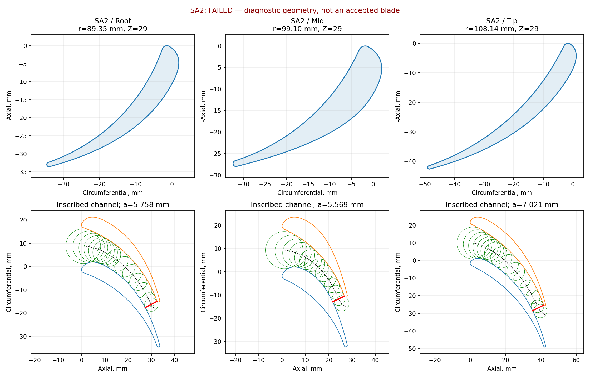
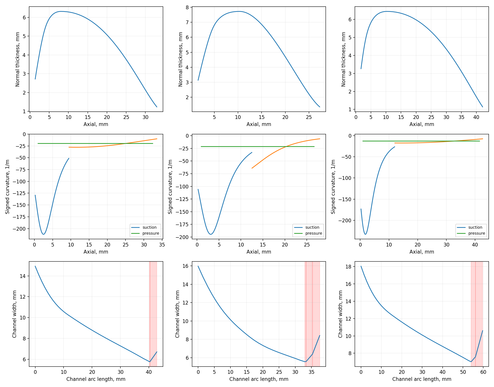
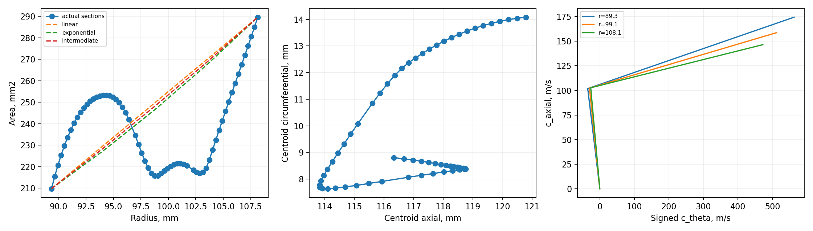
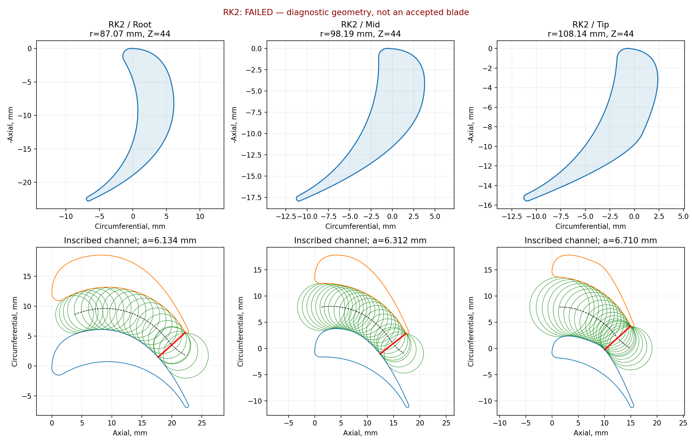
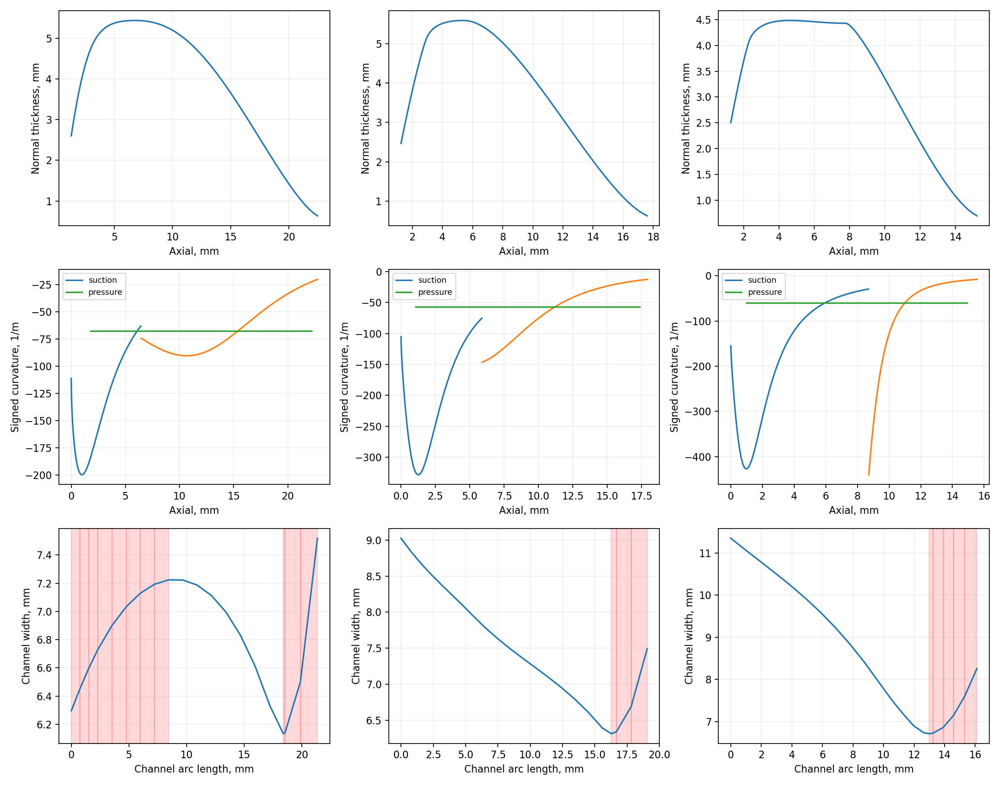
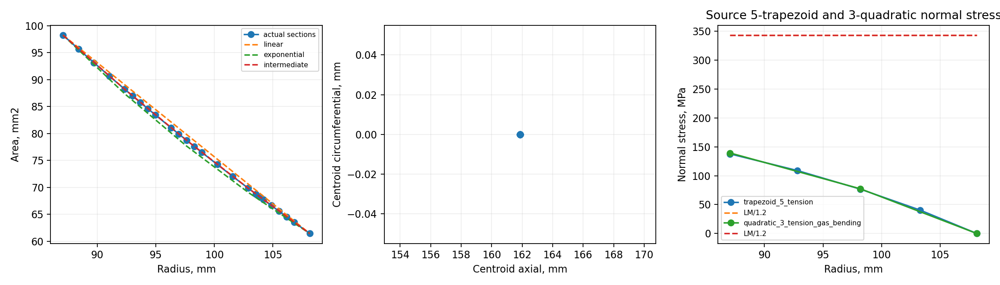
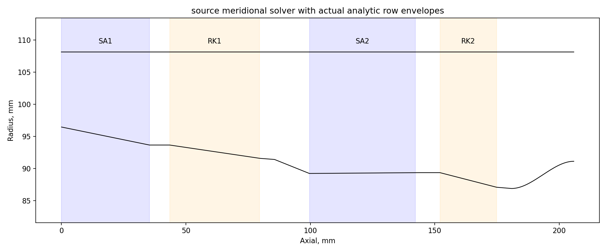

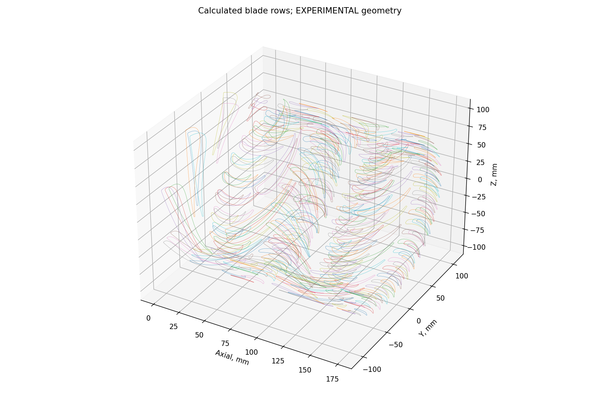

## Scope and missing physical evidence

- Geometry is not CFD/experimental proof of no separation or efficiency.
- Reynolds uses a documented air-viscosity proxy, not measured mixture transport.
- Source variable-cp thermodynamics and independent pressure-equilibrium audits are retained.
- IN738C/LM data are preliminary, not certified supply allowables.
- HCF NOT_CHECKED: grade-specific fatigue curve, forcing and damping are unavailable.
