# Vinogradov — actual TWO-stage course resource calculation

Source: **TVD_1CBK_2st_10000h.ipynb**; resource: **10000 h**; stages: **2**.
Fixed source RPM: **30700**.
Engineering admissible: **False**.
Constructed rows: 4/4.

A failed finite search is not a proof of global infeasibility. No design limit was relaxed.

## Quantified violations

### SA1
- No recorded row violation; global checks still required.
### RK1
- {'section': 0, 'name': 'axial envelope boundary', 'value': 8.467644203634081e-05, 'limit': 3.8126453623653255e-09, 'passed': False, 'classification': 'numerical', 'source': 'Prescribed axial width between leading/trailing outer edge planes', 'units': 'm', 'note': ''}
- {'section': 0, 'name': 'axial envelope boundary', 'value': 8.467644203634081e-05, 'limit': 3.8126453623653255e-09, 'passed': False, 'classification': 'numerical', 'source': 'Prescribed axial width between leading/trailing outer edge planes', 'units': 'm', 'note': ''}
- {'section': 0, 'name': 'local streamtube choke conflict', 'possible': False, 'required_flux_kg_m2_s': 369.37969157965205, 'critical_flux_kg_m2_s': 311.2435918164691, 'required_mach': None, 'stagnation_temperature_K': 1137.2915020814069, 'stagnation_pressure_Pa': 265420.65788059647, 'critical_temperature_K': 981.1822876144373, 'source': 'original variable-cp h, pressure_isentropic, sound'}
- {'section': 1, 'name': 'local streamtube choke conflict', 'possible': False, 'required_flux_kg_m2_s': 320.5344452878796, 'critical_flux_kg_m2_s': 314.95219504562596, 'required_mach': None, 'stagnation_temperature_K': 1140.9477673156566, 'stagnation_pressure_Pa': 269032.06475210417, 'critical_temperature_K': 984.4407832761073, 'source': 'original variable-cp h, pressure_isentropic, sound'}
- {'section': 2, 'name': 'axial envelope boundary', 'value': 3.8170488504765775e-05, 'limit': 3.0744766109849363e-09, 'passed': False, 'classification': 'numerical', 'source': 'Prescribed axial width between leading/trailing outer edge planes', 'units': 'm', 'note': ''}
- {'section': 2, 'name': 'axial envelope boundary', 'value': 3.8170488504765775e-05, 'limit': 3.0744766109849363e-09, 'passed': False, 'classification': 'numerical', 'source': 'Prescribed axial width between leading/trailing outer edge planes', 'units': 'm', 'note': ''}
- {'section': 3, 'name': 'axial envelope boundary', 'value': 9.335593192008384e-05, 'limit': 3.357453834261292e-09, 'passed': False, 'classification': 'numerical', 'source': 'Prescribed axial width between leading/trailing outer edge planes', 'units': 'm', 'note': ''}
- {'section': 3, 'name': 'axial envelope boundary', 'value': 9.335593192008384e-05, 'limit': 3.357453834261292e-09, 'passed': False, 'classification': 'numerical', 'source': 'Prescribed axial width between leading/trailing outer edge planes', 'units': 'm', 'note': ''}
- {'name': 'vibration strength', 'status': 'NOT_CHECKED', 'reason': 'NOT_CHECKED: no grade-specific fatigue curve, damping or actual harmonic forcing; beam modes are screening only'}
- {'name': 'construction/calculation failure', 'message': 'Intermediate radial profile fails geometry validation', 'details': {'radius_m': 0.09027041493688907, 'checks': [{'name': 'axial envelope boundary', 'value': 3.464852440747755e-07, 'limit': 3.809741445166692e-09, 'passed': False, 'classification': 'numerical', 'source': 'Prescribed axial width between leading/trailing outer edge planes', 'units': 'm', 'note': ''}]}}
- {'name': 'source normal-stress LM margin', 'rotor': 1, 'method': 'trapezoid_5_tension', 'section': 0, 'section_name': 'Сечение 0', 'r_m': 0.08972662356744505, 'sigma_tension_MPa': 121.83178645435493, 'sigma_bending_min_MPa': None, 'sigma_bending_max_MPa': None, 'sigma_normal_min_MPa': 121.83178645435493, 'sigma_normal_max_MPa': 121.83178645435493, 'T_bound_K': 1151.9377456685795, 'life_hours': 10000.0, 'P_K': 27646.505896045906, 'allowable_MPa': 129.6495153524967, 'margin': 1.0641682201801312, 'required_margin': 1.2, 'rupture_hours': 14044.080185772975, 'design_life_hours': 6561.5826867575315, 'passed': False, 'material': 'IN-738C, вакуумное литьё', 'reason': 'Запас длительной прочности по нормальным напряжениям ниже требования', 'scope': 'Только длительная прочность по нормальным напряжениям, не общий запас'}
- {'name': 'source normal-stress LM margin', 'rotor': 1, 'method': 'quadratic_3_tension_gas_bending', 'section': 0, 'section_name': 'Корневое', 'r_m': 0.08972662356744505, 'sigma_tension_MPa': 121.8700073737635, 'sigma_bending_min_MPa': -0.21019403513484242, 'sigma_bending_max_MPa': 0.28478817718115707, 'sigma_normal_min_MPa': 121.65981333862867, 'sigma_normal_max_MPa': 122.15479555094466, 'T_bound_K': 1151.9377456685795, 'life_hours': 10000.0, 'P_K': 27646.505896045906, 'allowable_MPa': 129.6495153524967, 'margin': 1.0613542822264916, 'required_margin': 1.2, 'rupture_hours': 13842.48523486354, 'design_life_hours': 6467.1940170107855, 'passed': False, 'material': 'IN-738C, вакуумное литьё', 'reason': 'Запас длительной прочности по нормальным напряжениям ниже требования', 'scope': 'Только длительная прочность по нормальным напряжениям, не общий запас'}
### SA2
- {'section': 2, 'name': 'local streamtube choke conflict', 'possible': False, 'required_flux_kg_m2_s': 237.37899702955914, 'critical_flux_kg_m2_s': 237.2225175437152, 'required_mach': None, 'stagnation_temperature_K': 1102.0273672836927, 'stagnation_pressure_Pa': 199008.95065822554, 'critical_temperature_K': 949.7649326304713, 'source': 'original variable-cp h, pressure_isentropic, sound'}
- {'name': 'radial local choke conflict', 'value': -0.001393340214594141, 'radius_m': 0.0983911665153613, 'limit': 0.0}
### RK2
- {'name': 'vibration strength', 'status': 'NOT_CHECKED', 'reason': 'NOT_CHECKED: no grade-specific fatigue curve, damping or actual harmonic forcing; beam modes are screening only'}
- {'name': 'construction/calculation failure', 'message': 'Intermediate radial profile fails geometry validation', 'details': {'radius_m': 0.09656215047881067, 'checks': [{'name': 'axial envelope boundary', 'value': 2.4840775260947247e-09, 'limit': 1.8213636645305137e-09, 'passed': False, 'classification': 'numerical', 'source': 'Prescribed axial width between leading/trailing outer edge planes', 'units': 'm', 'note': ''}]}}

## Global/source violations

- {'name': 'α2 первой ступени', 'value': 69.53731756901054, 'limit': '70…90', 'source': 'Проектный выбор'}
- {'name': 'Разброс приростов высот, мм', 'value': 0.53820973028176, 'limit': '≤0,25', 'source': 'Требование компоновки, не норма книги'}
- {'row': 'RK1', 'section': 0, 'name': 'axial envelope boundary', 'value': 8.467644203634081e-05, 'limit': 3.8126453623653255e-09, 'passed': False, 'classification': 'numerical', 'source': 'Prescribed axial width between leading/trailing outer edge planes', 'units': 'm', 'note': ''}
- {'row': 'RK1', 'section': 0, 'name': 'axial envelope boundary', 'value': 8.467644203634081e-05, 'limit': 3.8126453623653255e-09, 'passed': False, 'classification': 'numerical', 'source': 'Prescribed axial width between leading/trailing outer edge planes', 'units': 'm', 'note': ''}
- {'row': 'RK1', 'section': 0, 'name': 'local streamtube choke conflict', 'possible': False, 'required_flux_kg_m2_s': 369.37969157965205, 'critical_flux_kg_m2_s': 311.2435918164691, 'required_mach': None, 'stagnation_temperature_K': 1137.2915020814069, 'stagnation_pressure_Pa': 265420.65788059647, 'critical_temperature_K': 981.1822876144373, 'source': 'original variable-cp h, pressure_isentropic, sound'}
- {'row': 'RK1', 'section': 1, 'name': 'local streamtube choke conflict', 'possible': False, 'required_flux_kg_m2_s': 320.5344452878796, 'critical_flux_kg_m2_s': 314.95219504562596, 'required_mach': None, 'stagnation_temperature_K': 1140.9477673156566, 'stagnation_pressure_Pa': 269032.06475210417, 'critical_temperature_K': 984.4407832761073, 'source': 'original variable-cp h, pressure_isentropic, sound'}
- {'row': 'RK1', 'section': 2, 'name': 'axial envelope boundary', 'value': 3.8170488504765775e-05, 'limit': 3.0744766109849363e-09, 'passed': False, 'classification': 'numerical', 'source': 'Prescribed axial width between leading/trailing outer edge planes', 'units': 'm', 'note': ''}
- {'row': 'RK1', 'section': 2, 'name': 'axial envelope boundary', 'value': 3.8170488504765775e-05, 'limit': 3.0744766109849363e-09, 'passed': False, 'classification': 'numerical', 'source': 'Prescribed axial width between leading/trailing outer edge planes', 'units': 'm', 'note': ''}
- {'row': 'RK1', 'section': 3, 'name': 'axial envelope boundary', 'value': 9.335593192008384e-05, 'limit': 3.357453834261292e-09, 'passed': False, 'classification': 'numerical', 'source': 'Prescribed axial width between leading/trailing outer edge planes', 'units': 'm', 'note': ''}
- {'row': 'RK1', 'section': 3, 'name': 'axial envelope boundary', 'value': 9.335593192008384e-05, 'limit': 3.357453834261292e-09, 'passed': False, 'classification': 'numerical', 'source': 'Prescribed axial width between leading/trailing outer edge planes', 'units': 'm', 'note': ''}
- {'row': 'RK1', 'name': 'vibration strength', 'status': 'NOT_CHECKED', 'reason': 'NOT_CHECKED: no grade-specific fatigue curve, damping or actual harmonic forcing; beam modes are screening only'}
- {'row': 'RK1', 'name': 'construction/calculation failure', 'message': 'Intermediate radial profile fails geometry validation', 'details': {'radius_m': 0.09027041493688907, 'checks': [{'name': 'axial envelope boundary', 'value': 3.464852440747755e-07, 'limit': 3.809741445166692e-09, 'passed': False, 'classification': 'numerical', 'source': 'Prescribed axial width between leading/trailing outer edge planes', 'units': 'm', 'note': ''}]}}
- {'row': 'SA2', 'section': 2, 'name': 'local streamtube choke conflict', 'possible': False, 'required_flux_kg_m2_s': 237.37899702955914, 'critical_flux_kg_m2_s': 237.2225175437152, 'required_mach': None, 'stagnation_temperature_K': 1102.0273672836927, 'stagnation_pressure_Pa': 199008.95065822554, 'critical_temperature_K': 949.7649326304713, 'source': 'original variable-cp h, pressure_isentropic, sound'}
- {'row': 'SA2', 'name': 'radial local choke conflict', 'value': -0.001393340214594141, 'radius_m': 0.0983911665153613, 'limit': 0.0}
- {'row': 'RK2', 'name': 'vibration strength', 'status': 'NOT_CHECKED', 'reason': 'NOT_CHECKED: no grade-specific fatigue curve, damping or actual harmonic forcing; beam modes are screening only'}
- {'row': 'RK2', 'name': 'construction/calculation failure', 'message': 'Intermediate radial profile fails geometry validation', 'details': {'radius_m': 0.09656215047881067, 'checks': [{'name': 'axial envelope boundary', 'value': 2.4840775260947247e-09, 'limit': 1.8213636645305137e-09, 'passed': False, 'classification': 'numerical', 'source': 'Prescribed axial width between leading/trailing outer edge planes', 'units': 'm', 'note': ''}]}}
- {'row': 'RK1', 'name': 'source normal-stress LM margin', 'rotor': 1, 'method': 'trapezoid_5_tension', 'section': 0, 'section_name': 'Сечение 0', 'r_m': 0.08972662356744505, 'sigma_tension_MPa': 121.83178645435493, 'sigma_bending_min_MPa': None, 'sigma_bending_max_MPa': None, 'sigma_normal_min_MPa': 121.83178645435493, 'sigma_normal_max_MPa': 121.83178645435493, 'T_bound_K': 1151.9377456685795, 'life_hours': 10000.0, 'P_K': 27646.505896045906, 'allowable_MPa': 129.6495153524967, 'margin': 1.0641682201801312, 'required_margin': 1.2, 'rupture_hours': 14044.080185772975, 'design_life_hours': 6561.5826867575315, 'passed': False, 'material': 'IN-738C, вакуумное литьё', 'reason': 'Запас длительной прочности по нормальным напряжениям ниже требования', 'scope': 'Только длительная прочность по нормальным напряжениям, не общий запас'}
- {'row': 'RK1', 'name': 'source normal-stress LM margin', 'rotor': 1, 'method': 'quadratic_3_tension_gas_bending', 'section': 0, 'section_name': 'Корневое', 'r_m': 0.08972662356744505, 'sigma_tension_MPa': 121.8700073737635, 'sigma_bending_min_MPa': -0.21019403513484242, 'sigma_bending_max_MPa': 0.28478817718115707, 'sigma_normal_min_MPa': 121.65981333862867, 'sigma_normal_max_MPa': 122.15479555094466, 'T_bound_K': 1151.9377456685795, 'life_hours': 10000.0, 'P_K': 27646.505896045906, 'allowable_MPa': 129.6495153524967, 'margin': 1.0613542822264916, 'required_margin': 1.2, 'rupture_hours': 13842.48523486354, 'design_life_hours': 6467.1940170107855, 'passed': False, 'material': 'IN-738C, вакуумное литьё', 'reason': 'Запас длительной прочности по нормальным напряжениям ниже требования', 'scope': 'Только длительная прочность по нормальным напряжениям, не общий запас'}
- {'name': 'source strength assessment', 'reasons': ['РК1, trapezoid_5_tension, Сечение 0: Запас длительной прочности по нормальным напряжениям ниже требования', 'РК1, quadratic_3_tension_gas_bending, Корневое: Запас длительной прочности по нормальным напряжениям ниже требования']}
- {'row': 'SA2', 'section': 3, 'name': 'source finite trailing edge', 'value': 0.00044297713310986953, 'limit': 0.0005}
- {'row': 'RK2', 'section': 0, 'name': 'source finite trailing edge', 'value': 0.0004722278966462939, 'limit': 0.0005}

## Empirical guidance — not added hard limits

- {'row': 'SA1', 'section': 0, 'name': 'relative thickness starting guidance', 'value': 0.15307819062715156, 'range': [0.1, 0.1], 'classification': 'empirical, p13'}
- {'row': 'SA1', 'section': 0, 'name': 'prior profile guide: местная диффузорность', 'measurements': {'geometry_valid': True, 'circle_crosses_open_station_cut': False, 'intersections': False, 'self_intersection': False, 'area_equivalent_angle_deg': 10.852360093814955, 'area_ratio': 0.18827890534756755, 'angle_comparison': 'uniform-flux geometric comparison, not actual gas exit angle', 'angle_error_deg': -0.3476399061850426, 'te_over_throat': 0.06372655279061822, 'book_te_over_throat': 0.055, 'max_reduced_expansion': 1.4026894600650426}, 'relative_thickness': 0.15307819062715156, 'actual_relative_pitch': 0.863719162902849, 'classification': 'historical empirical profile guide; Vinogradov uses its own recommendations'}
- {'row': 'SA1', 'section': 0, 'name': 'prior profile guide: максимальная толщина', 'measurements': {'geometry_valid': True, 'circle_crosses_open_station_cut': False, 'intersections': False, 'self_intersection': False, 'area_equivalent_angle_deg': 10.852360093814955, 'area_ratio': 0.18827890534756755, 'angle_comparison': 'uniform-flux geometric comparison, not actual gas exit angle', 'angle_error_deg': -0.3476399061850426, 'te_over_throat': 0.06372655279061822, 'book_te_over_throat': 0.055, 'max_reduced_expansion': 1.4026894600650426}, 'relative_thickness': 0.15307819062715156, 'actual_relative_pitch': 0.863719162902849, 'classification': 'historical empirical profile guide; Vinogradov uses its own recommendations'}
- {'row': 'SA1', 'section': 0, 'name': 'prior profile guide: относительный шаг', 'measurements': {'geometry_valid': True, 'circle_crosses_open_station_cut': False, 'intersections': False, 'self_intersection': False, 'area_equivalent_angle_deg': 10.852360093814955, 'area_ratio': 0.18827890534756755, 'angle_comparison': 'uniform-flux geometric comparison, not actual gas exit angle', 'angle_error_deg': -0.3476399061850426, 'te_over_throat': 0.06372655279061822, 'book_te_over_throat': 0.055, 'max_reduced_expansion': 1.4026894600650426}, 'relative_thickness': 0.15307819062715156, 'actual_relative_pitch': 0.863719162902849, 'classification': 'historical empirical profile guide; Vinogradov uses its own recommendations'}
- {'row': 'SA1', 'section': 1, 'name': 'relative thickness starting guidance', 'value': 0.17656175790881398, 'range': [0.1, 0.1], 'classification': 'empirical, p13'}
- {'row': 'SA1', 'section': 1, 'name': 'prior profile guide: толщина выходной кромки', 'measurements': {'geometry_valid': True, 'circle_crosses_open_station_cut': False, 'intersections': False, 'self_intersection': False, 'area_equivalent_angle_deg': 10.748056347241837, 'area_ratio': 0.18649070809888907, 'angle_comparison': 'uniform-flux geometric comparison, not actual gas exit angle', 'angle_error_deg': -0.4519436527581604, 'te_over_throat': 0.09917613305134465, 'book_te_over_throat': 0.055, 'max_reduced_expansion': 1.4105501158695317}, 'relative_thickness': 0.17656175790881398, 'actual_relative_pitch': 0.9426177899636147, 'classification': 'historical empirical profile guide; Vinogradov uses its own recommendations'}
- {'row': 'SA1', 'section': 1, 'name': 'prior profile guide: местная диффузорность', 'measurements': {'geometry_valid': True, 'circle_crosses_open_station_cut': False, 'intersections': False, 'self_intersection': False, 'area_equivalent_angle_deg': 10.748056347241837, 'area_ratio': 0.18649070809888907, 'angle_comparison': 'uniform-flux geometric comparison, not actual gas exit angle', 'angle_error_deg': -0.4519436527581604, 'te_over_throat': 0.09917613305134465, 'book_te_over_throat': 0.055, 'max_reduced_expansion': 1.4105501158695317}, 'relative_thickness': 0.17656175790881398, 'actual_relative_pitch': 0.9426177899636147, 'classification': 'historical empirical profile guide; Vinogradov uses its own recommendations'}
- {'row': 'SA1', 'section': 1, 'name': 'prior profile guide: максимальная толщина', 'measurements': {'geometry_valid': True, 'circle_crosses_open_station_cut': False, 'intersections': False, 'self_intersection': False, 'area_equivalent_angle_deg': 10.748056347241837, 'area_ratio': 0.18649070809888907, 'angle_comparison': 'uniform-flux geometric comparison, not actual gas exit angle', 'angle_error_deg': -0.4519436527581604, 'te_over_throat': 0.09917613305134465, 'book_te_over_throat': 0.055, 'max_reduced_expansion': 1.4105501158695317}, 'relative_thickness': 0.17656175790881398, 'actual_relative_pitch': 0.9426177899636147, 'classification': 'historical empirical profile guide; Vinogradov uses its own recommendations'}
- {'row': 'SA1', 'section': 1, 'name': 'prior profile guide: относительный шаг', 'measurements': {'geometry_valid': True, 'circle_crosses_open_station_cut': False, 'intersections': False, 'self_intersection': False, 'area_equivalent_angle_deg': 10.748056347241837, 'area_ratio': 0.18649070809888907, 'angle_comparison': 'uniform-flux geometric comparison, not actual gas exit angle', 'angle_error_deg': -0.4519436527581604, 'te_over_throat': 0.09917613305134465, 'book_te_over_throat': 0.055, 'max_reduced_expansion': 1.4105501158695317}, 'relative_thickness': 0.17656175790881398, 'actual_relative_pitch': 0.9426177899636147, 'classification': 'historical empirical profile guide; Vinogradov uses its own recommendations'}
- {'row': 'SA1', 'section': 2, 'name': 'relative thickness starting guidance', 'value': 0.12870280528793393, 'range': [0.1, 0.1], 'classification': 'empirical, p13'}
- {'row': 'SA1', 'section': 2, 'name': 'prior profile guide: толщина выходной кромки', 'measurements': {'geometry_valid': True, 'circle_crosses_open_station_cut': False, 'intersections': False, 'self_intersection': False, 'area_equivalent_angle_deg': 10.724525615468876, 'area_ratio': 0.18608720846387675, 'angle_comparison': 'uniform-flux geometric comparison, not actual gas exit angle', 'angle_error_deg': -0.47547438453112356, 'te_over_throat': 0.07180506249567155, 'book_te_over_throat': 0.055, 'max_reduced_expansion': 1.548268618823546}, 'relative_thickness': 0.12870280528793393, 'actual_relative_pitch': 0.9496514214980052, 'classification': 'historical empirical profile guide; Vinogradov uses its own recommendations'}
- {'row': 'SA1', 'section': 2, 'name': 'prior profile guide: местная диффузорность', 'measurements': {'geometry_valid': True, 'circle_crosses_open_station_cut': False, 'intersections': False, 'self_intersection': False, 'area_equivalent_angle_deg': 10.724525615468876, 'area_ratio': 0.18608720846387675, 'angle_comparison': 'uniform-flux geometric comparison, not actual gas exit angle', 'angle_error_deg': -0.47547438453112356, 'te_over_throat': 0.07180506249567155, 'book_te_over_throat': 0.055, 'max_reduced_expansion': 1.548268618823546}, 'relative_thickness': 0.12870280528793393, 'actual_relative_pitch': 0.9496514214980052, 'classification': 'historical empirical profile guide; Vinogradov uses its own recommendations'}
- {'row': 'SA1', 'section': 2, 'name': 'prior profile guide: относительный шаг', 'measurements': {'geometry_valid': True, 'circle_crosses_open_station_cut': False, 'intersections': False, 'self_intersection': False, 'area_equivalent_angle_deg': 10.724525615468876, 'area_ratio': 0.18608720846387675, 'angle_comparison': 'uniform-flux geometric comparison, not actual gas exit angle', 'angle_error_deg': -0.47547438453112356, 'te_over_throat': 0.07180506249567155, 'book_te_over_throat': 0.055, 'max_reduced_expansion': 1.548268618823546}, 'relative_thickness': 0.12870280528793393, 'actual_relative_pitch': 0.9496514214980052, 'classification': 'historical empirical profile guide; Vinogradov uses its own recommendations'}
- {'row': 'SA1', 'section': 3, 'name': 'relative thickness starting guidance', 'value': 0.10912561893311652, 'range': [0.1, 0.1], 'classification': 'empirical, p13'}
- {'row': 'SA1', 'section': 3, 'name': 'prior profile guide: местная диффузорность', 'measurements': {'geometry_valid': True, 'circle_crosses_open_station_cut': False, 'intersections': False, 'self_intersection': False, 'area_equivalent_angle_deg': 10.63044042687155, 'area_ratio': 0.18447354409677025, 'angle_comparison': 'uniform-flux geometric comparison, not actual gas exit angle', 'angle_error_deg': -0.5695595731284495, 'te_over_throat': 0.06036995229376122, 'book_te_over_throat': 0.055, 'max_reduced_expansion': 1.6059023956797025}, 'relative_thickness': 0.10912561893311652, 'actual_relative_pitch': 0.8974567615159575, 'classification': 'historical empirical profile guide; Vinogradov uses its own recommendations'}
- {'row': 'SA1', 'section': 3, 'name': 'prior profile guide: максимальная толщина', 'measurements': {'geometry_valid': True, 'circle_crosses_open_station_cut': False, 'intersections': False, 'self_intersection': False, 'area_equivalent_angle_deg': 10.63044042687155, 'area_ratio': 0.18447354409677025, 'angle_comparison': 'uniform-flux geometric comparison, not actual gas exit angle', 'angle_error_deg': -0.5695595731284495, 'te_over_throat': 0.06036995229376122, 'book_te_over_throat': 0.055, 'max_reduced_expansion': 1.6059023956797025}, 'relative_thickness': 0.10912561893311652, 'actual_relative_pitch': 0.8974567615159575, 'classification': 'historical empirical profile guide; Vinogradov uses its own recommendations'}
- {'row': 'SA1', 'section': 3, 'name': 'prior profile guide: относительный шаг', 'measurements': {'geometry_valid': True, 'circle_crosses_open_station_cut': False, 'intersections': False, 'self_intersection': False, 'area_equivalent_angle_deg': 10.63044042687155, 'area_ratio': 0.18447354409677025, 'angle_comparison': 'uniform-flux geometric comparison, not actual gas exit angle', 'angle_error_deg': -0.5695595731284495, 'te_over_throat': 0.06036995229376122, 'book_te_over_throat': 0.055, 'max_reduced_expansion': 1.6059023956797025}, 'relative_thickness': 0.10912561893311652, 'actual_relative_pitch': 0.8974567615159575, 'classification': 'historical empirical profile guide; Vinogradov uses its own recommendations'}
- {'row': 'SA1', 'section': 4, 'name': 'relative thickness starting guidance', 'value': 0.09874378121934795, 'range': [0.1, 0.1], 'classification': 'empirical, p13'}
- {'row': 'SA1', 'section': 4, 'name': 'prior profile guide: местная диффузорность', 'measurements': {'geometry_valid': True, 'circle_crosses_open_station_cut': False, 'intersections': False, 'self_intersection': False, 'area_equivalent_angle_deg': 10.939178532735655, 'area_ratio': 0.18976685659068648, 'angle_comparison': 'uniform-flux geometric comparison, not actual gas exit angle', 'angle_error_deg': -0.2608214672643463, 'te_over_throat': 0.04209566714428757, 'book_te_over_throat': 0.055, 'max_reduced_expansion': 1.6196782917930308}, 'relative_thickness': 0.09874378121934795, 'actual_relative_pitch': 0.8560986020430702, 'classification': 'historical empirical profile guide; Vinogradov uses its own recommendations'}
- {'row': 'SA1', 'section': 4, 'name': 'prior profile guide: максимальная толщина', 'measurements': {'geometry_valid': True, 'circle_crosses_open_station_cut': False, 'intersections': False, 'self_intersection': False, 'area_equivalent_angle_deg': 10.939178532735655, 'area_ratio': 0.18976685659068648, 'angle_comparison': 'uniform-flux geometric comparison, not actual gas exit angle', 'angle_error_deg': -0.2608214672643463, 'te_over_throat': 0.04209566714428757, 'book_te_over_throat': 0.055, 'max_reduced_expansion': 1.6196782917930308}, 'relative_thickness': 0.09874378121934795, 'actual_relative_pitch': 0.8560986020430702, 'classification': 'historical empirical profile guide; Vinogradov uses its own recommendations'}
- {'row': 'SA1', 'section': 4, 'name': 'prior profile guide: относительный шаг', 'measurements': {'geometry_valid': True, 'circle_crosses_open_station_cut': False, 'intersections': False, 'self_intersection': False, 'area_equivalent_angle_deg': 10.939178532735655, 'area_ratio': 0.18976685659068648, 'angle_comparison': 'uniform-flux geometric comparison, not actual gas exit angle', 'angle_error_deg': -0.2608214672643463, 'te_over_throat': 0.04209566714428757, 'book_te_over_throat': 0.055, 'max_reduced_expansion': 1.6196782917930308}, 'relative_thickness': 0.09874378121934795, 'actual_relative_pitch': 0.8560986020430702, 'classification': 'historical empirical profile guide; Vinogradov uses its own recommendations'}
- {'row': 'RK1', 'section': 0, 'name': 'subsonic entrance expansion guidance', 'value': 1.8988795660297864, 'limit': 1.1, 'classification': 'empirical recommendation; CFD required'}
- {'row': 'RK1', 'section': 0, 'name': 'prior profile guide: угол горла', 'measurements': {'geometry_valid': True, 'circle_crosses_open_station_cut': False, 'intersections': False, 'self_intersection': False, 'area_equivalent_angle_deg': 12.005985287382376, 'area_ratio': 0.2080138698880928, 'angle_comparison': 'uniform-flux geometric comparison, not actual gas exit angle', 'angle_error_deg': -6.428996697403601, 'te_over_throat': 0.7311768862903492, 'book_te_over_throat': 0.07, 'max_reduced_expansion': 2.127945599455241}, 'relative_thickness': 0.20891532865361725, 'actual_relative_pitch': 0.3080587477544549, 'classification': 'historical empirical profile guide; Vinogradov uses its own recommendations'}
- {'row': 'RK1', 'section': 0, 'name': 'prior profile guide: толщина выходной кромки', 'measurements': {'geometry_valid': True, 'circle_crosses_open_station_cut': False, 'intersections': False, 'self_intersection': False, 'area_equivalent_angle_deg': 12.005985287382376, 'area_ratio': 0.2080138698880928, 'angle_comparison': 'uniform-flux geometric comparison, not actual gas exit angle', 'angle_error_deg': -6.428996697403601, 'te_over_throat': 0.7311768862903492, 'book_te_over_throat': 0.07, 'max_reduced_expansion': 2.127945599455241}, 'relative_thickness': 0.20891532865361725, 'actual_relative_pitch': 0.3080587477544549, 'classification': 'historical empirical profile guide; Vinogradov uses its own recommendations'}
- {'row': 'RK1', 'section': 0, 'name': 'prior profile guide: местная диффузорность', 'measurements': {'geometry_valid': True, 'circle_crosses_open_station_cut': False, 'intersections': False, 'self_intersection': False, 'area_equivalent_angle_deg': 12.005985287382376, 'area_ratio': 0.2080138698880928, 'angle_comparison': 'uniform-flux geometric comparison, not actual gas exit angle', 'angle_error_deg': -6.428996697403601, 'te_over_throat': 0.7311768862903492, 'book_te_over_throat': 0.07, 'max_reduced_expansion': 2.127945599455241}, 'relative_thickness': 0.20891532865361725, 'actual_relative_pitch': 0.3080587477544549, 'classification': 'historical empirical profile guide; Vinogradov uses its own recommendations'}
- {'row': 'RK1', 'section': 0, 'name': 'prior profile guide: максимальная толщина', 'measurements': {'geometry_valid': True, 'circle_crosses_open_station_cut': False, 'intersections': False, 'self_intersection': False, 'area_equivalent_angle_deg': 12.005985287382376, 'area_ratio': 0.2080138698880928, 'angle_comparison': 'uniform-flux geometric comparison, not actual gas exit angle', 'angle_error_deg': -6.428996697403601, 'te_over_throat': 0.7311768862903492, 'book_te_over_throat': 0.07, 'max_reduced_expansion': 2.127945599455241}, 'relative_thickness': 0.20891532865361725, 'actual_relative_pitch': 0.3080587477544549, 'classification': 'historical empirical profile guide; Vinogradov uses its own recommendations'}
- {'row': 'RK1', 'section': 0, 'name': 'prior profile guide: относительный шаг', 'measurements': {'geometry_valid': True, 'circle_crosses_open_station_cut': False, 'intersections': False, 'self_intersection': False, 'area_equivalent_angle_deg': 12.005985287382376, 'area_ratio': 0.2080138698880928, 'angle_comparison': 'uniform-flux geometric comparison, not actual gas exit angle', 'angle_error_deg': -6.428996697403601, 'te_over_throat': 0.7311768862903492, 'book_te_over_throat': 0.07, 'max_reduced_expansion': 2.127945599455241}, 'relative_thickness': 0.20891532865361725, 'actual_relative_pitch': 0.3080587477544549, 'classification': 'historical empirical profile guide; Vinogradov uses its own recommendations'}
- {'row': 'RK1', 'section': 1, 'name': 'subsonic entrance expansion guidance', 'value': 1.418732852578126, 'limit': 1.1, 'classification': 'empirical recommendation; CFD required'}
- {'row': 'RK1', 'section': 1, 'name': 'prior profile guide: угол горла', 'measurements': {'geometry_valid': True, 'circle_crosses_open_station_cut': False, 'intersections': False, 'self_intersection': False, 'area_equivalent_angle_deg': 13.943663663292583, 'area_ratio': 0.2409677311082801, 'angle_comparison': 'uniform-flux geometric comparison, not actual gas exit angle', 'angle_error_deg': -3.910874493820266, 'te_over_throat': 0.49733133729781515, 'book_te_over_throat': 0.07, 'max_reduced_expansion': 1.8947447170443885}, 'relative_thickness': 0.17087124118467462, 'actual_relative_pitch': 0.28155990659096647, 'classification': 'historical empirical profile guide; Vinogradov uses its own recommendations'}
- {'row': 'RK1', 'section': 1, 'name': 'prior profile guide: толщина выходной кромки', 'measurements': {'geometry_valid': True, 'circle_crosses_open_station_cut': False, 'intersections': False, 'self_intersection': False, 'area_equivalent_angle_deg': 13.943663663292583, 'area_ratio': 0.2409677311082801, 'angle_comparison': 'uniform-flux geometric comparison, not actual gas exit angle', 'angle_error_deg': -3.910874493820266, 'te_over_throat': 0.49733133729781515, 'book_te_over_throat': 0.07, 'max_reduced_expansion': 1.8947447170443885}, 'relative_thickness': 0.17087124118467462, 'actual_relative_pitch': 0.28155990659096647, 'classification': 'historical empirical profile guide; Vinogradov uses its own recommendations'}
- {'row': 'RK1', 'section': 1, 'name': 'prior profile guide: местная диффузорность', 'measurements': {'geometry_valid': True, 'circle_crosses_open_station_cut': False, 'intersections': False, 'self_intersection': False, 'area_equivalent_angle_deg': 13.943663663292583, 'area_ratio': 0.2409677311082801, 'angle_comparison': 'uniform-flux geometric comparison, not actual gas exit angle', 'angle_error_deg': -3.910874493820266, 'te_over_throat': 0.49733133729781515, 'book_te_over_throat': 0.07, 'max_reduced_expansion': 1.8947447170443885}, 'relative_thickness': 0.17087124118467462, 'actual_relative_pitch': 0.28155990659096647, 'classification': 'historical empirical profile guide; Vinogradov uses its own recommendations'}
- {'row': 'RK1', 'section': 1, 'name': 'prior profile guide: максимальная толщина', 'measurements': {'geometry_valid': True, 'circle_crosses_open_station_cut': False, 'intersections': False, 'self_intersection': False, 'area_equivalent_angle_deg': 13.943663663292583, 'area_ratio': 0.2409677311082801, 'angle_comparison': 'uniform-flux geometric comparison, not actual gas exit angle', 'angle_error_deg': -3.910874493820266, 'te_over_throat': 0.49733133729781515, 'book_te_over_throat': 0.07, 'max_reduced_expansion': 1.8947447170443885}, 'relative_thickness': 0.17087124118467462, 'actual_relative_pitch': 0.28155990659096647, 'classification': 'historical empirical profile guide; Vinogradov uses its own recommendations'}
- {'row': 'RK1', 'section': 1, 'name': 'prior profile guide: толщина тела без пережатия', 'measurements': {'geometry_valid': True, 'circle_crosses_open_station_cut': False, 'intersections': False, 'self_intersection': False, 'area_equivalent_angle_deg': 13.943663663292583, 'area_ratio': 0.2409677311082801, 'angle_comparison': 'uniform-flux geometric comparison, not actual gas exit angle', 'angle_error_deg': -3.910874493820266, 'te_over_throat': 0.49733133729781515, 'book_te_over_throat': 0.07, 'max_reduced_expansion': 1.8947447170443885}, 'relative_thickness': 0.17087124118467462, 'actual_relative_pitch': 0.28155990659096647, 'classification': 'historical empirical profile guide; Vinogradov uses its own recommendations'}
- {'row': 'RK1', 'section': 1, 'name': 'prior profile guide: относительный шаг', 'measurements': {'geometry_valid': True, 'circle_crosses_open_station_cut': False, 'intersections': False, 'self_intersection': False, 'area_equivalent_angle_deg': 13.943663663292583, 'area_ratio': 0.2409677311082801, 'angle_comparison': 'uniform-flux geometric comparison, not actual gas exit angle', 'angle_error_deg': -3.910874493820266, 'te_over_throat': 0.49733133729781515, 'book_te_over_throat': 0.07, 'max_reduced_expansion': 1.8947447170443885}, 'relative_thickness': 0.17087124118467462, 'actual_relative_pitch': 0.28155990659096647, 'classification': 'historical empirical profile guide; Vinogradov uses its own recommendations'}
- {'row': 'RK1', 'section': 2, 'name': 'subsonic entrance expansion guidance', 'value': 1.1550818036410548, 'limit': 1.1, 'classification': 'empirical recommendation; CFD required'}
- {'row': 'RK1', 'section': 2, 'name': 'relative thickness starting guidance', 'value': 0.2799600863161778, 'range': [0.09705096366827011, 0.14508493944711684], 'classification': 'empirical, p13'}
- {'row': 'RK1', 'section': 2, 'name': 'prior profile guide: угол горла', 'measurements': {'geometry_valid': True, 'circle_crosses_open_station_cut': False, 'intersections': False, 'self_intersection': False, 'area_equivalent_angle_deg': 14.343528227497258, 'area_ratio': 0.24773511317407465, 'angle_comparison': 'uniform-flux geometric comparison, not actual gas exit angle', 'angle_error_deg': -2.9741730410658587, 'te_over_throat': 0.26354358719194654, 'book_te_over_throat': 0.07, 'max_reduced_expansion': 1.2986354146515227}, 'relative_thickness': 0.2799600863161778, 'actual_relative_pitch': 0.4231571582891148, 'classification': 'historical empirical profile guide; Vinogradov uses its own recommendations'}
- {'row': 'RK1', 'section': 2, 'name': 'prior profile guide: толщина выходной кромки', 'measurements': {'geometry_valid': True, 'circle_crosses_open_station_cut': False, 'intersections': False, 'self_intersection': False, 'area_equivalent_angle_deg': 14.343528227497258, 'area_ratio': 0.24773511317407465, 'angle_comparison': 'uniform-flux geometric comparison, not actual gas exit angle', 'angle_error_deg': -2.9741730410658587, 'te_over_throat': 0.26354358719194654, 'book_te_over_throat': 0.07, 'max_reduced_expansion': 1.2986354146515227}, 'relative_thickness': 0.2799600863161778, 'actual_relative_pitch': 0.4231571582891148, 'classification': 'historical empirical profile guide; Vinogradov uses its own recommendations'}
- {'row': 'RK1', 'section': 2, 'name': 'prior profile guide: местная диффузорность', 'measurements': {'geometry_valid': True, 'circle_crosses_open_station_cut': False, 'intersections': False, 'self_intersection': False, 'area_equivalent_angle_deg': 14.343528227497258, 'area_ratio': 0.24773511317407465, 'angle_comparison': 'uniform-flux geometric comparison, not actual gas exit angle', 'angle_error_deg': -2.9741730410658587, 'te_over_throat': 0.26354358719194654, 'book_te_over_throat': 0.07, 'max_reduced_expansion': 1.2986354146515227}, 'relative_thickness': 0.2799600863161778, 'actual_relative_pitch': 0.4231571582891148, 'classification': 'historical empirical profile guide; Vinogradov uses its own recommendations'}
- {'row': 'RK1', 'section': 2, 'name': 'prior profile guide: максимальная толщина', 'measurements': {'geometry_valid': True, 'circle_crosses_open_station_cut': False, 'intersections': False, 'self_intersection': False, 'area_equivalent_angle_deg': 14.343528227497258, 'area_ratio': 0.24773511317407465, 'angle_comparison': 'uniform-flux geometric comparison, not actual gas exit angle', 'angle_error_deg': -2.9741730410658587, 'te_over_throat': 0.26354358719194654, 'book_te_over_throat': 0.07, 'max_reduced_expansion': 1.2986354146515227}, 'relative_thickness': 0.2799600863161778, 'actual_relative_pitch': 0.4231571582891148, 'classification': 'historical empirical profile guide; Vinogradov uses its own recommendations'}
- {'row': 'RK1', 'section': 2, 'name': 'prior profile guide: относительный шаг', 'measurements': {'geometry_valid': True, 'circle_crosses_open_station_cut': False, 'intersections': False, 'self_intersection': False, 'area_equivalent_angle_deg': 14.343528227497258, 'area_ratio': 0.24773511317407465, 'angle_comparison': 'uniform-flux geometric comparison, not actual gas exit angle', 'angle_error_deg': -2.9741730410658587, 'te_over_throat': 0.26354358719194654, 'book_te_over_throat': 0.07, 'max_reduced_expansion': 1.2986354146515227}, 'relative_thickness': 0.2799600863161778, 'actual_relative_pitch': 0.4231571582891148, 'classification': 'historical empirical profile guide; Vinogradov uses its own recommendations'}
- {'row': 'RK1', 'section': 3, 'name': 'measured back angle outside source guidance', 'value': 15.996220872012316, 'recommended_range_deg': [5.0, 10.0], 'source_maximum_deg': 15.0, 'classification': 'empirical applicability review, not a new physical limit; Vinogradov pp.7–14'}
- {'row': 'RK1', 'section': 3, 'name': 'relative thickness starting guidance', 'value': 0.21161231436999095, 'range': [0.06789217185118335, 0.09648695308530557], 'classification': 'empirical, p13'}
- {'row': 'RK1', 'section': 3, 'name': 'prior profile guide: толщина выходной кромки', 'measurements': {'geometry_valid': True, 'circle_crosses_open_station_cut': False, 'intersections': False, 'self_intersection': False, 'area_equivalent_angle_deg': 15.51023161103367, 'area_ratio': 0.26741045241392164, 'angle_comparison': 'uniform-flux geometric comparison, not actual gas exit angle', 'angle_error_deg': -1.3110086332431479, 'te_over_throat': 0.3549270245158244, 'book_te_over_throat': 0.07, 'max_reduced_expansion': 1.1667067503708277}, 'relative_thickness': 0.21161231436999095, 'actual_relative_pitch': 0.4049403054010446, 'classification': 'historical empirical profile guide; Vinogradov uses its own recommendations'}
- {'row': 'RK1', 'section': 3, 'name': 'prior profile guide: местная диффузорность', 'measurements': {'geometry_valid': True, 'circle_crosses_open_station_cut': False, 'intersections': False, 'self_intersection': False, 'area_equivalent_angle_deg': 15.51023161103367, 'area_ratio': 0.26741045241392164, 'angle_comparison': 'uniform-flux geometric comparison, not actual gas exit angle', 'angle_error_deg': -1.3110086332431479, 'te_over_throat': 0.3549270245158244, 'book_te_over_throat': 0.07, 'max_reduced_expansion': 1.1667067503708277}, 'relative_thickness': 0.21161231436999095, 'actual_relative_pitch': 0.4049403054010446, 'classification': 'historical empirical profile guide; Vinogradov uses its own recommendations'}
- {'row': 'RK1', 'section': 3, 'name': 'prior profile guide: максимальная толщина', 'measurements': {'geometry_valid': True, 'circle_crosses_open_station_cut': False, 'intersections': False, 'self_intersection': False, 'area_equivalent_angle_deg': 15.51023161103367, 'area_ratio': 0.26741045241392164, 'angle_comparison': 'uniform-flux geometric comparison, not actual gas exit angle', 'angle_error_deg': -1.3110086332431479, 'te_over_throat': 0.3549270245158244, 'book_te_over_throat': 0.07, 'max_reduced_expansion': 1.1667067503708277}, 'relative_thickness': 0.21161231436999095, 'actual_relative_pitch': 0.4049403054010446, 'classification': 'historical empirical profile guide; Vinogradov uses its own recommendations'}
- {'row': 'RK1', 'section': 3, 'name': 'prior profile guide: относительный шаг', 'measurements': {'geometry_valid': True, 'circle_crosses_open_station_cut': False, 'intersections': False, 'self_intersection': False, 'area_equivalent_angle_deg': 15.51023161103367, 'area_ratio': 0.26741045241392164, 'angle_comparison': 'uniform-flux geometric comparison, not actual gas exit angle', 'angle_error_deg': -1.3110086332431479, 'te_over_throat': 0.3549270245158244, 'book_te_over_throat': 0.07, 'max_reduced_expansion': 1.1667067503708277}, 'relative_thickness': 0.21161231436999095, 'actual_relative_pitch': 0.4049403054010446, 'classification': 'historical empirical profile guide; Vinogradov uses its own recommendations'}
- {'row': 'RK1', 'section': 4, 'name': 'measured back angle outside source guidance', 'value': 19.93136815183425, 'recommended_range_deg': [5.0, 10.0], 'source_maximum_deg': 15.0, 'classification': 'empirical applicability review, not a new physical limit; Vinogradov pp.7–14'}
- {'row': 'RK1', 'section': 4, 'name': 'subsonic entrance expansion guidance', 'value': 1.1250500387236868, 'limit': 1.1, 'classification': 'empirical recommendation; CFD required'}
- {'row': 'RK1', 'section': 4, 'name': 'relative thickness starting guidance', 'value': 0.260565756420902, 'range': [0.04, 0.05], 'classification': 'empirical, p13'}
- {'row': 'RK1', 'section': 4, 'name': 'prior profile guide: толщина выходной кромки', 'measurements': {'geometry_valid': True, 'circle_crosses_open_station_cut': False, 'intersections': False, 'self_intersection': False, 'area_equivalent_angle_deg': 16.963663545810306, 'area_ratio': 0.2917651663238399, 'angle_comparison': 'uniform-flux geometric comparison, not actual gas exit angle', 'angle_error_deg': 0.6022582209509864, 'te_over_throat': 0.2955562591079233, 'book_te_over_throat': 0.07, 'max_reduced_expansion': 1.5203362603844526}, 'relative_thickness': 0.260565756420902, 'actual_relative_pitch': 0.5039957880424417, 'classification': 'historical empirical profile guide; Vinogradov uses its own recommendations'}
- {'row': 'RK1', 'section': 4, 'name': 'prior profile guide: местная диффузорность', 'measurements': {'geometry_valid': True, 'circle_crosses_open_station_cut': False, 'intersections': False, 'self_intersection': False, 'area_equivalent_angle_deg': 16.963663545810306, 'area_ratio': 0.2917651663238399, 'angle_comparison': 'uniform-flux geometric comparison, not actual gas exit angle', 'angle_error_deg': 0.6022582209509864, 'te_over_throat': 0.2955562591079233, 'book_te_over_throat': 0.07, 'max_reduced_expansion': 1.5203362603844526}, 'relative_thickness': 0.260565756420902, 'actual_relative_pitch': 0.5039957880424417, 'classification': 'historical empirical profile guide; Vinogradov uses its own recommendations'}
- {'row': 'RK1', 'section': 4, 'name': 'prior profile guide: максимальная толщина', 'measurements': {'geometry_valid': True, 'circle_crosses_open_station_cut': False, 'intersections': False, 'self_intersection': False, 'area_equivalent_angle_deg': 16.963663545810306, 'area_ratio': 0.2917651663238399, 'angle_comparison': 'uniform-flux geometric comparison, not actual gas exit angle', 'angle_error_deg': 0.6022582209509864, 'te_over_throat': 0.2955562591079233, 'book_te_over_throat': 0.07, 'max_reduced_expansion': 1.5203362603844526}, 'relative_thickness': 0.260565756420902, 'actual_relative_pitch': 0.5039957880424417, 'classification': 'historical empirical profile guide; Vinogradov uses its own recommendations'}
- {'row': 'RK1', 'section': 4, 'name': 'prior profile guide: относительный шаг', 'measurements': {'geometry_valid': True, 'circle_crosses_open_station_cut': False, 'intersections': False, 'self_intersection': False, 'area_equivalent_angle_deg': 16.963663545810306, 'area_ratio': 0.2917651663238399, 'angle_comparison': 'uniform-flux geometric comparison, not actual gas exit angle', 'angle_error_deg': 0.6022582209509864, 'te_over_throat': 0.2955562591079233, 'book_te_over_throat': 0.07, 'max_reduced_expansion': 1.5203362603844526}, 'relative_thickness': 0.260565756420902, 'actual_relative_pitch': 0.5039957880424417, 'classification': 'historical empirical profile guide; Vinogradov uses its own recommendations'}
- {'row': 'SA2', 'section': 0, 'name': 'relative thickness starting guidance', 'value': 0.07951787791580754, 'range': [0.1, 0.1], 'classification': 'empirical, p13'}
- {'row': 'SA2', 'section': 0, 'name': 'prior profile guide: толщина выходной кромки', 'measurements': {'geometry_valid': True, 'circle_crosses_open_station_cut': False, 'intersections': False, 'self_intersection': False, 'area_equivalent_angle_deg': 17.357252770846742, 'area_ratio': 0.2983287695698811, 'angle_comparison': 'uniform-flux geometric comparison, not actual gas exit angle', 'angle_error_deg': 0.1258666606385077, 'te_over_throat': 0.19924266740719668, 'book_te_over_throat': 0.055, 'max_reduced_expansion': 1.1864224784361355}, 'relative_thickness': 0.07951787791580754, 'actual_relative_pitch': 0.25935257107497756, 'classification': 'historical empirical profile guide; Vinogradov uses its own recommendations'}
- {'row': 'SA2', 'section': 0, 'name': 'prior profile guide: местная диффузорность', 'measurements': {'geometry_valid': True, 'circle_crosses_open_station_cut': False, 'intersections': False, 'self_intersection': False, 'area_equivalent_angle_deg': 17.357252770846742, 'area_ratio': 0.2983287695698811, 'angle_comparison': 'uniform-flux geometric comparison, not actual gas exit angle', 'angle_error_deg': 0.1258666606385077, 'te_over_throat': 0.19924266740719668, 'book_te_over_throat': 0.055, 'max_reduced_expansion': 1.1864224784361355}, 'relative_thickness': 0.07951787791580754, 'actual_relative_pitch': 0.25935257107497756, 'classification': 'historical empirical profile guide; Vinogradov uses its own recommendations'}
- {'row': 'SA2', 'section': 0, 'name': 'prior profile guide: максимальная толщина', 'measurements': {'geometry_valid': True, 'circle_crosses_open_station_cut': False, 'intersections': False, 'self_intersection': False, 'area_equivalent_angle_deg': 17.357252770846742, 'area_ratio': 0.2983287695698811, 'angle_comparison': 'uniform-flux geometric comparison, not actual gas exit angle', 'angle_error_deg': 0.1258666606385077, 'te_over_throat': 0.19924266740719668, 'book_te_over_throat': 0.055, 'max_reduced_expansion': 1.1864224784361355}, 'relative_thickness': 0.07951787791580754, 'actual_relative_pitch': 0.25935257107497756, 'classification': 'historical empirical profile guide; Vinogradov uses its own recommendations'}
- {'row': 'SA2', 'section': 0, 'name': 'prior profile guide: относительный шаг', 'measurements': {'geometry_valid': True, 'circle_crosses_open_station_cut': False, 'intersections': False, 'self_intersection': False, 'area_equivalent_angle_deg': 17.357252770846742, 'area_ratio': 0.2983287695698811, 'angle_comparison': 'uniform-flux geometric comparison, not actual gas exit angle', 'angle_error_deg': 0.1258666606385077, 'te_over_throat': 0.19924266740719668, 'book_te_over_throat': 0.055, 'max_reduced_expansion': 1.1864224784361355}, 'relative_thickness': 0.07951787791580754, 'actual_relative_pitch': 0.25935257107497756, 'classification': 'historical empirical profile guide; Vinogradov uses its own recommendations'}
- {'row': 'SA2', 'section': 1, 'name': 'relative thickness starting guidance', 'value': 0.086832313999455, 'range': [0.1, 0.1], 'classification': 'empirical, p13'}
- {'row': 'SA2', 'section': 1, 'name': 'prior profile guide: толщина выходной кромки', 'measurements': {'geometry_valid': True, 'circle_crosses_open_station_cut': False, 'intersections': False, 'self_intersection': False, 'area_equivalent_angle_deg': 17.71422324008016, 'area_ratio': 0.30426954249878174, 'angle_comparison': 'uniform-flux geometric comparison, not actual gas exit angle', 'angle_error_deg': 0.48283712987192473, 'te_over_throat': 0.15139114057742195, 'book_te_over_throat': 0.055, 'max_reduced_expansion': 1.3103207692968797}, 'relative_thickness': 0.086832313999455, 'actual_relative_pitch': 0.2735464232703156, 'classification': 'historical empirical profile guide; Vinogradov uses its own recommendations'}
- {'row': 'SA2', 'section': 1, 'name': 'prior profile guide: местная диффузорность', 'measurements': {'geometry_valid': True, 'circle_crosses_open_station_cut': False, 'intersections': False, 'self_intersection': False, 'area_equivalent_angle_deg': 17.71422324008016, 'area_ratio': 0.30426954249878174, 'angle_comparison': 'uniform-flux geometric comparison, not actual gas exit angle', 'angle_error_deg': 0.48283712987192473, 'te_over_throat': 0.15139114057742195, 'book_te_over_throat': 0.055, 'max_reduced_expansion': 1.3103207692968797}, 'relative_thickness': 0.086832313999455, 'actual_relative_pitch': 0.2735464232703156, 'classification': 'historical empirical profile guide; Vinogradov uses its own recommendations'}
- {'row': 'SA2', 'section': 1, 'name': 'prior profile guide: максимальная толщина', 'measurements': {'geometry_valid': True, 'circle_crosses_open_station_cut': False, 'intersections': False, 'self_intersection': False, 'area_equivalent_angle_deg': 17.71422324008016, 'area_ratio': 0.30426954249878174, 'angle_comparison': 'uniform-flux geometric comparison, not actual gas exit angle', 'angle_error_deg': 0.48283712987192473, 'te_over_throat': 0.15139114057742195, 'book_te_over_throat': 0.055, 'max_reduced_expansion': 1.3103207692968797}, 'relative_thickness': 0.086832313999455, 'actual_relative_pitch': 0.2735464232703156, 'classification': 'historical empirical profile guide; Vinogradov uses its own recommendations'}
- {'row': 'SA2', 'section': 1, 'name': 'prior profile guide: относительный шаг', 'measurements': {'geometry_valid': True, 'circle_crosses_open_station_cut': False, 'intersections': False, 'self_intersection': False, 'area_equivalent_angle_deg': 17.71422324008016, 'area_ratio': 0.30426954249878174, 'angle_comparison': 'uniform-flux geometric comparison, not actual gas exit angle', 'angle_error_deg': 0.48283712987192473, 'te_over_throat': 0.15139114057742195, 'book_te_over_throat': 0.055, 'max_reduced_expansion': 1.3103207692968797}, 'relative_thickness': 0.086832313999455, 'actual_relative_pitch': 0.2735464232703156, 'classification': 'historical empirical profile guide; Vinogradov uses its own recommendations'}
- {'row': 'SA2', 'section': 2, 'name': 'relative thickness starting guidance', 'value': 0.1259361420334372, 'range': [0.1, 0.1], 'classification': 'empirical, p13'}
- {'row': 'SA2', 'section': 2, 'name': 'prior profile guide: толщина выходной кромки', 'measurements': {'geometry_valid': True, 'circle_crosses_open_station_cut': False, 'intersections': False, 'self_intersection': False, 'area_equivalent_angle_deg': 16.821470881060126, 'area_ratio': 0.28939052022207745, 'angle_comparison': 'uniform-flux geometric comparison, not actual gas exit angle', 'angle_error_deg': -0.40991522914810474, 'te_over_throat': 0.19522192489475207, 'book_te_over_throat': 0.055, 'max_reduced_expansion': 1.2784829118646173}, 'relative_thickness': 0.1259361420334372, 'actual_relative_pitch': 0.34686598225915716, 'classification': 'historical empirical profile guide; Vinogradov uses its own recommendations'}
- {'row': 'SA2', 'section': 2, 'name': 'prior profile guide: местная диффузорность', 'measurements': {'geometry_valid': True, 'circle_crosses_open_station_cut': False, 'intersections': False, 'self_intersection': False, 'area_equivalent_angle_deg': 16.821470881060126, 'area_ratio': 0.28939052022207745, 'angle_comparison': 'uniform-flux geometric comparison, not actual gas exit angle', 'angle_error_deg': -0.40991522914810474, 'te_over_throat': 0.19522192489475207, 'book_te_over_throat': 0.055, 'max_reduced_expansion': 1.2784829118646173}, 'relative_thickness': 0.1259361420334372, 'actual_relative_pitch': 0.34686598225915716, 'classification': 'historical empirical profile guide; Vinogradov uses its own recommendations'}
- {'row': 'SA2', 'section': 2, 'name': 'prior profile guide: относительный шаг', 'measurements': {'geometry_valid': True, 'circle_crosses_open_station_cut': False, 'intersections': False, 'self_intersection': False, 'area_equivalent_angle_deg': 16.821470881060126, 'area_ratio': 0.28939052022207745, 'angle_comparison': 'uniform-flux geometric comparison, not actual gas exit angle', 'angle_error_deg': -0.40991522914810474, 'te_over_throat': 0.19522192489475207, 'book_te_over_throat': 0.055, 'max_reduced_expansion': 1.2784829118646173}, 'relative_thickness': 0.1259361420334372, 'actual_relative_pitch': 0.34686598225915716, 'classification': 'historical empirical profile guide; Vinogradov uses its own recommendations'}
- {'row': 'SA2', 'section': 3, 'name': 'relative thickness starting guidance', 'value': 0.09751835857621788, 'range': [0.1, 0.1], 'classification': 'empirical, p13'}
- {'row': 'SA2', 'section': 3, 'name': 'prior profile guide: толщина выходной кромки', 'measurements': {'geometry_valid': True, 'circle_crosses_open_station_cut': False, 'intersections': False, 'self_intersection': False, 'area_equivalent_angle_deg': 17.326168459243796, 'area_ratio': 0.29781090691177675, 'angle_comparison': 'uniform-flux geometric comparison, not actual gas exit angle', 'angle_error_deg': 0.09478234903556171, 'te_over_throat': 0.11240482494778667, 'book_te_over_throat': 0.055, 'max_reduced_expansion': 1.4451439352835422}, 'relative_thickness': 0.09751835857621788, 'actual_relative_pitch': 0.2847513394279718, 'classification': 'historical empirical profile guide; Vinogradov uses its own recommendations'}
- {'row': 'SA2', 'section': 3, 'name': 'prior profile guide: местная диффузорность', 'measurements': {'geometry_valid': True, 'circle_crosses_open_station_cut': False, 'intersections': False, 'self_intersection': False, 'area_equivalent_angle_deg': 17.326168459243796, 'area_ratio': 0.29781090691177675, 'angle_comparison': 'uniform-flux geometric comparison, not actual gas exit angle', 'angle_error_deg': 0.09478234903556171, 'te_over_throat': 0.11240482494778667, 'book_te_over_throat': 0.055, 'max_reduced_expansion': 1.4451439352835422}, 'relative_thickness': 0.09751835857621788, 'actual_relative_pitch': 0.2847513394279718, 'classification': 'historical empirical profile guide; Vinogradov uses its own recommendations'}
- {'row': 'SA2', 'section': 3, 'name': 'prior profile guide: максимальная толщина', 'measurements': {'geometry_valid': True, 'circle_crosses_open_station_cut': False, 'intersections': False, 'self_intersection': False, 'area_equivalent_angle_deg': 17.326168459243796, 'area_ratio': 0.29781090691177675, 'angle_comparison': 'uniform-flux geometric comparison, not actual gas exit angle', 'angle_error_deg': 0.09478234903556171, 'te_over_throat': 0.11240482494778667, 'book_te_over_throat': 0.055, 'max_reduced_expansion': 1.4451439352835422}, 'relative_thickness': 0.09751835857621788, 'actual_relative_pitch': 0.2847513394279718, 'classification': 'historical empirical profile guide; Vinogradov uses its own recommendations'}
- {'row': 'SA2', 'section': 3, 'name': 'prior profile guide: относительный шаг', 'measurements': {'geometry_valid': True, 'circle_crosses_open_station_cut': False, 'intersections': False, 'self_intersection': False, 'area_equivalent_angle_deg': 17.326168459243796, 'area_ratio': 0.29781090691177675, 'angle_comparison': 'uniform-flux geometric comparison, not actual gas exit angle', 'angle_error_deg': 0.09478234903556171, 'te_over_throat': 0.11240482494778667, 'book_te_over_throat': 0.055, 'max_reduced_expansion': 1.4451439352835422}, 'relative_thickness': 0.09751835857621788, 'actual_relative_pitch': 0.2847513394279718, 'classification': 'historical empirical profile guide; Vinogradov uses its own recommendations'}
- {'row': 'SA2', 'section': 4, 'name': 'relative thickness starting guidance', 'value': 0.05822519553954698, 'range': [0.1, 0.1], 'classification': 'empirical, p13'}
- {'row': 'SA2', 'section': 4, 'name': 'prior profile guide: толщина выходной кромки', 'measurements': {'geometry_valid': True, 'circle_crosses_open_station_cut': False, 'intersections': False, 'self_intersection': False, 'area_equivalent_angle_deg': 16.96431880479199, 'area_ratio': 0.2917761051323244, 'angle_comparison': 'uniform-flux geometric comparison, not actual gas exit angle', 'angle_error_deg': -0.2670673054162407, 'te_over_throat': 0.16725028146339077, 'book_te_over_throat': 0.055, 'max_reduced_expansion': 1.2986384952309928}, 'relative_thickness': 0.05822519553954698, 'actual_relative_pitch': 0.24242562660416608, 'classification': 'historical empirical profile guide; Vinogradov uses its own recommendations'}
- {'row': 'SA2', 'section': 4, 'name': 'prior profile guide: местная диффузорность', 'measurements': {'geometry_valid': True, 'circle_crosses_open_station_cut': False, 'intersections': False, 'self_intersection': False, 'area_equivalent_angle_deg': 16.96431880479199, 'area_ratio': 0.2917761051323244, 'angle_comparison': 'uniform-flux geometric comparison, not actual gas exit angle', 'angle_error_deg': -0.2670673054162407, 'te_over_throat': 0.16725028146339077, 'book_te_over_throat': 0.055, 'max_reduced_expansion': 1.2986384952309928}, 'relative_thickness': 0.05822519553954698, 'actual_relative_pitch': 0.24242562660416608, 'classification': 'historical empirical profile guide; Vinogradov uses its own recommendations'}
- {'row': 'SA2', 'section': 4, 'name': 'prior profile guide: максимальная толщина', 'measurements': {'geometry_valid': True, 'circle_crosses_open_station_cut': False, 'intersections': False, 'self_intersection': False, 'area_equivalent_angle_deg': 16.96431880479199, 'area_ratio': 0.2917761051323244, 'angle_comparison': 'uniform-flux geometric comparison, not actual gas exit angle', 'angle_error_deg': -0.2670673054162407, 'te_over_throat': 0.16725028146339077, 'book_te_over_throat': 0.055, 'max_reduced_expansion': 1.2986384952309928}, 'relative_thickness': 0.05822519553954698, 'actual_relative_pitch': 0.24242562660416608, 'classification': 'historical empirical profile guide; Vinogradov uses its own recommendations'}
- {'row': 'SA2', 'section': 4, 'name': 'prior profile guide: относительный шаг', 'measurements': {'geometry_valid': True, 'circle_crosses_open_station_cut': False, 'intersections': False, 'self_intersection': False, 'area_equivalent_angle_deg': 16.96431880479199, 'area_ratio': 0.2917761051323244, 'angle_comparison': 'uniform-flux geometric comparison, not actual gas exit angle', 'angle_error_deg': -0.2670673054162407, 'te_over_throat': 0.16725028146339077, 'book_te_over_throat': 0.055, 'max_reduced_expansion': 1.2986384952309928}, 'relative_thickness': 0.05822519553954698, 'actual_relative_pitch': 0.24242562660416608, 'classification': 'historical empirical profile guide; Vinogradov uses its own recommendations'}
- {'row': 'RK2', 'section': 0, 'name': 'subsonic entrance expansion guidance', 'value': 1.1726114118878432, 'limit': 1.1, 'classification': 'empirical recommendation; CFD required'}
- {'row': 'RK2', 'section': 0, 'name': 'relative thickness starting guidance', 'value': 0.1997241387590724, 'range': [0.2, 0.3], 'classification': 'empirical, p13'}
- {'row': 'RK2', 'section': 0, 'name': 'prior profile guide: толщина выходной кромки', 'measurements': {'geometry_valid': True, 'circle_crosses_open_station_cut': True, 'intersections': False, 'self_intersection': False, 'area_equivalent_angle_deg': 27.5184186820848, 'area_ratio': 0.46203373376912255, 'angle_comparison': 'uniform-flux geometric comparison, not actual gas exit angle', 'angle_error_deg': -0.645065994224133, 'te_over_throat': 0.09924743801527107, 'book_te_over_throat': 0.07, 'max_reduced_expansion': 1.2257626313899268}, 'relative_thickness': 0.1997241387590724, 'actual_relative_pitch': 0.45107991649763, 'classification': 'historical empirical profile guide; Vinogradov uses its own recommendations'}
- {'row': 'RK2', 'section': 0, 'name': 'prior profile guide: местная диффузорность', 'measurements': {'geometry_valid': True, 'circle_crosses_open_station_cut': True, 'intersections': False, 'self_intersection': False, 'area_equivalent_angle_deg': 27.5184186820848, 'area_ratio': 0.46203373376912255, 'angle_comparison': 'uniform-flux geometric comparison, not actual gas exit angle', 'angle_error_deg': -0.645065994224133, 'te_over_throat': 0.09924743801527107, 'book_te_over_throat': 0.07, 'max_reduced_expansion': 1.2257626313899268}, 'relative_thickness': 0.1997241387590724, 'actual_relative_pitch': 0.45107991649763, 'classification': 'historical empirical profile guide; Vinogradov uses its own recommendations'}
- {'row': 'RK2', 'section': 0, 'name': 'prior profile guide: максимальная толщина', 'measurements': {'geometry_valid': True, 'circle_crosses_open_station_cut': True, 'intersections': False, 'self_intersection': False, 'area_equivalent_angle_deg': 27.5184186820848, 'area_ratio': 0.46203373376912255, 'angle_comparison': 'uniform-flux geometric comparison, not actual gas exit angle', 'angle_error_deg': -0.645065994224133, 'te_over_throat': 0.09924743801527107, 'book_te_over_throat': 0.07, 'max_reduced_expansion': 1.2257626313899268}, 'relative_thickness': 0.1997241387590724, 'actual_relative_pitch': 0.45107991649763, 'classification': 'historical empirical profile guide; Vinogradov uses its own recommendations'}
- {'row': 'RK2', 'section': 0, 'name': 'prior profile guide: относительный шаг', 'measurements': {'geometry_valid': True, 'circle_crosses_open_station_cut': True, 'intersections': False, 'self_intersection': False, 'area_equivalent_angle_deg': 27.5184186820848, 'area_ratio': 0.46203373376912255, 'angle_comparison': 'uniform-flux geometric comparison, not actual gas exit angle', 'angle_error_deg': -0.645065994224133, 'te_over_throat': 0.09924743801527107, 'book_te_over_throat': 0.07, 'max_reduced_expansion': 1.2257626313899268}, 'relative_thickness': 0.1997241387590724, 'actual_relative_pitch': 0.45107991649763, 'classification': 'historical empirical profile guide; Vinogradov uses its own recommendations'}
- {'row': 'RK2', 'section': 1, 'name': 'measured back angle outside source guidance', 'value': 15.770087525644733, 'recommended_range_deg': [5.0, 10.0], 'source_maximum_deg': 15.0, 'classification': 'empirical applicability review, not a new physical limit; Vinogradov pp.7–14'}
- {'row': 'RK2', 'section': 1, 'name': 'relative thickness starting guidance', 'value': 0.28025898676905636, 'range': [0.14490240110635783, 0.2173536016595367], 'classification': 'empirical, p13'}
- {'row': 'RK2', 'section': 1, 'name': 'prior profile guide: толщина выходной кромки', 'measurements': {'geometry_valid': True, 'circle_crosses_open_station_cut': True, 'intersections': False, 'self_intersection': False, 'area_equivalent_angle_deg': 27.316701809807615, 'area_ratio': 0.45890856831458343, 'angle_comparison': 'uniform-flux geometric comparison, not actual gas exit angle', 'angle_error_deg': 0.3401522574341449, 'te_over_throat': 0.11865412746709071, 'book_te_over_throat': 0.07, 'max_reduced_expansion': 1.1343494224584982}, 'relative_thickness': 0.28025898676905636, 'actual_relative_pitch': 0.5960492839734057, 'classification': 'historical empirical profile guide; Vinogradov uses its own recommendations'}
- {'row': 'RK2', 'section': 1, 'name': 'prior profile guide: местная диффузорность', 'measurements': {'geometry_valid': True, 'circle_crosses_open_station_cut': True, 'intersections': False, 'self_intersection': False, 'area_equivalent_angle_deg': 27.316701809807615, 'area_ratio': 0.45890856831458343, 'angle_comparison': 'uniform-flux geometric comparison, not actual gas exit angle', 'angle_error_deg': 0.3401522574341449, 'te_over_throat': 0.11865412746709071, 'book_te_over_throat': 0.07, 'max_reduced_expansion': 1.1343494224584982}, 'relative_thickness': 0.28025898676905636, 'actual_relative_pitch': 0.5960492839734057, 'classification': 'historical empirical profile guide; Vinogradov uses its own recommendations'}
- {'row': 'RK2', 'section': 1, 'name': 'prior profile guide: максимальная толщина', 'measurements': {'geometry_valid': True, 'circle_crosses_open_station_cut': True, 'intersections': False, 'self_intersection': False, 'area_equivalent_angle_deg': 27.316701809807615, 'area_ratio': 0.45890856831458343, 'angle_comparison': 'uniform-flux geometric comparison, not actual gas exit angle', 'angle_error_deg': 0.3401522574341449, 'te_over_throat': 0.11865412746709071, 'book_te_over_throat': 0.07, 'max_reduced_expansion': 1.1343494224584982}, 'relative_thickness': 0.28025898676905636, 'actual_relative_pitch': 0.5960492839734057, 'classification': 'historical empirical profile guide; Vinogradov uses its own recommendations'}
- {'row': 'RK2', 'section': 1, 'name': 'prior profile guide: относительный шаг', 'measurements': {'geometry_valid': True, 'circle_crosses_open_station_cut': True, 'intersections': False, 'self_intersection': False, 'area_equivalent_angle_deg': 27.316701809807615, 'area_ratio': 0.45890856831458343, 'angle_comparison': 'uniform-flux geometric comparison, not actual gas exit angle', 'angle_error_deg': 0.3401522574341449, 'te_over_throat': 0.11865412746709071, 'book_te_over_throat': 0.07, 'max_reduced_expansion': 1.1343494224584982}, 'relative_thickness': 0.28025898676905636, 'actual_relative_pitch': 0.5960492839734057, 'classification': 'historical empirical profile guide; Vinogradov uses its own recommendations'}
- {'row': 'RK2', 'section': 2, 'name': 'relative thickness starting guidance', 'value': 0.28302497417502387, 'range': [0.09619050043171, 0.14365083405284998], 'classification': 'empirical, p13'}
- {'row': 'RK2', 'section': 2, 'name': 'prior profile guide: толщина выходной кромки', 'measurements': {'geometry_valid': True, 'circle_crosses_open_station_cut': False, 'intersections': False, 'self_intersection': False, 'area_equivalent_angle_deg': 24.930995107906767, 'area_ratio': 0.4215264323301026, 'angle_comparison': 'uniform-flux geometric comparison, not actual gas exit angle', 'angle_error_deg': -0.965810475408972, 'te_over_throat': 0.10927304004417784, 'book_te_over_throat': 0.07, 'max_reduced_expansion': 1.3114892688127586}, 'relative_thickness': 0.28302497417502387, 'actual_relative_pitch': 0.6444075182398671, 'classification': 'historical empirical profile guide; Vinogradov uses its own recommendations'}
- {'row': 'RK2', 'section': 2, 'name': 'prior profile guide: местная диффузорность', 'measurements': {'geometry_valid': True, 'circle_crosses_open_station_cut': False, 'intersections': False, 'self_intersection': False, 'area_equivalent_angle_deg': 24.930995107906767, 'area_ratio': 0.4215264323301026, 'angle_comparison': 'uniform-flux geometric comparison, not actual gas exit angle', 'angle_error_deg': -0.965810475408972, 'te_over_throat': 0.10927304004417784, 'book_te_over_throat': 0.07, 'max_reduced_expansion': 1.3114892688127586}, 'relative_thickness': 0.28302497417502387, 'actual_relative_pitch': 0.6444075182398671, 'classification': 'historical empirical profile guide; Vinogradov uses its own recommendations'}
- {'row': 'RK2', 'section': 2, 'name': 'prior profile guide: максимальная толщина', 'measurements': {'geometry_valid': True, 'circle_crosses_open_station_cut': False, 'intersections': False, 'self_intersection': False, 'area_equivalent_angle_deg': 24.930995107906767, 'area_ratio': 0.4215264323301026, 'angle_comparison': 'uniform-flux geometric comparison, not actual gas exit angle', 'angle_error_deg': -0.965810475408972, 'te_over_throat': 0.10927304004417784, 'book_te_over_throat': 0.07, 'max_reduced_expansion': 1.3114892688127586}, 'relative_thickness': 0.28302497417502387, 'actual_relative_pitch': 0.6444075182398671, 'classification': 'historical empirical profile guide; Vinogradov uses its own recommendations'}
- {'row': 'RK2', 'section': 2, 'name': 'prior profile guide: относительный шаг', 'measurements': {'geometry_valid': True, 'circle_crosses_open_station_cut': False, 'intersections': False, 'self_intersection': False, 'area_equivalent_angle_deg': 24.930995107906767, 'area_ratio': 0.4215264323301026, 'angle_comparison': 'uniform-flux geometric comparison, not actual gas exit angle', 'angle_error_deg': -0.965810475408972, 'te_over_throat': 0.10927304004417784, 'book_te_over_throat': 0.07, 'max_reduced_expansion': 1.3114892688127586}, 'relative_thickness': 0.28302497417502387, 'actual_relative_pitch': 0.6444075182398671, 'classification': 'historical empirical profile guide; Vinogradov uses its own recommendations'}
- {'row': 'RK2', 'section': 3, 'name': 'measured back angle outside source guidance', 'value': 15.08997390146922, 'recommended_range_deg': [5.0, 10.0], 'source_maximum_deg': 15.0, 'classification': 'empirical applicability review, not a new physical limit; Vinogradov pp.7–14'}
- {'row': 'RK2', 'section': 3, 'name': 'relative thickness starting guidance', 'value': 0.23962943961306607, 'range': [0.06731415358068296, 0.09552358930113827], 'classification': 'empirical, p13'}
- {'row': 'RK2', 'section': 3, 'name': 'prior profile guide: толщина выходной кромки', 'measurements': {'geometry_valid': True, 'circle_crosses_open_station_cut': True, 'intersections': False, 'self_intersection': False, 'area_equivalent_angle_deg': 25.595655432864994, 'area_ratio': 0.43201736430390525, 'angle_comparison': 'uniform-flux geometric comparison, not actual gas exit angle', 'angle_error_deg': 0.6784419243056732, 'te_over_throat': 0.0937962936450418, 'book_te_over_throat': 0.07, 'max_reduced_expansion': 1.1743073053198418}, 'relative_thickness': 0.23962943961306607, 'actual_relative_pitch': 0.6616555621292323, 'classification': 'historical empirical profile guide; Vinogradov uses its own recommendations'}
- {'row': 'RK2', 'section': 3, 'name': 'prior profile guide: местная диффузорность', 'measurements': {'geometry_valid': True, 'circle_crosses_open_station_cut': True, 'intersections': False, 'self_intersection': False, 'area_equivalent_angle_deg': 25.595655432864994, 'area_ratio': 0.43201736430390525, 'angle_comparison': 'uniform-flux geometric comparison, not actual gas exit angle', 'angle_error_deg': 0.6784419243056732, 'te_over_throat': 0.0937962936450418, 'book_te_over_throat': 0.07, 'max_reduced_expansion': 1.1743073053198418}, 'relative_thickness': 0.23962943961306607, 'actual_relative_pitch': 0.6616555621292323, 'classification': 'historical empirical profile guide; Vinogradov uses its own recommendations'}
- {'row': 'RK2', 'section': 3, 'name': 'prior profile guide: максимальная толщина', 'measurements': {'geometry_valid': True, 'circle_crosses_open_station_cut': True, 'intersections': False, 'self_intersection': False, 'area_equivalent_angle_deg': 25.595655432864994, 'area_ratio': 0.43201736430390525, 'angle_comparison': 'uniform-flux geometric comparison, not actual gas exit angle', 'angle_error_deg': 0.6784419243056732, 'te_over_throat': 0.0937962936450418, 'book_te_over_throat': 0.07, 'max_reduced_expansion': 1.1743073053198418}, 'relative_thickness': 0.23962943961306607, 'actual_relative_pitch': 0.6616555621292323, 'classification': 'historical empirical profile guide; Vinogradov uses its own recommendations'}
- {'row': 'RK2', 'section': 3, 'name': 'prior profile guide: относительный шаг', 'measurements': {'geometry_valid': True, 'circle_crosses_open_station_cut': True, 'intersections': False, 'self_intersection': False, 'area_equivalent_angle_deg': 25.595655432864994, 'area_ratio': 0.43201736430390525, 'angle_comparison': 'uniform-flux geometric comparison, not actual gas exit angle', 'angle_error_deg': 0.6784419243056732, 'te_over_throat': 0.0937962936450418, 'book_te_over_throat': 0.07, 'max_reduced_expansion': 1.1743073053198418}, 'relative_thickness': 0.23962943961306607, 'actual_relative_pitch': 0.6616555621292323, 'classification': 'historical empirical profile guide; Vinogradov uses its own recommendations'}
- {'row': 'RK2', 'section': 4, 'name': 'measured back angle outside source guidance', 'value': 18.34332548253707, 'recommended_range_deg': [5.0, 10.0], 'source_maximum_deg': 15.0, 'classification': 'empirical applicability review, not a new physical limit; Vinogradov pp.7–14'}
- {'row': 'RK2', 'section': 4, 'name': 'relative thickness starting guidance', 'value': 0.33615716082824665, 'range': [0.04, 0.05], 'classification': 'empirical, p13'}
- {'row': 'RK2', 'section': 4, 'name': 'prior profile guide: толщина выходной кромки', 'measurements': {'geometry_valid': True, 'circle_crosses_open_station_cut': True, 'intersections': False, 'self_intersection': False, 'area_equivalent_angle_deg': 24.58744088017916, 'area_ratio': 0.41608147953193675, 'angle_comparison': 'uniform-flux geometric comparison, not actual gas exit angle', 'angle_error_deg': 0.5601069280432789, 'te_over_throat': 0.13038427883459228, 'book_te_over_throat': 0.07, 'max_reduced_expansion': 1.2556110997132723}, 'relative_thickness': 0.33615716082824665, 'actual_relative_pitch': 0.8797011453515791, 'classification': 'historical empirical profile guide; Vinogradov uses its own recommendations'}
- {'row': 'RK2', 'section': 4, 'name': 'prior profile guide: местная диффузорность', 'measurements': {'geometry_valid': True, 'circle_crosses_open_station_cut': True, 'intersections': False, 'self_intersection': False, 'area_equivalent_angle_deg': 24.58744088017916, 'area_ratio': 0.41608147953193675, 'angle_comparison': 'uniform-flux geometric comparison, not actual gas exit angle', 'angle_error_deg': 0.5601069280432789, 'te_over_throat': 0.13038427883459228, 'book_te_over_throat': 0.07, 'max_reduced_expansion': 1.2556110997132723}, 'relative_thickness': 0.33615716082824665, 'actual_relative_pitch': 0.8797011453515791, 'classification': 'historical empirical profile guide; Vinogradov uses its own recommendations'}
- {'row': 'RK2', 'section': 4, 'name': 'prior profile guide: максимальная толщина', 'measurements': {'geometry_valid': True, 'circle_crosses_open_station_cut': True, 'intersections': False, 'self_intersection': False, 'area_equivalent_angle_deg': 24.58744088017916, 'area_ratio': 0.41608147953193675, 'angle_comparison': 'uniform-flux geometric comparison, not actual gas exit angle', 'angle_error_deg': 0.5601069280432789, 'te_over_throat': 0.13038427883459228, 'book_te_over_throat': 0.07, 'max_reduced_expansion': 1.2556110997132723}, 'relative_thickness': 0.33615716082824665, 'actual_relative_pitch': 0.8797011453515791, 'classification': 'historical empirical profile guide; Vinogradov uses its own recommendations'}
- {'row': 'RK2', 'section': 4, 'name': 'prior profile guide: относительный шаг', 'measurements': {'geometry_valid': True, 'circle_crosses_open_station_cut': True, 'intersections': False, 'self_intersection': False, 'area_equivalent_angle_deg': 24.58744088017916, 'area_ratio': 0.41608147953193675, 'angle_comparison': 'uniform-flux geometric comparison, not actual gas exit angle', 'angle_error_deg': 0.5601069280432789, 'te_over_throat': 0.13038427883459228, 'book_te_over_throat': 0.07, 'max_reduced_expansion': 1.2556110997132723}, 'relative_thickness': 0.33615716082824665, 'actual_relative_pitch': 0.8797011453515791, 'classification': 'historical empirical profile guide; Vinogradov uses its own recommendations'}
- {'row': 'SA1', 'section': 0, 'name': 'source leading radius/axial width', 'value': 0.058278952875467804, 'limit': '.03… .04', 'classification': 'historical empirical nose guide, not a Vinogradov restriction'}
- {'row': 'SA1', 'section': 1, 'name': 'source leading radius/axial width', 'value': 0.06584531625064549, 'limit': '.03… .04', 'classification': 'historical empirical nose guide, not a Vinogradov restriction'}
- {'row': 'SA1', 'section': 2, 'name': 'source leading radius/axial width', 'value': 0.06726990296346755, 'limit': '.03… .04', 'classification': 'historical empirical nose guide, not a Vinogradov restriction'}
- {'row': 'SA1', 'section': 3, 'name': 'source leading radius/axial width', 'value': 0.05798700708703333, 'limit': '.03… .04', 'classification': 'historical empirical nose guide, not a Vinogradov restriction'}
- {'row': 'SA1', 'section': 4, 'name': 'source leading radius/axial width', 'value': 0.047456741090513725, 'limit': '.03… .04', 'classification': 'historical empirical nose guide, not a Vinogradov restriction'}
- {'row': 'RK1', 'section': 0, 'name': 'source leading radius/axial width', 'value': 0.05936417366006071, 'limit': '.03… .04', 'classification': 'historical empirical nose guide, not a Vinogradov restriction'}
- {'row': 'RK1', 'section': 2, 'name': 'source leading radius/axial width', 'value': 0.058892782138081134, 'limit': '.03… .04', 'classification': 'historical empirical nose guide, not a Vinogradov restriction'}
- {'row': 'RK1', 'section': 3, 'name': 'source leading radius/axial width', 'value': 0.05200697825241954, 'limit': '.03… .04', 'classification': 'historical empirical nose guide, not a Vinogradov restriction'}
- {'row': 'RK1', 'section': 4, 'name': 'source leading radius/axial width', 'value': 0.060692633706461455, 'limit': '.03… .04', 'classification': 'historical empirical nose guide, not a Vinogradov restriction'}
- {'row': 'SA2', 'section': 0, 'name': 'source leading radius/axial width', 'value': 0.01907029771497288, 'limit': '.03… .04', 'classification': 'historical empirical nose guide, not a Vinogradov restriction'}
- {'row': 'SA2', 'section': 1, 'name': 'source leading radius/axial width', 'value': 0.02178986995464216, 'limit': '.03… .04', 'classification': 'historical empirical nose guide, not a Vinogradov restriction'}
- {'row': 'SA2', 'section': 3, 'name': 'source leading radius/axial width', 'value': 0.022973273715198902, 'limit': '.03… .04', 'classification': 'historical empirical nose guide, not a Vinogradov restriction'}
- {'row': 'SA2', 'section': 4, 'name': 'source leading radius/axial width', 'value': 0.018768253744725145, 'limit': '.03… .04', 'classification': 'historical empirical nose guide, not a Vinogradov restriction'}
- {'row': 'RK2', 'section': 1, 'name': 'source leading radius/axial width', 'value': 0.06084847710057259, 'limit': '.03… .04', 'classification': 'historical empirical nose guide, not a Vinogradov restriction'}
- {'row': 'RK2', 'section': 2, 'name': 'source leading radius/axial width', 'value': 0.062231413537067355, 'limit': '.03… .04', 'classification': 'historical empirical nose guide, not a Vinogradov restriction'}
- {'row': 'RK2', 'section': 3, 'name': 'source leading radius/axial width', 'value': 0.05592860852685568, 'limit': '.03… .04', 'classification': 'historical empirical nose guide, not a Vinogradov restriction'}
- {'row': 'RK2', 'section': 4, 'name': 'source leading radius/axial width', 'value': 0.08885479015968983, 'limit': '.03… .04', 'classification': 'historical empirical nose guide, not a Vinogradov restriction'}

## Figures

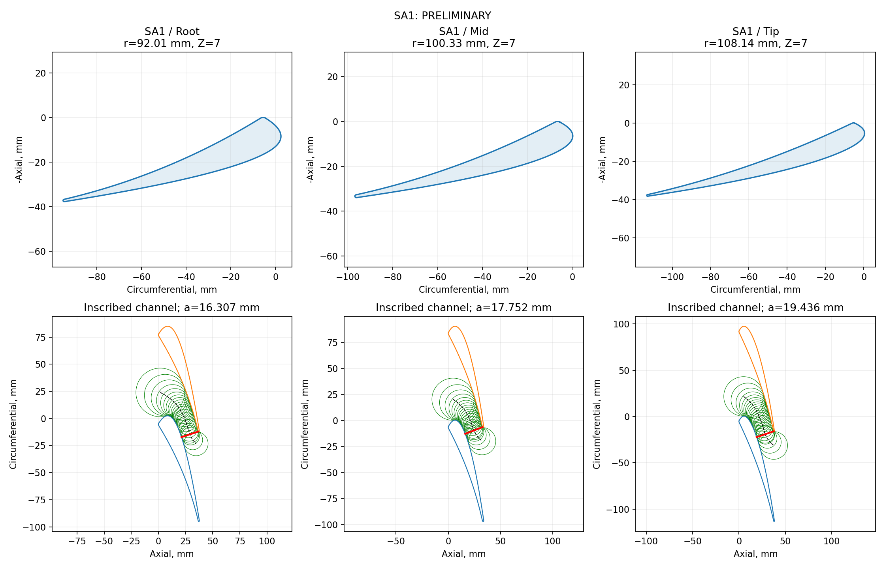
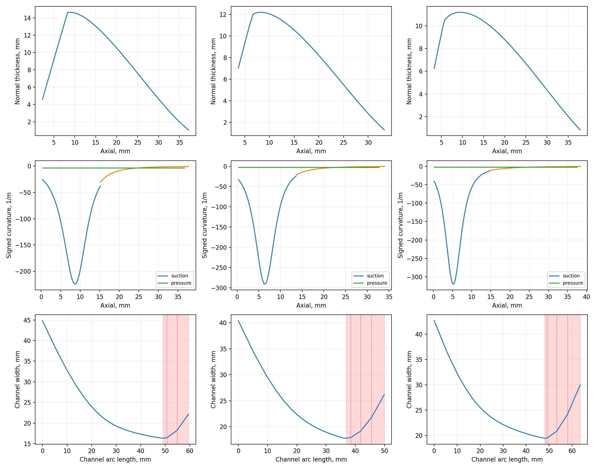
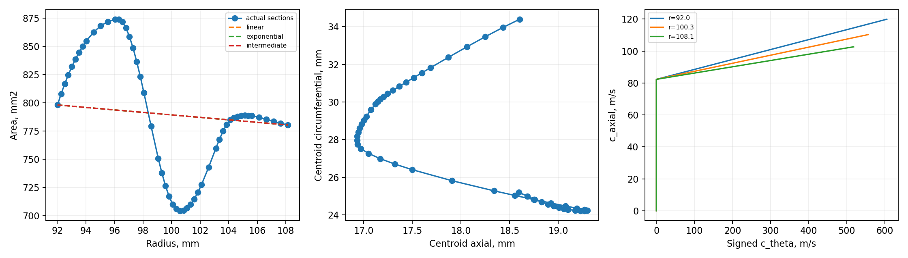
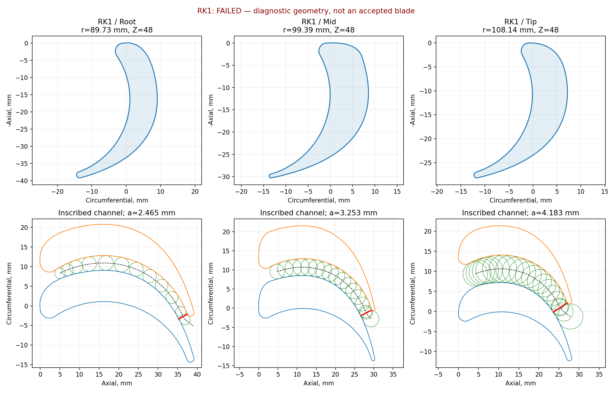
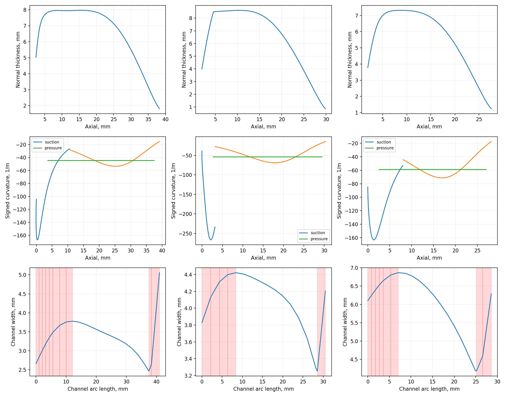
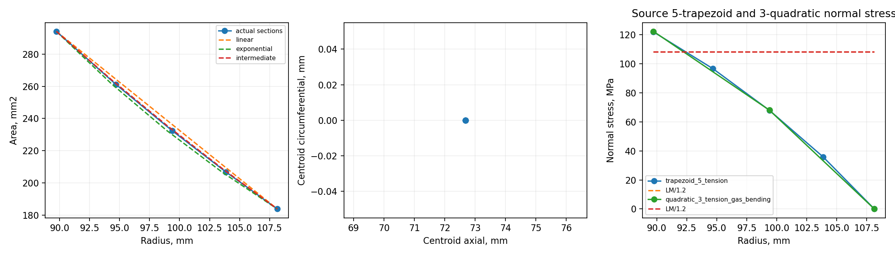
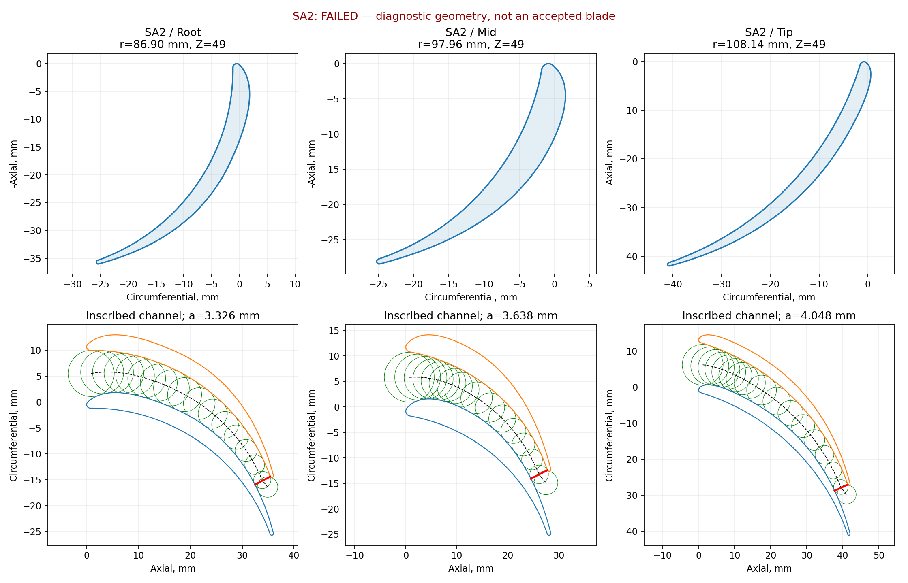
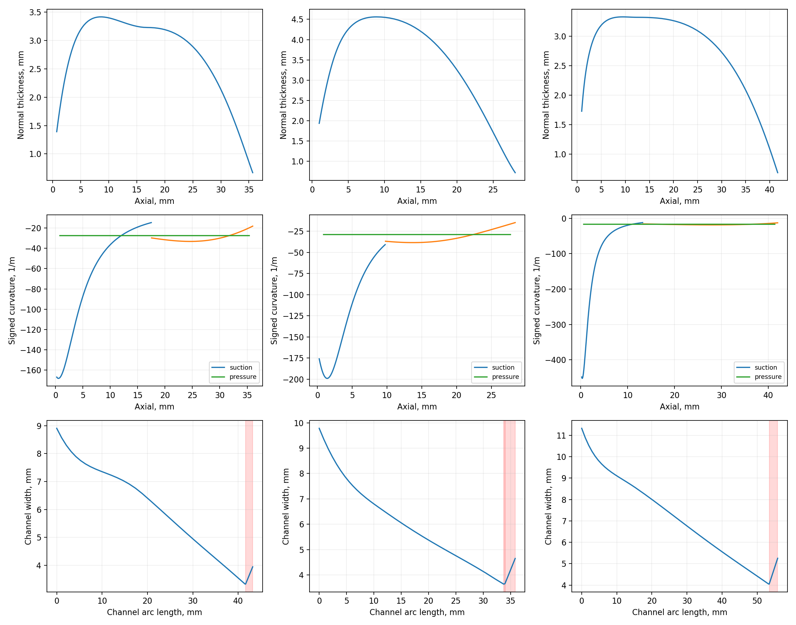
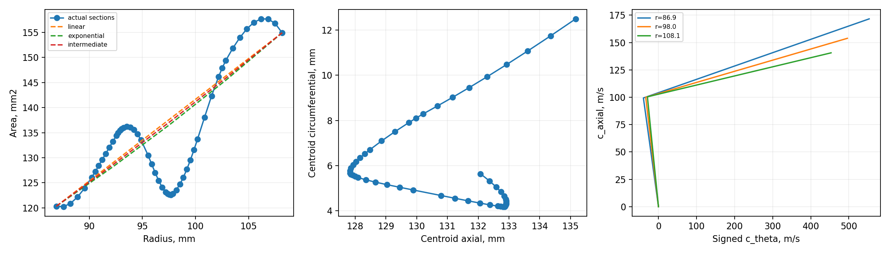
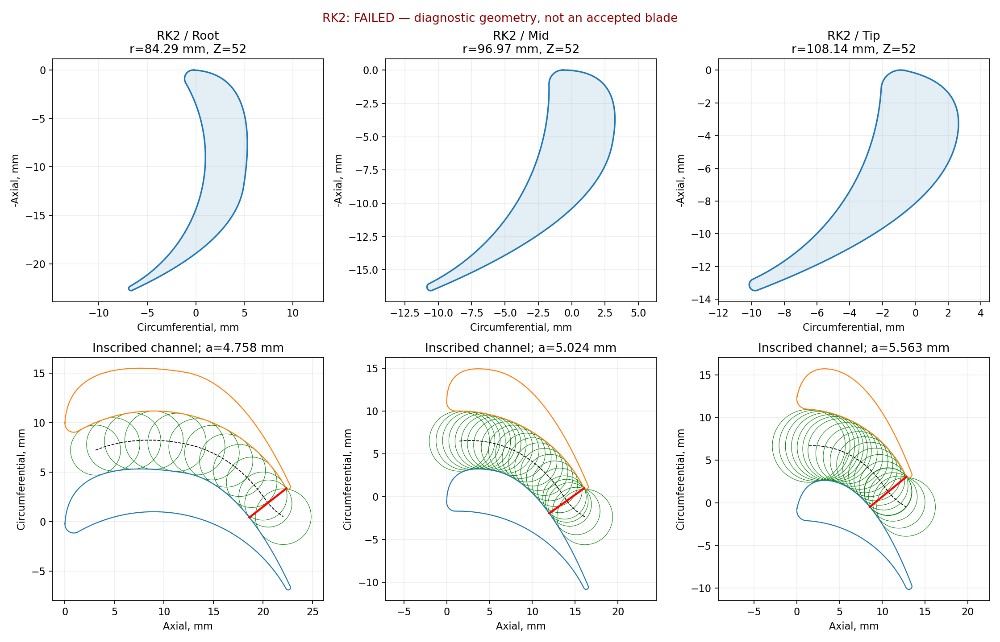
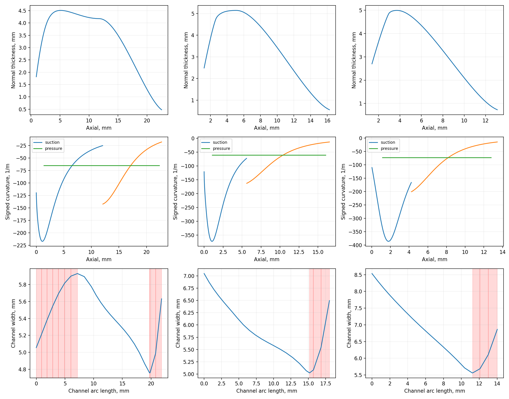
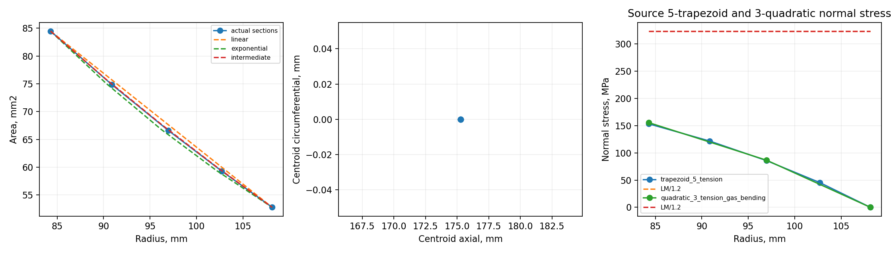
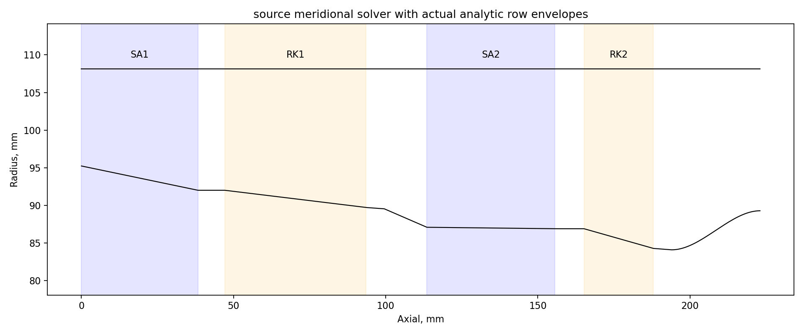
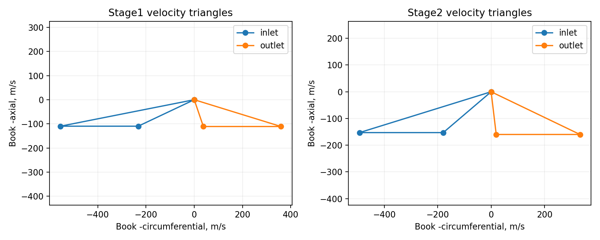
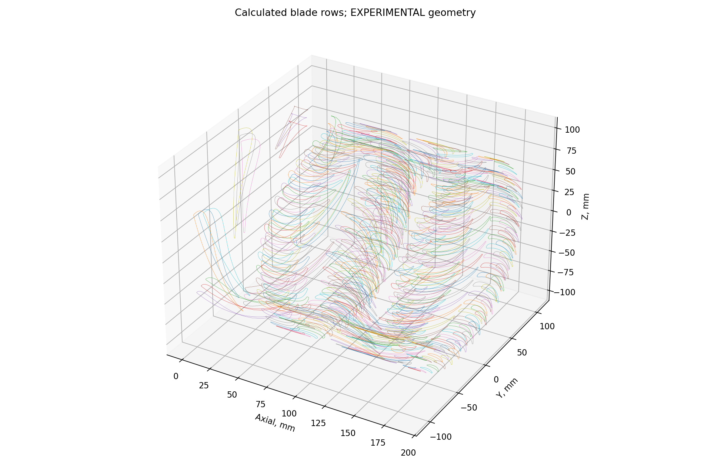

## Scope and missing physical evidence

- Geometry is not CFD/experimental proof of no separation or efficiency.
- Reynolds uses a documented air-viscosity proxy, not measured mixture transport.
- Source variable-cp thermodynamics and independent pressure-equilibrium audits are retained.
- IN738C/LM data are preliminary, not certified supply allowables.
- HCF NOT_CHECKED: grade-specific fatigue curve, forcing and damping are unavailable.
