# Vinogradov — actual TWO-stage course resource calculation

Source: **TVD_1CBK_2st_10000h.ipynb**; resource: **10000 h**; stages: **2**.
Fixed source RPM: **30700**.
Engineering admissible: **False**.
Constructed rows: 3/4.

A failed finite search is not a proof of global infeasibility. No design limit was relaxed.

## Quantified violations

### SA1
- {'name': 'source streamline Euler residual', 'value': 1.663001603446901e-05, 'limit': 1e-05, 'passed': False, 'classification': 'numerical', 'source': 'course radial_stage, J/kg', 'units': '1', 'note': ''}
- {'section': 0, 'name': 'local streamtube choke conflict', 'possible': False, 'required_flux_kg_m2_s': 479.50461487970006, 'critical_flux_kg_m2_s': 471.9765445887573, 'required_mach': None, 'stagnation_temperature_K': 1249.9999999999998, 'stagnation_pressure_Pa': 422749.4491921801, 'critical_temperature_K': 1081.7030867407584, 'source': 'original variable-cp h, pressure_isentropic, sound'}
- {'section': 0, 'name': 'source channel: толщина выходной кромки', 'measurements': {'geometry_valid': True, 'intersections': False, 'self_intersection': False, 'angle_error_deg': -0.7059687231798293, 'te_over_throat': 0.1452696132394664, 'book_te_over_throat': 0.055, 'max_reduced_expansion': 1.6884024001032587}, 'relative_thickness': 0.22481868034208763, 'actual_relative_pitch': 0.9953577085105528}
- {'section': 0, 'name': 'source channel: местная диффузорность', 'measurements': {'geometry_valid': True, 'intersections': False, 'self_intersection': False, 'angle_error_deg': -0.7059687231798293, 'te_over_throat': 0.1452696132394664, 'book_te_over_throat': 0.055, 'max_reduced_expansion': 1.6884024001032587}, 'relative_thickness': 0.22481868034208763, 'actual_relative_pitch': 0.9953577085105528}
- {'section': 0, 'name': 'source channel: максимальная толщина', 'measurements': {'geometry_valid': True, 'intersections': False, 'self_intersection': False, 'angle_error_deg': -0.7059687231798293, 'te_over_throat': 0.1452696132394664, 'book_te_over_throat': 0.055, 'max_reduced_expansion': 1.6884024001032587}, 'relative_thickness': 0.22481868034208763, 'actual_relative_pitch': 0.9953577085105528}
- {'section': 0, 'name': 'source channel: относительный шаг', 'measurements': {'geometry_valid': True, 'intersections': False, 'self_intersection': False, 'angle_error_deg': -0.7059687231798293, 'te_over_throat': 0.1452696132394664, 'book_te_over_throat': 0.055, 'max_reduced_expansion': 1.6884024001032587}, 'relative_thickness': 0.22481868034208763, 'actual_relative_pitch': 0.9953577085105528}
- {'section': 1, 'name': 'local streamtube choke conflict', 'possible': False, 'required_flux_kg_m2_s': 480.3196013211295, 'critical_flux_kg_m2_s': 471.97655331961613, 'required_mach': None, 'stagnation_temperature_K': 1249.9999551658825, 'stagnation_pressure_Pa': 422749.4491399771, 'critical_temperature_K': 1081.7030467298239, 'source': 'original variable-cp h, pressure_isentropic, sound'}
- {'section': 1, 'name': 'source channel: толщина выходной кромки', 'measurements': {'geometry_valid': True, 'intersections': False, 'self_intersection': False, 'angle_error_deg': -0.7626534625154004, 'te_over_throat': 0.1418338217272082, 'book_te_over_throat': 0.055, 'max_reduced_expansion': 1.4149644290673133}, 'relative_thickness': 0.2249030713033292, 'actual_relative_pitch': 1.0059371855751327}
- {'section': 1, 'name': 'source channel: местная диффузорность', 'measurements': {'geometry_valid': True, 'intersections': False, 'self_intersection': False, 'angle_error_deg': -0.7626534625154004, 'te_over_throat': 0.1418338217272082, 'book_te_over_throat': 0.055, 'max_reduced_expansion': 1.4149644290673133}, 'relative_thickness': 0.2249030713033292, 'actual_relative_pitch': 1.0059371855751327}
- {'section': 1, 'name': 'source channel: максимальная толщина', 'measurements': {'geometry_valid': True, 'intersections': False, 'self_intersection': False, 'angle_error_deg': -0.7626534625154004, 'te_over_throat': 0.1418338217272082, 'book_te_over_throat': 0.055, 'max_reduced_expansion': 1.4149644290673133}, 'relative_thickness': 0.2249030713033292, 'actual_relative_pitch': 1.0059371855751327}
- {'section': 1, 'name': 'source channel: относительный шаг', 'measurements': {'geometry_valid': True, 'intersections': False, 'self_intersection': False, 'angle_error_deg': -0.7626534625154004, 'te_over_throat': 0.1418338217272082, 'book_te_over_throat': 0.055, 'max_reduced_expansion': 1.4149644290673133}, 'relative_thickness': 0.2249030713033292, 'actual_relative_pitch': 1.0059371855751327}
- {'section': 2, 'name': 'local streamtube choke conflict', 'possible': False, 'required_flux_kg_m2_s': 477.15755092168274, 'critical_flux_kg_m2_s': 471.97654888311433, 'required_mach': None, 'stagnation_temperature_K': 1249.9999317739803, 'stagnation_pressure_Pa': 422749.4410588134, 'critical_temperature_K': 1081.7030258543848, 'source': 'original variable-cp h, pressure_isentropic, sound'}
- {'section': 2, 'name': 'source channel: толщина выходной кромки', 'measurements': {'geometry_valid': True, 'intersections': False, 'self_intersection': False, 'angle_error_deg': -0.7544418662454877, 'te_over_throat': 0.13894508152090826, 'book_te_over_throat': 0.055, 'max_reduced_expansion': 1.4201298103045645}, 'relative_thickness': 0.2248736520888269, 'actual_relative_pitch': 1.009266817256675}
- {'section': 2, 'name': 'source channel: местная диффузорность', 'measurements': {'geometry_valid': True, 'intersections': False, 'self_intersection': False, 'angle_error_deg': -0.7544418662454877, 'te_over_throat': 0.13894508152090826, 'book_te_over_throat': 0.055, 'max_reduced_expansion': 1.4201298103045645}, 'relative_thickness': 0.2248736520888269, 'actual_relative_pitch': 1.009266817256675}
- {'section': 2, 'name': 'source channel: максимальная толщина', 'measurements': {'geometry_valid': True, 'intersections': False, 'self_intersection': False, 'angle_error_deg': -0.7544418662454877, 'te_over_throat': 0.13894508152090826, 'book_te_over_throat': 0.055, 'max_reduced_expansion': 1.4201298103045645}, 'relative_thickness': 0.2248736520888269, 'actual_relative_pitch': 1.009266817256675}
- {'section': 2, 'name': 'source channel: относительный шаг', 'measurements': {'geometry_valid': True, 'intersections': False, 'self_intersection': False, 'angle_error_deg': -0.7544418662454877, 'te_over_throat': 0.13894508152090826, 'book_te_over_throat': 0.055, 'max_reduced_expansion': 1.4201298103045645}, 'relative_thickness': 0.2248736520888269, 'actual_relative_pitch': 1.009266817256675}
- {'section': 3, 'name': 'local streamtube choke conflict', 'possible': False, 'required_flux_kg_m2_s': 498.96041053087805, 'critical_flux_kg_m2_s': 471.9765440501777, 'required_mach': None, 'stagnation_temperature_K': 1249.9999895364103, 'stagnation_pressure_Pa': 422749.4468724699, 'critical_temperature_K': 1081.7030774028253, 'source': 'original variable-cp h, pressure_isentropic, sound'}
- {'section': 3, 'name': 'source channel: толщина выходной кромки', 'measurements': {'geometry_valid': True, 'intersections': False, 'self_intersection': False, 'angle_error_deg': -1.3050249094494344, 'te_over_throat': 0.13849336569872805, 'book_te_over_throat': 0.055, 'max_reduced_expansion': 1.7313409443946264}, 'relative_thickness': 0.22613693959162087, 'actual_relative_pitch': 1.0565702327284439}
- {'section': 3, 'name': 'source channel: местная диффузорность', 'measurements': {'geometry_valid': True, 'intersections': False, 'self_intersection': False, 'angle_error_deg': -1.3050249094494344, 'te_over_throat': 0.13849336569872805, 'book_te_over_throat': 0.055, 'max_reduced_expansion': 1.7313409443946264}, 'relative_thickness': 0.22613693959162087, 'actual_relative_pitch': 1.0565702327284439}
- {'section': 3, 'name': 'source channel: максимальная толщина', 'measurements': {'geometry_valid': True, 'intersections': False, 'self_intersection': False, 'angle_error_deg': -1.3050249094494344, 'te_over_throat': 0.13849336569872805, 'book_te_over_throat': 0.055, 'max_reduced_expansion': 1.7313409443946264}, 'relative_thickness': 0.22613693959162087, 'actual_relative_pitch': 1.0565702327284439}
- {'section': 3, 'name': 'source channel: относительный шаг', 'measurements': {'geometry_valid': True, 'intersections': False, 'self_intersection': False, 'angle_error_deg': -1.3050249094494344, 'te_over_throat': 0.13849336569872805, 'book_te_over_throat': 0.055, 'max_reduced_expansion': 1.7313409443946264}, 'relative_thickness': 0.22613693959162087, 'actual_relative_pitch': 1.0565702327284439}
- {'section': 4, 'name': 'local streamtube choke conflict', 'possible': False, 'required_flux_kg_m2_s': 500.85444424650706, 'critical_flux_kg_m2_s': 471.97654458875684, 'required_mach': None, 'stagnation_temperature_K': 1249.9999999999998, 'stagnation_pressure_Pa': 422749.44919217966, 'critical_temperature_K': 1081.7030867407584, 'source': 'original variable-cp h, pressure_isentropic, sound'}
- {'section': 4, 'name': 'source channel: толщина выходной кромки', 'measurements': {'geometry_valid': True, 'intersections': False, 'self_intersection': False, 'angle_error_deg': -1.4288744720177657, 'te_over_throat': 0.13799019395591922, 'book_te_over_throat': 0.055, 'max_reduced_expansion': 1.733538552751569}, 'relative_thickness': 0.22628020735659174, 'actual_relative_pitch': 1.058567486383511}
- {'section': 4, 'name': 'source channel: местная диффузорность', 'measurements': {'geometry_valid': True, 'intersections': False, 'self_intersection': False, 'angle_error_deg': -1.4288744720177657, 'te_over_throat': 0.13799019395591922, 'book_te_over_throat': 0.055, 'max_reduced_expansion': 1.733538552751569}, 'relative_thickness': 0.22628020735659174, 'actual_relative_pitch': 1.058567486383511}
- {'section': 4, 'name': 'source channel: максимальная толщина', 'measurements': {'geometry_valid': True, 'intersections': False, 'self_intersection': False, 'angle_error_deg': -1.4288744720177657, 'te_over_throat': 0.13799019395591922, 'book_te_over_throat': 0.055, 'max_reduced_expansion': 1.733538552751569}, 'relative_thickness': 0.22628020735659174, 'actual_relative_pitch': 1.058567486383511}
- {'section': 4, 'name': 'source channel: относительный шаг', 'measurements': {'geometry_valid': True, 'intersections': False, 'self_intersection': False, 'angle_error_deg': -1.4288744720177657, 'te_over_throat': 0.13799019395591922, 'book_te_over_throat': 0.055, 'max_reduced_expansion': 1.733538552751569}, 'relative_thickness': 0.22628020735659174, 'actual_relative_pitch': 1.058567486383511}
- {'name': 'insufficient choked capacity', 'value': 0.8086433053118299, 'limit': 0.8336628797375195, 'units': 'kg/s'}
### RK1
- {'name': 'source streamline Euler residual', 'value': 1.663001603446901e-05, 'limit': 1e-05, 'passed': False, 'classification': 'numerical', 'source': 'course radial_stage, J/kg', 'units': '1', 'note': ''}
- {'name': 'construction/calculation failure', 'message': 'No constructible row in the explicit search domain', 'details': {'archive_path': '/home/jovyan/work/Turbinis-Curs/1-Turbinis-Curs-Last/exports/vinogradov/10000h/RK1_search.json', 'attempts': 458}}
### SA2
- {'name': 'source streamline Euler residual', 'value': 3.2915588235482574e-05, 'limit': 1e-05, 'passed': False, 'classification': 'numerical', 'source': 'course radial_stage, J/kg', 'units': '1', 'note': ''}
- {'section': 0, 'name': 'local streamtube choke conflict', 'possible': False, 'required_flux_kg_m2_s': 268.7964072791508, 'critical_flux_kg_m2_s': 245.0191897316294, 'required_mach': None, 'stagnation_temperature_K': 1099.3008865253757, 'stagnation_pressure_Pa': 205284.8501270197, 'critical_temperature_K': 947.3366965458624, 'source': 'original variable-cp h, pressure_isentropic, sound'}
- {'section': 0, 'name': 'source channel: местная диффузорность', 'measurements': {'geometry_valid': True, 'intersections': False, 'self_intersection': False, 'angle_error_deg': -1.549132304080313, 'te_over_throat': 0.04403694009868549, 'book_te_over_throat': 0.055, 'max_reduced_expansion': 1.296376086035031}, 'relative_thickness': 0.09939257234844531, 'actual_relative_pitch': 0.6874351424394822}
- {'section': 0, 'name': 'source channel: максимальная толщина', 'measurements': {'geometry_valid': True, 'intersections': False, 'self_intersection': False, 'angle_error_deg': -1.549132304080313, 'te_over_throat': 0.04403694009868549, 'book_te_over_throat': 0.055, 'max_reduced_expansion': 1.296376086035031}, 'relative_thickness': 0.09939257234844531, 'actual_relative_pitch': 0.6874351424394822}
- {'section': 1, 'name': 'local streamtube choke conflict', 'possible': False, 'required_flux_kg_m2_s': 260.0340725369121, 'critical_flux_kg_m2_s': 245.01920054288667, 'required_mach': None, 'stagnation_temperature_K': 1099.3007737442865, 'stagnation_pressure_Pa': 205284.8482237486, 'critical_temperature_K': 947.3365961042688, 'source': 'original variable-cp h, pressure_isentropic, sound'}
- {'section': 1, 'name': 'source channel: местная диффузорность', 'measurements': {'geometry_valid': True, 'intersections': False, 'self_intersection': False, 'angle_error_deg': -1.0848536487176688, 'te_over_throat': 0.05114092849863625, 'book_te_over_throat': 0.055, 'max_reduced_expansion': 1.4685654633702083}, 'relative_thickness': 0.13402337763702868, 'actual_relative_pitch': 0.7707020920896411}
- {'section': 2, 'name': 'local streamtube choke conflict', 'possible': False, 'required_flux_kg_m2_s': 271.336147195445, 'critical_flux_kg_m2_s': 245.01918982972262, 'required_mach': None, 'stagnation_temperature_K': 1099.3008533053826, 'stagnation_pressure_Pa': 205284.8469805286, 'critical_temperature_K': 947.336666960503, 'source': 'original variable-cp h, pressure_isentropic, sound'}
- {'section': 2, 'name': 'source channel: местная диффузорность', 'measurements': {'geometry_valid': True, 'intersections': False, 'self_intersection': False, 'angle_error_deg': -1.9083448572887445, 'te_over_throat': 0.05072126239030503, 'book_te_over_throat': 0.055, 'max_reduced_expansion': 1.3318189261201032}, 'relative_thickness': 0.13413978218244327, 'actual_relative_pitch': 0.7503382373417801}
- {'section': 3, 'name': 'local streamtube choke conflict', 'possible': False, 'required_flux_kg_m2_s': 258.14786610987346, 'critical_flux_kg_m2_s': 245.0191845353256, 'required_mach': None, 'stagnation_temperature_K': 1099.3008169721734, 'stagnation_pressure_Pa': 205284.8390134603, 'critical_temperature_K': 947.3366346025477, 'source': 'original variable-cp h, pressure_isentropic, sound'}
- {'section': 3, 'name': 'source channel: местная диффузорность', 'measurements': {'geometry_valid': True, 'intersections': False, 'self_intersection': False, 'angle_error_deg': -1.2843933523877045, 'te_over_throat': 0.04696650006779496, 'book_te_over_throat': 0.055, 'max_reduced_expansion': 1.3504615762427425}, 'relative_thickness': 0.13403354130070774, 'actual_relative_pitch': 0.7423889172124893}
- {'section': 4, 'name': 'local streamtube choke conflict', 'possible': False, 'required_flux_kg_m2_s': 250.94422444906647, 'critical_flux_kg_m2_s': 245.01918973162918, 'required_mach': None, 'stagnation_temperature_K': 1099.3008865253757, 'stagnation_pressure_Pa': 205284.85012701948, 'critical_temperature_K': 947.3366965458624, 'source': 'original variable-cp h, pressure_isentropic, sound'}
- {'section': 4, 'name': 'source channel: местная диффузорность', 'measurements': {'geometry_valid': True, 'intersections': False, 'self_intersection': False, 'angle_error_deg': -1.0226313225820682, 'te_over_throat': 0.04965304777546328, 'book_te_over_throat': 0.055, 'max_reduced_expansion': 1.4038001089387644}, 'relative_thickness': 0.142238310425611, 'actual_relative_pitch': 0.7607312868553799}
- {'name': 'insufficient choked capacity', 'value': 0.779013830367097, 'limit': 0.8336628797375195, 'units': 'kg/s'}
### RK2
- {'name': 'source streamline Euler residual', 'value': 3.2915588235482574e-05, 'limit': 1e-05, 'passed': False, 'classification': 'numerical', 'source': 'course radial_stage, J/kg', 'units': '1', 'note': ''}
- {'section': 0, 'name': 'source channel: угол горла', 'measurements': {'geometry_valid': True, 'intersections': False, 'self_intersection': False, 'angle_error_deg': -3.296423781186423, 'te_over_throat': 0.08758614539086326, 'book_te_over_throat': 0.07, 'max_reduced_expansion': 1.182500399546582}, 'relative_thickness': 0.18020435409048433, 'actual_relative_pitch': 0.533058666221471}
- {'section': 0, 'name': 'source channel: толщина выходной кромки', 'measurements': {'geometry_valid': True, 'intersections': False, 'self_intersection': False, 'angle_error_deg': -3.296423781186423, 'te_over_throat': 0.08758614539086326, 'book_te_over_throat': 0.07, 'max_reduced_expansion': 1.182500399546582}, 'relative_thickness': 0.18020435409048433, 'actual_relative_pitch': 0.533058666221471}
- {'section': 0, 'name': 'source channel: местная диффузорность', 'measurements': {'geometry_valid': True, 'intersections': False, 'self_intersection': False, 'angle_error_deg': -3.296423781186423, 'te_over_throat': 0.08758614539086326, 'book_te_over_throat': 0.07, 'max_reduced_expansion': 1.182500399546582}, 'relative_thickness': 0.18020435409048433, 'actual_relative_pitch': 0.533058666221471}
- {'section': 0, 'name': 'source channel: максимальная толщина', 'measurements': {'geometry_valid': True, 'intersections': False, 'self_intersection': False, 'angle_error_deg': -3.296423781186423, 'te_over_throat': 0.08758614539086326, 'book_te_over_throat': 0.07, 'max_reduced_expansion': 1.182500399546582}, 'relative_thickness': 0.18020435409048433, 'actual_relative_pitch': 0.533058666221471}
- {'section': 0, 'name': 'source channel: относительный шаг', 'measurements': {'geometry_valid': True, 'intersections': False, 'self_intersection': False, 'angle_error_deg': -3.296423781186423, 'te_over_throat': 0.08758614539086326, 'book_te_over_throat': 0.07, 'max_reduced_expansion': 1.182500399546582}, 'relative_thickness': 0.18020435409048433, 'actual_relative_pitch': 0.533058666221471}
- {'section': 1, 'name': 'source channel: угол горла', 'measurements': {'geometry_valid': True, 'intersections': False, 'self_intersection': False, 'angle_error_deg': -2.4708215781375458, 'te_over_throat': 0.11016696563253066, 'book_te_over_throat': 0.07, 'max_reduced_expansion': 1.243589824707024}, 'relative_thickness': 0.17841435179115078, 'actual_relative_pitch': 0.6096884682213586}
- {'section': 1, 'name': 'source channel: толщина выходной кромки', 'measurements': {'geometry_valid': True, 'intersections': False, 'self_intersection': False, 'angle_error_deg': -2.4708215781375458, 'te_over_throat': 0.11016696563253066, 'book_te_over_throat': 0.07, 'max_reduced_expansion': 1.243589824707024}, 'relative_thickness': 0.17841435179115078, 'actual_relative_pitch': 0.6096884682213586}
- {'section': 1, 'name': 'source channel: местная диффузорность', 'measurements': {'geometry_valid': True, 'intersections': False, 'self_intersection': False, 'angle_error_deg': -2.4708215781375458, 'te_over_throat': 0.11016696563253066, 'book_te_over_throat': 0.07, 'max_reduced_expansion': 1.243589824707024}, 'relative_thickness': 0.17841435179115078, 'actual_relative_pitch': 0.6096884682213586}
- {'section': 1, 'name': 'source channel: максимальная толщина', 'measurements': {'geometry_valid': True, 'intersections': False, 'self_intersection': False, 'angle_error_deg': -2.4708215781375458, 'te_over_throat': 0.11016696563253066, 'book_te_over_throat': 0.07, 'max_reduced_expansion': 1.243589824707024}, 'relative_thickness': 0.17841435179115078, 'actual_relative_pitch': 0.6096884682213586}
- {'section': 1, 'name': 'source channel: относительный шаг', 'measurements': {'geometry_valid': True, 'intersections': False, 'self_intersection': False, 'angle_error_deg': -2.4708215781375458, 'te_over_throat': 0.11016696563253066, 'book_te_over_throat': 0.07, 'max_reduced_expansion': 1.243589824707024}, 'relative_thickness': 0.17841435179115078, 'actual_relative_pitch': 0.6096884682213586}
- {'section': 2, 'name': 'source channel: угол горла', 'measurements': {'geometry_valid': True, 'intersections': False, 'self_intersection': False, 'angle_error_deg': -3.0406378402425602, 'te_over_throat': 0.10085512558480252, 'book_te_over_throat': 0.07, 'max_reduced_expansion': 1.2869896801877492}, 'relative_thickness': 0.1760935879836774, 'actual_relative_pitch': 0.6905931509537693}
- {'section': 2, 'name': 'source channel: толщина выходной кромки', 'measurements': {'geometry_valid': True, 'intersections': False, 'self_intersection': False, 'angle_error_deg': -3.0406378402425602, 'te_over_throat': 0.10085512558480252, 'book_te_over_throat': 0.07, 'max_reduced_expansion': 1.2869896801877492}, 'relative_thickness': 0.1760935879836774, 'actual_relative_pitch': 0.6905931509537693}
- {'section': 2, 'name': 'source channel: местная диффузорность', 'measurements': {'geometry_valid': True, 'intersections': False, 'self_intersection': False, 'angle_error_deg': -3.0406378402425602, 'te_over_throat': 0.10085512558480252, 'book_te_over_throat': 0.07, 'max_reduced_expansion': 1.2869896801877492}, 'relative_thickness': 0.1760935879836774, 'actual_relative_pitch': 0.6905931509537693}
- {'section': 2, 'name': 'source channel: максимальная толщина', 'measurements': {'geometry_valid': True, 'intersections': False, 'self_intersection': False, 'angle_error_deg': -3.0406378402425602, 'te_over_throat': 0.10085512558480252, 'book_te_over_throat': 0.07, 'max_reduced_expansion': 1.2869896801877492}, 'relative_thickness': 0.1760935879836774, 'actual_relative_pitch': 0.6905931509537693}
- {'section': 2, 'name': 'source channel: относительный шаг', 'measurements': {'geometry_valid': True, 'intersections': False, 'self_intersection': False, 'angle_error_deg': -3.0406378402425602, 'te_over_throat': 0.10085512558480252, 'book_te_over_throat': 0.07, 'max_reduced_expansion': 1.2869896801877492}, 'relative_thickness': 0.1760935879836774, 'actual_relative_pitch': 0.6905931509537693}
- {'section': 3, 'name': 'source channel: угол горла', 'measurements': {'geometry_valid': True, 'intersections': False, 'self_intersection': False, 'angle_error_deg': -2.401631716117066, 'te_over_throat': 0.10125008064981943, 'book_te_over_throat': 0.07, 'max_reduced_expansion': 1.2585022670279913}, 'relative_thickness': 0.1690300677998334, 'actual_relative_pitch': 0.7365121745910056}
- {'section': 3, 'name': 'source channel: толщина выходной кромки', 'measurements': {'geometry_valid': True, 'intersections': False, 'self_intersection': False, 'angle_error_deg': -2.401631716117066, 'te_over_throat': 0.10125008064981943, 'book_te_over_throat': 0.07, 'max_reduced_expansion': 1.2585022670279913}, 'relative_thickness': 0.1690300677998334, 'actual_relative_pitch': 0.7365121745910056}
- {'section': 3, 'name': 'source channel: местная диффузорность', 'measurements': {'geometry_valid': True, 'intersections': False, 'self_intersection': False, 'angle_error_deg': -2.401631716117066, 'te_over_throat': 0.10125008064981943, 'book_te_over_throat': 0.07, 'max_reduced_expansion': 1.2585022670279913}, 'relative_thickness': 0.1690300677998334, 'actual_relative_pitch': 0.7365121745910056}
- {'section': 3, 'name': 'source channel: максимальная толщина', 'measurements': {'geometry_valid': True, 'intersections': False, 'self_intersection': False, 'angle_error_deg': -2.401631716117066, 'te_over_throat': 0.10125008064981943, 'book_te_over_throat': 0.07, 'max_reduced_expansion': 1.2585022670279913}, 'relative_thickness': 0.1690300677998334, 'actual_relative_pitch': 0.7365121745910056}
- {'section': 4, 'name': 'source channel: вписанные круги', 'measurements': {'geometry_valid': False, 'intersections': False, 'self_intersection': False, 'angle_error_deg': -1.8900815986594388, 'te_over_throat': 0.07096221693223659, 'book_te_over_throat': 0.07, 'max_reduced_expansion': 1.249462572679895}, 'relative_thickness': 0.11419840143308442, 'actual_relative_pitch': 0.6617825426761385}
- {'section': 4, 'name': 'source channel: местная диффузорность', 'measurements': {'geometry_valid': False, 'intersections': False, 'self_intersection': False, 'angle_error_deg': -1.8900815986594388, 'te_over_throat': 0.07096221693223659, 'book_te_over_throat': 0.07, 'max_reduced_expansion': 1.249462572679895}, 'relative_thickness': 0.11419840143308442, 'actual_relative_pitch': 0.6617825426761385}
- {'section': 4, 'name': 'source channel: относительный шаг', 'measurements': {'geometry_valid': False, 'intersections': False, 'self_intersection': False, 'angle_error_deg': -1.8900815986594388, 'te_over_throat': 0.07096221693223659, 'book_te_over_throat': 0.07, 'max_reduced_expansion': 1.249462572679895}, 'relative_thickness': 0.11419840143308442, 'actual_relative_pitch': 0.6617825426761385}
- {'name': 'vibration strength', 'status': 'NOT_CHECKED', 'reason': 'NOT_CHECKED: no grade-specific fatigue curve, damping or actual harmonic forcing; beam modes are screening only'}

## Global/source violations

- {'row': 'SA1', 'name': 'source streamline Euler residual', 'value': 1.663001603446901e-05, 'limit': 1e-05, 'passed': False, 'classification': 'numerical', 'source': 'course radial_stage, J/kg', 'units': '1', 'note': ''}
- {'row': 'SA1', 'section': 0, 'name': 'local streamtube choke conflict', 'possible': False, 'required_flux_kg_m2_s': 479.50461487970006, 'critical_flux_kg_m2_s': 471.9765445887573, 'required_mach': None, 'stagnation_temperature_K': 1249.9999999999998, 'stagnation_pressure_Pa': 422749.4491921801, 'critical_temperature_K': 1081.7030867407584, 'source': 'original variable-cp h, pressure_isentropic, sound'}
- {'row': 'SA1', 'section': 0, 'name': 'source channel: толщина выходной кромки', 'measurements': {'geometry_valid': True, 'intersections': False, 'self_intersection': False, 'angle_error_deg': -0.7059687231798293, 'te_over_throat': 0.1452696132394664, 'book_te_over_throat': 0.055, 'max_reduced_expansion': 1.6884024001032587}, 'relative_thickness': 0.22481868034208763, 'actual_relative_pitch': 0.9953577085105528}
- {'row': 'SA1', 'section': 0, 'name': 'source channel: местная диффузорность', 'measurements': {'geometry_valid': True, 'intersections': False, 'self_intersection': False, 'angle_error_deg': -0.7059687231798293, 'te_over_throat': 0.1452696132394664, 'book_te_over_throat': 0.055, 'max_reduced_expansion': 1.6884024001032587}, 'relative_thickness': 0.22481868034208763, 'actual_relative_pitch': 0.9953577085105528}
- {'row': 'SA1', 'section': 0, 'name': 'source channel: максимальная толщина', 'measurements': {'geometry_valid': True, 'intersections': False, 'self_intersection': False, 'angle_error_deg': -0.7059687231798293, 'te_over_throat': 0.1452696132394664, 'book_te_over_throat': 0.055, 'max_reduced_expansion': 1.6884024001032587}, 'relative_thickness': 0.22481868034208763, 'actual_relative_pitch': 0.9953577085105528}
- {'row': 'SA1', 'section': 0, 'name': 'source channel: относительный шаг', 'measurements': {'geometry_valid': True, 'intersections': False, 'self_intersection': False, 'angle_error_deg': -0.7059687231798293, 'te_over_throat': 0.1452696132394664, 'book_te_over_throat': 0.055, 'max_reduced_expansion': 1.6884024001032587}, 'relative_thickness': 0.22481868034208763, 'actual_relative_pitch': 0.9953577085105528}
- {'row': 'SA1', 'section': 1, 'name': 'local streamtube choke conflict', 'possible': False, 'required_flux_kg_m2_s': 480.3196013211295, 'critical_flux_kg_m2_s': 471.97655331961613, 'required_mach': None, 'stagnation_temperature_K': 1249.9999551658825, 'stagnation_pressure_Pa': 422749.4491399771, 'critical_temperature_K': 1081.7030467298239, 'source': 'original variable-cp h, pressure_isentropic, sound'}
- {'row': 'SA1', 'section': 1, 'name': 'source channel: толщина выходной кромки', 'measurements': {'geometry_valid': True, 'intersections': False, 'self_intersection': False, 'angle_error_deg': -0.7626534625154004, 'te_over_throat': 0.1418338217272082, 'book_te_over_throat': 0.055, 'max_reduced_expansion': 1.4149644290673133}, 'relative_thickness': 0.2249030713033292, 'actual_relative_pitch': 1.0059371855751327}
- {'row': 'SA1', 'section': 1, 'name': 'source channel: местная диффузорность', 'measurements': {'geometry_valid': True, 'intersections': False, 'self_intersection': False, 'angle_error_deg': -0.7626534625154004, 'te_over_throat': 0.1418338217272082, 'book_te_over_throat': 0.055, 'max_reduced_expansion': 1.4149644290673133}, 'relative_thickness': 0.2249030713033292, 'actual_relative_pitch': 1.0059371855751327}
- {'row': 'SA1', 'section': 1, 'name': 'source channel: максимальная толщина', 'measurements': {'geometry_valid': True, 'intersections': False, 'self_intersection': False, 'angle_error_deg': -0.7626534625154004, 'te_over_throat': 0.1418338217272082, 'book_te_over_throat': 0.055, 'max_reduced_expansion': 1.4149644290673133}, 'relative_thickness': 0.2249030713033292, 'actual_relative_pitch': 1.0059371855751327}
- {'row': 'SA1', 'section': 1, 'name': 'source channel: относительный шаг', 'measurements': {'geometry_valid': True, 'intersections': False, 'self_intersection': False, 'angle_error_deg': -0.7626534625154004, 'te_over_throat': 0.1418338217272082, 'book_te_over_throat': 0.055, 'max_reduced_expansion': 1.4149644290673133}, 'relative_thickness': 0.2249030713033292, 'actual_relative_pitch': 1.0059371855751327}
- {'row': 'SA1', 'section': 2, 'name': 'local streamtube choke conflict', 'possible': False, 'required_flux_kg_m2_s': 477.15755092168274, 'critical_flux_kg_m2_s': 471.97654888311433, 'required_mach': None, 'stagnation_temperature_K': 1249.9999317739803, 'stagnation_pressure_Pa': 422749.4410588134, 'critical_temperature_K': 1081.7030258543848, 'source': 'original variable-cp h, pressure_isentropic, sound'}
- {'row': 'SA1', 'section': 2, 'name': 'source channel: толщина выходной кромки', 'measurements': {'geometry_valid': True, 'intersections': False, 'self_intersection': False, 'angle_error_deg': -0.7544418662454877, 'te_over_throat': 0.13894508152090826, 'book_te_over_throat': 0.055, 'max_reduced_expansion': 1.4201298103045645}, 'relative_thickness': 0.2248736520888269, 'actual_relative_pitch': 1.009266817256675}
- {'row': 'SA1', 'section': 2, 'name': 'source channel: местная диффузорность', 'measurements': {'geometry_valid': True, 'intersections': False, 'self_intersection': False, 'angle_error_deg': -0.7544418662454877, 'te_over_throat': 0.13894508152090826, 'book_te_over_throat': 0.055, 'max_reduced_expansion': 1.4201298103045645}, 'relative_thickness': 0.2248736520888269, 'actual_relative_pitch': 1.009266817256675}
- {'row': 'SA1', 'section': 2, 'name': 'source channel: максимальная толщина', 'measurements': {'geometry_valid': True, 'intersections': False, 'self_intersection': False, 'angle_error_deg': -0.7544418662454877, 'te_over_throat': 0.13894508152090826, 'book_te_over_throat': 0.055, 'max_reduced_expansion': 1.4201298103045645}, 'relative_thickness': 0.2248736520888269, 'actual_relative_pitch': 1.009266817256675}
- {'row': 'SA1', 'section': 2, 'name': 'source channel: относительный шаг', 'measurements': {'geometry_valid': True, 'intersections': False, 'self_intersection': False, 'angle_error_deg': -0.7544418662454877, 'te_over_throat': 0.13894508152090826, 'book_te_over_throat': 0.055, 'max_reduced_expansion': 1.4201298103045645}, 'relative_thickness': 0.2248736520888269, 'actual_relative_pitch': 1.009266817256675}
- {'row': 'SA1', 'section': 3, 'name': 'local streamtube choke conflict', 'possible': False, 'required_flux_kg_m2_s': 498.96041053087805, 'critical_flux_kg_m2_s': 471.9765440501777, 'required_mach': None, 'stagnation_temperature_K': 1249.9999895364103, 'stagnation_pressure_Pa': 422749.4468724699, 'critical_temperature_K': 1081.7030774028253, 'source': 'original variable-cp h, pressure_isentropic, sound'}
- {'row': 'SA1', 'section': 3, 'name': 'source channel: толщина выходной кромки', 'measurements': {'geometry_valid': True, 'intersections': False, 'self_intersection': False, 'angle_error_deg': -1.3050249094494344, 'te_over_throat': 0.13849336569872805, 'book_te_over_throat': 0.055, 'max_reduced_expansion': 1.7313409443946264}, 'relative_thickness': 0.22613693959162087, 'actual_relative_pitch': 1.0565702327284439}
- {'row': 'SA1', 'section': 3, 'name': 'source channel: местная диффузорность', 'measurements': {'geometry_valid': True, 'intersections': False, 'self_intersection': False, 'angle_error_deg': -1.3050249094494344, 'te_over_throat': 0.13849336569872805, 'book_te_over_throat': 0.055, 'max_reduced_expansion': 1.7313409443946264}, 'relative_thickness': 0.22613693959162087, 'actual_relative_pitch': 1.0565702327284439}
- {'row': 'SA1', 'section': 3, 'name': 'source channel: максимальная толщина', 'measurements': {'geometry_valid': True, 'intersections': False, 'self_intersection': False, 'angle_error_deg': -1.3050249094494344, 'te_over_throat': 0.13849336569872805, 'book_te_over_throat': 0.055, 'max_reduced_expansion': 1.7313409443946264}, 'relative_thickness': 0.22613693959162087, 'actual_relative_pitch': 1.0565702327284439}
- {'row': 'SA1', 'section': 3, 'name': 'source channel: относительный шаг', 'measurements': {'geometry_valid': True, 'intersections': False, 'self_intersection': False, 'angle_error_deg': -1.3050249094494344, 'te_over_throat': 0.13849336569872805, 'book_te_over_throat': 0.055, 'max_reduced_expansion': 1.7313409443946264}, 'relative_thickness': 0.22613693959162087, 'actual_relative_pitch': 1.0565702327284439}
- {'row': 'SA1', 'section': 4, 'name': 'local streamtube choke conflict', 'possible': False, 'required_flux_kg_m2_s': 500.85444424650706, 'critical_flux_kg_m2_s': 471.97654458875684, 'required_mach': None, 'stagnation_temperature_K': 1249.9999999999998, 'stagnation_pressure_Pa': 422749.44919217966, 'critical_temperature_K': 1081.7030867407584, 'source': 'original variable-cp h, pressure_isentropic, sound'}
- {'row': 'SA1', 'section': 4, 'name': 'source channel: толщина выходной кромки', 'measurements': {'geometry_valid': True, 'intersections': False, 'self_intersection': False, 'angle_error_deg': -1.4288744720177657, 'te_over_throat': 0.13799019395591922, 'book_te_over_throat': 0.055, 'max_reduced_expansion': 1.733538552751569}, 'relative_thickness': 0.22628020735659174, 'actual_relative_pitch': 1.058567486383511}
- {'row': 'SA1', 'section': 4, 'name': 'source channel: местная диффузорность', 'measurements': {'geometry_valid': True, 'intersections': False, 'self_intersection': False, 'angle_error_deg': -1.4288744720177657, 'te_over_throat': 0.13799019395591922, 'book_te_over_throat': 0.055, 'max_reduced_expansion': 1.733538552751569}, 'relative_thickness': 0.22628020735659174, 'actual_relative_pitch': 1.058567486383511}
- {'row': 'SA1', 'section': 4, 'name': 'source channel: максимальная толщина', 'measurements': {'geometry_valid': True, 'intersections': False, 'self_intersection': False, 'angle_error_deg': -1.4288744720177657, 'te_over_throat': 0.13799019395591922, 'book_te_over_throat': 0.055, 'max_reduced_expansion': 1.733538552751569}, 'relative_thickness': 0.22628020735659174, 'actual_relative_pitch': 1.058567486383511}
- {'row': 'SA1', 'section': 4, 'name': 'source channel: относительный шаг', 'measurements': {'geometry_valid': True, 'intersections': False, 'self_intersection': False, 'angle_error_deg': -1.4288744720177657, 'te_over_throat': 0.13799019395591922, 'book_te_over_throat': 0.055, 'max_reduced_expansion': 1.733538552751569}, 'relative_thickness': 0.22628020735659174, 'actual_relative_pitch': 1.058567486383511}
- {'row': 'SA1', 'name': 'insufficient choked capacity', 'value': 0.8086433053118299, 'limit': 0.8336628797375195, 'units': 'kg/s'}
- {'row': 'RK1', 'name': 'source streamline Euler residual', 'value': 1.663001603446901e-05, 'limit': 1e-05, 'passed': False, 'classification': 'numerical', 'source': 'course radial_stage, J/kg', 'units': '1', 'note': ''}
- {'row': 'RK1', 'name': 'construction/calculation failure', 'message': 'No constructible row in the explicit search domain', 'details': {'archive_path': '/home/jovyan/work/Turbinis-Curs/1-Turbinis-Curs-Last/exports/vinogradov/10000h/RK1_search.json', 'attempts': 458}}
- {'row': 'SA2', 'name': 'source streamline Euler residual', 'value': 3.2915588235482574e-05, 'limit': 1e-05, 'passed': False, 'classification': 'numerical', 'source': 'course radial_stage, J/kg', 'units': '1', 'note': ''}
- {'row': 'SA2', 'section': 0, 'name': 'local streamtube choke conflict', 'possible': False, 'required_flux_kg_m2_s': 268.7964072791508, 'critical_flux_kg_m2_s': 245.0191897316294, 'required_mach': None, 'stagnation_temperature_K': 1099.3008865253757, 'stagnation_pressure_Pa': 205284.8501270197, 'critical_temperature_K': 947.3366965458624, 'source': 'original variable-cp h, pressure_isentropic, sound'}
- {'row': 'SA2', 'section': 0, 'name': 'source channel: местная диффузорность', 'measurements': {'geometry_valid': True, 'intersections': False, 'self_intersection': False, 'angle_error_deg': -1.549132304080313, 'te_over_throat': 0.04403694009868549, 'book_te_over_throat': 0.055, 'max_reduced_expansion': 1.296376086035031}, 'relative_thickness': 0.09939257234844531, 'actual_relative_pitch': 0.6874351424394822}
- {'row': 'SA2', 'section': 0, 'name': 'source channel: максимальная толщина', 'measurements': {'geometry_valid': True, 'intersections': False, 'self_intersection': False, 'angle_error_deg': -1.549132304080313, 'te_over_throat': 0.04403694009868549, 'book_te_over_throat': 0.055, 'max_reduced_expansion': 1.296376086035031}, 'relative_thickness': 0.09939257234844531, 'actual_relative_pitch': 0.6874351424394822}
- {'row': 'SA2', 'section': 1, 'name': 'local streamtube choke conflict', 'possible': False, 'required_flux_kg_m2_s': 260.0340725369121, 'critical_flux_kg_m2_s': 245.01920054288667, 'required_mach': None, 'stagnation_temperature_K': 1099.3007737442865, 'stagnation_pressure_Pa': 205284.8482237486, 'critical_temperature_K': 947.3365961042688, 'source': 'original variable-cp h, pressure_isentropic, sound'}
- {'row': 'SA2', 'section': 1, 'name': 'source channel: местная диффузорность', 'measurements': {'geometry_valid': True, 'intersections': False, 'self_intersection': False, 'angle_error_deg': -1.0848536487176688, 'te_over_throat': 0.05114092849863625, 'book_te_over_throat': 0.055, 'max_reduced_expansion': 1.4685654633702083}, 'relative_thickness': 0.13402337763702868, 'actual_relative_pitch': 0.7707020920896411}
- {'row': 'SA2', 'section': 2, 'name': 'local streamtube choke conflict', 'possible': False, 'required_flux_kg_m2_s': 271.336147195445, 'critical_flux_kg_m2_s': 245.01918982972262, 'required_mach': None, 'stagnation_temperature_K': 1099.3008533053826, 'stagnation_pressure_Pa': 205284.8469805286, 'critical_temperature_K': 947.336666960503, 'source': 'original variable-cp h, pressure_isentropic, sound'}
- {'row': 'SA2', 'section': 2, 'name': 'source channel: местная диффузорность', 'measurements': {'geometry_valid': True, 'intersections': False, 'self_intersection': False, 'angle_error_deg': -1.9083448572887445, 'te_over_throat': 0.05072126239030503, 'book_te_over_throat': 0.055, 'max_reduced_expansion': 1.3318189261201032}, 'relative_thickness': 0.13413978218244327, 'actual_relative_pitch': 0.7503382373417801}
- {'row': 'SA2', 'section': 3, 'name': 'local streamtube choke conflict', 'possible': False, 'required_flux_kg_m2_s': 258.14786610987346, 'critical_flux_kg_m2_s': 245.0191845353256, 'required_mach': None, 'stagnation_temperature_K': 1099.3008169721734, 'stagnation_pressure_Pa': 205284.8390134603, 'critical_temperature_K': 947.3366346025477, 'source': 'original variable-cp h, pressure_isentropic, sound'}
- {'row': 'SA2', 'section': 3, 'name': 'source channel: местная диффузорность', 'measurements': {'geometry_valid': True, 'intersections': False, 'self_intersection': False, 'angle_error_deg': -1.2843933523877045, 'te_over_throat': 0.04696650006779496, 'book_te_over_throat': 0.055, 'max_reduced_expansion': 1.3504615762427425}, 'relative_thickness': 0.13403354130070774, 'actual_relative_pitch': 0.7423889172124893}
- {'row': 'SA2', 'section': 4, 'name': 'local streamtube choke conflict', 'possible': False, 'required_flux_kg_m2_s': 250.94422444906647, 'critical_flux_kg_m2_s': 245.01918973162918, 'required_mach': None, 'stagnation_temperature_K': 1099.3008865253757, 'stagnation_pressure_Pa': 205284.85012701948, 'critical_temperature_K': 947.3366965458624, 'source': 'original variable-cp h, pressure_isentropic, sound'}
- {'row': 'SA2', 'section': 4, 'name': 'source channel: местная диффузорность', 'measurements': {'geometry_valid': True, 'intersections': False, 'self_intersection': False, 'angle_error_deg': -1.0226313225820682, 'te_over_throat': 0.04965304777546328, 'book_te_over_throat': 0.055, 'max_reduced_expansion': 1.4038001089387644}, 'relative_thickness': 0.142238310425611, 'actual_relative_pitch': 0.7607312868553799}
- {'row': 'SA2', 'name': 'insufficient choked capacity', 'value': 0.779013830367097, 'limit': 0.8336628797375195, 'units': 'kg/s'}
- {'row': 'RK2', 'name': 'source streamline Euler residual', 'value': 3.2915588235482574e-05, 'limit': 1e-05, 'passed': False, 'classification': 'numerical', 'source': 'course radial_stage, J/kg', 'units': '1', 'note': ''}
- {'row': 'RK2', 'section': 0, 'name': 'source channel: угол горла', 'measurements': {'geometry_valid': True, 'intersections': False, 'self_intersection': False, 'angle_error_deg': -3.296423781186423, 'te_over_throat': 0.08758614539086326, 'book_te_over_throat': 0.07, 'max_reduced_expansion': 1.182500399546582}, 'relative_thickness': 0.18020435409048433, 'actual_relative_pitch': 0.533058666221471}
- {'row': 'RK2', 'section': 0, 'name': 'source channel: толщина выходной кромки', 'measurements': {'geometry_valid': True, 'intersections': False, 'self_intersection': False, 'angle_error_deg': -3.296423781186423, 'te_over_throat': 0.08758614539086326, 'book_te_over_throat': 0.07, 'max_reduced_expansion': 1.182500399546582}, 'relative_thickness': 0.18020435409048433, 'actual_relative_pitch': 0.533058666221471}
- {'row': 'RK2', 'section': 0, 'name': 'source channel: местная диффузорность', 'measurements': {'geometry_valid': True, 'intersections': False, 'self_intersection': False, 'angle_error_deg': -3.296423781186423, 'te_over_throat': 0.08758614539086326, 'book_te_over_throat': 0.07, 'max_reduced_expansion': 1.182500399546582}, 'relative_thickness': 0.18020435409048433, 'actual_relative_pitch': 0.533058666221471}
- {'row': 'RK2', 'section': 0, 'name': 'source channel: максимальная толщина', 'measurements': {'geometry_valid': True, 'intersections': False, 'self_intersection': False, 'angle_error_deg': -3.296423781186423, 'te_over_throat': 0.08758614539086326, 'book_te_over_throat': 0.07, 'max_reduced_expansion': 1.182500399546582}, 'relative_thickness': 0.18020435409048433, 'actual_relative_pitch': 0.533058666221471}
- {'row': 'RK2', 'section': 0, 'name': 'source channel: относительный шаг', 'measurements': {'geometry_valid': True, 'intersections': False, 'self_intersection': False, 'angle_error_deg': -3.296423781186423, 'te_over_throat': 0.08758614539086326, 'book_te_over_throat': 0.07, 'max_reduced_expansion': 1.182500399546582}, 'relative_thickness': 0.18020435409048433, 'actual_relative_pitch': 0.533058666221471}
- {'row': 'RK2', 'section': 1, 'name': 'source channel: угол горла', 'measurements': {'geometry_valid': True, 'intersections': False, 'self_intersection': False, 'angle_error_deg': -2.4708215781375458, 'te_over_throat': 0.11016696563253066, 'book_te_over_throat': 0.07, 'max_reduced_expansion': 1.243589824707024}, 'relative_thickness': 0.17841435179115078, 'actual_relative_pitch': 0.6096884682213586}
- {'row': 'RK2', 'section': 1, 'name': 'source channel: толщина выходной кромки', 'measurements': {'geometry_valid': True, 'intersections': False, 'self_intersection': False, 'angle_error_deg': -2.4708215781375458, 'te_over_throat': 0.11016696563253066, 'book_te_over_throat': 0.07, 'max_reduced_expansion': 1.243589824707024}, 'relative_thickness': 0.17841435179115078, 'actual_relative_pitch': 0.6096884682213586}
- {'row': 'RK2', 'section': 1, 'name': 'source channel: местная диффузорность', 'measurements': {'geometry_valid': True, 'intersections': False, 'self_intersection': False, 'angle_error_deg': -2.4708215781375458, 'te_over_throat': 0.11016696563253066, 'book_te_over_throat': 0.07, 'max_reduced_expansion': 1.243589824707024}, 'relative_thickness': 0.17841435179115078, 'actual_relative_pitch': 0.6096884682213586}
- {'row': 'RK2', 'section': 1, 'name': 'source channel: максимальная толщина', 'measurements': {'geometry_valid': True, 'intersections': False, 'self_intersection': False, 'angle_error_deg': -2.4708215781375458, 'te_over_throat': 0.11016696563253066, 'book_te_over_throat': 0.07, 'max_reduced_expansion': 1.243589824707024}, 'relative_thickness': 0.17841435179115078, 'actual_relative_pitch': 0.6096884682213586}
- {'row': 'RK2', 'section': 1, 'name': 'source channel: относительный шаг', 'measurements': {'geometry_valid': True, 'intersections': False, 'self_intersection': False, 'angle_error_deg': -2.4708215781375458, 'te_over_throat': 0.11016696563253066, 'book_te_over_throat': 0.07, 'max_reduced_expansion': 1.243589824707024}, 'relative_thickness': 0.17841435179115078, 'actual_relative_pitch': 0.6096884682213586}
- {'row': 'RK2', 'section': 2, 'name': 'source channel: угол горла', 'measurements': {'geometry_valid': True, 'intersections': False, 'self_intersection': False, 'angle_error_deg': -3.0406378402425602, 'te_over_throat': 0.10085512558480252, 'book_te_over_throat': 0.07, 'max_reduced_expansion': 1.2869896801877492}, 'relative_thickness': 0.1760935879836774, 'actual_relative_pitch': 0.6905931509537693}
- {'row': 'RK2', 'section': 2, 'name': 'source channel: толщина выходной кромки', 'measurements': {'geometry_valid': True, 'intersections': False, 'self_intersection': False, 'angle_error_deg': -3.0406378402425602, 'te_over_throat': 0.10085512558480252, 'book_te_over_throat': 0.07, 'max_reduced_expansion': 1.2869896801877492}, 'relative_thickness': 0.1760935879836774, 'actual_relative_pitch': 0.6905931509537693}
- {'row': 'RK2', 'section': 2, 'name': 'source channel: местная диффузорность', 'measurements': {'geometry_valid': True, 'intersections': False, 'self_intersection': False, 'angle_error_deg': -3.0406378402425602, 'te_over_throat': 0.10085512558480252, 'book_te_over_throat': 0.07, 'max_reduced_expansion': 1.2869896801877492}, 'relative_thickness': 0.1760935879836774, 'actual_relative_pitch': 0.6905931509537693}
- {'row': 'RK2', 'section': 2, 'name': 'source channel: максимальная толщина', 'measurements': {'geometry_valid': True, 'intersections': False, 'self_intersection': False, 'angle_error_deg': -3.0406378402425602, 'te_over_throat': 0.10085512558480252, 'book_te_over_throat': 0.07, 'max_reduced_expansion': 1.2869896801877492}, 'relative_thickness': 0.1760935879836774, 'actual_relative_pitch': 0.6905931509537693}
- {'row': 'RK2', 'section': 2, 'name': 'source channel: относительный шаг', 'measurements': {'geometry_valid': True, 'intersections': False, 'self_intersection': False, 'angle_error_deg': -3.0406378402425602, 'te_over_throat': 0.10085512558480252, 'book_te_over_throat': 0.07, 'max_reduced_expansion': 1.2869896801877492}, 'relative_thickness': 0.1760935879836774, 'actual_relative_pitch': 0.6905931509537693}
- {'row': 'RK2', 'section': 3, 'name': 'source channel: угол горла', 'measurements': {'geometry_valid': True, 'intersections': False, 'self_intersection': False, 'angle_error_deg': -2.401631716117066, 'te_over_throat': 0.10125008064981943, 'book_te_over_throat': 0.07, 'max_reduced_expansion': 1.2585022670279913}, 'relative_thickness': 0.1690300677998334, 'actual_relative_pitch': 0.7365121745910056}
- {'row': 'RK2', 'section': 3, 'name': 'source channel: толщина выходной кромки', 'measurements': {'geometry_valid': True, 'intersections': False, 'self_intersection': False, 'angle_error_deg': -2.401631716117066, 'te_over_throat': 0.10125008064981943, 'book_te_over_throat': 0.07, 'max_reduced_expansion': 1.2585022670279913}, 'relative_thickness': 0.1690300677998334, 'actual_relative_pitch': 0.7365121745910056}
- {'row': 'RK2', 'section': 3, 'name': 'source channel: местная диффузорность', 'measurements': {'geometry_valid': True, 'intersections': False, 'self_intersection': False, 'angle_error_deg': -2.401631716117066, 'te_over_throat': 0.10125008064981943, 'book_te_over_throat': 0.07, 'max_reduced_expansion': 1.2585022670279913}, 'relative_thickness': 0.1690300677998334, 'actual_relative_pitch': 0.7365121745910056}
- {'row': 'RK2', 'section': 3, 'name': 'source channel: максимальная толщина', 'measurements': {'geometry_valid': True, 'intersections': False, 'self_intersection': False, 'angle_error_deg': -2.401631716117066, 'te_over_throat': 0.10125008064981943, 'book_te_over_throat': 0.07, 'max_reduced_expansion': 1.2585022670279913}, 'relative_thickness': 0.1690300677998334, 'actual_relative_pitch': 0.7365121745910056}
- {'row': 'RK2', 'section': 4, 'name': 'source channel: вписанные круги', 'measurements': {'geometry_valid': False, 'intersections': False, 'self_intersection': False, 'angle_error_deg': -1.8900815986594388, 'te_over_throat': 0.07096221693223659, 'book_te_over_throat': 0.07, 'max_reduced_expansion': 1.249462572679895}, 'relative_thickness': 0.11419840143308442, 'actual_relative_pitch': 0.6617825426761385}
- {'row': 'RK2', 'section': 4, 'name': 'source channel: местная диффузорность', 'measurements': {'geometry_valid': False, 'intersections': False, 'self_intersection': False, 'angle_error_deg': -1.8900815986594388, 'te_over_throat': 0.07096221693223659, 'book_te_over_throat': 0.07, 'max_reduced_expansion': 1.249462572679895}, 'relative_thickness': 0.11419840143308442, 'actual_relative_pitch': 0.6617825426761385}
- {'row': 'RK2', 'section': 4, 'name': 'source channel: относительный шаг', 'measurements': {'geometry_valid': False, 'intersections': False, 'self_intersection': False, 'angle_error_deg': -1.8900815986594388, 'te_over_throat': 0.07096221693223659, 'book_te_over_throat': 0.07, 'max_reduced_expansion': 1.249462572679895}, 'relative_thickness': 0.11419840143308442, 'actual_relative_pitch': 0.6617825426761385}
- {'row': 'RK2', 'name': 'vibration strength', 'status': 'NOT_CHECKED', 'reason': 'NOT_CHECKED: no grade-specific fatigue curve, damping or actual harmonic forcing; beam modes are screening only'}
- {'name': 'source strength assessment', 'reasons': ["('РК1', 0)"]}
- {'row': 'SA1', 'section': 0, 'name': 'source leading radius/axial width', 'value': 0.0730209986163823, 'limit': '.03… .04'}
- {'row': 'SA1', 'section': 1, 'name': 'source leading radius/axial width', 'value': 0.07377275428681455, 'limit': '.03… .04'}
- {'row': 'SA1', 'section': 2, 'name': 'source leading radius/axial width', 'value': 0.07402842334542953, 'limit': '.03… .04'}
- {'row': 'SA1', 'section': 3, 'name': 'source leading radius/axial width', 'value': 0.07853975014369571, 'limit': '.03… .04'}
- {'row': 'SA1', 'section': 4, 'name': 'source leading radius/axial width', 'value': 0.07926562218096772, 'limit': '.03… .04'}
- {'row': 'SA2', 'section': 1, 'name': 'source leading radius/axial width', 'value': 0.04595670978462052, 'limit': '.03… .04'}
- {'row': 'SA2', 'section': 2, 'name': 'source leading radius/axial width', 'value': 0.04691294083978506, 'limit': '.03… .04'}
- {'row': 'SA2', 'section': 3, 'name': 'source leading radius/axial width', 'value': 0.04597177826059134, 'limit': '.03… .04'}
- {'row': 'SA2', 'section': 4, 'name': 'source leading radius/axial width', 'value': 0.04743914618525969, 'limit': '.03… .04'}
- {'row': 'RK2', 'name': 'source rotor taper mismatch', 'value': 1.9972118444481206, 'limit': 1.6}
- {'row': 'RK2', 'name': 'source chord direction', 'root_m': 0.03207155674378853, 'tip_m': 0.03208618790693505, 'limit': 'root>tip RK; root<tip SA'}
- {'row': 'RK2', 'section': 0, 'name': 'source leading radius/axial width', 'value': 0.051989419841960705, 'limit': '.03… .04'}
- {'row': 'RK2', 'section': 1, 'name': 'source leading radius/axial width', 'value': 0.04519427334987289, 'limit': '.03… .04'}
- {'row': 'RK2', 'section': 2, 'name': 'source leading radius/axial width', 'value': 0.044408502834615796, 'limit': '.03… .04'}
- {'row': 'RK2', 'section': 3, 'name': 'source leading radius/axial width', 'value': 0.04574764260588607, 'limit': '.03… .04'}

## Empirical guidance — not added hard limits

- {'row': 'SA1', 'section': 0, 'name': 'relative thickness starting guidance', 'value': 0.22481868034208763, 'range': [0.1, 0.1], 'classification': 'empirical, p13'}
- {'row': 'SA1', 'section': 1, 'name': 'relative thickness starting guidance', 'value': 0.2249030713033292, 'range': [0.1, 0.1], 'classification': 'empirical, p13'}
- {'row': 'SA1', 'section': 2, 'name': 'relative thickness starting guidance', 'value': 0.2248736520888269, 'range': [0.1, 0.1], 'classification': 'empirical, p13'}
- {'row': 'SA1', 'section': 3, 'name': 'relative thickness starting guidance', 'value': 0.22613693959162087, 'range': [0.1, 0.1], 'classification': 'empirical, p13'}
- {'row': 'SA1', 'section': 4, 'name': 'relative thickness starting guidance', 'value': 0.22628020735659174, 'range': [0.1, 0.1], 'classification': 'empirical, p13'}
- {'row': 'SA2', 'section': 0, 'name': 'relative thickness starting guidance', 'value': 0.09939257234844531, 'range': [0.1, 0.1], 'classification': 'empirical, p13'}
- {'row': 'SA2', 'section': 1, 'name': 'relative thickness starting guidance', 'value': 0.13402337763702868, 'range': [0.1, 0.1], 'classification': 'empirical, p13'}
- {'row': 'SA2', 'section': 2, 'name': 'relative thickness starting guidance', 'value': 0.13413978218244327, 'range': [0.1, 0.1], 'classification': 'empirical, p13'}
- {'row': 'SA2', 'section': 3, 'name': 'relative thickness starting guidance', 'value': 0.13403354130070774, 'range': [0.1, 0.1], 'classification': 'empirical, p13'}
- {'row': 'SA2', 'section': 4, 'name': 'relative thickness starting guidance', 'value': 0.142238310425611, 'range': [0.1, 0.1], 'classification': 'empirical, p13'}
- {'row': 'RK2', 'section': 0, 'name': 'relative thickness starting guidance', 'value': 0.18020435409048433, 'range': [0.2, 0.3], 'classification': 'empirical, p13'}
- {'row': 'RK2', 'section': 2, 'name': 'relative thickness starting guidance', 'value': 0.1760935879836774, 'range': [0.09668021909485812, 0.14446703182476353], 'classification': 'empirical, p13'}
- {'row': 'RK2', 'section': 3, 'name': 'relative thickness starting guidance', 'value': 0.1690300677998334, 'range': [0.06764145599124761, 0.09606909331874602], 'classification': 'empirical, p13'}
- {'row': 'RK2', 'section': 4, 'name': 'relative thickness starting guidance', 'value': 0.11419840143308442, 'range': [0.04, 0.05], 'classification': 'empirical, p13'}

## Figures

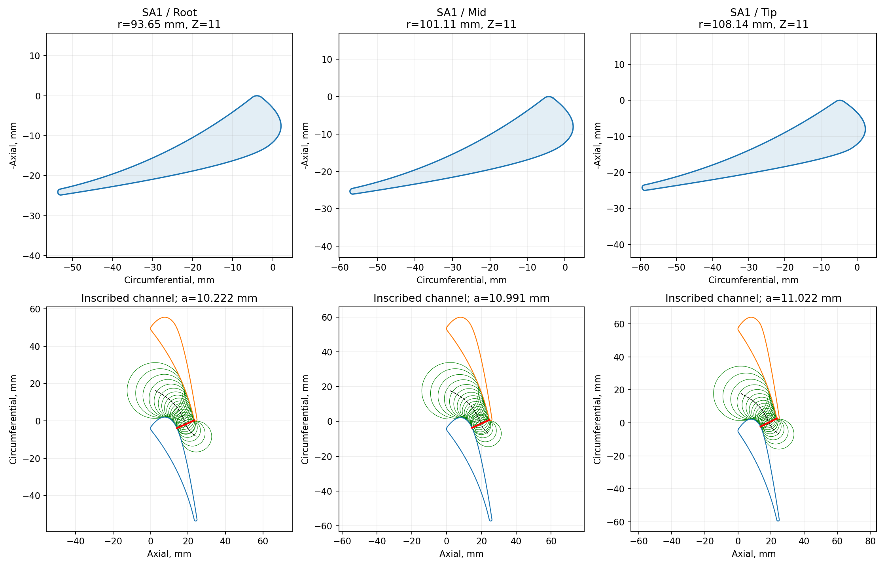
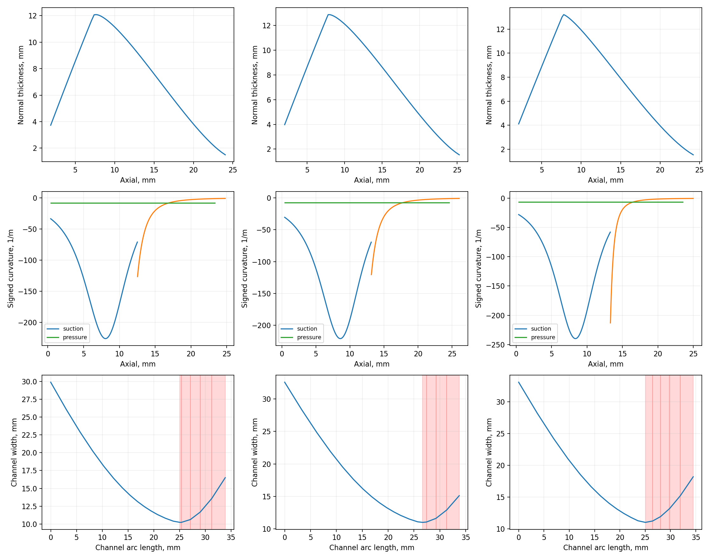
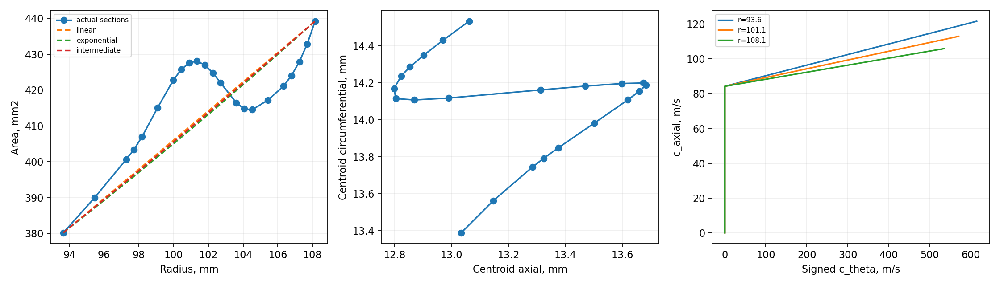
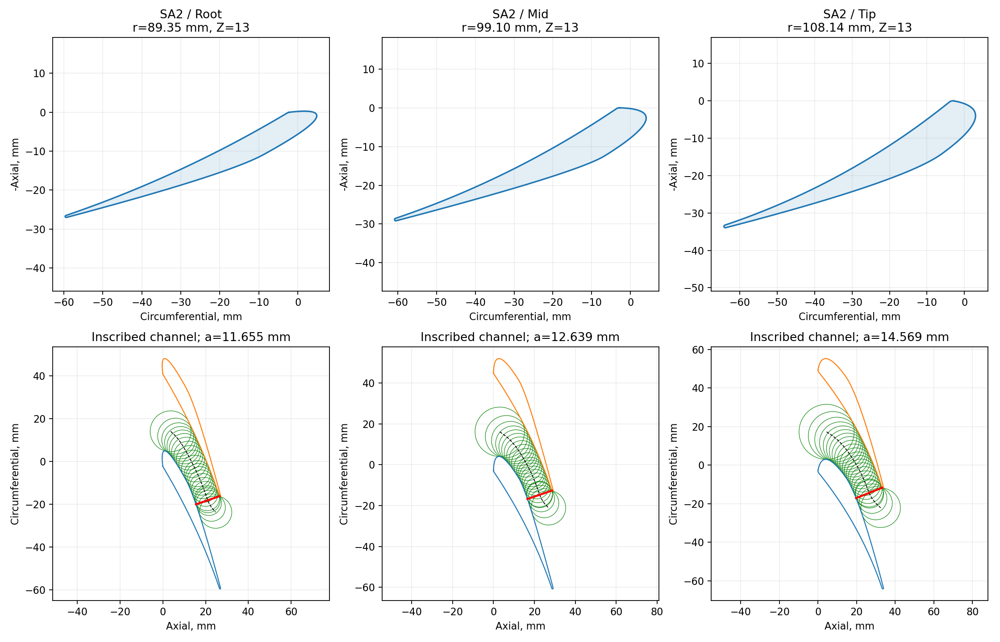
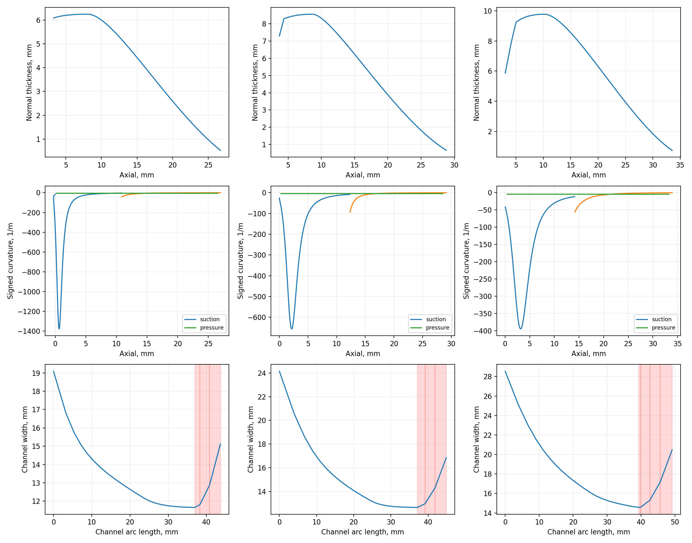
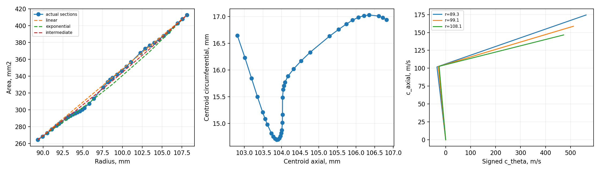
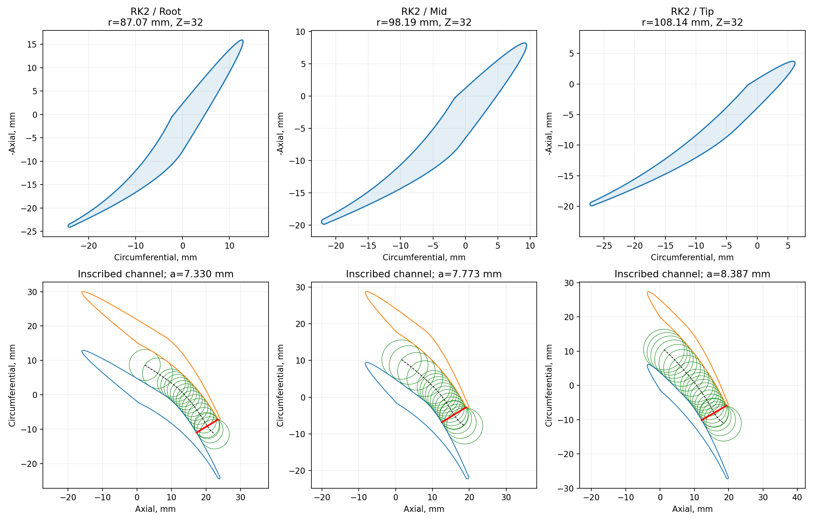
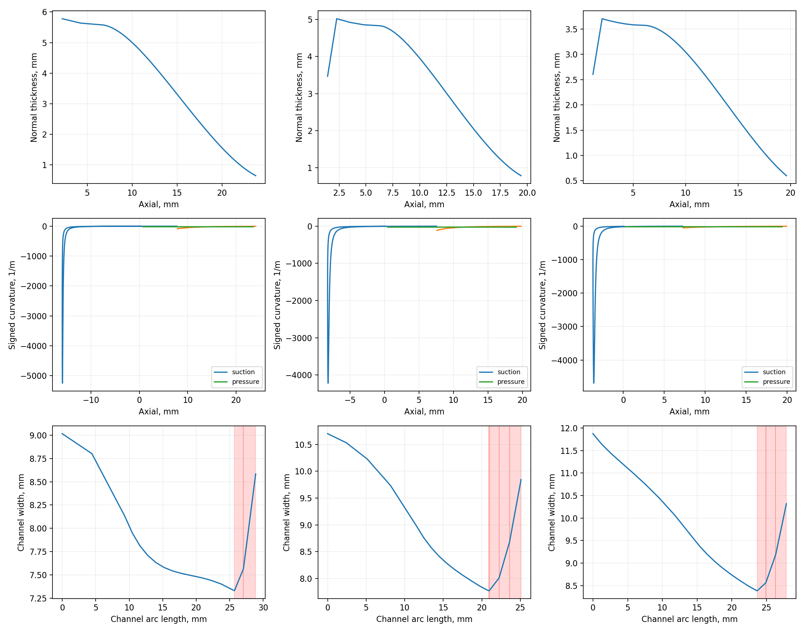
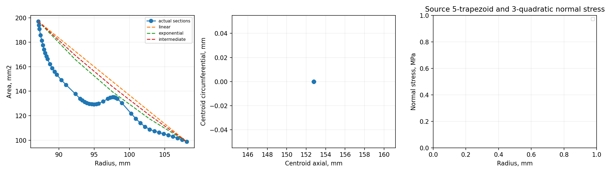
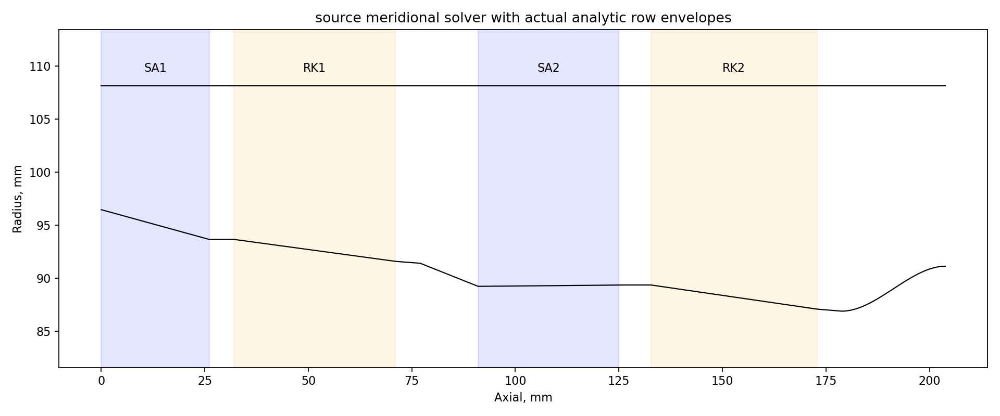

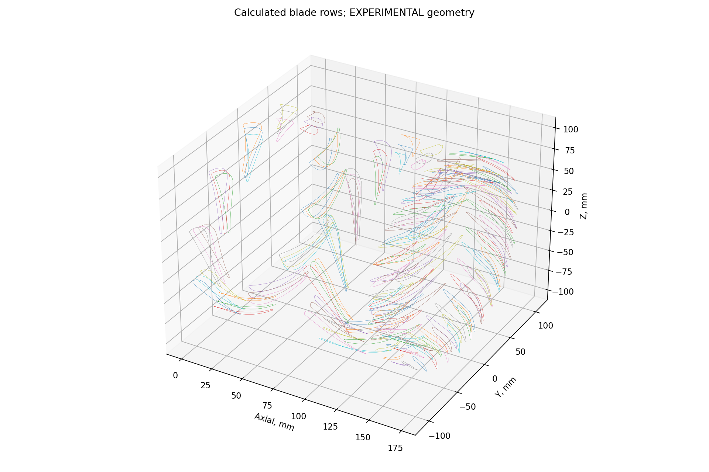

## Scope and missing physical evidence

- Geometry is not CFD/experimental proof of no separation or efficiency.
- Reynolds uses a documented air-viscosity proxy, not measured mixture transport.
- Source variable-cp thermodynamics and independent pressure-equilibrium audits are retained.
- IN738C/LM data are preliminary, not certified supply allowables.
- HCF NOT_CHECKED: grade-specific fatigue curve, forcing and damping are unavailable.

## Coupled source feedback

Converged: **False**. Final admissible: **False**.

feedback unavailable: one or more actual row loss evaluations failed.

110 kW is after the gearbox; CBK is only the cycle compressor. Resource RPM, material, life and LM reserve are inherited from the source.
