# Vinogradov — actual TWO-stage course resource calculation

Source: **TVD_1CBK_2st_2000h.ipynb**; resource: **2000 h**; stages: **2**.
Fixed source RPM: **33200**.
Engineering admissible: **False**.
Constructed rows: 3/4.

A failed finite search is not a proof of global infeasibility. No design limit was relaxed.

## Quantified violations

### SA1
- {'name': 'source streamline Euler residual', 'value': 1.9255327060818672e-05, 'limit': 1e-05, 'passed': False, 'classification': 'numerical', 'source': 'course radial_stage, J/kg', 'units': '1', 'note': ''}
- {'section': 0, 'name': 'local streamtube choke conflict', 'possible': False, 'required_flux_kg_m2_s': 493.1733879057927, 'critical_flux_kg_m2_s': 478.45213741893383, 'required_mach': None, 'stagnation_temperature_K': 1249.9999999999998, 'stagnation_pressure_Pa': 428549.6384887377, 'critical_temperature_K': 1081.7030867407584, 'source': 'original variable-cp h, pressure_isentropic, sound'}
- {'section': 0, 'name': 'source channel: толщина выходной кромки', 'measurements': {'geometry_valid': True, 'intersections': False, 'self_intersection': False, 'angle_error_deg': -0.803618355687691, 'te_over_throat': 0.15491195598020255, 'book_te_over_throat': 0.055, 'max_reduced_expansion': 1.5334268862017604}, 'relative_thickness': 0.22917763173042843, 'actual_relative_pitch': 1.0211365612721477}
- {'section': 0, 'name': 'source channel: местная диффузорность', 'measurements': {'geometry_valid': True, 'intersections': False, 'self_intersection': False, 'angle_error_deg': -0.803618355687691, 'te_over_throat': 0.15491195598020255, 'book_te_over_throat': 0.055, 'max_reduced_expansion': 1.5334268862017604}, 'relative_thickness': 0.22917763173042843, 'actual_relative_pitch': 1.0211365612721477}
- {'section': 0, 'name': 'source channel: максимальная толщина', 'measurements': {'geometry_valid': True, 'intersections': False, 'self_intersection': False, 'angle_error_deg': -0.803618355687691, 'te_over_throat': 0.15491195598020255, 'book_te_over_throat': 0.055, 'max_reduced_expansion': 1.5334268862017604}, 'relative_thickness': 0.22917763173042843, 'actual_relative_pitch': 1.0211365612721477}
- {'section': 0, 'name': 'source channel: относительный шаг', 'measurements': {'geometry_valid': True, 'intersections': False, 'self_intersection': False, 'angle_error_deg': -0.803618355687691, 'te_over_throat': 0.15491195598020255, 'book_te_over_throat': 0.055, 'max_reduced_expansion': 1.5334268862017604}, 'relative_thickness': 0.22917763173042843, 'actual_relative_pitch': 1.0211365612721477}
- {'section': 1, 'name': 'local streamtube choke conflict', 'possible': False, 'required_flux_kg_m2_s': 610.6693937881984, 'critical_flux_kg_m2_s': 478.4521392942559, 'required_mach': None, 'stagnation_temperature_K': 1249.9999691552225, 'stagnation_pressure_Pa': 428549.63467811403, 'critical_temperature_K': 1081.7030592142128, 'source': 'original variable-cp h, pressure_isentropic, sound'}
- {'section': 1, 'name': 'source channel: угол горла', 'measurements': {'geometry_valid': True, 'intersections': False, 'self_intersection': False, 'angle_error_deg': -3.0742228544134456, 'te_over_throat': 0.056880613771631, 'book_te_over_throat': 0.055, 'max_reduced_expansion': 1.9101933154010233}, 'relative_thickness': 0.08594041293477005, 'actual_relative_pitch': 0.6896552684950842}
- {'section': 1, 'name': 'source channel: местная диффузорность', 'measurements': {'geometry_valid': True, 'intersections': False, 'self_intersection': False, 'angle_error_deg': -3.0742228544134456, 'te_over_throat': 0.056880613771631, 'book_te_over_throat': 0.055, 'max_reduced_expansion': 1.9101933154010233}, 'relative_thickness': 0.08594041293477005, 'actual_relative_pitch': 0.6896552684950842}
- {'section': 1, 'name': 'source channel: максимальная толщина', 'measurements': {'geometry_valid': True, 'intersections': False, 'self_intersection': False, 'angle_error_deg': -3.0742228544134456, 'te_over_throat': 0.056880613771631, 'book_te_over_throat': 0.055, 'max_reduced_expansion': 1.9101933154010233}, 'relative_thickness': 0.08594041293477005, 'actual_relative_pitch': 0.6896552684950842}
- {'section': 1, 'name': 'source channel: относительный шаг', 'measurements': {'geometry_valid': True, 'intersections': False, 'self_intersection': False, 'angle_error_deg': -3.0742228544134456, 'te_over_throat': 0.056880613771631, 'book_te_over_throat': 0.055, 'max_reduced_expansion': 1.9101933154010233}, 'relative_thickness': 0.08594041293477005, 'actual_relative_pitch': 0.6896552684950842}
- {'section': 2, 'name': 'local streamtube choke conflict', 'possible': False, 'required_flux_kg_m2_s': 601.3800514434445, 'critical_flux_kg_m2_s': 478.4521333630373, 'required_mach': None, 'stagnation_temperature_K': 1249.9999359040053, 'stagnation_pressure_Pa': 428549.6234468245, 'critical_temperature_K': 1081.7030295401084, 'source': 'original variable-cp h, pressure_isentropic, sound'}
- {'section': 2, 'name': 'source channel: угол горла', 'measurements': {'geometry_valid': True, 'intersections': False, 'self_intersection': False, 'angle_error_deg': -3.009863630374827, 'te_over_throat': 0.05452908464351771, 'book_te_over_throat': 0.055, 'max_reduced_expansion': 1.9475196102947074}, 'relative_thickness': 0.08589704995930324, 'actual_relative_pitch': 0.6919993852920051}
- {'section': 2, 'name': 'source channel: местная диффузорность', 'measurements': {'geometry_valid': True, 'intersections': False, 'self_intersection': False, 'angle_error_deg': -3.009863630374827, 'te_over_throat': 0.05452908464351771, 'book_te_over_throat': 0.055, 'max_reduced_expansion': 1.9475196102947074}, 'relative_thickness': 0.08589704995930324, 'actual_relative_pitch': 0.6919993852920051}
- {'section': 2, 'name': 'source channel: максимальная толщина', 'measurements': {'geometry_valid': True, 'intersections': False, 'self_intersection': False, 'angle_error_deg': -3.009863630374827, 'te_over_throat': 0.05452908464351771, 'book_te_over_throat': 0.055, 'max_reduced_expansion': 1.9475196102947074}, 'relative_thickness': 0.08589704995930324, 'actual_relative_pitch': 0.6919993852920051}
- {'section': 2, 'name': 'source channel: относительный шаг', 'measurements': {'geometry_valid': True, 'intersections': False, 'self_intersection': False, 'angle_error_deg': -3.009863630374827, 'te_over_throat': 0.05452908464351771, 'book_te_over_throat': 0.055, 'max_reduced_expansion': 1.9475196102947074}, 'relative_thickness': 0.08589704995930324, 'actual_relative_pitch': 0.6919993852920051}
- {'section': 3, 'name': 'local streamtube choke conflict', 'possible': False, 'required_flux_kg_m2_s': 498.6842086573399, 'critical_flux_kg_m2_s': 478.4521371945715, 'required_mach': None, 'stagnation_temperature_K': 1249.9999986655478, 'stagnation_pressure_Pa': 428549.638050247, 'critical_temperature_K': 1081.7030855498645, 'source': 'original variable-cp h, pressure_isentropic, sound'}
- {'section': 3, 'name': 'source channel: толщина выходной кромки', 'measurements': {'geometry_valid': True, 'intersections': False, 'self_intersection': False, 'angle_error_deg': -1.1716435346291867, 'te_over_throat': 0.15133677572233595, 'book_te_over_throat': 0.055, 'max_reduced_expansion': 1.6026307717060742}, 'relative_thickness': 0.2298002502527968, 'actual_relative_pitch': 1.037306268772653}
- {'section': 3, 'name': 'source channel: местная диффузорность', 'measurements': {'geometry_valid': True, 'intersections': False, 'self_intersection': False, 'angle_error_deg': -1.1716435346291867, 'te_over_throat': 0.15133677572233595, 'book_te_over_throat': 0.055, 'max_reduced_expansion': 1.6026307717060742}, 'relative_thickness': 0.2298002502527968, 'actual_relative_pitch': 1.037306268772653}
- {'section': 3, 'name': 'source channel: максимальная толщина', 'measurements': {'geometry_valid': True, 'intersections': False, 'self_intersection': False, 'angle_error_deg': -1.1716435346291867, 'te_over_throat': 0.15133677572233595, 'book_te_over_throat': 0.055, 'max_reduced_expansion': 1.6026307717060742}, 'relative_thickness': 0.2298002502527968, 'actual_relative_pitch': 1.037306268772653}
- {'section': 3, 'name': 'source channel: относительный шаг', 'measurements': {'geometry_valid': True, 'intersections': False, 'self_intersection': False, 'angle_error_deg': -1.1716435346291867, 'te_over_throat': 0.15133677572233595, 'book_te_over_throat': 0.055, 'max_reduced_expansion': 1.6026307717060742}, 'relative_thickness': 0.2298002502527968, 'actual_relative_pitch': 1.037306268772653}
- {'section': 4, 'name': 'local streamtube choke conflict', 'possible': False, 'required_flux_kg_m2_s': 501.7464958349059, 'critical_flux_kg_m2_s': 478.4521374189336, 'required_mach': None, 'stagnation_temperature_K': 1249.9999999999998, 'stagnation_pressure_Pa': 428549.6384887375, 'critical_temperature_K': 1081.7030867407584, 'source': 'original variable-cp h, pressure_isentropic, sound'}
- {'section': 4, 'name': 'source channel: толщина выходной кромки', 'measurements': {'geometry_valid': True, 'intersections': False, 'self_intersection': False, 'angle_error_deg': -1.3455994596929344, 'te_over_throat': 0.1492841928945781, 'book_te_over_throat': 0.055, 'max_reduced_expansion': 1.7233217592594685}, 'relative_thickness': 0.2302142305026213, 'actual_relative_pitch': 1.0565224374718258}
- {'section': 4, 'name': 'source channel: местная диффузорность', 'measurements': {'geometry_valid': True, 'intersections': False, 'self_intersection': False, 'angle_error_deg': -1.3455994596929344, 'te_over_throat': 0.1492841928945781, 'book_te_over_throat': 0.055, 'max_reduced_expansion': 1.7233217592594685}, 'relative_thickness': 0.2302142305026213, 'actual_relative_pitch': 1.0565224374718258}
- {'section': 4, 'name': 'source channel: максимальная толщина', 'measurements': {'geometry_valid': True, 'intersections': False, 'self_intersection': False, 'angle_error_deg': -1.3455994596929344, 'te_over_throat': 0.1492841928945781, 'book_te_over_throat': 0.055, 'max_reduced_expansion': 1.7233217592594685}, 'relative_thickness': 0.2302142305026213, 'actual_relative_pitch': 1.0565224374718258}
- {'section': 4, 'name': 'source channel: относительный шаг', 'measurements': {'geometry_valid': True, 'intersections': False, 'self_intersection': False, 'angle_error_deg': -1.3455994596929344, 'te_over_throat': 0.1492841928945781, 'book_te_over_throat': 0.055, 'max_reduced_expansion': 1.7233217592594685}, 'relative_thickness': 0.2302142305026213, 'actual_relative_pitch': 1.0565224374718258}
- {'name': 'insufficient choked capacity', 'value': 0.7053660085256035, 'limit': 0.8063216651432048, 'units': 'kg/s'}
- {'name': 'radial CAD mesh unconverged', 'value': 0.00012343030420110607, 'limit': 2e-05}
### RK1
- {'name': 'source streamline Euler residual', 'value': 1.9255327060818672e-05, 'limit': 1e-05, 'passed': False, 'classification': 'numerical', 'source': 'course radial_stage, J/kg', 'units': '1', 'note': ''}
- {'name': 'construction/calculation failure', 'message': 'No constructible row in the explicit search domain', 'details': {'archive_path': '/home/jovyan/work/Turbinis-Curs/1-Turbinis-Curs-Last/exports/vinogradov/2000h/RK1_search.json', 'attempts': 458}}
### SA2
- {'name': 'source streamline Euler residual', 'value': 4.750437801703811e-05, 'limit': 1e-05, 'passed': False, 'classification': 'numerical', 'source': 'course radial_stage, J/kg', 'units': '1', 'note': ''}
- {'section': 0, 'name': 'local streamtube choke conflict', 'possible': False, 'required_flux_kg_m2_s': 258.5677017204779, 'critical_flux_kg_m2_s': 248.60985588553734, 'required_mach': None, 'stagnation_temperature_K': 1097.5971646403743, 'stagnation_pressure_Pa': 208125.14711057904, 'critical_temperature_K': 945.8194051388098, 'source': 'original variable-cp h, pressure_isentropic, sound'}
- {'section': 0, 'name': 'source channel: местная диффузорность', 'measurements': {'geometry_valid': True, 'intersections': False, 'self_intersection': False, 'angle_error_deg': -0.6346364902507737, 'te_over_throat': 0.05378174485756762, 'book_te_over_throat': 0.055, 'max_reduced_expansion': 1.3830500325115558}, 'relative_thickness': 0.09365687136191508, 'actual_relative_pitch': 0.6811144254132265}
- {'section': 0, 'name': 'source channel: максимальная толщина', 'measurements': {'geometry_valid': True, 'intersections': False, 'self_intersection': False, 'angle_error_deg': -0.6346364902507737, 'te_over_throat': 0.05378174485756762, 'book_te_over_throat': 0.055, 'max_reduced_expansion': 1.3830500325115558}, 'relative_thickness': 0.09365687136191508, 'actual_relative_pitch': 0.6811144254132265}
- {'section': 1, 'name': 'local streamtube choke conflict', 'possible': False, 'required_flux_kg_m2_s': 269.9310826241576, 'critical_flux_kg_m2_s': 248.60986612287869, 'required_mach': None, 'stagnation_temperature_K': 1097.5970522735724, 'stagnation_pressure_Pa': 208125.14459127543, 'critical_temperature_K': 945.8193050694119, 'source': 'original variable-cp h, pressure_isentropic, sound'}
- {'section': 1, 'name': 'source channel: местная диффузорность', 'measurements': {'geometry_valid': True, 'intersections': False, 'self_intersection': False, 'angle_error_deg': -1.443820556852895, 'te_over_throat': 0.06480089043813253, 'book_te_over_throat': 0.055, 'max_reduced_expansion': 1.361703096655399}, 'relative_thickness': 0.10945826287728341, 'actual_relative_pitch': 0.7063875224306018}
- {'section': 1, 'name': 'source channel: максимальная толщина', 'measurements': {'geometry_valid': True, 'intersections': False, 'self_intersection': False, 'angle_error_deg': -1.443820556852895, 'te_over_throat': 0.06480089043813253, 'book_te_over_throat': 0.055, 'max_reduced_expansion': 1.361703096655399}, 'relative_thickness': 0.10945826287728341, 'actual_relative_pitch': 0.7063875224306018}
- {'section': 2, 'name': 'local streamtube choke conflict', 'possible': False, 'required_flux_kg_m2_s': 258.92299836243416, 'critical_flux_kg_m2_s': 248.6098557951375, 'required_mach': None, 'stagnation_temperature_K': 1097.5971307148343, 'stagnation_pressure_Pa': 208125.14368676787, 'critical_temperature_K': 945.8193749260752, 'source': 'original variable-cp h, pressure_isentropic, sound'}
- {'section': 2, 'name': 'source channel: толщина выходной кромки', 'measurements': {'geometry_valid': True, 'intersections': False, 'self_intersection': False, 'angle_error_deg': -0.8927168764862721, 'te_over_throat': 0.06641966869956925, 'book_te_over_throat': 0.055, 'max_reduced_expansion': 1.4315998873814744}, 'relative_thickness': 0.13568927737181055, 'actual_relative_pitch': 0.7579670097408097}
- {'section': 2, 'name': 'source channel: местная диффузорность', 'measurements': {'geometry_valid': True, 'intersections': False, 'self_intersection': False, 'angle_error_deg': -0.8927168764862721, 'te_over_throat': 0.06641966869956925, 'book_te_over_throat': 0.055, 'max_reduced_expansion': 1.4315998873814744}, 'relative_thickness': 0.13568927737181055, 'actual_relative_pitch': 0.7579670097408097}
- {'section': 3, 'name': 'local streamtube choke conflict', 'possible': False, 'required_flux_kg_m2_s': 265.1887524558371, 'critical_flux_kg_m2_s': 248.60985029404682, 'required_mach': None, 'stagnation_temperature_K': 1097.5970956483773, 'stagnation_pressure_Pa': 208125.13562076844, 'critical_temperature_K': 945.8193436972855, 'source': 'original variable-cp h, pressure_isentropic, sound'}
- {'section': 3, 'name': 'source channel: толщина выходной кромки', 'measurements': {'geometry_valid': True, 'intersections': False, 'self_intersection': False, 'angle_error_deg': -1.4772317613165011, 'te_over_throat': 0.06762198444527541, 'book_te_over_throat': 0.055, 'max_reduced_expansion': 1.390695800926686}, 'relative_thickness': 0.13856466928788216, 'actual_relative_pitch': 0.7552351400467826}
- {'section': 3, 'name': 'source channel: местная диффузорность', 'measurements': {'geometry_valid': True, 'intersections': False, 'self_intersection': False, 'angle_error_deg': -1.4772317613165011, 'te_over_throat': 0.06762198444527541, 'book_te_over_throat': 0.055, 'max_reduced_expansion': 1.390695800926686}, 'relative_thickness': 0.13856466928788216, 'actual_relative_pitch': 0.7552351400467826}
- {'section': 4, 'name': 'local streamtube choke conflict', 'possible': False, 'required_flux_kg_m2_s': 253.04789292691737, 'critical_flux_kg_m2_s': 248.60985588553794, 'required_mach': None, 'stagnation_temperature_K': 1097.5971646403743, 'stagnation_pressure_Pa': 208125.1471105795, 'critical_temperature_K': 945.8194051388098, 'source': 'original variable-cp h, pressure_isentropic, sound'}
- {'section': 4, 'name': 'source channel: местная диффузорность', 'measurements': {'geometry_valid': True, 'intersections': False, 'self_intersection': False, 'angle_error_deg': -0.9102940436536393, 'te_over_throat': 0.06217841424551088, 'book_te_over_throat': 0.055, 'max_reduced_expansion': 1.2908411740311359}, 'relative_thickness': 0.1345193094739154, 'actual_relative_pitch': 0.7183213424845706}
- {'name': 'insufficient choked capacity', 'value': 0.7638876208629365, 'limit': 0.8063216651432048, 'units': 'kg/s'}
### RK2
- {'name': 'source streamline Euler residual', 'value': 4.750437801703811e-05, 'limit': 1e-05, 'passed': False, 'classification': 'numerical', 'source': 'course radial_stage, J/kg', 'units': '1', 'note': ''}
- {'section': 0, 'name': 'source channel: вписанные круги', 'measurements': {'geometry_valid': False, 'intersections': False, 'self_intersection': False, 'angle_error_deg': -1.0890699268200237, 'te_over_throat': 0.11106900491292264, 'book_te_over_throat': 0.07, 'max_reduced_expansion': 1.3080646406254937}, 'relative_thickness': 0.14376230209099117, 'actual_relative_pitch': 0.6313954177125882}
- {'section': 0, 'name': 'source channel: толщина выходной кромки', 'measurements': {'geometry_valid': False, 'intersections': False, 'self_intersection': False, 'angle_error_deg': -1.0890699268200237, 'te_over_throat': 0.11106900491292264, 'book_te_over_throat': 0.07, 'max_reduced_expansion': 1.3080646406254937}, 'relative_thickness': 0.14376230209099117, 'actual_relative_pitch': 0.6313954177125882}
- {'section': 0, 'name': 'source channel: местная диффузорность', 'measurements': {'geometry_valid': False, 'intersections': False, 'self_intersection': False, 'angle_error_deg': -1.0890699268200237, 'te_over_throat': 0.11106900491292264, 'book_te_over_throat': 0.07, 'max_reduced_expansion': 1.3080646406254937}, 'relative_thickness': 0.14376230209099117, 'actual_relative_pitch': 0.6313954177125882}
- {'section': 0, 'name': 'source channel: максимальная толщина', 'measurements': {'geometry_valid': False, 'intersections': False, 'self_intersection': False, 'angle_error_deg': -1.0890699268200237, 'te_over_throat': 0.11106900491292264, 'book_te_over_throat': 0.07, 'max_reduced_expansion': 1.3080646406254937}, 'relative_thickness': 0.14376230209099117, 'actual_relative_pitch': 0.6313954177125882}
- {'section': 1, 'name': 'source channel: вписанные круги', 'measurements': {'geometry_valid': False, 'intersections': False, 'self_intersection': False, 'angle_error_deg': -0.27839420302726126, 'te_over_throat': 0.10002844343932625, 'book_te_over_throat': 0.07, 'max_reduced_expansion': 1.2358218868068995}, 'relative_thickness': 0.1561365469773138, 'actual_relative_pitch': 0.7015832510911015}
- {'section': 1, 'name': 'source channel: толщина выходной кромки', 'measurements': {'geometry_valid': False, 'intersections': False, 'self_intersection': False, 'angle_error_deg': -0.27839420302726126, 'te_over_throat': 0.10002844343932625, 'book_te_over_throat': 0.07, 'max_reduced_expansion': 1.2358218868068995}, 'relative_thickness': 0.1561365469773138, 'actual_relative_pitch': 0.7015832510911015}
- {'section': 1, 'name': 'source channel: местная диффузорность', 'measurements': {'geometry_valid': False, 'intersections': False, 'self_intersection': False, 'angle_error_deg': -0.27839420302726126, 'te_over_throat': 0.10002844343932625, 'book_te_over_throat': 0.07, 'max_reduced_expansion': 1.2358218868068995}, 'relative_thickness': 0.1561365469773138, 'actual_relative_pitch': 0.7015832510911015}
- {'section': 1, 'name': 'source channel: максимальная толщина', 'measurements': {'geometry_valid': False, 'intersections': False, 'self_intersection': False, 'angle_error_deg': -0.27839420302726126, 'te_over_throat': 0.10002844343932625, 'book_te_over_throat': 0.07, 'max_reduced_expansion': 1.2358218868068995}, 'relative_thickness': 0.1561365469773138, 'actual_relative_pitch': 0.7015832510911015}
- {'section': 2, 'name': 'source channel: вписанные круги', 'measurements': {'geometry_valid': False, 'intersections': False, 'self_intersection': False, 'angle_error_deg': 0.17726805219968966, 'te_over_throat': 0.07965651261347179, 'book_te_over_throat': 0.07, 'max_reduced_expansion': 1.3532660777807834}, 'relative_thickness': 0.11751365178778751, 'actual_relative_pitch': 0.6829628346239422}
- {'section': 2, 'name': 'source channel: местная диффузорность', 'measurements': {'geometry_valid': False, 'intersections': False, 'self_intersection': False, 'angle_error_deg': 0.17726805219968966, 'te_over_throat': 0.07965651261347179, 'book_te_over_throat': 0.07, 'max_reduced_expansion': 1.3532660777807834}, 'relative_thickness': 0.11751365178778751, 'actual_relative_pitch': 0.6829628346239422}
- {'section': 2, 'name': 'source channel: относительный шаг', 'measurements': {'geometry_valid': False, 'intersections': False, 'self_intersection': False, 'angle_error_deg': 0.17726805219968966, 'te_over_throat': 0.07965651261347179, 'book_te_over_throat': 0.07, 'max_reduced_expansion': 1.3532660777807834}, 'relative_thickness': 0.11751365178778751, 'actual_relative_pitch': 0.6829628346239422}
- {'section': 3, 'name': 'source channel: вписанные круги', 'measurements': {'geometry_valid': False, 'intersections': False, 'self_intersection': False, 'angle_error_deg': 0.5885075450117476, 'te_over_throat': 0.09485788419494576, 'book_te_over_throat': 0.07, 'max_reduced_expansion': 1.2762286734012938}, 'relative_thickness': 0.14416383557598364, 'actual_relative_pitch': 0.7638177562965391}
- {'section': 3, 'name': 'source channel: толщина выходной кромки', 'measurements': {'geometry_valid': False, 'intersections': False, 'self_intersection': False, 'angle_error_deg': 0.5885075450117476, 'te_over_throat': 0.09485788419494576, 'book_te_over_throat': 0.07, 'max_reduced_expansion': 1.2762286734012938}, 'relative_thickness': 0.14416383557598364, 'actual_relative_pitch': 0.7638177562965391}
- {'section': 3, 'name': 'source channel: местная диффузорность', 'measurements': {'geometry_valid': False, 'intersections': False, 'self_intersection': False, 'angle_error_deg': 0.5885075450117476, 'te_over_throat': 0.09485788419494576, 'book_te_over_throat': 0.07, 'max_reduced_expansion': 1.2762286734012938}, 'relative_thickness': 0.14416383557598364, 'actual_relative_pitch': 0.7638177562965391}
- {'section': 3, 'name': 'source channel: максимальная толщина', 'measurements': {'geometry_valid': False, 'intersections': False, 'self_intersection': False, 'angle_error_deg': 0.5885075450117476, 'te_over_throat': 0.09485788419494576, 'book_te_over_throat': 0.07, 'max_reduced_expansion': 1.2762286734012938}, 'relative_thickness': 0.14416383557598364, 'actual_relative_pitch': 0.7638177562965391}
- {'section': 4, 'name': 'source channel: толщина выходной кромки', 'measurements': {'geometry_valid': True, 'intersections': False, 'self_intersection': False, 'angle_error_deg': -1.2099679106195929, 'te_over_throat': 0.10561425271847104, 'book_te_over_throat': 0.07, 'max_reduced_expansion': 1.2553310785861023}, 'relative_thickness': 0.12262529643259798, 'actual_relative_pitch': 0.7442031891665893}
- {'section': 4, 'name': 'source channel: местная диффузорность', 'measurements': {'geometry_valid': True, 'intersections': False, 'self_intersection': False, 'angle_error_deg': -1.2099679106195929, 'te_over_throat': 0.10561425271847104, 'book_te_over_throat': 0.07, 'max_reduced_expansion': 1.2553310785861023}, 'relative_thickness': 0.12262529643259798, 'actual_relative_pitch': 0.7442031891665893}
- {'name': 'vibration strength', 'status': 'NOT_CHECKED', 'reason': 'NOT_CHECKED: no grade-specific fatigue curve, damping or actual harmonic forcing; beam modes are screening only'}

## Global/source violations

- {'row': 'SA1', 'name': 'source streamline Euler residual', 'value': 1.9255327060818672e-05, 'limit': 1e-05, 'passed': False, 'classification': 'numerical', 'source': 'course radial_stage, J/kg', 'units': '1', 'note': ''}
- {'row': 'SA1', 'section': 0, 'name': 'local streamtube choke conflict', 'possible': False, 'required_flux_kg_m2_s': 493.1733879057927, 'critical_flux_kg_m2_s': 478.45213741893383, 'required_mach': None, 'stagnation_temperature_K': 1249.9999999999998, 'stagnation_pressure_Pa': 428549.6384887377, 'critical_temperature_K': 1081.7030867407584, 'source': 'original variable-cp h, pressure_isentropic, sound'}
- {'row': 'SA1', 'section': 0, 'name': 'source channel: толщина выходной кромки', 'measurements': {'geometry_valid': True, 'intersections': False, 'self_intersection': False, 'angle_error_deg': -0.803618355687691, 'te_over_throat': 0.15491195598020255, 'book_te_over_throat': 0.055, 'max_reduced_expansion': 1.5334268862017604}, 'relative_thickness': 0.22917763173042843, 'actual_relative_pitch': 1.0211365612721477}
- {'row': 'SA1', 'section': 0, 'name': 'source channel: местная диффузорность', 'measurements': {'geometry_valid': True, 'intersections': False, 'self_intersection': False, 'angle_error_deg': -0.803618355687691, 'te_over_throat': 0.15491195598020255, 'book_te_over_throat': 0.055, 'max_reduced_expansion': 1.5334268862017604}, 'relative_thickness': 0.22917763173042843, 'actual_relative_pitch': 1.0211365612721477}
- {'row': 'SA1', 'section': 0, 'name': 'source channel: максимальная толщина', 'measurements': {'geometry_valid': True, 'intersections': False, 'self_intersection': False, 'angle_error_deg': -0.803618355687691, 'te_over_throat': 0.15491195598020255, 'book_te_over_throat': 0.055, 'max_reduced_expansion': 1.5334268862017604}, 'relative_thickness': 0.22917763173042843, 'actual_relative_pitch': 1.0211365612721477}
- {'row': 'SA1', 'section': 0, 'name': 'source channel: относительный шаг', 'measurements': {'geometry_valid': True, 'intersections': False, 'self_intersection': False, 'angle_error_deg': -0.803618355687691, 'te_over_throat': 0.15491195598020255, 'book_te_over_throat': 0.055, 'max_reduced_expansion': 1.5334268862017604}, 'relative_thickness': 0.22917763173042843, 'actual_relative_pitch': 1.0211365612721477}
- {'row': 'SA1', 'section': 1, 'name': 'local streamtube choke conflict', 'possible': False, 'required_flux_kg_m2_s': 610.6693937881984, 'critical_flux_kg_m2_s': 478.4521392942559, 'required_mach': None, 'stagnation_temperature_K': 1249.9999691552225, 'stagnation_pressure_Pa': 428549.63467811403, 'critical_temperature_K': 1081.7030592142128, 'source': 'original variable-cp h, pressure_isentropic, sound'}
- {'row': 'SA1', 'section': 1, 'name': 'source channel: угол горла', 'measurements': {'geometry_valid': True, 'intersections': False, 'self_intersection': False, 'angle_error_deg': -3.0742228544134456, 'te_over_throat': 0.056880613771631, 'book_te_over_throat': 0.055, 'max_reduced_expansion': 1.9101933154010233}, 'relative_thickness': 0.08594041293477005, 'actual_relative_pitch': 0.6896552684950842}
- {'row': 'SA1', 'section': 1, 'name': 'source channel: местная диффузорность', 'measurements': {'geometry_valid': True, 'intersections': False, 'self_intersection': False, 'angle_error_deg': -3.0742228544134456, 'te_over_throat': 0.056880613771631, 'book_te_over_throat': 0.055, 'max_reduced_expansion': 1.9101933154010233}, 'relative_thickness': 0.08594041293477005, 'actual_relative_pitch': 0.6896552684950842}
- {'row': 'SA1', 'section': 1, 'name': 'source channel: максимальная толщина', 'measurements': {'geometry_valid': True, 'intersections': False, 'self_intersection': False, 'angle_error_deg': -3.0742228544134456, 'te_over_throat': 0.056880613771631, 'book_te_over_throat': 0.055, 'max_reduced_expansion': 1.9101933154010233}, 'relative_thickness': 0.08594041293477005, 'actual_relative_pitch': 0.6896552684950842}
- {'row': 'SA1', 'section': 1, 'name': 'source channel: относительный шаг', 'measurements': {'geometry_valid': True, 'intersections': False, 'self_intersection': False, 'angle_error_deg': -3.0742228544134456, 'te_over_throat': 0.056880613771631, 'book_te_over_throat': 0.055, 'max_reduced_expansion': 1.9101933154010233}, 'relative_thickness': 0.08594041293477005, 'actual_relative_pitch': 0.6896552684950842}
- {'row': 'SA1', 'section': 2, 'name': 'local streamtube choke conflict', 'possible': False, 'required_flux_kg_m2_s': 601.3800514434445, 'critical_flux_kg_m2_s': 478.4521333630373, 'required_mach': None, 'stagnation_temperature_K': 1249.9999359040053, 'stagnation_pressure_Pa': 428549.6234468245, 'critical_temperature_K': 1081.7030295401084, 'source': 'original variable-cp h, pressure_isentropic, sound'}
- {'row': 'SA1', 'section': 2, 'name': 'source channel: угол горла', 'measurements': {'geometry_valid': True, 'intersections': False, 'self_intersection': False, 'angle_error_deg': -3.009863630374827, 'te_over_throat': 0.05452908464351771, 'book_te_over_throat': 0.055, 'max_reduced_expansion': 1.9475196102947074}, 'relative_thickness': 0.08589704995930324, 'actual_relative_pitch': 0.6919993852920051}
- {'row': 'SA1', 'section': 2, 'name': 'source channel: местная диффузорность', 'measurements': {'geometry_valid': True, 'intersections': False, 'self_intersection': False, 'angle_error_deg': -3.009863630374827, 'te_over_throat': 0.05452908464351771, 'book_te_over_throat': 0.055, 'max_reduced_expansion': 1.9475196102947074}, 'relative_thickness': 0.08589704995930324, 'actual_relative_pitch': 0.6919993852920051}
- {'row': 'SA1', 'section': 2, 'name': 'source channel: максимальная толщина', 'measurements': {'geometry_valid': True, 'intersections': False, 'self_intersection': False, 'angle_error_deg': -3.009863630374827, 'te_over_throat': 0.05452908464351771, 'book_te_over_throat': 0.055, 'max_reduced_expansion': 1.9475196102947074}, 'relative_thickness': 0.08589704995930324, 'actual_relative_pitch': 0.6919993852920051}
- {'row': 'SA1', 'section': 2, 'name': 'source channel: относительный шаг', 'measurements': {'geometry_valid': True, 'intersections': False, 'self_intersection': False, 'angle_error_deg': -3.009863630374827, 'te_over_throat': 0.05452908464351771, 'book_te_over_throat': 0.055, 'max_reduced_expansion': 1.9475196102947074}, 'relative_thickness': 0.08589704995930324, 'actual_relative_pitch': 0.6919993852920051}
- {'row': 'SA1', 'section': 3, 'name': 'local streamtube choke conflict', 'possible': False, 'required_flux_kg_m2_s': 498.6842086573399, 'critical_flux_kg_m2_s': 478.4521371945715, 'required_mach': None, 'stagnation_temperature_K': 1249.9999986655478, 'stagnation_pressure_Pa': 428549.638050247, 'critical_temperature_K': 1081.7030855498645, 'source': 'original variable-cp h, pressure_isentropic, sound'}
- {'row': 'SA1', 'section': 3, 'name': 'source channel: толщина выходной кромки', 'measurements': {'geometry_valid': True, 'intersections': False, 'self_intersection': False, 'angle_error_deg': -1.1716435346291867, 'te_over_throat': 0.15133677572233595, 'book_te_over_throat': 0.055, 'max_reduced_expansion': 1.6026307717060742}, 'relative_thickness': 0.2298002502527968, 'actual_relative_pitch': 1.037306268772653}
- {'row': 'SA1', 'section': 3, 'name': 'source channel: местная диффузорность', 'measurements': {'geometry_valid': True, 'intersections': False, 'self_intersection': False, 'angle_error_deg': -1.1716435346291867, 'te_over_throat': 0.15133677572233595, 'book_te_over_throat': 0.055, 'max_reduced_expansion': 1.6026307717060742}, 'relative_thickness': 0.2298002502527968, 'actual_relative_pitch': 1.037306268772653}
- {'row': 'SA1', 'section': 3, 'name': 'source channel: максимальная толщина', 'measurements': {'geometry_valid': True, 'intersections': False, 'self_intersection': False, 'angle_error_deg': -1.1716435346291867, 'te_over_throat': 0.15133677572233595, 'book_te_over_throat': 0.055, 'max_reduced_expansion': 1.6026307717060742}, 'relative_thickness': 0.2298002502527968, 'actual_relative_pitch': 1.037306268772653}
- {'row': 'SA1', 'section': 3, 'name': 'source channel: относительный шаг', 'measurements': {'geometry_valid': True, 'intersections': False, 'self_intersection': False, 'angle_error_deg': -1.1716435346291867, 'te_over_throat': 0.15133677572233595, 'book_te_over_throat': 0.055, 'max_reduced_expansion': 1.6026307717060742}, 'relative_thickness': 0.2298002502527968, 'actual_relative_pitch': 1.037306268772653}
- {'row': 'SA1', 'section': 4, 'name': 'local streamtube choke conflict', 'possible': False, 'required_flux_kg_m2_s': 501.7464958349059, 'critical_flux_kg_m2_s': 478.4521374189336, 'required_mach': None, 'stagnation_temperature_K': 1249.9999999999998, 'stagnation_pressure_Pa': 428549.6384887375, 'critical_temperature_K': 1081.7030867407584, 'source': 'original variable-cp h, pressure_isentropic, sound'}
- {'row': 'SA1', 'section': 4, 'name': 'source channel: толщина выходной кромки', 'measurements': {'geometry_valid': True, 'intersections': False, 'self_intersection': False, 'angle_error_deg': -1.3455994596929344, 'te_over_throat': 0.1492841928945781, 'book_te_over_throat': 0.055, 'max_reduced_expansion': 1.7233217592594685}, 'relative_thickness': 0.2302142305026213, 'actual_relative_pitch': 1.0565224374718258}
- {'row': 'SA1', 'section': 4, 'name': 'source channel: местная диффузорность', 'measurements': {'geometry_valid': True, 'intersections': False, 'self_intersection': False, 'angle_error_deg': -1.3455994596929344, 'te_over_throat': 0.1492841928945781, 'book_te_over_throat': 0.055, 'max_reduced_expansion': 1.7233217592594685}, 'relative_thickness': 0.2302142305026213, 'actual_relative_pitch': 1.0565224374718258}
- {'row': 'SA1', 'section': 4, 'name': 'source channel: максимальная толщина', 'measurements': {'geometry_valid': True, 'intersections': False, 'self_intersection': False, 'angle_error_deg': -1.3455994596929344, 'te_over_throat': 0.1492841928945781, 'book_te_over_throat': 0.055, 'max_reduced_expansion': 1.7233217592594685}, 'relative_thickness': 0.2302142305026213, 'actual_relative_pitch': 1.0565224374718258}
- {'row': 'SA1', 'section': 4, 'name': 'source channel: относительный шаг', 'measurements': {'geometry_valid': True, 'intersections': False, 'self_intersection': False, 'angle_error_deg': -1.3455994596929344, 'te_over_throat': 0.1492841928945781, 'book_te_over_throat': 0.055, 'max_reduced_expansion': 1.7233217592594685}, 'relative_thickness': 0.2302142305026213, 'actual_relative_pitch': 1.0565224374718258}
- {'row': 'SA1', 'name': 'insufficient choked capacity', 'value': 0.7053660085256035, 'limit': 0.8063216651432048, 'units': 'kg/s'}
- {'row': 'SA1', 'name': 'radial CAD mesh unconverged', 'value': 0.00012343030420110607, 'limit': 2e-05}
- {'row': 'RK1', 'name': 'source streamline Euler residual', 'value': 1.9255327060818672e-05, 'limit': 1e-05, 'passed': False, 'classification': 'numerical', 'source': 'course radial_stage, J/kg', 'units': '1', 'note': ''}
- {'row': 'RK1', 'name': 'construction/calculation failure', 'message': 'No constructible row in the explicit search domain', 'details': {'archive_path': '/home/jovyan/work/Turbinis-Curs/1-Turbinis-Curs-Last/exports/vinogradov/2000h/RK1_search.json', 'attempts': 458}}
- {'row': 'SA2', 'name': 'source streamline Euler residual', 'value': 4.750437801703811e-05, 'limit': 1e-05, 'passed': False, 'classification': 'numerical', 'source': 'course radial_stage, J/kg', 'units': '1', 'note': ''}
- {'row': 'SA2', 'section': 0, 'name': 'local streamtube choke conflict', 'possible': False, 'required_flux_kg_m2_s': 258.5677017204779, 'critical_flux_kg_m2_s': 248.60985588553734, 'required_mach': None, 'stagnation_temperature_K': 1097.5971646403743, 'stagnation_pressure_Pa': 208125.14711057904, 'critical_temperature_K': 945.8194051388098, 'source': 'original variable-cp h, pressure_isentropic, sound'}
- {'row': 'SA2', 'section': 0, 'name': 'source channel: местная диффузорность', 'measurements': {'geometry_valid': True, 'intersections': False, 'self_intersection': False, 'angle_error_deg': -0.6346364902507737, 'te_over_throat': 0.05378174485756762, 'book_te_over_throat': 0.055, 'max_reduced_expansion': 1.3830500325115558}, 'relative_thickness': 0.09365687136191508, 'actual_relative_pitch': 0.6811144254132265}
- {'row': 'SA2', 'section': 0, 'name': 'source channel: максимальная толщина', 'measurements': {'geometry_valid': True, 'intersections': False, 'self_intersection': False, 'angle_error_deg': -0.6346364902507737, 'te_over_throat': 0.05378174485756762, 'book_te_over_throat': 0.055, 'max_reduced_expansion': 1.3830500325115558}, 'relative_thickness': 0.09365687136191508, 'actual_relative_pitch': 0.6811144254132265}
- {'row': 'SA2', 'section': 1, 'name': 'local streamtube choke conflict', 'possible': False, 'required_flux_kg_m2_s': 269.9310826241576, 'critical_flux_kg_m2_s': 248.60986612287869, 'required_mach': None, 'stagnation_temperature_K': 1097.5970522735724, 'stagnation_pressure_Pa': 208125.14459127543, 'critical_temperature_K': 945.8193050694119, 'source': 'original variable-cp h, pressure_isentropic, sound'}
- {'row': 'SA2', 'section': 1, 'name': 'source channel: местная диффузорность', 'measurements': {'geometry_valid': True, 'intersections': False, 'self_intersection': False, 'angle_error_deg': -1.443820556852895, 'te_over_throat': 0.06480089043813253, 'book_te_over_throat': 0.055, 'max_reduced_expansion': 1.361703096655399}, 'relative_thickness': 0.10945826287728341, 'actual_relative_pitch': 0.7063875224306018}
- {'row': 'SA2', 'section': 1, 'name': 'source channel: максимальная толщина', 'measurements': {'geometry_valid': True, 'intersections': False, 'self_intersection': False, 'angle_error_deg': -1.443820556852895, 'te_over_throat': 0.06480089043813253, 'book_te_over_throat': 0.055, 'max_reduced_expansion': 1.361703096655399}, 'relative_thickness': 0.10945826287728341, 'actual_relative_pitch': 0.7063875224306018}
- {'row': 'SA2', 'section': 2, 'name': 'local streamtube choke conflict', 'possible': False, 'required_flux_kg_m2_s': 258.92299836243416, 'critical_flux_kg_m2_s': 248.6098557951375, 'required_mach': None, 'stagnation_temperature_K': 1097.5971307148343, 'stagnation_pressure_Pa': 208125.14368676787, 'critical_temperature_K': 945.8193749260752, 'source': 'original variable-cp h, pressure_isentropic, sound'}
- {'row': 'SA2', 'section': 2, 'name': 'source channel: толщина выходной кромки', 'measurements': {'geometry_valid': True, 'intersections': False, 'self_intersection': False, 'angle_error_deg': -0.8927168764862721, 'te_over_throat': 0.06641966869956925, 'book_te_over_throat': 0.055, 'max_reduced_expansion': 1.4315998873814744}, 'relative_thickness': 0.13568927737181055, 'actual_relative_pitch': 0.7579670097408097}
- {'row': 'SA2', 'section': 2, 'name': 'source channel: местная диффузорность', 'measurements': {'geometry_valid': True, 'intersections': False, 'self_intersection': False, 'angle_error_deg': -0.8927168764862721, 'te_over_throat': 0.06641966869956925, 'book_te_over_throat': 0.055, 'max_reduced_expansion': 1.4315998873814744}, 'relative_thickness': 0.13568927737181055, 'actual_relative_pitch': 0.7579670097408097}
- {'row': 'SA2', 'section': 3, 'name': 'local streamtube choke conflict', 'possible': False, 'required_flux_kg_m2_s': 265.1887524558371, 'critical_flux_kg_m2_s': 248.60985029404682, 'required_mach': None, 'stagnation_temperature_K': 1097.5970956483773, 'stagnation_pressure_Pa': 208125.13562076844, 'critical_temperature_K': 945.8193436972855, 'source': 'original variable-cp h, pressure_isentropic, sound'}
- {'row': 'SA2', 'section': 3, 'name': 'source channel: толщина выходной кромки', 'measurements': {'geometry_valid': True, 'intersections': False, 'self_intersection': False, 'angle_error_deg': -1.4772317613165011, 'te_over_throat': 0.06762198444527541, 'book_te_over_throat': 0.055, 'max_reduced_expansion': 1.390695800926686}, 'relative_thickness': 0.13856466928788216, 'actual_relative_pitch': 0.7552351400467826}
- {'row': 'SA2', 'section': 3, 'name': 'source channel: местная диффузорность', 'measurements': {'geometry_valid': True, 'intersections': False, 'self_intersection': False, 'angle_error_deg': -1.4772317613165011, 'te_over_throat': 0.06762198444527541, 'book_te_over_throat': 0.055, 'max_reduced_expansion': 1.390695800926686}, 'relative_thickness': 0.13856466928788216, 'actual_relative_pitch': 0.7552351400467826}
- {'row': 'SA2', 'section': 4, 'name': 'local streamtube choke conflict', 'possible': False, 'required_flux_kg_m2_s': 253.04789292691737, 'critical_flux_kg_m2_s': 248.60985588553794, 'required_mach': None, 'stagnation_temperature_K': 1097.5971646403743, 'stagnation_pressure_Pa': 208125.1471105795, 'critical_temperature_K': 945.8194051388098, 'source': 'original variable-cp h, pressure_isentropic, sound'}
- {'row': 'SA2', 'section': 4, 'name': 'source channel: местная диффузорность', 'measurements': {'geometry_valid': True, 'intersections': False, 'self_intersection': False, 'angle_error_deg': -0.9102940436536393, 'te_over_throat': 0.06217841424551088, 'book_te_over_throat': 0.055, 'max_reduced_expansion': 1.2908411740311359}, 'relative_thickness': 0.1345193094739154, 'actual_relative_pitch': 0.7183213424845706}
- {'row': 'SA2', 'name': 'insufficient choked capacity', 'value': 0.7638876208629365, 'limit': 0.8063216651432048, 'units': 'kg/s'}
- {'row': 'RK2', 'name': 'source streamline Euler residual', 'value': 4.750437801703811e-05, 'limit': 1e-05, 'passed': False, 'classification': 'numerical', 'source': 'course radial_stage, J/kg', 'units': '1', 'note': ''}
- {'row': 'RK2', 'section': 0, 'name': 'source channel: вписанные круги', 'measurements': {'geometry_valid': False, 'intersections': False, 'self_intersection': False, 'angle_error_deg': -1.0890699268200237, 'te_over_throat': 0.11106900491292264, 'book_te_over_throat': 0.07, 'max_reduced_expansion': 1.3080646406254937}, 'relative_thickness': 0.14376230209099117, 'actual_relative_pitch': 0.6313954177125882}
- {'row': 'RK2', 'section': 0, 'name': 'source channel: толщина выходной кромки', 'measurements': {'geometry_valid': False, 'intersections': False, 'self_intersection': False, 'angle_error_deg': -1.0890699268200237, 'te_over_throat': 0.11106900491292264, 'book_te_over_throat': 0.07, 'max_reduced_expansion': 1.3080646406254937}, 'relative_thickness': 0.14376230209099117, 'actual_relative_pitch': 0.6313954177125882}
- {'row': 'RK2', 'section': 0, 'name': 'source channel: местная диффузорность', 'measurements': {'geometry_valid': False, 'intersections': False, 'self_intersection': False, 'angle_error_deg': -1.0890699268200237, 'te_over_throat': 0.11106900491292264, 'book_te_over_throat': 0.07, 'max_reduced_expansion': 1.3080646406254937}, 'relative_thickness': 0.14376230209099117, 'actual_relative_pitch': 0.6313954177125882}
- {'row': 'RK2', 'section': 0, 'name': 'source channel: максимальная толщина', 'measurements': {'geometry_valid': False, 'intersections': False, 'self_intersection': False, 'angle_error_deg': -1.0890699268200237, 'te_over_throat': 0.11106900491292264, 'book_te_over_throat': 0.07, 'max_reduced_expansion': 1.3080646406254937}, 'relative_thickness': 0.14376230209099117, 'actual_relative_pitch': 0.6313954177125882}
- {'row': 'RK2', 'section': 1, 'name': 'source channel: вписанные круги', 'measurements': {'geometry_valid': False, 'intersections': False, 'self_intersection': False, 'angle_error_deg': -0.27839420302726126, 'te_over_throat': 0.10002844343932625, 'book_te_over_throat': 0.07, 'max_reduced_expansion': 1.2358218868068995}, 'relative_thickness': 0.1561365469773138, 'actual_relative_pitch': 0.7015832510911015}
- {'row': 'RK2', 'section': 1, 'name': 'source channel: толщина выходной кромки', 'measurements': {'geometry_valid': False, 'intersections': False, 'self_intersection': False, 'angle_error_deg': -0.27839420302726126, 'te_over_throat': 0.10002844343932625, 'book_te_over_throat': 0.07, 'max_reduced_expansion': 1.2358218868068995}, 'relative_thickness': 0.1561365469773138, 'actual_relative_pitch': 0.7015832510911015}
- {'row': 'RK2', 'section': 1, 'name': 'source channel: местная диффузорность', 'measurements': {'geometry_valid': False, 'intersections': False, 'self_intersection': False, 'angle_error_deg': -0.27839420302726126, 'te_over_throat': 0.10002844343932625, 'book_te_over_throat': 0.07, 'max_reduced_expansion': 1.2358218868068995}, 'relative_thickness': 0.1561365469773138, 'actual_relative_pitch': 0.7015832510911015}
- {'row': 'RK2', 'section': 1, 'name': 'source channel: максимальная толщина', 'measurements': {'geometry_valid': False, 'intersections': False, 'self_intersection': False, 'angle_error_deg': -0.27839420302726126, 'te_over_throat': 0.10002844343932625, 'book_te_over_throat': 0.07, 'max_reduced_expansion': 1.2358218868068995}, 'relative_thickness': 0.1561365469773138, 'actual_relative_pitch': 0.7015832510911015}
- {'row': 'RK2', 'section': 2, 'name': 'source channel: вписанные круги', 'measurements': {'geometry_valid': False, 'intersections': False, 'self_intersection': False, 'angle_error_deg': 0.17726805219968966, 'te_over_throat': 0.07965651261347179, 'book_te_over_throat': 0.07, 'max_reduced_expansion': 1.3532660777807834}, 'relative_thickness': 0.11751365178778751, 'actual_relative_pitch': 0.6829628346239422}
- {'row': 'RK2', 'section': 2, 'name': 'source channel: местная диффузорность', 'measurements': {'geometry_valid': False, 'intersections': False, 'self_intersection': False, 'angle_error_deg': 0.17726805219968966, 'te_over_throat': 0.07965651261347179, 'book_te_over_throat': 0.07, 'max_reduced_expansion': 1.3532660777807834}, 'relative_thickness': 0.11751365178778751, 'actual_relative_pitch': 0.6829628346239422}
- {'row': 'RK2', 'section': 2, 'name': 'source channel: относительный шаг', 'measurements': {'geometry_valid': False, 'intersections': False, 'self_intersection': False, 'angle_error_deg': 0.17726805219968966, 'te_over_throat': 0.07965651261347179, 'book_te_over_throat': 0.07, 'max_reduced_expansion': 1.3532660777807834}, 'relative_thickness': 0.11751365178778751, 'actual_relative_pitch': 0.6829628346239422}
- {'row': 'RK2', 'section': 3, 'name': 'source channel: вписанные круги', 'measurements': {'geometry_valid': False, 'intersections': False, 'self_intersection': False, 'angle_error_deg': 0.5885075450117476, 'te_over_throat': 0.09485788419494576, 'book_te_over_throat': 0.07, 'max_reduced_expansion': 1.2762286734012938}, 'relative_thickness': 0.14416383557598364, 'actual_relative_pitch': 0.7638177562965391}
- {'row': 'RK2', 'section': 3, 'name': 'source channel: толщина выходной кромки', 'measurements': {'geometry_valid': False, 'intersections': False, 'self_intersection': False, 'angle_error_deg': 0.5885075450117476, 'te_over_throat': 0.09485788419494576, 'book_te_over_throat': 0.07, 'max_reduced_expansion': 1.2762286734012938}, 'relative_thickness': 0.14416383557598364, 'actual_relative_pitch': 0.7638177562965391}
- {'row': 'RK2', 'section': 3, 'name': 'source channel: местная диффузорность', 'measurements': {'geometry_valid': False, 'intersections': False, 'self_intersection': False, 'angle_error_deg': 0.5885075450117476, 'te_over_throat': 0.09485788419494576, 'book_te_over_throat': 0.07, 'max_reduced_expansion': 1.2762286734012938}, 'relative_thickness': 0.14416383557598364, 'actual_relative_pitch': 0.7638177562965391}
- {'row': 'RK2', 'section': 3, 'name': 'source channel: максимальная толщина', 'measurements': {'geometry_valid': False, 'intersections': False, 'self_intersection': False, 'angle_error_deg': 0.5885075450117476, 'te_over_throat': 0.09485788419494576, 'book_te_over_throat': 0.07, 'max_reduced_expansion': 1.2762286734012938}, 'relative_thickness': 0.14416383557598364, 'actual_relative_pitch': 0.7638177562965391}
- {'row': 'RK2', 'section': 4, 'name': 'source channel: толщина выходной кромки', 'measurements': {'geometry_valid': True, 'intersections': False, 'self_intersection': False, 'angle_error_deg': -1.2099679106195929, 'te_over_throat': 0.10561425271847104, 'book_te_over_throat': 0.07, 'max_reduced_expansion': 1.2553310785861023}, 'relative_thickness': 0.12262529643259798, 'actual_relative_pitch': 0.7442031891665893}
- {'row': 'RK2', 'section': 4, 'name': 'source channel: местная диффузорность', 'measurements': {'geometry_valid': True, 'intersections': False, 'self_intersection': False, 'angle_error_deg': -1.2099679106195929, 'te_over_throat': 0.10561425271847104, 'book_te_over_throat': 0.07, 'max_reduced_expansion': 1.2553310785861023}, 'relative_thickness': 0.12262529643259798, 'actual_relative_pitch': 0.7442031891665893}
- {'row': 'RK2', 'name': 'vibration strength', 'status': 'NOT_CHECKED', 'reason': 'NOT_CHECKED: no grade-specific fatigue curve, damping or actual harmonic forcing; beam modes are screening only'}
- {'name': 'source strength assessment', 'reasons': ["('РК1', 0)"]}
- {'row': 'SA1', 'section': 0, 'name': 'source leading radius/axial width', 'value': 0.07485363964021165, 'limit': '.03… .04'}
- {'row': 'SA1', 'section': 1, 'name': 'source finite trailing edge', 'value': 0.0004612368990616896, 'limit': 0.0005}
- {'row': 'SA1', 'section': 1, 'name': 'source leading radius/axial width', 'value': 0.0599068537277157, 'limit': '.03… .04'}
- {'row': 'SA1', 'section': 2, 'name': 'source finite trailing edge', 'value': 0.0004625486794197729, 'limit': 0.0005}
- {'row': 'SA1', 'section': 2, 'name': 'source leading radius/axial width', 'value': 0.059769426822340876, 'limit': '.03… .04'}
- {'row': 'SA1', 'section': 3, 'name': 'source leading radius/axial width', 'value': 0.07748605413196591, 'limit': '.03… .04'}
- {'row': 'SA1', 'section': 4, 'name': 'source leading radius/axial width', 'value': 0.07930809693009265, 'limit': '.03… .04'}
- {'row': 'SA2', 'section': 0, 'name': 'source finite trailing edge', 'value': 0.00044346701382281053, 'limit': 0.0005}
- {'row': 'SA2', 'section': 2, 'name': 'source leading radius/axial width', 'value': 0.044748666261228726, 'limit': '.03… .04'}
- {'row': 'SA2', 'section': 3, 'name': 'source leading radius/axial width', 'value': 0.04515125634964215, 'limit': '.03… .04'}
- {'row': 'SA2', 'section': 4, 'name': 'source leading radius/axial width', 'value': 0.04455285457482629, 'limit': '.03… .04'}
- {'row': 'RK2', 'name': 'source rotor taper mismatch', 'value': 1.1192890888166929, 'limit': 1.3}
- {'row': 'RK2', 'name': 'source chord direction', 'root_m': 0.018277183987332055, 'tip_m': 0.019240635605743756, 'limit': 'root>tip RK; root<tip SA'}
- {'row': 'RK2', 'name': 'source rotor areas must decrease', 'value': [4.039414727417016e-05, 3.7991671382828993e-05, 3.390035619443777e-05, 3.587264919448361e-05, 3.608911020197174e-05], 'limit': 'strict decrease root to tip'}
- {'row': 'RK2', 'section': 1, 'name': 'source leading radius/axial width', 'value': 0.043756667171371506, 'limit': '.03… .04'}
- {'row': 'RK2', 'section': 2, 'name': 'source finite trailing edge', 'value': 0.00047706981805713874, 'limit': 0.0005}
- {'row': 'RK2', 'section': 3, 'name': 'source leading radius/axial width', 'value': 0.04330524533205541, 'limit': '.03… .04'}
- {'row': 'RK2', 'section': 4, 'name': 'source leading radius/axial width', 'value': 0.040163130852220466, 'limit': '.03… .04'}

## Empirical guidance — not added hard limits

- {'row': 'SA1', 'section': 0, 'name': 'relative thickness starting guidance', 'value': 0.22917763173042843, 'range': [0.1, 0.1], 'classification': 'empirical, p13'}
- {'row': 'SA1', 'section': 1, 'name': 'relative thickness starting guidance', 'value': 0.08594041293477005, 'range': [0.1, 0.1], 'classification': 'empirical, p13'}
- {'row': 'SA1', 'section': 2, 'name': 'relative thickness starting guidance', 'value': 0.08589704995930324, 'range': [0.1, 0.1], 'classification': 'empirical, p13'}
- {'row': 'SA1', 'section': 3, 'name': 'relative thickness starting guidance', 'value': 0.2298002502527968, 'range': [0.1, 0.1], 'classification': 'empirical, p13'}
- {'row': 'SA1', 'section': 4, 'name': 'relative thickness starting guidance', 'value': 0.2302142305026213, 'range': [0.1, 0.1], 'classification': 'empirical, p13'}
- {'row': 'SA2', 'section': 0, 'name': 'relative thickness starting guidance', 'value': 0.09365687136191508, 'range': [0.1, 0.1], 'classification': 'empirical, p13'}
- {'row': 'SA2', 'section': 1, 'name': 'relative thickness starting guidance', 'value': 0.10945826287728341, 'range': [0.1, 0.1], 'classification': 'empirical, p13'}
- {'row': 'SA2', 'section': 2, 'name': 'relative thickness starting guidance', 'value': 0.13568927737181055, 'range': [0.1, 0.1], 'classification': 'empirical, p13'}
- {'row': 'SA2', 'section': 3, 'name': 'relative thickness starting guidance', 'value': 0.13856466928788216, 'range': [0.1, 0.1], 'classification': 'empirical, p13'}
- {'row': 'SA2', 'section': 4, 'name': 'relative thickness starting guidance', 'value': 0.1345193094739154, 'range': [0.1, 0.1], 'classification': 'empirical, p13'}
- {'row': 'RK2', 'section': 0, 'name': 'relative thickness starting guidance', 'value': 0.14376230209099117, 'range': [0.2, 0.3], 'classification': 'empirical, p13'}
- {'row': 'RK2', 'section': 3, 'name': 'relative thickness starting guidance', 'value': 0.14416383557598364, 'range': [0.0676922969800166, 0.09615382830002765], 'classification': 'empirical, p13'}
- {'row': 'RK2', 'section': 4, 'name': 'relative thickness starting guidance', 'value': 0.12262529643259798, 'range': [0.04, 0.05], 'classification': 'empirical, p13'}

## Figures

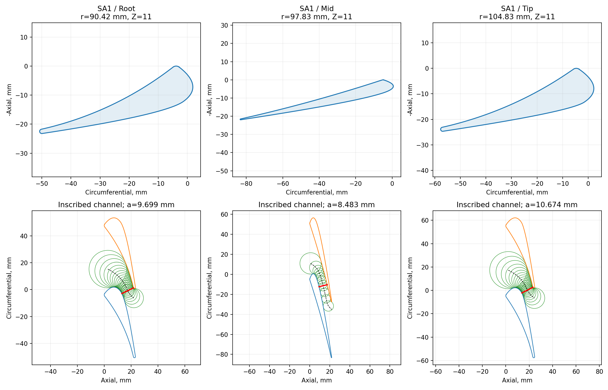
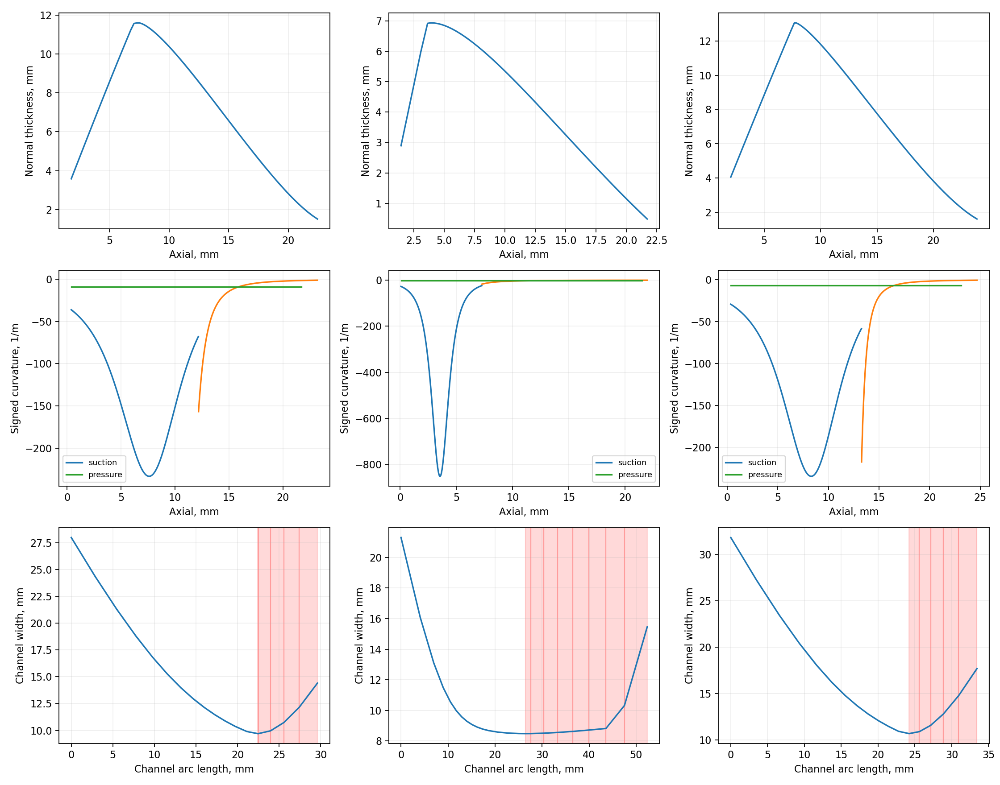
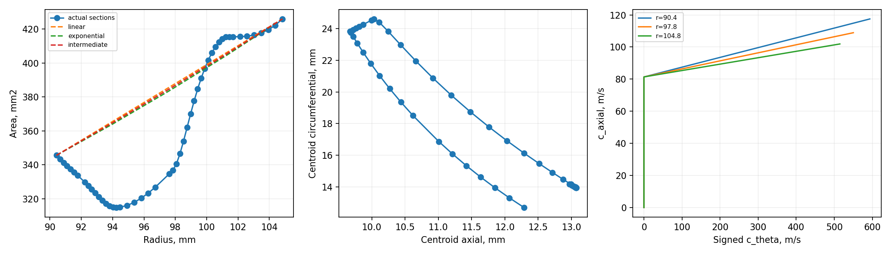
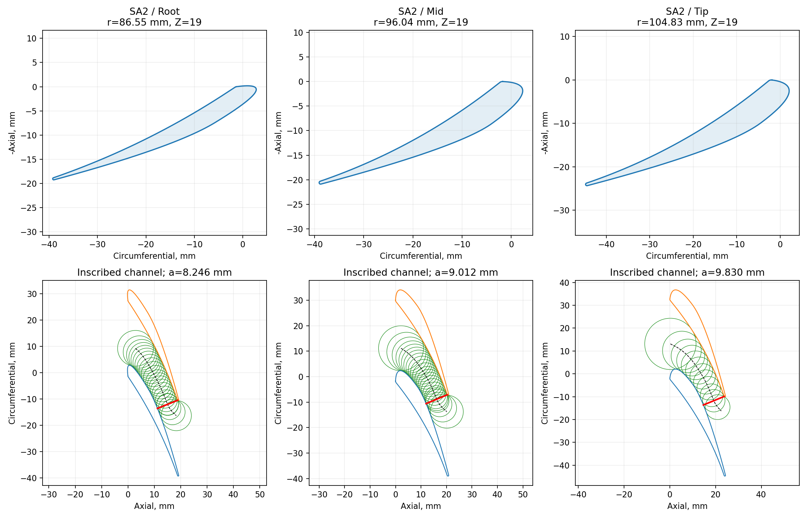
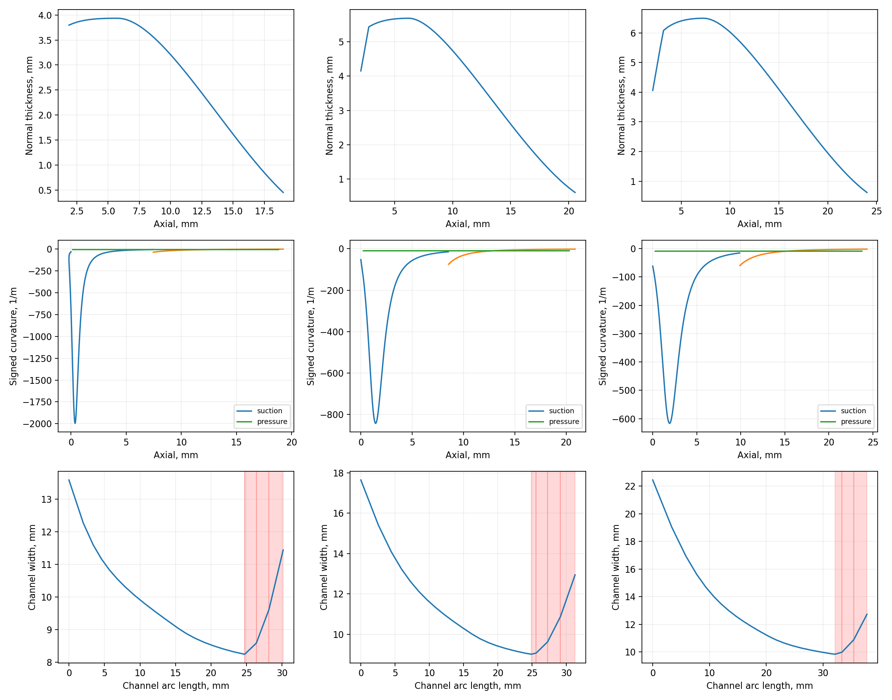
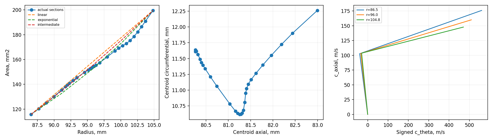
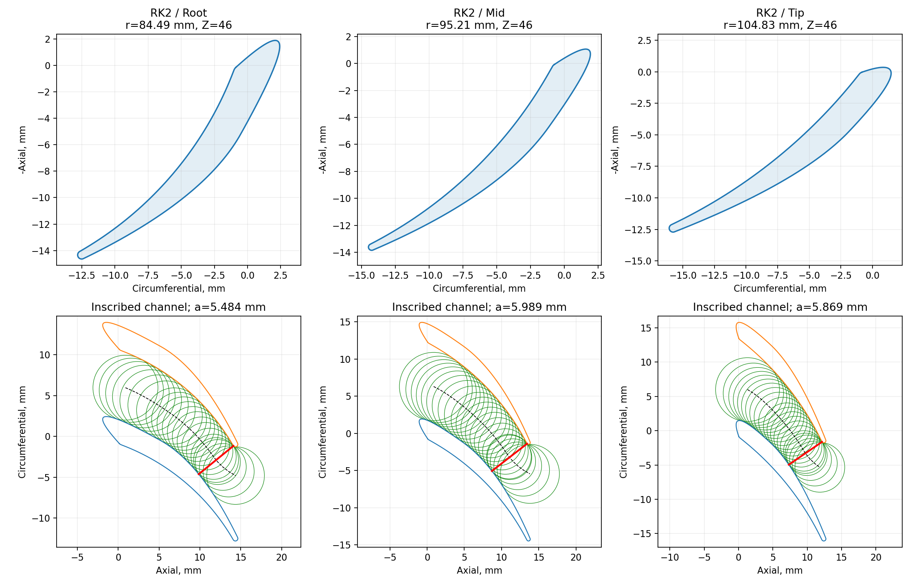
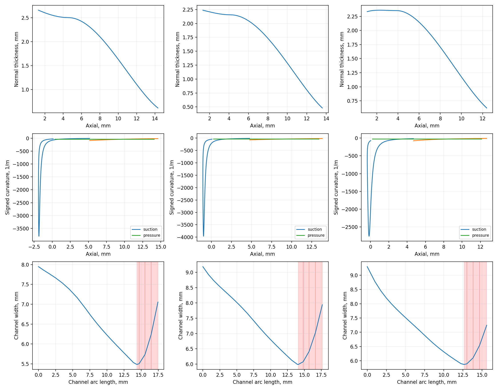
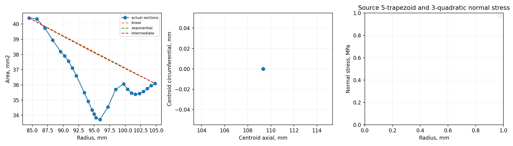
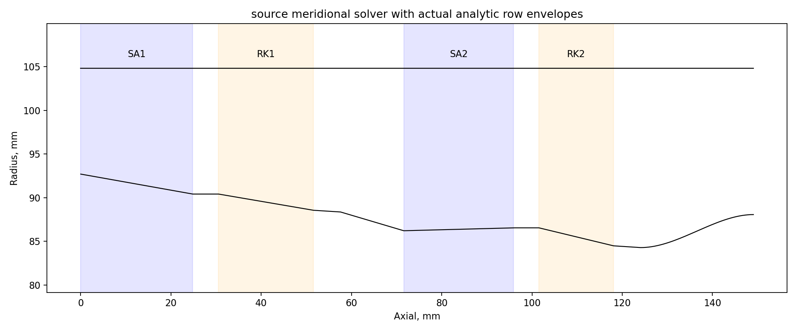
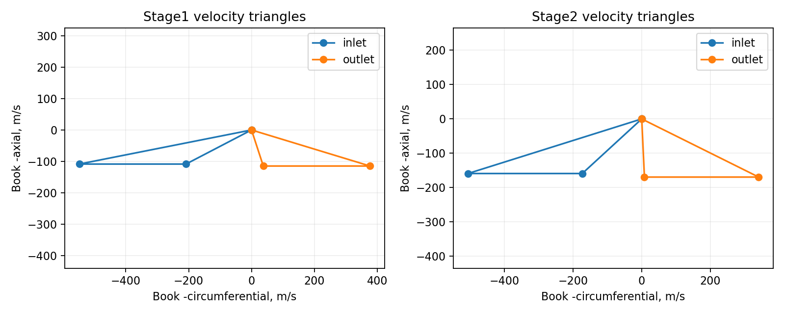
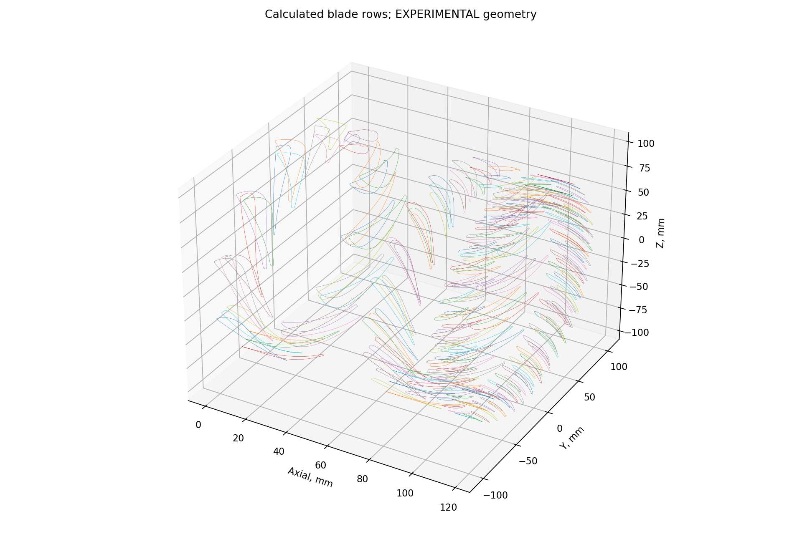

## Scope and missing physical evidence

- Geometry is not CFD/experimental proof of no separation or efficiency.
- Reynolds uses a documented air-viscosity proxy, not measured mixture transport.
- Source variable-cp thermodynamics and independent pressure-equilibrium audits are retained.
- IN738C/LM data are preliminary, not certified supply allowables.
- HCF NOT_CHECKED: grade-specific fatigue curve, forcing and damping are unavailable.

## Coupled source feedback

Converged: **False**. Final admissible: **False**.

feedback unavailable: one or more actual row loss evaluations failed.

110 kW is after the gearbox; CBK is only the cycle compressor. Resource RPM, material, life and LM reserve are inherited from the source.
