# Vinogradov — actual TWO-stage course resource calculation

Source: **TVD_1CBK_2st_300h.ipynb**; resource: **300 h**; stages: **2**.
Fixed source RPM: **38800**.
Engineering admissible: **False**.
Constructed rows: 3/4.

A failed finite search is not a proof of global infeasibility. No design limit was relaxed.

## Quantified violations

### SA1
- {'name': 'source streamline Euler residual', 'value': 1.4479970559477806e-05, 'limit': 1e-05, 'passed': False, 'classification': 'numerical', 'source': 'course radial_stage, J/kg', 'units': '1', 'note': ''}
- {'section': 0, 'name': 'local streamtube choke conflict', 'possible': False, 'required_flux_kg_m2_s': 554.2438551581998, 'critical_flux_kg_m2_s': 475.62362625805, 'required_mach': None, 'stagnation_temperature_K': 1249.9999999999998, 'stagnation_pressure_Pa': 426016.1406931228, 'critical_temperature_K': 1081.7030867407584, 'source': 'original variable-cp h, pressure_isentropic, sound'}
- {'section': 0, 'name': 'source channel: угол горла', 'measurements': {'geometry_valid': True, 'intersections': False, 'self_intersection': False, 'angle_error_deg': -2.1220217536954475, 'te_over_throat': 0.054715732958670854, 'book_te_over_throat': 0.055, 'max_reduced_expansion': 1.4458914228548831}, 'relative_thickness': 0.0853346176991929, 'actual_relative_pitch': 0.6877692010306806}
- {'section': 0, 'name': 'source channel: местная диффузорность', 'measurements': {'geometry_valid': True, 'intersections': False, 'self_intersection': False, 'angle_error_deg': -2.1220217536954475, 'te_over_throat': 0.054715732958670854, 'book_te_over_throat': 0.055, 'max_reduced_expansion': 1.4458914228548831}, 'relative_thickness': 0.0853346176991929, 'actual_relative_pitch': 0.6877692010306806}
- {'section': 0, 'name': 'source channel: максимальная толщина', 'measurements': {'geometry_valid': True, 'intersections': False, 'self_intersection': False, 'angle_error_deg': -2.1220217536954475, 'te_over_throat': 0.054715732958670854, 'book_te_over_throat': 0.055, 'max_reduced_expansion': 1.4458914228548831}, 'relative_thickness': 0.0853346176991929, 'actual_relative_pitch': 0.6877692010306806}
- {'section': 1, 'name': 'local streamtube choke conflict', 'possible': False, 'required_flux_kg_m2_s': 570.1409964001838, 'critical_flux_kg_m2_s': 475.6236421330016, 'required_mach': None, 'stagnation_temperature_K': 1249.9999157018892, 'stagnation_pressure_Pa': 426016.1399960128, 'critical_temperature_K': 1081.7030115113037, 'source': 'original variable-cp h, pressure_isentropic, sound'}
- {'section': 1, 'name': 'source channel: угол горла', 'measurements': {'geometry_valid': True, 'intersections': False, 'self_intersection': False, 'angle_error_deg': -2.4635077752409646, 'te_over_throat': 0.05504149802767291, 'book_te_over_throat': 0.055, 'max_reduced_expansion': 1.5137369343604814}, 'relative_thickness': 0.0857549572186647, 'actual_relative_pitch': 0.7079763361941855}
- {'section': 1, 'name': 'source channel: местная диффузорность', 'measurements': {'geometry_valid': True, 'intersections': False, 'self_intersection': False, 'angle_error_deg': -2.4635077752409646, 'te_over_throat': 0.05504149802767291, 'book_te_over_throat': 0.055, 'max_reduced_expansion': 1.5137369343604814}, 'relative_thickness': 0.0857549572186647, 'actual_relative_pitch': 0.7079763361941855}
- {'section': 1, 'name': 'source channel: максимальная толщина', 'measurements': {'geometry_valid': True, 'intersections': False, 'self_intersection': False, 'angle_error_deg': -2.4635077752409646, 'te_over_throat': 0.05504149802767291, 'book_te_over_throat': 0.055, 'max_reduced_expansion': 1.5137369343604814}, 'relative_thickness': 0.0857549572186647, 'actual_relative_pitch': 0.7079763361941855}
- {'section': 2, 'name': 'local streamtube choke conflict', 'possible': False, 'required_flux_kg_m2_s': 484.80327295228057, 'critical_flux_kg_m2_s': 475.6236295028836, 'required_mach': None, 'stagnation_temperature_K': 1249.9999209394507, 'stagnation_pressure_Pa': 426016.1296099883, 'critical_temperature_K': 1081.7030161854163, 'source': 'original variable-cp h, pressure_isentropic, sound'}
- {'section': 2, 'name': 'source channel: толщина выходной кромки', 'measurements': {'geometry_valid': True, 'intersections': False, 'self_intersection': False, 'angle_error_deg': -0.818398250402053, 'te_over_throat': 0.15716787421791853, 'book_te_over_throat': 0.055, 'max_reduced_expansion': 1.530509594015377}, 'relative_thickness': 0.2299742651107276, 'actual_relative_pitch': 1.0090851202021045}
- {'section': 2, 'name': 'source channel: местная диффузорность', 'measurements': {'geometry_valid': True, 'intersections': False, 'self_intersection': False, 'angle_error_deg': -0.818398250402053, 'te_over_throat': 0.15716787421791853, 'book_te_over_throat': 0.055, 'max_reduced_expansion': 1.530509594015377}, 'relative_thickness': 0.2299742651107276, 'actual_relative_pitch': 1.0090851202021045}
- {'section': 2, 'name': 'source channel: максимальная толщина', 'measurements': {'geometry_valid': True, 'intersections': False, 'self_intersection': False, 'angle_error_deg': -0.818398250402053, 'te_over_throat': 0.15716787421791853, 'book_te_over_throat': 0.055, 'max_reduced_expansion': 1.530509594015377}, 'relative_thickness': 0.2299742651107276, 'actual_relative_pitch': 1.0090851202021045}
- {'section': 2, 'name': 'source channel: относительный шаг', 'measurements': {'geometry_valid': True, 'intersections': False, 'self_intersection': False, 'angle_error_deg': -0.818398250402053, 'te_over_throat': 0.15716787421791853, 'book_te_over_throat': 0.055, 'max_reduced_expansion': 1.530509594015377}, 'relative_thickness': 0.2299742651107276, 'actual_relative_pitch': 1.0090851202021045}
- {'section': 3, 'name': 'local streamtube choke conflict', 'possible': False, 'required_flux_kg_m2_s': 498.0023719815983, 'critical_flux_kg_m2_s': 475.6236231339657, 'required_mach': None, 'stagnation_temperature_K': 1249.999963146439, 'stagnation_pressure_Pa': 426016.13137375115, 'critical_temperature_K': 1081.7030538518445, 'source': 'original variable-cp h, pressure_isentropic, sound'}
- {'section': 3, 'name': 'source channel: толщина выходной кромки', 'measurements': {'geometry_valid': True, 'intersections': False, 'self_intersection': False, 'angle_error_deg': -1.209990171554761, 'te_over_throat': 0.15664986059749578, 'book_te_over_throat': 0.055, 'max_reduced_expansion': 1.5515905780958021}, 'relative_thickness': 0.23038590840508724, 'actual_relative_pitch': 1.0402324905533389}
- {'section': 3, 'name': 'source channel: местная диффузорность', 'measurements': {'geometry_valid': True, 'intersections': False, 'self_intersection': False, 'angle_error_deg': -1.209990171554761, 'te_over_throat': 0.15664986059749578, 'book_te_over_throat': 0.055, 'max_reduced_expansion': 1.5515905780958021}, 'relative_thickness': 0.23038590840508724, 'actual_relative_pitch': 1.0402324905533389}
- {'section': 3, 'name': 'source channel: максимальная толщина', 'measurements': {'geometry_valid': True, 'intersections': False, 'self_intersection': False, 'angle_error_deg': -1.209990171554761, 'te_over_throat': 0.15664986059749578, 'book_te_over_throat': 0.055, 'max_reduced_expansion': 1.5515905780958021}, 'relative_thickness': 0.23038590840508724, 'actual_relative_pitch': 1.0402324905533389}
- {'section': 3, 'name': 'source channel: относительный шаг', 'measurements': {'geometry_valid': True, 'intersections': False, 'self_intersection': False, 'angle_error_deg': -1.209990171554761, 'te_over_throat': 0.15664986059749578, 'book_te_over_throat': 0.055, 'max_reduced_expansion': 1.5515905780958021}, 'relative_thickness': 0.23038590840508724, 'actual_relative_pitch': 1.0402324905533389}
- {'section': 4, 'name': 'local streamtube choke conflict', 'possible': False, 'required_flux_kg_m2_s': 513.8522400716993, 'critical_flux_kg_m2_s': 475.62362625805, 'required_mach': None, 'stagnation_temperature_K': 1249.9999999999998, 'stagnation_pressure_Pa': 426016.1406931228, 'critical_temperature_K': 1081.7030867407584, 'source': 'original variable-cp h, pressure_isentropic, sound'}
- {'section': 4, 'name': 'source channel: толщина выходной кромки', 'measurements': {'geometry_valid': True, 'intersections': False, 'self_intersection': False, 'angle_error_deg': -1.609366951647873, 'te_over_throat': 0.1518058155765873, 'book_te_over_throat': 0.055, 'max_reduced_expansion': 1.5891782846846445}, 'relative_thickness': 0.23103255465467304, 'actual_relative_pitch': 1.0372104245364024}
- {'section': 4, 'name': 'source channel: местная диффузорность', 'measurements': {'geometry_valid': True, 'intersections': False, 'self_intersection': False, 'angle_error_deg': -1.609366951647873, 'te_over_throat': 0.1518058155765873, 'book_te_over_throat': 0.055, 'max_reduced_expansion': 1.5891782846846445}, 'relative_thickness': 0.23103255465467304, 'actual_relative_pitch': 1.0372104245364024}
- {'section': 4, 'name': 'source channel: максимальная толщина', 'measurements': {'geometry_valid': True, 'intersections': False, 'self_intersection': False, 'angle_error_deg': -1.609366951647873, 'te_over_throat': 0.1518058155765873, 'book_te_over_throat': 0.055, 'max_reduced_expansion': 1.5891782846846445}, 'relative_thickness': 0.23103255465467304, 'actual_relative_pitch': 1.0372104245364024}
- {'section': 4, 'name': 'source channel: относительный шаг', 'measurements': {'geometry_valid': True, 'intersections': False, 'self_intersection': False, 'angle_error_deg': -1.609366951647873, 'te_over_throat': 0.1518058155765873, 'book_te_over_throat': 0.055, 'max_reduced_expansion': 1.5891782846846445}, 'relative_thickness': 0.23103255465467304, 'actual_relative_pitch': 1.0372104245364024}
- {'name': 'insufficient choked capacity', 'value': 0.6850981920049939, 'limit': 0.7483390317051527, 'units': 'kg/s'}
### RK1
- {'name': 'source streamline Euler residual', 'value': 1.4479970559477806e-05, 'limit': 1e-05, 'passed': False, 'classification': 'numerical', 'source': 'course radial_stage, J/kg', 'units': '1', 'note': ''}
- {'name': 'construction/calculation failure', 'message': 'No constructible row in the explicit search domain', 'details': {'archive_path': '/home/jovyan/work/Turbinis-Curs/1-Turbinis-Curs-Last/exports/vinogradov/300h/RK1_search.json', 'attempts': 458}}
### SA2
- {'name': 'source streamline Euler residual', 'value': 3.843728336505592e-05, 'limit': 1e-05, 'passed': False, 'classification': 'numerical', 'source': 'course radial_stage, J/kg', 'units': '1', 'note': ''}
- {'section': 0, 'name': 'local streamtube choke conflict', 'possible': False, 'required_flux_kg_m2_s': 253.03549125493836, 'critical_flux_kg_m2_s': 238.57128527342212, 'required_mach': None, 'stagnation_temperature_K': 1084.7018400267177, 'stagnation_pressure_Pa': 198496.4812196081, 'critical_temperature_K': 934.3367762265492, 'source': 'original variable-cp h, pressure_isentropic, sound'}
- {'section': 0, 'name': 'source channel: толщина выходной кромки', 'measurements': {'geometry_valid': True, 'intersections': False, 'self_intersection': False, 'angle_error_deg': -1.0613149461639786, 'te_over_throat': 0.06791858899706003, 'book_te_over_throat': 0.055, 'max_reduced_expansion': 1.2318841097906428}, 'relative_thickness': 0.09961522121950889, 'actual_relative_pitch': 0.5659426743344531}
- {'section': 0, 'name': 'source channel: местная диффузорность', 'measurements': {'geometry_valid': True, 'intersections': False, 'self_intersection': False, 'angle_error_deg': -1.0613149461639786, 'te_over_throat': 0.06791858899706003, 'book_te_over_throat': 0.055, 'max_reduced_expansion': 1.2318841097906428}, 'relative_thickness': 0.09961522121950889, 'actual_relative_pitch': 0.5659426743344531}
- {'section': 0, 'name': 'source channel: максимальная толщина', 'measurements': {'geometry_valid': True, 'intersections': False, 'self_intersection': False, 'angle_error_deg': -1.0613149461639786, 'te_over_throat': 0.06791858899706003, 'book_te_over_throat': 0.055, 'max_reduced_expansion': 1.2318841097906428}, 'relative_thickness': 0.09961522121950889, 'actual_relative_pitch': 0.5659426743344531}
- {'section': 1, 'name': 'local streamtube choke conflict', 'possible': False, 'required_flux_kg_m2_s': 264.4866366066155, 'critical_flux_kg_m2_s': 238.5712815939324, 'required_mach': None, 'stagnation_temperature_K': 1084.701695806131, 'stagnation_pressure_Pa': 198496.46441985326, 'critical_temperature_K': 934.3366478217677, 'source': 'original variable-cp h, pressure_isentropic, sound'}
- {'section': 1, 'name': 'source channel: толщина выходной кромки', 'measurements': {'geometry_valid': True, 'intersections': False, 'self_intersection': False, 'angle_error_deg': -1.8273717479004112, 'te_over_throat': 0.08347144784697832, 'book_te_over_throat': 0.055, 'max_reduced_expansion': 1.3244814188210086}, 'relative_thickness': 0.1360714855400927, 'actual_relative_pitch': 0.6359168894768188}
- {'section': 1, 'name': 'source channel: местная диффузорность', 'measurements': {'geometry_valid': True, 'intersections': False, 'self_intersection': False, 'angle_error_deg': -1.8273717479004112, 'te_over_throat': 0.08347144784697832, 'book_te_over_throat': 0.055, 'max_reduced_expansion': 1.3244814188210086}, 'relative_thickness': 0.1360714855400927, 'actual_relative_pitch': 0.6359168894768188}
- {'section': 1, 'name': 'source channel: относительный шаг', 'measurements': {'geometry_valid': True, 'intersections': False, 'self_intersection': False, 'angle_error_deg': -1.8273717479004112, 'te_over_throat': 0.08347144784697832, 'book_te_over_throat': 0.055, 'max_reduced_expansion': 1.3244814188210086}, 'relative_thickness': 0.1360714855400927, 'actual_relative_pitch': 0.6359168894768188}
- {'section': 2, 'name': 'local streamtube choke conflict', 'possible': False, 'required_flux_kg_m2_s': 260.5957262718569, 'critical_flux_kg_m2_s': 238.5712543629863, 'required_mach': None, 'stagnation_temperature_K': 1084.7016344782178, 'stagnation_pressure_Pa': 198496.43592106932, 'critical_temperature_K': 934.3365932193182, 'source': 'original variable-cp h, pressure_isentropic, sound'}
- {'section': 2, 'name': 'source channel: толщина выходной кромки', 'measurements': {'geometry_valid': True, 'intersections': False, 'self_intersection': False, 'angle_error_deg': -1.9296745050410653, 'te_over_throat': 0.07755234321145829, 'book_te_over_throat': 0.055, 'max_reduced_expansion': 1.2535122080640435}, 'relative_thickness': 0.13638130796396086, 'actual_relative_pitch': 0.6298682275306879}
- {'section': 2, 'name': 'source channel: местная диффузорность', 'measurements': {'geometry_valid': True, 'intersections': False, 'self_intersection': False, 'angle_error_deg': -1.9296745050410653, 'te_over_throat': 0.07755234321145829, 'book_te_over_throat': 0.055, 'max_reduced_expansion': 1.2535122080640435}, 'relative_thickness': 0.13638130796396086, 'actual_relative_pitch': 0.6298682275306879}
- {'section': 2, 'name': 'source channel: относительный шаг', 'measurements': {'geometry_valid': True, 'intersections': False, 'self_intersection': False, 'angle_error_deg': -1.9296745050410653, 'te_over_throat': 0.07755234321145829, 'book_te_over_throat': 0.055, 'max_reduced_expansion': 1.2535122080640435}, 'relative_thickness': 0.13638130796396086, 'actual_relative_pitch': 0.6298682275306879}
- {'section': 3, 'name': 'local streamtube choke conflict', 'possible': False, 'required_flux_kg_m2_s': 241.92096937857772, 'critical_flux_kg_m2_s': 238.57125547561182, 'required_mach': None, 'stagnation_temperature_K': 1084.7017171567957, 'stagnation_pressure_Pa': 198496.44472269277, 'critical_temperature_K': 934.3366668310332, 'source': 'original variable-cp h, pressure_isentropic, sound'}
- {'section': 3, 'name': 'source channel: толщина выходной кромки', 'measurements': {'geometry_valid': True, 'intersections': False, 'self_intersection': False, 'angle_error_deg': -1.3503161758084197, 'te_over_throat': 0.06894308892143804, 'book_te_over_throat': 0.055, 'max_reduced_expansion': 1.4436376140489042}, 'relative_thickness': 0.12107045241240291, 'actual_relative_pitch': 0.6310784308674967}
- {'section': 3, 'name': 'source channel: местная диффузорность', 'measurements': {'geometry_valid': True, 'intersections': False, 'self_intersection': False, 'angle_error_deg': -1.3503161758084197, 'te_over_throat': 0.06894308892143804, 'book_te_over_throat': 0.055, 'max_reduced_expansion': 1.4436376140489042}, 'relative_thickness': 0.12107045241240291, 'actual_relative_pitch': 0.6310784308674967}
- {'section': 3, 'name': 'source channel: относительный шаг', 'measurements': {'geometry_valid': True, 'intersections': False, 'self_intersection': False, 'angle_error_deg': -1.3503161758084197, 'te_over_throat': 0.06894308892143804, 'book_te_over_throat': 0.055, 'max_reduced_expansion': 1.4436376140489042}, 'relative_thickness': 0.12107045241240291, 'actual_relative_pitch': 0.6310784308674967}
- {'section': 4, 'name': 'source channel: толщина выходной кромки', 'measurements': {'geometry_valid': True, 'intersections': False, 'self_intersection': False, 'angle_error_deg': -1.3808815005562103, 'te_over_throat': 0.0687037102205357, 'book_te_over_throat': 0.055, 'max_reduced_expansion': 1.3618753339864191}, 'relative_thickness': 0.12753392885510428, 'actual_relative_pitch': 0.628128113262064}
- {'section': 4, 'name': 'source channel: местная диффузорность', 'measurements': {'geometry_valid': True, 'intersections': False, 'self_intersection': False, 'angle_error_deg': -1.3808815005562103, 'te_over_throat': 0.0687037102205357, 'book_te_over_throat': 0.055, 'max_reduced_expansion': 1.3618753339864191}, 'relative_thickness': 0.12753392885510428, 'actual_relative_pitch': 0.628128113262064}
- {'section': 4, 'name': 'source channel: относительный шаг', 'measurements': {'geometry_valid': True, 'intersections': False, 'self_intersection': False, 'angle_error_deg': -1.3808815005562103, 'te_over_throat': 0.0687037102205357, 'book_te_over_throat': 0.055, 'max_reduced_expansion': 1.3618753339864191}, 'relative_thickness': 0.12753392885510428, 'actual_relative_pitch': 0.628128113262064}
- {'name': 'insufficient choked capacity', 'value': 0.7069475126670212, 'limit': 0.7483390317051527, 'units': 'kg/s'}
### RK2
- {'name': 'source streamline Euler residual', 'value': 3.843728336505592e-05, 'limit': 1e-05, 'passed': False, 'classification': 'numerical', 'source': 'course radial_stage, J/kg', 'units': '1', 'note': ''}
- {'name': 'source neighboring counts coprime', 'value': 26, 'previous': 13, 'gcd': 13, 'limit': 1}
- {'section': 0, 'name': 'source channel: толщина выходной кромки', 'measurements': {'geometry_valid': True, 'intersections': False, 'self_intersection': False, 'angle_error_deg': -1.2763494751547455, 'te_over_throat': 0.12122398154808843, 'book_te_over_throat': 0.07, 'max_reduced_expansion': 1.354660209779989}, 'relative_thickness': 0.1822531643144321, 'actual_relative_pitch': 0.6923892251248457}
- {'section': 0, 'name': 'source channel: местная диффузорность', 'measurements': {'geometry_valid': True, 'intersections': False, 'self_intersection': False, 'angle_error_deg': -1.2763494751547455, 'te_over_throat': 0.12122398154808843, 'book_te_over_throat': 0.07, 'max_reduced_expansion': 1.354660209779989}, 'relative_thickness': 0.1822531643144321, 'actual_relative_pitch': 0.6923892251248457}
- {'section': 0, 'name': 'source channel: максимальная толщина', 'measurements': {'geometry_valid': True, 'intersections': False, 'self_intersection': False, 'angle_error_deg': -1.2763494751547455, 'te_over_throat': 0.12122398154808843, 'book_te_over_throat': 0.07, 'max_reduced_expansion': 1.354660209779989}, 'relative_thickness': 0.1822531643144321, 'actual_relative_pitch': 0.6923892251248457}
- {'section': 1, 'name': 'source channel: толщина выходной кромки', 'measurements': {'geometry_valid': True, 'intersections': False, 'self_intersection': False, 'angle_error_deg': -0.9441968244482233, 'te_over_throat': 0.11607939894433497, 'book_te_over_throat': 0.07, 'max_reduced_expansion': 1.2966973102209094}, 'relative_thickness': 0.21056950757406248, 'actual_relative_pitch': 0.707667473585211}
- {'section': 1, 'name': 'source channel: местная диффузорность', 'measurements': {'geometry_valid': True, 'intersections': False, 'self_intersection': False, 'angle_error_deg': -0.9441968244482233, 'te_over_throat': 0.11607939894433497, 'book_te_over_throat': 0.07, 'max_reduced_expansion': 1.2966973102209094}, 'relative_thickness': 0.21056950757406248, 'actual_relative_pitch': 0.707667473585211}
- {'section': 1, 'name': 'source channel: максимальная толщина', 'measurements': {'geometry_valid': True, 'intersections': False, 'self_intersection': False, 'angle_error_deg': -0.9441968244482233, 'te_over_throat': 0.11607939894433497, 'book_te_over_throat': 0.07, 'max_reduced_expansion': 1.2966973102209094}, 'relative_thickness': 0.21056950757406248, 'actual_relative_pitch': 0.707667473585211}
- {'section': 2, 'name': 'source channel: толщина выходной кромки', 'measurements': {'geometry_valid': True, 'intersections': False, 'self_intersection': False, 'angle_error_deg': 0.29951053662150784, 'te_over_throat': 0.09109546517457683, 'book_te_over_throat': 0.07, 'max_reduced_expansion': 1.4178771427468646}, 'relative_thickness': 0.15515617388592912, 'actual_relative_pitch': 0.6625433848310687}
- {'section': 2, 'name': 'source channel: местная диффузорность', 'measurements': {'geometry_valid': True, 'intersections': False, 'self_intersection': False, 'angle_error_deg': 0.29951053662150784, 'te_over_throat': 0.09109546517457683, 'book_te_over_throat': 0.07, 'max_reduced_expansion': 1.4178771427468646}, 'relative_thickness': 0.15515617388592912, 'actual_relative_pitch': 0.6625433848310687}
- {'section': 2, 'name': 'source channel: максимальная толщина', 'measurements': {'geometry_valid': True, 'intersections': False, 'self_intersection': False, 'angle_error_deg': 0.29951053662150784, 'te_over_throat': 0.09109546517457683, 'book_te_over_throat': 0.07, 'max_reduced_expansion': 1.4178771427468646}, 'relative_thickness': 0.15515617388592912, 'actual_relative_pitch': 0.6625433848310687}
- {'section': 2, 'name': 'source channel: относительный шаг', 'measurements': {'geometry_valid': True, 'intersections': False, 'self_intersection': False, 'angle_error_deg': 0.29951053662150784, 'te_over_throat': 0.09109546517457683, 'book_te_over_throat': 0.07, 'max_reduced_expansion': 1.4178771427468646}, 'relative_thickness': 0.15515617388592912, 'actual_relative_pitch': 0.6625433848310687}
- {'section': 3, 'name': 'source channel: угол горла', 'measurements': {'geometry_valid': True, 'intersections': False, 'self_intersection': False, 'angle_error_deg': -2.3417132448541746, 'te_over_throat': 0.09516995202043914, 'book_te_over_throat': 0.07, 'max_reduced_expansion': 1.4728776711062834}, 'relative_thickness': 0.10520340408987269, 'actual_relative_pitch': 0.6368115550216124}
- {'section': 3, 'name': 'source channel: толщина выходной кромки', 'measurements': {'geometry_valid': True, 'intersections': False, 'self_intersection': False, 'angle_error_deg': -2.3417132448541746, 'te_over_throat': 0.09516995202043914, 'book_te_over_throat': 0.07, 'max_reduced_expansion': 1.4728776711062834}, 'relative_thickness': 0.10520340408987269, 'actual_relative_pitch': 0.6368115550216124}
- {'section': 3, 'name': 'source channel: местная диффузорность', 'measurements': {'geometry_valid': True, 'intersections': False, 'self_intersection': False, 'angle_error_deg': -2.3417132448541746, 'te_over_throat': 0.09516995202043914, 'book_te_over_throat': 0.07, 'max_reduced_expansion': 1.4728776711062834}, 'relative_thickness': 0.10520340408987269, 'actual_relative_pitch': 0.6368115550216124}
- {'section': 3, 'name': 'source channel: относительный шаг', 'measurements': {'geometry_valid': True, 'intersections': False, 'self_intersection': False, 'angle_error_deg': -2.3417132448541746, 'te_over_throat': 0.09516995202043914, 'book_te_over_throat': 0.07, 'max_reduced_expansion': 1.4728776711062834}, 'relative_thickness': 0.10520340408987269, 'actual_relative_pitch': 0.6368115550216124}
- {'section': 4, 'name': 'local streamtube choke conflict', 'possible': False, 'required_flux_kg_m2_s': 219.59790605536665, 'critical_flux_kg_m2_s': 179.62490816603085, 'required_mach': None, 'stagnation_temperature_K': 1012.1570926774737, 'stagnation_pressure_Pa': 144160.32140950728, 'critical_temperature_K': 869.7987277369821, 'source': 'original variable-cp h, pressure_isentropic, sound'}
- {'section': 4, 'name': 'source channel: угол горла', 'measurements': {'geometry_valid': True, 'intersections': False, 'self_intersection': False, 'angle_error_deg': -5.0085674338407, 'te_over_throat': 0.1410945443725011, 'book_te_over_throat': 0.07, 'max_reduced_expansion': 1.5201315964918887}, 'relative_thickness': 0.10715037008132369, 'actual_relative_pitch': 0.7209896410817729}
- {'section': 4, 'name': 'source channel: толщина выходной кромки', 'measurements': {'geometry_valid': True, 'intersections': False, 'self_intersection': False, 'angle_error_deg': -5.0085674338407, 'te_over_throat': 0.1410945443725011, 'book_te_over_throat': 0.07, 'max_reduced_expansion': 1.5201315964918887}, 'relative_thickness': 0.10715037008132369, 'actual_relative_pitch': 0.7209896410817729}
- {'section': 4, 'name': 'source channel: местная диффузорность', 'measurements': {'geometry_valid': True, 'intersections': False, 'self_intersection': False, 'angle_error_deg': -5.0085674338407, 'te_over_throat': 0.1410945443725011, 'book_te_over_throat': 0.07, 'max_reduced_expansion': 1.5201315964918887}, 'relative_thickness': 0.10715037008132369, 'actual_relative_pitch': 0.7209896410817729}
- {'name': 'vibration strength', 'status': 'NOT_CHECKED', 'reason': 'NOT_CHECKED: no grade-specific fatigue curve, damping or actual harmonic forcing; beam modes are screening only'}
- {'name': 'radial CAD mesh unconverged', 'value': 0.0008442019224277816, 'limit': 2e-05}

## Global/source violations

- {'row': 'SA1', 'name': 'source streamline Euler residual', 'value': 1.4479970559477806e-05, 'limit': 1e-05, 'passed': False, 'classification': 'numerical', 'source': 'course radial_stage, J/kg', 'units': '1', 'note': ''}
- {'row': 'SA1', 'section': 0, 'name': 'local streamtube choke conflict', 'possible': False, 'required_flux_kg_m2_s': 554.2438551581998, 'critical_flux_kg_m2_s': 475.62362625805, 'required_mach': None, 'stagnation_temperature_K': 1249.9999999999998, 'stagnation_pressure_Pa': 426016.1406931228, 'critical_temperature_K': 1081.7030867407584, 'source': 'original variable-cp h, pressure_isentropic, sound'}
- {'row': 'SA1', 'section': 0, 'name': 'source channel: угол горла', 'measurements': {'geometry_valid': True, 'intersections': False, 'self_intersection': False, 'angle_error_deg': -2.1220217536954475, 'te_over_throat': 0.054715732958670854, 'book_te_over_throat': 0.055, 'max_reduced_expansion': 1.4458914228548831}, 'relative_thickness': 0.0853346176991929, 'actual_relative_pitch': 0.6877692010306806}
- {'row': 'SA1', 'section': 0, 'name': 'source channel: местная диффузорность', 'measurements': {'geometry_valid': True, 'intersections': False, 'self_intersection': False, 'angle_error_deg': -2.1220217536954475, 'te_over_throat': 0.054715732958670854, 'book_te_over_throat': 0.055, 'max_reduced_expansion': 1.4458914228548831}, 'relative_thickness': 0.0853346176991929, 'actual_relative_pitch': 0.6877692010306806}
- {'row': 'SA1', 'section': 0, 'name': 'source channel: максимальная толщина', 'measurements': {'geometry_valid': True, 'intersections': False, 'self_intersection': False, 'angle_error_deg': -2.1220217536954475, 'te_over_throat': 0.054715732958670854, 'book_te_over_throat': 0.055, 'max_reduced_expansion': 1.4458914228548831}, 'relative_thickness': 0.0853346176991929, 'actual_relative_pitch': 0.6877692010306806}
- {'row': 'SA1', 'section': 1, 'name': 'local streamtube choke conflict', 'possible': False, 'required_flux_kg_m2_s': 570.1409964001838, 'critical_flux_kg_m2_s': 475.6236421330016, 'required_mach': None, 'stagnation_temperature_K': 1249.9999157018892, 'stagnation_pressure_Pa': 426016.1399960128, 'critical_temperature_K': 1081.7030115113037, 'source': 'original variable-cp h, pressure_isentropic, sound'}
- {'row': 'SA1', 'section': 1, 'name': 'source channel: угол горла', 'measurements': {'geometry_valid': True, 'intersections': False, 'self_intersection': False, 'angle_error_deg': -2.4635077752409646, 'te_over_throat': 0.05504149802767291, 'book_te_over_throat': 0.055, 'max_reduced_expansion': 1.5137369343604814}, 'relative_thickness': 0.0857549572186647, 'actual_relative_pitch': 0.7079763361941855}
- {'row': 'SA1', 'section': 1, 'name': 'source channel: местная диффузорность', 'measurements': {'geometry_valid': True, 'intersections': False, 'self_intersection': False, 'angle_error_deg': -2.4635077752409646, 'te_over_throat': 0.05504149802767291, 'book_te_over_throat': 0.055, 'max_reduced_expansion': 1.5137369343604814}, 'relative_thickness': 0.0857549572186647, 'actual_relative_pitch': 0.7079763361941855}
- {'row': 'SA1', 'section': 1, 'name': 'source channel: максимальная толщина', 'measurements': {'geometry_valid': True, 'intersections': False, 'self_intersection': False, 'angle_error_deg': -2.4635077752409646, 'te_over_throat': 0.05504149802767291, 'book_te_over_throat': 0.055, 'max_reduced_expansion': 1.5137369343604814}, 'relative_thickness': 0.0857549572186647, 'actual_relative_pitch': 0.7079763361941855}
- {'row': 'SA1', 'section': 2, 'name': 'local streamtube choke conflict', 'possible': False, 'required_flux_kg_m2_s': 484.80327295228057, 'critical_flux_kg_m2_s': 475.6236295028836, 'required_mach': None, 'stagnation_temperature_K': 1249.9999209394507, 'stagnation_pressure_Pa': 426016.1296099883, 'critical_temperature_K': 1081.7030161854163, 'source': 'original variable-cp h, pressure_isentropic, sound'}
- {'row': 'SA1', 'section': 2, 'name': 'source channel: толщина выходной кромки', 'measurements': {'geometry_valid': True, 'intersections': False, 'self_intersection': False, 'angle_error_deg': -0.818398250402053, 'te_over_throat': 0.15716787421791853, 'book_te_over_throat': 0.055, 'max_reduced_expansion': 1.530509594015377}, 'relative_thickness': 0.2299742651107276, 'actual_relative_pitch': 1.0090851202021045}
- {'row': 'SA1', 'section': 2, 'name': 'source channel: местная диффузорность', 'measurements': {'geometry_valid': True, 'intersections': False, 'self_intersection': False, 'angle_error_deg': -0.818398250402053, 'te_over_throat': 0.15716787421791853, 'book_te_over_throat': 0.055, 'max_reduced_expansion': 1.530509594015377}, 'relative_thickness': 0.2299742651107276, 'actual_relative_pitch': 1.0090851202021045}
- {'row': 'SA1', 'section': 2, 'name': 'source channel: максимальная толщина', 'measurements': {'geometry_valid': True, 'intersections': False, 'self_intersection': False, 'angle_error_deg': -0.818398250402053, 'te_over_throat': 0.15716787421791853, 'book_te_over_throat': 0.055, 'max_reduced_expansion': 1.530509594015377}, 'relative_thickness': 0.2299742651107276, 'actual_relative_pitch': 1.0090851202021045}
- {'row': 'SA1', 'section': 2, 'name': 'source channel: относительный шаг', 'measurements': {'geometry_valid': True, 'intersections': False, 'self_intersection': False, 'angle_error_deg': -0.818398250402053, 'te_over_throat': 0.15716787421791853, 'book_te_over_throat': 0.055, 'max_reduced_expansion': 1.530509594015377}, 'relative_thickness': 0.2299742651107276, 'actual_relative_pitch': 1.0090851202021045}
- {'row': 'SA1', 'section': 3, 'name': 'local streamtube choke conflict', 'possible': False, 'required_flux_kg_m2_s': 498.0023719815983, 'critical_flux_kg_m2_s': 475.6236231339657, 'required_mach': None, 'stagnation_temperature_K': 1249.999963146439, 'stagnation_pressure_Pa': 426016.13137375115, 'critical_temperature_K': 1081.7030538518445, 'source': 'original variable-cp h, pressure_isentropic, sound'}
- {'row': 'SA1', 'section': 3, 'name': 'source channel: толщина выходной кромки', 'measurements': {'geometry_valid': True, 'intersections': False, 'self_intersection': False, 'angle_error_deg': -1.209990171554761, 'te_over_throat': 0.15664986059749578, 'book_te_over_throat': 0.055, 'max_reduced_expansion': 1.5515905780958021}, 'relative_thickness': 0.23038590840508724, 'actual_relative_pitch': 1.0402324905533389}
- {'row': 'SA1', 'section': 3, 'name': 'source channel: местная диффузорность', 'measurements': {'geometry_valid': True, 'intersections': False, 'self_intersection': False, 'angle_error_deg': -1.209990171554761, 'te_over_throat': 0.15664986059749578, 'book_te_over_throat': 0.055, 'max_reduced_expansion': 1.5515905780958021}, 'relative_thickness': 0.23038590840508724, 'actual_relative_pitch': 1.0402324905533389}
- {'row': 'SA1', 'section': 3, 'name': 'source channel: максимальная толщина', 'measurements': {'geometry_valid': True, 'intersections': False, 'self_intersection': False, 'angle_error_deg': -1.209990171554761, 'te_over_throat': 0.15664986059749578, 'book_te_over_throat': 0.055, 'max_reduced_expansion': 1.5515905780958021}, 'relative_thickness': 0.23038590840508724, 'actual_relative_pitch': 1.0402324905533389}
- {'row': 'SA1', 'section': 3, 'name': 'source channel: относительный шаг', 'measurements': {'geometry_valid': True, 'intersections': False, 'self_intersection': False, 'angle_error_deg': -1.209990171554761, 'te_over_throat': 0.15664986059749578, 'book_te_over_throat': 0.055, 'max_reduced_expansion': 1.5515905780958021}, 'relative_thickness': 0.23038590840508724, 'actual_relative_pitch': 1.0402324905533389}
- {'row': 'SA1', 'section': 4, 'name': 'local streamtube choke conflict', 'possible': False, 'required_flux_kg_m2_s': 513.8522400716993, 'critical_flux_kg_m2_s': 475.62362625805, 'required_mach': None, 'stagnation_temperature_K': 1249.9999999999998, 'stagnation_pressure_Pa': 426016.1406931228, 'critical_temperature_K': 1081.7030867407584, 'source': 'original variable-cp h, pressure_isentropic, sound'}
- {'row': 'SA1', 'section': 4, 'name': 'source channel: толщина выходной кромки', 'measurements': {'geometry_valid': True, 'intersections': False, 'self_intersection': False, 'angle_error_deg': -1.609366951647873, 'te_over_throat': 0.1518058155765873, 'book_te_over_throat': 0.055, 'max_reduced_expansion': 1.5891782846846445}, 'relative_thickness': 0.23103255465467304, 'actual_relative_pitch': 1.0372104245364024}
- {'row': 'SA1', 'section': 4, 'name': 'source channel: местная диффузорность', 'measurements': {'geometry_valid': True, 'intersections': False, 'self_intersection': False, 'angle_error_deg': -1.609366951647873, 'te_over_throat': 0.1518058155765873, 'book_te_over_throat': 0.055, 'max_reduced_expansion': 1.5891782846846445}, 'relative_thickness': 0.23103255465467304, 'actual_relative_pitch': 1.0372104245364024}
- {'row': 'SA1', 'section': 4, 'name': 'source channel: максимальная толщина', 'measurements': {'geometry_valid': True, 'intersections': False, 'self_intersection': False, 'angle_error_deg': -1.609366951647873, 'te_over_throat': 0.1518058155765873, 'book_te_over_throat': 0.055, 'max_reduced_expansion': 1.5891782846846445}, 'relative_thickness': 0.23103255465467304, 'actual_relative_pitch': 1.0372104245364024}
- {'row': 'SA1', 'section': 4, 'name': 'source channel: относительный шаг', 'measurements': {'geometry_valid': True, 'intersections': False, 'self_intersection': False, 'angle_error_deg': -1.609366951647873, 'te_over_throat': 0.1518058155765873, 'book_te_over_throat': 0.055, 'max_reduced_expansion': 1.5891782846846445}, 'relative_thickness': 0.23103255465467304, 'actual_relative_pitch': 1.0372104245364024}
- {'row': 'SA1', 'name': 'insufficient choked capacity', 'value': 0.6850981920049939, 'limit': 0.7483390317051527, 'units': 'kg/s'}
- {'row': 'RK1', 'name': 'source streamline Euler residual', 'value': 1.4479970559477806e-05, 'limit': 1e-05, 'passed': False, 'classification': 'numerical', 'source': 'course radial_stage, J/kg', 'units': '1', 'note': ''}
- {'row': 'RK1', 'name': 'construction/calculation failure', 'message': 'No constructible row in the explicit search domain', 'details': {'archive_path': '/home/jovyan/work/Turbinis-Curs/1-Turbinis-Curs-Last/exports/vinogradov/300h/RK1_search.json', 'attempts': 458}}
- {'row': 'SA2', 'name': 'source streamline Euler residual', 'value': 3.843728336505592e-05, 'limit': 1e-05, 'passed': False, 'classification': 'numerical', 'source': 'course radial_stage, J/kg', 'units': '1', 'note': ''}
- {'row': 'SA2', 'section': 0, 'name': 'local streamtube choke conflict', 'possible': False, 'required_flux_kg_m2_s': 253.03549125493836, 'critical_flux_kg_m2_s': 238.57128527342212, 'required_mach': None, 'stagnation_temperature_K': 1084.7018400267177, 'stagnation_pressure_Pa': 198496.4812196081, 'critical_temperature_K': 934.3367762265492, 'source': 'original variable-cp h, pressure_isentropic, sound'}
- {'row': 'SA2', 'section': 0, 'name': 'source channel: толщина выходной кромки', 'measurements': {'geometry_valid': True, 'intersections': False, 'self_intersection': False, 'angle_error_deg': -1.0613149461639786, 'te_over_throat': 0.06791858899706003, 'book_te_over_throat': 0.055, 'max_reduced_expansion': 1.2318841097906428}, 'relative_thickness': 0.09961522121950889, 'actual_relative_pitch': 0.5659426743344531}
- {'row': 'SA2', 'section': 0, 'name': 'source channel: местная диффузорность', 'measurements': {'geometry_valid': True, 'intersections': False, 'self_intersection': False, 'angle_error_deg': -1.0613149461639786, 'te_over_throat': 0.06791858899706003, 'book_te_over_throat': 0.055, 'max_reduced_expansion': 1.2318841097906428}, 'relative_thickness': 0.09961522121950889, 'actual_relative_pitch': 0.5659426743344531}
- {'row': 'SA2', 'section': 0, 'name': 'source channel: максимальная толщина', 'measurements': {'geometry_valid': True, 'intersections': False, 'self_intersection': False, 'angle_error_deg': -1.0613149461639786, 'te_over_throat': 0.06791858899706003, 'book_te_over_throat': 0.055, 'max_reduced_expansion': 1.2318841097906428}, 'relative_thickness': 0.09961522121950889, 'actual_relative_pitch': 0.5659426743344531}
- {'row': 'SA2', 'section': 1, 'name': 'local streamtube choke conflict', 'possible': False, 'required_flux_kg_m2_s': 264.4866366066155, 'critical_flux_kg_m2_s': 238.5712815939324, 'required_mach': None, 'stagnation_temperature_K': 1084.701695806131, 'stagnation_pressure_Pa': 198496.46441985326, 'critical_temperature_K': 934.3366478217677, 'source': 'original variable-cp h, pressure_isentropic, sound'}
- {'row': 'SA2', 'section': 1, 'name': 'source channel: толщина выходной кромки', 'measurements': {'geometry_valid': True, 'intersections': False, 'self_intersection': False, 'angle_error_deg': -1.8273717479004112, 'te_over_throat': 0.08347144784697832, 'book_te_over_throat': 0.055, 'max_reduced_expansion': 1.3244814188210086}, 'relative_thickness': 0.1360714855400927, 'actual_relative_pitch': 0.6359168894768188}
- {'row': 'SA2', 'section': 1, 'name': 'source channel: местная диффузорность', 'measurements': {'geometry_valid': True, 'intersections': False, 'self_intersection': False, 'angle_error_deg': -1.8273717479004112, 'te_over_throat': 0.08347144784697832, 'book_te_over_throat': 0.055, 'max_reduced_expansion': 1.3244814188210086}, 'relative_thickness': 0.1360714855400927, 'actual_relative_pitch': 0.6359168894768188}
- {'row': 'SA2', 'section': 1, 'name': 'source channel: относительный шаг', 'measurements': {'geometry_valid': True, 'intersections': False, 'self_intersection': False, 'angle_error_deg': -1.8273717479004112, 'te_over_throat': 0.08347144784697832, 'book_te_over_throat': 0.055, 'max_reduced_expansion': 1.3244814188210086}, 'relative_thickness': 0.1360714855400927, 'actual_relative_pitch': 0.6359168894768188}
- {'row': 'SA2', 'section': 2, 'name': 'local streamtube choke conflict', 'possible': False, 'required_flux_kg_m2_s': 260.5957262718569, 'critical_flux_kg_m2_s': 238.5712543629863, 'required_mach': None, 'stagnation_temperature_K': 1084.7016344782178, 'stagnation_pressure_Pa': 198496.43592106932, 'critical_temperature_K': 934.3365932193182, 'source': 'original variable-cp h, pressure_isentropic, sound'}
- {'row': 'SA2', 'section': 2, 'name': 'source channel: толщина выходной кромки', 'measurements': {'geometry_valid': True, 'intersections': False, 'self_intersection': False, 'angle_error_deg': -1.9296745050410653, 'te_over_throat': 0.07755234321145829, 'book_te_over_throat': 0.055, 'max_reduced_expansion': 1.2535122080640435}, 'relative_thickness': 0.13638130796396086, 'actual_relative_pitch': 0.6298682275306879}
- {'row': 'SA2', 'section': 2, 'name': 'source channel: местная диффузорность', 'measurements': {'geometry_valid': True, 'intersections': False, 'self_intersection': False, 'angle_error_deg': -1.9296745050410653, 'te_over_throat': 0.07755234321145829, 'book_te_over_throat': 0.055, 'max_reduced_expansion': 1.2535122080640435}, 'relative_thickness': 0.13638130796396086, 'actual_relative_pitch': 0.6298682275306879}
- {'row': 'SA2', 'section': 2, 'name': 'source channel: относительный шаг', 'measurements': {'geometry_valid': True, 'intersections': False, 'self_intersection': False, 'angle_error_deg': -1.9296745050410653, 'te_over_throat': 0.07755234321145829, 'book_te_over_throat': 0.055, 'max_reduced_expansion': 1.2535122080640435}, 'relative_thickness': 0.13638130796396086, 'actual_relative_pitch': 0.6298682275306879}
- {'row': 'SA2', 'section': 3, 'name': 'local streamtube choke conflict', 'possible': False, 'required_flux_kg_m2_s': 241.92096937857772, 'critical_flux_kg_m2_s': 238.57125547561182, 'required_mach': None, 'stagnation_temperature_K': 1084.7017171567957, 'stagnation_pressure_Pa': 198496.44472269277, 'critical_temperature_K': 934.3366668310332, 'source': 'original variable-cp h, pressure_isentropic, sound'}
- {'row': 'SA2', 'section': 3, 'name': 'source channel: толщина выходной кромки', 'measurements': {'geometry_valid': True, 'intersections': False, 'self_intersection': False, 'angle_error_deg': -1.3503161758084197, 'te_over_throat': 0.06894308892143804, 'book_te_over_throat': 0.055, 'max_reduced_expansion': 1.4436376140489042}, 'relative_thickness': 0.12107045241240291, 'actual_relative_pitch': 0.6310784308674967}
- {'row': 'SA2', 'section': 3, 'name': 'source channel: местная диффузорность', 'measurements': {'geometry_valid': True, 'intersections': False, 'self_intersection': False, 'angle_error_deg': -1.3503161758084197, 'te_over_throat': 0.06894308892143804, 'book_te_over_throat': 0.055, 'max_reduced_expansion': 1.4436376140489042}, 'relative_thickness': 0.12107045241240291, 'actual_relative_pitch': 0.6310784308674967}
- {'row': 'SA2', 'section': 3, 'name': 'source channel: относительный шаг', 'measurements': {'geometry_valid': True, 'intersections': False, 'self_intersection': False, 'angle_error_deg': -1.3503161758084197, 'te_over_throat': 0.06894308892143804, 'book_te_over_throat': 0.055, 'max_reduced_expansion': 1.4436376140489042}, 'relative_thickness': 0.12107045241240291, 'actual_relative_pitch': 0.6310784308674967}
- {'row': 'SA2', 'section': 4, 'name': 'source channel: толщина выходной кромки', 'measurements': {'geometry_valid': True, 'intersections': False, 'self_intersection': False, 'angle_error_deg': -1.3808815005562103, 'te_over_throat': 0.0687037102205357, 'book_te_over_throat': 0.055, 'max_reduced_expansion': 1.3618753339864191}, 'relative_thickness': 0.12753392885510428, 'actual_relative_pitch': 0.628128113262064}
- {'row': 'SA2', 'section': 4, 'name': 'source channel: местная диффузорность', 'measurements': {'geometry_valid': True, 'intersections': False, 'self_intersection': False, 'angle_error_deg': -1.3808815005562103, 'te_over_throat': 0.0687037102205357, 'book_te_over_throat': 0.055, 'max_reduced_expansion': 1.3618753339864191}, 'relative_thickness': 0.12753392885510428, 'actual_relative_pitch': 0.628128113262064}
- {'row': 'SA2', 'section': 4, 'name': 'source channel: относительный шаг', 'measurements': {'geometry_valid': True, 'intersections': False, 'self_intersection': False, 'angle_error_deg': -1.3808815005562103, 'te_over_throat': 0.0687037102205357, 'book_te_over_throat': 0.055, 'max_reduced_expansion': 1.3618753339864191}, 'relative_thickness': 0.12753392885510428, 'actual_relative_pitch': 0.628128113262064}
- {'row': 'SA2', 'name': 'insufficient choked capacity', 'value': 0.7069475126670212, 'limit': 0.7483390317051527, 'units': 'kg/s'}
- {'row': 'RK2', 'name': 'source streamline Euler residual', 'value': 3.843728336505592e-05, 'limit': 1e-05, 'passed': False, 'classification': 'numerical', 'source': 'course radial_stage, J/kg', 'units': '1', 'note': ''}
- {'row': 'RK2', 'name': 'source neighboring counts coprime', 'value': 26, 'previous': 13, 'gcd': 13, 'limit': 1}
- {'row': 'RK2', 'section': 0, 'name': 'source channel: толщина выходной кромки', 'measurements': {'geometry_valid': True, 'intersections': False, 'self_intersection': False, 'angle_error_deg': -1.2763494751547455, 'te_over_throat': 0.12122398154808843, 'book_te_over_throat': 0.07, 'max_reduced_expansion': 1.354660209779989}, 'relative_thickness': 0.1822531643144321, 'actual_relative_pitch': 0.6923892251248457}
- {'row': 'RK2', 'section': 0, 'name': 'source channel: местная диффузорность', 'measurements': {'geometry_valid': True, 'intersections': False, 'self_intersection': False, 'angle_error_deg': -1.2763494751547455, 'te_over_throat': 0.12122398154808843, 'book_te_over_throat': 0.07, 'max_reduced_expansion': 1.354660209779989}, 'relative_thickness': 0.1822531643144321, 'actual_relative_pitch': 0.6923892251248457}
- {'row': 'RK2', 'section': 0, 'name': 'source channel: максимальная толщина', 'measurements': {'geometry_valid': True, 'intersections': False, 'self_intersection': False, 'angle_error_deg': -1.2763494751547455, 'te_over_throat': 0.12122398154808843, 'book_te_over_throat': 0.07, 'max_reduced_expansion': 1.354660209779989}, 'relative_thickness': 0.1822531643144321, 'actual_relative_pitch': 0.6923892251248457}
- {'row': 'RK2', 'section': 1, 'name': 'source channel: толщина выходной кромки', 'measurements': {'geometry_valid': True, 'intersections': False, 'self_intersection': False, 'angle_error_deg': -0.9441968244482233, 'te_over_throat': 0.11607939894433497, 'book_te_over_throat': 0.07, 'max_reduced_expansion': 1.2966973102209094}, 'relative_thickness': 0.21056950757406248, 'actual_relative_pitch': 0.707667473585211}
- {'row': 'RK2', 'section': 1, 'name': 'source channel: местная диффузорность', 'measurements': {'geometry_valid': True, 'intersections': False, 'self_intersection': False, 'angle_error_deg': -0.9441968244482233, 'te_over_throat': 0.11607939894433497, 'book_te_over_throat': 0.07, 'max_reduced_expansion': 1.2966973102209094}, 'relative_thickness': 0.21056950757406248, 'actual_relative_pitch': 0.707667473585211}
- {'row': 'RK2', 'section': 1, 'name': 'source channel: максимальная толщина', 'measurements': {'geometry_valid': True, 'intersections': False, 'self_intersection': False, 'angle_error_deg': -0.9441968244482233, 'te_over_throat': 0.11607939894433497, 'book_te_over_throat': 0.07, 'max_reduced_expansion': 1.2966973102209094}, 'relative_thickness': 0.21056950757406248, 'actual_relative_pitch': 0.707667473585211}
- {'row': 'RK2', 'section': 2, 'name': 'source channel: толщина выходной кромки', 'measurements': {'geometry_valid': True, 'intersections': False, 'self_intersection': False, 'angle_error_deg': 0.29951053662150784, 'te_over_throat': 0.09109546517457683, 'book_te_over_throat': 0.07, 'max_reduced_expansion': 1.4178771427468646}, 'relative_thickness': 0.15515617388592912, 'actual_relative_pitch': 0.6625433848310687}
- {'row': 'RK2', 'section': 2, 'name': 'source channel: местная диффузорность', 'measurements': {'geometry_valid': True, 'intersections': False, 'self_intersection': False, 'angle_error_deg': 0.29951053662150784, 'te_over_throat': 0.09109546517457683, 'book_te_over_throat': 0.07, 'max_reduced_expansion': 1.4178771427468646}, 'relative_thickness': 0.15515617388592912, 'actual_relative_pitch': 0.6625433848310687}
- {'row': 'RK2', 'section': 2, 'name': 'source channel: максимальная толщина', 'measurements': {'geometry_valid': True, 'intersections': False, 'self_intersection': False, 'angle_error_deg': 0.29951053662150784, 'te_over_throat': 0.09109546517457683, 'book_te_over_throat': 0.07, 'max_reduced_expansion': 1.4178771427468646}, 'relative_thickness': 0.15515617388592912, 'actual_relative_pitch': 0.6625433848310687}
- {'row': 'RK2', 'section': 2, 'name': 'source channel: относительный шаг', 'measurements': {'geometry_valid': True, 'intersections': False, 'self_intersection': False, 'angle_error_deg': 0.29951053662150784, 'te_over_throat': 0.09109546517457683, 'book_te_over_throat': 0.07, 'max_reduced_expansion': 1.4178771427468646}, 'relative_thickness': 0.15515617388592912, 'actual_relative_pitch': 0.6625433848310687}
- {'row': 'RK2', 'section': 3, 'name': 'source channel: угол горла', 'measurements': {'geometry_valid': True, 'intersections': False, 'self_intersection': False, 'angle_error_deg': -2.3417132448541746, 'te_over_throat': 0.09516995202043914, 'book_te_over_throat': 0.07, 'max_reduced_expansion': 1.4728776711062834}, 'relative_thickness': 0.10520340408987269, 'actual_relative_pitch': 0.6368115550216124}
- {'row': 'RK2', 'section': 3, 'name': 'source channel: толщина выходной кромки', 'measurements': {'geometry_valid': True, 'intersections': False, 'self_intersection': False, 'angle_error_deg': -2.3417132448541746, 'te_over_throat': 0.09516995202043914, 'book_te_over_throat': 0.07, 'max_reduced_expansion': 1.4728776711062834}, 'relative_thickness': 0.10520340408987269, 'actual_relative_pitch': 0.6368115550216124}
- {'row': 'RK2', 'section': 3, 'name': 'source channel: местная диффузорность', 'measurements': {'geometry_valid': True, 'intersections': False, 'self_intersection': False, 'angle_error_deg': -2.3417132448541746, 'te_over_throat': 0.09516995202043914, 'book_te_over_throat': 0.07, 'max_reduced_expansion': 1.4728776711062834}, 'relative_thickness': 0.10520340408987269, 'actual_relative_pitch': 0.6368115550216124}
- {'row': 'RK2', 'section': 3, 'name': 'source channel: относительный шаг', 'measurements': {'geometry_valid': True, 'intersections': False, 'self_intersection': False, 'angle_error_deg': -2.3417132448541746, 'te_over_throat': 0.09516995202043914, 'book_te_over_throat': 0.07, 'max_reduced_expansion': 1.4728776711062834}, 'relative_thickness': 0.10520340408987269, 'actual_relative_pitch': 0.6368115550216124}
- {'row': 'RK2', 'section': 4, 'name': 'local streamtube choke conflict', 'possible': False, 'required_flux_kg_m2_s': 219.59790605536665, 'critical_flux_kg_m2_s': 179.62490816603085, 'required_mach': None, 'stagnation_temperature_K': 1012.1570926774737, 'stagnation_pressure_Pa': 144160.32140950728, 'critical_temperature_K': 869.7987277369821, 'source': 'original variable-cp h, pressure_isentropic, sound'}
- {'row': 'RK2', 'section': 4, 'name': 'source channel: угол горла', 'measurements': {'geometry_valid': True, 'intersections': False, 'self_intersection': False, 'angle_error_deg': -5.0085674338407, 'te_over_throat': 0.1410945443725011, 'book_te_over_throat': 0.07, 'max_reduced_expansion': 1.5201315964918887}, 'relative_thickness': 0.10715037008132369, 'actual_relative_pitch': 0.7209896410817729}
- {'row': 'RK2', 'section': 4, 'name': 'source channel: толщина выходной кромки', 'measurements': {'geometry_valid': True, 'intersections': False, 'self_intersection': False, 'angle_error_deg': -5.0085674338407, 'te_over_throat': 0.1410945443725011, 'book_te_over_throat': 0.07, 'max_reduced_expansion': 1.5201315964918887}, 'relative_thickness': 0.10715037008132369, 'actual_relative_pitch': 0.7209896410817729}
- {'row': 'RK2', 'section': 4, 'name': 'source channel: местная диффузорность', 'measurements': {'geometry_valid': True, 'intersections': False, 'self_intersection': False, 'angle_error_deg': -5.0085674338407, 'te_over_throat': 0.1410945443725011, 'book_te_over_throat': 0.07, 'max_reduced_expansion': 1.5201315964918887}, 'relative_thickness': 0.10715037008132369, 'actual_relative_pitch': 0.7209896410817729}
- {'row': 'RK2', 'name': 'vibration strength', 'status': 'NOT_CHECKED', 'reason': 'NOT_CHECKED: no grade-specific fatigue curve, damping or actual harmonic forcing; beam modes are screening only'}
- {'row': 'RK2', 'name': 'radial CAD mesh unconverged', 'value': 0.0008442019224277816, 'limit': 2e-05}
- {'name': 'source strength assessment', 'reasons': ["('РК1', 0)"]}
- {'row': 'SA1', 'name': 'source chord direction', 'root_m': 0.06878924444686547, 'tip_m': 0.05359287246346097, 'limit': 'root>tip RK; root<tip SA'}
- {'row': 'SA1', 'section': 0, 'name': 'source finite trailing edge', 'value': 0.00043133160497353765, 'limit': 0.0005}
- {'row': 'SA1', 'section': 0, 'name': 'source leading radius/axial width', 'value': 0.055859818769627555, 'limit': '.03… .04'}
- {'row': 'SA1', 'section': 1, 'name': 'source finite trailing edge', 'value': 0.0004395809546663123, 'limit': 0.0005}
- {'row': 'SA1', 'section': 1, 'name': 'source leading radius/axial width', 'value': 0.05799524120760218, 'limit': '.03… .04'}
- {'row': 'SA1', 'section': 2, 'name': 'source leading radius/axial width', 'value': 0.07387678014523247, 'limit': '.03… .04'}
- {'row': 'SA1', 'section': 3, 'name': 'source leading radius/axial width', 'value': 0.07784401601013602, 'limit': '.03… .04'}
- {'row': 'SA1', 'section': 4, 'name': 'source leading radius/axial width', 'value': 0.07946263665734746, 'limit': '.03… .04'}
- {'row': 'SA2', 'section': 1, 'name': 'source leading radius/axial width', 'value': 0.047765433637691555, 'limit': '.03… .04'}
- {'row': 'SA2', 'section': 2, 'name': 'source leading radius/axial width', 'value': 0.047881054411437834, 'limit': '.03… .04'}
- {'row': 'SA2', 'section': 3, 'name': 'source leading radius/axial width', 'value': 0.04766604385842092, 'limit': '.03… .04'}
- {'row': 'SA2', 'section': 4, 'name': 'source leading radius/axial width', 'value': 0.049279550341639555, 'limit': '.03… .04'}
- {'row': 'RK2', 'name': 'source rotor taper mismatch', 'value': 3.778801620482711, 'limit': 1.3}
- {'row': 'RK2', 'name': 'source chord direction', 'root_m': 0.022985410601735937, 'tip_m': 0.03261851761472969, 'limit': 'root>tip RK; root<tip SA'}
- {'row': 'RK2', 'name': 'source rotor areas must decrease', 'value': [0.0003149990947209016, 0.00013496204781041613, 0.0001222551456287881, 0.00014390163042117635, 8.335952144549547e-05], 'limit': 'strict decrease root to tip'}
- {'row': 'RK2', 'section': 0, 'name': 'source leading radius/axial width', 'value': 0.04524252809095077, 'limit': '.03… .04'}
- {'row': 'RK2', 'section': 1, 'name': 'source leading radius/axial width', 'value': 0.05429404774942511, 'limit': '.03… .04'}
- {'row': 'RK2', 'section': 2, 'name': 'source leading radius/axial width', 'value': 0.04497811625746403, 'limit': '.03… .04'}
- {'row': 'RK2', 'section': 3, 'name': 'source leading radius/axial width', 'value': 0.046669119886977674, 'limit': '.03… .04'}
- {'row': 'RK2', 'section': 4, 'name': 'source leading radius/axial width', 'value': 0.05138453290596218, 'limit': '.03… .04'}

## Empirical guidance — not added hard limits

- {'row': 'SA1', 'section': 0, 'name': 'relative thickness starting guidance', 'value': 0.0853346176991929, 'range': [0.1, 0.1], 'classification': 'empirical, p13'}
- {'row': 'SA1', 'section': 1, 'name': 'relative thickness starting guidance', 'value': 0.0857549572186647, 'range': [0.1, 0.1], 'classification': 'empirical, p13'}
- {'row': 'SA1', 'section': 2, 'name': 'relative thickness starting guidance', 'value': 0.2299742651107276, 'range': [0.1, 0.1], 'classification': 'empirical, p13'}
- {'row': 'SA1', 'section': 3, 'name': 'relative thickness starting guidance', 'value': 0.23038590840508724, 'range': [0.1, 0.1], 'classification': 'empirical, p13'}
- {'row': 'SA1', 'section': 4, 'name': 'relative thickness starting guidance', 'value': 0.23103255465467304, 'range': [0.1, 0.1], 'classification': 'empirical, p13'}
- {'row': 'SA2', 'section': 0, 'name': 'relative thickness starting guidance', 'value': 0.09961522121950889, 'range': [0.1, 0.1], 'classification': 'empirical, p13'}
- {'row': 'SA2', 'section': 1, 'name': 'relative thickness starting guidance', 'value': 0.1360714855400927, 'range': [0.1, 0.1], 'classification': 'empirical, p13'}
- {'row': 'SA2', 'section': 2, 'name': 'relative thickness starting guidance', 'value': 0.13638130796396086, 'range': [0.1, 0.1], 'classification': 'empirical, p13'}
- {'row': 'SA2', 'section': 3, 'name': 'relative thickness starting guidance', 'value': 0.12107045241240291, 'range': [0.1, 0.1], 'classification': 'empirical, p13'}
- {'row': 'SA2', 'section': 4, 'name': 'relative thickness starting guidance', 'value': 0.12753392885510428, 'range': [0.1, 0.1], 'classification': 'empirical, p13'}
- {'row': 'RK2', 'section': 0, 'name': 'relative thickness starting guidance', 'value': 0.1822531643144321, 'range': [0.2, 0.3], 'classification': 'empirical, p13'}
- {'row': 'RK2', 'section': 2, 'name': 'relative thickness starting guidance', 'value': 0.15515617388592912, 'range': [0.09422524530919596, 0.14037540884865993], 'classification': 'empirical, p13'}
- {'row': 'RK2', 'section': 3, 'name': 'relative thickness starting guidance', 'value': 0.10520340408987269, 'range': [0.06604289571368091, 0.09340482618946816], 'classification': 'empirical, p13'}
- {'row': 'RK2', 'section': 4, 'name': 'relative thickness starting guidance', 'value': 0.10715037008132369, 'range': [0.04, 0.05], 'classification': 'empirical, p13'}

## Figures

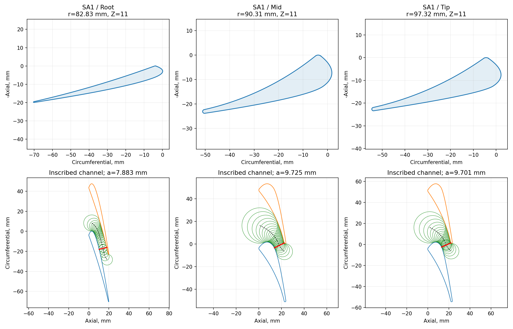
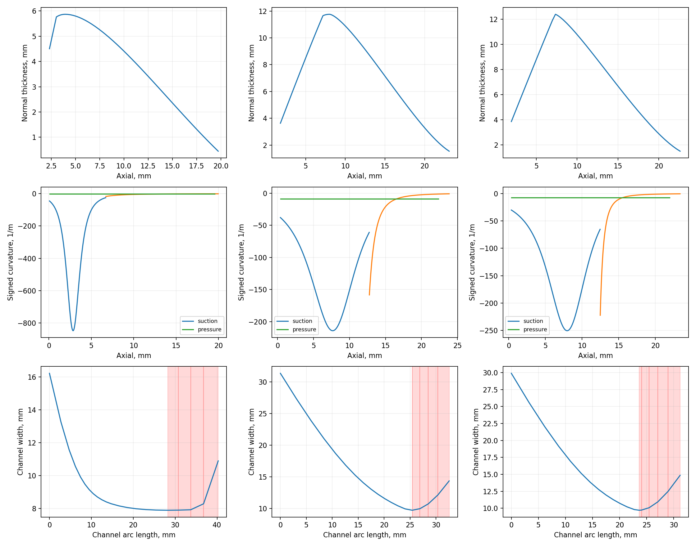
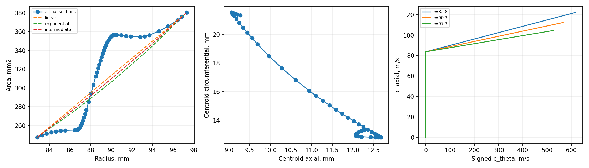
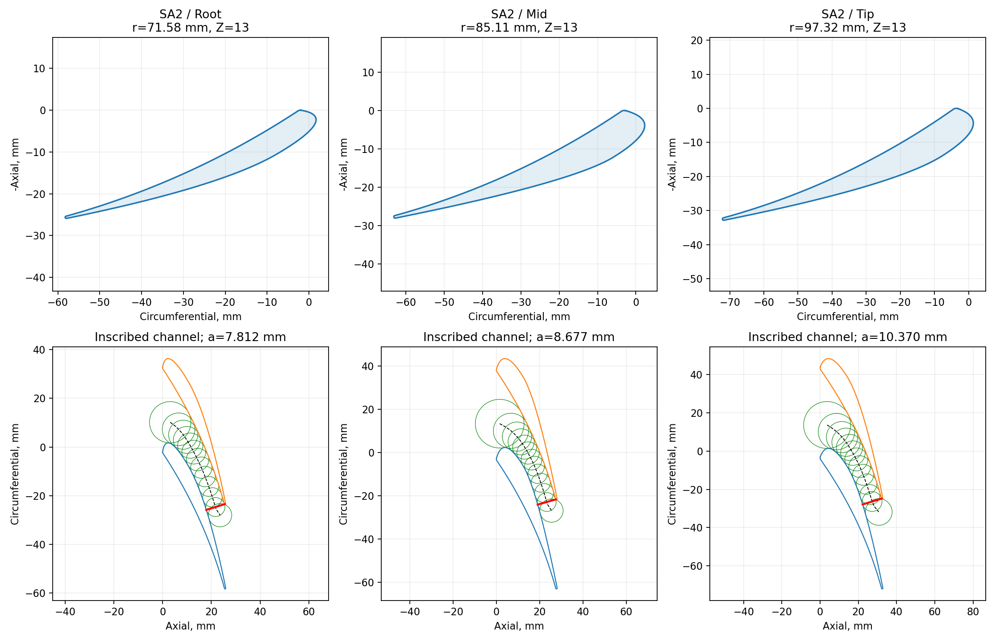
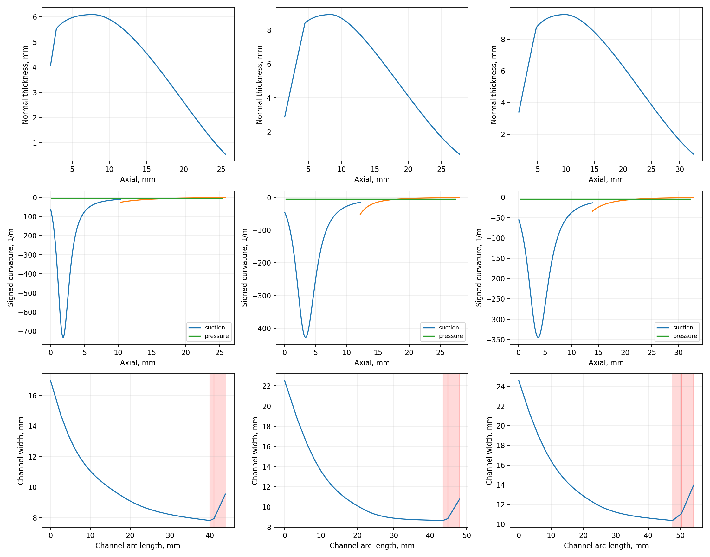
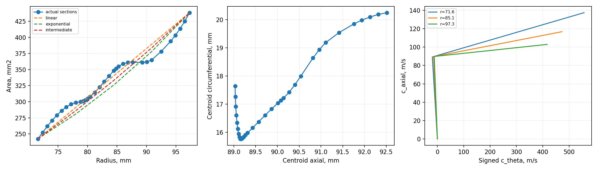
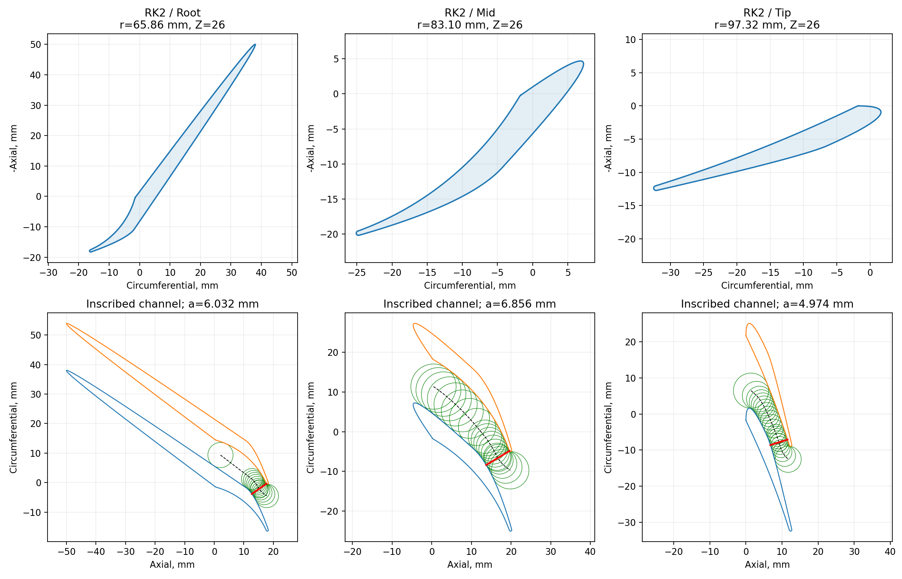
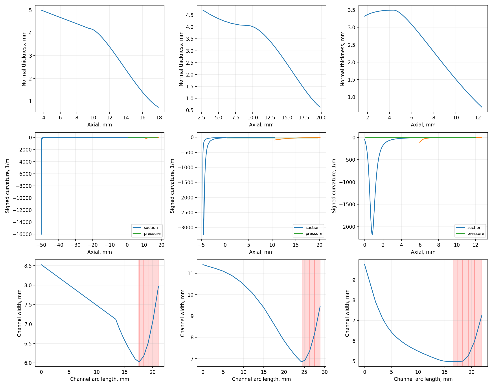
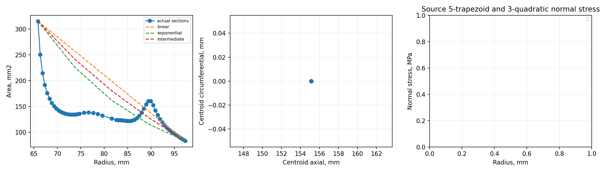
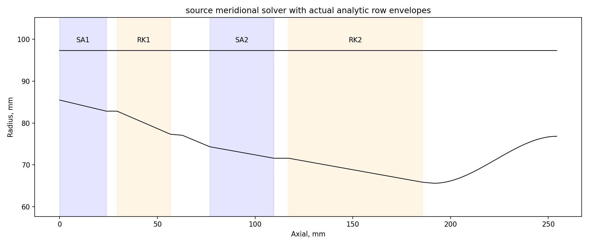
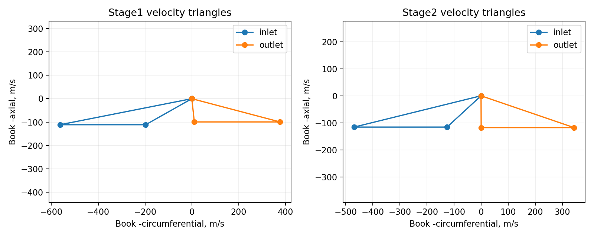
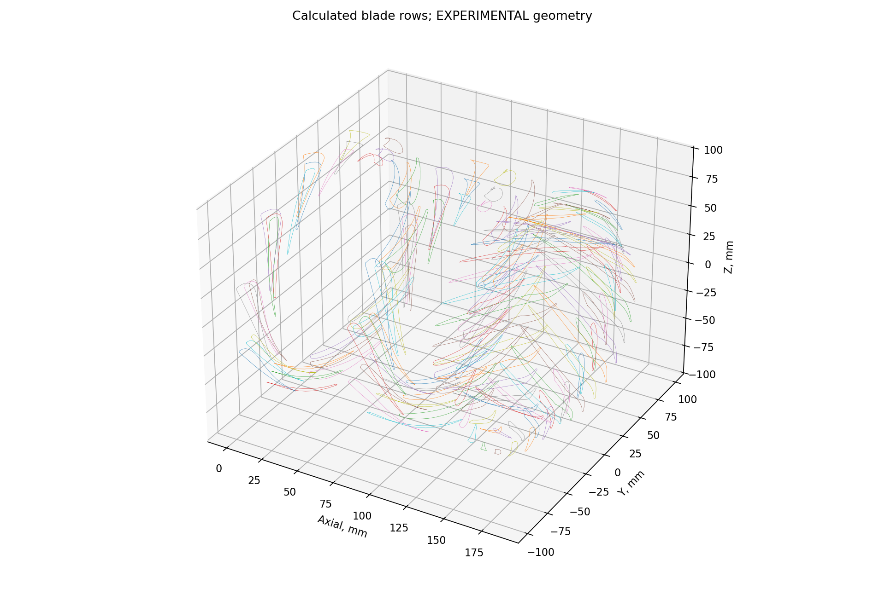

## Scope and missing physical evidence

- Geometry is not CFD/experimental proof of no separation or efficiency.
- Reynolds uses a documented air-viscosity proxy, not measured mixture transport.
- Source variable-cp thermodynamics and independent pressure-equilibrium audits are retained.
- IN738C/LM data are preliminary, not certified supply allowables.
- HCF NOT_CHECKED: grade-specific fatigue curve, forcing and damping are unavailable.

## Coupled source feedback

Converged: **False**. Final admissible: **False**.

feedback unavailable: one or more actual row loss evaluations failed.

110 kW is after the gearbox; CBK is only the cycle compressor. Resource RPM, material, life and LM reserve are inherited from the source.
