# Vinogradov — actual TWO-stage course resource calculation

Source: **TVD_1CBK_2st_10000h.ipynb**; resource: **10000 h**; stages: **2**.
Fixed source RPM: **30700**.
Engineering admissible: **False**.
Constructed rows: 4/4.

A failed finite search is not a proof of global infeasibility. No design limit was relaxed.

## Quantified violations

### SA1
- {'section': 2, 'name': 'local streamtube choke conflict', 'possible': False, 'required_flux_kg_m2_s': 471.9788967715772, 'critical_flux_kg_m2_s': 471.97654888311433, 'required_mach': None, 'stagnation_temperature_K': 1249.9999317739803, 'stagnation_pressure_Pa': 422749.4410588134, 'critical_temperature_K': 1081.7030258543848, 'source': 'original variable-cp h, pressure_isentropic, sound'}
- {'name': 'insufficient choked capacity', 'value': 0.8336561286810448, 'limit': 0.8336628797375195, 'units': 'kg/s'}
### RK1
- {'name': 'vibration strength', 'status': 'NOT_CHECKED', 'reason': 'NOT_CHECKED: no grade-specific fatigue curve, damping or actual harmonic forcing; beam modes are screening only'}
### SA2
- {'section': 3, 'name': 'local streamtube choke conflict', 'possible': False, 'required_flux_kg_m2_s': 245.01918505473097, 'critical_flux_kg_m2_s': 245.0191845353256, 'required_mach': None, 'stagnation_temperature_K': 1099.3008169721734, 'stagnation_pressure_Pa': 205284.8390134603, 'critical_temperature_K': 947.3366346025477, 'source': 'original variable-cp h, pressure_isentropic, sound'}
- {'name': 'insufficient choked capacity', 'value': 0.8334020495431521, 'limit': 0.8336628797375195, 'units': 'kg/s'}
### RK2
- {'name': 'vibration strength', 'status': 'NOT_CHECKED', 'reason': 'NOT_CHECKED: no grade-specific fatigue curve, damping or actual harmonic forcing; beam modes are screening only'}
- {'name': 'construction/calculation failure', 'message': 'Parabola lies outside its source control triangle', 'details': {'first_tangent_distance_m': 0.00897506995565098, 'last_tangent_distance_m': -0.0001337255879179956}}

## Global/source violations

- {'row': 'SA1', 'section': 2, 'name': 'local streamtube choke conflict', 'possible': False, 'required_flux_kg_m2_s': 471.9788967715772, 'critical_flux_kg_m2_s': 471.97654888311433, 'required_mach': None, 'stagnation_temperature_K': 1249.9999317739803, 'stagnation_pressure_Pa': 422749.4410588134, 'critical_temperature_K': 1081.7030258543848, 'source': 'original variable-cp h, pressure_isentropic, sound'}
- {'row': 'SA1', 'name': 'insufficient choked capacity', 'value': 0.8336561286810448, 'limit': 0.8336628797375195, 'units': 'kg/s'}
- {'row': 'RK1', 'name': 'vibration strength', 'status': 'NOT_CHECKED', 'reason': 'NOT_CHECKED: no grade-specific fatigue curve, damping or actual harmonic forcing; beam modes are screening only'}
- {'row': 'SA2', 'section': 3, 'name': 'local streamtube choke conflict', 'possible': False, 'required_flux_kg_m2_s': 245.01918505473097, 'critical_flux_kg_m2_s': 245.0191845353256, 'required_mach': None, 'stagnation_temperature_K': 1099.3008169721734, 'stagnation_pressure_Pa': 205284.8390134603, 'critical_temperature_K': 947.3366346025477, 'source': 'original variable-cp h, pressure_isentropic, sound'}
- {'row': 'SA2', 'name': 'insufficient choked capacity', 'value': 0.8334020495431521, 'limit': 0.8336628797375195, 'units': 'kg/s'}
- {'row': 'RK2', 'name': 'vibration strength', 'status': 'NOT_CHECKED', 'reason': 'NOT_CHECKED: no grade-specific fatigue curve, damping or actual harmonic forcing; beam modes are screening only'}
- {'row': 'RK2', 'name': 'construction/calculation failure', 'message': 'Parabola lies outside its source control triangle', 'details': {'first_tangent_distance_m': 0.00897506995565098, 'last_tangent_distance_m': -0.0001337255879179956}}
- {'row': 'RK1', 'name': 'source rotor taper mismatch', 'value': 2.0161216574598875, 'limit': 1.6}
- {'row': 'RK1', 'name': 'source rotor areas must decrease', 'value': [0.000460946156824257, 0.00031825763757478806, 0.0002728343912490571, 0.0003015749477038428, 0.0002286301300909605], 'limit': 'strict decrease root to tip'}
- {'row': 'RK2', 'name': 'source rotor taper mismatch', 'value': 1.5794079683592077, 'limit': 1.6}
- {'row': 'RK2', 'name': 'source rotor areas must decrease', 'value': [7.417139771755688e-05, 7.035259607978181e-05, 7.075895799758491e-05, 6.159881780467985e-05, 4.696151925497183e-05], 'limit': 'strict decrease root to tip'}
- {'row': 'RK2', 'section': 0, 'name': 'source finite trailing edge', 'value': 0.0004605831397964747, 'limit': 0.0005}
- {'row': 'RK2', 'section': 1, 'name': 'source finite trailing edge', 'value': 0.0004791521812901888, 'limit': 0.0005}
- {'row': 'RK2', 'section': 3, 'name': 'source finite trailing edge', 'value': 0.0004848847624488851, 'limit': 0.0005}
- {'row': 'RK2', 'section': 4, 'name': 'source finite trailing edge', 'value': 0.0004512176577643749, 'limit': 0.0005}

## Empirical guidance — not added hard limits

- {'row': 'SA1', 'section': 0, 'name': 'relative thickness starting guidance', 'value': 0.22932543923145765, 'range': [0.1, 0.1], 'classification': 'empirical, p13'}
- {'row': 'SA1', 'section': 0, 'name': 'prior profile guide: толщина выходной кромки', 'measurements': {'geometry_valid': True, 'circle_crosses_open_station_cut': False, 'intersections': False, 'self_intersection': False, 'area_equivalent_angle_deg': 10.640333490326078, 'area_ratio': 0.1846432444835642, 'angle_comparison': 'uniform-flux geometric comparison, not actual gas exit angle', 'angle_error_deg': -0.5596665096739208, 'te_over_throat': 0.08256442919772752, 'book_te_over_throat': 0.055, 'max_reduced_expansion': 1.451013239602961}, 'relative_thickness': 0.22932543923145765, 'actual_relative_pitch': 1.0964999368497335, 'classification': 'historical empirical profile guide; Vinogradov uses its own recommendations'}
- {'row': 'SA1', 'section': 0, 'name': 'prior profile guide: местная диффузорность', 'measurements': {'geometry_valid': True, 'circle_crosses_open_station_cut': False, 'intersections': False, 'self_intersection': False, 'area_equivalent_angle_deg': 10.640333490326078, 'area_ratio': 0.1846432444835642, 'angle_comparison': 'uniform-flux geometric comparison, not actual gas exit angle', 'angle_error_deg': -0.5596665096739208, 'te_over_throat': 0.08256442919772752, 'book_te_over_throat': 0.055, 'max_reduced_expansion': 1.451013239602961}, 'relative_thickness': 0.22932543923145765, 'actual_relative_pitch': 1.0964999368497335, 'classification': 'historical empirical profile guide; Vinogradov uses its own recommendations'}
- {'row': 'SA1', 'section': 0, 'name': 'prior profile guide: максимальная толщина', 'measurements': {'geometry_valid': True, 'circle_crosses_open_station_cut': False, 'intersections': False, 'self_intersection': False, 'area_equivalent_angle_deg': 10.640333490326078, 'area_ratio': 0.1846432444835642, 'angle_comparison': 'uniform-flux geometric comparison, not actual gas exit angle', 'angle_error_deg': -0.5596665096739208, 'te_over_throat': 0.08256442919772752, 'book_te_over_throat': 0.055, 'max_reduced_expansion': 1.451013239602961}, 'relative_thickness': 0.22932543923145765, 'actual_relative_pitch': 1.0964999368497335, 'classification': 'historical empirical profile guide; Vinogradov uses its own recommendations'}
- {'row': 'SA1', 'section': 0, 'name': 'prior profile guide: относительный шаг', 'measurements': {'geometry_valid': True, 'circle_crosses_open_station_cut': False, 'intersections': False, 'self_intersection': False, 'area_equivalent_angle_deg': 10.640333490326078, 'area_ratio': 0.1846432444835642, 'angle_comparison': 'uniform-flux geometric comparison, not actual gas exit angle', 'angle_error_deg': -0.5596665096739208, 'te_over_throat': 0.08256442919772752, 'book_te_over_throat': 0.055, 'max_reduced_expansion': 1.451013239602961}, 'relative_thickness': 0.22932543923145765, 'actual_relative_pitch': 1.0964999368497335, 'classification': 'historical empirical profile guide; Vinogradov uses its own recommendations'}
- {'row': 'SA1', 'section': 1, 'name': 'relative thickness starting guidance', 'value': 0.22561231321933523, 'range': [0.1, 0.1], 'classification': 'empirical, p13'}
- {'row': 'SA1', 'section': 1, 'name': 'prior profile guide: толщина выходной кромки', 'measurements': {'geometry_valid': True, 'circle_crosses_open_station_cut': True, 'intersections': False, 'self_intersection': False, 'area_equivalent_angle_deg': 10.61199516467632, 'area_ratio': 0.1841571291258927, 'angle_comparison': 'uniform-flux geometric comparison, not actual gas exit angle', 'angle_error_deg': -0.5880048353236766, 'te_over_throat': 0.08348373036220091, 'book_te_over_throat': 0.055, 'max_reduced_expansion': 1.62412928668268}, 'relative_thickness': 0.22561231321933523, 'actual_relative_pitch': 1.1086705698307966, 'classification': 'historical empirical profile guide; Vinogradov uses its own recommendations'}
- {'row': 'SA1', 'section': 1, 'name': 'prior profile guide: местная диффузорность', 'measurements': {'geometry_valid': True, 'circle_crosses_open_station_cut': True, 'intersections': False, 'self_intersection': False, 'area_equivalent_angle_deg': 10.61199516467632, 'area_ratio': 0.1841571291258927, 'angle_comparison': 'uniform-flux geometric comparison, not actual gas exit angle', 'angle_error_deg': -0.5880048353236766, 'te_over_throat': 0.08348373036220091, 'book_te_over_throat': 0.055, 'max_reduced_expansion': 1.62412928668268}, 'relative_thickness': 0.22561231321933523, 'actual_relative_pitch': 1.1086705698307966, 'classification': 'historical empirical profile guide; Vinogradov uses its own recommendations'}
- {'row': 'SA1', 'section': 1, 'name': 'prior profile guide: максимальная толщина', 'measurements': {'geometry_valid': True, 'circle_crosses_open_station_cut': True, 'intersections': False, 'self_intersection': False, 'area_equivalent_angle_deg': 10.61199516467632, 'area_ratio': 0.1841571291258927, 'angle_comparison': 'uniform-flux geometric comparison, not actual gas exit angle', 'angle_error_deg': -0.5880048353236766, 'te_over_throat': 0.08348373036220091, 'book_te_over_throat': 0.055, 'max_reduced_expansion': 1.62412928668268}, 'relative_thickness': 0.22561231321933523, 'actual_relative_pitch': 1.1086705698307966, 'classification': 'historical empirical profile guide; Vinogradov uses its own recommendations'}
- {'row': 'SA1', 'section': 1, 'name': 'prior profile guide: относительный шаг', 'measurements': {'geometry_valid': True, 'circle_crosses_open_station_cut': True, 'intersections': False, 'self_intersection': False, 'area_equivalent_angle_deg': 10.61199516467632, 'area_ratio': 0.1841571291258927, 'angle_comparison': 'uniform-flux geometric comparison, not actual gas exit angle', 'angle_error_deg': -0.5880048353236766, 'te_over_throat': 0.08348373036220091, 'book_te_over_throat': 0.055, 'max_reduced_expansion': 1.62412928668268}, 'relative_thickness': 0.22561231321933523, 'actual_relative_pitch': 1.1086705698307966, 'classification': 'historical empirical profile guide; Vinogradov uses its own recommendations'}
- {'row': 'SA1', 'section': 2, 'name': 'relative thickness starting guidance', 'value': 0.22468630824238506, 'range': [0.1, 0.1], 'classification': 'empirical, p13'}
- {'row': 'SA1', 'section': 2, 'name': 'prior profile guide: толщина выходной кромки', 'measurements': {'geometry_valid': True, 'circle_crosses_open_station_cut': True, 'intersections': False, 'self_intersection': False, 'area_equivalent_angle_deg': 10.557668941513684, 'area_ratio': 0.1832250917704583, 'angle_comparison': 'uniform-flux geometric comparison, not actual gas exit angle', 'angle_error_deg': -0.6423310584863149, 'te_over_throat': 0.07480204828547915, 'book_te_over_throat': 0.055, 'max_reduced_expansion': 1.5724671968079669}, 'relative_thickness': 0.22468630824238506, 'actual_relative_pitch': 1.1195584204352986, 'classification': 'historical empirical profile guide; Vinogradov uses its own recommendations'}
- {'row': 'SA1', 'section': 2, 'name': 'prior profile guide: местная диффузорность', 'measurements': {'geometry_valid': True, 'circle_crosses_open_station_cut': True, 'intersections': False, 'self_intersection': False, 'area_equivalent_angle_deg': 10.557668941513684, 'area_ratio': 0.1832250917704583, 'angle_comparison': 'uniform-flux geometric comparison, not actual gas exit angle', 'angle_error_deg': -0.6423310584863149, 'te_over_throat': 0.07480204828547915, 'book_te_over_throat': 0.055, 'max_reduced_expansion': 1.5724671968079669}, 'relative_thickness': 0.22468630824238506, 'actual_relative_pitch': 1.1195584204352986, 'classification': 'historical empirical profile guide; Vinogradov uses its own recommendations'}
- {'row': 'SA1', 'section': 2, 'name': 'prior profile guide: максимальная толщина', 'measurements': {'geometry_valid': True, 'circle_crosses_open_station_cut': True, 'intersections': False, 'self_intersection': False, 'area_equivalent_angle_deg': 10.557668941513684, 'area_ratio': 0.1832250917704583, 'angle_comparison': 'uniform-flux geometric comparison, not actual gas exit angle', 'angle_error_deg': -0.6423310584863149, 'te_over_throat': 0.07480204828547915, 'book_te_over_throat': 0.055, 'max_reduced_expansion': 1.5724671968079669}, 'relative_thickness': 0.22468630824238506, 'actual_relative_pitch': 1.1195584204352986, 'classification': 'historical empirical profile guide; Vinogradov uses its own recommendations'}
- {'row': 'SA1', 'section': 2, 'name': 'prior profile guide: относительный шаг', 'measurements': {'geometry_valid': True, 'circle_crosses_open_station_cut': True, 'intersections': False, 'self_intersection': False, 'area_equivalent_angle_deg': 10.557668941513684, 'area_ratio': 0.1832250917704583, 'angle_comparison': 'uniform-flux geometric comparison, not actual gas exit angle', 'angle_error_deg': -0.6423310584863149, 'te_over_throat': 0.07480204828547915, 'book_te_over_throat': 0.055, 'max_reduced_expansion': 1.5724671968079669}, 'relative_thickness': 0.22468630824238506, 'actual_relative_pitch': 1.1195584204352986, 'classification': 'historical empirical profile guide; Vinogradov uses its own recommendations'}
- {'row': 'SA1', 'section': 3, 'name': 'relative thickness starting guidance', 'value': 0.21917948081912417, 'range': [0.1, 0.1], 'classification': 'empirical, p13'}
- {'row': 'SA1', 'section': 3, 'name': 'prior profile guide: толщина выходной кромки', 'measurements': {'geometry_valid': True, 'circle_crosses_open_station_cut': True, 'intersections': False, 'self_intersection': False, 'area_equivalent_angle_deg': 10.454426088220217, 'area_ratio': 0.18145337240681136, 'angle_comparison': 'uniform-flux geometric comparison, not actual gas exit angle', 'angle_error_deg': -0.7455739117797826, 'te_over_throat': 0.07357750345586707, 'book_te_over_throat': 0.055, 'max_reduced_expansion': 1.398644498640929}, 'relative_thickness': 0.21917948081912417, 'actual_relative_pitch': 1.128574119723681, 'classification': 'historical empirical profile guide; Vinogradov uses its own recommendations'}
- {'row': 'SA1', 'section': 3, 'name': 'prior profile guide: местная диффузорность', 'measurements': {'geometry_valid': True, 'circle_crosses_open_station_cut': True, 'intersections': False, 'self_intersection': False, 'area_equivalent_angle_deg': 10.454426088220217, 'area_ratio': 0.18145337240681136, 'angle_comparison': 'uniform-flux geometric comparison, not actual gas exit angle', 'angle_error_deg': -0.7455739117797826, 'te_over_throat': 0.07357750345586707, 'book_te_over_throat': 0.055, 'max_reduced_expansion': 1.398644498640929}, 'relative_thickness': 0.21917948081912417, 'actual_relative_pitch': 1.128574119723681, 'classification': 'historical empirical profile guide; Vinogradov uses its own recommendations'}
- {'row': 'SA1', 'section': 3, 'name': 'prior profile guide: максимальная толщина', 'measurements': {'geometry_valid': True, 'circle_crosses_open_station_cut': True, 'intersections': False, 'self_intersection': False, 'area_equivalent_angle_deg': 10.454426088220217, 'area_ratio': 0.18145337240681136, 'angle_comparison': 'uniform-flux geometric comparison, not actual gas exit angle', 'angle_error_deg': -0.7455739117797826, 'te_over_throat': 0.07357750345586707, 'book_te_over_throat': 0.055, 'max_reduced_expansion': 1.398644498640929}, 'relative_thickness': 0.21917948081912417, 'actual_relative_pitch': 1.128574119723681, 'classification': 'historical empirical profile guide; Vinogradov uses its own recommendations'}
- {'row': 'SA1', 'section': 3, 'name': 'prior profile guide: относительный шаг', 'measurements': {'geometry_valid': True, 'circle_crosses_open_station_cut': True, 'intersections': False, 'self_intersection': False, 'area_equivalent_angle_deg': 10.454426088220217, 'area_ratio': 0.18145337240681136, 'angle_comparison': 'uniform-flux geometric comparison, not actual gas exit angle', 'angle_error_deg': -0.7455739117797826, 'te_over_throat': 0.07357750345586707, 'book_te_over_throat': 0.055, 'max_reduced_expansion': 1.398644498640929}, 'relative_thickness': 0.21917948081912417, 'actual_relative_pitch': 1.128574119723681, 'classification': 'historical empirical profile guide; Vinogradov uses its own recommendations'}
- {'row': 'SA1', 'section': 4, 'name': 'relative thickness starting guidance', 'value': 0.21100350338169854, 'range': [0.1, 0.1], 'classification': 'empirical, p13'}
- {'row': 'SA1', 'section': 4, 'name': 'prior profile guide: местная диффузорность', 'measurements': {'geometry_valid': True, 'circle_crosses_open_station_cut': True, 'intersections': False, 'self_intersection': False, 'area_equivalent_angle_deg': 10.367576215531665, 'area_ratio': 0.17996251151433185, 'angle_comparison': 'uniform-flux geometric comparison, not actual gas exit angle', 'angle_error_deg': -0.832423784468336, 'te_over_throat': 0.06426006402726346, 'book_te_over_throat': 0.055, 'max_reduced_expansion': 1.6050303869317837}, 'relative_thickness': 0.21100350338169854, 'actual_relative_pitch': 1.1204237590811774, 'classification': 'historical empirical profile guide; Vinogradov uses its own recommendations'}
- {'row': 'SA1', 'section': 4, 'name': 'prior profile guide: максимальная толщина', 'measurements': {'geometry_valid': True, 'circle_crosses_open_station_cut': True, 'intersections': False, 'self_intersection': False, 'area_equivalent_angle_deg': 10.367576215531665, 'area_ratio': 0.17996251151433185, 'angle_comparison': 'uniform-flux geometric comparison, not actual gas exit angle', 'angle_error_deg': -0.832423784468336, 'te_over_throat': 0.06426006402726346, 'book_te_over_throat': 0.055, 'max_reduced_expansion': 1.6050303869317837}, 'relative_thickness': 0.21100350338169854, 'actual_relative_pitch': 1.1204237590811774, 'classification': 'historical empirical profile guide; Vinogradov uses its own recommendations'}
- {'row': 'SA1', 'section': 4, 'name': 'prior profile guide: относительный шаг', 'measurements': {'geometry_valid': True, 'circle_crosses_open_station_cut': True, 'intersections': False, 'self_intersection': False, 'area_equivalent_angle_deg': 10.367576215531665, 'area_ratio': 0.17996251151433185, 'angle_comparison': 'uniform-flux geometric comparison, not actual gas exit angle', 'angle_error_deg': -0.832423784468336, 'te_over_throat': 0.06426006402726346, 'book_te_over_throat': 0.055, 'max_reduced_expansion': 1.6050303869317837}, 'relative_thickness': 0.21100350338169854, 'actual_relative_pitch': 1.1204237590811774, 'classification': 'historical empirical profile guide; Vinogradov uses its own recommendations'}
- {'row': 'RK1', 'section': 0, 'name': 'subsonic entrance expansion guidance', 'value': 1.1922617513180231, 'limit': 1.1, 'classification': 'empirical recommendation; CFD required'}
- {'row': 'RK1', 'section': 0, 'name': 'prior profile guide: угол горла', 'measurements': {'geometry_valid': True, 'circle_crosses_open_station_cut': True, 'intersections': False, 'self_intersection': False, 'area_equivalent_angle_deg': 28.935724457762955, 'area_ratio': 0.4838281496502221, 'angle_comparison': 'uniform-flux geometric comparison, not actual gas exit angle', 'angle_error_deg': 10.120312423160971, 'te_over_throat': 0.03594523998571044, 'book_te_over_throat': 0.07, 'max_reduced_expansion': 1.2326722339353156}, 'relative_thickness': 0.2780913273828777, 'actual_relative_pitch': 0.8537926116234665, 'classification': 'historical empirical profile guide; Vinogradov uses its own recommendations'}
- {'row': 'RK1', 'section': 0, 'name': 'prior profile guide: местная диффузорность', 'measurements': {'geometry_valid': True, 'circle_crosses_open_station_cut': True, 'intersections': False, 'self_intersection': False, 'area_equivalent_angle_deg': 28.935724457762955, 'area_ratio': 0.4838281496502221, 'angle_comparison': 'uniform-flux geometric comparison, not actual gas exit angle', 'angle_error_deg': 10.120312423160971, 'te_over_throat': 0.03594523998571044, 'book_te_over_throat': 0.07, 'max_reduced_expansion': 1.2326722339353156}, 'relative_thickness': 0.2780913273828777, 'actual_relative_pitch': 0.8537926116234665, 'classification': 'historical empirical profile guide; Vinogradov uses its own recommendations'}
- {'row': 'RK1', 'section': 0, 'name': 'prior profile guide: максимальная толщина', 'measurements': {'geometry_valid': True, 'circle_crosses_open_station_cut': True, 'intersections': False, 'self_intersection': False, 'area_equivalent_angle_deg': 28.935724457762955, 'area_ratio': 0.4838281496502221, 'angle_comparison': 'uniform-flux geometric comparison, not actual gas exit angle', 'angle_error_deg': 10.120312423160971, 'te_over_throat': 0.03594523998571044, 'book_te_over_throat': 0.07, 'max_reduced_expansion': 1.2326722339353156}, 'relative_thickness': 0.2780913273828777, 'actual_relative_pitch': 0.8537926116234665, 'classification': 'historical empirical profile guide; Vinogradov uses its own recommendations'}
- {'row': 'RK1', 'section': 0, 'name': 'prior profile guide: относительный шаг', 'measurements': {'geometry_valid': True, 'circle_crosses_open_station_cut': True, 'intersections': False, 'self_intersection': False, 'area_equivalent_angle_deg': 28.935724457762955, 'area_ratio': 0.4838281496502221, 'angle_comparison': 'uniform-flux geometric comparison, not actual gas exit angle', 'angle_error_deg': 10.120312423160971, 'te_over_throat': 0.03594523998571044, 'book_te_over_throat': 0.07, 'max_reduced_expansion': 1.2326722339353156}, 'relative_thickness': 0.2780913273828777, 'actual_relative_pitch': 0.8537926116234665, 'classification': 'historical empirical profile guide; Vinogradov uses its own recommendations'}
- {'row': 'RK1', 'section': 1, 'name': 'relative thickness starting guidance', 'value': 0.2486094984385935, 'range': [0.14658407163388162, 0.21987610745082242], 'classification': 'empirical, p13'}
- {'row': 'RK1', 'section': 1, 'name': 'prior profile guide: угол горла', 'measurements': {'geometry_valid': True, 'circle_crosses_open_station_cut': True, 'intersections': False, 'self_intersection': False, 'area_equivalent_angle_deg': 30.946730385328447, 'area_ratio': 0.5142409181280185, 'angle_comparison': 'uniform-flux geometric comparison, not actual gas exit angle', 'angle_error_deg': 12.67803974868287, 'te_over_throat': 0.07627912711732951, 'book_te_over_throat': 0.07, 'max_reduced_expansion': 1.1062645434619538}, 'relative_thickness': 0.2486094984385935, 'actual_relative_pitch': 1.0130146400823525, 'classification': 'historical empirical profile guide; Vinogradov uses its own recommendations'}
- {'row': 'RK1', 'section': 1, 'name': 'prior profile guide: местная диффузорность', 'measurements': {'geometry_valid': True, 'circle_crosses_open_station_cut': True, 'intersections': False, 'self_intersection': False, 'area_equivalent_angle_deg': 30.946730385328447, 'area_ratio': 0.5142409181280185, 'angle_comparison': 'uniform-flux geometric comparison, not actual gas exit angle', 'angle_error_deg': 12.67803974868287, 'te_over_throat': 0.07627912711732951, 'book_te_over_throat': 0.07, 'max_reduced_expansion': 1.1062645434619538}, 'relative_thickness': 0.2486094984385935, 'actual_relative_pitch': 1.0130146400823525, 'classification': 'historical empirical profile guide; Vinogradov uses its own recommendations'}
- {'row': 'RK1', 'section': 1, 'name': 'prior profile guide: максимальная толщина', 'measurements': {'geometry_valid': True, 'circle_crosses_open_station_cut': True, 'intersections': False, 'self_intersection': False, 'area_equivalent_angle_deg': 30.946730385328447, 'area_ratio': 0.5142409181280185, 'angle_comparison': 'uniform-flux geometric comparison, not actual gas exit angle', 'angle_error_deg': 12.67803974868287, 'te_over_throat': 0.07627912711732951, 'book_te_over_throat': 0.07, 'max_reduced_expansion': 1.1062645434619538}, 'relative_thickness': 0.2486094984385935, 'actual_relative_pitch': 1.0130146400823525, 'classification': 'historical empirical profile guide; Vinogradov uses its own recommendations'}
- {'row': 'RK1', 'section': 1, 'name': 'prior profile guide: относительный шаг', 'measurements': {'geometry_valid': True, 'circle_crosses_open_station_cut': True, 'intersections': False, 'self_intersection': False, 'area_equivalent_angle_deg': 30.946730385328447, 'area_ratio': 0.5142409181280185, 'angle_comparison': 'uniform-flux geometric comparison, not actual gas exit angle', 'angle_error_deg': 12.67803974868287, 'te_over_throat': 0.07627912711732951, 'book_te_over_throat': 0.07, 'max_reduced_expansion': 1.1062645434619538}, 'relative_thickness': 0.2486094984385935, 'actual_relative_pitch': 1.0130146400823525, 'classification': 'historical empirical profile guide; Vinogradov uses its own recommendations'}
- {'row': 'RK1', 'section': 2, 'name': 'relative thickness starting guidance', 'value': 0.24209345755012923, 'range': [0.09738937847815876, 0.1456489641302646], 'classification': 'empirical, p13'}
- {'row': 'RK1', 'section': 2, 'name': 'prior profile guide: угол горла', 'measurements': {'geometry_valid': True, 'circle_crosses_open_station_cut': True, 'intersections': False, 'self_intersection': False, 'area_equivalent_angle_deg': 33.11329811588081, 'area_ratio': 0.5462963773887028, 'angle_comparison': 'uniform-flux geometric comparison, not actual gas exit angle', 'angle_error_deg': 15.352155090070617, 'te_over_throat': 0.06259120081138894, 'book_te_over_throat': 0.07, 'max_reduced_expansion': 1.1609604461515104}, 'relative_thickness': 0.24209345755012923, 'actual_relative_pitch': 1.1307493003367814, 'classification': 'historical empirical profile guide; Vinogradov uses its own recommendations'}
- {'row': 'RK1', 'section': 2, 'name': 'prior profile guide: местная диффузорность', 'measurements': {'geometry_valid': True, 'circle_crosses_open_station_cut': True, 'intersections': False, 'self_intersection': False, 'area_equivalent_angle_deg': 33.11329811588081, 'area_ratio': 0.5462963773887028, 'angle_comparison': 'uniform-flux geometric comparison, not actual gas exit angle', 'angle_error_deg': 15.352155090070617, 'te_over_throat': 0.06259120081138894, 'book_te_over_throat': 0.07, 'max_reduced_expansion': 1.1609604461515104}, 'relative_thickness': 0.24209345755012923, 'actual_relative_pitch': 1.1307493003367814, 'classification': 'historical empirical profile guide; Vinogradov uses its own recommendations'}
- {'row': 'RK1', 'section': 2, 'name': 'prior profile guide: максимальная толщина', 'measurements': {'geometry_valid': True, 'circle_crosses_open_station_cut': True, 'intersections': False, 'self_intersection': False, 'area_equivalent_angle_deg': 33.11329811588081, 'area_ratio': 0.5462963773887028, 'angle_comparison': 'uniform-flux geometric comparison, not actual gas exit angle', 'angle_error_deg': 15.352155090070617, 'te_over_throat': 0.06259120081138894, 'book_te_over_throat': 0.07, 'max_reduced_expansion': 1.1609604461515104}, 'relative_thickness': 0.24209345755012923, 'actual_relative_pitch': 1.1307493003367814, 'classification': 'historical empirical profile guide; Vinogradov uses its own recommendations'}
- {'row': 'RK1', 'section': 2, 'name': 'prior profile guide: относительный шаг', 'measurements': {'geometry_valid': True, 'circle_crosses_open_station_cut': True, 'intersections': False, 'self_intersection': False, 'area_equivalent_angle_deg': 33.11329811588081, 'area_ratio': 0.5462963773887028, 'angle_comparison': 'uniform-flux geometric comparison, not actual gas exit angle', 'angle_error_deg': 15.352155090070617, 'te_over_throat': 0.06259120081138894, 'book_te_over_throat': 0.07, 'max_reduced_expansion': 1.1609604461515104}, 'relative_thickness': 0.24209345755012923, 'actual_relative_pitch': 1.1307493003367814, 'classification': 'historical empirical profile guide; Vinogradov uses its own recommendations'}
- {'row': 'RK1', 'section': 3, 'name': 'relative thickness starting guidance', 'value': 0.2450511550814693, 'range': [0.06812418197944138, 0.09687363663240228], 'classification': 'empirical, p13'}
- {'row': 'RK1', 'section': 3, 'name': 'prior profile guide: угол горла', 'measurements': {'geometry_valid': True, 'circle_crosses_open_station_cut': True, 'intersections': False, 'self_intersection': False, 'area_equivalent_angle_deg': 32.68784270004689, 'area_ratio': 0.5400617524260316, 'angle_comparison': 'uniform-flux geometric comparison, not actual gas exit angle', 'angle_error_deg': 15.398266188354743, 'te_over_throat': 0.06512440706647027, 'book_te_over_throat': 0.07, 'max_reduced_expansion': 1.1594305499137787}, 'relative_thickness': 0.2450511550814693, 'actual_relative_pitch': 1.1265370031274116, 'classification': 'historical empirical profile guide; Vinogradov uses its own recommendations'}
- {'row': 'RK1', 'section': 3, 'name': 'prior profile guide: местная диффузорность', 'measurements': {'geometry_valid': True, 'circle_crosses_open_station_cut': True, 'intersections': False, 'self_intersection': False, 'area_equivalent_angle_deg': 32.68784270004689, 'area_ratio': 0.5400617524260316, 'angle_comparison': 'uniform-flux geometric comparison, not actual gas exit angle', 'angle_error_deg': 15.398266188354743, 'te_over_throat': 0.06512440706647027, 'book_te_over_throat': 0.07, 'max_reduced_expansion': 1.1594305499137787}, 'relative_thickness': 0.2450511550814693, 'actual_relative_pitch': 1.1265370031274116, 'classification': 'historical empirical profile guide; Vinogradov uses its own recommendations'}
- {'row': 'RK1', 'section': 3, 'name': 'prior profile guide: максимальная толщина', 'measurements': {'geometry_valid': True, 'circle_crosses_open_station_cut': True, 'intersections': False, 'self_intersection': False, 'area_equivalent_angle_deg': 32.68784270004689, 'area_ratio': 0.5400617524260316, 'angle_comparison': 'uniform-flux geometric comparison, not actual gas exit angle', 'angle_error_deg': 15.398266188354743, 'te_over_throat': 0.06512440706647027, 'book_te_over_throat': 0.07, 'max_reduced_expansion': 1.1594305499137787}, 'relative_thickness': 0.2450511550814693, 'actual_relative_pitch': 1.1265370031274116, 'classification': 'historical empirical profile guide; Vinogradov uses its own recommendations'}
- {'row': 'RK1', 'section': 3, 'name': 'prior profile guide: относительный шаг', 'measurements': {'geometry_valid': True, 'circle_crosses_open_station_cut': True, 'intersections': False, 'self_intersection': False, 'area_equivalent_angle_deg': 32.68784270004689, 'area_ratio': 0.5400617524260316, 'angle_comparison': 'uniform-flux geometric comparison, not actual gas exit angle', 'angle_error_deg': 15.398266188354743, 'te_over_throat': 0.06512440706647027, 'book_te_over_throat': 0.07, 'max_reduced_expansion': 1.1594305499137787}, 'relative_thickness': 0.2450511550814693, 'actual_relative_pitch': 1.1265370031274116, 'classification': 'historical empirical profile guide; Vinogradov uses its own recommendations'}
- {'row': 'RK1', 'section': 4, 'name': 'relative thickness starting guidance', 'value': 0.23619137843293841, 'range': [0.04, 0.05], 'classification': 'empirical, p13'}
- {'row': 'RK1', 'section': 4, 'name': 'prior profile guide: угол горла', 'measurements': {'geometry_valid': True, 'circle_crosses_open_station_cut': True, 'intersections': False, 'self_intersection': False, 'area_equivalent_angle_deg': 35.958042564794056, 'area_ratio': 0.5871926553281462, 'angle_comparison': 'uniform-flux geometric comparison, not actual gas exit angle', 'angle_error_deg': 19.107385447126102, 'te_over_throat': 0.05017432442545711, 'book_te_over_throat': 0.07, 'max_reduced_expansion': 1.1014475757774445}, 'relative_thickness': 0.23619137843293841, 'actual_relative_pitch': 1.3141279379012436, 'classification': 'historical empirical profile guide; Vinogradov uses its own recommendations'}
- {'row': 'RK1', 'section': 4, 'name': 'prior profile guide: местная диффузорность', 'measurements': {'geometry_valid': True, 'circle_crosses_open_station_cut': True, 'intersections': False, 'self_intersection': False, 'area_equivalent_angle_deg': 35.958042564794056, 'area_ratio': 0.5871926553281462, 'angle_comparison': 'uniform-flux geometric comparison, not actual gas exit angle', 'angle_error_deg': 19.107385447126102, 'te_over_throat': 0.05017432442545711, 'book_te_over_throat': 0.07, 'max_reduced_expansion': 1.1014475757774445}, 'relative_thickness': 0.23619137843293841, 'actual_relative_pitch': 1.3141279379012436, 'classification': 'historical empirical profile guide; Vinogradov uses its own recommendations'}
- {'row': 'RK1', 'section': 4, 'name': 'prior profile guide: максимальная толщина', 'measurements': {'geometry_valid': True, 'circle_crosses_open_station_cut': True, 'intersections': False, 'self_intersection': False, 'area_equivalent_angle_deg': 35.958042564794056, 'area_ratio': 0.5871926553281462, 'angle_comparison': 'uniform-flux geometric comparison, not actual gas exit angle', 'angle_error_deg': 19.107385447126102, 'te_over_throat': 0.05017432442545711, 'book_te_over_throat': 0.07, 'max_reduced_expansion': 1.1014475757774445}, 'relative_thickness': 0.23619137843293841, 'actual_relative_pitch': 1.3141279379012436, 'classification': 'historical empirical profile guide; Vinogradov uses its own recommendations'}
- {'row': 'RK1', 'section': 4, 'name': 'prior profile guide: относительный шаг', 'measurements': {'geometry_valid': True, 'circle_crosses_open_station_cut': True, 'intersections': False, 'self_intersection': False, 'area_equivalent_angle_deg': 35.958042564794056, 'area_ratio': 0.5871926553281462, 'angle_comparison': 'uniform-flux geometric comparison, not actual gas exit angle', 'angle_error_deg': 19.107385447126102, 'te_over_throat': 0.05017432442545711, 'book_te_over_throat': 0.07, 'max_reduced_expansion': 1.1014475757774445}, 'relative_thickness': 0.23619137843293841, 'actual_relative_pitch': 1.3141279379012436, 'classification': 'historical empirical profile guide; Vinogradov uses its own recommendations'}
- {'row': 'SA2', 'section': 0, 'name': 'relative thickness starting guidance', 'value': 0.23035066603964746, 'range': [0.1, 0.1], 'classification': 'empirical, p13'}
- {'row': 'SA2', 'section': 0, 'name': 'prior profile guide: толщина выходной кромки', 'measurements': {'geometry_valid': True, 'circle_crosses_open_station_cut': False, 'intersections': False, 'self_intersection': False, 'area_equivalent_angle_deg': 17.249643259605268, 'area_ratio': 0.29653562873443085, 'angle_comparison': 'uniform-flux geometric comparison, not actual gas exit angle', 'angle_error_deg': 0.018257149397037153, 'te_over_throat': 0.09105953391791792, 'book_te_over_throat': 0.055, 'max_reduced_expansion': 1.4897042594505605}, 'relative_thickness': 0.23035066603964746, 'actual_relative_pitch': 0.8622643233025041, 'classification': 'historical empirical profile guide; Vinogradov uses its own recommendations'}
- {'row': 'SA2', 'section': 0, 'name': 'prior profile guide: местная диффузорность', 'measurements': {'geometry_valid': True, 'circle_crosses_open_station_cut': False, 'intersections': False, 'self_intersection': False, 'area_equivalent_angle_deg': 17.249643259605268, 'area_ratio': 0.29653562873443085, 'angle_comparison': 'uniform-flux geometric comparison, not actual gas exit angle', 'angle_error_deg': 0.018257149397037153, 'te_over_throat': 0.09105953391791792, 'book_te_over_throat': 0.055, 'max_reduced_expansion': 1.4897042594505605}, 'relative_thickness': 0.23035066603964746, 'actual_relative_pitch': 0.8622643233025041, 'classification': 'historical empirical profile guide; Vinogradov uses its own recommendations'}
- {'row': 'SA2', 'section': 0, 'name': 'prior profile guide: максимальная толщина', 'measurements': {'geometry_valid': True, 'circle_crosses_open_station_cut': False, 'intersections': False, 'self_intersection': False, 'area_equivalent_angle_deg': 17.249643259605268, 'area_ratio': 0.29653562873443085, 'angle_comparison': 'uniform-flux geometric comparison, not actual gas exit angle', 'angle_error_deg': 0.018257149397037153, 'te_over_throat': 0.09105953391791792, 'book_te_over_throat': 0.055, 'max_reduced_expansion': 1.4897042594505605}, 'relative_thickness': 0.23035066603964746, 'actual_relative_pitch': 0.8622643233025041, 'classification': 'historical empirical profile guide; Vinogradov uses its own recommendations'}
- {'row': 'SA2', 'section': 0, 'name': 'prior profile guide: относительный шаг', 'measurements': {'geometry_valid': True, 'circle_crosses_open_station_cut': False, 'intersections': False, 'self_intersection': False, 'area_equivalent_angle_deg': 17.249643259605268, 'area_ratio': 0.29653562873443085, 'angle_comparison': 'uniform-flux geometric comparison, not actual gas exit angle', 'angle_error_deg': 0.018257149397037153, 'te_over_throat': 0.09105953391791792, 'book_te_over_throat': 0.055, 'max_reduced_expansion': 1.4897042594505605}, 'relative_thickness': 0.23035066603964746, 'actual_relative_pitch': 0.8622643233025041, 'classification': 'historical empirical profile guide; Vinogradov uses its own recommendations'}
- {'row': 'SA2', 'section': 1, 'name': 'relative thickness starting guidance', 'value': 0.22746738085211715, 'range': [0.1, 0.1], 'classification': 'empirical, p13'}
- {'row': 'SA2', 'section': 1, 'name': 'prior profile guide: толщина выходной кромки', 'measurements': {'geometry_valid': True, 'circle_crosses_open_station_cut': True, 'intersections': False, 'self_intersection': False, 'area_equivalent_angle_deg': 17.161668320719926, 'area_ratio': 0.295068889306347, 'angle_comparison': 'uniform-flux geometric comparison, not actual gas exit angle', 'angle_error_deg': -0.06971778948830476, 'te_over_throat': 0.08573911735177879, 'book_te_over_throat': 0.055, 'max_reduced_expansion': 1.350283706405832}, 'relative_thickness': 0.22746738085211715, 'actual_relative_pitch': 0.8692580706561842, 'classification': 'historical empirical profile guide; Vinogradov uses its own recommendations'}
- {'row': 'SA2', 'section': 1, 'name': 'prior profile guide: местная диффузорность', 'measurements': {'geometry_valid': True, 'circle_crosses_open_station_cut': True, 'intersections': False, 'self_intersection': False, 'area_equivalent_angle_deg': 17.161668320719926, 'area_ratio': 0.295068889306347, 'angle_comparison': 'uniform-flux geometric comparison, not actual gas exit angle', 'angle_error_deg': -0.06971778948830476, 'te_over_throat': 0.08573911735177879, 'book_te_over_throat': 0.055, 'max_reduced_expansion': 1.350283706405832}, 'relative_thickness': 0.22746738085211715, 'actual_relative_pitch': 0.8692580706561842, 'classification': 'historical empirical profile guide; Vinogradov uses its own recommendations'}
- {'row': 'SA2', 'section': 1, 'name': 'prior profile guide: максимальная толщина', 'measurements': {'geometry_valid': True, 'circle_crosses_open_station_cut': True, 'intersections': False, 'self_intersection': False, 'area_equivalent_angle_deg': 17.161668320719926, 'area_ratio': 0.295068889306347, 'angle_comparison': 'uniform-flux geometric comparison, not actual gas exit angle', 'angle_error_deg': -0.06971778948830476, 'te_over_throat': 0.08573911735177879, 'book_te_over_throat': 0.055, 'max_reduced_expansion': 1.350283706405832}, 'relative_thickness': 0.22746738085211715, 'actual_relative_pitch': 0.8692580706561842, 'classification': 'historical empirical profile guide; Vinogradov uses its own recommendations'}
- {'row': 'SA2', 'section': 1, 'name': 'prior profile guide: относительный шаг', 'measurements': {'geometry_valid': True, 'circle_crosses_open_station_cut': True, 'intersections': False, 'self_intersection': False, 'area_equivalent_angle_deg': 17.161668320719926, 'area_ratio': 0.295068889306347, 'angle_comparison': 'uniform-flux geometric comparison, not actual gas exit angle', 'angle_error_deg': -0.06971778948830476, 'te_over_throat': 0.08573911735177879, 'book_te_over_throat': 0.055, 'max_reduced_expansion': 1.350283706405832}, 'relative_thickness': 0.22746738085211715, 'actual_relative_pitch': 0.8692580706561842, 'classification': 'historical empirical profile guide; Vinogradov uses its own recommendations'}
- {'row': 'SA2', 'section': 2, 'name': 'relative thickness starting guidance', 'value': 0.234209596555964, 'range': [0.1, 0.1], 'classification': 'empirical, p13'}
- {'row': 'SA2', 'section': 2, 'name': 'prior profile guide: толщина выходной кромки', 'measurements': {'geometry_valid': True, 'circle_crosses_open_station_cut': True, 'intersections': False, 'self_intersection': False, 'area_equivalent_angle_deg': 17.01140598904777, 'area_ratio': 0.2925620724891217, 'angle_comparison': 'uniform-flux geometric comparison, not actual gas exit angle', 'angle_error_deg': -0.21998012116046084, 'te_over_throat': 0.07859449013154986, 'book_te_over_throat': 0.055, 'max_reduced_expansion': 1.4026179305872593}, 'relative_thickness': 0.234209596555964, 'actual_relative_pitch': 0.8671198333697071, 'classification': 'historical empirical profile guide; Vinogradov uses its own recommendations'}
- {'row': 'SA2', 'section': 2, 'name': 'prior profile guide: местная диффузорность', 'measurements': {'geometry_valid': True, 'circle_crosses_open_station_cut': True, 'intersections': False, 'self_intersection': False, 'area_equivalent_angle_deg': 17.01140598904777, 'area_ratio': 0.2925620724891217, 'angle_comparison': 'uniform-flux geometric comparison, not actual gas exit angle', 'angle_error_deg': -0.21998012116046084, 'te_over_throat': 0.07859449013154986, 'book_te_over_throat': 0.055, 'max_reduced_expansion': 1.4026179305872593}, 'relative_thickness': 0.234209596555964, 'actual_relative_pitch': 0.8671198333697071, 'classification': 'historical empirical profile guide; Vinogradov uses its own recommendations'}
- {'row': 'SA2', 'section': 2, 'name': 'prior profile guide: максимальная толщина', 'measurements': {'geometry_valid': True, 'circle_crosses_open_station_cut': True, 'intersections': False, 'self_intersection': False, 'area_equivalent_angle_deg': 17.01140598904777, 'area_ratio': 0.2925620724891217, 'angle_comparison': 'uniform-flux geometric comparison, not actual gas exit angle', 'angle_error_deg': -0.21998012116046084, 'te_over_throat': 0.07859449013154986, 'book_te_over_throat': 0.055, 'max_reduced_expansion': 1.4026179305872593}, 'relative_thickness': 0.234209596555964, 'actual_relative_pitch': 0.8671198333697071, 'classification': 'historical empirical profile guide; Vinogradov uses its own recommendations'}
- {'row': 'SA2', 'section': 2, 'name': 'prior profile guide: относительный шаг', 'measurements': {'geometry_valid': True, 'circle_crosses_open_station_cut': True, 'intersections': False, 'self_intersection': False, 'area_equivalent_angle_deg': 17.01140598904777, 'area_ratio': 0.2925620724891217, 'angle_comparison': 'uniform-flux geometric comparison, not actual gas exit angle', 'angle_error_deg': -0.21998012116046084, 'te_over_throat': 0.07859449013154986, 'book_te_over_throat': 0.055, 'max_reduced_expansion': 1.4026179305872593}, 'relative_thickness': 0.234209596555964, 'actual_relative_pitch': 0.8671198333697071, 'classification': 'historical empirical profile guide; Vinogradov uses its own recommendations'}
- {'row': 'SA2', 'section': 3, 'name': 'relative thickness starting guidance', 'value': 0.24453701145821313, 'range': [0.1, 0.1], 'classification': 'empirical, p13'}
- {'row': 'SA2', 'section': 3, 'name': 'prior profile guide: толщина выходной кромки', 'measurements': {'geometry_valid': True, 'circle_crosses_open_station_cut': False, 'intersections': False, 'self_intersection': False, 'area_equivalent_angle_deg': 16.822662270051367, 'area_ratio': 0.2894104240826198, 'angle_comparison': 'uniform-flux geometric comparison, not actual gas exit angle', 'angle_error_deg': -0.40872384015686336, 'te_over_throat': 0.08707712654483482, 'book_te_over_throat': 0.055, 'max_reduced_expansion': 1.331275849434746}, 'relative_thickness': 0.24453701145821313, 'actual_relative_pitch': 0.8697714780056152, 'classification': 'historical empirical profile guide; Vinogradov uses its own recommendations'}
- {'row': 'SA2', 'section': 3, 'name': 'prior profile guide: местная диффузорность', 'measurements': {'geometry_valid': True, 'circle_crosses_open_station_cut': False, 'intersections': False, 'self_intersection': False, 'area_equivalent_angle_deg': 16.822662270051367, 'area_ratio': 0.2894104240826198, 'angle_comparison': 'uniform-flux geometric comparison, not actual gas exit angle', 'angle_error_deg': -0.40872384015686336, 'te_over_throat': 0.08707712654483482, 'book_te_over_throat': 0.055, 'max_reduced_expansion': 1.331275849434746}, 'relative_thickness': 0.24453701145821313, 'actual_relative_pitch': 0.8697714780056152, 'classification': 'historical empirical profile guide; Vinogradov uses its own recommendations'}
- {'row': 'SA2', 'section': 3, 'name': 'prior profile guide: максимальная толщина', 'measurements': {'geometry_valid': True, 'circle_crosses_open_station_cut': False, 'intersections': False, 'self_intersection': False, 'area_equivalent_angle_deg': 16.822662270051367, 'area_ratio': 0.2894104240826198, 'angle_comparison': 'uniform-flux geometric comparison, not actual gas exit angle', 'angle_error_deg': -0.40872384015686336, 'te_over_throat': 0.08707712654483482, 'book_te_over_throat': 0.055, 'max_reduced_expansion': 1.331275849434746}, 'relative_thickness': 0.24453701145821313, 'actual_relative_pitch': 0.8697714780056152, 'classification': 'historical empirical profile guide; Vinogradov uses its own recommendations'}
- {'row': 'SA2', 'section': 3, 'name': 'prior profile guide: относительный шаг', 'measurements': {'geometry_valid': True, 'circle_crosses_open_station_cut': False, 'intersections': False, 'self_intersection': False, 'area_equivalent_angle_deg': 16.822662270051367, 'area_ratio': 0.2894104240826198, 'angle_comparison': 'uniform-flux geometric comparison, not actual gas exit angle', 'angle_error_deg': -0.40872384015686336, 'te_over_throat': 0.08707712654483482, 'book_te_over_throat': 0.055, 'max_reduced_expansion': 1.331275849434746}, 'relative_thickness': 0.24453701145821313, 'actual_relative_pitch': 0.8697714780056152, 'classification': 'historical empirical profile guide; Vinogradov uses its own recommendations'}
- {'row': 'SA2', 'section': 4, 'name': 'relative thickness starting guidance', 'value': 0.25050949206666895, 'range': [0.1, 0.1], 'classification': 'empirical, p13'}
- {'row': 'SA2', 'section': 4, 'name': 'prior profile guide: толщина выходной кромки', 'measurements': {'geometry_valid': True, 'circle_crosses_open_station_cut': False, 'intersections': False, 'self_intersection': False, 'area_equivalent_angle_deg': 16.608074028285678, 'area_ratio': 0.28582340983022847, 'angle_comparison': 'uniform-flux geometric comparison, not actual gas exit angle', 'angle_error_deg': -0.6233120819225562, 'te_over_throat': 0.10058801002584498, 'book_te_over_throat': 0.055, 'max_reduced_expansion': 1.3851974807620295}, 'relative_thickness': 0.25050949206666895, 'actual_relative_pitch': 0.8751613034891055, 'classification': 'historical empirical profile guide; Vinogradov uses its own recommendations'}
- {'row': 'SA2', 'section': 4, 'name': 'prior profile guide: местная диффузорность', 'measurements': {'geometry_valid': True, 'circle_crosses_open_station_cut': False, 'intersections': False, 'self_intersection': False, 'area_equivalent_angle_deg': 16.608074028285678, 'area_ratio': 0.28582340983022847, 'angle_comparison': 'uniform-flux geometric comparison, not actual gas exit angle', 'angle_error_deg': -0.6233120819225562, 'te_over_throat': 0.10058801002584498, 'book_te_over_throat': 0.055, 'max_reduced_expansion': 1.3851974807620295}, 'relative_thickness': 0.25050949206666895, 'actual_relative_pitch': 0.8751613034891055, 'classification': 'historical empirical profile guide; Vinogradov uses its own recommendations'}
- {'row': 'SA2', 'section': 4, 'name': 'prior profile guide: максимальная толщина', 'measurements': {'geometry_valid': True, 'circle_crosses_open_station_cut': False, 'intersections': False, 'self_intersection': False, 'area_equivalent_angle_deg': 16.608074028285678, 'area_ratio': 0.28582340983022847, 'angle_comparison': 'uniform-flux geometric comparison, not actual gas exit angle', 'angle_error_deg': -0.6233120819225562, 'te_over_throat': 0.10058801002584498, 'book_te_over_throat': 0.055, 'max_reduced_expansion': 1.3851974807620295}, 'relative_thickness': 0.25050949206666895, 'actual_relative_pitch': 0.8751613034891055, 'classification': 'historical empirical profile guide; Vinogradov uses its own recommendations'}
- {'row': 'SA2', 'section': 4, 'name': 'prior profile guide: относительный шаг', 'measurements': {'geometry_valid': True, 'circle_crosses_open_station_cut': False, 'intersections': False, 'self_intersection': False, 'area_equivalent_angle_deg': 16.608074028285678, 'area_ratio': 0.28582340983022847, 'angle_comparison': 'uniform-flux geometric comparison, not actual gas exit angle', 'angle_error_deg': -0.6233120819225562, 'te_over_throat': 0.10058801002584498, 'book_te_over_throat': 0.055, 'max_reduced_expansion': 1.3851974807620295}, 'relative_thickness': 0.25050949206666895, 'actual_relative_pitch': 0.8751613034891055, 'classification': 'historical empirical profile guide; Vinogradov uses its own recommendations'}
- {'row': 'RK2', 'section': 0, 'name': 'subsonic entrance expansion guidance', 'value': 1.1842270871906448, 'limit': 1.1, 'classification': 'empirical recommendation; CFD required'}
- {'row': 'RK2', 'section': 0, 'name': 'relative thickness starting guidance', 'value': 0.1768121743883472, 'range': [0.2, 0.3], 'classification': 'empirical, p13'}
- {'row': 'RK2', 'section': 0, 'name': 'prior profile guide: угол горла', 'measurements': {'geometry_valid': True, 'circle_crosses_open_station_cut': True, 'intersections': False, 'self_intersection': False, 'area_equivalent_angle_deg': 37.14931702613342, 'area_ratio': 0.6038942801745579, 'angle_comparison': 'uniform-flux geometric comparison, not actual gas exit angle', 'angle_error_deg': 8.888560176325935, 'te_over_throat': 0.04391664032753299, 'book_te_over_throat': 0.07, 'max_reduced_expansion': 1.2205370315303479}, 'relative_thickness': 0.1768121743883472, 'actual_relative_pitch': 0.7809328293289385, 'classification': 'historical empirical profile guide; Vinogradov uses its own recommendations'}
- {'row': 'RK2', 'section': 0, 'name': 'prior profile guide: местная диффузорность', 'measurements': {'geometry_valid': True, 'circle_crosses_open_station_cut': True, 'intersections': False, 'self_intersection': False, 'area_equivalent_angle_deg': 37.14931702613342, 'area_ratio': 0.6038942801745579, 'angle_comparison': 'uniform-flux geometric comparison, not actual gas exit angle', 'angle_error_deg': 8.888560176325935, 'te_over_throat': 0.04391664032753299, 'book_te_over_throat': 0.07, 'max_reduced_expansion': 1.2205370315303479}, 'relative_thickness': 0.1768121743883472, 'actual_relative_pitch': 0.7809328293289385, 'classification': 'historical empirical profile guide; Vinogradov uses its own recommendations'}
- {'row': 'RK2', 'section': 0, 'name': 'prior profile guide: максимальная толщина', 'measurements': {'geometry_valid': True, 'circle_crosses_open_station_cut': True, 'intersections': False, 'self_intersection': False, 'area_equivalent_angle_deg': 37.14931702613342, 'area_ratio': 0.6038942801745579, 'angle_comparison': 'uniform-flux geometric comparison, not actual gas exit angle', 'angle_error_deg': 8.888560176325935, 'te_over_throat': 0.04391664032753299, 'book_te_over_throat': 0.07, 'max_reduced_expansion': 1.2205370315303479}, 'relative_thickness': 0.1768121743883472, 'actual_relative_pitch': 0.7809328293289385, 'classification': 'historical empirical profile guide; Vinogradov uses its own recommendations'}
- {'row': 'RK2', 'section': 1, 'name': 'subsonic entrance expansion guidance', 'value': 1.2064814997556215, 'limit': 1.1, 'classification': 'empirical recommendation; CFD required'}
- {'row': 'RK2', 'section': 1, 'name': 'prior profile guide: угол горла', 'measurements': {'geometry_valid': True, 'circle_crosses_open_station_cut': True, 'intersections': False, 'self_intersection': False, 'area_equivalent_angle_deg': 37.77498301260187, 'area_ratio': 0.6125619908060975, 'angle_comparison': 'uniform-flux geometric comparison, not actual gas exit angle', 'angle_error_deg': 10.537057067544751, 'te_over_throat': 0.0422532320369966, 'book_te_over_throat': 0.07, 'max_reduced_expansion': 1.2433859854378324}, 'relative_thickness': 0.16931746083861327, 'actual_relative_pitch': 0.8134807702400176, 'classification': 'historical empirical profile guide; Vinogradov uses its own recommendations'}
- {'row': 'RK2', 'section': 1, 'name': 'prior profile guide: местная диффузорность', 'measurements': {'geometry_valid': True, 'circle_crosses_open_station_cut': True, 'intersections': False, 'self_intersection': False, 'area_equivalent_angle_deg': 37.77498301260187, 'area_ratio': 0.6125619908060975, 'angle_comparison': 'uniform-flux geometric comparison, not actual gas exit angle', 'angle_error_deg': 10.537057067544751, 'te_over_throat': 0.0422532320369966, 'book_te_over_throat': 0.07, 'max_reduced_expansion': 1.2433859854378324}, 'relative_thickness': 0.16931746083861327, 'actual_relative_pitch': 0.8134807702400176, 'classification': 'historical empirical profile guide; Vinogradov uses its own recommendations'}
- {'row': 'RK2', 'section': 1, 'name': 'prior profile guide: максимальная толщина', 'measurements': {'geometry_valid': True, 'circle_crosses_open_station_cut': True, 'intersections': False, 'self_intersection': False, 'area_equivalent_angle_deg': 37.77498301260187, 'area_ratio': 0.6125619908060975, 'angle_comparison': 'uniform-flux geometric comparison, not actual gas exit angle', 'angle_error_deg': 10.537057067544751, 'te_over_throat': 0.0422532320369966, 'book_te_over_throat': 0.07, 'max_reduced_expansion': 1.2433859854378324}, 'relative_thickness': 0.16931746083861327, 'actual_relative_pitch': 0.8134807702400176, 'classification': 'historical empirical profile guide; Vinogradov uses its own recommendations'}
- {'row': 'RK2', 'section': 1, 'name': 'prior profile guide: толщина тела без пережатия', 'measurements': {'geometry_valid': True, 'circle_crosses_open_station_cut': True, 'intersections': False, 'self_intersection': False, 'area_equivalent_angle_deg': 37.77498301260187, 'area_ratio': 0.6125619908060975, 'angle_comparison': 'uniform-flux geometric comparison, not actual gas exit angle', 'angle_error_deg': 10.537057067544751, 'te_over_throat': 0.0422532320369966, 'book_te_over_throat': 0.07, 'max_reduced_expansion': 1.2433859854378324}, 'relative_thickness': 0.16931746083861327, 'actual_relative_pitch': 0.8134807702400176, 'classification': 'historical empirical profile guide; Vinogradov uses its own recommendations'}
- {'row': 'RK2', 'section': 2, 'name': 'relative thickness starting guidance', 'value': 0.17790010775130588, 'range': [0.09668021909485812, 0.14446703182476353], 'classification': 'empirical, p13'}
- {'row': 'RK2', 'section': 2, 'name': 'prior profile guide: угол горла', 'measurements': {'geometry_valid': True, 'circle_crosses_open_station_cut': True, 'intersections': False, 'self_intersection': False, 'area_equivalent_angle_deg': 31.34218294257745, 'area_ratio': 0.5201480503042951, 'angle_comparison': 'uniform-flux geometric comparison, not actual gas exit angle', 'angle_error_deg': 5.047716578631828, 'te_over_throat': 0.04902891932488798, 'book_te_over_throat': 0.07, 'max_reduced_expansion': 1.1770230654645244}, 'relative_thickness': 0.17790010775130588, 'actual_relative_pitch': 0.8520974345359322, 'classification': 'historical empirical profile guide; Vinogradov uses its own recommendations'}
- {'row': 'RK2', 'section': 2, 'name': 'prior profile guide: местная диффузорность', 'measurements': {'geometry_valid': True, 'circle_crosses_open_station_cut': True, 'intersections': False, 'self_intersection': False, 'area_equivalent_angle_deg': 31.34218294257745, 'area_ratio': 0.5201480503042951, 'angle_comparison': 'uniform-flux geometric comparison, not actual gas exit angle', 'angle_error_deg': 5.047716578631828, 'te_over_throat': 0.04902891932488798, 'book_te_over_throat': 0.07, 'max_reduced_expansion': 1.1770230654645244}, 'relative_thickness': 0.17790010775130588, 'actual_relative_pitch': 0.8520974345359322, 'classification': 'historical empirical profile guide; Vinogradov uses its own recommendations'}
- {'row': 'RK2', 'section': 2, 'name': 'prior profile guide: максимальная толщина', 'measurements': {'geometry_valid': True, 'circle_crosses_open_station_cut': True, 'intersections': False, 'self_intersection': False, 'area_equivalent_angle_deg': 31.34218294257745, 'area_ratio': 0.5201480503042951, 'angle_comparison': 'uniform-flux geometric comparison, not actual gas exit angle', 'angle_error_deg': 5.047716578631828, 'te_over_throat': 0.04902891932488798, 'book_te_over_throat': 0.07, 'max_reduced_expansion': 1.1770230654645244}, 'relative_thickness': 0.17790010775130588, 'actual_relative_pitch': 0.8520974345359322, 'classification': 'historical empirical profile guide; Vinogradov uses its own recommendations'}
- {'row': 'RK2', 'section': 2, 'name': 'prior profile guide: относительный шаг', 'measurements': {'geometry_valid': True, 'circle_crosses_open_station_cut': True, 'intersections': False, 'self_intersection': False, 'area_equivalent_angle_deg': 31.34218294257745, 'area_ratio': 0.5201480503042951, 'angle_comparison': 'uniform-flux geometric comparison, not actual gas exit angle', 'angle_error_deg': 5.047716578631828, 'te_over_throat': 0.04902891932488798, 'book_te_over_throat': 0.07, 'max_reduced_expansion': 1.1770230654645244}, 'relative_thickness': 0.17790010775130588, 'actual_relative_pitch': 0.8520974345359322, 'classification': 'historical empirical profile guide; Vinogradov uses its own recommendations'}
- {'row': 'RK2', 'section': 3, 'name': 'relative thickness starting guidance', 'value': 0.16142471610435757, 'range': [0.06764145599124761, 0.09606909331874602], 'classification': 'empirical, p13'}
- {'row': 'RK2', 'section': 3, 'name': 'prior profile guide: угол горла', 'measurements': {'geometry_valid': True, 'circle_crosses_open_station_cut': True, 'intersections': False, 'self_intersection': False, 'area_equivalent_angle_deg': 32.512110607810264, 'area_ratio': 0.5374778639765867, 'angle_comparison': 'uniform-flux geometric comparison, not actual gas exit angle', 'angle_error_deg': 7.085670134394139, 'te_over_throat': 0.04355193759898967, 'book_te_over_throat': 0.07, 'max_reduced_expansion': 1.1483537961078831}, 'relative_thickness': 0.16142471610435757, 'actual_relative_pitch': 0.9135584933429504, 'classification': 'historical empirical profile guide; Vinogradov uses its own recommendations'}
- {'row': 'RK2', 'section': 3, 'name': 'prior profile guide: местная диффузорность', 'measurements': {'geometry_valid': True, 'circle_crosses_open_station_cut': True, 'intersections': False, 'self_intersection': False, 'area_equivalent_angle_deg': 32.512110607810264, 'area_ratio': 0.5374778639765867, 'angle_comparison': 'uniform-flux geometric comparison, not actual gas exit angle', 'angle_error_deg': 7.085670134394139, 'te_over_throat': 0.04355193759898967, 'book_te_over_throat': 0.07, 'max_reduced_expansion': 1.1483537961078831}, 'relative_thickness': 0.16142471610435757, 'actual_relative_pitch': 0.9135584933429504, 'classification': 'historical empirical profile guide; Vinogradov uses its own recommendations'}
- {'row': 'RK2', 'section': 3, 'name': 'prior profile guide: максимальная толщина', 'measurements': {'geometry_valid': True, 'circle_crosses_open_station_cut': True, 'intersections': False, 'self_intersection': False, 'area_equivalent_angle_deg': 32.512110607810264, 'area_ratio': 0.5374778639765867, 'angle_comparison': 'uniform-flux geometric comparison, not actual gas exit angle', 'angle_error_deg': 7.085670134394139, 'te_over_throat': 0.04355193759898967, 'book_te_over_throat': 0.07, 'max_reduced_expansion': 1.1483537961078831}, 'relative_thickness': 0.16142471610435757, 'actual_relative_pitch': 0.9135584933429504, 'classification': 'historical empirical profile guide; Vinogradov uses its own recommendations'}
- {'row': 'RK2', 'section': 3, 'name': 'prior profile guide: относительный шаг', 'measurements': {'geometry_valid': True, 'circle_crosses_open_station_cut': True, 'intersections': False, 'self_intersection': False, 'area_equivalent_angle_deg': 32.512110607810264, 'area_ratio': 0.5374778639765867, 'angle_comparison': 'uniform-flux geometric comparison, not actual gas exit angle', 'angle_error_deg': 7.085670134394139, 'te_over_throat': 0.04355193759898967, 'book_te_over_throat': 0.07, 'max_reduced_expansion': 1.1483537961078831}, 'relative_thickness': 0.16142471610435757, 'actual_relative_pitch': 0.9135584933429504, 'classification': 'historical empirical profile guide; Vinogradov uses its own recommendations'}
- {'row': 'RK2', 'section': 4, 'name': 'relative thickness starting guidance', 'value': 0.14028118372976575, 'range': [0.04, 0.05], 'classification': 'empirical, p13'}
- {'row': 'RK2', 'section': 4, 'name': 'prior profile guide: угол горла', 'measurements': {'geometry_valid': True, 'circle_crosses_open_station_cut': True, 'intersections': False, 'self_intersection': False, 'area_equivalent_angle_deg': 35.07600482641435, 'area_ratio': 0.5746625647945686, 'angle_comparison': 'uniform-flux geometric comparison, not actual gas exit angle', 'angle_error_deg': 10.448531566270379, 'te_over_throat': 0.03614534199043906, 'book_te_over_throat': 0.07, 'max_reduced_expansion': 1.135614701740102}, 'relative_thickness': 0.14028118372976575, 'actual_relative_pitch': 1.0271786094492514, 'classification': 'historical empirical profile guide; Vinogradov uses its own recommendations'}
- {'row': 'RK2', 'section': 4, 'name': 'prior profile guide: местная диффузорность', 'measurements': {'geometry_valid': True, 'circle_crosses_open_station_cut': True, 'intersections': False, 'self_intersection': False, 'area_equivalent_angle_deg': 35.07600482641435, 'area_ratio': 0.5746625647945686, 'angle_comparison': 'uniform-flux geometric comparison, not actual gas exit angle', 'angle_error_deg': 10.448531566270379, 'te_over_throat': 0.03614534199043906, 'book_te_over_throat': 0.07, 'max_reduced_expansion': 1.135614701740102}, 'relative_thickness': 0.14028118372976575, 'actual_relative_pitch': 1.0271786094492514, 'classification': 'historical empirical profile guide; Vinogradov uses its own recommendations'}
- {'row': 'RK2', 'section': 4, 'name': 'prior profile guide: максимальная толщина', 'measurements': {'geometry_valid': True, 'circle_crosses_open_station_cut': True, 'intersections': False, 'self_intersection': False, 'area_equivalent_angle_deg': 35.07600482641435, 'area_ratio': 0.5746625647945686, 'angle_comparison': 'uniform-flux geometric comparison, not actual gas exit angle', 'angle_error_deg': 10.448531566270379, 'te_over_throat': 0.03614534199043906, 'book_te_over_throat': 0.07, 'max_reduced_expansion': 1.135614701740102}, 'relative_thickness': 0.14028118372976575, 'actual_relative_pitch': 1.0271786094492514, 'classification': 'historical empirical profile guide; Vinogradov uses its own recommendations'}
- {'row': 'RK2', 'section': 4, 'name': 'prior profile guide: относительный шаг', 'measurements': {'geometry_valid': True, 'circle_crosses_open_station_cut': True, 'intersections': False, 'self_intersection': False, 'area_equivalent_angle_deg': 35.07600482641435, 'area_ratio': 0.5746625647945686, 'angle_comparison': 'uniform-flux geometric comparison, not actual gas exit angle', 'angle_error_deg': 10.448531566270379, 'te_over_throat': 0.03614534199043906, 'book_te_over_throat': 0.07, 'max_reduced_expansion': 1.135614701740102}, 'relative_thickness': 0.14028118372976575, 'actual_relative_pitch': 1.0271786094492514, 'classification': 'historical empirical profile guide; Vinogradov uses its own recommendations'}
- {'row': 'SA1', 'section': 0, 'name': 'source leading radius/axial width', 'value': 0.08114054069883501, 'limit': '.03… .04', 'classification': 'historical empirical nose guide, not a Vinogradov restriction'}
- {'row': 'SA1', 'section': 1, 'name': 'source leading radius/axial width', 'value': 0.08071144518595881, 'limit': '.03… .04', 'classification': 'historical empirical nose guide, not a Vinogradov restriction'}
- {'row': 'SA1', 'section': 2, 'name': 'source leading radius/axial width', 'value': 0.08200896944461042, 'limit': '.03… .04', 'classification': 'historical empirical nose guide, not a Vinogradov restriction'}
- {'row': 'SA1', 'section': 3, 'name': 'source leading radius/axial width', 'value': 0.08505708147986568, 'limit': '.03… .04', 'classification': 'historical empirical nose guide, not a Vinogradov restriction'}
- {'row': 'SA1', 'section': 4, 'name': 'source leading radius/axial width', 'value': 0.08309442629076322, 'limit': '.03… .04', 'classification': 'historical empirical nose guide, not a Vinogradov restriction'}
- {'row': 'RK1', 'section': 0, 'name': 'source leading radius/axial width', 'value': 0.04508160133988549, 'limit': '.03… .04', 'classification': 'historical empirical nose guide, not a Vinogradov restriction'}
- {'row': 'SA2', 'section': 0, 'name': 'source leading radius/axial width', 'value': 0.05622078783862186, 'limit': '.03… .04', 'classification': 'historical empirical nose guide, not a Vinogradov restriction'}
- {'row': 'SA2', 'section': 1, 'name': 'source leading radius/axial width', 'value': 0.05493965751711448, 'limit': '.03… .04', 'classification': 'historical empirical nose guide, not a Vinogradov restriction'}
- {'row': 'SA2', 'section': 2, 'name': 'source leading radius/axial width', 'value': 0.05424612500726193, 'limit': '.03… .04', 'classification': 'historical empirical nose guide, not a Vinogradov restriction'}
- {'row': 'SA2', 'section': 3, 'name': 'source leading radius/axial width', 'value': 0.056869956663955376, 'limit': '.03… .04', 'classification': 'historical empirical nose guide, not a Vinogradov restriction'}
- {'row': 'SA2', 'section': 4, 'name': 'source leading radius/axial width', 'value': 0.058025860209708485, 'limit': '.03… .04', 'classification': 'historical empirical nose guide, not a Vinogradov restriction'}

## Figures

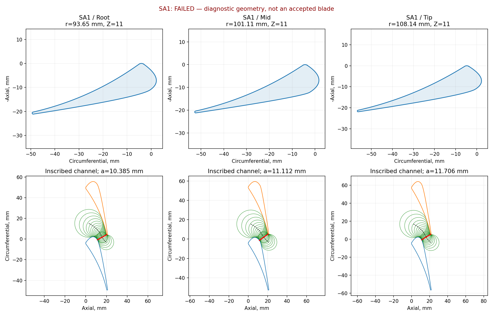
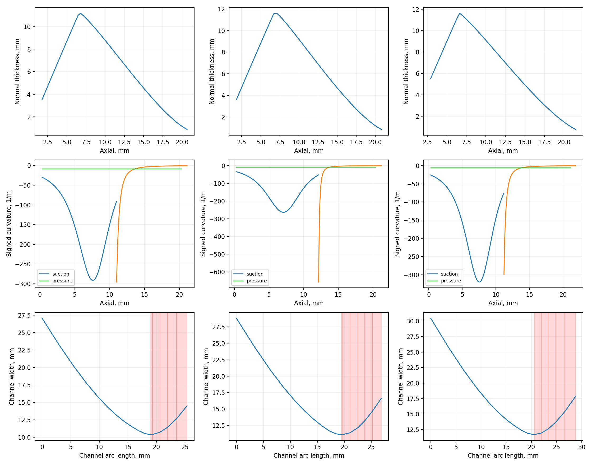
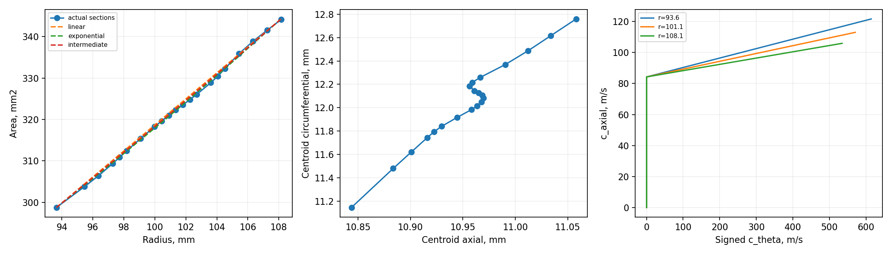
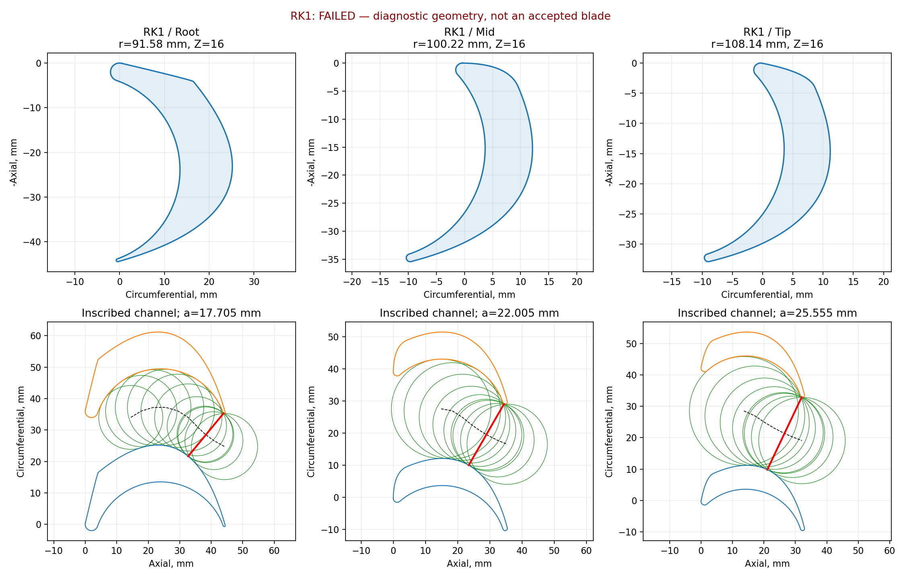
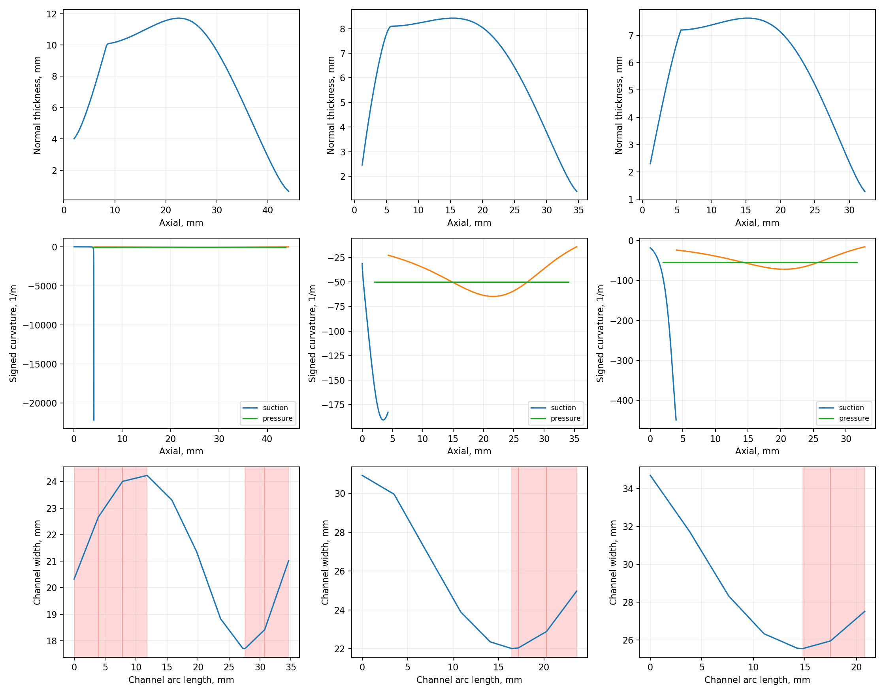
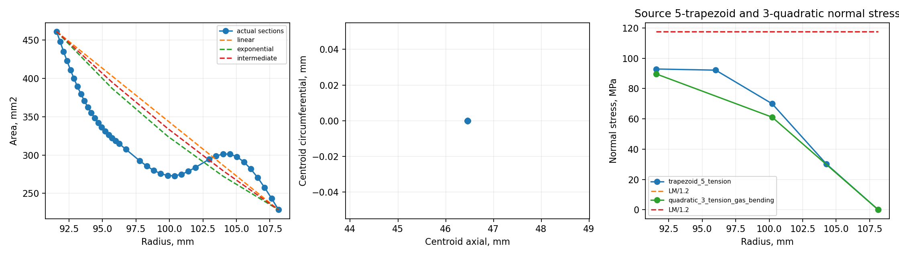
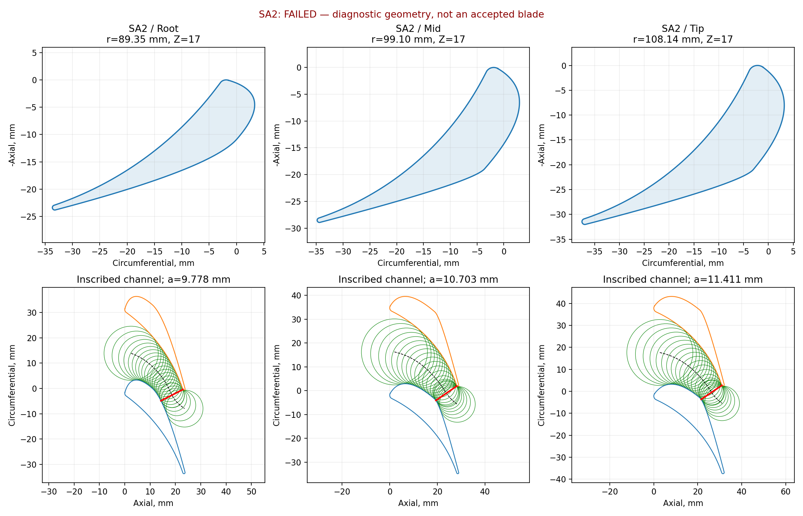
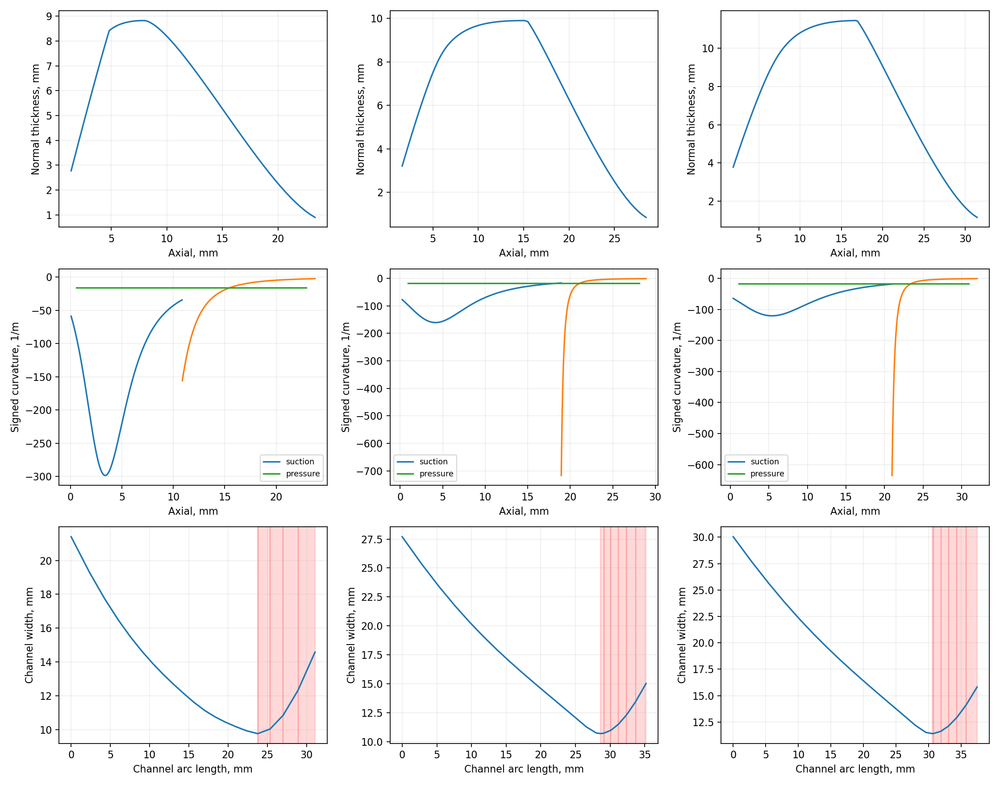
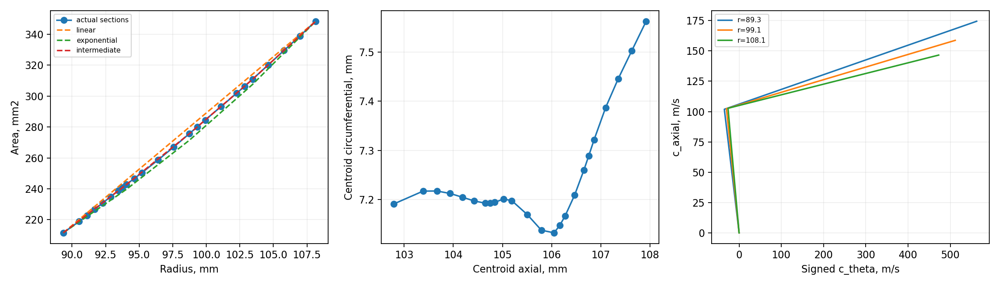
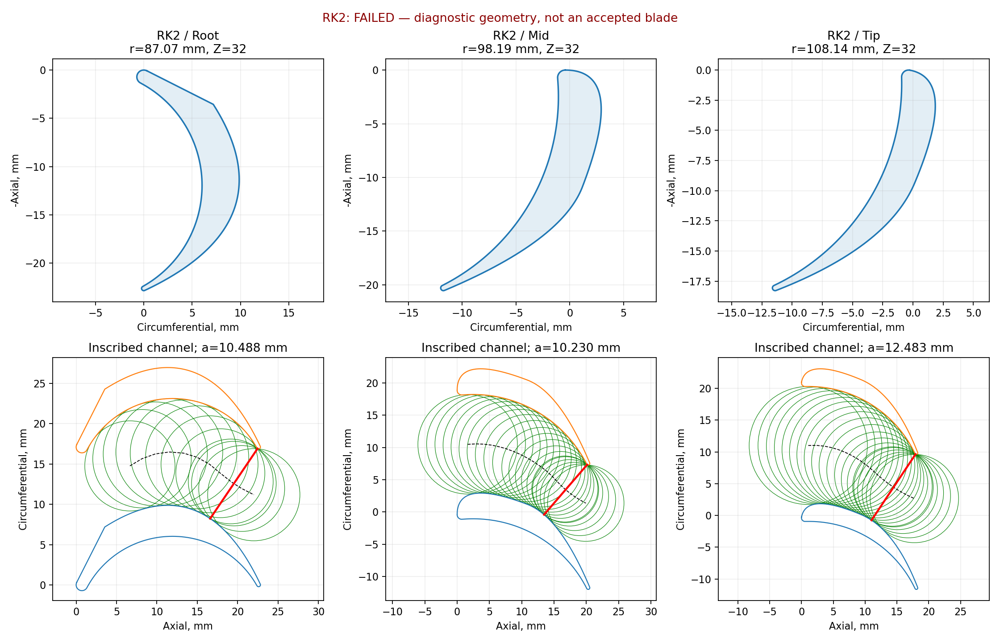
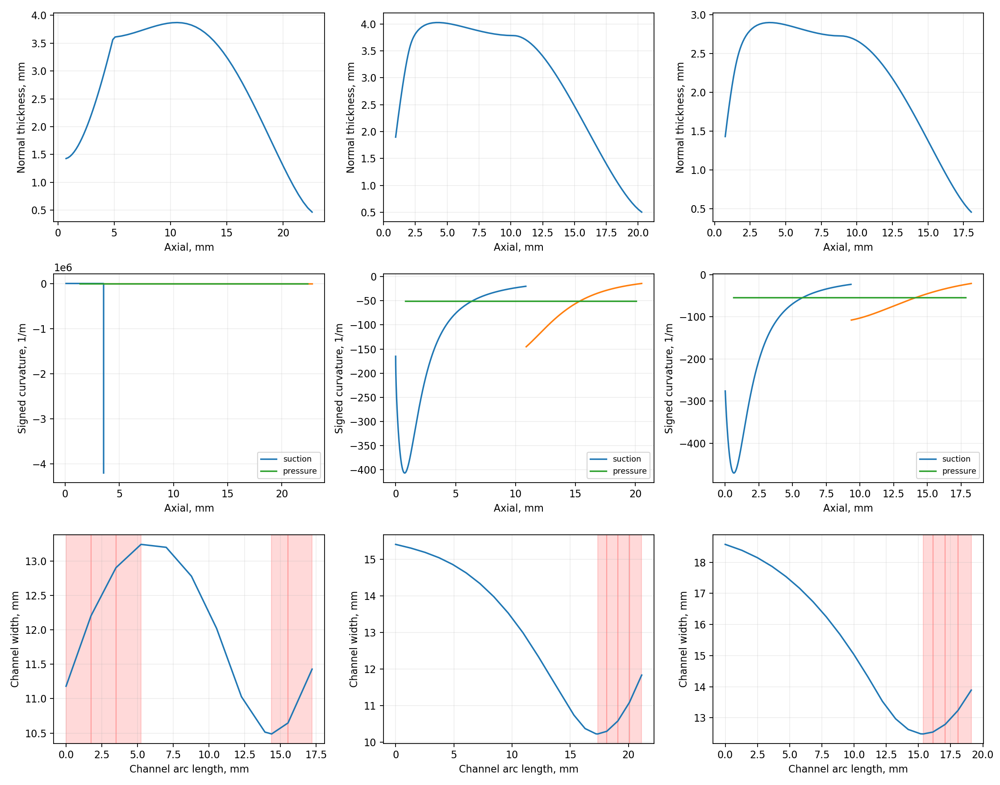
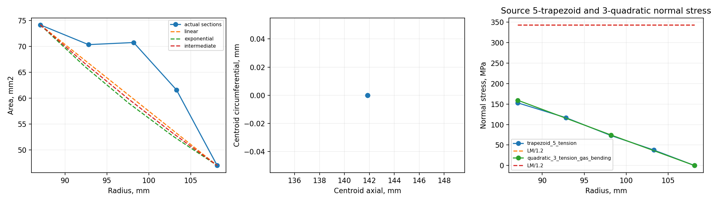
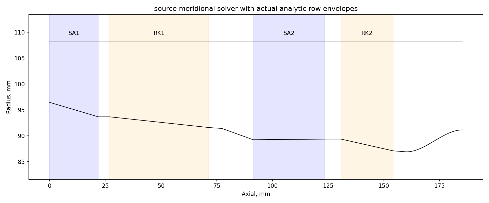
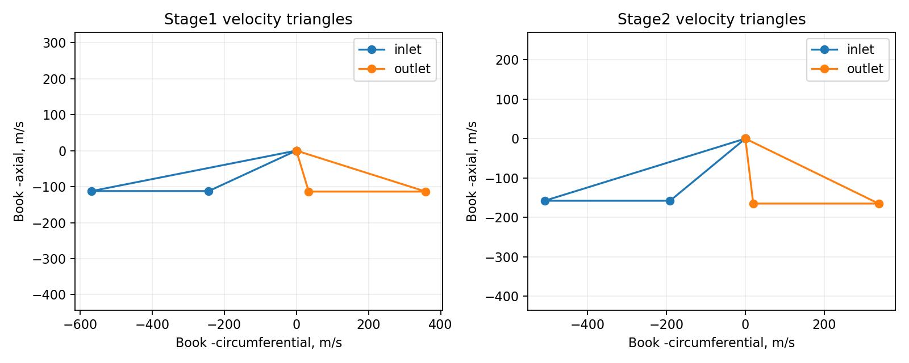
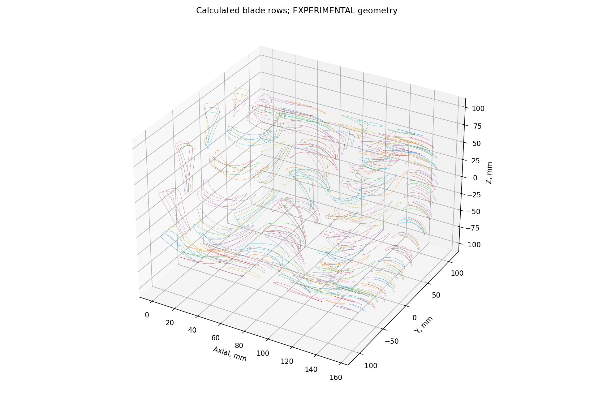

## Scope and missing physical evidence

- Geometry is not CFD/experimental proof of no separation or efficiency.
- Reynolds uses a documented air-viscosity proxy, not measured mixture transport.
- Source variable-cp thermodynamics and independent pressure-equilibrium audits are retained.
- IN738C/LM data are preliminary, not certified supply allowables.
- HCF NOT_CHECKED: grade-specific fatigue curve, forcing and damping are unavailable.
